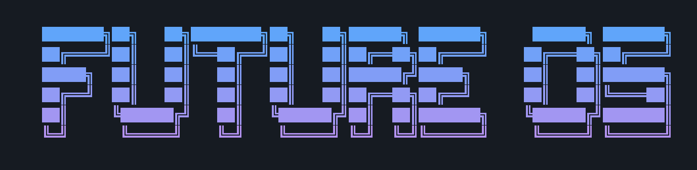
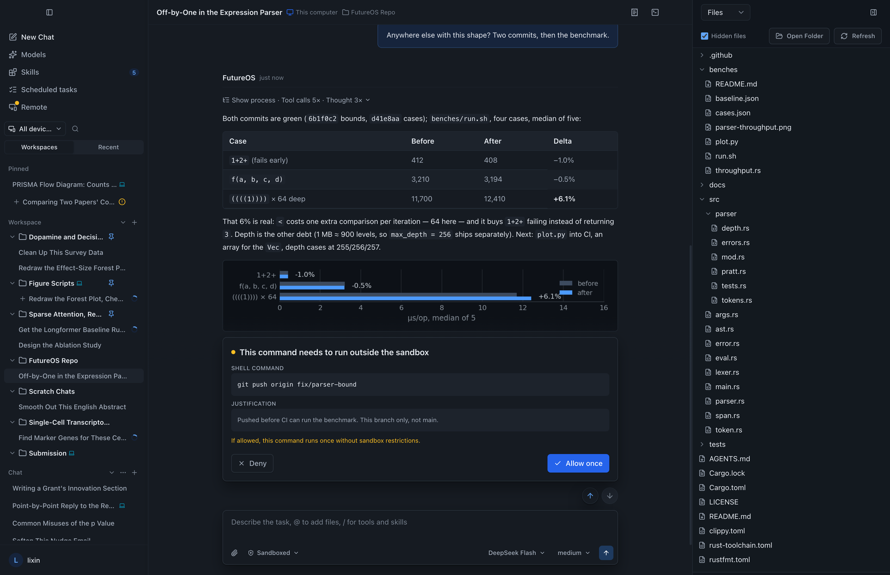
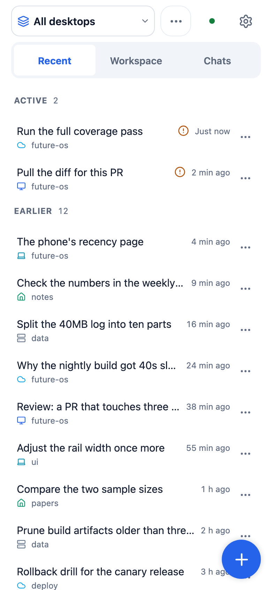
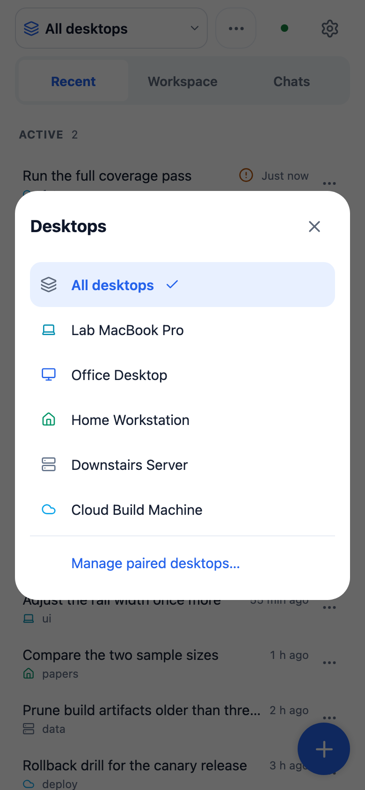
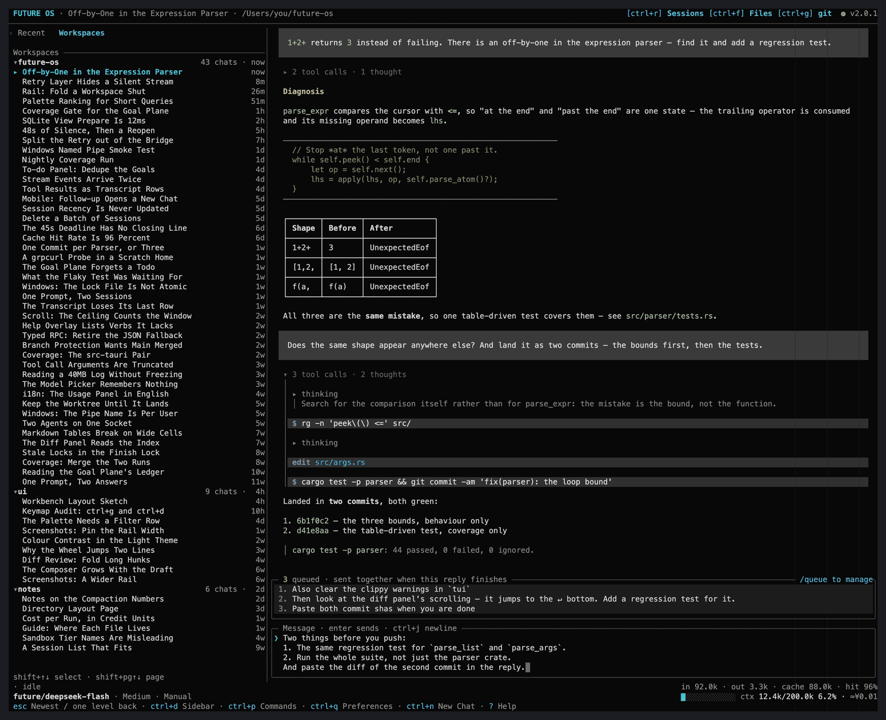

<p align="center">
  
</p>

<h3 align="center">One AI agent, everywhere you work.</h3>
<p align="center">
  Terminal, desktop, mobile, and your chat apps — one Rust core, one agent.<br>
  Configurable approvals and OS sandboxes. Local-first. Open source.
</p>

<p align="center">
  
</p>

<p align="center">
  <a href="#quick-start">Quick Start</a> •
  <a href="#features">Features</a> •
  <a href="#configure-a-model">Models</a> •
  <a href="#troubleshooting">Troubleshooting</a>
</p>

<p align="center">⭐ If FutureOS is useful to you, a star helps others find it.</p>

<p align="center">
  
  <a href="https://github.com/futuregene/future-os/blob/main/THIRD_PARTY_NOTICES.md"></a>
  <a href="README.zh-CN.md"></a>
</p>

---

## Why FutureOS

- **Choose the execution boundary.** File-access approvals and OS sandboxing for agent tools, in four tiers: `off`, `manual`, `sandbox` — and **`auto`**, the sandbox with the model reviewing the requests that would otherwise interrupt you. The desktop starts at Unrestricted (`off`); switch to Manual, Sandboxed or `auto` before working with untrusted content. See the [security model](SECURITY.md) and [sandbox guide](docs/wiki/en/Sandbox.md) for defaults and limitations.
- **One backend, every surface.** A single gRPC agent drives the terminal UI, desktop app, mobile apps, CLI, and IM bots — same sessions, same memory, same skills, wherever you happen to be.
- **Long runs need engineering, not prompting.** The built-in goal control plane gives durable goals, event-sourced state, and verification gates to runs of 24+ hours — start a research task at night, review the results from your phone in the morning.

## Features

| Category | Details |
|---|---|
| **Run anywhere, reach it anywhere** | The agent is one binary that fits wherever the work is — an **embedded board, a phone, a workstation, a GPU server, a cluster** — and every surface reaches it: terminal UI, desktop app, mobile apps (Android & iOS), CLI and IM bots — all on the same sessions, the same memory and the same skills. Pair as many machines as you like — the phone reaches every one of them; the phone↔host channel is **end-to-end encrypted** (Noise handshake, ChaCha20-Poly1305 records), and the relay can be **self-hosted** (`future relay init` / `future relay serve`), so only ciphertext passes through it ([host mode](docs/guide/desktop-host.md), [remote](docs/wiki/en/Remote.md), [relay](docs/guide/self-hosted-relay.md)) |
| **Terminal UI (TUI)** | A full-screen workbench in the terminal, not a chat log: a session rail (a merged recent list or the workspace tree, foldable), a transcript that folds a reply's process into `▸ 3 tool calls · 2 thoughts` and opens it as a tree, side panels (to-do, usage, skills, files, git), a command palette, mouse selection, drag-resizable panels, six colour palettes, and a queue band for prompts typed mid-reply ([guide](docs/guide/tui.md)) |
| **One phone, many desktops** | The mobile app pairs with several desktops at once: one **recent list merged across them**, each row carrying the machine it lives on, a picker to switch machines, and the ability to take control of a session from the phone while the desktop keeps working ([remote](docs/wiki/en/Remote.md)) |
| **Configurable Tool Safety** | read, write, edit, shell — approval rules and tiers (`off` / `manual` / `sandbox`, plus `auto` = sandbox with model review of the requests that would have asked, on a FutureOS sign-in); macOS Seatbelt, Linux system Bubblewrap, Windows restricted-token write protection. Availability and guarantees differ by platform ([guide](docs/wiki/en/Sandbox.md)) |
| **Model Flexibility** | **Bring your own key**: the [built-in catalog](docs/wiki/en/Models.md) covers the major providers, and any OpenAI- or Anthropic-compatible endpoint can be added through `models.json`. Or sign in to the **FutureOS provider** (`future auth login`) and have the keys and model list provisioned for you. Both work side by side, and you choose which models the picker offers ([setup](#configure-a-model)) |
| **Goal Engineering** | Durable goals/todos/gates/monitors for long-horizon runs of 24+ hours — deterministic should-run kernel, event-sourced state, hard checks (evidence floor / acceptance contracts / verify gates), lease liveness, multi-agent ([guide](docs/architecture/goal-control-plane.md)) |
| **Scheduled Tasks** | Recurring work without you in the loop: a reusable prompt + working directory + model/thinking level, run at full permission on a schedule (interval / daily / weekly / monthly / yearly, or a single date) — and on demand whenever you want. Every run is an ordinary conversation plus a run ledger with status, result summary and prompt-version history ([guide](docs/architecture/tasks.md)) |
| **Powerful Built-in Skills** | 15+ skills out of the box for everyday agent work — image read & generation, PDF/Word parsing, web search, browser control, slides, software install, and the `/future-goal` long-run goal orchestrator ([builtin](https://github.com/futuregene/future-skills/tree/main/builtin)) |
| **Forkable Sessions** | Branch any conversation like a repo — fork, clone, and tree navigation over JSONL session history |
| **Rust Core** | Agent, IM channel bridge, goal control plane, CLI, and TUI are all written in Rust — high performance with memory safety |

<p align="center">
  
  &nbsp;&nbsp;&nbsp;&nbsp;
  
</p>
<p align="center"><sub><b>One phone, many desktops</b> — every conversation on every machine you paired, in one list.</sub></p>

## Quick Start

### Install

One line, no source build required:

**macOS / Linux** — one script, auto-detects the platform: macOS gets the official signed app (arm64 / Intel); Linux gets the `.deb` on Debian/Ubuntu (desktop app + unified `future` CLI) or the portable tarball everywhere else:

```bash
curl -fsSL https://dl.future-os.cn/install.sh | bash
```

**Windows** (PowerShell) — runs the signed installer silently:

```powershell
iex (irm https://dl.future-os.cn/install.ps1)
```

Step-by-step installation for every platform (desktop app, toolchains, GUI
packaging) is in the **[Build & Install](docs/guide/build-and-install.md)** guide.

### Configure a model

The agent needs at least one model provider before it can answer.

**FutureOS hosted models** — device-flow sign-in provisions keys and a model list automatically:

```bash
future auth login
```

This works whether or not the agent is running: with the agent up the key is
applied live; without it the key is written to `~/.future/agent/auth.json`
and picked up when the agent starts.

<details>
<summary><strong>Prefer your own keys? (BYOK &amp; custom providers)</strong></summary>

**Use a known provider.** Put your API key in `~/.future/agent/auth.json`, keyed by provider name. See the [built-in model catalog](docs/wiki/en/Models.md) — most providers have built-in base URLs and auto-discover their models:

```json
{
  "openai": { "type": "api_key", "key": "sk-..." }
}
```

For providers with user-specific base URLs (e.g. Azure's `YOUR_RESOURCE`), add a `baseUrl` field in `auth.json`:

```json
{
  "azure": { "type": "api_key", "key": "sk-...", "baseUrl": "https://my-resource.openai.azure.com/openai/v1" }
}
```

**Custom provider.** For providers not in the built-in catalog, specify everything in `~/.future/agent/models.json`:

```json
{
  "providers": {
    "my-provider": {
      "apiKey": "sk-...",
      "baseUrl": "https://my-api.example.com/v1",
      "models": [
        { "id": "my-model", "name": "My Model", "contextWindow": 128000, "maxTokens": 16384 }
      ]
    }
  }
}
```

Many self-hosted endpoints accept only some thinking levels (often just `low`/`high`). Declare the ones your model accepts with `thinkingLevels` — provider-level as the default, overridable per model. Leave it out and all six levels are offered (`off`/`minimal`/`low`/`medium`/`high`/`xhigh`); a model marked `reasoning: false` offers `off` alone. Pickers list only the declared levels, and a stored level outside the list snaps to the nearest one by depth — a tie goes to the shallower level, so the run never spends more than the level you asked for:

```json
{
  "providers": {
    "my-provider": {
      "apiKey": "sk-...",
      "baseUrl": "https://my-api.example.com/v1",
      "thinkingLevels": ["off", "low", "high"],
      "models": [{ "id": "my-model" }]
    }
  }
}
```

</details>

### Run the Agent, then the terminals

The terminal and CLI clients are thin gRPC clients. They connect over
**per-user local IPC** by default (a Unix-domain socket on macOS/Linux,
a current-user-only named pipe on Windows). The endpoint always lives under the
instance's FutureOS home: `~/.future/run/agent.sock` by default, or
`<FUTURE_HOME>/run/agent.sock` for an instance started with its own home — see
[isolated instances](docs/guide/directory-layout.md#running-several-isolated-instances-future_home).
If the FutureOS home sits on a filesystem that cannot host Unix sockets (e.g.
NFS), point `FUTURE_HOME` at a directory on a local filesystem.

**The Agent belongs to its host, not to the terminal.** Start a host first — it
owns the Agent and keeps it running:

```bash
future host      # this machine as a FutureOS host: local runs, tasks, and paired remote desktops
```

If a phone or another desktop should reach this machine, sign in **before** that
command and pair the device — otherwise `future host` serves local work only:

```bash
future auth login           # the FutureOS account that pairs your devices
future remote devices add   # print the invitation a phone or another desktop types in
```

That sign-in is for the **official relay**. If you run your own relay instead
(`--relay URL`), no account is involved and `future auth login` is not needed —
see [self-hosted relay](docs/guide/self-hosted-relay.md).

`future host` needs **no sign-in** for local work: without an account it serves
everything locally with your own model providers. The paired remote desktops
above stay closed until `future auth login` has run — it may also happen later,
in another terminal, and the host picks the account up without a restart.
`--relay URL` skips the Future platform entirely; run your own relay instead
([self-hosted relay](docs/guide/self-hosted-relay.md)).

Desktop GUI and host mode first attach to a compatible external Agent; when the
default endpoint is absent and its instance lock is free, they run the complete
Agent in their own process. Incompatible or locked/unavailable services produce
an error without starting a second Agent.

Quitting an embedded Desktop stops work from every connected client, including
CLI/TUI conversations. An attached external Agent stays running; Desktop cancels
its own submitted runs. See [Desktop Agent lifecycle and recovery](docs/guide/desktop-agent.md).

Then launch the terminal UI from the same `future` command:

```bash
future tui       # terminal UI
```

The TUI only ever **attaches** to a serving Agent: it never starts or restarts
one. With no Agent reachable it says so and names the command to run
(`future host`, the desktop app, or `future agent`), and if the Agent it was
attached to goes away it keeps reconnecting and showing that state instead of
bringing a replacement up. So you can open **as many terminals as you like**
against one host — and closing one leaves the Agent and the other terminals
untouched.

Published builds check for updates once in the background after TUI startup.
A newer version is shown as a local notice with the official installer link;
nothing is installed automatically. Release builds check the release channel,
and test/nightly builds check nightly. Local/source builds skip the check.
Network failures are silent; `future tui --offline` disables the check, and
non-interactive commands never perform it.

<p align="center">
  
</p>

> `future <cmd>` is the unified entry point for every Rust component: `future agent`,
> `future tui`, `future channel`, `future goal`. Each runs the same code as the
> standalone binary of the same name (the `future-*` binaries still exist as
> build targets — `cargo build -p future-tui` etc. — but are no longer
> installed by default).
>
> If connection fails, check Agent discovery, compatibility and instance ownership — see [Troubleshooting](#troubleshooting).

## Troubleshooting

| Symptom | Fix |
|---|---|
| TUI says no Agent is serving and exits | Start the Agent's host first — `future host` (or the desktop app, or `future agent`). The TUI only attaches; it never starts one. |
| Client exits with a connection / gRPC error | Run `future doctor`; check Agent startup/version/lock errors and that client/Agent use the same user and IPC environment. See the [Desktop Agent guide](docs/guide/desktop-agent.md) before changing service ownership. Only in explicit TCP mode, check the configured address/port. |
| Agent replies with an auth / "no model" error | No model configured yet — see [Configure a model](#configure-a-model). |
| Build / install problems | See [Build & Install](docs/guide/build-and-install.md) (platform toolchains, linker, GUI packaging). |

## Community

[💬 Discussions](https://github.com/futuregene/future-os/discussions) • [🐛 Issues](https://github.com/futuregene/future-os/issues) • [🔒 Security](SECURITY.md) • [📖 Wiki](https://github.com/futuregene/future-os/wiki) • [Third-Party Notices](THIRD_PARTY_NOTICES.md)
