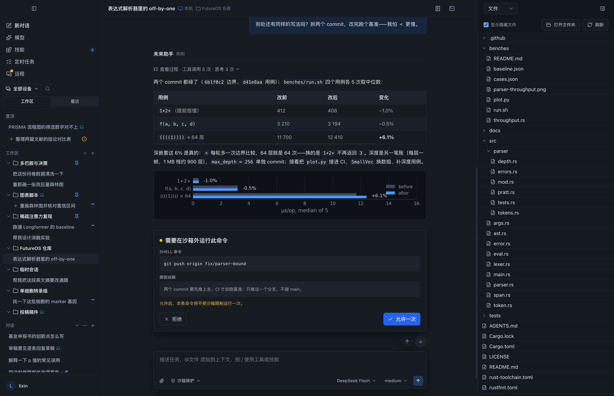
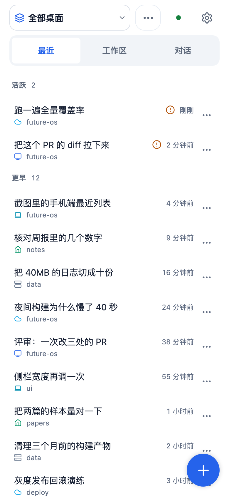
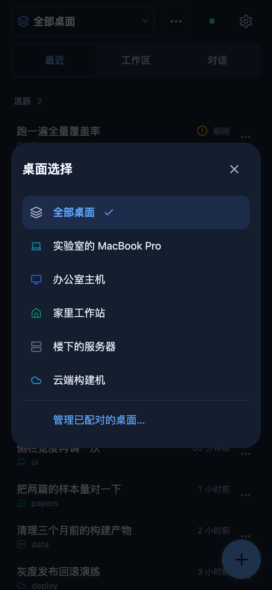
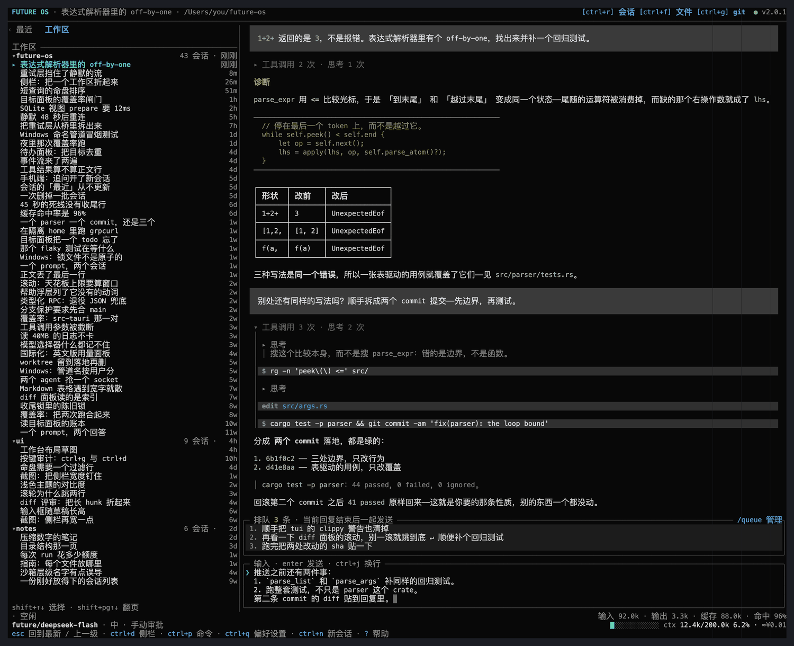

<p align="center">
  
</p>

<h3 align="center">同一个 AI Agent，处处随你。</h3>
<p align="center">
  终端、桌面、手机、飞书与钉钉——一个 Rust 核心，一个 Agent。<br>
  可配置审批与 OS 沙箱。本地优先。开源。
</p>

<p align="center">
  
</p>

<p align="center">
  <a href="#快速开始">快速开始</a> •
  <a href="#特性">特性</a> •
  <a href="#配置模型">模型</a> •
  <a href="#常用斜杠命令tui">命令</a> •
  <a href="#故障排查">故障排查</a>
</p>

<p align="center">⭐ 如果 FutureOS 对你有用，点个 Star 帮助更多人发现它。</p>

<p align="center">
  
  <a href="https://github.com/futuregene/future-os/blob/main/THIRD_PARTY_NOTICES.md"></a>
  <a href="README.md"></a>
</p>

---

## 为什么是 FutureOS

- **选择执行边界。** 为 Agent 工具配置文件访问审批与 OS 沙箱。桌面默认是不受限（`off`）；处理不可信内容前，请切换为手动或沙箱模式。默认值和限制见[安全模型](SECURITY.md)与[沙箱指南](docs/wiki/zh/Sandbox.md)。
- **一个后端，所有界面。** 同一个 gRPC Agent 驱动终端界面、桌面应用、移动端、CLI 和 IM 机器人——同一份会话、同一份记忆、同一套技能，无论你身在何处。
- **长任务靠工程，不靠提示词。** 内置 goal 控制面为 24 小时以上的任务提供持久化目标、事件溯源状态与验证门控——晚上布置一个调研任务，早上在手机上验收结果。

## 特性

| 类别 | 说明 |
|---|---|
| **哪里都能跑，哪里都能接** | Agent 是一个二进制，能跑在活儿所在的任何地方——**嵌入式板子、手机、工位上的桌面机、GPU 服务器、集群**；而接它的界面同样是全的：终端界面、桌面应用、移动端（Android · iOS）、命令行与 IM 机器人——共享同一份会话、同一份记忆、同一套技能。配对多少台机器都行——手机够得着其中每一台；手机与主机之间的通道是**端到端加密**的（Noise 握手 + ChaCha20-Poly1305 记录），中继还可以**自建**（`future relay init` / `future relay serve`），所以中继上只会经过密文（[主机模式](docs/guide/desktop-host.zh-CN.md)、[远程](docs/wiki/zh/Remote.md)、[自建中继](docs/guide/self-hosted-relay.zh-CN.md)） |
| **终端界面 (TUI)** | 终端里的全屏工作台，不是聊天记录：会话列表（「最近」合并列表或按工作区分组的树，可折叠）、把一轮回复的过程折成 `▸ 工具调用 3 次 · 思考 2 次` 并能展开成树的正文、侧边面板（待办、用量、技能、文件、git）、命令面板、鼠标选取、可拖拽的栏宽、六套配色、回复进行中输入时用的排队带——整个界面支持**中文或英文**，跟随系统或 `/lang`（[指南](docs/guide/tui.md)） |
| **一部手机，多台桌面** | 移动端可以同时配对多台桌面：把它们合并成**一条最近列表**，每行标出所在的机器，用选择面板切换机器，还能在桌面上继续干活的同时从手机接管某条会话（[远程](docs/wiki/zh/Remote.md)） |
| **可配置工具安全** | read, write, edit, shell——审批规则与分级（`off` / `manual` / `sandbox`，以及 `auto` = 沙箱 + 由模型复核本会询问的请求，需登录 FutureOS）；支持 macOS Seatbelt、Linux 系统 Bubblewrap、Windows 受限令牌写保护。各平台可用性与保护范围不同（[指南](docs/wiki/zh/Sandbox.md)） |
| **模型灵活** | **自带 API Key（BYOK）**：[内置目录](docs/wiki/zh/Models.md)覆盖主流 Provider，任何 OpenAI 或 Anthropic 兼容端点都可通过 `models.json` 接入。也可以登录 **FutureOS 托管 Provider**（`future auth login`），由平台直接配好 Key 与模型列表。两者可同时使用，并自行限定选择器里出现的模型（[配置](#配置模型)） |
| **Goal 工程** | 持久化目标/todos/门禁/监控，支撑 24+ 小时长程任务连续执行——确定性 should-run 内核、事件溯源状态、硬校验（证据下限/验收契约/verify 闸门）、租约活性自愈、多 agent（[指南](docs/architecture/goal-control-plane.zh-CN.md)） |
| **定时任务** | 不用盯着也会跑：可复用的提示词 + 工作目录 + 模型/思考等级，按计划（每隔 N 分钟 / 每天 / 每周 / 每月 / 每年，或指定某一天）以完全权限自动运行，也可以随时手动立即运行。每次运行都是一条普通会话，并留下运行台账——状态、结果摘要与提示词版本历史（[指南](docs/architecture/tasks.zh-CN.md)） |
| **强大的预设技能** | 内置 15+ 技能开箱即用，覆盖日常 Agent 场景——图片读取与生成、PDF/Word 解析、网页搜索、浏览器控制、幻灯片与软件安装，以及 `/future-goal` 长程目标编排器（[builtin](https://github.com/futuregene/future-skills/tree/main/builtin)） |
| **可分支会话** | 像仓库一样为对话开分支——fork、clone、树形导航，JSONL 存储 |
| **Rust 核心** | Agent、IM 渠道桥、goal 控制面、CLI 与 TUI 均用 Rust 编写——高性能、内存安全 |

<p align="center">
  
  &nbsp;&nbsp;&nbsp;&nbsp;
  
</p>
<p align="center"><sub><b>一部手机，多台桌面</b>——所有配对机器上的对话，都在这一条列表里。</sub></p>

## 快速开始

### 安装

一行命令，无需源码构建：

**macOS / Linux** — 同一脚本自动识别平台：macOS 安装官方签名应用（自动识别 arm64 / Intel）；Debian/Ubuntu 安装 `.deb`（桌面应用 + 统一 `future` CLI），其他 Linux 安装便携版压缩包：

```bash
curl -fsSL https://dl.future-os.cn/install.sh | bash
```

**Windows**（PowerShell）— 静默运行签名安装程序：

```powershell
iex (irm https://dl.future-os.cn/install.ps1)
```

各平台（桌面应用、工具链、GUI 打包）的分步安装步骤见
**[构建与安装](docs/guide/build-and-install.zh-CN.md)** 文档。

安装脚本最后会自动执行 `future init`。

两个脚本都会在安装前用发布清单里的 SHA-256 核对下载到的产物，用
`FUTUREOS_VERSION` 固定某个版本时也一样（读取该版本自己的 `latest.json`）。
核对不上的产物——清单缺失、平台没有 `sha256`，或主机既无 `shasum` 也无
`sha256sum`——会被拒绝安装，而不是未经校验就装上。只有
`FUTUREOS_SKIP_VERIFY=1`（Windows 为 `$env:FUTUREOS_SKIP_VERIFY = '1'`）会关掉该校验，
那意味着镜像给什么就装什么。

### 配置模型

Agent 至少需要配置一个模型提供商才能回复。交互式配置同时支持 FutureOS 和自定义 Provider：

```bash
future config
```

**FutureOS 托管模型** —— 设备码登录会自动配好 key 和模型列表：

```bash
future auth login
```

无论 agent 是否在运行都可以执行：agent 在线时 key 立即生效；未运行时 key 会写入 `~/.future/agent/auth.json`，agent 启动时自动读取。

<details>
<summary><strong>想用自己的 API key？（BYOK 与自定义 Provider）</strong></summary>

**使用已知 Provider。** 将 API Key 放入 `~/.future/agent/auth.json`，按 Provider 名索引。查看[内置模型目录](docs/wiki/zh/Models.md)——多数 Provider 自带 Base URL，模型自动发现：

```json
{
  "openai": { "type": "api_key", "key": "sk-..." }
}
```

对于 Base URL 含用户特定值的 Provider（如 Azure 的 `YOUR_RESOURCE`），在 `auth.json` 中添加 `baseUrl` 字段：

```json
{
  "azure": { "type": "api_key", "key": "sk-...", "baseUrl": "https://my-resource.openai.azure.com/openai/v1" }
}
```

**自定义 Provider。** 不在内置目录中的 Provider，在 `~/.future/agent/models.json` 中指定完整信息：

```json
{
  "providers": {
    "my-provider": {
      "apiKey": "sk-...",
      "baseUrl": "https://my-api.example.com/v1",
      "models": [
        { "id": "my-model", "name": "My Model", "contextWindow": 128000, "maxTokens": 16384 }
      ]
    }
  }
}
```

模型只支持部分思考等级时（不少自建服务只认 `low`/`high`），用 `thinkingLevels` 声明它接受的档位——provider 级作默认，model 级覆盖；不写就是全部六档（`off`/`minimal`/`low`/`medium`/`high`/`xhigh`），`reasoning: false` 的模型只有 `off`。选择器只列出声明过的档位，存量的档位不在其中时会按深度就近吸附（距离相同时取更浅的一档，不会比你选的更费 token）：

```json
{
  "providers": {
    "my-provider": {
      "apiKey": "sk-...",
      "baseUrl": "https://my-api.example.com/v1",
      "thinkingLevels": ["off", "low", "high"],
      "models": [{ "id": "my-model" }]
    }
  }
}
```

</details>

### 启动主机，再启动终端

终端与 CLI 客户端都是轻量 gRPC 客户端，默认使用**每用户本地 IPC**（macOS/Linux 为 Unix socket，Windows 为仅当前用户可访问的命名管道）。Unix 优先使用 `FUTURE_AGENT_SOCKET`；否则端点始终位于实例的 FutureOS home 之下：默认 `~/.future/run/agent.sock`，`FUTURE_HOME=DIR` 指定的实例使用 `<FUTURE_HOME>/run/agent.sock`——见[多实例运行](docs/guide/directory-layout.zh-CN.md#多实例运行future_home)。若 FutureOS home 位于无法承载 Unix socket 的文件系统（如 NFS），请将 `FUTURE_HOME` 指向本地文件系统上的目录。

**Agent 由它的宿主负责，不由终端负责。** 先启动一个宿主——它会持有并维持 Agent：

```bash
future host       # 把本机作为 FutureOS 主机：本地运行、定时任务，以及已配对的远程桌面
```

如果要从手机或另一台桌面接入这台机器，请在**上面那条命令之前**登录，并把设备配对好——否则 `future host` 只提供本地能力：

```bash
future auth login           # 用来配对设备的 FutureOS 账号
future remote devices add   # 打印邀请，供手机或另一台桌面输入
```

`future host` 做本地工作**不需要先登录**：没有账号时它用你自己的模型 provider 提供全部本地能力，上面那些已配对的远程桌面会一直保持关闭，直到执行过 `future auth login`——这一步也可以稍后在另一个终端做，主机会无需重启就接管；`--relay URL` 则完全绕开 Future 平台——直接自建中继，见[自建中继](docs/guide/self-hosted-relay.zh-CN.md)。桌面 GUI 与主机模式先尝试连接兼容的外部 Agent；默认端点上没有服务且其实例锁空闲时，它们在自己的进程内运行完整 Agent；不兼容或锁被占用/不可用时直接报错，不会另起第二个 Agent。

退出内置 Agent 的 Desktop 会停止所有客户端的任务，包括 CLI/TUI 对话；连接外部 Agent 时只取消本 Desktop 提交的运行，外部服务保持存活。详见 [Desktop Agent 生命周期与恢复](docs/guide/desktop-agent.zh-CN.md)。

然后用同一个 `future` 命令启动终端界面：

```bash
future tui        # 终端界面
```

TUI **只连接**正在提供服务的 Agent，自己从不启动或重启 Agent。没有可达的 Agent 时它会说明这一点并给出该执行的命令（`future host`、桌面应用或 `future agent`）；若它连上的 Agent 之后消失，它只会继续重连并显示该状态，而不会另起一个。因此**可以同时开任意多个终端**连接同一个宿主——关掉其中一个不会影响 Agent 和其它终端。

正式发布的构建会在 TUI 启动后于后台检查一次更新：发现新版本时仅在本地提示
并给出官方安装脚本链接，不会自动安装。release 构建检查 release 通道，
test/nightly 构建检查 nightly；本地/源码构建跳过检查。网络失败静默忽略；
`future tui --offline` 关闭该检查，非交互命令从不执行检查。

> **远程 / 开发模式：**给 `future agent` 传入 `--grpc-addr 127.0.0.1:50051` 可显式启用 TCP；客户端设置 `FUTURE_AGENT_GRPC_ADDR=127.0.0.1:50051`。TCP 非默认，不要暴露到不可信网络。

<p align="center">
  
</p>

> `future <cmd>` 是所有 Rust 组件的统一入口：`future agent`、`future tui`、
> `future channel`、`future goal`。每个都运行与同名独立二进制完全相同的代码
> （`future-*` 二进制仍是构建目标，可用 `cargo build -p future-tui` 等构建，
> 但已不再默认安装）。
>
> 若连接失败，检查 Agent 发现、兼容性和实例所有权——见 [故障排查](#故障排查)。

### 常用斜杠命令（TUI）

| 命令 | 说明 |
|---|---|
| `/help` | 显示所有命令和快捷键 |
| `/model [name]` | 选择 / 切换模型 |
| `/new` | 新建会话 |
| `/sessions` | 浏览和切换会话 |
| `/tree` | 会话树（含 fork/clone 层级） |
| `/fork` | 从指定消息分叉 |
| `/clone` | 克隆当前会话 |
| `/name <name>` | 设置会话名称 |
| `/scoped-models` | 配置模型启用/禁用列表 |
| `/compact` | 压缩对话上下文 |
| `/status` | 会话状态、token 用量、费用 |
| `/stop` | 中断当前生成 |
| `/cancel <run-id>` | 取消排队中的运行 |
| `/cwd <dir>` | 切换工作目录 |
| `/approve <request-id>` | 批准待执行的工具调用 |
| `/reject <request-id>` | 拒绝待执行的工具调用 |
| `/reload` | 重新加载技能与上下文文件 |
| `/skills` | 浏览、安装与管理技能 |
| `/providers` | 配置 provider 与模型 |
| `/theme [id]` | 切换配色主题 |

在 TUI 中运行 `/help` 查看完整列表（40+ 命令）。

### 键盘快捷键（TUI）

| 按键 | 功能 |
|---|---|
| `ctrl+c` | 停止当前运行（没有 run 在跑时什么都不做） |
| `ctrl+x` | 退出 |
| `ctrl+n` | 新会话 |
| `ctrl+r` | 会话列表 |
| `ctrl+d` | 侧栏：显示 / 聚焦 / 隐藏 |
| `ctrl+p` | 命令面板 |
| `ctrl+o` | 模型选择器 |
| `ctrl+t` | 思考强度 |
| `ctrl+s` | 审批模式 |
| `ctrl+l` | 工作区 |
| `ctrl+f` | 文件面板 |
| `ctrl+g` | git 浏览 |
| `ctrl+e` | 过程展示：只留回答 / 全部过程 |
| `ctrl+v` | 粘贴剪贴板（图片或文本） |
| `ctrl+q` | 偏好设置（内含快捷键编辑） |
| `?` | 帮助：当前实际生效的按键 |
| `enter` | 发送——运行期间排到当前 run 之后 |
| `ctrl+j` | 草稿换行 |
| `page up` / `page down` | 滚动对话 |
| `escape` | 关闭浮层；回到最新输出 |

全部都能在 `/preferences` 里改键，`?` 显示的永远是实际生效的那一套。

## 故障排查

| 现象 | 解决 |
|---|---|
| TUI 提示没有 Agent 提供服务并退出 | 先启动 Agent 的宿主——`future host`（或桌面应用、`future agent`）。TUI 只连接，从不自己启动。 |
| 客户端报连接 / gRPC 错误退出 | 运行 `future doctor`，检查 Agent 启动、版本、实例锁错误以及用户、数据根和 IPC 环境是否一致；更换服务前先看 [Desktop Agent 指南](docs/guide/desktop-agent.zh-CN.md)。仅在显式 TCP 模式下检查配置的地址/端口。 |
| Agent 回复鉴权 / "no model" 错误 | 还没配置模型。运行 `future config`——见 [配置模型](#配置模型)。 |
| 构建 / 安装问题 | 见 [构建与安装](docs/guide/build-and-install.zh-CN.md)（平台工具链、链接器、GUI 打包）。 |

## 社区

[💬 Discussions](https://github.com/futuregene/future-os/discussions) • [🐛 Issues](https://github.com/futuregene/future-os/issues) • [🔒 安全](SECURITY.md) • [📖 Wiki](https://github.com/futuregene/future-os/wiki) • [第三方声明](THIRD_PARTY_NOTICES.md)
