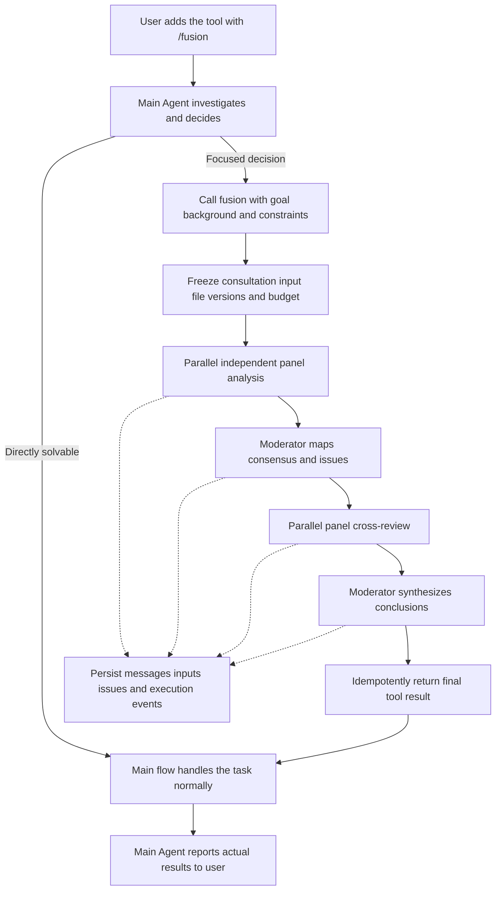

# Fusion development design

[中文](fusion.zh-CN.md)

Status: first tool implementation available with fixed development models. Design/implementation date: 2026-10-29.

Fusion is a multi-model thinking tool available to the main Agent. Its orchestration kernel lives in `orchestration/fusion`, alongside Goal and Tasks. Users add the `fusion` tool to the current main run with `/fusion`. The main Agent investigates and may submit a focused decision question. Internal read-only discussion returns a final conclusion, then the original main flow continues the user's task. Users can inspect the complete discussion separately.

Delivery requires desktop, mobile and terminal support, with hosts on Windows, macOS and Linux. Desktop alone is insufficient. The outer main flow retains `read / write / edit / shell`, adding `fusion` when requested. The inner moderator and panelists receive only `read / ls / glob / grep`.

## Current implementation and usage

The moderator is fixed to `future/deepseek-flash`. Panelists are `future/deepseek-flash`, `future/glm-5.3-flash` and `future/qwen3.7-plus`, the third selected from the live Future catalog with the user's confirmation. Missing models fail explicitly; no default-model substitution occurs.

Start Desktop or `future host`, then submit `/fusion <task>` from Desktop, Mobile or TUI. The main Agent receives a real run-scoped tool and decides when to consult on a focused question. The inner 3→1→3→1 protocol returns one final result and the original flow continues. Later ordinary runs do not inherit the tool. Expand the reply process and Fusion activity to inspect discussion, issues/conclusion, diagnostics and original evidence. TUI offers `/fusion-log [step-id]`; CLI offers `future fusion show <parent-session-id> [--run <id> --tool <id>] [--step <id>] [--offset <bytes>] --json`. Reads never invoke models.

The Host executor claims a bounded durable queue in `~/.future/fusion/fusion.db`, avoiding an Agent-to-Host crate dependency. The existing Host instance lock gives one executor, with at most two concurrent consultations. The Agent validates the leading token from the original submission and persists `ScheduledSettingsSnapshot.fusion_enabled` with the raw input/request key. Remote outboxes retain that original directive and key. No persistent session-tool setting is changed. Inner sessions carry `created_by=fusion`; each run forcibly receives only the four snapshot tools regardless of ordinary session configuration.

Only explicit, parent-authorized UTF-8 `read_scope` files are captured, once per consultation, with hashes shared across every round. Empty scope supports conceptual decisions. Escapes, links/reparse points, special files and oversized inputs fail. Limits are 1 MiB/file, 16 MiB total and 1024 files/directories. Capture timestamps and observed-change detection are recorded; this is not an atomic filesystem snapshot. Input/result limits are 48/32 KiB. Each completion is limited to 4096 output tokens and each step to five tool-loop turns. Each parent run admits at most two consultations; steps time out after 180 seconds, total waiting after 900 seconds, with at most two attempts per step. Completeness reflects actual full/partial/single participation.

The `fusion_runs/inputs/participants/steps/messages/issues/positions/events` tables store structure, inputs, state, references and diagnostics. Complete messages/tool evidence remain in Agent child transcripts. Previews are bounded; original transcripts use UTF-8 byte paging. Queries verify the parent, database source and step ownership. Restart interrupts unfinished consultations without automatic paid replay. Parent cancellation stops child work and fences late results. Deleting a parent stops/deletes linked children and removes its consultation/snapshot records. Offline `future data` backups include the Fusion database and snapshots. Archived reads remain valid after restoring the same Agent database; execution still requires the current restore identity.

Later sections retain the planned product contract. Editable model/thinking settings, dedicated redacted export, richer position-change records and monetary budgets remain future work; this development version uses fixed models plus token/count/time limits. Cross-system builds and unit regressions run in CI. See the [implementation verification record](../testing/fusion-implementation.md).

## Product boundaries

Fusion thinks, investigates, compares, discusses and proposes plans; it does not implement them. Inner models cannot modify the workspace, execute general commands, install dependencies, run tests, commit code or invoke external business actions. The trusted backend still writes the discussion database, logs, snapshots and caches without granting models write capabilities.

The outer main Agent owns interpretation, tool use, implementation, verification and the final reply. A Fusion call is one tool invocation inside that flow, not a replacement for the entire user request or a prerequisite for each write/command. Recommendations cannot expand user authorization. A request to implement continues naturally under existing permissions; an analysis-only request ends with analysis, without requiring an extra execution button.

Distinguish the outer main Agent from the inner Fusion moderator: one completes the user task, the other chairs a consultation. They may use the same model configuration but have separate contexts, runtime identities and permissions. Settings eventually select a moderator, panelists and thinking levels. Development fixes one moderator and three panelists through `future-fusion` constants, reusing existing model IDs and credential resolution without copying API keys.

Goal, Tasks and Fusion retain separate responsibilities. V1 enables the tool only through an explicit user `/fusion` request. Model-generated text, skills, files and schedulers cannot enlarge the tool catalog. Once enabled, the outer main Agent decides whether consultation is useful according to the task and tool description.

## Slash command and invocation choice

Submitting `/fusion <task>` adds `fusion` to that outer Agent run while the remaining text is an ordinary task. Availability does not force immediate invocation. Submitting `/fusion` alone sets a removable flag for the next task in that composer, without creating an empty run, invoking models or spending credits. Show “Fusion tool enabled.” Submission consumes the flag; subsequent ordinary messages do not inherit it. The current run's tool loop and interrupted recovery retain the same activation.

Non-interactive CLI calls without a composer must include the task in the same request. Bare `/fusion` returns missing-task usage, without an invisible pending flag affecting a later command.

All clients share command and submission-metadata semantics. Recognize only an independent leading `/fusion` token or an equivalent command-menu action. Quotes, code blocks, paths, `/fusion-other` and file contents do not activate it. Retain raw user input, normalized task and activation origin for audit. The current transport retains the original directive; the server derives and validates a run-scoped `fusion_enabled` snapshot and constructs the actual tool catalog. Prompt text alone and persistent `set_tools` changes are insufficient.

The main Agent may investigate with ordinary tools before consulting, or solve a simple task without calling Fusion. Honor explicit user instructions to require consultation or prohibit it; `/fusion` alone does not force a call. Do not create a fake discussion record or show completion when unused. V1 adds no separate mode, permanent conversation toggle or global default activation.

Consult when necessary facts exist, a substantive choice affects implementation direction, and independent perspectives could change the decision. Finding files, gathering basic facts, formatting, clear local fixes and routine corrections within an accepted plan remain in the main flow. Reuse conclusions for repeated questions without new evidence; do not consult before every command or file operation. Bound consultation count, time and cost per outer run; limits are ceilings, not targets.

## Fusion tool contract

### Tool description

The following is the semantic baseline for matching English and Chinese tool descriptions:

> Think through one explicit, narrowly focused decision with multiple models and return a synthesized conclusion. Fusion analyzes and discusses; it does not modify files, execute commands or implement the plan. Investigate first and provide the goal, background, confirmed facts, unknowns, constraints and relevant evidence needed to decide. Include candidate options and comparison criteria when useful. Do not delegate the entire task indiscriminately. Use it for substantive disagreements, important tradeoffs or independent cross-checking; handle routine investigation, directly solvable local issues and implementation in the main flow. When an action or verification is needed, propose its purpose, plan and expected outcome for the main flow to handle under user authorization. Do not substitute repeated discussion for investigation or verification.

### Inputs and focus

| Field | Requirement |
|---|---|
| `question` | Required: one principal decision, with scope and what must be decided |
| `goal` | Required: user objective and the outcome this decision should improve or satisfy |
| `background` | Required: relevant background, confirmed facts, unknowns and investigation, separating observations from assumptions |
| `constraints` | Required array: platform, compatibility, cost, scope and user limits; explicitly empty when none are additional |
| `options` | Optional candidate approaches and comparison criteria, without requiring agreement with a preferred answer |
| `evidence` | Optional file/line references, collected output and version references; externally dependent facts should have inspectable support |
| `read_scope` | Optional proposed read paths, intersected with existing parent authorization rather than expanding it |

Trusted backend code supplies parent source identity, parent run, tool call ID, model configuration, policy and budget. Models cannot supply credentials or override permissions. Do not copy the entire parent chat or workspace by default. Supply common material sufficient to understand this decision independently; missing decisive evidence remains an unknown or evidence request, not an invented fact.

```json
{
  "question": "Should v1 conversation full-text search use SQLite FTS or a separate index?",
  "goal": "Provide consistent search on desktop, mobile and terminal while minimizing migration complexity.",
  "background": "Agent SQLite owns bodies and shared services serve all clients. Storage entry points are located; large-data performance is unmeasured.",
  "constraints": ["Windows/macOS/Linux hosts", "Preserve deletion and recovery semantics"],
  "options": ["SQLite FTS", "Separate index"],
  "read_scope": ["agent/src/session", "host/src/agent_bridge"]
}
```

Program logic validates required fields, size, references and authorization. When meaning lacks a clear decision or key background, the moderator returns what must be supplied or narrowed rather than expanding into project redesign. Heuristics cannot prove semantic focus. The main Agent corrects the input, and the moderator separates findings affecting this decision from later work without expanding scope.

### Final result

The outer flow receives only the final result: `fusion_run_id`, status/completeness, `conclusion`, brief `rationale`, applicability `conditions`, `unresolved`, proposed `next_steps`, and discussion/evidence references. Raw messages, round reviews and tool outputs do not automatically enter parent model context. Users read them through separate detail queries; UI progress is not an additional tool result.

The result is decision material, not a new user instruction or execution queue. The main Agent may adopt, adapt or reject it under the original authorization, current facts and constraints. Before implementation, read the live workspace and recheck key facts. Correct local issues directly; reconsider consultation only when new evidence changes a key decision. Conclusions are not verification. The final reply separates discussion recommendations from actual execution results.

## Shared architecture

Follow the orchestration/host split in [Tasks](tasks.md) and the GUI-free service boundary in the [Host architecture](headless-package-development.md).

| Location | Responsibility |
|---|---|
| `orchestration/fusion`, crate `future-fusion` | Types, configuration snapshots, phase protocols, deterministic transitions, storage and discussion projections |
| `host/src/fusion` | Tool admission, inner orchestration, cancellation, recovery, queries, events and tool-result delivery |
| Agent | Run-scoped catalogs/tool adapter, isolated inner sessions, durable bodies/results and continuation of the ordinary main loop |
| Desktop and Mobile | `/fusion`, tool activity, discussion, disagreements, history and diagnostics |
| TUI and CLI | Equivalent terminal interactions and machine-readable output |
| RPC and Remote | Typed commands, paged reads, incremental events and capability negotiation |

`future-fusion` does not depend on Tauri, React or terminal rendering. One executor lives in the active shared Host; client disconnect does not transfer ownership. Reuse the Host instance lock and shutdown management rather than starting competing executors.

TUI and CLI connect to shared services. Mobile runs consultation on its paired Host, without copying the workspace or running panelists on the phone. An unavailable host produces an actionable error, never an ordinary answer labeled Fusion.

The Agent tool adapter depends on a neutral invocation interface or RPC implemented by Host, never imports `future-host` or creates an Agent/Host dependency cycle. A standalone Agent or old host without a reachable service cannot advertise the tool. An explicit `/fusion` request must receive a capability error instead of silently dropping activation.

## Discussion protocol



| Phase | Input | Output |
|---|---|---|
| `analyzing` | Identical focused question, goal, common background, constraints and file snapshot | Independent proposals, evidence, assumptions, uncertainty and verification work |
| `issue_mapping` | All valid independent answers | Consensus, contradictions, partial coverage, unique insights, blind spots and review issues |
| `reviewing` | Frozen first-round material and the same issue list | Support, objections, additions, revised positions and reasons |
| `synthesizing` | All valid messages, evidence and reviews | Final conclusion, issue decisions, reasons, unresolved disagreements and verification work |

Panelists cannot see each other's analysis in round one or receive an initial preferred answer from the moderator. The moderator chairs and synthesizes without a separately configured Judge. Round two receives first-round material in a fixed order; early round-two results cannot change another participant's input. Save a common trimmed input when material exceeds budget while retaining originals.

V1 uses one cross-review round with program-controlled transitions. Three panelists produce eight Agent phase executions, `3 + 1 + 3 + 1`; tool loops may involve further model requests, so this is not a promise of eight API calls total. Issue mapping does not decide prematurely, and the last phase still synthesizes without acting. Agreement is not accuracy. `3131` is an initial internal strategy, not a permanent external tool contract.

Each phase has a versioned protocol. Validate structured issue maps and synthesis, retaining issue decisions, message references and proposed verification internally while returning the compact final tool contract. Structured results may appear after completion and public panel text may stream in details. Do not publish partial JSON or intermediate judgments to the parent model.

The program allocates run, participant, message and issue IDs. Models reference only valid IDs visible in their inputs; nonexistent, unauthorized or invalidated references produce explicit validation errors. V1 permits at most one retry for retryable failures within total budget, retaining prior attempts.

## Four read-only tools

| Tool | Parameter contract | Result |
|---|---|---|
| `read` | `path, offset, limit` | File lines, actual range, version reference and truncation information |
| `ls` | `path, depth, limit` | Stably ordered entries, types, traversal scope and truncation information |
| `glob` | `pattern, root, limit` | Matching logical paths, query scope and truncation information |
| `grep` | `pattern, root, glob, context, limit` | Paths, line numbers, matches/context, versions and truncation information |

These are proposed shapes. Freeze defaults, limits and case rules during implementation. The default root is the authorized snapshot root. Bound bytes, time, regex work, depth, file count and concurrency, and support cancellation. No matches, truncation, unreadable data and cancellation are distinct outcomes.

These names describe structured operations, accepting no shell strings, redirections, pipes, substitutions or arbitrary extra options. Prefer Rust filesystem/search implementations. If using an external program, backend code selects a trusted executable, builds fixed arguments and starts it directly, without a shell or workspace-provided executable resolution. Do not replace ordinary `shell` globally.

Reuse existing `read` where appropriate, but resolve Fusion reads through authorized scope and snapshots. V1 adds no Git-specific tools, interpreters, browser automation or extension entry points. Future web retrieval needs a separate reviewed contract, not general shell access.

### Enforced policy

The inner model catalog contains only the four tools. Recheck capabilities before every execution; prompts or `set_tools` alone are insufficient. Effective access intersects the Fusion ceiling, user authorization and run read scope. The outer flow retains normal tools but cannot expand inner access through parameters, full access, approval, session rules or retries.

Bind policy to the whole consultation: moderator, panelists, attempts and recovery. Reject `write`, `edit`, `shell`, unregistered tools and indirect restoration through MCP, agents, command endpoints or configuration. Inner models cannot recursively invoke `fusion`. They propose action purposes, plans and expected outcomes for the outer flow under original authorization, without permission escalation inside discussion.

Reuse read authorization and normalize original targets, checking symlinks, Windows junctions/reparse points and root boundaries. Handle allowed regular files/directories only, without escaping links or treating devices, FIFOs or sockets as files. Snapshot copying cannot expose unauthorized originals. Read-only guarantees do not depend on OS sandbox availability.

## Frozen context and file versions

At actual tool invocation, freeze the focused question, goal, background/evidence, necessary history references, attachments, models, thinking levels, prompt/policy versions, read scope and budget. Do not copy all context when the outer message first arrives. Supply one common input fitting the smallest model window, retaining actual trimming/summary content rather than only a hash or a claim that history was used.

Capture only necessary, authorized scope, never the entire workspace because a parameter was omitted. Conceptual decisions may use an empty file manifest. Request additional evidence or scope explicitly instead of expanding investigation through this focused tool.

All file reads use the run's versioned source. Complete delivery uses a bounded snapshot containing saved uncommitted changes and allowed untracked files in scope, not Git HEAD alone. Do not claim access to unsaved editor buffers. Trusted backend code writes private snapshots while logical paths still name original workspace files.

Frozen manifest bytes supply all four tools; queries cannot mix in live files. Record capture start/end, detect capture-time changes and retry within a bound or fail. Portable copying is not an atomic filesystem snapshot at one instant. Scope, ignores, file/byte limits are diagnosable; overflow fails explicitly or requests narrower scope without silently omitting required input.

Development may temporarily freeze files on first read. This ensures captured-file consistency, not a common instant across files. Record `snapshot_mode` and capture times; do not claim equivalent guarantees before complete snapshot acceptance.

Coalesce/cache only identical run, authorization, snapshot version, tool and semantic parameters. Audit each participant's request with a shared result reference and distinguish execution from reuse. Objective evidence may be shared while first-round analysis stays isolated.

## Tool lifecycle and main flow

The original Agent send path accepts the user message and parent run. Bind each consultation to parent source identity and `session_id / run_id / tool_call_id`, without creating another user message, parent turn or direct final assistant answer. After the tool result, the original loop continues the same task under existing concurrency and final-reply semantics.

Panelists and the moderator have isolated Agent sessions. A panelist may reuse its own session for review without shared mutable model settings. Group children under the tool call instead of the ordinary conversation list. The parent Agent waits for the final tool result; independent UI events report progress, rather than multiple parent tool results containing inner output.

Treat `fusion` as a barrier against same-workspace parent writes: order mixed consultation/write batches, never capture or discuss while that parent modifies the same workspace. Other sessions remain isolated through versions and existing worktree coordination. After return, recheck live key files and never overwrite them from the discussion snapshot. Outer tasks retain normal worktree rules.

Do not assume a transaction across Fusion DB and Agent's tool journal. Agent persists call intent first. Derive a stable invocation key from parent source/run/tool call, atomically create/reuse the consultation and reject a mismatching input fingerprint. Persist the final result and `delivering`; Agent accepts one final result for the original tool call ID. Commit `completed` after delivery acknowledgment or receipt lookup. Lost acknowledgment triggers redelivery/reconciliation, not another model run. Preserve late discussion results after parent cancellation without silently resuming the parent.

Reload/reconnect/recovery reattach to the existing invocation. A repeated tool call cannot create another discussion. Parent cancellation cancels active consultations. A separate “stop consultation” action returns cancellation for the main flow to handle under the latest user intent, without automatically restarting. Consultation completion means tool-result delivery, not parent-task completion.

## Storage and audit

Data lives at `<FUTURE_HOME>/fusion/`, or `fusion/` under the default FutureOS home, in `fusion.db`. Reuse home resolution. SQLite uses WAL, foreign keys, short transactions and bounded busy timeout; construct paths with platform APIs. Freeze DDL, migrations and layout marker during implementation. This logical model is not a shipped schema.

| Table | Main fields and responsibility |
|---|---|
| `fusion_runs` | ID, parent source/thread/session/run/tool call, invocation key/input fingerprint, activation origin, status, phase, completeness, configuration/input snapshots, budget, final tool-result reference, delivery receipt, owner generation, times, errors and continuation source |
| `fusion_participants` | ID, run, moderator/panel role, configured/actual model, thinking level and child-session source |
| `fusion_steps` | Logical step, phase, participant, attempt, actual input, Agent run, status, duration, usage, known cost and error |
| `fusion_inputs` | Immutable input manifests/content references, template version, trimming/summary rules, file manifest and versions |
| `fusion_messages` | Stable message ID, phase, author, body reference, reply/issue links and complete/partial state |
| `fusion_issues` | Issue, source messages, status, moderator decision and reasons |
| `fusion_positions` | Issue, participant, support/oppose/uncertain, evidence and previous-position link |
| `fusion_events` | Per-run sequence, type, step/causal references, time, metadata and policy denials |

Participant identity differs from model identity. Invocation keys are unique within parent source/run/tool call; `(run, logical_step, attempt)` and `(run, seq)` are unique. Retries preserve history. Parent Agent call/result entries are authoritative conversation records; Fusion records support review without creating another parent answer.

Agent owns public output, tool calls and bodies. Fusion stores orchestration facts, immutable inputs and stable references without duplicating token logs. Cross-database references include identity and restore provenance, not just session IDs. Body/content references follow the [streaming storage design](stream-storage-development.md).

Commit transitions, events and structured projections in one Fusion transaction. Events rebuild orchestration projections; authoritative stores provide bodies/inputs. Only complete Agent-committed results become downstream inputs. Uncommitted streaming tails may preview; recovery restores the committed prefix and marks partial output.

Publish events after commit, using increasing cursors. Snapshot responses include a watermark from the same read version; apply the snapshot before subsequent events to avoid gaps. Arrival order is not causality: link inputs, messages and steps explicitly. Load bodies by page, not to populate lists.

Retention keeps referenced Agent bodies, attachments and snapshots. Deleting a parent/discussion uses recoverable coordinated cleanup, preserving shared references until unused. Backup/restore includes Fusion, Agent, application bindings and referenced content in the coordinated data-root flow. Exports exclude credentials while retaining versions, inputs, public discussion, tool evidence and execution records without expanding authorization.

## Lifecycle and failures

Consultation status is `queued / running / delivering / completed / failed / cancelling / cancelled / interrupted`; phase is `preparing / analyzing / issue_mapping / reviewing / synthesizing`. Completeness is separately `full / partial / single`. Outer execution is independent: discussion completion is not task completion, and degraded results are not complete discussion. Timestamps support display, not causal ordering or idempotency.

| Scenario | Behavior |
|---|---|
| Some panelists fail/time out | At most one retry within budget, retain attempts, continue with valid results and visible absence |
| One valid panelist | May synthesize as `single`, without multi-model consensus claims |
| All panelists fail | Return a tool error and retain records; outer flow may proceed if appropriate but cannot claim completed consultation |
| Moderator fails/structure is invalid | Bounded retry, then a tool error with retained discussion, not an indefinitely waiting parent |
| Unauthorized tool request | Reject/record before execution, then use read-only investigation or propose verification |
| Insufficient budget | Stop unaffordable dispatch, retain reason/results and do not claim complete delivery |
| User stops | Commit cancellation intent and stop inner runs; distinguish parent cancellation from cancellation of this tool only |
| UI disconnect/switch | Host continues; reattach by run/cursor |
| Host crash | Reconcile accepted inner requests/delivery receipts using parent recovery policy; otherwise explicitly interrupt without duplicates or indefinite waiting |

Bound phase/model time, output and tools. Total budget includes all attempts and reserves synthesis capacity. Use estimates/output limits before dispatch and reconcile actual provider usage later. Missing cost is unknown, not zero; do not promise exact hard currency caps across providers.

Use durable owner generations and conditional updates so stale executors cannot advance/deliver. Late output stays with its attempt without overwriting cancellation. Check accepted requests before retrying. Recovery retains both inner read-only policy and the outer run's activation metadata.

## Service and client protocol

The following are proposed service contracts, not available commands.

| Operation | Contract |
|---|---|
| `invoke` | Agent tool adapter supplies focused input, trusted parent source/run/tool call, run-level activation proof and key; receives admission receipt and final tool result |
| `get` / `list` | State, phase, participants, completeness and summaries, without full list bodies |
| `events` | Incremental pages by run/durable cursor with explicit truncation/invalidation |
| `messages` / `issues` / `input` / `step` | Paged discussion, disagreements, actual inputs and execution details |
| `cancel` / `resume` | Idempotent stop or parent-task recovery without reviving a cancelled parent or expanding access |
| `export` / `delete` | Authorized export and recoverable coordinated cleanup |

Clients retain normal prompt submission. Define run activation and Agent/Host invocation through `packages/rpc/proto/future.proto` and shared interfaces, freezing exact wire fields at implementation. `invoke` belongs to the tool adapter, not three UIs starting independent Fusion tasks. Add terminal-to-Host routing, never direct live-database access. Mobile/remote Desktop forward submission/queries through typed Remote commands; update schema, generated types and both adapters.

Negotiate proposed `fusion_v1`. Old hosts show an upgrade explanation in menus and return an explicit error for typed `/fusion`, never ordinary fallback. Persistent outboxes retain original task, activation metadata and request key across resend. Reconnection reads cannot activate tools. Queries check pairing, source and authorization; knowing an ID grants no access. Mobile does not automatically download full diagnostics and respects existing paging/message/download limits.

| Client | Required experience |
|---|---|
| Desktop | `/fusion` completion/parsing, removable pending activation, normal main-flow tool activity, discussion/issues/diagnostics side panel, stop/history/reconnect |
| Mobile, Android and iOS | Same command/submission metadata, main-flow tool card, full-screen paged discussion, issue/source navigation, stop, outbox resend and foreground/background recovery |
| TUI and CLI | TUI `/fusion` palette/parsing, main-flow tool progress and discussion/issues/diagnostics; CLI ordinary submission recognizes the same directive and offers JSON queries, stop and history |

All clients read/configure moderator and panelists from one source, showing identical fixed development configuration. Keep English/Chinese strings aligned. Narrow screens/terminals use ordered collapsible content. TUI starts no second executor; non-watch CLI reads invoke no models. `/fusion` cannot be a skill-text expansion on one client and native tool activation on another.

## Discussion and review interface

Show removable “Fusion tool enabled · Read-only consultation when needed,” without suggesting the outer main flow is read-only. Actual calls appear in ordinary tool activity with the focused question, configured models, real phase counts, completeness and discussion link. Do not invent overall percentages. Default to brief progress and on-demand detail instead of flooding chat with inner output.

After delivery show “Consultation complete; main flow continuing.” The outer flow may still implement, verify or fail; keep tool and parent-task states separate. The outer main Agent writes the final user reply, distinguishing recommendations from execution/verification. Do not add a separate final reply from the moderator.

Detail views are:

- **Discussion:** independent analysis, issue mapping, review and synthesis, with expandable messages and associated read/search activity. Follow streaming only where the user is viewing.
- **Issues and conclusions:** initial positions, revisions, adoption reasons, unresolved items and original references. Proposal/verification status is not voting accuracy.
- **Diagnostics:** actual inputs, configured/actual models, available provider request IDs, timing, tokens, known costs, retries, denials, cache reuse and Agent bindings.

Replay invokes no models. Consulting again about new evidence or disagreements creates a new tool call and linked run through the main flow. UI expresses this as a sourced user request, not a direct independent task bypass. Interrupted recovery resumes the original run. Reading discussion details does not automatically inject them into parent model context.

## Windows macOS Linux compatibility

All three host systems support orchestration, four tools, SQLite, cancellation, recovery and all clients across supported x86-64/arm64 targets. Tool capabilities enforce read-only independently of sandbox availability. Clean installs without Bash or system `grep`, `ls` or `rg` must work.

| Area | Requirement |
|---|---|
| Paths | `Path/PathBuf` and shared home resolution, Windows drives/UNC/separators/junctions/reparse points, logical/native path separation |
| Equality | Actual filesystem case behavior, not blanket macOS/Windows insensitivity; explicitly support/reject Unicode/non-UTF-8 cases without addressing another file |
| Search | Portable frozen glob/regex/case semantics, stable ordering, CRLF/LF, empty/binary files and decoding errors |
| Processes | Trusted direct executables without shell/profile; timeout/cancel cleans owned process trees, never another Agent |
| Storage | Verify WAL, locks, short transactions, Windows open-file cleanup and atomic operations; explicit cross-volume errors |
| Transport | Existing Unix IPC/Windows named pipes and Remote; clients never construct host paths or execute commands locally |

## Implementation and acceptance

| Milestone | Delivery | Exit condition |
|---|---|---|
| M0 | Tool contract, run activation, `future-fusion` kernel/store, Host route, four tools and fixed models | A real parent task consults, receives one tool result and continues normally without a second parent turn |
| M1 | Desktop/Mobile/TUI/CLI `/fusion`, tool cards and RPC/Remote capability | All clients enable incrementally, consult as needed, inspect, stop, reconnect and review history |
| M2 | Run snapshots, recovery, budget, export/cleanup and diagnostics | Failure/version/permission acceptance passes across all host systems |
| M3 | Moderator/panel/thinking settings | Consistent client configuration; changes affect future consultations without altering existing snapshots |

M0/M1 may use first-read freezing for development; complete delivery requires M2 snapshot acceptance. Show fixed configuration before M3. Natural main-flow implementation after tool return is core M0 behavior, not a later execution mode. Future Goal linkage does not alter read-only tool boundaries.

Acceptance covers:

1. All clients add only `fusion` for `/fusion <task>`, retaining ordinary tools. Bare `/fusion` marks the next task only. Quotes, paths, code, similar prefixes and model text do not activate. Later messages do not inherit; recovery preserves metadata; old hosts fail explicitly.
2. Calls supply focused question, goal, background, constraints and necessary evidence. Main Agent may investigate or skip simple cases, honoring explicit require/prohibit instructions. Inner isolation, common input, versions, concurrent reads and cache audit are correct.
3. Snapshots retain authorized saved edits, detect capture changes and isolate later edits. Trimming, limits and first-read limitations are visible.
4. Moderator/panelists have only `read / ls / glob / grep`. Reject writes, shell, recursive Fusion, extensions, escaping links and special files; full access/recovery never expands inner scope. Outer permissions are not changed globally.
5. Reload, outbox resend, repeated calls and lost delivery ACKs do not duplicate runs/messages/results; conflicting fingerprints fail. Parent continues the same tool loop without extra parent turns/moderator answers, and event handoff has no gap.
6. Partial/total failure, invalid structure, exhausted budget, cancel and Host crash return true tool states without hanging. Recovery does not redispatch or overwrite cancellation; late output cannot restart parents.
7. Outer context receives compact final results only, while all clients can inspect originals, inputs, retries and evidence. Tool/task completion differs; main-flow final answers enter normal history and children remain grouped.
8. Deletion/backup/restore/export preserve references and authorization. No credentials in records or successful empty-history fallback for missing sources.
9. Windows/macOS/Linux and Android/iOS cover paths, line endings, encoding, cancellation, paging, authorization and disconnects, with capability feedback on old hosts.
10. Implementation requests continue after consultation; analysis-only requests do not modify. Routine corrections do not repeatedly consult. Parent writes cannot overlap same-workspace consultation, live facts are rechecked, and recommendations do not expand authorization.

Implementation unit/contract tests run in CI with module-scoped static checks per repository policy. This documentation change runs documentation checks only and does not claim implementation acceptance.

## Related material

- [Goal control plane](goal-control-plane.md)
- [Tasks architecture](tasks.md)
- [Host development plan](headless-package-development.md)
- [RPC contract](rpc.md)
- [SQLite migration](sqlite-migration.md)
- [Streaming storage design](stream-storage-development.md)
- [OpenRouter Fusion](https://openrouter.ai/docs/guides/routing/routers/fusion-router): reference for independent analysis and structured comparison; `/fusion` adds a thinking tool to the main flow, with read-only inner discussion and normal outer continuation.
