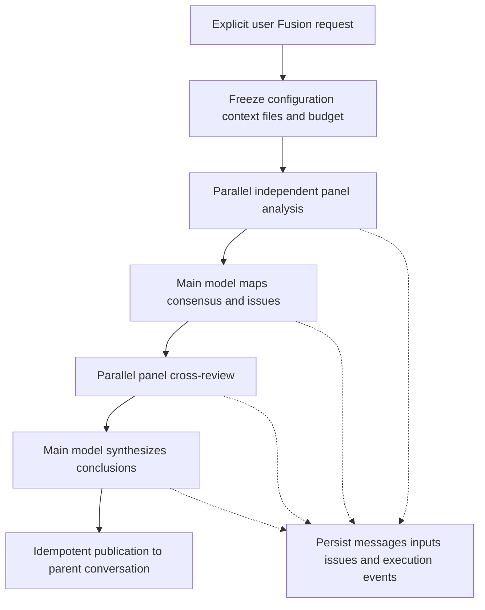

# Fusion development design

[中文](fusion.zh-CN.md)

Status: development design, not implemented. Design date: 2026-10-29.

Fusion is a manually enabled discussion among models, with read-only investigation, under `orchestration/fusion` alongside Goal and Tasks. One user question passes through independent analysis, issue mapping, cross-review and synthesis. The final answer enters the current conversation; discussion and execution records remain available for review.

Delivery requires desktop, mobile and terminal support for the same core workflow, with hosts on Windows, macOS and Linux. A desktop-only implementation does not satisfy this scope. Ordinary runs retain `read / write / edit / shell`; the Fusion main model and panelists receive only `read / ls / glob / grep`.

## Product boundaries

Fusion investigates, compares, discusses and proposes a plan. During discussion, models cannot modify the workspace, execute general commands, install dependencies, run tests, commit code or invoke external business actions. The trusted backend still writes the discussion database, logs, snapshots and caches; these writes do not grant models file-write access.

Selecting Fusion in the composer routes that request through the complete workflow. The main model cannot skip it. The selection applies to the next message by default. Persistent mode, automatic invocation and automatic execution of conclusions are outside v1. With Fusion off, the existing ordinary send path remains in use.

Settings eventually select one main model, multiple panelists and each model's thinking level. Development fixes one main model and three panelists behind a shared `FusionConfig`, rather than embedding choices into scheduling. Replacing the configuration source then connects settings. Reference existing model IDs and credential resolution; do not copy API keys. The main model may differ from the ordinary conversation model, so the composer must show the actual configuration.

Goal's ongoing work, Tasks' triggered execution and Fusion's discussion remain separate. Later integrations may explicitly reference their results. Goal, model tools and schedulers cannot enable Fusion on their own in v1.

## Shared architecture

Follow the orchestration/host split in [Tasks](tasks.md) and the GUI-free service boundary in the [Host architecture](headless-package-development.md).

| Location | Responsibility |
|---|---|
| `orchestration/fusion`, crate `future-fusion` | Types, configuration snapshots, phase protocols, deterministic transitions, storage and discussion projections |
| `host/src/fusion` | Admission, execution, cancellation, recovery, queries, events and publication |
| Agent | Model/tool execution, isolated child sessions, durable bodies and tool results, parent-turn integration |
| Desktop and Mobile | Mode selection, progress, discussion, disagreements, history and diagnostics |
| TUI and CLI | Equivalent terminal interactions and machine-readable output |
| RPC and Remote | Typed commands, paged reads, incremental events and capability negotiation |

`future-fusion` does not depend on Tauri, React or terminal rendering. One executor lives in the active shared Host; disconnecting a client does not transfer ownership. Reuse the Host instance lock and shutdown management rather than starting independent competing executors.

TUI and CLI connect to the shared service. Mobile executes on its paired Host, without copying the workspace or running panelists on the phone. An unavailable host produces an actionable error, never an ordinary answer labeled Fusion.

## Discussion protocol

| Phase | Input | Output |
|---|---|---|
| `analyzing` | Identical question, common context, constraints and file snapshot | Independent proposals, evidence, assumptions, uncertainty and outstanding verification |
| `issue_mapping` | All valid independent answers | Consensus, contradictions, partial coverage, unique insights, blind spots and review issues |
| `reviewing` | Frozen first-round material and the same issue list | Support, objections, additions, revised positions and reasons |
| `synthesizing` | All valid messages, evidence and reviews | Final answer, issue decisions, adoption reasons, unresolved disagreements and verification work |

Panelists cannot see one another's analysis in round one and receive no initial preferred answer from the main model. The main model chairs and synthesizes; there is no separately configured Judge. Round two receives first-round material in a fixed order. Early round-two results cannot change another panelist's input. When material exceeds budget, save one common trimmed input and retain access to originals.

V1 has one cross-review round, advanced by program logic. Three panelists require eight model executions on the normal path: `3 + 1 + 3 + 1`, excluding tools and retries. Issue mapping does not make the final decision. Synthesis preserves well-supported minority views. Agreement is not an accuracy percentage, and reaching a proposal is not verification.

Each phase has a versioned input/output protocol. Validate structured issue maps and synthesis output; the final result includes `final_markdown`, issue decisions, message references, unresolved items and proposed verification actions. Structured responses may appear after completion, while public panel text can stream. V1 need not publish conclusions from incomplete JSON.

The program allocates run, participant, message and issue IDs. Models can reference only valid IDs visible in their inputs; nonexistent, unauthorized or invalidated references produce explicit validation errors. V1 allows at most one retry for retryable failures within total budget, preserving the previous attempt.

## Four read-only tools

| Tool | Parameter contract | Result |
|---|---|---|
| `read` | `path, offset, limit` | File lines, actual range, version reference and truncation information |
| `ls` | `path, depth, limit` | Stably ordered entries, types, traversal scope and truncation information |
| `glob` | `pattern, root, limit` | Matching logical paths, query scope and truncation information |
| `grep` | `pattern, root, glob, context, limit` | Paths, line numbers, matches and context, version references and truncation information |

These are proposed shapes. Freeze defaults, limits and case rules during implementation. The default root is the authorized snapshot root for this run. Bound output bytes, time, regex work, traversal depth, file count and concurrency, and support cancellation. No matches, truncation, unreadable data and cancellation are distinct outcomes.

These names describe structured operations. They accept no shell strings, redirections, pipes, substitutions or arbitrary extra options. Prefer Rust filesystem/search implementations. If using an external search program, the backend selects a trusted executable, builds fixed arguments and starts it directly, without a shell or workspace-provided executable resolution. Ordinary runs keep their existing tools; do not replace `shell` globally.

Reuse the existing `read` implementation where appropriate, but Fusion calls must resolve through authorized scope and snapshot data. V1 adds no Git-specific tools, interpreters, browser automation or extension-tool entry points. Future web retrieval needs a separate reviewed read contract, not general shell access.

### Enforced policy

The model-visible catalog contains only these four tools. The backend rechecks capabilities before every execution; prompts or `set_tools` alone are insufficient. Effective access is the intersection of the fixed Fusion ceiling, existing user authorization and the run's read scope. Full-access ordinary sessions, automatic approval, session rules and retries cannot expand that ceiling.

Bind policy to the whole Fusion run, including main model, panelists, attempts and recovery. Reject `write`, `edit`, `shell`, unregistered tools, and indirect restoration of those capabilities through MCP, child agents, command endpoints or configuration changes. Discussion offers no one-time write escalation. Record proposed actions for the user to start later as ordinary execution.

Reuse existing read authorization, normalize original targets, and check symlinks, Windows junctions/reparse points and root boundaries. Handle only allowed regular files and directories; do not follow escaping links or read devices, FIFOs or sockets as files. Snapshot copying must not make unauthorized originals readable. The read-only guarantee cannot depend on an OS-specific sandbox being available.

## Frozen context and file versions

At admission, freeze the question, history boundary, attachment references, model settings, thinking levels, prompt version, tool-policy version, read scope and budget. Supply one common context fitting the smallest model context window. Retain the actual trimmed or summarized material, not just a hash or a claim that history was used.

All file reads use the run's versioned data source. Complete delivery uses a bounded run snapshot containing saved uncommitted changes and allowed untracked files in scope, rather than Git HEAD alone. It cannot claim to read unsaved editor buffers. The trusted backend writes application-private snapshots while model-visible logical paths continue to name original workspace files.

The frozen manifest bytes are the common source for all four tools; live files cannot be mixed into queries. Record capture start/end, detect changes during capture and retry within a bound or report failure. Portable file copying is not an atomic snapshot of an entire filesystem at one instant. Scope, ignore rules, file limits and total bytes must be diagnosable. Exceeding a limit fails explicitly or asks for a narrower scope, without silently omitting required input.

Development may temporarily freeze each file on first read, serving that saved version to later readers. This guarantees consistency for captured files, not a common instant across files. Record `snapshot_mode` and capture times and do not claim equivalent guarantees before complete snapshot acceptance.

Snapshot queries share an authorization namespace. Coalesce/cache only requests with the same run, authorization scope, snapshot version, tool and full semantic parameters. Record each participant's request separately with a shared result reference, distinguishing execution from reuse. Objective evidence can be shared while round-one analysis remains isolated.

## Runs and parent conversations

One Fusion occupies one parent conversation turn. The backend atomically accepts or reserves it, saving the user input, request idempotency key and `fusion_run_id`. Reject competition with other active turns in that parent. A frontend send lock alone cannot coordinate mobile, terminal or another window.

Every panelist has an isolated Agent child session; the main model also uses an isolated orchestration session. A panelist may reuse its own session for review without sharing mutable model configuration. Group child sessions under Fusion rather than filling the ordinary conversation list. Reload and reconnect attach to existing execution instead of creating a run.

Agent needs orchestration-turn support for parent admission, active ownership, idempotent final assistant publication with Fusion provenance, and terminal closure. Freeze endpoint names and wire fields during implementation. Use authoritative Agent history writes, never direct Agent SQLite mutation or a React-only bubble. Later ordinary chat sees the final answer; internal messages remain queryable rather than all entering parent context.

There is no assumed transaction across the Fusion and Agent databases. Persist the final result and `publishing`, publish through Agent with a stable key, then commit `completed` after acknowledgment. If commit succeeds but acknowledgment is lost, query the receipt without duplicating the answer. Failure, cancellation and interruption must eventually release the corresponding parent-turn reservation too.

## Storage and audit

The data root is `<FUTURE_HOME>/fusion/`, or `fusion/` under the default FutureOS home, with `fusion.db`. Reuse shared home resolution. SQLite uses WAL, foreign keys, short transactions and a bounded busy timeout. Construct paths through platform APIs. Freeze DDL, migrations and a layout marker in the first implementation; the logical model below is not a shipped schema.

| Table | Main fields and responsibility |
|---|---|
| `fusion_runs` | ID, parent source identity and thread/session/turn binding, request key, status, phase, completeness, configuration/context snapshots, budget, result reference, publication receipt, owner generation, times, errors and continuation source |
| `fusion_participants` | ID, run, main/panel role, configured/actual model, thinking level and Agent child source |
| `fusion_steps` | ID, logical step key, phase, participant, attempt, actual input reference, Agent run binding, status, duration, usage, known cost and error |
| `fusion_inputs` | Immutable input manifests/content references, template version, trimming/summary rules, file manifest and versions |
| `fusion_messages` | Stable message ID, phase, author, body reference, reply/issue links and complete/partial state |
| `fusion_issues` | Issue, source messages, status, main-model decision and reasons |
| `fusion_positions` | Issue, participant, support/oppose/uncertain, evidence messages and previous position link |
| `fusion_events` | Per-run sequence, event type, step/causal references, time, necessary metadata and policy denials |

Participant identity is separate from model identity, allowing one model in different roles. Request keys are unique within parent source/conversation; `(run, logical_step, attempt)` and `(run, seq)` are unique. Retries do not overwrite history.

Agent remains authoritative for public output, tool calls and bodies. Fusion retains orchestration facts, immutable inputs and stable references without duplicating token logs. Cross-database references include database identity and restore provenance; a session ID alone cannot address another database. Body references and fine-grained content follow the [streaming storage design](stream-storage-development.md).

Commit transitions, corresponding events and structured projections in one Fusion transaction. Events can rebuild orchestration projections; authoritative stores provide bodies and actual inputs. Only a complete result durably committed by Agent can become downstream input. Uncommitted streaming tails may preview, but recovery restores only the committed prefix and marks partial output.

Publish subscription events after commit with increasing cursors and refill after disconnect. A snapshot response includes the event watermark from the same read version; apply it before subsequent events to avoid a handoff gap. Concurrent arrival order is not causality: explicitly link inputs, messages and steps. Load bodies by page, never to populate a run list.

Keeping a discussion keeps its referenced Agent bodies, attachments and snapshots. Parent/discussion deletion uses recoverable cleanup and reference coordination, preserving shared content until unused. Do not leave clickable records whose bodies were reclaimed. Backup/restore must include Fusion, Agent, application bindings and referenced content in the coordinated data-root flow. Exports exclude credentials, retain versions, inputs, public discussion, tool evidence and execution records, and cannot expand read access.

## Lifecycle and failures

Run status is `queued / running / publishing / completed / failed / cancelling / cancelled / interrupted`; phase separately records `preparing / analyzing / issue_mapping / reviewing / synthesizing`. Completeness is `full / partial / single`, so degraded output cannot appear complete. Timestamps support display, not phase ordering or idempotency.

| Scenario | Behavior |
|---|---|
| Some panelists fail or time out | At most one retry within budget, retaining attempts; continue with valid results and visible absence |
| Only one valid panelist | Synthesis may continue as `single`, without multi-model consensus claims |
| All panelists fail | Fail and retain evidence, without substituting ordinary success |
| Main model fails or structure is invalid | Bounded retry, then retain discussion for explicit continuation |
| Unauthorized tool request | Reject before execution and record it; use read-only investigation or an outstanding verification item |
| Insufficient budget | Stop dispatching unaffordable steps, retain results/reason and do not claim complete delivery |
| User stops | Commit cancellation intent, stop dispatch, cancel child runs, then confirm/reconcile parent closure |
| UI disconnect or conversation switch | Host continues; reattach by run and cursor |
| Host crash | Reconcile accepted Agent requests/publication receipts, mark interrupted, and continue after user choice |

Bound phase/model time, output, and tool calls. Total budget covers all attempts and reserves synthesis capacity. Before dispatch use estimates and maximum-output constraints; afterward reconcile actual provider usage. Missing cost is unknown, not zero; do not promise a precise hard currency cap across providers.

Use durable owner generations and conditional updates for cancellation/recovery so stale executors cannot advance or publish. Late results may be saved to their original attempt without overwriting cancellation. Check whether an accepted request still runs before retrying it. Continuation preserves the original read-only ceiling.

## Service and client protocol

The following operations are planned contracts, not currently available commands.

| Operation | Contract |
|---|---|
| `start` | Parent source/conversation, question/attachments, explicit Fusion selection, configuration version and client request key; returns receipt/run ID |
| `get` / `list` | Status, phase, participants, completeness and summaries, without full bodies in lists |
| `events` | Incremental pages by run/durable cursor with explicit truncation and invalidation |
| `messages` / `issues` / `input` / `step` | Paged discussion, disagreements, actual inputs and execution details |
| `cancel` / `resume` | Idempotent stop or explicit user continuation, without permission expansion |
| `export` / `delete` | Authorized export and recoverable coordinated cleanup |

All clients call the same Host service. Agent execution and parent-turn contracts belong in `packages/rpc/proto/future.proto`. Add the terminal-to-Host route rather than letting CLI bypass the service by opening live databases. Mobile and remote Desktop use typed Remote commands; update schema, generated types and both adapters when adding wire contracts. Transport cannot depend on Tauri event names or platform file paths.

Negotiate a proposed `fusion_v1` capability. Clients disable the entry with an upgrade explanation on old hosts, never silently sending an ordinary prompt. Every read checks pairing, source and authorization; knowing a run ID does not grant access. Mobile does not automatically download full diagnostic exports and respects existing pagination, message and download limits.

| Client | Required experience |
|---|---|
| Desktop | One-message composer selection, configuration summary, progress card, discussion/issues/diagnostics side panel, stop, history and reattachment |
| Mobile, Android and iOS | Same mode/status, full-screen details, paged messages, issue/source navigation, stop, history, foreground/background recovery and capability feedback |
| TUI and CLI | TUI mode selection, phase status, participant/discussion/issue/diagnostic navigation, stop and history; CLI equivalents and structured JSON |

All clients can select and display the main model/panelists. During development, show the same fixed configuration and read-only boundary; later settings use one consistent source. Maintain English/Chinese strings. Narrow layouts and terminals use ordered, collapsible content rather than shrinking desktop columns. TUI does not host another executor; non-watch CLI reads do not invoke models.

## Discussion and review interface

Show “Fusion · Read-only investigation” and actual main/panel configuration beside the composer. Progress reports real phase counts such as `3/3` analyses or `2/3` reviews, without an invented overall percentage. Users can open discussion or stop. The final answer reads like ordinary chat, with participant, completeness and discussion links below.

Details offer three views:

- **Discussion** groups independent analysis, issue mapping, cross-review and synthesis. Expand each model message and attach its read/search activity. Follow streaming only for content the user is viewing, without forced jumps.
- **Issues and conclusions** shows initial positions, revisions, adoption reasons and unresolved items by issue, with links to originals. State means a proposal or outstanding verification, not verified correctness or voting accuracy.
- **Diagnostics** exposes actual inputs, configured/actual models, available provider request IDs, timing, tokens, known costs, retries, policy denials, cache reuse and Agent bindings.

Replay reads history without model calls. Rerunning or continuing a particular disagreement creates a linked new run and preserves the old conclusion; interrupted execution resumes its existing run. Distinguish these operations in both UI and API.

## Windows macOS Linux compatibility

All three host operating systems must support orchestration, four tools, SQLite, cancellation, recovery and access from the three clients, across supported x86-64/arm64 targets. Tool execution capabilities enforce read-only behavior independently of platform sandbox availability. Clean installations without Bash or system `grep`, `ls` or `rg` must work.

| Area | Requirement |
|---|---|
| Paths | Use `Path/PathBuf` and shared home resolution; handle Windows drive/UNC paths, separators, junctions/reparse points; separate logical display paths from native paths |
| Equality | Respect actual filesystem case behavior instead of assuming every macOS volume or Windows directory is insensitive; explicitly support or reject Unicode/non-UTF-8 path cases without addressing another file |
| Search | Freeze portable glob/regex/case semantics; stable ordering and correct CRLF/LF, empty, binary and decoding-error handling |
| Processes | If search spawns a process, use a trusted executable without shell/profile loading; timeouts/cancellation clean its owned process tree, never another Agent |
| Storage | Verify WAL, locking, short transactions, Windows open-file cleanup and atomic file operations; report cross-volume failures explicitly |
| Transport | Reuse Unix IPC or Windows named pipes and Remote; clients do not construct host absolute paths or execute local commands |

## Implementation and acceptance

| Milestone | Delivery | Exit condition |
|---|---|---|
| M0 | `future-fusion` protocol/store, Host service, four tools, fixed models and parent-turn integration | A real four-phase request publishes exactly one final answer with inspectable inputs/discussion |
| M1 | Desktop, Mobile, TUI/CLI and RPC/Remote capability negotiation | Every client can manually start, inspect progress/issues, stop, reconnect and review history |
| M2 | Run snapshots, recovery, budget, export/cleanup and diagnostics | Failure, version and permission acceptance below passes on all three host systems |
| M3 | Main/panel/thinking settings | Consistent configuration across clients; changes affect future runs without mutating existing snapshots |

M0/M1 may use first-read freezing for development; complete delivery requires M2 run-snapshot acceptance. Before M3, show fixed configuration explicitly. Further discussion, Goal linkage and execution handoff are later capabilities. Execution handoff requires the user to start a separate ordinary run referencing conclusions/verification work and checking workspace drift.

Acceptance covers:

1. Ordinary tools retain their behavior when Fusion is off. When on, main/panel models receive only `read / ls / glob / grep`, with no bypass through full access, retries, recovery or alternate entry points.
2. Concurrent reads of one version agree; dedup preserves each request's audit. Round-one analysis is isolated and round-two inputs are fixed before dispatch.
3. Run snapshots retain authorized saved edits, detect capture changes and isolate later workspace edits. Trimming, limits and first-read-freezing limitations are visible.
4. Writes, shell/extension tools, escaping paths/links and special files are rejected before execution, without approval silently expanding access.
5. Reload, reconnect, duplicate sends and lost publication acknowledgments do not duplicate runs/user messages/answers. Snapshot/event handoff has no gap and invalid/expired cursors are explicit.
6. Partial/total failure, invalid structure, exhausted budget, late output after stop and Host crashes retain true states. Recovery neither duplicates active steps nor overwrites cancellation.
7. All clients navigate to original evidence and inspect inputs/retries/tools. Ordinary follow-up sees the final answer while child sessions remain grouped.
8. Deletion, backup, restore and export preserve references/authorization. Credentials stay out of records; a missing source is not successful empty history.
9. Windows/macOS/Linux hosts and Android/iOS clients cover paths, line endings, encoding, cancellation, paging, authorization and disconnects. Old hosts show explicit capability feedback.

Implementation unit/contract tests run in CI, with module-scoped static checks per repository policy. This documentation change runs documentation checks only and does not claim implementation acceptance.

## Related material

- [Goal control plane](goal-control-plane.md)
- [Tasks architecture](tasks.md)
- [Host development plan](headless-package-development.md)
- [RPC contract](rpc.md)
- [SQLite migration](sqlite-migration.md)
- [Streaming storage design](stream-storage-development.md)
- [OpenRouter Fusion](https://openrouter.ai/docs/guides/routing/routers/fusion-router): reference for independent analysis and structured comparison; this design uses explicit user activation and strictly read-only investigation.
