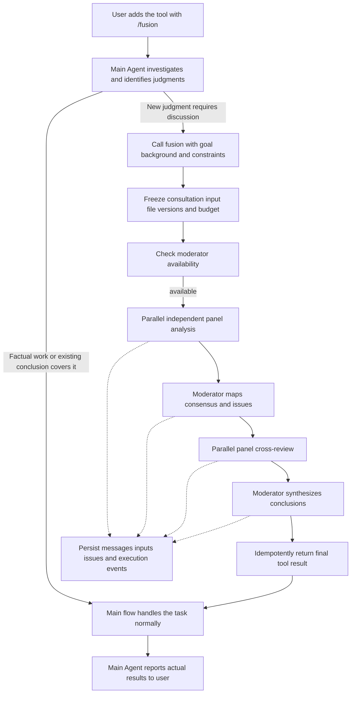

# Fusion development design

[中文](fusion.zh-CN.md)

Status: tool orchestration, shared settings, first-batch resilience and proactive discussion policy implemented. Updated: 2026-11-02.

Fusion is a multi-model thinking tool available to the main Agent. Its orchestration kernel lives in `orchestration/fusion`, alongside Goal and Tasks. Users add the `fusion` tool to the current main run with `/fusion`. The main Agent investigates, then must submit a focused question before making a substantive judgment, choosing an approach or recommending an outcome that requires analysis. Internal read-only discussion returns a final conclusion, then the original main flow continues the user's task. Users can inspect the complete discussion separately.

Delivery requires desktop, mobile and terminal support, with hosts on Windows, macOS and Linux. Desktop alone is insufficient. The outer main flow retains `read / write / edit / shell`, adding `fusion` when requested. The inner moderator and panelists receive only `read / ls / glob / grep`.

## Current implementation and usage

The default moderator is `future/deepseek-flash`. Default panelists are `future/deepseek-flash`, `future/glm-5.3-flash` and `future/qwen3.7-plus`, the third selected from the live Future catalog with the user's confirmation. Missing moderators fail explicitly; missing panelists are excluded with a recorded reason. No default-model substitution occurs.

Start Desktop or `future host`, then submit `/fusion <task>` from Desktop, Mobile or TUI. The main Agent receives a real run-scoped tool and consults on questions requiring judgment under the proactive policy below. The healthy inner N→1→N→1 (N = 2–5) protocol returns one final result; explicit failure branches may skip stages or return a no-conclusion outcome and the original flow continues. Later ordinary runs do not inherit the tool. Expand the reply process and Fusion activity to see a four-segment title ring and one icon-status row per model. Full messages and evidence remain in storage, with a dedicated Fusion inspector within Desktop Runs and terminal queries for review. TUI offers `/fusion-log [step-id]`; CLI offers `future fusion show <parent-session-id> [--run <id> --tool <id>] [--step <id>] [--offset <bytes>] --json`. Reads never invoke models.

The Host executor claims a bounded durable queue in `~/.future/fusion/fusion.db`, avoiding an Agent-to-Host crate dependency. The existing Host instance lock gives one executor, with at most two concurrent consultations. The Agent validates the leading token from the original submission and persists `ScheduledSettingsSnapshot.fusion_enabled` with the raw input/request key. Remote outboxes retain that original directive and key. No persistent session-tool setting is changed. Inner sessions carry `created_by=fusion`; investigation uses only the four snapshot tools regardless of ordinary session configuration, while moderator/report-revision runs receive no tools.

Only explicit, parent-authorized UTF-8 `read_scope` files are captured, once per consultation, with hashes shared across every round. Empty scope supports conceptual decisions. Escapes, links/reparse points, special files and oversized inputs fail. Limits are 1 MiB/file, 16 MiB total and 1024 files/directories. Capture timestamps and observed-change detection are recorded; this is not an atomic filesystem snapshot. Fusion uses model-capacity-derived output allocations rather than fixed word-count limits. Final-report space is shared from the moderator window and role count; working generation is independent and uses model capability and remaining context. See Context capacity admission below. Default thinking levels are medium for DeepSeek Flash and Qwen 3.7 Plus, low for GLM 5.3 Flash, and medium for the DeepSeek moderator. Steps have no additional five-turn cap and allow 300 seconds including all working/report-revision generations. A discussion has a 2700-second total deadline measured from creation; an attempt cannot reset that budget. Each parent run admits an unlimited number of discussions, with at most two attempts per step. Whole-step timeout, cancellation, authentication and unclassified failures do not trigger an identical retry. Empty read scopes expose no file tools. Completeness reflects actual full/partial/single participation.

The `fusion_runs/inputs/participants/steps/messages/issues/positions/events` tables store structure, inputs, state, references and diagnostics. Complete messages/tool evidence remain in Agent child transcripts. Previews are bounded; original transcripts use UTF-8 byte paging. Queries verify the parent, database source and step ownership. Restart interrupts unfinished consultations without automatic paid replay. Parent cancellation stops child work and fences late results. Deleting a parent stops/deletes linked children and removes its consultation/snapshot records. Offline `future data` backups include the Fusion database and snapshots. Archived reads remain valid after restoring the same Agent database; execution still requires the current restore identity.

Later sections retain the planned product contract. Dedicated redacted export, richer position-change records and monetary budgets remain future work; this version retains step-attempt and time limits, without a parent-run discussion-count cap. Cross-system builds and unit regressions run in CI. See the [implementation verification record](../testing/fusion-implementation.md). See the [device-run database audit and compact UI checks](../testing/fusion-database-audit.md).

The fixed defaults live in `orchestration/fusion/src/config.rs`. Each new discussion persists a configuration snapshot; each attempt persists its thinking level, actual output allocation, context window and public-response byte capacity, effective timeout and retry reason. Host and Agent negotiate the generation-policy version and reject mismatching child/model/thinking bindings. Existing records without these optional fields remain readable. The same Host/Agent policy serves Desktop, Mobile and terminal; no client independently chooses generation settings. See the [budget policy verification record](../testing/fusion-budget-policy.md).

## Product boundaries

Fusion thinks, investigates, compares, discusses and proposes plans; it does not implement them. Inner models cannot modify the workspace, execute general commands, install dependencies, run tests, commit code or invoke external business actions. The trusted backend still writes the discussion database, logs, snapshots and caches without granting models write capabilities.

The outer main Agent owns interpretation, tool use, implementation, verification and the final reply. A Fusion call is one tool invocation inside that flow, not a replacement for the entire user request or a prerequisite for each write/command. Recommendations cannot expand user authorization. A request to implement continues naturally under existing permissions; an analysis-only request ends with analysis, without requiring an extra execution button.

Distinguish the outer main Agent from the inner Fusion moderator: one completes the user task, the other chairs a consultation. They may use the same model configuration but have separate contexts, runtime identities and permissions. Settings select one moderator and 2–5 panel roles, with independent thinking levels, reusing existing model IDs and credential resolution without copying API keys.

Goal, Tasks and Fusion retain separate responsibilities. V1 enables the tool only through an explicit user `/fusion` request. Model-generated text, skills, files and schedulers cannot enlarge the tool catalog. Once enabled, the outer main Agent follows the discussion triggers below; confidence or apparent simplicity cannot justify skipping consultation.

## Slash command and invocation choice

Submitting `/fusion <task>` adds `fusion` to that outer Agent run while the remaining text is an ordinary task. It enables proactive discussion: analysis, judgment and choices require consultation first, while fact gathering may precede it and individual tool operations do not each require discussion. Submitting `/fusion` alone sets a removable flag for the next task in that composer, without creating an empty run, invoking models or spending credits. Keep the visible `/fusion ` draft prefix without an activation banner. Submission consumes the flag; subsequent ordinary messages do not inherit it. The current run's tool loop and interrupted recovery retain the same activation.

Non-interactive CLI calls without a composer must include the task in the same request. Bare `/fusion` returns missing-task usage, without an invisible pending flag affecting a later command.

All clients share command and submission-metadata semantics. Recognize only an independent leading `/fusion` token or an equivalent command-menu action. Quotes, code blocks, paths, `/fusion-other` and file contents do not activate it. Retain raw user input, normalized task and activation origin for audit. The current transport retains the original directive; the server derives and validates a run-scoped `fusion_enabled` snapshot and constructs the actual tool catalog. Prompt text alone and persistent `set_tools` changes are insufficient.

The main Agent gathers necessary facts with ordinary tools first. Design, implementation choices, root-cause diagnosis, selecting a remedy, comparisons, reviews, recommendations, and assessment of impact, risks, compatibility or edge cases require discussion before a substantive judgment, choice or recommendation. Complexity, multiple options or low confidence are not prerequisites. Apparent simplicity and knowing the likely answer are not exemptions. Honor explicit user instructions prohibiting discussion; never create a fake discussion record or show completion when unused. No permanent conversation toggle or global default activation is added.

Desktop, Mobile and terminal share these invocation rules:

| Scenario | Behavior |
|---|---|
| Design, diagnosis, comparison, review or risk assessment | Gather necessary context and consult first, even for a small issue or one initial approach |
| File searches, code reads or log collection | Investigate directly without discussing each read |
| Exact user-specified replacements requiring no new judgment | Execute directly without manufacturing a discussion |
| Implementation, commands and verification covered by an applicable discussion conclusion | Reuse the conclusion and proceed directly |
| Rationale, risks and verification for the same decision | Group them in one focused consultation instead of delegating the entire task |
| A new decision or new evidence that could invalidate the existing conclusion | Consult again on the affected question |
| A failed discussion | Do not automatically repeat it; explain the failure, reuse applicable conclusions or continue with clearly qualified independent reasoning, without claiming a completed discussion or consensus |

There is no per-run cap on the number of discussions: new decisions or evidence that could invalidate existing conclusions may trigger further consultations. Existing per-discussion time, output, step-attempt and concurrency protections remain unchanged. Increasing use does not justify duplicate discussions or treating failed materials as conclusions.

For `/fusion fix the model selector safe-area issue`, read the component and layout first, then discuss the cause, remedy and verification priorities before implementing and checking. Import, type or mechanical corrections covered by that conclusion proceed directly. If new evidence shows that the shared component affects other sheets and changes the remedy, discuss that new decision. An exact text replacement may finish with zero consultations.

`future_fusion::DISCUSSION_POLICY` is the single invocation-policy source, reused by the shared Agent in the run system prompt and the `fusion` tool description. `TOOL_DESCRIPTION` adds context requirements and the read-only tool contract. Desktop (local/remote), Mobile and TUI/CLI use the same normal submission path without client-side invocation policies. Recovery retains run activation; later ordinary messages do not inherit it.

This is an explicit model instruction, not programmatic proof that every semantic judgment was discussed. This batch adds no judging model, write/Shell interception or mandatory call for every message. Acceptance must inspect actual invocation traces; the prompt text alone does not establish an improved call rate.

## Fusion tool contract

### Tool description

The following is the semantic baseline for matching English and Chinese tool descriptions:

> Think through one explicit, narrowly focused decision with multiple models and return a synthesized conclusion. Fusion analyzes and discusses; it does not modify files, execute commands or implement the plan. Investigate first and provide the goal, background, confirmed facts, unknowns, constraints and relevant evidence needed to decide. Keep the user's wording when clear; rewrite only for necessary disambiguation, reference resolution or focus. Do not add requirements or an answer outline in any input field, including goal, background and constraints. Explicit user/context restrictions remain valid. Split genuinely broad topics into separate focused discussions rather than adding a mandatory checklist; make vague questions answerable without inventing circumstances. Background faithfully compresses relevant context and user requirements, distinguishes attributed user statements, confirmed observations, prior assistant statements and unknowns, and excludes main-agent reasoning, newly invented plans and preferences. Prior replies are summarized only to explain user follow-ups/corrections, without copying their solution outline unless the user adopted it or requested review. User-provided proposals belong in background with attribution. Constraints are brief material boundaries, may be empty, and do not impose language, length or formatting requirements. Do not delegate the entire task indiscriminately. When enabled, analysis, diagnosis, design, comparison, review and risk judgments require discussion first; confidence, simplicity or a lack of competing options do not excuse skipping it. Handle factual investigation, exact edits requiring no judgment, and implementation or verification covered by an applicable discussion conclusion directly. Group related questions about one decision; consult again only for a new decision or evidence that could invalidate the existing conclusion. When an action or verification is needed, propose its purpose, plan and expected outcome for the main flow to handle under user authorization. Do not substitute repeated discussion for investigation or verification. There is no per-run discussion-count limit; explain failures without automatically repeating a call or calling incomplete discussion a conclusion or consensus.

### Inputs and focus

| Field | Requirement |
|---|---|
| `question` | Required: user wording with only necessary disambiguation/focus; no extra requirements or answer checklist |
| `goal` | Required: only the requested outcome, without invented quality criteria, audience assumptions or deliverables |
| `background` | Required: faithful compression of context and user requirements, attributed confirmed facts and unknowns. User proposals belong here; prior assistant suggestions are not verified facts or user decisions. Exclude main-agent reasoning and preferences |
| `constraints` | Brief restrictions explicitly established by the user/relevant context; empty otherwise. No inferred compliance/equipment/detail/language/format demands |
| `evidence` | Optional file/line references, collected output and version references; externally dependent facts should have inspectable support |
| `read_scope` | Optional proposed read paths, intersected with existing parent authorization rather than expanding it |

Trusted backend code supplies parent source identity, parent run, tool call ID, model configuration, policy and budget. Models cannot supply credentials or override permissions. Do not copy the entire parent chat or workspace by default. Supply common material sufficient to understand this decision independently; missing decisive evidence remains an unknown or evidence request, not an invented fact.

```json
{
  "question": "How should v1 conversation full-text search be implemented?",
  "goal": "Provide consistent search on desktop, mobile and terminal while minimizing migration complexity.",
  "background": "Agent SQLite owns bodies and shared services serve all clients. Storage entry points are located; large-data performance is unmeasured.",
  "constraints": ["Windows/macOS/Linux hosts", "Preserve deletion and recovery semantics"],
  "read_scope": ["agent/src/session", "host/src/agent_bridge"]
}
```

Program logic validates required fields, references and authorization; it adds no Fusion text-length limit. When meaning lacks a clear decision or key background, the moderator returns what must be supplied or narrowed rather than expanding into project redesign. Heuristics cannot prove semantic focus. The main Agent corrects the input, and the moderator separates findings affecting this decision from later work without expanding scope.

### Preserve the user's scope

Topic formation only disambiguates or focuses the request. Do not append unsolicited legality/compliance framing, an assumed audience or jurisdiction, equipment conditions, detail levels, mandatory subtopics, reporting procedures or verification work. Do not relocate these additions into goal/background/constraints/evidence. Research findings are observations, not new user instructions; unknown circumstances remain unknown. System/tool safety rules continue to apply independently and are not presented as user demands. Participants may independently identify relevant considerations during discussion.

For `/fusion 我要查找业余无线电中继上的恶意干扰有什么办法？`, a sufficient question is “业余无线电爱好者可以采取哪些方法来发现、确认并测向定位中继台（repeater）上出现的恶意干扰？”. Do not append “separately explain … VHF/UHF handheld/car equipment … reporting procedures”. A faithful goal is “Learn methods for finding the interference source”; background may simply state that no location, equipment or field observations were supplied, and constraints may be `[]`. When a topic is genuinely large, use multiple focused discussions as needed; discussion count remains unlimited.

This rule is shared in the enabled run policy, tool description and field schemas in Rust, so Desktop, Mobile and terminal do not maintain independent topic rewriting rules. It guides semantic behavior; structural validation cannot prove that every paraphrase is faithful.

### Final result

The outer flow receives one compact tool envelope: `fusion_run_id`, `status`, `has_conclusion`, `completeness`, a `conclusion` directly answering the question, optional non-repeating `rationale` and material `unresolved`, compact coverage counts/skipped phases and degradation codes. No `conditions`, `next_steps`, complete report, intermediate previews or issue matrix enter parent context. Essential applicability qualifications belong in the conclusion itself. Failures return no conclusion and retain full records for inspection rather than dumping partial public texts into the parent. Execution coverage is not truth or unanimity.

The result is decision material, not a new user instruction or execution queue. The main Agent may adopt, adapt or reject it under the original authorization, current facts and constraints. Before implementation, read the live workspace and recheck key facts. Correct local issues directly; consult again under the invocation policy only for a new decision or evidence that could invalidate the existing conclusion. Conclusions are not verification. The final reply separates discussion recommendations from actual execution results.

## Fusion settings

[Settings verification](../testing/fusion-settings.md).

Desktop places Fusion immediately below Models. Remote desktop and mobile expose the same host-owned settings. Select one required moderator and 2–5 panel roles, each with its own model and thinking level. Roles may share a model, including different thinking levels. Stable role identities (moderator, P1…PN) keep progress separate even when models match. The moderator is separate from the outer chat model.

The switch controls availability of `/fusion`, not automatic consultation on every message. It starts enabled for compatibility. Disabling removes completion and rejects manually typed commands and new consultations in the backend. Existing discussions retain their frozen configuration and history remains readable. The switch saves immediately; model edits require Save.

`fusion_meta` in `<FUTURE_HOME>/fusion/fusion.db` stores key `settings`: enabled, configuration and revision. Updates compare expected_revision in a transaction and reject stale saves. Clients preserve unsaved drafts and offer Reload on conflict. The Agent resolves callable models, validates their declared thinking levels and clamps output caps to model limits without LLM requests. RPCs are `get_fusion_settings` and `update_fusion_settings`; Remote uses a dedicated `fusionSettings` payload and `fusion_settings_v1` capability, plus settings invalidations.

CLI: `future fusion settings --json`, `--disable`, or `--enable`. TUI: `/fusion-settings` with the same flags. `--main MODEL --thinking LEVEL` sets the moderator; repeated `--participant MODEL --thinking LEVEL` replaces the whole panel and must specify 2–5 roles. Thinking applies to the most recently selected role. For example:

```sh
future fusion settings --main future/deepseek-flash --thinking medium \
  --participant future/deepseek-flash --thinking low \
  --participant future/qwen3.7-plus --thinking medium
```

The executor runs N+1+N+1 logical steps and validates issue references against the actual P1…PN roster. Old histories retain recorded configuration. Clients use Agent RPC/paired-host services rather than local database access, preserving Windows, macOS and Linux hosting support.

## Shared architecture

Follow the orchestration/host split in [Tasks](tasks.md) and the GUI-free service boundary in the [Host architecture](headless-package-development.md).

| Location | Responsibility |
|---|---|
| `orchestration/fusion`, crate `future-fusion` | Types, configuration snapshots, phase protocols, deterministic transitions, storage and discussion projections |
| `host/src/fusion` | Tool admission, inner orchestration, cancellation, recovery, queries, events and tool-result delivery |
| Agent | Run-scoped catalogs/tool adapter, isolated inner sessions, durable bodies/results and continuation of the ordinary main loop |
| Desktop and Mobile | `/fusion`, tool activity, four-stage progress and model status; terminal queries for detailed review |
| TUI and CLI | Equivalent terminal interactions and machine-readable output |
| RPC and Remote | Typed commands, paged reads, incremental events and capability negotiation |

`future-fusion` does not depend on Tauri, React or terminal rendering. One executor lives in the active shared Host; client disconnect does not transfer ownership. Reuse the Host instance lock and shutdown management rather than starting competing executors.

TUI and CLI connect to shared services. Mobile runs consultation on its paired Host, without copying the workspace or running panelists on the phone. An unavailable host produces an actionable error, never an ordinary answer labeled Fusion.

The Agent tool adapter depends on a neutral invocation interface or RPC implemented by Host, never imports `future-host` or creates an Agent/Host dependency cycle. A standalone Agent or old host without a reachable service cannot advertise the tool. An explicit `/fusion` request must receive a capability error instead of silently dropping activation.

## Discussion protocol

The diagram shows the healthy path. Before it, moderator preflight runs unless a fresh matching success is cached. The first uncached three-panel consultation has nine attempts without retries: one readiness check plus eight discussion steps. Failure branches are defined below.



| Phase | Input | Output |
|---|---|---|
| `analyzing` | Identical focused question, goal, common background, constraints and file snapshot | Independent proposals, evidence, assumptions, uncertainty and verification work |
| `issue_mapping` | All valid independent answers | Only existing shared views, existing disagreements, and existing statements outside task boundaries or unsuitable for continued discussion |
| `reviewing` | Own complete first answer, original task requirements and the same frozen moderator map; no other complete answers | Cited responses, maintain/revise/withdraw decisions on own positions, mapping corrections, and separately labeled proposals/unverified claims/reported verified facts |
| `synthesizing` | All valid messages, evidence and reviews | Final conclusion, issue decisions, reasons, unresolved disagreements and verification work |

Panelists cannot see each other's analysis in round one or receive an initial preferred answer from the moderator. The moderator chairs and synthesizes without a separately configured Judge. Each round-two reviewer receives only its own complete first answer, the original task context and the same frozen moderator map, including its sourced excerpts. Other participants' complete answers and all third-stage replies are withheld. Early replies cannot alter another reviewer's packet. Inputs must pass context capacity admission without silent truncation.

The healthy path uses one cross-review round with program-controlled transitions. N participants produce `N + 1 + N + 1` Agent phase executions (eight with the default three participants); tool loops may involve further model requests, so this is not a promise of eight API calls total. Issue mapping is a faithful organizer, with no new analysis, omissions, clarification questions or checks. Shared views require exact source excerpts from every actual participant and are not verified truth. Disagreements require at least two stated positions; silence is explicitly not_mentioned, never opposition. Excluded statements cite both an original statement and an existing task boundary; novelty or minority status is not grounds for exclusion. The strict schema rejects additional fields; runtime checks source excerpts, actual participants and boundary quotes. Both moderator stages (2 and 4), as well as preflight, have no tools; only participant analysis/review can receive authorized snapshot tools. Invalid maps receive a format retry; if still invalid, skip review and synthesize from existing analyses with partial coverage, never send other full answers as a fallback. Reviewers can correct the organization against their own original answer and visible quoted excerpts. Issue mapping does not decide prematurely, and the last phase synthesizes only participant analyses/reviews without new facts, proposals or independent technical analysis. Decision input preserves goals/boundaries; the issue map is navigation, not evidence. Unresolved items and next steps must originate in participant content. Agreement is not accuracy. `3131` is an initial internal strategy, not a permanent external tool contract.

Each phase has a versioned protocol. Validate structured issue maps and synthesis, retaining issue decisions, message references and proposed verification internally while returning the compact final tool contract. Structured results and public panel text remain audit records available through terminal queries. Do not publish partial JSON or intermediate judgments to the parent model.

Third-stage responses must first give a self-contained current answer to the original topic, then explain only material changes. They use a strict structure: `participant`, `current_answer`, `responses`, `self_review`, `mapping_corrections`, and `additions`. Responses identify another participant and quote a visible original excerpt from the map; insufficient excerpts are explicitly insufficient information. Own revisions quote the reviewer's first answer and use maintain/revise/withdraw with the resulting position and reason. Mapping corrections quote the map and a visible original source. Additions distinguish proposals, unverified claims and participant-reported verified facts; the last requires evidence references. Identity and source-quote checks reject invented prior positions or references to unseen answers; malformed reviews follow existing format retry and partial-review degradation. Reference presence does not establish factual truth or prove a tool check occurred, and synthesis must preserve that distinction.

The program allocates run, participant, message and issue IDs. Models reference only valid IDs visible in their inputs; nonexistent, unauthorized or invalidated references produce explicit validation errors. V1 permits at most one retry for retryable failures within total budget, retaining prior attempts.

## Context capacity admission

Host reads actual catalog context and output capacities; unknown/zero capacities fail before dispatch. `list_models.maxTokens` comes from Agent `effective_max_tokens()` and must survive the shared payload, optional `ModelEntry.max_tokens` protobuf field 14 and both codecs, rather than being present only in internal Agent JSON. A missing capacity from an older Agent identifies the model and requires an upgrade; Host does not invent an output limit. **Working generation and final-report capacity are independent.** Each model request gets a generation limit based on model capability and its actual remaining window, including reasoning and public output. Never divide the public-byte allocation by four to cap thinking. Fusion adds no five-turn investigation limit. Investigation/tool history stays in the working child session; the public capacity is checked only when a final report is submitted. Model windows, cancellation and phase/run deadlines still apply independently.

Downstream report allocation reserves generation space, task/stage instructions and protocol margin before sharing moderator capacity among 2–5 roles, also allowing each reviewer to receive its own report plus the map. The planning reserve is not a generation-token cap. Measure actual forwarding: analysis/review source strings include real JSON escaping, a map uses its compact parsed JSON object, and the natural synthesis body includes its actual string escaping in the backend result envelope. Models still write natural stage-1/stage-4 reports. There is no blanket sixfold factor. UTF-8 bytes are a conservative fallback without a target tokenizer, not exact tokens; HTTP transport escaping is not model-visible context.

Models may investigate and think over multiple turns before submitting a report. Oversized or structurally/quote-invalid reports receive a revision request in **the same child session**, reusing all existing context. The original investigation is not submitted again; no new model session is created and text is never silently truncated. Revision turns have no investigation tools and share the original phase deadline/cancellation. If revision times out or the service fails, retain records and stop under the existing failure policy; do not restart the report in a fresh session. This is in-run report repair, not checkpoint recovery after interruption.

Stage 1 returns plain text/Markdown; stages 2/3 retain existing identity, position and source-quote validation; stage 4 directly answers the topic as plain text/Markdown, with result metadata/envelope supplied by the backend. Synthesis receives only one accepted latest report per role, excluding thinking, tool history and oversized drafts. Revisions preserve step/session identity and use fresh Agent run/client request IDs. Step events retain session/run IDs and report_revision; child sessions retain report versions, feedback and cumulative usage for debugging.

Host checks each actual dispatched input. Agent remeasures system text, decoded message bodies, accumulated tool results and actual tool arguments/definitions before every model turn, adapting generation to the remaining window. Working requests additionally reserve up to one quarter of the window for a same-session report repair; repair turns may use that space. This reserve is independent of the report quota. JSON tool definitions/arguments carry their actual cost; escaping the entire HTTP request does not add context. Requests without room are not sent and records remain available. This is conservative admission against known metadata, not a promise of completion for arbitrary tasks or undocumented provider limits. Agent advertises context-budget capability 2; upgrade Host and Agent together so an old Agent cannot ignore tool disabling during report revision.

## Four read-only tools

| Tool | Parameter contract | Result |
|---|---|---|
| `read` | `path, offset, limit` | File lines, actual range, version reference and truncation information |
| `ls` | `path, depth, limit` | Stably ordered entries, types, traversal scope and truncation information |
| `glob` | `pattern, root, limit` | Matching logical paths, query scope and truncation information |
| `grep` | `pattern, root, glob, context, limit` | Paths, line numbers, matches/context, versions and truncation information |

These are proposed shapes. Freeze defaults, limits and case rules during implementation. The default root is the authorized snapshot root. Bound bytes, time, regex work, depth, file count and concurrency, and support cancellation. No matches, truncation, unreadable data and cancellation are distinct outcomes.

These names describe structured operations, accepting no shell strings, redirections, pipes, substitutions or arbitrary extra options. Prefer Rust filesystem/search implementations. If using an external program, backend code selects a trusted executable, builds fixed arguments and starts it directly, without a shell or workspace-provided executable resolution. Do not replace ordinary `shell` globally.

Reuse existing `read` where appropriate, but resolve Fusion reads through authorized scope and snapshots. V1 adds no Git-specific tools, interpreters, browser automation or extension entry points. Future web retrieval needs a separate reviewed contract, not general shell access.

### Enforced policy

The inner model catalog contains only the four tools. Recheck capabilities before every execution; prompts or `set_tools` alone are insufficient. Effective access intersects the Fusion ceiling, user authorization and run read scope. The outer flow retains normal tools but cannot expand inner access through parameters, full access, approval, session rules or retries.

Bind policy to the whole consultation: moderator, panelists, attempts and recovery. Reject `write`, `edit`, `shell`, unregistered tools and indirect restoration through MCP, agents, command endpoints or configuration. Inner models cannot recursively invoke `fusion`. They propose action purposes, plans and expected outcomes for the outer flow under original authorization, without permission escalation inside discussion.

Reuse read authorization and normalize original targets, checking symlinks, Windows junctions/reparse points and root boundaries. Handle allowed regular files/directories only, without escaping links or treating devices, FIFOs or sockets as files. Snapshot copying cannot expose unauthorized originals. Read-only guarantees do not depend on OS sandbox availability.

## Frozen context and file versions

At actual tool invocation, freeze the focused question, goal, background/evidence, necessary history references, attachments, models, thinking levels, prompt/policy versions, read scope and budget. Do not copy all context when the outer message first arrives. Supply one common input fitting the smallest model window, retaining actual trimming/summary content rather than only a hash or a claim that history was used.

Capture only necessary, authorized scope, never the entire workspace because a parameter was omitted. Conceptual decisions may use an empty file manifest. Request additional evidence or scope explicitly instead of expanding investigation through this focused tool.

All file reads use the run's versioned source. Complete delivery uses a bounded snapshot containing saved uncommitted changes and allowed untracked files in scope, not Git HEAD alone. Do not claim access to unsaved editor buffers. Trusted backend code writes private snapshots while logical paths still name original workspace files.

Frozen manifest bytes supply all four tools; queries cannot mix in live files. Record capture start/end, detect capture-time changes and retry within a bound or fail. Portable copying is not an atomic filesystem snapshot at one instant. Scope, ignores, file/byte limits are diagnosable; overflow fails explicitly or requests narrower scope without silently omitting required input.

Development may temporarily freeze files on first read. This ensures captured-file consistency, not a common instant across files. Record `snapshot_mode` and capture times; do not claim equivalent guarantees before complete snapshot acceptance.

Coalesce/cache only identical run, authorization, snapshot version, tool and semantic parameters. Audit each participant's request with a shared result reference and distinguish execution from reuse. Objective evidence may be shared while first-round analysis stays isolated.

## Tool lifecycle and main flow

The original Agent send path accepts the user message and parent run. Bind each consultation to parent source identity and `session_id / run_id / tool_call_id`, without creating another user message, parent turn or direct final assistant answer. After the tool result, the original loop continues the same task under existing concurrency and final-reply semantics.

Panelists and the moderator have isolated Agent sessions. A panelist may reuse its own session for review without shared mutable model settings. Group children under the tool call instead of the ordinary conversation list. The parent Agent waits for the final tool result; independent UI events report progress, rather than multiple parent tool results containing inner output.

Treat `fusion` as a barrier against same-workspace parent writes: order mixed consultation/write batches, never capture or discuss while that parent modifies the same workspace. Other sessions remain isolated through versions and existing worktree coordination. After return, recheck live key files and never overwrite them from the discussion snapshot. Outer tasks retain normal worktree rules.

Do not assume a transaction across Fusion DB and Agent's tool journal. Agent persists call intent first. Derive a stable invocation key from parent source/run/tool call, atomically create/reuse the consultation and reject a mismatching input fingerprint. Persist the final result and `delivering`; Agent accepts one final result for the original tool call ID. Commit `completed` after delivery acknowledgment or receipt lookup. Lost acknowledgment triggers redelivery/reconciliation, not another model run. Preserve late discussion results after parent cancellation without silently resuming the parent.

Reload/reconnect/recovery reattach to the existing invocation. A repeated tool call cannot create another discussion. Parent cancellation cancels active consultations. A separate “stop consultation” action returns cancellation for the main flow to handle under the latest user intent, without automatically restarting. Consultation completion means tool-result delivery, not parent-task completion.

## Storage and audit

Data lives at `<FUTURE_HOME>/fusion/`, or `fusion/` under the default FutureOS home, in `fusion.db`. Reuse home resolution. SQLite uses WAL, foreign keys, short transactions and bounded busy timeout; construct paths with platform APIs. Freeze DDL, migrations and layout marker during implementation. This logical model is not a shipped schema.

| Table | Main fields and responsibility |
|---|---|
| `fusion_runs` | ID, parent source/thread/session/run/tool call, invocation key/input fingerprint, activation origin, status, phase, completeness, configuration/input snapshots, budget, final tool-result reference, delivery receipt, owner generation, times, errors and continuation source |
| `fusion_participants` | ID, run, moderator/panel role, configured/actual model, thinking level and child-session source |
| `fusion_steps` | Logical step, phase, participant, attempt, actual input, Agent run, status, duration, usage, known cost and error |
| `fusion_inputs` | Immutable input manifests/content references, template version, trimming/summary rules, file manifest and versions |
| `fusion_messages` | Stable message ID, phase, author, body reference, reply/issue links and complete/partial state |
| `fusion_issues` | Issue, source messages, status, moderator decision and reasons |
| `fusion_positions` | Issue, participant, support/oppose/uncertain, evidence and previous-position link |
| `fusion_events` | Per-run sequence, type, step/causal references, time, metadata and policy denials |

Participant identity differs from model identity. Invocation keys are unique within parent source/run/tool call; `(run, logical_step, attempt)` and `(run, seq)` are unique. Retries preserve history. Parent Agent call/result entries are authoritative conversation records; Fusion records support review without creating another parent answer.

Agent owns public output, tool calls and bodies. Fusion stores orchestration facts, immutable inputs and stable references without duplicating token logs. Cross-database references include identity and restore provenance, not just session IDs. Body/content references follow the [streaming storage design](stream-storage-development.md).

Commit transitions, events and structured projections in one Fusion transaction. Events rebuild orchestration projections; authoritative stores provide bodies/inputs. Only complete Agent-committed results become downstream inputs. Uncommitted streaming tails may preview; recovery restores the committed prefix and marks partial output.

Publish events after commit, using increasing cursors. Snapshot responses include a watermark from the same read version; apply the snapshot before subsequent events to avoid gaps. Arrival order is not causality: link inputs, messages and steps explicitly. Load bodies by page, not to populate lists.

Retention keeps referenced Agent bodies, attachments and snapshots. Deleting a parent/discussion uses recoverable coordinated cleanup, preserving shared references until unused. Backup/restore includes Fusion, Agent, application bindings and referenced content in the coordinated data-root flow. Exports exclude credentials while retaining versions, inputs, public discussion, tool evidence and execution records without expanding authorization.

## Lifecycle and failures

Consultation status is `preparing / queued / running / delivering / completed / failed / cancelled / interrupted`; phase is `preparing / preflight / analyzing / issue_mapping / reviewing / synthesizing`. Completeness is separately `full / partial / single`; `none` means no valid conclusion yet. Outer execution is independent: discussion completion is not task completion, and degraded results are not complete discussion. Timestamps support display, not causal ordering or idempotency.

| Scenario | Behavior |
|---|---|
| Some panelists fail/time out | Retry only classified repairable failures, at most once; 2+ valid analyses continue with those roles only |
| One valid panelist | Skip mapping/review and synthesize as `single`; never claim multi-model consensus |
| All panelists fail | Stop, return a structured failed outcome with no conclusion, retain records; do not automatically repeat the discussion |
| Moderator unavailable or request fails | Preflight before analysis; later failures stop without model substitution, preserving valid public results and reasons |
| Invalid mapping after format retry | Skip mapping/review, summarize existing analyses as partial; preserve the input-isolation boundary |
| Invalid final structure after format retry | Failed outcome with no conclusion and retained materials |
| Unauthorized tool request | Reject/record before execution, then use read-only investigation or propose verification |
| Insufficient budget | Stop unaffordable dispatch, retain reason/results and do not claim complete delivery |
| User stops | Commit cancellation intent and stop inner runs; distinguish parent cancellation from cancellation of this tool only |
| UI disconnect/switch | Host continues; reattach by run/cursor |
| Host crash | Reconcile accepted inner requests/delivery receipts using parent recovery policy; otherwise explicitly interrupt without duplicates or indefinite waiting |

Within each discussion, bound phase/model time, output and tools; these protections do not cap how many discussions a parent run may create. The per-discussion total budget includes all attempts and reserves synthesis capacity. Use estimates/output limits before dispatch and reconcile actual provider usage later. Missing cost is unknown, not zero; do not promise exact hard currency caps across providers.

Use durable owner generations and conditional updates so stale executors cannot advance/deliver. Late output stays with its attempt without overwriting cancellation. Check accepted requests before retrying. Recovery retains both inner read-only policy and the outer run's activation metadata.

## First-batch resilience policy (version 1)

This is implemented once in the shared Rust policy and Host executor. Desktop, Android/iOS, TUI and CLI read the same saved outcome; none starts fallback model requests. Host and Agent must negotiate both generation policy 2 and resilience policy 1. Changes are additive JSON fields, without changing SQL schema version 1; historical rows missing `report` or step `failure_kind` remain readable.

1. Validate the frozen model/thinking bindings against the callable catalog. Exclude missing participant roles, keeping their original P1…P5 IDs; stop for a missing moderator or zero eligible participants before any paid dispatch. A missing Future entry may refresh the existing catalog once.
2. Before dispatching panelists, run a real moderator completion with the exact configured model and thinking level using ordinary provider generation settings. It exposes no tools and must finish with nonempty public text. The preflight attempt cap is min(step budget, 120 seconds). A bounded 60-second success cache keys database identity, Agent instance, provider configuration revision and moderator profile; failures invalidate it. A successful check is a recent observation, not a guarantee of later synthesis availability.
3. Use only valid first-round roles in review. Two or more continue; one skips mapping/review; zero stops. Fewer or no valid reviews preserve analyses and produce partial coverage. Mapping-format failure skips review rather than exposing all first answers; authentication, transport exhaustion or other moderator execution failure never promotes a participant to moderator.
4. At most two in-flight roles per provider per discussion, with bounded retries owned by Host (no multiplied inner Agent retry). Output-limit/invalid-format attempts get correction; 429 rate limits and explicit transient failures get one jittered retry within remaining budget. Whole-step timeout, unknown error, cancellation, 401, quota and 403 do not repeat. Confirm the exact previous child is durably terminal before a retry; uncertain abort stops retry.
5. Normalize quota signals including HTTP 402 and `insufficient_quota` under HTTP 429. Authentication/known quota opens a 15-second provider cooldown. Two distinct models under the same provider returning transient failures also open it. 403 alone is model-scoped. Cache/circuit scope includes database, Agent generation and provider configuration revision; it contains no credential copy. Stop new affected dispatch once failure is observed and fence running requests; already completed answers remain valid evidence. Requests dispatched before observation may already incur cost. Provider IDs are the current account/credential boundary; finer multiple-account routing is future work.
6. Reserve `min(2 × step_timeout, run_timeout / 3)` for synthesis (600 seconds with defaults). Admission/queue time counts. Nonfinal steps and retries cannot use this reserve; skip mapping/review when exhausted, then summarize with actual coverage. The synthesis itself still obeys remaining whole-run and step deadlines. No guarantee of completion or exact currency budget is made.
7. Save `report` (policy version, strategy, completed/skipped phases, valid analysis/review roles, typed degradation reasons and public-material references) as it progresses. Steps retain typed `failure_kind`, attempts and original child references. Failure preserves up to ten 1400-byte UTF-8 public previews, not hidden reasoning; original public messages remain in child transcripts. Only the compact final result enters parent context; complete reports and previews remain queryable records. Failure commits the reason with the latest report atomically; cancellation/owner fences and an already committed conclusion win over late timeout observers.

The parent inspects `status`, `has_conclusion` and coverage before using the result. It may continue under the original user authorization, but cannot call retained materials a synthesized conclusion, automatically replay the entire discussion, or infer that skipped checks passed. Client detail views show four stage segments, model statuses and short reasons; terminal `fusion show --json` and paged step reads retain debug detail. Validation is recorded in [resilience verification](../testing/fusion-resilience.md).

## Service and client protocol

The following are proposed service contracts, not available commands.

| Operation | Contract |
|---|---|
| `invoke` | Agent tool adapter supplies focused input, trusted parent source/run/tool call, run-level activation proof and key; receives admission receipt and final tool result |
| `get` / `list` | State, phase, participants, completeness and summaries, without full list bodies |
| `events` | Incremental pages by run/durable cursor with explicit truncation/invalidation |
| `messages` / `issues` / `input` / `step` | Paged discussion, disagreements, actual inputs and execution details |
| `cancel` | Idempotent stop; interrupted Fusion discussions require a new invocation |
| `export` / `delete` | Authorized export and recoverable coordinated cleanup |

Clients retain normal prompt submission. Define run activation and Agent/Host invocation through `packages/rpc/proto/future.proto` and shared interfaces, freezing exact wire fields at implementation. `invoke` belongs to the tool adapter, not three UIs starting independent Fusion tasks. Add terminal-to-Host routing, never direct live-database access. Mobile/remote Desktop forward submission/queries through typed Remote commands; update schema, generated types and both adapters.

Negotiate proposed `fusion_v1`. Old hosts show an upgrade explanation in menus and return an explicit error for typed `/fusion`, never ordinary fallback. Persistent outboxes retain original task, activation metadata and request key across resend. Reconnection reads cannot activate tools. Queries check pairing, source and authorization; knowing an ID grants no access. Mobile does not automatically download full diagnostics and respects existing paging/message/download limits.

| Client | Required experience |
|---|---|
| Desktop | `/fusion` completion/parsing, visible `/fusion` draft prefix without an activation banner, normal main-flow tool activity, four-stage progress and model-status rows, stop/history/reconnect |
| Mobile, Android and iOS | Same command/submission metadata, main-flow tool card, compact stage progress and model-status rows, stop, outbox resend and foreground/background recovery |
| TUI and CLI | TUI `/fusion` palette/parsing, main-flow tool progress, compact discussion status and step transcript queries; CLI ordinary submission recognizes the same directive and offers JSON queries, stop and history |

All clients read/configure moderator and panelists from one source, showing the same persisted configuration. Keep English/Chinese strings aligned. Narrow screens/terminals use ordered collapsible content. TUI starts no second executor; non-watch CLI reads invoke no models. `/fusion` cannot be a skill-text expansion on one client and native tool activation on another.

## Discussion and review interface

Use one term, “discussion”, and the `user-round-group` icon for Fusion. Use the same icon in slash-command completion. Choosing the command inserts `/fusion ` into the draft without an enabled banner or toast; removing that prefix cancels activation. A bare directive stays in the draft until a task is supplied. The inline Fusion title carries a 14px four-segment ring without center text, visible and refreshed even when collapsed without increasing the title line height. Preparation/preflight precedes the four discussion stages: independent thinking, issue mapping, cross discussion and synthesis. Hover and accessible descriptions retain the current stage. This is a stage position, not elapsed time or a successful-model percentage. Completed, active, failed and unexecuted/skipped segments use their corresponding colors; skipped segments are never marked complete.

Expanding shows the discussion topic first, then per-model progress using a leading icon and color, without repeated status text. Waiting, thinking, completion, failure, timeout, output limit, stopped, interrupted, skipped and partial states retain accessible descriptions and desktop hover text. Inline rows use role · model · stage (Moderator / Participant N). Interrupted moderators display as failed, using a red circle-exclamation icon on Desktop/Mobile; durable interruption states and reasons are preserved. During stages 1 (independent thinking) and 3 (cross discussion), only participants are visible; during stages 2 (issue mapping) and 4 (synthesis), only the moderator is visible. After discussion completion, the inline activity hides all model-status rows while keeping the topic and detail entry. Configured records use role identity; older records identify the moderator from persisted steps. Filtering changes presentation, not records or execution.

Rows distinguish waiting, thinking, complete, skipped, failed, timeout, output limit, stopped, interrupted and partial completion. Skipped stages remain neutral rather than appearing complete; compact translated reasons use the same policy in Desktop, Mobile and TUI. No-conclusion outcomes are explicit. A retry replaces its earlier attempt for presentation only. A completed partial result keeps a short completeness notice, with participant failure states available in the discussion inspector. Discussion completion does not mean the outer task completed.

The ordinary activity omits full transcripts, issue matrices, diagnostic JSON, raw inputs, opaque IDs, token counts and long errors. Detailed records remain in the database and Agent sessions, available through desktop discussion details and terminal queries without new model requests.

### Desktop discussion details

Fusion remains a tool in Runs; the dropdown does not add a separate Discussions type. Fusion rows in Runs show the focused question and `user-round-group`; clicking opens a dedicated discussion panel rather than the generic input/output inspector. The compact inline activity adds View discussion details, opening the exact parent run/tool call even before the projected tool list arrives.

Details show the question, actual status, final conclusion and optional essential rationale and unresolved issues. The four stage buttons adapt to the panel width: one row when wide enough, otherwise two rows. Selectable stages list each role and attempt with public output, model status, retry number and errors; moderator preflight remains internal and is not displayed as an engineering step; inline activity uses Preparing evidence during this period. Expanding a model lazily reads public records through existing UTF-8 byte paging and displays only the last report, without concatenating investigation drafts or revision versions. The original-message/tool-evidence disclosure and raw records are not shown; stored records remain available through terminal queries and debugging. Hidden reasoning is not requested. Failed discussions retain messages and reasons with an explicit no-conclusion notice; stale results or individual messages are never shown as consensus.

Only an open active discussion refreshes every 1.5 seconds. Terminal states stop polling and support manual refresh; closing unmounts the reader. Conversation/selection changes isolate state and reject late responses. This reuses `get_fusion` and step paging without adding model requests, schema changes or execution permissions.

Remote Desktop opens the same component from the inline activity, preserving its original host/session-bound resolver. Failed remote reads never fall back to local data; Back returns to remote files. Mobile retains its compact activity and terminal retains original-message queries. This section extends the desktop right panel while preserving shared records and read-only boundaries. UI verification scenarios live in `scripts/screenshots/scenarios.d/fusion-detail.json`; see the [detail-panel verification record](../testing/fusion-detail-panel.md).

## Windows macOS Linux compatibility

All three host systems support orchestration, four tools, SQLite, cancellation, recovery and all clients across supported x86-64/arm64 targets. Tool capabilities enforce read-only independently of sandbox availability. Clean installs without Bash or system `grep`, `ls` or `rg` must work.

| Area | Requirement |
|---|---|
| Paths | `Path/PathBuf` and shared home resolution, Windows drives/UNC/separators/junctions/reparse points, logical/native path separation |
| Equality | Actual filesystem case behavior, not blanket macOS/Windows insensitivity; explicitly support/reject Unicode/non-UTF-8 cases without addressing another file |
| Search | Portable frozen glob/regex/case semantics, stable ordering, CRLF/LF, empty/binary files and decoding errors |
| Processes | Trusted direct executables without shell/profile; timeout/cancel cleans owned process trees, never another Agent |
| Storage | Verify WAL, locks, short transactions, Windows open-file cleanup and atomic operations; explicit cross-volume errors |
| Transport | Existing Unix IPC/Windows named pipes and Remote; clients never construct host paths or execute commands locally |

## Implementation and acceptance

| Milestone | Delivery | Exit condition |
|---|---|---|
| M0 | Tool contract, run activation, `future-fusion` kernel/store, Host route, four tools and fixed models | A real parent task consults, receives one tool result and continues normally without a second parent turn |
| M1 | Desktop/Mobile/TUI/CLI `/fusion`, tool cards and RPC/Remote capability | All clients enable incrementally, consult under the shared policy, inspect, stop, reconnect and review history |
| M2 | Run snapshots, recovery, budget, export/cleanup and diagnostics | Failure/version/permission acceptance passes across all host systems |
| M3 | Moderator/panel/thinking settings | Consistent client configuration; changes affect future consultations without altering existing snapshots |

M0/M1 may use first-read freezing for development; complete delivery requires M2 snapshot acceptance. M3 implements the availability switch and independent role settings. Natural main-flow implementation after tool return is core M0 behavior, not a later execution mode. Future Goal linkage does not alter read-only tool boundaries.

Acceptance covers:

1. All clients add only `fusion` for `/fusion <task>`, retaining ordinary tools. Bare `/fusion` marks the next task only. Quotes, paths, code, similar prefixes and model text do not activate. Later messages do not inherit; recovery preserves metadata; old hosts fail explicitly.
2. Calls supply focused question, goal, background, constraints and necessary evidence. The main Agent may investigate first; design, diagnosis, comparison, review and risk judgments require discussion regardless of confidence or simplicity. Exact edits and work covered by existing conclusions proceed directly. New decisions or evidence invalidating conclusions trigger another consultation. More than two distinct discussions can be admitted in the same parent run while replays retain their original identities. Failures are reported honestly, honoring explicit prohibitions. Inner isolation, common input, versions, concurrent reads and cache audit are correct.
3. Snapshots retain authorized saved edits, detect capture changes and isolate later edits. Trimming, limits and first-read limitations are visible.
4. Moderator/panelists have only `read / ls / glob / grep`. Reject writes, shell, recursive Fusion, extensions, escaping links and special files; full access/recovery never expands inner scope. Outer permissions are not changed globally.
5. Reload, outbox resend, repeated calls and lost delivery ACKs do not duplicate runs/messages/results; conflicting fingerprints fail. Parent continues the same tool loop without extra parent turns/moderator answers, and event handoff has no gap.
6. Partial/total failure, invalid structure, exhausted budget, cancel and Host crash return true tool states without hanging. Recovery does not redispatch or overwrite cancellation; late output cannot restart parents.
7. Outer context receives compact final results only, while all clients can inspect originals, inputs, retries and evidence. Tool/task completion differs; main-flow final answers enter normal history and children remain grouped.
8. Deletion/backup/restore/export preserve references and authorization. No credentials in records or successful empty-history fallback for missing sources.
9. Windows/macOS/Linux and Android/iOS cover paths, line endings, encoding, cancellation, paging, authorization and disconnects, with capability feedback on old hosts.
10. Implementation requests continue after consultation; analysis-only requests do not modify. Routine corrections do not repeatedly consult. Parent writes cannot overlap same-workspace consultation, live facts are rechecked, and recommendations do not expand authorization.

Implementation unit/contract tests run in CI with module-scoped static checks per repository policy. This documentation change runs documentation checks only and does not claim implementation acceptance.

## Related material

- [Goal control plane](goal-control-plane.md)
- [Tasks architecture](tasks.md)
- [Host development plan](headless-package-development.md)
- [RPC contract](rpc.md)
- [SQLite migration](sqlite-migration.md)
- [Streaming storage design](stream-storage-development.md)
- [OpenRouter Fusion](https://openrouter.ai/docs/guides/routing/routers/fusion-router): reference for independent analysis and structured comparison; `/fusion` adds a thinking tool to the main flow, with read-only inner discussion and normal outer continuation.

Fusion does not implement failure/interruption checkpoint recovery. Keep existing records; users can send `/fusion <task>` again to start a fresh discussion. Ordinary “continue” does not reuse Fusion steps or automatically restart discussion; general parent-task continuation is separate.

Desktop Fusion details reuse the compact Runs tool-inspector toolbar (status on the left, refresh/back on the right). Raw run/step errors remain in storage, not in the discussion UI; localized status and notices explain failure.
