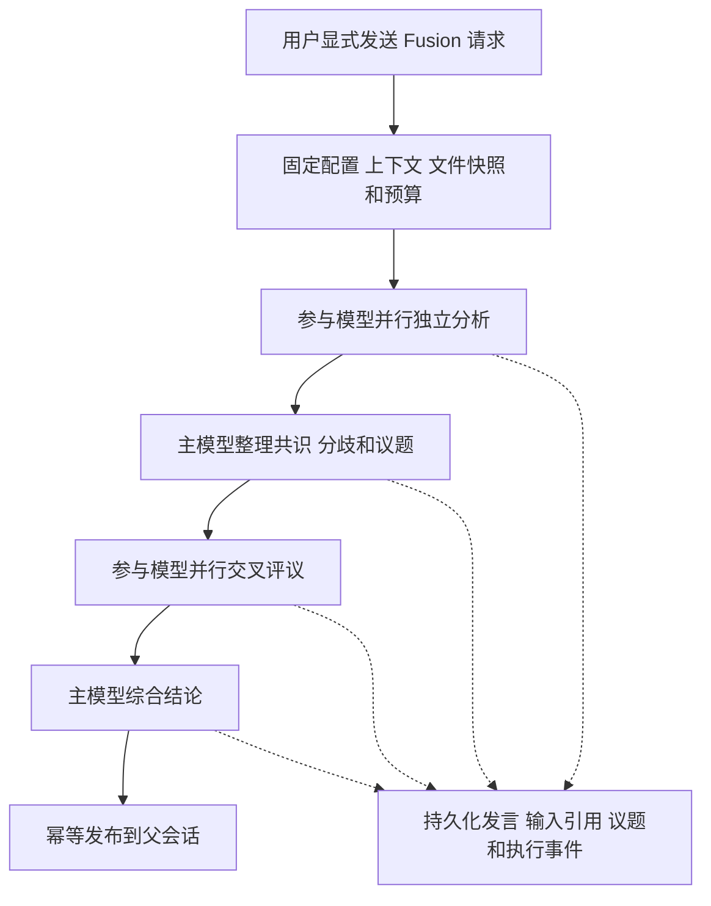

# Fusion 开发设计

[English](fusion.md)

状态：开发设计，尚未实现。设计日期：2026-10-29。

Fusion 是由用户手动开启的多模型只读讨论功能，位于 `orchestration/fusion`，与 Goal、Tasks 并列。一次用户提问经过独立分析、议题整理、交叉评议和综合结论，最终答案进入当前聊天历史，讨论和执行记录可以长期复盘。

本设计要求桌面端、移动端、终端三端支持相同的核心流程，同时要求宿主兼容 Windows、macOS、Linux。三端支持是交付条件，不能以只完成桌面端代替。普通流程继续使用 `read / write / edit / shell`；Fusion 主模型和参与模型仅使用 `read / ls / glob / grep`。

## 产品边界

Fusion 负责调查、比较、讨论和制定方案。模型不能在讨论期间修改工作区、运行通用命令、安装依赖、执行测试、提交代码或触发外部业务操作。系统仍正常写入讨论数据库、日志、快照和缓存，这些写入属于可信后端，不是模型获得的文件写权限。

用户在输入框选择 Fusion 后，本条请求必须进入完整编排流程，主模型不能决定跳过。默认只对下一条消息生效；持续开启、自动触发、自动执行结论不属于第一版。关闭 Fusion 时仍走原来的普通发送路径。

设置页面最终提供一个主模型、多个参与模型及各自思考级别。开发阶段固定一个主模型和三个参与模型，通过统一的 `FusionConfig` 提供，不把模型选择写进调度逻辑；之后替换配置来源即可接入设置页。配置引用现有模型 ID 和凭据解析机制，不复制 API key。主模型可以与普通聊天模型不同，开启时必须展示实际配置。

Goal 的长期推进、Tasks 的触发执行与 Fusion 的讨论保持独立。后续可显式引用彼此的结果，第一版不允许 Goal、模型工具或调度器自行开启 Fusion。

## 共享架构

沿用 [Tasks 架构](tasks.zh-CN.md) 的编排与宿主分离，以及 [Host 架构](headless-package-development.zh-CN.md) 的无 GUI 业务边界。

| 位置 | 职责 |
|---|---|
| `orchestration/fusion`，crate `future-fusion` | 类型、配置快照、阶段协议、确定性状态转换、存储、讨论投影 |
| `host/src/fusion` | 启动、执行、取消、恢复、查询、事件分发和结果发布 |
| Agent | 模型与工具执行、独立子会话、正文和工具结果持久化、父回合接入 |
| Desktop 与 Mobile | 模式选择、状态、讨论、分歧、历史复盘和诊断展示 |
| TUI 与 CLI | 相同业务能力的终端交互和机器可读输出 |
| RPC 与 Remote | 类型化命令、分页读取、增量事件和能力协商 |

`future-fusion` 不依赖 Tauri、React 或终端绘制。执行器只在已运行的共享 Host 中存在一份；客户端断开不会转移执行所有权。复用既有 Host 实例锁和退出管理，不另起一个彼此不知情的后台执行器。

TUI、CLI 连接共享服务，移动端通过已配对 Host 执行，不在手机上复制工作区或运行子模型。宿主不可用时返回可操作的错误，不能降级成普通模型回答并标记为 Fusion。

## 讨论协议

| 阶段 | 输入 | 输出 |
|---|---|---|
| `analyzing` | 相同的用户问题、公共上下文、约束和文件快照 | 各模型独立的方案、依据、假设、不确定性和待验证项 |
| `issue_mapping` | 全部有效独立回答 | 共识、矛盾、覆盖不足、独到见解、共同遗漏和待评议议题 |
| `reviewing` | 固定的第一轮材料和同一份议题清单 | 支持、反对、补充、立场修正及其理由 |
| `synthesizing` | 全部有效发言、证据和评议 | 最终答案、议题处理、采用理由、未解决分歧和待验证项 |

第一轮参与者互不可见，不先接收主模型的倾向。主模型负责主持和综合，不额外配置 Judge。第二轮按固定顺序提供相同的第一轮材料，不能根据先后返回的第二轮内容改变其他模型的输入。材料超过预算时使用已保存的公共裁剪结果，原文仍可回查。

第一版固定一轮交叉评议，程序控制阶段推进。三个参与模型的正常路径需要八次模型执行，即 `3 + 1 + 3 + 1`，不含工具调用和重试。主持阶段只整理议题，不提前给出最终裁决。综合阶段保留有依据的少数观点；多数赞同不是正确率，讨论收束不等于验证通过。

各阶段使用版本化输入输出协议。主模型输出经校验的结构化议题或综合结果，最终结果包含 `final_markdown`、议题决定、发言引用、未解决事项和待验证动作。结构化响应可在完成后展示，参与模型公开文本可流式预览；第一版不要求对不完整 JSON 提前发布结论。

运行、参与者、发言和议题 ID 由程序分配。模型只能引用本次输入中可见的有效 ID；引用不存在、越权或已失效的内容时返回明确校验错误。第一版对可重试故障最多重试一次，受总预算约束，重试不能覆盖旧 attempt。

## 四个只读工具

| 工具 | 参数契约 | 返回内容 |
|---|---|---|
| `read` | `path, offset, limit` | 指定文件行范围、实际范围、版本引用和截断信息 |
| `ls` | `path, depth, limit` | 稳定排序的目录项、类型、遍历范围和截断信息 |
| `glob` | `pattern, root, limit` | 匹配的逻辑路径、查询范围和截断信息 |
| `grep` | `pattern, root, glob, context, limit` | 路径、行号、命中及上下文、版本引用和截断信息 |

参数形状是拟议契约，落地时冻结默认值、上限和大小写规则。缺省根目录是本次已授权快照根。返回结果必须有字节上限、超时和取消支持；正则、递归深度、文件数量和并发都有边界。未命中、输出截断、无法读取和取消是不同结果。

这四个名字表示结构化操作，不接受 Shell 字符串、重定向、管道、命令替换或任意额外选项。优先使用 Rust 文件与检索实现；使用外部检索程序时，只能由后端选择可信程序、构造固定参数并直接启动，不能经过 Shell 或解析工作区提供的程序。普通流程的工具集保持原样，不全局替换 `shell`。

`read` 可复用既有读取能力，但 Fusion 执行必须接入读取范围与快照解析。第一版不增加 Git 专用工具、解释器、浏览器自动化或扩展工具入口。网页检索若后续加入，需要单独评审读取契约；不借用通用 Shell 实现。

### 强制策略

模型可见工具目录只包含这四个工具；后端在每次实际调用前再次校验能力，不能仅依赖提示词或 `set_tools`。有效能力为 Fusion 固定上限、用户现有授权和本次读取范围的交集。普通聊天的全权限、自动审批、会话规则或重试不能扩大该上限。

策略绑定整个 Fusion run，覆盖主模型、参与者、所有 attempt 和恢复路径。拒绝 `write`、`edit`、`shell`、未登记工具，以及通过 MCP、子代理、命令接口或配置变更间接恢复这些能力。讨论中不提供一次性写入升级；需要执行时记录待验证动作，由用户之后显式启动普通执行。

文件访问复用既有读取授权，规范化原始目标并校验符号链接、Windows junction/reparse point 和根目录边界。只处理允许的普通文件与目录，不跟随越界链接，不把设备、FIFO 或 socket 当作文件。授权范围外的内容不能因快照复制而变得可读。只读能力的成立不依赖某个操作系统沙箱可用。

## 固定上下文和文件版本

启动时固定用户问题、历史边界、附件引用、模型配置、思考级别、提示词版本、工具策略版本、读取范围和预算。所有参与模型使用适配最小上下文窗口的一份公共上下文；保存实际裁剪或摘要后的材料，不能只记录“使用了聊天历史”或仅存 hash。

文件读取统一经过本次 run 的版本化数据源。完整交付使用有界的运行快照，包含范围内已经保存的未提交修改与允许的未跟踪文件，不只复制 Git HEAD；不声称能够读取编辑器尚未保存的缓冲区。快照由可信后端写入应用私有存储，模型的逻辑路径仍指向原工作区。

固定清单中的字节是后续四个工具的共同读取来源，不能混入实时文件。捕获过程保存起止时间，检测捕获期间的变化并有界重试或报告失败；跨平台文件复制不等于整个文件系统某一时刻的原子快照。范围、忽略规则、文件和总字节上限必须可诊断，超限明确失败或要求缩小范围，不能静默遗漏关键输入。

开发阶段可暂用“首次读取固定”：首次读取保存内容，其他参与者复用同一文件版本。这只能保证已捕获文件一致，不能保证跨文件同一时刻一致；必须记录 `snapshot_mode` 和捕获时间，在完整快照验收前不能宣称达到同等保证。

所有快照查询使用同一授权命名空间。相同版本和参数的读取可合并或缓存，键包含 run、授权范围、快照版本、工具和完整语义参数。每个参与者的请求仍分别记账，引用同一个结果，并区分实际执行与缓存复用。客观证据可共享，第一轮模型分析仍保持隔离。

## 运行与父会话

一次 Fusion 占用父会话的一个回合。后端原子接收或预留该回合，保存用户输入、请求幂等键和 `fusion_run_id`，拒绝与同一父会话内其他活跃回合竞争。仅有前端发送锁不足以约束手机、终端或另一窗口。

每个参与者有独立 Agent 子会话；主模型也在隔离的编排会话中工作。同一参与者的评议可沿用自己的子会话，但不共享可变模型配置。子会话在 Fusion 内分组，默认不污染普通聊天列表。重新加载或重新连接只接回现有执行，不创建新 run。

Agent 需要新增编排回合接入能力：接收父回合、维护运行占用、幂等提交来源为 Fusion 的最终 assistant 答案，以及终止回合。接口名和具体 wire 字段在实现阶段冻结。必须经过 Agent 的权威历史写入，不能直接写 Agent SQLite 或只在 React 中插入气泡。后续普通聊天读取最终答案；内部发言按需查询，不全部塞入父上下文。

Fusion 数据库与 Agent 数据库不假设有跨库事务。结果发布采用可恢复状态：先提交最终结果和 `publishing`，再以固定发布键请求 Agent 写回，收到回执后提交 `completed`。提交成功但确认丢失时查询回执，不能重复答案；失败、取消和中断也必须最终释放对应父回合占用。

## 存储与审计

数据根为 `<FUTURE_HOME>/fusion/`，默认 FutureOS home 下的 `fusion/`；数据库为 `fusion.db`。复用统一 home 解析，SQLite 使用 WAL、外键、短事务和有界 busy timeout。所有路径通过平台路径 API 组装。表结构、迁移和布局标记在首个实现里冻结，不能把以下逻辑模型当成已经发布的 DDL。

| 表 | 主要字段与职责 |
|---|---|
| `fusion_runs` | ID、父来源身份与 thread/session/turn 绑定、请求幂等键、状态、阶段、结果完整性、配置与上下文快照、预算、结果引用、发布回执、owner generation、时间、错误、续议来源 |
| `fusion_participants` | ID、run、main/panel 角色、配置和实际模型、思考级别、Agent 子会话来源 |
| `fusion_steps` | ID、逻辑步骤键、阶段、参与者、attempt、实际输入引用、Agent run 绑定、状态、耗时、usage、已知费用、错误 |
| `fusion_inputs` | 不可变输入清单及内容引用、模板版本、裁剪和摘要规则、文件清单与版本 |
| `fusion_messages` | 稳定发言 ID、阶段、作者、正文引用、回复与议题关联、完成或部分输出状态 |
| `fusion_issues` | 议题、来源发言、状态、主模型判断和采用理由 |
| `fusion_positions` | 议题、参与者、支持/反对/不确定、依据发言、前后立场关联 |
| `fusion_events` | run 内序号、事件类型、步骤与因果引用、时间、必要元数据及策略拒绝记录 |

参与者 ID 与模型 ID 分离，同模型可承担不同角色。请求键在父来源与父会话范围内唯一；步骤的 `(run, logical_step, attempt)` 唯一；事件 `(run, seq)` 唯一；模型重试不会重写历史。

Agent 继续拥有公开模型输出、工具调用和正文；Fusion 保存编排事实、不可变输入以及稳定引用，不复制逐 token 日志。跨库引用携带数据库身份与恢复来源信息，不能仅凭 session ID 访问另一份数据库。正文引用与细分内容字段遵循 [流式存储设计](stream-storage-development.zh-CN.md)。

阶段转换、对应事件和结构化投影在同一 Fusion 事务提交，事件可重建编排投影；正文与实际输入由各自权威存储提供。只有 Agent 已持久化的完整结果才能被接纳为下阶段输入。流式未提交尾部可以预览，崩溃后只恢复已提交前缀并标记部分输出。

事件订阅在提交后发出，带递增游标；断连从持久化游标补读。快照响应带同一读取版本的事件水位，客户端先应用快照再接续事件，避免窗口丢失。并行返回顺序不是因果关系，依赖必须显式关联输入、发言和步骤。正文分页按需读取，不能为列表加载整段讨论。

保留讨论意味着保留其引用的 Agent 正文、附件和快照。删除父会话或讨论时通过可恢复清理流程联动引用，不能留下可点击却已丢失原文的记录；共享引用不提前回收。备份和恢复必须把 Fusion、Agent、应用绑定和相关内容纳入一致的数据根流程。导出包去除凭据，保留版本、输入、公开讨论、工具证据和执行信息；沿用读取权限，不因导出扩大可见性。

## 生命周期与失败

运行状态为 `queued / running / publishing / completed / failed / cancelling / cancelled / interrupted`；阶段另存 `preparing / analyzing / issue_mapping / reviewing / synthesizing`。结果完整性独立为 `full / partial / single`，不能把降级当成完整讨论。时间戳用于显示，阶段先后和幂等校验不依赖墙钟排序。

| 场景 | 处理 |
|---|---|
| 部分参与者失败或超时 | 预算内至多重试一次，保留 attempt；用有效结果继续并标记缺席 |
| 只有一个有效参与者 | 可以综合，明确显示 `single`，不展示多方共识 |
| 所有参与者失败 | 失败，保留记录，不伪装为普通模型成功 |
| 主模型失败或结构无效 | 有界重试；仍失败则保留讨论，允许用户继续完成 |
| 工具请求越权 | 执行前拒绝并记录，不升级权限；模型改用只读调查或记录待验证项 |
| 预算不足 | 不派发超预算步骤；记录终止原因，保留已有内容，不宣称完整完成 |
| 用户停止 | 先提交取消意图，停止派发并取消子 run；确认或对账后结束父回合 |
| UI 断连或切换会话 | Host 继续运行，客户端按 run 和游标重接 |
| Host 崩溃 | 查询已接受的 Agent 请求和发布回执，标记中断；用户选择继续后恢复 |

每阶段、每模型与工具有时间、输出和调用次数上限；总预算包含所有 attempt，并预留综合结论开销。执行前使用估算与最大输出约束，执行后按供应商实际 usage 对账；未报告的费用为未知，不当成零，也不承诺跨供应商精确硬金额上限。

取消和恢复使用持久化 owner generation 与条件状态更新，旧执行者不能推进新阶段或发布结论。晚到结果可保存到原 attempt，但不能覆盖取消状态。恢复前先核对原请求是否仍在运行，不盲目重新派发；继续和重试继承原只读上限。

## 服务与三端协议

下列为待实现的业务操作，不表示当前命令已经可用。

| 操作 | 契约 |
|---|---|
| `start` | 父会话来源、问题与附件、显式 Fusion 标志、配置版本、客户端请求键；返回接受回执和 run ID |
| `get` / `list` | 当前状态、阶段、参与者、结果完整性和摘要；列表不带全部正文 |
| `events` | 按 run 和持久化游标增量分页，明确截断和游标失效 |
| `messages` / `issues` / `input` / `step` | 分页读取讨论、分歧、实际输入和执行详情 |
| `cancel` / `resume` | 幂等停止或用户明确继续；恢复不能扩大权限 |
| `export` / `delete` | 权限检查后的导出与可恢复联动清理 |

三端调用同一 Host 服务。Agent 执行和父回合能力经 `packages/rpc/proto/future.proto` 定义；终端访问共享 Host 的路由必须补齐，不能让 CLI 直接打开运行中的数据库绕过服务。Mobile、远程 Desktop 经 Remote 类型化命令转发，新增 wire 契约需要更新 schema、生成类型和双方适配。传输层不得依赖 Tauri event 名或平台文件路径。

协商拟议能力 `fusion_v1`；旧宿主不支持时客户端禁用入口并说明需要升级，不静默发送普通请求。每次读取校验配对、会话来源和权限；知道 run ID 不等于可读取讨论。移动端不自动下载完整调试包，遵守已有分页、消息大小和下载限制。

| 客户端 | 必须提供的体验 |
|---|---|
| Desktop | 输入框一次性模式选择、配置摘要、过程卡片、右侧讨论/分歧/诊断面板、停止、历史与重接 |
| Mobile，Android 与 iOS | 同一模式与状态、全屏讨论详情、发言分页、分歧与来源跳转、停止、历史、前后台恢复和能力提示 |
| TUI 与 CLI | TUI 模式选择、阶段状态、参与者与讨论/分歧/诊断导航、停止和历史；CLI 对应服务操作及结构化 JSON 输出 |

三端都能选择并显示主模型和参与者；开发阶段显示同一固定配置及只读说明，后续设置来源保持一致。中文与英文文案同步。窄屏和终端采用顺序列表与折叠，不把桌面多列布局简单缩小。TUI 不托管第二个执行器，CLI 非 watch 读取不触发模型请求。

## 讨论与复盘界面

输入处显示“Fusion · 只读调查”，同时显示主模型和参与者。运行卡片按真实阶段显示 `3/3` 分析完成、`2/3` 评议完成等，不编造总进度百分比；用户可以展开讨论或停止。完成后最终答案保持普通聊天阅读方式，下面保留参与者、完整性与讨论入口。

详情提供三种视图：

- **讨论**：按独立分析、议题整理、交叉评议、综合结论分组；模型发言可展开，工具读取活动归属于对应发言。只有用户正在查看的流式内容跟随更新，避免强制跳动。
- **分歧与结论**：按议题展示初始立场、修正、最终采用理由和未解决事项，引用可跳转原文。状态表示已形成方案或仍待验证，不能显示成验证通过或模型投票正确率。
- **诊断**：实际输入、配置与实际模型、可获得的供应商请求标识、时间、Token、已知费用、重试、策略拒绝、缓存复用和 Agent 关联 ID。

回放只读历史，不调用模型。重新运行和继续讨论指定分歧产生关联的新 run，保留原结论；中断恢复则继续原 run。两者在 UI 和 API 中明确区分。

## Windows macOS Linux 兼容

三种宿主操作系统均必须支持核心编排、四工具、SQLite、取消、恢复和三端访问，覆盖项目支持的 x86-64、arm64 目标。只读保证来自工具执行能力，而非某个平台独有沙箱；没有 Bash、系统 `grep`、`ls` 或 `rg` 的干净安装也必须工作。

| 领域 | 实现要求 |
|---|---|
| 路径 | 使用 `Path/PathBuf` 与统一 home 解析；处理 Windows 盘符、UNC、分隔符、junction 和 reparse point；逻辑展示路径与本机路径分离 |
| 比较 | 按实际文件系统识别大小写和路径身份，不假定所有 macOS 卷或 Windows 目录都不区分大小写；处理 Unicode 和非 UTF-8 路径时明确支持或报错，不悄悄指向另一文件 |
| 搜索 | 冻结跨平台 glob、正则和大小写语义；稳定排序，正确处理 CRLF/LF、空文件、二进制和解码失败 |
| 进程 | 检索若用子进程则固定可信程序，不加载 Shell/profile；超时与取消清理整棵自有进程树，不终止其他 Agent |
| 存储 | WAL、锁、短事务、Windows 文件占用下的快照回收与原子文件操作需要验证；跨卷失败显式处理 |
| 传输 | 复用现有 Unix IPC 或 Windows named pipe 与 Remote，客户端不拼接宿主绝对路径或自行执行命令 |

## 实施与验收

| 阶段 | 交付 | 退出条件 |
|---|---|---|
| M0 | `future-fusion` 协议与存储、Host 服务、四个只读工具、固定模型配置、父回合接入 | 一次真实请求完成四阶段并只发布一份最终答案，输入与讨论可回查 |
| M1 | Desktop、Mobile、TUI/CLI 接入及 RPC/Remote 能力协商 | 三端均可手动开启、查看过程和分歧、停止、重接和历史复盘 |
| M2 | 运行快照、故障恢复、预算、导出清理与诊断 | 通过下列故障、版本与权限验收，覆盖三种宿主系统 |
| M3 | 主模型、参与模型和思考级别设置 | 三端读取一致配置，修改只影响后续 run，既有 run 快照不变 |

M0/M1 可用首次读取固定做开发验证，完整交付必须通过 M2 的运行快照验收。M3 前界面明确显示固定配置。续议、Goal 关联和执行交接属于后续能力；执行交接必须由用户显式启动独立普通 run，引用结论与待验证项，并核对工作区是否已经变化。

验收覆盖以下行为：

1. 关闭时普通四工具保持原行为；开启时主模型与参与者均仅获得 `read / ls / glob / grep`，全权限、重试、恢复和其他入口不能绕过限制。
2. 并发读取同一版本得到相同结果，重复请求正确复用且保留各自审计；第一轮看不到其他模型分析，第二轮输入在派发前固定。
3. 运行快照保留允许的已保存修改，捕获期间变化可检测，工作区后续变化不污染讨论；裁剪、超限和首次读取固定的局限可见。
4. 写文件、Shell、扩展工具、路径越界、越界链接和特殊文件在执行前被拒绝；失败尝试不会进入审批后偷偷扩大权限。
5. 刷新、重连、重复发送与发布确认丢失不会重复创建 run、用户消息或最终答案；接入没有事件窗口缺口，非法或过期游标明确处理。
6. 部分失败、全部失败、结构无效、预算耗尽、停止后晚到结果和 Host 崩溃保留真实状态；恢复不重复派发已运行步骤，不覆盖取消。
7. 三端都能跳到结论依据原文，查看实际输入、重试和工具证据；普通后续聊天读取最终答案，子会话不污染列表。
8. 删除、备份、恢复和导出保留引用一致性与权限；凭据不进入讨论记录，缺少来源不能被显示成空历史成功。
9. Windows、macOS、Linux 及 Android/iOS 客户端覆盖路径、行尾、编码、取消、分页、权限与断连；不支持 Fusion 的旧宿主有明确能力提示。

实现时由 CI 运行单元与契约测试，按仓库规范执行模块范围的静态检查。本文档阶段仅运行文档检查，不宣称上述功能已经验收。

## 相关资料

- [Goal 控制面](goal-control-plane.zh-CN.md)
- [Tasks 架构](tasks.zh-CN.md)
- [Host 开发计划](headless-package-development.zh-CN.md)
- [RPC 契约](rpc.zh-CN.md)
- [SQLite 迁移](sqlite-migration.zh-CN.md)
- [流式存储设计](stream-storage-development.zh-CN.md)
- [OpenRouter Fusion](https://openrouter.ai/docs/guides/routing/routers/fusion-router)：多模型独立分析与结构化比较的参考；本设计采用用户手动开启和严格只读调查。
