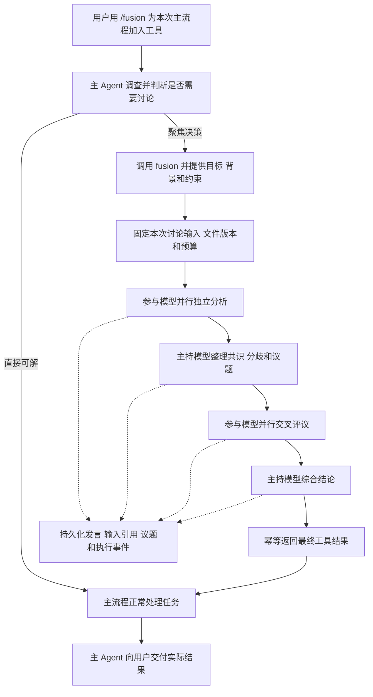

# Fusion 开发设计

[English](fusion.md)

状态：工具化首版已实现，开发阶段固定模型。设计与实现日期：2026-10-29。

Fusion 是主 Agent 可调用的多模型思考工具，编排内核位于 `orchestration/fusion`，与 Goal、Tasks 并列。用户通过 `/fusion` 为本次主流程加入 `fusion` 工具，主 Agent 先调查，再按需提交一个聚焦的决策问题。内部只读讨论后返回最终结论，原主流程继续完成用户任务，用户可以展开讨论记录复盘。

本设计要求桌面端、移动端、终端三端支持相同的核心流程，同时要求宿主兼容 Windows、macOS、Linux。三端支持是交付条件，不能以只完成桌面端代替。外层主流程保持 `read / write / edit / shell`，使用 `/fusion` 时增量加入 `fusion`；内层主持模型和参与模型仅使用 `read / ls / glob / grep`。

## 当前实现与使用

- 主持模型固定为 `future/deepseek-flash`；三个参与模型固定为 `future/deepseek-flash`、`future/glm-5.3-flash`、`future/qwen3.7-plus`。最后一个型号按当前 Future 目录和用户确认选择，不使用不存在的 `qwen3.8-plus`，缺失模型明确失败，不替换成默认模型。
- 启动 Desktop 或 `future host`，在 Desktop、Mobile 或 TUI 输入 `/fusion <任务>`。主 Agent 本次获得 `fusion`，根据聚焦问题决定调用；内层按 3→1→3→1 讨论，外层收到唯一最终结果后继续原任务。普通后续 run 不继承该工具。
- Desktop/Mobile 展开回复的过程，再展开 Fusion，仅显示四阶段主进度条与各模型的思考状态，使用 `user-round-group` 图标；详细发言、诊断和工具证据继续保存在数据库，通过终端查询复盘。TUI 使用 `/fusion-log` 查看当前父会话最近一次讨论，`/fusion-log <step-id>` 查看原始步骤。CLI 使用 `future fusion show <parent-session-id> [--run <id> --tool <id>] [--step <id>] [--offset <bytes>] --json`，查询不调用模型。
- 共享 Host 通过 `~/.future/fusion/fusion.db` 的有界持久队列接收 Agent 工具调用，避免 Agent 反向依赖 Host。Host 实例锁保证执行器唯一，事务认领每次讨论，最多同时执行两个讨论。服务不可用或旧 Agent/Host 不支持时明确失败。
- Agent 从原始用户提交开头的独立命令 token 验证启用，并冻结到 `ScheduledSettingsSnapshot.fusion_enabled`，同原文与请求键一起持久化；不新增持久会话开关。Remote outbox 保留原始 `/fusion`，重发继续使用原请求键。内层会话标记为 `created_by=fusion`，每次运行都强制替换成四个快照工具，不从普通会话设置继承 shell/写工具。
- 调用时仅捕获显式 `read_scope` 中经父权限允许的 UTF-8 文件，生成同一份有哈希的文件快照，所有轮次读取它；空范围适用于纯概念问题。拒绝越界、链接/reparse point、特殊文件和越限资料。单文件 1 MiB、合计 16 MiB、最多 1024 个文件/目录；记录捕获起止时间并检测观察到的变化，不声称文件系统原子快照。
- 输入最多 48 KiB，最终工具结果最多 32 KiB，中间模型回答单独限制为 128 KiB。所有参与者及主持模型每次 completion 的输出上限为 16384 token，只有输出超限重试时提高到 32768。DeepSeek Flash、Qwen 3.7 Plus 及 DeepSeek 主持模型的思考等级固定为 `medium`，GLM 5.3 Flash 固定为 `low`。每步最多五轮工具循环，整个步骤限时 300 秒；整次讨论从创建起限时 2700 秒，重试不能重置总时限。每个父 run 最多两次讨论，每步骤最多两次尝试。整步超时、取消、鉴权及未知错误不原样重试；输出超限会提高预算并要求更精简的完整回答，结构错误会带修正要求重试，明确的临时服务错误可有限重试。空 `read_scope` 不提供文件工具。失败尝试单独记录；结果只标记 `full`、`partial` 或 `single` 的实际完整性。
- `fusion_runs/inputs/participants/steps/messages/issues/positions/events` 保存结构、输入、状态、引用和诊断，完整正文/工具证据仍由 Agent 子会话持久化。详情预览有界，原文按 UTF-8 字节分页读取；查询校验父会话、数据库来源及步骤归属。重启中断未完成讨论，不静默重新计费；父任务取消会停止讨论，晚到结果不能覆盖取消。
- 删除父会话时先停止并清理关联子会话，再清理讨论与快照。`future data` 离线备份包含 Fusion 数据库和快照，恢复继续保留原始消息/run ID。历史查询允许同一数据库恢复后的存档，执行仍要求当前恢复代身份匹配。

以下章节保留后续产品契约：可编辑模型/思考设置、独立脱敏导出、更完整的立场变化结构及货币预算尚未提供。当前开发版使用上述固定配置和 token/次数/超时限制。跨系统构建与单元回归由 CI 验证，本机静态检查与隔离实测记录见 [实现验证](../testing/fusion-implementation.md)。另见 [真机数据库核查与精简 UI 验证](../testing/fusion-database-audit.md)。

固定开发配置集中在 `orchestration/fusion/src/config.rs`。每次讨论保存配置快照，每次尝试保存实际思考等级、输出上限、有效超时和重试原因。Host 与 Agent 校验 generation-policy 版本及子会话、模型和思考等级绑定；旧记录缺少这些可选字段时仍可查询。桌面、移动、终端统一使用同一 Host/Agent 策略，客户端不独立选择生成参数。验证记录见 [预算策略验证](../testing/fusion-budget-policy.md)。

## 产品边界

Fusion 只负责思考、调查、比较、讨论和制定方案，不执行方案。内部模型不能修改工作区、运行通用命令、安装依赖、执行测试、提交代码或触发外部业务操作。系统仍正常写入讨论数据库、日志、快照和缓存，这些写入属于可信后端，不是模型获得的文件写权限。

外层主 Agent 始终负责理解请求、调用工具、实施、验证和最终回复。一次 Fusion 是其中的一次工具调用，不接管整条消息，也不要求每次写文件或执行命令前讨论。返回建议不能扩大用户授权；用户要求实施时主流程按已有权限自然继续，用户只要求分析或明确禁止修改时交付分析即可，不强制再点一次“执行”。

区分外层主 Agent 与内层 Fusion 主持模型：前者完成用户任务，后者组织一次讨论；两者可以使用同一个模型配置，但上下文、运行身份和权限独立。设置页面最终提供一个主持模型、多个参与模型及各自思考级别。开发阶段固定一个主持模型和三个参与模型，通过 `future-fusion` 的固定配置常量提供；配置引用现有模型 ID 和凭据解析机制，不复制 API key。

Goal 的长期推进、Tasks 的触发执行与 Fusion 的讨论保持独立。第一版只有明确的用户 `/fusion` 请求才能启用工具，模型生成的文本、技能正文、文件或调度器不能扩大可用工具集合。工具已启用时，是否讨论由外层主 Agent 根据问题和工具说明判断。

## Slash 命令与调用选择

`/fusion <任务>` 在提交时为本次外层 Agent run 增量启用 `fusion`，其余文本仍是普通用户任务。它表示工具可用，不等于立即强制调用。只提交 `/fusion` 时，为当前输入框的下一条任务设置可取消的待启用标记，不创建空任务、不调用模型或计费；UI 明确显示“Fusion 工具已启用”。提交后该标记被消费，后续普通消息不自动继承。当前 run 的正常工具循环与中断恢复保持同一启用状态。

没有输入框的非交互 CLI 必须在同一请求中附带任务；裸 `/fusion` 返回缺少任务的用法提示，不在后台留下不可见的下一次启用状态。

三端共享精确命令与提交元数据契约：只识别输入开头的独立 `/fusion` token 或等价的命令菜单操作；引用、代码块、路径、`/fusion-other` 和文件内容不触发。保留用户原文、规范化任务和启用来源以便复盘。当前协议保留原始命令，由服务端解析为 run 级 `fusion_enabled` 快照并验证；服务端增量构造真实工具目录，不能只把提示文本拼进 system prompt，也不能调用持久化 `set_tools` 改写整段会话工具配置。

主 Agent 可以先用正常工具补齐事实，再聚焦讨论；也可以直接处理简单任务而不调用。用户明确要求“必须用 Fusion 讨论后决定”时应调用，明确禁止讨论时不调用；`/fusion` 本身不表示强制讨论。未实际调用时不创建虚假讨论记录或显示“Fusion 已完成”。第一版不增加独立模式、永久会话开关或全局默认启用。

适用问题是已有必要事实、存在影响实施方向的实质性选择，且独立观点可能改变决策。找文件、收集基础事实、格式修改、明确的局部修复、既定方案内的常规纠错由主流程单独完成。相同问题没有新证据时复用结论，不在每个命令或文件操作前重跑讨论。每个外层 run 配置讨论次数、时间和费用预算；次数是上限，不是必须完成的调用数。

## Fusion 工具契约

### 工具说明

以下说明是拟实现工具的语义基线，中文和英文说明必须保持一致：

> 对一个明确、尽可能聚焦的决策问题进行多模型只读思考，并返回综合结论。Fusion 负责分析和讨论，不修改文件、不执行命令，也不实施方案。调用前先完成必要调查，提供目标、背景、已知事实、未知项、约束以及相关证据，使参与者能够判断；需要时提供候选方案与比较标准。不要把整个任务无差别地交给讨论组。存在实质性方案分歧、关键取舍或需要独立观点交叉检查时使用；常规调查、直接可解的局部问题与既定方案实施由主流程单跑。需要写文件、运行命令或验证时，请在讨论中给出目的、计划与预期结果，交回主流程按用户授权处理。不要用重复讨论替代调查或验证。

### 输入与聚焦

| 字段 | 要求 |
|---|---|
| `question` | 必填，一个主要决策问题；明确需要决定什么和范围边界 |
| `goal` | 必填，用户目标和这次决策要改善或满足的结果 |
| `background` | 必填，必要背景、已确认事实、未知项和已有调查；区分观察与假设 |
| `constraints` | 必填数组，平台、兼容、成本、范围和用户限制等；没有额外约束时显式为空 |
| `options` | 可选，已有候选方案及需要比较的标准，不预设必须赞同的答案 |
| `evidence` | 可选，相关文件/行范围、已收集输出与版本引用；事实依赖外部材料时应提供可检查依据 |
| `read_scope` | 可选，建议只读调查路径；后端与父请求已有授权相交，不能扩大范围 |

父来源身份、父 run、tool call ID、模型配置、策略和预算由可信后端补齐，模型不传凭据或覆盖角色权限。不默认复制整个父聊天或整个工作区；传入足以独立理解本次决策的公共材料，缺少决定性信息时返回未知或需要的证据，不编造事实。

```json
{
  "question": "会话全文搜索第一版采用 SQLite FTS 还是独立索引？",
  "goal": "在桌面、手机和终端提供一致的会话搜索，优先减少迁移复杂度。",
  "background": "正文由 Agent SQLite 管理，三端经共享服务读取。已定位存储入口；大数据量性能尚未实测。",
  "constraints": ["支持 Windows、macOS、Linux", "保留现有删除与恢复语义"],
  "options": ["SQLite FTS", "独立索引"],
  "read_scope": ["agent/src/session", "host/src/agent_bridge"]
}
```

输入大小、引用、授权和必填字段由程序校验。语义上缺少明确决策或关键背景时，主持模型返回需要补充或收窄的内容，不静默展开成整个项目重设计，也不把启发式规则当作能证明问题聚焦的检查。主 Agent 负责修正输入。内层议题围绕原问题，相关发现区分“影响本次决策”和“以后再处理”，不自行扩大任务。

### 返回结果

外层只接收最终结果：`fusion_run_id`、状态和完整性、`conclusion`、简短依据 `rationale`、适用条件 `conditions`、`unresolved`、建议后续动作 `next_steps`，以及讨论/证据引用。内部发言、逐轮评议和工具输出不自动进入父模型上下文；开发者通过终端查询读取。UI 的进度不是额外工具结果。

返回内容是决策参考，不是新的用户指令或工具执行队列。主 Agent 结合原始授权、现状和约束决定采用、调整或不采用；需要执行时读取实时工作区并核对关键事实。局部错误自行修正，只有新证据改变关键决策时才考虑再次讨论。结论不等于验证通过；最终回复区分讨论意见与实际执行结果。

## 共享架构

沿用 [Tasks 架构](tasks.zh-CN.md) 的编排与宿主分离，以及 [Host 架构](headless-package-development.zh-CN.md) 的无 GUI 业务边界。

| 位置 | 职责 |
|---|---|
| `orchestration/fusion`，crate `future-fusion` | 类型、配置快照、阶段协议、确定性状态转换、存储、讨论投影 |
| `host/src/fusion` | 工具调用接入、内层编排、取消、恢复、查询、事件分发和工具结果交付 |
| Agent | run 级工具目录与调用适配、独立内层会话、正文和工具结果持久化、正常主循环继续 |
| Desktop 与 Mobile | `/fusion` 命令、工具活动、四阶段进度和模型状态；详细复盘通过终端查询 |
| TUI 与 CLI | 相同业务能力的终端交互和机器可读输出 |
| RPC 与 Remote | 类型化命令、分页读取、增量事件和能力协商 |

`future-fusion` 不依赖 Tauri、React 或终端绘制。执行器只在已运行的共享 Host 中存在一份；客户端断开不会转移执行所有权。复用既有 Host 实例锁和退出管理，不另起一个彼此不知情的后台执行器。

TUI、CLI 连接共享服务，移动端通过已配对 Host 执行，不在手机上复制工作区或运行子模型。宿主不可用时返回可操作的错误，不能降级成普通模型回答并标记为 Fusion。

Agent 的工具适配依赖中立的调用接口或 RPC，由 Host 提供实现，不反向导入 `future-host`，不产生 Agent/Host 依赖环。独立 Agent 或旧宿主没有可达讨论服务时，不声明可用工具；已发送的 `/fusion` 需要明确能力错误，不能默默去掉后继续。

## 讨论协议



| 阶段 | 输入 | 输出 |
|---|---|---|
| `analyzing` | 相同的聚焦问题、目标、公共背景、约束和文件快照 | 各模型独立的方案、依据、假设、不确定性和待验证项 |
| `issue_mapping` | 全部有效独立回答 | 共识、矛盾、覆盖不足、独到见解、共同遗漏和待评议议题 |
| `reviewing` | 固定的第一轮材料和同一份议题清单 | 支持、反对、补充、立场修正及其理由 |
| `synthesizing` | 全部有效发言、证据和评议 | 综合结论、议题处理、采用理由、未解决分歧和待验证项 |

第一轮参与者互不可见，不先接收主持模型的倾向。主持模型负责议题组织和综合，不额外配置 Judge。第二轮按固定顺序提供相同的第一轮材料，不能根据先后返回的第二轮内容改变其他模型的输入。材料超过预算时使用已保存的公共裁剪结果，原文仍可回查。

第一版内部固定一轮交叉评议，程序控制阶段推进。三个参与模型的正常路径为八个 Agent 阶段执行，即 `3 + 1 + 3 + 1`，每次执行的工具循环可能产生多次模型请求，不能承诺总计只有八次 API 调用。主持阶段只整理议题，不提前裁决；最后阶段也只综合、不执行。多数赞同不是正确率。`3131` 是内部初始策略，不作为外部工具契约的永久承诺。

各阶段使用版本化输入输出协议。主持模型输出经校验的结构化议题或综合结果，内部保留议题决定、发言引用和待验证动作，外部按工具契约返回精简最终结果。结构化响应和参与模型公开文本作为审计记录保存，通过终端查询；不向父模型发布不完整 JSON 或中间判断。

运行、参与者、发言和议题 ID 由程序分配。模型只能引用本次输入中可见的有效 ID；引用不存在、越权或已失效的内容时返回明确校验错误。第一版对可重试故障最多重试一次，受总预算约束，重试不能覆盖旧 attempt。

## 四个只读工具

| 工具 | 参数契约 | 返回内容 |
|---|---|---|
| `read` | `path, offset, limit` | 指定文件行范围、实际范围、版本引用和截断信息 |
| `ls` | `path, depth, limit` | 稳定排序的目录项、类型、遍历范围和截断信息 |
| `glob` | `pattern, root, limit` | 匹配的逻辑路径、查询范围和截断信息 |
| `grep` | `pattern, root, glob, context, limit` | 路径、行号、命中及上下文、版本引用和截断信息 |

参数形状是拟议契约，落地时冻结默认值、上限和大小写规则。缺省根目录是本次已授权快照根。返回结果必须有字节上限、超时和取消支持；正则、递归深度、文件数量和并发都有边界。未命中、输出截断、无法读取和取消是不同结果。

这四个名字表示结构化操作，不接受 Shell 字符串、重定向、管道、命令替换或任意额外选项。优先使用 Rust 文件与检索实现；使用外部检索程序时，只能由后端选择可信程序、构造固定参数并直接启动，不能经过 Shell 或解析工作区提供的程序。普通流程的工具集保持原样，不全局替换 `shell`。

`read` 可复用既有读取能力，但 Fusion 执行必须接入读取范围与快照解析。第一版不增加 Git 专用工具、解释器、浏览器自动化或扩展工具入口。网页检索若后续加入，需要单独评审读取契约；不借用通用 Shell 实现。

### 强制策略

内层模型可见工具目录只包含这四个工具；后端在每次实际调用前再次校验能力，不能仅依赖提示词或 `set_tools`。有效能力为 Fusion 固定上限、用户现有授权和本次读取范围的交集。外层主流程保留正常工具，但不能通过参数、全权限、自动审批、会话规则或重试扩大内层上限。

策略绑定整个 Fusion run，覆盖主持模型、参与者、所有 attempt 和恢复路径。拒绝 `write`、`edit`、`shell`、未登记工具，以及通过 MCP、子代理、命令接口或配置变更间接恢复这些能力；内层不能递归调用 `fusion`。需要执行时只提出计划、目的与预期结果，返回外层主流程按原始用户授权实施，不在讨论中升级权限。

文件访问复用既有读取授权，规范化原始目标并校验符号链接、Windows junction/reparse point 和根目录边界。只处理允许的普通文件与目录，不跟随越界链接，不把设备、FIFO 或 socket 当作文件。授权范围外的内容不能因快照复制而变得可读。只读能力的成立不依赖某个操作系统沙箱可用。

## 固定上下文和文件版本

工具实际调用时固定聚焦问题、目标、背景与证据、必要历史引用、附件、模型配置、思考级别、提示词版本、工具策略版本、读取范围和预算，而不是在外层用户消息刚提交时复制全部上下文。所有参与模型使用适配最小上下文窗口的一份公共材料；保存实际裁剪或摘要后的输入，不能只记录“使用了聊天历史”或仅存 hash。

只捕获本次决策需要且已授权的读取范围，不因缺省参数扫描整个工作区。纯概念决策可使用空文件清单；需要额外资料时明确请求补充范围或证据，不以聚焦工具为入口扩大调查。

文件读取统一经过本次 run 的版本化数据源。完整交付使用有界的运行快照，包含范围内已经保存的未提交修改与允许的未跟踪文件，不只复制 Git HEAD；不声称能够读取编辑器尚未保存的缓冲区。快照由可信后端写入应用私有存储，模型的逻辑路径仍指向原工作区。

固定清单中的字节是后续四个工具的共同读取来源，不能混入实时文件。捕获过程保存起止时间，检测捕获期间的变化并有界重试或报告失败；跨平台文件复制不等于整个文件系统某一时刻的原子快照。范围、忽略规则、文件和总字节上限必须可诊断，超限明确失败或要求缩小范围，不能静默遗漏关键输入。

开发阶段可暂用“首次读取固定”：首次读取保存内容，其他参与者复用同一文件版本。这只能保证已捕获文件一致，不能保证跨文件同一时刻一致；必须记录 `snapshot_mode` 和捕获时间，在完整快照验收前不能宣称达到同等保证。

所有快照查询使用同一授权命名空间。相同版本和参数的读取可合并或缓存，键包含 run、授权范围、快照版本、工具和完整语义参数。每个参与者的请求仍分别记账，引用同一个结果，并区分实际执行与缓存复用。客观证据可共享，第一轮模型分析仍保持隔离。

## 工具生命周期与主流程

用户消息和父 run 继续由原 Agent 发送路径接收。一次 Fusion 绑定父来源身份、`session_id / run_id / tool_call_id`，不额外创建用户消息、占用第二个父回合或直接插入最终 assistant 答案。工具返回后，原主循环在同一任务中继续，沿用既有会话并发与最终回复语义。

每个参与者有独立 Agent 子会话；主持模型也在隔离的讨论会话中工作。同一参与者的评议可沿用自己的子会话，但不共享可变模型配置。子会话在 Fusion 工具调用下分组，不污染普通聊天列表。父 Agent 等待最终工具结果，进度通过独立事件提供给 UI；不把参与者输出转成多个父工具结果。

Agent 调度把 `fusion` 作为同一工作区写操作的等待边界：同批工具调用包含讨论和修改时必须排序，不能边捕获/讨论边在父任务修改同一工作区。其他会话的修改仍通过文件版本隔离和既有工作树协调处理。返回后主流程对实时关键文件复核，不能拿讨论快照直接覆盖当前代码；外层多任务执行继续遵守既有工作树规则。

Fusion 数据库与 Agent 工具日志之间不假设跨库事务。Agent 先持久化工具调用意图；后端以父来源、父 run 和 tool call ID 生成稳定调用键，原子创建或复用 Fusion run，输入指纹不一致则拒绝。先提交最终结果与 `delivering`，再由 Agent 以原 tool call ID 接纳唯一的最终工具结果，收到或查询交付回执后提交 `completed`。确认丢失只补交或核对结果，不重跑模型。父 run 已取消时保存讨论记录，但不通过晚到结果偷偷恢复父执行。

刷新、重连或恢复重接已有调用；同一个工具调用重试不能新建讨论。取消父任务同时取消其在途讨论；单独“停止讨论”返回明确取消状态，由主流程遵守用户最新意图处理，不能自动重开。Fusion 完成只表示工具结论已交付，父任务是否完成由外层 run 决定。

## 存储与审计

数据根为 `<FUTURE_HOME>/fusion/`，默认 FutureOS home 下的 `fusion/`；数据库为 `fusion.db`。复用统一 home 解析，SQLite 使用 WAL、外键、短事务和有界 busy timeout。所有路径通过平台路径 API 组装。表结构、迁移和布局标记在首个实现里冻结，不能把以下逻辑模型当成已经发布的 DDL。

| 表 | 主要字段与职责 |
|---|---|
| `fusion_runs` | ID、父来源身份与 thread/session/run/tool call 绑定、调用幂等键与输入指纹、启用来源、状态、阶段、结果完整性、配置与输入快照、预算、最终工具结果引用、交付回执、owner generation、时间、错误、续议来源 |
| `fusion_participants` | ID、run、moderator/panel 角色、配置和实际模型、思考级别、Agent 子会话来源 |
| `fusion_steps` | ID、逻辑步骤键、阶段、参与者、attempt、实际输入引用、Agent run 绑定、状态、耗时、usage、已知费用、错误 |
| `fusion_inputs` | 不可变输入清单及内容引用、模板版本、裁剪和摘要规则、文件清单与版本 |
| `fusion_messages` | 稳定发言 ID、阶段、作者、正文引用、回复与议题关联、完成或部分输出状态 |
| `fusion_issues` | 议题、来源发言、状态、主持模型判断和采用理由 |
| `fusion_positions` | 议题、参与者、支持/反对/不确定、依据发言、前后立场关联 |
| `fusion_events` | run 内序号、事件类型、步骤与因果引用、时间、必要元数据及策略拒绝记录 |

参与者 ID 与模型 ID 分离，同模型可承担不同角色。调用键在父来源、父 run 和 tool call 范围内唯一；步骤的 `(run, logical_step, attempt)` 唯一；事件 `(run, seq)` 唯一；模型重试不会重写历史。父 Agent 的 tool call/result 是会话权威记录，Fusion 记录供讨论复盘，不能再创建一份父回答。

Agent 继续拥有公开模型输出、工具调用和正文；Fusion 保存编排事实、不可变输入以及稳定引用，不复制逐 token 日志。跨库引用携带数据库身份与恢复来源信息，不能仅凭 session ID 访问另一份数据库。正文引用与细分内容字段遵循 [流式存储设计](stream-storage-development.zh-CN.md)。

阶段转换、对应事件和结构化投影在同一 Fusion 事务提交，事件可重建编排投影；正文与实际输入由各自权威存储提供。只有 Agent 已持久化的完整结果才能被接纳为下阶段输入。流式未提交尾部可以预览，崩溃后只恢复已提交前缀并标记部分输出。

事件订阅在提交后发出，带递增游标；断连从持久化游标补读。快照响应带同一读取版本的事件水位，客户端先应用快照再接续事件，避免窗口丢失。并行返回顺序不是因果关系，依赖必须显式关联输入、发言和步骤。正文分页按需读取，不能为列表加载整段讨论。

保留讨论意味着保留其引用的 Agent 正文、附件和快照。删除父会话或讨论时通过可恢复清理流程联动引用，不能留下可点击却已丢失原文的记录；共享引用不提前回收。备份和恢复必须把 Fusion、Agent、应用绑定和相关内容纳入一致的数据根流程。导出包去除凭据，保留版本、输入、公开讨论、工具证据和执行信息；沿用读取权限，不因导出扩大可见性。

## 生命周期与失败

讨论状态为 `queued / running / delivering / completed / failed / cancelling / cancelled / interrupted`；阶段另存 `preparing / analyzing / issue_mapping / reviewing / synthesizing`。结果完整性独立为 `full / partial / single`。外层执行状态独立，不能把讨论完成显示成任务完成，或把降级当成完整讨论。时间戳用于显示，阶段先后和幂等校验不依赖墙钟排序。

| 场景 | 处理 |
|---|---|
| 部分参与者失败或超时 | 预算内至多重试一次，保留 attempt；用有效结果继续并标记缺席 |
| 只有一个有效参与者 | 可以综合，明确显示 `single`，不展示多方共识 |
| 所有参与者失败 | 返回明确工具错误，保留记录；外层可在用户意图允许时自行处理，但不能宣称完成讨论 |
| 主持模型失败或结构无效 | 有界重试；仍失败则保留讨论并返回工具错误，不让父流程永久等待 |
| 工具请求越权 | 执行前拒绝并记录，不升级权限；模型改用只读调查或记录待验证项 |
| 预算不足 | 不派发超预算步骤；记录终止原因，保留已有内容，不宣称完整完成 |
| 用户停止 | 先提交取消意图，停止派发并取消内层 run；明确区分取消父任务和仅取消本次工具调用 |
| UI 断连或切换会话 | Host 继续运行，客户端按 run 和游标重接 |
| Host 崩溃 | 查询已接受的内层请求和工具结果交付回执；沿用父任务恢复策略，未恢复时显式中断，不重复消费或永久挂起 |

每阶段、每模型与工具有时间、输出和调用次数上限；总预算包含所有 attempt，并预留综合结论开销。执行前使用估算与最大输出约束，执行后按供应商实际 usage 对账；未报告的费用为未知，不当成零，也不承诺跨供应商精确硬金额上限。

取消和恢复使用持久化 owner generation 与条件状态更新，旧执行者不能推进新阶段或交付结论。晚到结果可保存到原 attempt，但不能覆盖取消状态。恢复前先核对原请求是否仍在运行，不盲目重新派发；继续和重试继承原只读上限以及外层 run 的工具启用元数据。

## 服务与三端协议

下列为待实现的业务操作，不表示当前命令已经可用。

| 操作 | 契约 |
|---|---|
| `invoke` | 由 Agent 的 `fusion` 工具适配调用；携带聚焦输入、可信父来源/run/tool call、run 级启用证明与幂等键，返回调用回执和最终工具结果 |
| `get` / `list` | 当前状态、阶段、参与者、结果完整性和摘要；列表不带全部正文 |
| `events` | 按 run 和持久化游标增量分页，明确截断和游标失效 |
| `messages` / `issues` / `input` / `step` | 分页读取讨论、分歧、实际输入和执行详情 |
| `cancel` / `resume` | 幂等停止或按父任务恢复；不能恢复已取消父任务或扩大权限 |
| `export` / `delete` | 权限检查后的导出与可恢复联动清理 |

三端沿用正常 prompt 发送路径，run 级启用元数据与 Agent/Host 调用能力经 `packages/rpc/proto/future.proto` 和共享调用接口定义，具体 wire 字段在实现时冻结。`invoke` 是工具适配的服务入口，不让三个 UI 直接提交另一条独立 Fusion 任务。终端访问 Host 的路由必须补齐，不能让 CLI 直接打开运行中的数据库绕过服务。Mobile、远程 Desktop 经 Remote 类型化命令转发提交和查询，新增契约同步 schema、生成类型与双方适配。

协商能力 `fusion_v1`；旧宿主不支持时命令菜单提示升级，手输 `/fusion` 也返回明确错误，不静默发送普通请求。持久化 outbox 必须保留原任务、启用元数据与请求键，重发不遗漏工具、不重复调用；重连读取不会激活新工具。每次查询校验配对、来源和权限；知道 run ID 不等于可读取讨论。移动端不自动下载完整调试包，遵守已有分页、消息大小和下载限制。

| 客户端 | 必须提供的体验 |
|---|---|
| Desktop | `/fusion` 补全和输入解析、用输入框内 `/fusion` 前缀表示启用、不增加提示条、正常主流程工具活动、四阶段进度条和各模型状态、停止、历史与重接 |
| Mobile，Android 与 iOS | 相同命令和提交元数据、主流程工具卡片、紧凑阶段进度与模型状态、停止、outbox 重发与前后台恢复 |
| TUI 与 CLI | TUI `/fusion` 菜单与输入解析、主流程工具进度、精简讨论状态及步骤原文查询；CLI 普通请求入口识别同一指令并提供 JSON 查询、停止和历史 |

三端都能读取并设置主持模型和参与者，配置来源一致；开发阶段显示同一固定配置。中文与英文文案同步。窄屏和终端采用顺序列表与折叠，不把桌面多列布局简单缩小。TUI 不托管第二个执行器，CLI 非 watch 读取不触发模型请求。不能只在某一端把 `/fusion` 当作技能文本展开，其他端却作为原生工具启用。

## 讨论与复盘界面

中文统一称“讨论”。Fusion 活动使用 `user-round-group`，与普通模型思考的大脑图标区分。 `/fusion` 补全菜单使用同一图标。选择命令只在输入框插入 `/fusion `，不显示开启提示条或通知；删除前缀即可取消启用。单独的 `/fusion` 保留为草稿，补充任务后才发送。

展开后，上方是一条四段主进度条，标明独立思考、整理议题、交叉讨论、总结中的当前阶段。它表示真实阶段，不估算耗时百分比。下方每个模型仅一行，显示模型名与等待思考、思考中、思考完成、思考失败、思考超时、达到输出上限、已停止、已中断或部分完成。

运行中显示当前阶段各模型状态；总结期间展示主持模型状态及参与者最近状态。结束后保留未完成模型的失败状态，重试成功覆盖该阶段之前失败的展示，不删除数据库里的失败尝试。部分完成的讨论给出一行“部分模型未完成讨论”，不能把产出结论显示为三个模型全部成功。讨论完成与主任务完成仍分别表达。

普通卡片不再展示完整发言、原始输入、议题矩阵、诊断 JSON、步骤 ID、token 数或长错误堆栈，也不重复显示主流程随后生成的最终回复。详细过程继续保存在原数据库和 Agent 子会话中，可用 `/fusion-log <step-id>` 或 `future fusion show` 调查，不因简化 UI 而删减审计记录。

## Windows macOS Linux 兼容

三种宿主操作系统均必须支持核心编排、四工具、SQLite、取消、恢复和三端访问，覆盖项目支持的 x86-64、arm64 目标。只读保证来自工具执行能力，而非某个平台独有沙箱；没有 Bash、系统 `grep`、`ls` 或 `rg` 的干净安装也必须工作。

| 领域 | 实现要求 |
|---|---|
| 路径 | 使用 `Path/PathBuf` 与统一 home 解析；处理 Windows 盘符、UNC、分隔符、junction 和 reparse point；逻辑展示路径与本机路径分离 |
| 比较 | 按实际文件系统识别大小写和路径身份，不假定所有 macOS 卷或 Windows 目录都不区分大小写；处理 Unicode 和非 UTF-8 路径时明确支持或报错，不悄悄指向另一文件 |
| 搜索 | 冻结跨平台 glob、正则和大小写语义；稳定排序，正确处理 CRLF/LF、空文件、二进制和解码失败 |
| 进程 | 检索若用子进程则固定可信程序，不加载 Shell/profile；超时与取消清理整棵自有进程树，不终止其他 Agent |
| 存储 | WAL、锁、短事务、Windows 文件占用下的快照回收与原子文件操作需要验证；跨卷失败显式处理 |
| 传输 | 复用现有 Unix IPC 或 Windows named pipe 与 Remote，客户端不拼接宿主绝对路径或自行执行命令 |

## 实施与验收

| 阶段 | 交付 | 退出条件 |
|---|---|---|
| M0 | `fusion` 工具契约、run 级启用、`future-fusion` 内核与存储、Host 路由、四个只读工具、固定模型配置 | 一次父任务完成真实讨论、接收唯一工具结果并继续正常处理，不创建第二个父回合 |
| M1 | Desktop、Mobile、TUI/CLI 的 `/fusion`、工具卡片和 RPC/Remote 能力协商 | 三端均可增量启用工具、按需讨论、查看阶段和模型状态、停止、重接和历史复盘 |
| M2 | 运行快照、故障恢复、预算、导出清理与诊断 | 通过下列故障、版本与权限验收，覆盖三种宿主系统 |
| M3 | 主持模型、参与模型和思考级别设置 | 三端读取一致配置，修改只影响后续讨论，既有快照不变 |

M0/M1 可用首次读取固定做开发验证，完整交付必须通过 M2 的运行快照验收。M3 前界面明确显示固定配置。外层主流程接收结果后自然继续实施是 M0 核心路径，不推迟为另一个执行模式；Goal 关联等后续能力不改变只读工具边界。

验收覆盖以下行为：

1. 三端 `/fusion <任务>` 仅为本次主流程加入 `fusion`，保留原四工具；裸命令只设置下一条待启用。引用、路径、代码块、相似前缀和模型文本不激活；后续消息不继承，重试/恢复不丢元数据，旧宿主明确报错。
2. 输入提供聚焦问题、目标、背景、约束与必要证据；主 Agent 可先调查，简单任务可不调用，明确强制/禁止讨论的用户要求被遵守。内层隔离、公共输入、并发读取、版本与缓存复用正确。
3. 运行快照保留允许的已保存修改，捕获期间变化可检测，工作区后续变化不污染讨论；裁剪、超限和首次读取固定的局限可见。
4. 内层主持和参与者只有 `read / ls / glob / grep`；写入、Shell、递归 Fusion、扩展工具、越界链接与特殊文件被拒绝，全权限和恢复不能扩大范围。外层正常权限不被全局修改。
5. 刷新、outbox 重发、重复工具调用和交付确认丢失不会重复创建 run、用户消息或工具结果；输入指纹冲突明确失败。父任务在同一工具循环继续，不新增父回合或主持模型最终答案；事件接续无窗口缺口。
6. 部分/全部失败、结构无效、预算耗尽、取消与 Host 崩溃返回真实工具状态，不永久挂起父流程；恢复不重复派发或覆盖取消，晚到结果不重启父任务。
7. 外层只获得精简最终结果，三端用户仍可跳转原文并查看输入、重试和证据；讨论完成与父任务完成分开，原主流程最终回答进入正常历史，子会话不污染列表。
8. 删除、备份、恢复和导出保留引用一致性与权限；凭据不进入讨论记录，缺少来源不能被显示成空历史成功。
9. Windows、macOS、Linux 及 Android/iOS 客户端覆盖路径、行尾、编码、取消、分页、权限与断连；不支持 Fusion 的旧宿主有明确能力提示。
10. 修复任务讨论后主流程可继续实施，分析任务不擅自修改；普通局部纠错不反复讨论。同工作区讨论和父写操作不并行，执行先核对实时关键事实，讨论建议不扩大原始授权。

实现时由 CI 运行单元与契约测试，按仓库规范执行模块范围的静态检查。本文档阶段仅运行文档检查，不宣称上述功能已经验收。

## 相关资料

- [Goal 控制面](goal-control-plane.zh-CN.md)
- [Tasks 架构](tasks.zh-CN.md)
- [Host 开发计划](headless-package-development.zh-CN.md)
- [RPC 契约](rpc.zh-CN.md)
- [SQLite 迁移](sqlite-migration.zh-CN.md)
- [流式存储设计](stream-storage-development.zh-CN.md)
- [OpenRouter Fusion](https://openrouter.ai/docs/guides/routing/routers/fusion-router)：多模型独立分析与结构化比较的参考；本设计通过 `/fusion` 为主流程加入思考工具，内层严格只读，外层按需调用并继续任务。
