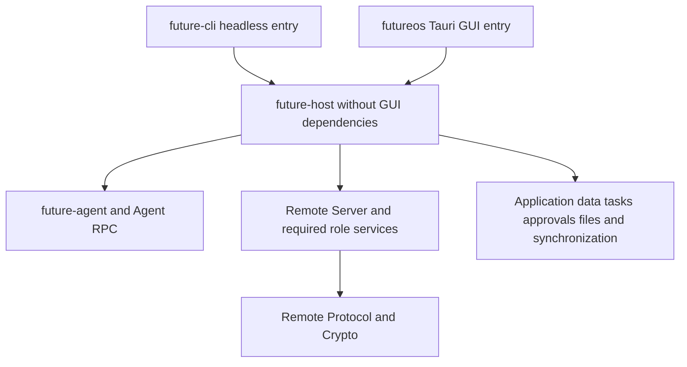

# Headless Package Development Plan

> [中文](headless-package-development.zh-CN.md)
>
> Design date: 2026-10-20. Source baseline: `904eab2b`, including Remote extraction merged through PR #1235.
> Status: in progress. Source/dependency baselines are captured and shared backend and unified entry are connected, with unified acceptance pending; phases 0–6 are incomplete.

Extract the application host without a GUI from the Desktop crate and start it in the foreground with `future headless`. Introduce `future-host`, a Rust library without GUI dependencies, for the application backend shared by Desktop GUI and headless. Desktop and CLI own their entry points and interaction. Preserve current functionality, data, pairing, approval, sandbox and shutdown behavior.

The existing contract is documented in the [Headless guide](../guide/desktop-headless.md), [Desktop Agent guide](../guide/desktop-agent.md) and [Remote extraction plan](remote-package-development.md). Update operational guides as implementation lands; commands described as targets here are not commands already provided by the current release.

## 1 Goals and scope

The final entry points are:

```bash
future headless
future headless --relay http://192.168.1.10:8099
future headless --relay https://relay.example.com --relay-ca relay-ca.pem
future headless --help

future remote devices
future remote devices add
future remote devices remove <id>
future remote devices use <id>
```

`future headless` remains in the foreground, guides login and pairing when needed, reuses valid credentials, serves mobile and existing remote requests, and exits on Ctrl+C. `future agent` continues to start the Agent service alone. `future headless` hosts the complete application backend and starts an embedded Agent or connects to a compatible external Agent under the existing ownership rules.

Final distributions provide headless through `future`, without requiring a separate `futureos-headless` executable. Desktop GUI remains `futureos`. Daemonization, system-service installation, background flags, new Remote protocols and new CLI/TUI controller product features are outside this migration.

This changes entry points and code ownership. Data paths, locks, communication contracts and business semantics do not change with package names. Concurrent GUI/headless ownership of the same data directory is outside scope.

## 2 Current coupling and target structure

At baseline the launcher belonged to `futureos` (current entry: [CLI headless](../../cli/src/headless/mod.rs)). Features already exclude GUI system libraries, but it still uses Desktop Store, Agent management, login, Remote host adapters, scheduling, observers and shutdown coordination. Adding a CLI dependency on Desktop would retain these build and test ownership problems.

Create `host/` with the crate name `future-host`, as an application host library in the root Cargo workspace, sharing the lockfile and build artifacts. It is an ordinary Rust library, with no separate executable or `staticlib`/`cdylib` targets. `host/` is an application runtime and may compose services such as `future-agent`; it differs from the product-independent protocol and role libraries under `packages/`.



Dependency requirements:

- `future-cli` and `futureos` may depend on `future-host`. `future-host` must not depend on `future-cli`, `futureos`, Tauri, React, Expo or a WebView, including through an optional GUI feature.
- The host can use existing `future-app-settings`, `future-app-workspaces`, `future-tasks`, RPC and Remote libraries. Do not duplicate their models, state machines or persistence implementations.
- Remote libraries must not depend back on `future-host`. They continue to access business services through host interfaces; protocol and crypto tests do not start the complete application host.
- Cargo feature unification when building CLI and GUI together must not introduce GUI dependencies into the CLI. Desktop owns GUI adapter implementations.

### 2.1 Code ownership

| Capability | Target owner | Boundary |
|---|---|---|
| Headless arguments, help, terminal login/pairing display, signals and exit codes | CLI entry module | Calls shared services; terminal interaction stays outside protocol and Store |
| Future home, environment initialization, instance lock, logging and lifecycle | `future-host` | One initialization sequence and ownership model, without GUI startup |
| Agent startup, compatibility/readiness, embedded/external ownership and stop | `future-host`, reusing Agent APIs | Preserve user, singleton and endpoint rules; do not create another Agent implementation |
| Store, session/run metadata, workspaces, configuration, identity and pairing persistence | `future-host` and existing shared data libraries | Preserve authoritative storage, atomic writes, migrations and lock order |
| Business, event projection, recovery and observers in `agent_bridge` | `future-host` | Deliver events through interfaces without Tauri types |
| `remote_host` business/catalog/file/pairing adapters and local Remote control | `future-host` | Preserve real Agent, approval, sandbox and file behavior |
| Model refresh, skill bootstrap, task ticks, delete outbox and watchdog | Explicitly started/stopped shared host services | Start each once per host; all tasks support stop and awaited cleanup |
| Windows, Tauri commands, menus, tray, system plugins, clipboard and GUI events | Desktop | Thin adapters call business APIs; do not move the entire commands module into the library |

Classify code by actual call chains rather than copying whole directories. Split business logic from Tauri types before moving mixed modules. Expose capabilities the two entries need, without making all Store or supervisor internals public for migration convenience.

### 2.2 Lifecycle and maintenance dependencies

`future-host` exposes explicit configuration, startup results, event output and observable stop/wait interfaces. Entries adapt terminal display, GUI events and required interaction responses. Display variants must not change credential commits, invitation lifetime or established-pairing detection.

The entry owns the runtime; `future-host` service APIs do not create runtimes or call `block_on`. CLI follows its [existing component dispatch](../../cli/src/main.rs), routing `headless` before the ordinary CLI runtime and creating the runtime in that entry to drive the host. GUI supplies its existing runtime capabilities. Retain current headless resource limits unless separately validated. Neither entry nests runtimes.

Current headless maintenance invokes a matching CLI for commands such as `future init`. Inject maintenance capability from the entry: CLI may invoke its current executable with the `init` subcommand; Desktop keeps using a CLI validated for version and capabilities. `future-host` must not import CLI command implementation or redispatch `headless` recursively. Preserve the current behavior where maintenance failures are reported without blocking remote service.

The in-process host may initially retain the current single-instance model; multiple hosts within one process are not a requirement. Give background tasks explicit lifecycle ownership rather than creating two independent copies of process-global state.

## 3 Functional and data compatibility

| Contract | Required behavior after migration |
|---|---|
| Data root | Preserve `FUTURE_HOME`, HOME/USERPROFILE resolution and default paths; no new headless-specific data tree |
| Application and Agent data | Keep `~/.future/app/app.db`, Agent configuration/sessions and workspace layout, including migrations, run/approval recovery and file references |
| Identity and credentials | Preserve device/Noise identities, pairing book, control pointer, pending revocations, account credentials and file formats; established devices do not re-pair |
| Same-directory exclusion | GUI and headless share the existing lock, including `app/desktop.lock`; renaming a command must not create two locks or delete active lock files |
| Remote entry | Preserve first login/pairing, stored pairing reuse, active/standby devices, refresh/recovery and revocation; retain wire fields and the `futureos://remote/pair` invitation scheme |
| Self-hosted relay | Preserve `--relay`, `--relay-ca`, saved settings and current invitation-origin/TLS policy; do not require platform login for the account-free relay path |
| Local device management | Existing `future remote devices` subcommands remain; `add` obtains a usable invitation from the active host through the existing `run/remote-control` file request/reply channel |
| Business and synchronization | Mobile sees the same sessions, history, models, workspaces, files, tasks and approvals; Agent and Store retain their authoritative roles |
| Models and skills | Keep initial/periodic model refresh, post-login skill bootstrap and failure handling without introducing parallel caches/configuration |
| Security boundaries | Preserve approvals, sandbox/path restrictions, file hash/cache rules, atomic credential writes and sanitized diagnostics; help/version do not start services or write data |
| Exit | Foreground operation; Ctrl+C and Unix SIGTERM/SIGHUP work during login, pairing and service; stop admission/recovery before bounded cleanup |
| Agent ownership | Stop owned Agent services according to current rules; preserve external Agents and cancel only this host's owned requests |

Preserve current runtime/next-start behavior of commands such as `remote devices use`. Entry migration does not change device-management semantics. Update obsolete program names in command hints, status text and diagnostics rather than preserving incorrect usage text.

Both upgraded GUI and headless must read the same old data. Use dedicated test-user data created by the old version, then verify upgrade and sequential restart of both entries. New-format fixtures cannot replace stored-pairing compatibility checks. Package renaming does not justify an irreversible schema change.

## 4 Implementation phases

| Phase | Deliverables | Exit condition |
|---|---|---|
| 0 Baseline and ownership | Fixed commit, startup/exit/data/release contracts, original-test destination inventory and build baseline | Every existing function/test has a retained owner; original GUI/CLI/headless dependency graphs are comparable |
| 1 Shared library | `host/` / `future-host`, ordinary library target, error/event/configuration boundaries and independent tests | CLI can depend on it without `futureos`; its graph contains no GUI framework |
| 2 Shared backend | Move Store/config, Agent hosting, business bridge, Remote host, scheduling and shutdown incrementally; reconnect GUI | GUI shares one implementation; existing protocol, data, approval and sandbox paths remain |
| 3 Unified command | Add `headless` to `future`; migrate terminal interaction, signals, maintenance and device-control wiring | `future` alone hosts the full backend; arguments, new/stored pairings and shutdown at every stage remain compatible |
| 4 Test migration | Move core tests to their libraries; retain CLI/GUI entry and real product integration; add versioned compatibility scenarios | Migration inventory closes; GUI-free tests are independent and shared core suites are not repeated per entry |
| 5 Build and release | Update CI, make, sidecar, install/uninstall, upgrade, static builds and distribution instructions | Supported release packages/source installs run `future headless` without hidden dependence on the old binary |
| 6 Acceptance and cleanup | Same-candidate CI, artifact smoke, performance records and manual confirmation; remove old entry/adapters | Required automation passes, manual results are confirmed, duplicate implementation is removed and docs match artifacts |

Commit traceable batches in an isolated branch and update the phase table. A temporary old launcher may forward to shared implementation to keep intermediate builds working. The final `future headless` must not launch an external `futureos-headless`, and no complete backend copy remains.

## 5 Test ownership and acceptance boundaries

### 5.1 Independent future-host tests

The new library must compile, lint and test independently without Desktop, Tauri mocks, WebView or npm. Commands are `cargo fmt -p future-host --check`, `cargo clippy -p future-host --all-targets -- -D warnings` and `cargo test -p future-host`.

Library tests use explicit event receivers, controlled time, fake host capabilities, temporary roots and isolated services. Cover lifecycle, task ownership, startup-failure cleanup, stop/wait, Store/config, synchronization, recovery and scheduling. Shared service tests run in their owning library, without repeating the complete suite in CLI, GUI and headless configurations.

Independent testing includes units and necessary library integration. GUI-free does not mean replacing real business behavior with mocks: migrations, atomic writes, permission/approval boundaries, real Agent RPC and embedded/external ownership still require real integration tests, without a graphical app.

### 5.2 Original test destinations

| Current tests or behavior | Target owner | Retained validation |
|---|---|---|
| Arguments and terminal cases in `headless/mod.rs` | CLI headless module/process tests | Rejected flags, side-effect-free help, TTY, login/pairing display and exit codes |
| `headless/agent.rs`, `agent_host`, shutdown coordinator and shared scheduling | `future-host` units/integration | Agent ownership, startup/readiness failure, stop order, total deadline and cleanup |
| Store, business bridge, config/identity and Remote business host | `future-host` or existing shared packages | Original database/file/approval assertions, beyond verifying interface calls |
| [headless_cli.rs](../../desktop/src-tauri/tests/headless_cli.rs) | Real CLI `future headless` process tests; retain GUI-specific portions in Desktop | Built `future`, first-run non-TTY refusal, existing config, signals, exclusion and external-Agent survival |
| [remote_start_refusal.rs](../../cli/tests/remote_start_refusal.rs) | CLI headless product process tests; shared fault policy in host/Remote libraries | Real active host, platform refusal, single-device revocation, recovery budgets and persisted results |
| Remote packages and [standalone interoperability](../../tests/remote-interop/Cargo.toml) | Retain their existing owners | Protocol, crypto, role state machines and real endpoint interoperability remain outside the host |
| Tauri commands, windows/menus, IPC and GUI lifecycle | Desktop | Real shared-backend wiring, window exit and GUI plugin behavior |

Map each original test name and assertion responsibility. Establish replacement coverage before removing originals. Test shared business once and each entry's wiring separately, while retaining process, platform and real side-effect coverage.

### 5.3 CLI and application integration

CLI tests execute Cargo's actual `future` artifact with the `headless` subcommand, rather than just an internal startup function or a fake script. GUI tests retain business/IPC results through the same host. Mobile keeps using the wire contract; this Rust migration does not require rewriting its client.

Key scenarios include old-data upgrade, new/stored pairings, self-hosted relay, device addition, workspace/session streaming, approval refusal/allowance, sandbox refusal, file transfer, tasks, background recovery, stop during transfer and restart. Cover both owned embedded Agent startup and attachment to an existing external Agent.

Never connect to or stop the user's normal Agent. Use isolated homes/user directories and unoccupied endpoints. Same-directory exclusion uses two real processes. Isolate environment/global-state cases in processes instead of introducing cross-test races.

### 5.4 Automated and manual acceptance

During development, run necessary compilation and static checks. Scope pre-submission fmt and Clippy `--all-targets` to changed modules, adding type-check/ESLint only for TS adapter changes. Follow the PR workflow: no local unit execution, with automated acceptance in CI, unless the user explicitly changes that arrangement.

CI reports shared library, CLI entry, Desktop GUI and artifact checks separately. Shared fixtures/schema, Cargo manifests/lock, features and build/install scripts participate in affected selection. Host changes select both Rust consumer entries; Rust-only headless changes do not unconditionally rerun all Mobile/frontend unit suites. Retain necessary end-to-end compatibility validation.

After automation passes, freeze a full candidate commit and use matching GUI, CLI and Mobile for manual testing. Record which Windows/macOS/Linux and Android/iOS combinations ran. Missing environments remain unexecuted rather than borrowing another platform's success.

| Manual scenario | Expected behavior |
|---|---|
| Fresh `future headless`, login and pair as needed | Complete terminal flow and working mobile; restart reuses valid credentials |
| Upgrade old pairing/data, start GUI/headless sequentially | Existing sessions, workspaces, models, tasks, approvals and files remain without re-pairing |
| Self-hosted relay and `future remote devices add` from another terminal | Existing auth/trust rules, usable new invitation and intact established devices |
| Remote prompts, streaming tools, approval/sandbox, files and tasks | Same results as the old host, without device/session mixing |
| Ctrl+C at startup stages or during requests/transfers, then restart | Bounded exit, no late writes/resurrected work and retained pairings |
| Attach to external Agent, exit, and try a second same-directory host | External Agent survives; second host is refused without state damage |
| CLI-only server and official package upgrade | Complete headless without Desktop/GUI dependencies; correct version, help, paths and uninstall |

## 6 Build and release adjustments

### 6.1 Cargo and make

`future-host` is an ordinary library without GUI features. `future-cli` includes headless by default; CLI-only distributions need no separate backend download. Desktop uses the same library for GUI. Once migration completes, remove Desktop's `headless` feature, standalone headless bin and compile branches used solely for the old configuration.

`make build-cli` / `make install-cli` produce the capable `future`. Add a clear `make run-headless` entry. During migration, existing `build-desktop-headless` / `install-desktop-headless` targets may remain forwarding aliases for CLI build/install, with help naming the new command and no separate headless output. Avoid building/installing the same CLI twice in `make install`.

Preserve combined CLI/GUI Cargo builds and shared feature resolution/artifacts. Adjust [build-desktop.mjs](../../scripts/build/build-desktop.mjs) and platform wrappers. Verify dependencies with `cargo tree` and actual artifacts, rather than treating `default-features = false` as proof.

### 6.2 Distributions and installation

| Distribution path | Adjustment |
|---|---|
| CLI-only platform archives | One `future` provides full headless; update help, capability discovery, version and smoke tests |
| Linux musl/server | Build static `future` and execute `future headless`; retain architectures, no dynamic GUI dependency and old-Linux baseline |
| Linux GUI deb/portable | Keep GUI plus matching CLI; remove checks/copies/manifests requiring `futureos-headless` |
| macOS app and signed packages | Preserve matching CLI sidecar version, signing/notarization, architecture and discovery; standalone CLI runs headless |
| Windows installer/portable | Support `future.exe headless`; retain CLI signing, CRT/sandbox helper and upgrade paths; verify console/signals separately |
| Installation, update and uninstall | Apply existing ownership rules to obsolete installed artifacts; do not delete user-created same-name files or move data; update service/scripts and obsolete hints |

Inspect [CI](../../.github/workflows/ci.yml), [generic builds](../../.github/workflows/build.yml), [Linux builds](../../.github/workflows/build-linux.yaml), [macOS signing](../../.github/workflows/build-macos-signed.yml), [Windows signing](../../.github/workflows/build-windows-signed.yml), release/installer workflows, [Makefile](../../Makefile) and packaging scripts. Do not assume only Linux needs changes.

Adapt [check-headless-linux.sh](../../scripts/ci/check-headless-linux.sh) to the actual released `future`: verify static ELF linkage, then execute `future headless --help` and first-run non-interactive refusal in an offline container with old Linux and no GUI stack. Retain both linkage inspection and runtime smoke. When GNU GUI builds consume a prebuilt musl CLI, do not rebuild an unused CLI or mix machine code across targets.

Adding the host must not make `future version --json`, help or early Linux sandbox-helper dispatch initialize databases, logs, Agent or locks. Matching sidecar capability/version checks and atomic replacement rules remain.

### 6.3 Performance records

Record build, link, test execution, binary size and startup costs under equivalent runner, toolchain, target, features, commands and cache conditions. Report the cost of including the complete host in CLI, GUI sharing benefits and core-test deduplication separately. Fewer executables or moved code alone do not establish a compilation speedup.

## 7 Documentation and completion checklist

Implementation updates CLI help; Headless, Agent, build/install and directory guides; device-management hints; self-hosted-relay instructions; distribution Readmes; wiki and AGENTS module ownership. Inventory old `futureos-headless` references in external deployment examples, service scripts and uninstall logic.

- [ ] `future-host` is a new GUI-free ordinary Rust library with independent compile, lint and tests.
- [ ] Desktop and CLI share the business backend; CLI/host depend on neither `futureos` nor GUI frameworks; Remote libraries remain independent.
- [ ] `future headless` alone provides current functionality, help/version have no side effects and runtimes are not nested.
- [ ] Old data, pairing, identity, locks and local control remain compatible; same-directory exclusion is retained.
- [ ] Login, relay, tasks/models/skills, real approval/sandbox/files, recovery and shutdown ownership are preserved.
- [ ] Original tests have traceable destinations; independent host tests and CLI/GUI entry/product integration boundaries are implemented.
- [ ] Affected CI, Linux static artifacts and platform install/update/signing/uninstall validation are complete.
- [ ] Final implementation/distribution has no separate `futureos-headless` dependency; transitional copies/forwarders are removed.
- [ ] Matched performance records, same-candidate automation and user-confirmed manual results are available.
- [ ] Bilingual documentation, command help and distribution instructions match implementation.

Creating a package, compiling an entry or merging a PR does not complete these requirements. Record actual phase changes, commands, candidate and remaining limitations; close the migration after manual confirmation.

## 8 Implementation record

### 2026-10-20 Baseline capture

Implementation uses `refactor/headless-host` in `.worktrees/headless-host`. Plan commit `e2251323` was integrated first; product source baseline is `904eab2b`. No PR is created and no local unit or NATS tests run.

The [test migration inventory](headless-test-migration.json) captures digests for 204 source files and 2143 test declarations identified by original path, line and function name. Declarations are not execution counts; final CI must reconcile conditional compilation, macros and runtime discovery. Initial ownership assigns 1535 to the shared host, 35 to CLI and 160 to Desktop, while 413 mixed-module cases need individual classification before originals may be removed. Planned destinations do not establish implementation or execution.

The [build/dependency baseline](../testing/headless-baseline-2026-10-20.json) records actual Cargo feature graphs for CLI, GUI and headless, Cargo/lock/build/release source digests, toolchain and compatible paths. Only metadata/dependency queries ran, without build timings or tests. Final performance still needs matched measurements.

Phase 0 source capture is recorded; test ownership remains open. Phases 1–6 are incomplete and the original entry remains current.

### 2026-10-20 Initial shared-library extraction

Created ordinary `future-host` in `host/`, without bin/FFI targets or GUI features. Existing shared error categories, boundary conversions and string serialization now live in `host/src/error.rs`; strict configuration reads, per-path locks, atomic writes and permissions live in `host/src/config_io.rs`. Original Desktop modules temporarily forward to the library. Thirteen original test declarations moved with implementation instead of being copied into Desktop. Fixture-only lenient/snapshot/restore helpers are available through `test-support` to existing application integration; their unit tests belong to the new library.

CLI and Desktop depend on the library, but `future headless` is not wired yet. `scripts/ci/host-boundaries.py` checks actual combined Cargo feature resolution with Desktop GUI enabled, rejecting Desktop/GUI dependencies in host/CLI, a host dependency back on CLI and host product-binary/FFI artifacts. Native macOS validation passes; CI must validate other targets separately.

The [static check record](../testing/headless-host-phase1-2026-10-20.json) covers default/test-support Host, CLI+GUI and original headless Clippy `--all-targets`, fmt and dependency boundaries. Test targets were compiled, with zero executions. Phase 1 lifecycle/event interfaces, most phase 2 backend work, phase 3 command wiring and subsequent test/release acceptance remain incomplete. Transitional facades will be removed at migration cleanup.

### 2026-10-20 Implementation continuation and backend leaves

A new worktree `.worktrees/headless-unified` on `refactor/headless-unified` inherits the committed baseline and initial extraction without modifying the earlier worktree. The original plan branch is explicitly merged (including `e2251323` ancestry); current `origin/main` is merged independently of local `main`.

Approval-rule atomic persistence, git diff parsing, run-error classification and platform child-process flags now live in `future-host`, with Desktop import facades. Original tests moved with their implementation; the inventory records their new ownership. Combined host/CLI/GUI Clippy `--all-targets`, formatting and dependency boundaries pass on native macOS. See [the check record](../testing/headless-host-leaves-2026-10-20.json). The documentation gate reports a pre-existing unwhitelisted Agent database fixture README. No unit/NATS tests run locally. All phases remain subject to the final CI, artifact and manual gates.

### 2026-10-20 Shared task registry and presentation outlet

The process task registry, future-drop acknowledgement, native-job tracking, admission freeze and bounded cleanup now live once in `host/src/runtime.rs`. Production code requires an entry-owned Tokio handle and does not construct a fallback runtime. Desktop supplies its existing Tauri runtime's Tokio handle; the transitional headless entry installs its own existing runtime. Seven original registry tests move to the host and use a registry lock/reset fixture instead of an unrelated HOME/Store fixture. Tests retain timeout, panic, unpolled-drop and task-lifetime assertions. Test-only runtimes remain isolated fixture infrastructure.

`host/src/events.rs` defines the presentation outlet without GUI types. Existing Desktop event serialization/coalescing stays in Desktop; setup attaches the adapter before producers start. Store/bridge notifications continue through the common outlet. Missing presentation is a no-op and does not disable Remote or persistence. The old `no_gui.rs` duplicate notification implementation is removed. Agent settings invalidation and provider configuration events use the same outlet and preserve event names/payloads.

These are incremental phase 1/2 changes. Agent owner, Store, Remote, scheduler and full shutdown coordination still remain in Desktop; this is not candidate acceptance. Original headless and GUI test targets compile via Clippy, with zero local test executions.

### 2026-10-20 Credentials, platform policy and skill guide

Credentials retain the strict atomic file reader/writer in `host/src/auth_store.rs`; platform URL and release-channel policy, build-channel classification, HOME resolution and skill-guide requests move to the host. Shared host build identity uses the embedded Agent's existing build version, keeping RPC and release policy aligned without a second host version generator. TLS provider initialization also lives once in the host.

The HOME fixture shares its serialization lock between Desktop and host. An entry-supplied fixture cleanup callback drains remaining Desktop resources and closes pooled connections before changing HOME. Core credential/platform/guide tests move with their implementation. The real pooled-database file-release regression remains in Desktop until the Store moves. No business assertion is replaced by a callback assertion. Static evidence is [recorded here](../testing/headless-host-config-2026-10-20.json); runtime compatibility and cross-platform acceptance remain pending.

### 2026-10-20 Shared Store and historical database fixtures

The application Store now lives in `host/src/store.rs` and `host/src/store/`: connection pool, schemas and versioned migrations, threads/runs, CAS status/projection writes, approvals and assessments, artifacts and files, workspaces, deletion outbox, legacy history, reviews and skill-recommendation records. All eight SQL files, including the old `pre-agent` and `v1.2.1` fixtures, are byte-identical to parent `40f993d4`. Paths, schemas and file formats are unchanged. CLI's existing data-upgrade fixture points at the same moved SQL file.

277 original test declarations (including the real pooled-connection cleanup regression) move to the host. Nine existing Agent/Store coordination tests remain in `desktop/src-tauri/src/store/reconcile.rs` with their original RPC and database assertions; inventory marks this intermediate location until the business bridge moves. The remaining adapter queries narrowly scoped candidate APIs; it cannot open Store internals directly. Database seed fixtures have one shared implementation. The legacy event writer/buffer is available only to test/test-support builds, preserving the existing on-disk reader assertions for entry integration.

Agent event projection and invalidation also move to the host with their existing Remote sink, independent of the GUI presentation sink. Native host-only, combined GUI/CLI and original headless Clippy `--all-targets`, formatting and dependency boundaries pass. [Evidence](../testing/headless-host-store-2026-10-20.json) records the SQL digests, interim tests and limits. No tests were executed locally. This is phase 2 progress; Agent ownership, business bridge, Remote, CLI command, CI and release acceptance remain open.

### 2026-10-20 Host CI ownership

CI now reports `future-host` tests as a separate Rust matrix group. Host source and shared build/schema/Remote inputs select this owner; host changes also select CLI, GUI and native lifecycle consumers without selecting Mobile or frontend unit suites merely because Rust host code moved. Combined GUI feature dependency validation runs with the existing Desktop quality pass. Full workflow dispatch on this implementation branch is the automation path; no PR is created and no local tests run. CI results remain pending until a concrete run completes.

### 2026-10-20 Identity, instance lock and review backend

Stable installation identity, Future home resolution and the existing `app/desktop.lock` implementation move to the shared host, including default-root compatibility and GUI single-instance namespace derivation. Git/shadow review and its real filesystem/Git tests also move, keeping the user's repository read-only and retaining the existing private review directory and attribution/retention policy. Desktop keeps import adapters; now-unused parser/process facades are removed. The reusable test environment guard moves with its users; CLI discovery remains in Desktop as an entry capability.

75 original test declarations move in this batch. All original test names remain traceable; the inventory currently records 427 moved declarations in total, 9 intermediate coordination cases and 412 mixed-module cases still requiring review. Native host-only, combined GUI/CLI and original headless Clippy `--all-targets`, fmt and dependency checks pass. [Evidence](../testing/headless-host-identity-review-2026-10-20.json) also records interim CI run [39356975686](https://github.com/futuregene/future-os/actions/runs/39356975686) on `b5bd2f53`: its snapshot is pending, its host job is running, and it does not include this batch. No passing CI, runtime or final-candidate claim is made.

Current phase status:

| Phase | Actual status |
|---|---|
| 0 | Source/dependency baseline and named inventory captured; mixed-module ownership reviewed per test; matched build/runtime measurements open |
| 1 | Ordinary GUI-free crate, lifecycle/config, task registry, presentation outlet and consumers connected; independent/combined boundaries checked; final runtime acceptance open |
| 2 | Store, credentials/platform, identity/lock, review, files, Agent client/owner and request ownership moved; complete bridge, task/conversation, OAuth/account and maintenance scheduler moved; Remote host/Peer moved with local core execution; cross-platform revalidation, stop coordination state moved; shared service teardown moved; CLI maintenance bootstrap and unified startup boundary connected; bulk validation remains |
| 3 | `future headless` connected; CLI owns terminal/signals/Agent runtime; old entry removed; bulk changes await unified validation |
| 4 | All 2193 baseline declarations assigned: Host 1712, CLI 53, retained entries 428; the latest 168 moves await unified execution; cross-platform/final-candidate acceptance open |
| 5 | Host CI group and affected propagation added; builds, release artifacts, signing/install/update/uninstall still open |
| 6 | Not started; no frozen final candidate, matched performance, artifact acceptance or confirmed manual results |

### 2026-10-20 Command admission and exact-run ownership

`host/src/request_scope.rs` now owns the single command-admission counter and submitted-run ledger, including bounded caller drain, exact-run cancellation/reconciliation, positive terminal evidence and the existing admission RAII fixture. Desktop stop coordination calls these operations without access to internal mutex/state fields; reset still preserves active guards. No external Agent or unrelated run is added to cancellation.

Original RPC constructors and response classification move once to `host/src/agent_commands.rs`, still using `future-rpc` wire types and preserving the `desktop_` request ID prefix and all payload fields. Ten original pure tests move with this code. Existing actual RPC, acknowledgment/observer races and full-stop tests remain intact in Desktop pending bridge migration. [Static evidence](../testing/headless-host-request-scope-2026-10-20.json) records passing native host, combined consumers, legacy headless and boundary checks; no local tests run. Intermediate CI `39356975686` has a successful host group and a failed Agent group; failure diagnosis is open and the run is not accepted.

### 2026-10-20 Intermediate CI failure and journal repair

Interim run `39356975686` on `b5bd2f53` executed 354 host tests successfully (0 failed/ignored); one existing doc-test remained ignored. Agent executed 2437 passing tests, one failure and one ignored test. The run is not accepted. [The evidence and repair record](../testing/headless-host-ci-repair-2026-10-20.json) identifies the exact job, assertion and log digests.

The failed mixed-batch journal test exposed an acknowledgement/health race: the refusal fallback replied to durable storage failures before publishing unhealthy state, and could report a successful flush when no unacknowledged retry remained. Health now precedes the reply; storage failure determines the flush result independently of queue length. The original failed test and all assertions remain. An additional real-SQLite test parks the real writer, queues the mixed batch deterministically and verifies the empty-retry case remains failed even if the shared health report is cleared. Agent fmt and Clippy `--all-targets` pass; no local tests run and CI revalidation is required before accepting the repair.

### 2026-10-20 Mixed-module test ownership audit

All 412 remaining `review-required` declarations now have a per-test ownership decision in the inventory: 206 shared host business/fixture tests, 181 GUI/IPC/installer or named real GUI command integration tests, and 25 CLI headless entry/terminal tests. `ownershipRules` records the responsibility for each decision. Planned destinations are explicit files; their `planned` status does not claim an implementation or CI execution. Shared file/approval/run/conversation/task/review business is assigned to host services, while clipboard, asset-scope registration, OS opening, IPC validation, updater/install/relaunch and GUI event/entry integration remain in Desktop. This audit closes the unassigned-owner list, not phases 0–6.

The full documentation gate previously rejected the historical Agent database-fixture provenance README outside `docs/`. Its unchanged contents move to `docs/testing/agent-database-fixtures.md`; fixture SQL stays in place, and no gate exemption is added. Full documentation validation now runs on the normal rules.

### 2026-10-20 Shared Agent client with entry-owned channel runtime

Verified connection selection/cache, readiness, instance fencing, per-command deadlines and prompt ownership now live in `host/src/agent_client.rs`. The host receives a channel runtime handle; it creates no runtime and does not call `block_on`. The transitional Desktop/headless entry adapter retains the existing dedicated one-worker driver runtime and explicitly installs it before shared calls, preserving resource limits and the connection surviving transient caller runtimes. No second connection cache or ownership ledger is created.

One pure RPC-error mapping test moves. Existing actual-loopback, caller-runtime-drop, readiness and changed-instance tests remain at the entry until the canonical RPC fixture moves; assertions are unchanged. [Static evidence](../testing/headless-host-agent-client-2026-10-20.json) covers native host, GUI/CLI combined and legacy headless Clippy. Full documentation checks pass after the provenance relocation. New full CI [39358154196](https://github.com/futuregene/future-os/actions/runs/39358154196) was dispatched on repair commit `df56f5f2`; it predates this client batch and is not final acceptance.

### 2026-10-20 Windows adapter compilation repair

CI `39358154196` passed the Agent and host test groups, validating the journal repair on that candidate. Windows Desktop compilation failed because removal of the old `proc` facade missed the Windows-only terminal tree-kill import. The missing `NoWindow` trait caused E0432/E0599; native evidence upload then found no files because compilation had stopped. The existing trait is now exported narrowly from the host root and imported directly by the Windows terminal adapter. Process flags and termination scope are unchanged. [Evidence](../testing/headless-host-windows-repair-2026-10-20.json) records the exact failing job. Windows acceptance remains pending its next CI execution; no failed step is skipped.

### 2026-10-20 Shared files and attachment services

`host/src/files.rs` now owns canonicalization and credential access checks, attachment/image validation, thumbnail generation, ephemeral import/deletion, directory listing, relative preview resolution, bounded text reads/export and pasted image/file persistence. Original business bodies, limits, private serialized fields and `futureos-attachments` path are retained. Desktop keeps thin IPC wrappers, native clipboard, Tauri asset authorization and OS open/fallback handling. Image preview registration uses the shared validator and original stamp source/format without moving asset scope into the host.

27 original real-filesystem/image/persistence tests move to the host; nine GUI/clipboard/OS cases remain at the adapter. The real asset-scope case retains every assertion and uses an owned temporary directory for its fixture. [Static evidence](../testing/headless-host-files-2026-10-20.json) covers host-only, combined GUI/CLI, original headless, formatting and dependency boundaries. No local tests run; this batch still needs CI execution and later product acceptance.

### 2026-10-20 Native shared-host CI coverage

The host already has its own Linux test group. CI additionally runs host fmt, Clippy `--all-targets` and `cargo test -p future-host` on native macOS and Windows, with no npm installation or Desktop package build. The stable Rust-test gate includes both native results. Combined GUI/CLI dependency-closure verification also runs after Desktop compilation on every native build target, after an explicit dependency fetch. Native commands use separate steps so a later successful PowerShell command cannot hide an earlier failure. YAML syntax validation passes; new jobs and the Windows import repair await actual CI execution.

### 2026-10-20 Remote startup race repair and authorized local rerun

The headless process group in CI `39358154196` failed `a_reconnect_with_a_pre_v2_slot_forgets_it`. A due credential worker could run before the initial generation was published, see no active state and exit; supervision then reported a dead critical task before the intended broker refusal. Remote Server now gates that worker with a one-shot installation notification. Publication starts renewal; cancelled installation drops the notification alongside candidate cleanup. Original test assertions, deadlines, platform conditions and wire behavior are unchanged.

The user explicitly requested local verification after repair and before the next CI run. The original failing case passes (one test, 7.62 seconds); the complete real-process integration file passes (13 tests, zero failed or ignored, 189.97 seconds), recorded in the [repair evidence](../testing/headless-remote-start-repair-2026-10-20.json). The first sandbox attempt failed to bind loopback with EPERM; the authorized unsandboxed rerun uses isolated Future homes and temporary ports. Remote, legacy headless and combined GUI/CLI Clippy `--all-targets`, formatting, dependency boundaries and documentation checks pass. Native macOS results do not substitute for Linux/Windows CI, final CLI test migration, releases or manual acceptance. These local timings are provenance, not a matched performance comparison.

The Agent's original failed test and new real-SQLite regression were subsequently run locally: each passes one test with zero failures. Before pushing, `origin/main` at `2e282c65` (invitation retries) was merged, and the complete headless process file rerun on merge `1d32b73a`: 13 passed, zero failed or ignored, 189.16 seconds. Remote/GUI/CLI Clippy, legacy headless Clippy, formatting, Desktop type-check/ESLint and dependency boundaries pass again. Existing npm dependencies with the identical lockfile were temporarily linked for checks; links were removed afterward. The user explicitly chose CI for native Windows verification; only the macOS Rust target is installed locally, so Windows is not claimed as passed. Results and log digests are in the same repair evidence.

### 2026-10-20 Shared RPC/database fixture and connection integration tests

The original scripted FutureAgent real-loopback gRPC server and temporary SQLite fixture move once to `host/src/test_support/agent.rs`, without copying protocol, scripts or schema. Desktop injects only its existing observer/task cleanup; cleanup-before-HOME publication, database retries and close-before-remove ordering remain. The fixture driver compiles only for test/test-support. Production clients still require entry-provided runtimes, with no runtime fallback added.

Seven cached-channel/instance-fence/readiness/caller-runtime-drop tests and four fixture/real-database tests move to the host, preserving names, assertions and behavior. Host-only, combined GUI/CLI and original headless Clippy `--all-targets` plus formatting pass; see [migration evidence](../testing/headless-host-rpc-fixture-2026-10-20.json). No tests execute locally for this batch. It postdates CI candidate `5da65cce` (run `39361847974`), whose results cannot validate this batch. Agent ownership and full stop coordination still need migration.

### 2026-10-20 Agent ownership and entry-owned runtimes

Agent state, discovery/compatibility policy, scoped service lease, preparation, readiness, cancellation, bounded stop and cleanup move to `host/src/agent_host.rs`. Desktop retains only its native execution driver: construct the probe runtime, drive shared selection, then drop the probe. After the host obtains the existing Agent service permission and prepares it, the entry constructs and drives the Agent runtime. Runtime teardown retains the original one-second bound and precedes leaving the borrowed service scope, where existing Agent cleanup decides whether to release or retain its singleton lease. Two workers, 32 blocking threads, a 2 MiB stack and original start/stop deadlines remain. The production host service constructs no runtime and calls no `block_on`; internal state locks and Agent storage remain private.

Twenty-two original declarations move with real RPC, database import, FIFO blocking, process/shell exit and embedded/external Agent ownership assertions. The isolated refusal-before-start case closes shared admission directly; Desktop full-coordinator tests retain entry wiring coverage. Shared logging retains `app/logs/desktop.log` and the same mirror; CLI discovery reporting remains in the entry. Host-only, combined GUI/CLI and original headless Clippy `--all-targets` plus formatting pass; see [verification](../testing/headless-host-agent-owner-2026-10-20.json). This batch has not executed tests and postdates the current CI candidate. Compilation and cross-platform host results for the previous candidate cannot substitute for lifecycle acceptance. Complete business bridge, Remote hosting, scheduling and coordinated exit remain open.

### 2026-10-20 Windows dependency encoding repair and independent local host execution

Windows Desktop compilation passed in CI `39361847974`, resolving the missing trait. The new dependency step decoded Cargo's UTF-8 JSON with the default Windows codec and raised `UnicodeDecodeError`; native lifecycle and artifact steps were consequently not run. The script now explicitly decodes rustc/Cargo output as UTF-8, retaining every GUI dependency assertion. Real local metadata reproduces the cp1252 error; the fixed script passes actual dependency traversal and assertions with the default encoding forced to cp1252. See [encoding evidence](../testing/headless-host-boundary-encoding-2026-10-20.json). Native Windows verification remains in CI as directed by the user.

Following the requested local-before-CI validation, standalone `cargo test -p future-host` on host source `caa99a78` passes 500 tests, zero failed or ignored, in 10.31 seconds. One pre-existing ignored `record_macro` documentation example remains unchanged. No Desktop or npm environment is required. The 500 tests include 498 original migrated declarations and two new event-outlet cases, mapped individually from actual output; `migrated-local-pass` means native local macOS execution only. Thirteen real legacy entry tests also pass (7.51 seconds); thirteen Remote process tests also pass (184.80 seconds), for 26 passed, zero failed or ignored across the two real entry files. See [local execution](../testing/headless-host-local-2026-10-20.json). This does not accept the final `future headless` CLI entry, other platforms or performance.

### 2026-10-20 Model, skills and provider services

Model catalog, skills RPC, provider/auth RPC and provider validation/view services move into the host; Desktop forwards to the same implementation. Production writes remain Agent-only. Local transaction helpers remain solely for existing real-file transaction, atomic-write and rollback tests. RPC types, serialized fields and configuration paths remain unchanged.

Sixty-eight original declarations move with these services: 13 model/skills/config RPC cases and 55 provider cases pass targeted local execution, preserving original assertions. Provider RPC cases reuse the canonical gRPC fixture. The original Remote mock catalog/snapshot responses are extracted once as shared test data and reused by both fixtures. Provider cases adopt canonical HOME-before-mock lock ordering, without a second protocol or backend. Host-only, combined GUI/CLI and original headless Clippy `--all-targets` plus formatting pass; see [evidence](../testing/headless-host-providers-2026-10-20.json). This batch postdates CI candidate `6e0ec7e7`; cross-platform execution still needs a subsequent run.

### 2026-10-20 Native lifecycle gate follows test ownership

CI `39363398726` correctly rejected `gui-host failed: exit=0, passed=0` in the Linux native script: shared tests had moved, but the script still selected their old Desktop namespace. The zero-match guard remains. Shared `agent_host::` assertions now run once in their host package, with separate GUI initialization/Ready/Exit side-effect cases and a real headless process target. Windows image and shell suites remain.

The first complete local script failed earlier in the Agent logging case because the terminal inherited `RUST_LOG=warn`, suppressing INFO startup phases. Logging policy and assertions were unchanged. Clearing that variable only for the test command to match CI defaults passes the original logging case and all eight nonempty native groups: 20 connection, 15 service, 15 CLI tools, 22 shared host, one each for the three GUI groups, and 13 real headless tests. Commands, actual profile, first failure, log digests and complete results are in the [native evidence](../testing/headless-native-routing-repair-2026-10-20.json). Local results cover macOS only; Linux/Windows and the same complete candidate still need CI. Legacy entry removal, final distribution and manual acceptance remain open.

Before pushing, main's pairing invitation API update at `c3a7ea10` was merged as `a59dcf30`. Affected host/CLI/Desktop/Remote Server, original headless and standalone interoperability Clippy `--all-targets` plus formatting pass. Both real entry files pass 13 tests each again after the merge. Commands, durations and source identities are appended to the same native evidence; pre-merge results are not presented as complete post-merge CI acceptance.

### 2026-10-20 Device-management test inventory supplement

Before adding the CLI headless entry, 50 existing device/control/invitation tests in `cli/src/commands/remote.rs` were audited from immutable baseline `904eab2b`. They remain owned by CLI and do not increase the migrated count. This supplements the initial 2,143 declarations to 2,193 baseline declarations. Three subsequent CLI invitation display/cleanup tests and three Desktop pairing cleanup tests from main are recorded separately in `upstreamTests`, with their actual introducing commits. They are not authored additions for this extraction, folded into the old baseline, or claimed as migrated.

### 2026-10-20 Run projection and review lifecycle services

Tool/approval/artifact Store projection and run shadow-review capture/materialization move into the host. Original event whitelist, real storage, sensitive-path restrictions and best-effort behavior remain. Desktop imports semantic operations without duplicating the backend or exposing database internals.

Forty-seven original declarations move with their names and assertions unchanged. Together with existing model/skills/config RPC tests, targeted host bridge execution passes 60 tests, zero failed or ignored (14.52 seconds), including real database, filesystem and Git lifecycle checks. Host-only, combined GUI/CLI and original headless Clippy `--all-targets` plus formatting pass; see [evidence](../testing/headless-host-projection-review-2026-10-20.json). This batch postdates CI candidate `8bc9e614`. Complete observer/collector/stream/prompt/session business, Remote hosting and exit coordination still need migration.

### 2026-10-20 Global config observer and explicit entry runtimes

Committed provider revision observation moves into the host, retaining snapshot invalidation, deduplication, reconnect/backoff and Remote/GUI fan-out. Seven original real-stream/RPC cases move and pass locally. GUI explicitly installs the task runtime after acquiring its instance lock and before shared services; the original initialization wiring case passes.

Running the retained Provider GUI entry case independently exposed an old fixture dependency on earlier tests installing the channel runtime. Alone, it reported `Entry must configure the Agent channel runtime`. The Desktop test entry now installs its driver explicitly. Production shared services retain no fallback and original RPC assertions remain. The GUI case passes independently with default and native CI test debug profile 1, and becomes the ninth native script suite; complete new-gate execution still needs CI. Selecting this GUI-only case under no-GUI features initially matched zero tests, which was not accepted as a pass. Host/GUI/CLI and original headless Clippy `--all-targets` plus formatting pass; see [verification](../testing/headless-host-config-observer-2026-10-20.json). This batch postdates candidate `8bc9e614`; Windows native success for that previous source does not validate this batch.

### 2026-10-20 Complete Agent bridge and Store coordination

The remaining prompt/session, collector/stream/replica, observers/discovery/event sync, import, approval, compaction/abort and run recovery move as one dependency-connected group into Host. Store/Agent cleanup coordination joins the same library. State, cursors, leases and request ownership remain single implementations. Desktop keeps entry runtimes, Tauri settings emission and synchronous GUI terminal cleanup; terminal closure still precedes observer removal and conversation deletion, with no presentation action in a headless entry.

This batch moves 311 original declarations, including the nine real database/RPC coordination cases previously waiting for the bridge, bringing the moved total to 931. Standalone Host core execution passes 933 tests, zero failed or ignored (78.94 seconds), including the two existing added outlet cases. Five GUI IPC/presentation cases remain in Desktop and pass locally (3.09 seconds). Both real legacy headless entry and Remote process targets pass 13 tests each. Original assertions remain; core tests need no Desktop, Tauri mock or npm. Entry fixtures explicitly install their runtimes; Host production code constructs none. See [bridge evidence](../testing/headless-host-bridge-2026-10-20.json).

Host/GUI/CLI and original headless Clippy `--all-targets`, fmt, strict docs and actual combined-GUI dependency checks pass. These are local macOS results; native Windows stays with subsequent CI. CI candidate `8bc9e614` still outputs NATS reconnects in its running Linux headless group and is not accepted as passed. Remote, scheduling/maintenance, complete stop coordination, the new CLI entry, distribution and manual acceptance remain open.

The complete nine-suite native script also passes locally on macOS: 20 connection, 15 service, 15 CLI tools, 22 shared Agent host, one each GUI state/Provider/Ready/Exit, and 13 actual headless entry cases. The zero-match guard remains; actual debug profile 1, commands, durations and log digests are recorded in the same evidence.

### 2026-10-20 Collector cancellation lifecycle regression

CI `39366079089` stalled in the Linux headless library on candidate `8bc9e614`: final-answer-read refusal and three other task cases never completed, while background NATS reconnects continued. The run was stopped to obtain complete logs; its final status is cancelled and dependency aggregate gates failed, with no passing claim. The individual task case and task-related group pass locally; the CI stall root cause is not yet proven.

Investigation found a separate definite cleanup defect: dropping a headless pipeline's spawned JoinHandle detached its collector. A real RPC/SQLite regression fails the old implementation's final lease assertion: cleanup returned while the run lease remained. Prompt and early acceptance now poll concurrently in the same parent future, so cancellation drops the collector synchronously. Panic isolation, durable receipts, failure retries and ordinary Agent errors remain, with no extra abort RPC or expanded external-run cancellation. Eight pipeline cases pass, followed by 934 Host core tests, 49 task-related cases with two unchanged pre-existing manual/real-model ignored declarations, and 29 headless argument/interaction cases. See [cancellation and CI evidence](../testing/headless-collector-cancellation-2026-10-20.json).

Main `5cf84dbc` is merged as `961816cd`. Its two CLI and one headless invitation-countdown declarations are tracked separately as upstream tests. Desktop ESLint/type-check and affected Rust Clippy `--all-targets`/fmt pass. The complete Desktop CI test step gains a 30-minute timeout to fail and archive a stalled run; commands, features, assertions and coverage are unchanged. No local NATS tests run; Windows stays on native CI. Only a subsequent complete run can confirm the CI stall is resolved.

On the same post-merge source, 55 CLI device-management cases pass and both actual legacy entry process groups pass 13 each (4.38 and 68.54 seconds), with no new ignores. Remote process fixtures use their existing controlled loopback HTTP/WebSocket broker; no real NATS-server suite is started locally. The combined-GUI dependency boundary passes again; this does not accept the final CLI entry or cross-platform release artifacts.

### 2026-10-20 Task execution and conversation deletion

Task tick/wake/admission, execution, completion/interruption records and recursive conversation deletion move into Host, directly reusing the existing future-tasks kernel, store and task format. GUI `start(app)` supplies only its notification adapter; headless keeps the same loop with no presentation notifications. Synchronous terminal presentation preserves the original closure, stop confirmation, recursive deletion, tombstone, observer and delete-outbox ordering.

Thirty-five original declarations move: 33 execute locally, while two pre-existing manual/real-model harnesses retain their ignore attributes and are never counted as passes. Full Host core execution passes 967 tests, zero failures and two original ignores (79.94 seconds). The real GUI wake/execute/close entry case remains in Desktop and passes independently (0.19 seconds). Task construction and real RPC setup share one fixture; default fixture cwd uses the platform temp directory instead of the old POSIX-only /tmp. All assertions remain; core needs no Tauri/npm. Host/GUI/CLI and original headless Clippy --all-targets, fmt and the combined dependency boundary pass; see [task migration evidence](../testing/headless-host-tasks-2026-10-20.json). This batch postdates CI candidate 0f9cc395; native CI and the real final CLI entry remain to be accepted.

### 2026-10-20 Real shell polling follows the Unknown activity contract

CI 39371045462 on candidate 0f9cc395 reports 933 passed and one failed in macOS Host: the real shell cancellation fixture unwrapped an activity snapshot during shell startup, encountering the documented short-lock/revision Unknown result. Production continues refusing to report Unknown as idle. Only the test poll changes: retry that exact existing error; all other errors and a non-owned Agent fail immediately. A positive commands > 0 snapshot is still required within the original three seconds, followed by unchanged stop-under-five-seconds, shell-RPC cancellation and metadata-removal assertions.

The original failing case passes locally (0.16 seconds), all 22 real Agent ownership/lifecycle cases pass (10.30 seconds), and Host all-target Clippy/fmt pass; see [poll repair evidence](../testing/headless-activity-poll-2026-10-20.json). The same CI candidate's full Linux Desktop headless group has succeeded. Other groups are still running and the macOS failure needs subsequent revalidation, so no overall passing claim is made.

### 2026-10-20 Desktop readiness probe wiring repair

The same CI 39371045462 Linux GUI library reports 1122 passed, one failed and ten pre-existing ignored cases: an owned real Agent starts, but status is unavailable while the original assertion requires ready. The exact case reproduces locally. The bridge group's glob forwarding bypassed Desktop readiness's entry-owned channel runtime installation. Restore that thin forwarding before the shared client probe; Host production still has no fallback runtime.

Original ready/version/quit/stop assertions are unchanged. All nine real GUI supervisor fixtures pass locally (0.08 seconds); see [readiness wiring evidence](../testing/headless-readiness-entry-2026-10-20.json). This repairs actual entry wiring without changing assertions or status mapping. Complete subsequent Linux/Windows CI revalidation remains required.

### 2026-10-20 Login and account services

Device-code OAuth, account/profile/balance/auth-state, error/retry/Retry-After policy and Agent-owned credential commit move into Host. Host returns validated authorization URLs/codes; Desktop retains start/start_with_browser and best-effort browser launch, while old SSH/headless remains browser-free. Keep client_name, platform parameters, HTTP messages, credential paths and the durable Agent commit/live-session-refresh success boundary unchanged.

Forty-nine original service declarations and all assertions move, with 49 local real loopback HTTP/file/RPC failure cases passing (0.20 seconds). The original browser adapter case remains in Desktop and passes. Tests changing the global Agent endpoint acquire the existing canonical RPC serialization guard first, retaining restoration/failure assertions. Host/GUI/CLI and original headless all-target Clippy/fmt pass; see [login migration evidence](../testing/headless-host-login-2026-10-20.json). Final CLI, cross-platform and manual login acceptance remain open.

### 2026-10-20 Standalone library documentation gate

Strict `RUSTDOCFLAGS="-D warnings" cargo doc -p future-host --no-deps --offline --locked` passes. Repair eleven public Rustdoc references to test-only, removed or private helpers/constants left by extraction, using accurate prose/code references without widening implementation visibility or suppressing warnings. The affected Linux Host test group gains the same strict documentation build, with no npm/Desktop prerequisite; see [documentation evidence](../testing/headless-host-rustdoc-2026-10-20.json).

### 2026-10-20 Maintenance scheduler and same-source validation

Minimum fixed delays, explicit-trigger clock resets, serial execution, account/balance policy and model refresh move into Host, preserving the existing shared services and 1h/24h policy. Desktop keeps Tauri updater capabilities and window emission, wired to the same opaque job clocks without exposing locks/state. GUI task/maintenance adapters explicitly install their entry runtime before shared spawning. Headless still starts only its existing model-catalogue maintenance, adding no balance polling or app updates.

Fourteen original core declarations move; three real GUI updater/presentation cases stay in Desktop, preserving all 49 assertions. On the same source including task/login migration, full Host core passes 1030 tests with zero failures and two original ignores (80.67 seconds), GUI maintenance passes three (0.01 seconds), and both actual legacy entry process groups pass 13 each (5.34 and 68.54 seconds). Host/GUI/CLI and original headless all-target Clippy, fmt, strict Rustdoc and combined dependency checks pass; see [maintenance evidence](../testing/headless-host-maintenance-2026-10-20.json). Final CLI, cross-platform distribution and manual acceptance remain open.

### 2026-10-20 Complete CI archive for candidate 0f9cc395

CI 39371045462 is completed with overall failure. Independent Windows Host, build/combined-dependency checks and all thirteen nonempty native suites pass, with the downloaded artifact summary commit verified as the same candidate. Its first download returned EOF and the retry succeeded; retrieval failure was never counted as a pass. Full Linux headless also passes. Actual failures are macOS shell activity polling and Linux GUI readiness wiring, each repaired and locally retested but awaiting a new candidate CI. Full group results, Windows platform/commands/durations and log digests are in [CI evidence](../testing/headless-ci-39371045462-2026-10-20.json). The comparison benchmark job is skipped, not passed; subsequent task/login/scheduler changes cannot inherit this older candidate's acceptance.

Before pushing, origin/main a9011bab is merged as bebaa39e. Upstream changes only Rust cache restore/save policy and flaky CLI documentation, with no Rust/TS product source changes. Preserve main cache warming and read-only PR caches. YAML, docs, fmt, Host/GUI/CLI and original headless all-target Clippy and strict Host Rustdoc pass again after synchronization. Source-tree/check-log digests are appended to the same CI evidence; a complete subsequent CI is still required.

### 2026-10-20 Task management and workspace application ownership

`host/src/tasks/service.rs` owns task form normalization, listing, enablement, run requests and revision application, reusing the `future-tasks` store and kernel. `host/src/workspaces.rs` owns workspace services, preserving database deletion, synchronous entry-terminal closure, Agent delete-outbox reconciliation and orphan app-directory cleanup ordering. Desktop retains IPC wrappers; Remote workspace/path-boundary/thumbnail calls now use Host directly. Data formats, task origins and user workspace file policy remain unchanged.

17 original tests move (13 task, four workspace), with each original body compared unchanged. The two direct real-SQLite round trips are reviewed as shared business rather than entry integration; both malformed-body IPC tests stay in Desktop. Full local Host: 1047 passed, two original ignores; GUI: one passed in each group; Remote host: 162 passed, one original ignore. Combined Clippy `--all-targets`, legacy headless Clippy, fmt, strict Rustdoc and combined dependency boundaries pass. [Evidence](../testing/headless-host-application-services-2026-10-20.json) records environment and digests. Running CI [39374836837](https://github.com/futuregene/future-os/actions/runs/39374836837) is fixed at `70f3d786` and predates this batch. Remote implementation, full lifecycle and CLI entry remain open.

Workspace deletion then gains a presentation-binding guard: terminal ownership is read only for entries with presentation resources, preserving the original headless path without that GUI read. All 20 workspace-related tests and combined Clippy pass again. The two actual legacy-entry process groups at `c32ddf29` each pass 13 cases (4.73s / 68.99s); these do not prove the pending `future headless` entry or subsequent source changes.

### 2026-10-20 macOS retry-budget clock repair

Interim CI `39374836837` reports macOS Host 1029 passed, one failed, two original ignores: the idle-wait test required exactly 25 real RPCs within the real five-second deadline, and the runner reached the deadline after 24. Production keeps its five-second total budget, at most 25 polls and 200ms interval; a private shared loop accepts only the wait future as a clock seam. The case still uses real RPC and retains exact 25-request and non-idle assertions, with a controlled Tokio clock and an additional exact five-second logical-duration assertion. The unanswered real-RPC production-deadline test is unchanged and passes.

[Evidence](../testing/headless-idle-retry-clock-2026-10-20.json) records the failure log, passing exact case, full Host 1047 passed/two original ignores, combined/legacy-headless Clippy, fmt, Rustdoc and dependency boundaries. The old candidate's Windows Host passes, but Windows build and Linux GUI remain running in the snapshot; the workflow is not accepted. A subsequent upstream Remote-switch persistence commit needs merging and affected validation; these results are not combined into acceptance of that merged candidate.

### 2026-10-20 Linux GUI shutdown fixture isolation and main sync

The same run's Linux GUI reports 1025 passed, two failed, eight original ignores. Its GUI runtime-update drain fixture reset global shutdown state without the shared HOME lock, clearing another real-RPC test's ownership ledger. Running the two original cases together reproduces the same `owned_count 0 != 1` locally. Only the resetting fixture gains the existing `HomeGuard`; product behavior and every original assertion stay unchanged. Both shutdown/runtime-update groups pass 26 cases concurrently. [Isolation evidence](../testing/headless-shutdown-fixture-isolation-2026-10-20.json) retains red/green digests.

Remote main `c53191cf` is merged by `0bf843e0`, preserving Remote switch persistence and defaults. Rename-aware merging applies the original Desktop store default assertion in Host; four upstream GUI cases are inventoried separately, leaving the immutable 2193-case baseline intact. After merging: Host 1047 passed/two original ignores, app-settings 20, GUI Remote 17, CLI settings 10; Desktop/Mobile type-check and ESLint plus affected Clippy `--all-targets` pass. [Sync evidence](../testing/headless-remote-switch-sync-2026-10-20.json) distinguishes source versions. No new dispatch yet: branch concurrency would cancel the still-running Windows native build. The failed old workflow is never accepted as passing.

### 2026-10-20 Recovery poll fixture isolation

CI [39376582909](https://github.com/futuregene/future-os/actions/runs/39376582909), candidate `20faf463`, is completed with failure. The Linux GUI recovery poll read ready and then incompatible while shared fixture state changed. Native Windows build, Host on all three platforms, Linux headless and the other independent groups passed. The two aggregate gates failed with GUI; matched Windows compilation was skipped. This run is not accepted as passing automation.

The original test now holds the existing HomeGuard and uses the real loopback Agent RPC fixture. All original phase/version/error comparisons remain, with an additional ready assertion. All 16 related local tests passed in the Remote migration worktree; no deterministic local red reproduction is claimed. See the [evidence](../testing/headless-recovery-poll-isolation-2026-10-20.json). Linux CI revalidation remains pending, alongside Remote extraction, the new CLI entry, release and manual acceptance.

### 2026-10-20 Remote application host and Peer extraction

Remote application adapters, RemoteHost business services, Remote Peer and platform adapters now belong to Host. Desktop retains thin entry forwarding and GUI fixture cleanup. Existing Remote packages continue to own protocol, crypto and supervisor state machines; private supervisor and RemoteHost Store state are not exported for the move. Invitation generation and local Remote control share one implementation, preserving scheme, origin/TLS, data paths and ownership rules. The validation resource moved to `host/web/index.html`, byte-identical to the original 53919 bytes; Host builds without Desktop or npm.

This batch maps 525 original declarations and three upstream pairing additions by name. The full local Host suite passed 1564, failed zero, retained ten original ignores and explicitly excluded two real NATS cases reserved for CI. Of this batch's original declarations, 514 executed successfully, eight retain their original ignore, two await real broker CI and one non-macOS sandbox case awaits its platform. All three upstream additions passed locally. The first full run exposed a transfer recovery fixture lacking HOME ownership: another fixture could cancel its registered task during cleanup. Adding the original HomeGuard made the full rerun pass without changing assertions or deadlines.

Linux Host CI will own an isolated broker child and execute both real broker cases in its single core suite, cleaning up only that child. No local NATS server was started. Broker URL reads now share the measurement fixtures' environment writer lock. Host/GUI/CLI and legacy headless Clippy `--all-targets`, fmt, strict Rustdoc, combined dependency boundaries and script syntax passed. Cross-platform extraction CI, the new CLI entry, release artifacts, matched performance and manual acceptance remain pending; see the [validation record](../testing/headless-host-remote-2026-10-20.json).

Local process validation exposed Cargo dev feature unification applying fixture recovery options to real headless children. HomeGuard now explicitly enables fixture configuration; test-support alone cannot change TLS, recovery, revoke cleanup, HTTP deadlines or platform listener rules. Original assertions and deadlines remain. After repair, all 52 GUI entry cases passed again, and both real legacy headless process files passed 13 each (26 total). These remain legacy entry evidence, not new CLI acceptance.

### 2026-10-20 Shared stop operation and deadline watchdog

Stop single-flight, admission linearization, the 20-second total deadline watchdog, sticky failure and snapshots now live in `host/src/shutdown.rs`. GUI progress uses the existing presentation outlet. The entry still supplies its cleanup worker and runtime; Host builds no Tokio runtime, calls no block_on and exposes no state mutex/condvar. One original private-state deadline test moves with the coordinator. Actual RPC/run ownership and full GUI exit tests stay at the entry, observing worker completion through a bounded API with original assertions and deadlines preserved.

The local Host deadline case passed once; all 34 entry stop/GUI drain cases passed. See the [evidence](../testing/headless-host-shutdown-coordinator-2026-10-20.json). Ordered service teardown and GUI terminal cleanup still reside at the entry and are the next extraction batch; moving the coordinator does not complete lifecycle work. This batch postdates live CI 39379461294 and does not borrow its result.

### 2026-10-20 Ordered shared service teardown

Host ServiceStop now owns admission closure, task freezing, Agent stop request, caller drain, graceful Remote stop/deadline fallback and task wait, Peer cleanup, exact owned-run cancellation on external Agents, owned Agent scope stop, background task cancellation and final caller verification. Entries freeze/close GUI terminals and build/drive/drop the cleanup runtime at the original positions. Stage order, total/per-stage budgets, data paths and Agent ownership remain unchanged.

Nine original shared tests move to Host. The original GUI stopping-status poll and empty shutdown snapshot case stays at the entry. The pure admission guard now holds the existing HomeGuard against concurrent shared-state resets; all assertions remain. Local Host stop tests passed 10, entry wiring passed 28 and the two real legacy process files passed 26 total. Clippy --all-targets, fmt and strict Rustdoc passed. A rustc 1.97 incremental-cache ICE required disabling incremental compilation for these local test invocations; no product workaround or shared-cache cleanup was used. See the [evidence](../testing/headless-host-shutdown-services-2026-10-20.json). This batch still needs its own CI; CLI entry, maintenance bootstrap, release and full acceptance remain open.

### 2026-10-20 Common process preparation and relay selection

Host prepare_process now installs tracing/TLS and hydrates the login-shell environment once, before entries select Future home, acquire the instance lock or create a runtime. Entries retain argument parsing and maintenance CLI discovery. Relay launch-option persistence also belongs to Host, preserving paths, normalization, empty-value clearing and existing pairing slots. The original real persistence test executes once in Host; GUI argument/initialization wiring remains at the entry.

Local Host persistence passed one case, entry wiring passed seven and the real process file passed 13. Clippy --all-targets passed for both entry configurations; see the [evidence](../testing/headless-host-startup-preparation-2026-10-20.json). New CLI integration and release acceptance remain open.

### 2026-10-20 Linux CI evidence for Remote extraction

Linux Host job 118485031786 passed on candidate 8291d272: 1566 passed, zero failed and ten original ignores; one existing doc-test remains ignored. After the isolated broker was ready, both real NATS multi-device cases actually executed successfully with no missing-environment skip. The non-macOS approval-tier case also passed. The inventory records exact candidate/platform evidence for these three declarations, without counting them as local passes. See the [evidence](../testing/headless-host-remote-linux-ci-2026-10-20.json). The workflow snapshot is still in progress, including Windows Host/build; later shutdown/startup commits cannot borrow this candidate result.

### 2026-10-20 Maintenance CLI discovery and capability contract

Host now owns maintenance executable discovery, identity cache, version/capability validation, the 3-second probe deadline, output cap and PATH preparation without depending on the future-cli crate. Original development targets and Desktop staged sidecar paths remain valid; absent Desktop paths do not prevent independent Host builds. Desktop retains a thin adapter and explicitly configures its unit/child fixtures, while Cargo test-support unification alone cannot change a real product process.

All 15 original Host cases passed, alongside 39 GUI/terminal/environment entry cases and 13 real legacy process cases. A GUI child fixture inherited another test's temporary PATH, making sleep unavailable; parent run_case now holds the existing HomeGuard with all cancellation/deadline assertions preserved. Clippy --all-targets, fmt, strict Rustdoc and combined dependency boundaries passed; see the [evidence](../testing/headless-host-maintenance-discovery-2026-10-20.json). This batch needs its own cross-platform CI; unified CLI integration follows.

### 2026-10-20 Windows import write-back observation

CI 39379461294 is completed with failure. All independent groups except Windows Host passed, including native Windows build. Windows Host passed 1544, failed one and retained ten original ignores. The failed fixture assumed 120ms was enough for a background new_session write-back; the request list was still empty. It now observes the exact session request on the real loopback RPC service under a bounded deadline, then retains the original reply-drain wait and all assertions. Product logic is unchanged.

All 48 local import cases passed. No local Windows or deterministic red reproduction is claimed; native revalidation remains in CI. See the [evidence](../testing/headless-windows-cwd-observation-2026-10-20.json). Unified CLI integration is now under development/local validation and is outside this completed candidate.

### 2026-10-20 Mainline journal-health merge

Synced remote main edb9d134 before pushing. Conflict resolution retains upstream deferred batch replies and this branch's storage_failed decision independent of the retry queue. Durable-only failures still publish unhealthy before replies and make flush fail. All 47 real SQLite/journal cases passed, including the branch regression. The upstream task-page file passed 46 cases; type-check, ESLint, fmt and relevant Clippy --all-targets passed. Temporary dependency links were removed; see the [evidence](../testing/headless-postsync-journal-2026-10-20.json). Unified CLI work was saved separately and is outside this backend acceptance candidate.


### 2026-10-20 Unified CLI entry and release wiring (unified validation pending)

CLI calls `future-host` directly and owns foreground/Agent/cleanup runtimes, terminal interaction, signals and exit status. Maintenance invokes the current executable as `init`. Desktop's old headless source and binary target are removed, with no external launcher or backend copy. The 53 original terminal/process declarations moved to CLI; two GUI argument/retirement checks remain Desktop-owned. Original assertions/platform boundaries stay tracked; migration status is `migrated-pending-unified-validation`. Native Windows console Ctrl+C and ConPTY fixtures await CI execution.

Linux musl, deb/portable and CLI-only distributions use the same `future`. Compatibility make aliases build/install CLI. Windows upgrade retains executable backup/rollback and uninstall handling while retiring the old entry; installer, macOS app and Windows/Linux payload probes now exercise `headless --help` and reject the retired binary. Actual signing, upgrade and release artifact acceptance remains open.

Following the user's latest direction, per-batch tests are deferred to unified validation after implementation. Earlier 11 CLI and 13 Remote process passes cover intermediate source only, excluding subsequent unit migration, Windows fixtures and release changes. Previous candidate `5c56a885` CI [39382550090](https://github.com/futuregene/future-os/actions/runs/39382550090) failed all three native build jobs because the old Desktop `cli_tool::tests` selector matched zero cases. The current script leaves shared cases to complete native Host suites once and retains real entry probes plus zero-test failure enforcement. That CI does not contain this section's changes. Matched performance, artifacts and manual acceptance remain pending.


### 2026-10-20 Shared application operations and ownership closure

The 58 conversation/history, run/tool query, atomic approval persistence/injection, review and skill operations now live in `host/src/application/`. Desktop retains matching IPC signatures and shared DTO references. Conversation deletion uses the existing presentation event for GUI terminal closure; CLI retains the same shared stop/delete sequence with no presentation sink. The persistent-script real-loopback RPC fixture moved once to Host and Desktop reuses it.

This batch moves 115 original declarations: 104 application cases, three RPC fixture cases, two skill cases and six shutdown coordinator cases. Actual-source review retains 19 previously provisional GUI status/quit-confirmation/maintenance-barrier/entry-logging cases in Desktop, with per-case reasons. All 2193 baseline key/source/line/name/attribute/ignored fields and source digests remain unchanged; no declaration remains unassigned/planned. This closes ownership, not execution acceptance. Cumulative moved counts are Host 1712 and CLI 53; 428 retain entry ownership.

[Bulk static evidence](../testing/headless-host-application-2026-10-20.json) records combined Host/CLI/GUI all-target check, all-target Clippy with warnings denied, formatting and actual merged-feature dependency closure passing. This batch executes zero tests; runtime revalidation remains consolidated. Prior candidate `5c56a885` Windows Host CI completed with 1562 passed, zero failures and ten original ignores, including the original cwd write-back case; it does not validate this batch or new Windows CLI fixtures.

Phases 1–3 have their shared implementation and entries connected; phase 4 ownership is closed with unified execution pending. Phase 5 artifacts/signing/install/update and phase 6 matched performance/final manual acceptance remain open.


### 2026-10-20 Unified candidate main synchronization

The implementation branch merged remote `6b89bd4f`, including TUI current-executable Agent launch, Desktop add-device gateway error text and Mobile lone-held-pair takeover, without conflicts. Post-merge combined Host/CLI/GUI/TUI all-target Clippy with warnings denied, Desktop/Mobile typechecks and affected TS ESLint passed; no unit tests ran. Temporary dependency symlinks were removed. See [post-sync static evidence](../testing/headless-postsync-bulk-2026-10-20.json). This is not a final freeze or manual acceptance.


### 2026-10-20 Release boundaries and native Windows wiring (runtime acceptance pending)

Desktop's empty `headless` feature is removed. CI no longer repeats a complete Desktop headless backend: Host/CLI owner suites run once, Desktop keeps GUI/IPC and the disabled-GUI negative entry check, and the required Desktop-backend aggregate requires both Desktop and package groups. The previous migration's file-level GUI gate obscured that negative case; its original refusal, unified-command hint and no-state assertions are effective again. `make run-headless ARGS=...` is added; old build/install targets are CLI aliases. The historical Remote measurement uses a no-GUI library command supported by both revisions and is not this migration's performance evidence.

The new `scripts/ci/check-headless-artifact.py` inspects ELF NEEDED, normal/delayed PE DLL imports or Mach-O linkage for GUI dependencies, then runs help and first noninteractive refusal against the same released CLI in temporary Future home, checking database/pairing/credential side effects. Linux deb/portable/CLI-only, Windows NSIS/portable and macOS app packaging invoke it. Static ELF and old Rocky 8 smoke remain. This is wiring, not evidence of actual signed-payload acceptance.

Candidate `fac28351` CI [39385601564](https://github.com/futuregene/future-os/actions/runs/39385601564) was still running when two Windows failures were confirmed: missing Console API dependency after the CLI move, and the installer fixture treating new headless health probes as cleanup calls. Console/Foundation now use the existing `windows-sys`; the fixture recognizes the probe and adds an actual NSIS rollback case for headless-only health failure, retaining original assertions. Three shared command-RPC fixture self-tests now hold HomeGuard in MOCK→HOME order to isolate endpoints in the combined core process. Native revalidation remains pending; no local Windows pass is claimed.

Portable prefixes lack ownership manifests, so the installer preserves pre-existing same-name files instead of deleting them blindly. Managed installer upgrade/uninstall retains existing ownership and rollback rules. New programs, builds and releases do not depend on the retired standalone entry.


Later observations confirmed Linux Host, CLI/TUI (including actual migrated process fixtures), GUI, Agent, Remote and frontend/Mobile groups passed, plus macOS Host. The run remains incomplete and is not accepted as passing. Linux's static gate failed on GUI-only imports in the old no-GUI Desktop configuration, matching the dedicated local reproduction; actual GUI conditions now resolve the imports and no-GUI Clippy passes without warning exemptions. Still-running Windows/macOS jobs remain unclassified. See [release wiring evidence](../testing/headless-release-wiring-2026-10-20.json) for fixes, pending payload execution and limitations.


### 2026-10-20 User-adjusted acceptance order

The latest user direction changes the sequence: complete implementation and automated acceptance, freeze one full candidate, prepare runnable builds and perform Desktop GUI, future CLI/headless and Mobile manual tests, then perform actual release packaging, signing and install/upgrade acceptance. Existing automated installer regressions must still be repaired and pass; this ordering change does not waive failures or weaken assertions. Do not start release packaging/signing or real install/upgrade flows before manual testing. Final completion still requires those deferred artifact/install gates and user confirmation.

Source changes during manual testing require affected automation and manual results to be revalidated against the new same candidate. Matched measurements, dependency boundaries, old data/pairing, exit/external-Agent ownership and exclusion checks remain required.
