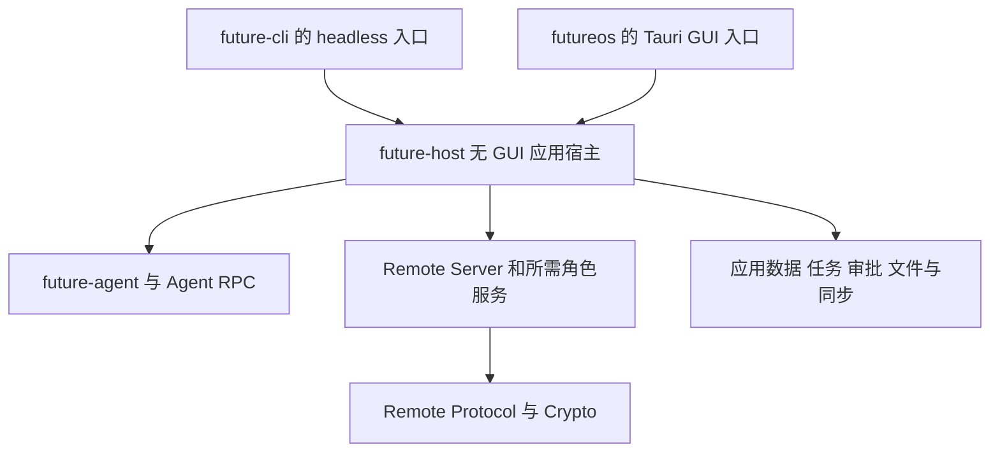

# Headless 拆分开发计划

> [English](headless-package-development.md)
>
> 设计日期：2026-10-20。源码基线：`904eab2b`，Remote 拆包已通过 PR #1235 合入。
> 状态：实施中，源码与依赖基线已固定，正在建立共享宿主；阶段 0～6 未完成。

将无界面应用宿主从 Desktop crate 中剥离，统一通过 `future headless` 前台启动。新建无 GUI 的 Rust 库 `future-host`，承接 Desktop GUI 与 headless 共用的应用后端；Desktop 和 CLI 各自负责入口与交互。保持现有功能、数据、配对、审批、沙箱和退出行为兼容。

现有使用契约见 [Headless 使用指南](../guide/desktop-headless.zh-CN.md)，Agent 归属见 [Desktop Agent](../guide/desktop-agent.zh-CN.md)，Remote 层次见 [Remote 拆包计划](remote-package-development.zh-CN.md)。迁移落地时同步更新使用指南；本计划中的目标命令不能当作当前已提供的命令。

## 1 目标与范围

最终用户入口为：

```bash
future headless
future headless --relay http://192.168.1.10:8099
future headless --relay https://relay.example.com --relay-ca relay-ca.pem
future headless --help

future remote devices
future remote devices add
future remote devices remove <id>
future remote devices use <id>
```

`future headless` 默认保持前台运行，按需引导登录和配对，复用有效凭据，处理手机及现有远端请求，Ctrl+C 退出。`future agent` 继续只启动 Agent；`future headless` 负责完整无界面应用宿主，并按现有规则启动内置 Agent 或连接兼容的外部 Agent。

最终发布以 `future` 提供 headless，不再要求独立的 `futureos-headless` 程序。Desktop GUI 仍使用 `futureos`。不在本次增加守护进程、系统服务安装、后台化参数、新 Remote 协议或新的 CLI/TUI 主控产品能力。

本次改变入口与代码归属。数据目录、锁、通信协议和业务语义不随包名重命名；GUI 和 headless 同时托管同一数据目录的能力不在范围内。

## 2 当前耦合与目标结构

当前 [headless 启动](../../desktop/src-tauri/src/headless/mod.rs)属于 `futureos` crate。它已通过 feature 排除 GUI 系统依赖，但仍使用 Desktop 的 Store、Agent 管理、登录、Remote 宿主适配、调度、观察器和退出协调。仅增加 CLI 对 Desktop crate 的依赖，会保留这些编译与测试归属问题。

新建 `host/`，crate 名为 `future-host`，作为应用宿主库加入根 Cargo workspace，共用根锁文件与构建产物。它是普通 Rust 库，不增加独立二进制或 `staticlib`/`cdylib` 产物。`host/` 是产品应用运行时；不同于 `packages/` 中保持产品无关的协议和角色库，它可以组合 `future-agent` 等应用服务。



依赖要求：

- `future-cli` 和 `futureos` 可以依赖 `future-host`；`future-host` 不依赖 `future-cli`、`futureos`、Tauri、React、Expo 或 WebView，不通过可选 GUI feature 引回它们。
- `future-host` 可以使用已有的 `future-app-settings`、`future-app-workspaces`、`future-tasks`、RPC 和 Remote 库；不复制它们的模型、状态机或持久化实现。
- Remote 库不反向依赖 `future-host`。它们继续通过宿主接口访问业务，协议与加密测试不启动完整应用宿主。
- Cargo 同时构建 CLI 和 GUI 时，feature 合并也不能把 GUI 依赖带进 CLI。GUI 适配实现放在 Desktop crate 中。

### 2.1 代码归属

| 能力 | 目标归属 | 边界 |
|---|---|---|
| `headless` 参数、帮助、终端登录/配对展示、信号与退出码 | `future-cli` 的入口模块 | 调用共享服务；终端交互不进入协议或 Store |
| Future home 解析、环境初始化、实例锁、日志、宿主生命周期 | `future-host` | 统一初始化顺序与资源归属，不启动 GUI |
| Agent 启动、兼容性/readiness、内置/外部归属及停止 | `future-host`，复用 Agent 现有 API | 保留运行用户、单例与端点规则，不再实现第二个 Agent |
| Store、会话与 run 元数据、工作区、配置、身份与配对持久化 | `future-host` 与已有共享数据包 | 以现有存储为事实源，原子写入、迁移和锁顺序保持 |
| `agent_bridge` 的业务、事件投影、恢复和观察器 | `future-host` | 通过不含 Tauri 类型的事件接口交给 GUI 或无界面宿主 |
| `remote_host` 业务/目录/文件/配对适配和本地 Remote 控制通道 | `future-host` | 真实 Agent、审批、沙箱和文件语义保留 |
| 模型刷新、技能引导、任务 tick、删除 outbox 与 watchdog | `future-host` 的共享服务与明确启停 | 每个宿主实例只启动一次，所有任务可停止并等待清理 |
| 窗口、Tauri commands、菜单、托盘、系统插件、剪贴板和 GUI 事件 | Desktop | 薄适配调用公共业务 API；不把整个 commands 模块直接搬入库 |

迁移按实际调用链归类，不按目录整批复制。一个模块同时包含业务和 Tauri 类型时，先提取业务，再由 Desktop 保留适配。共享后端只暴露两个入口需要的能力，不为迁移把内部 Store 或监督器状态全部公开。

### 2.2 生命周期与维护依赖

`future-host` 提供显式配置、启动结果、事件输出和可观察的停止/等待接口。终端展示、GUI 窗口事件以及必要的交互响应由入口适配。交互式登录和配对的展示变体不能改变凭据提交、邀请有效期或已配对状态判断。

runtime 由入口拥有，`future-host` 的服务接口不自行创建 runtime 或调用 `block_on`。CLI 沿用[现有组件分发](../../cli/src/main.rs)，在普通 CLI runtime 启动前分发 `headless`，由该入口建立运行时并驱动宿主；GUI 传入它已有的运行时能力。保留现有 headless 的运行时资源上限，调整前单独验证。两个入口均避免嵌套 runtime。

当前 headless 通过匹配 CLI 执行 `future init` 等维护。迁移后由入口注入维护能力：CLI 可以调用当前可执行程序的 `init` 子命令，Desktop 继续使用经过版本/能力校验的匹配 CLI。`future-host` 不导入 CLI 命令实现，不重新分发 `headless` 造成递归；维护失败维持原先报告但不阻断远程服务的行为。

进程内宿主可先保留现有单实例实现；本次不要求一次支持同进程多宿主。应由明确的生命周期对象约束后台任务，避免把进程全局对象拆成两个互不知情的副本。

## 3 功能与数据兼容要求

| 契约 | 迁移后的要求 |
|---|---|
| 数据根 | 保留 `FUTURE_HOME`、HOME/USERPROFILE 解析及现有默认路径；不创建新的 headless 专用数据树 |
| 应用与 Agent 数据 | 继续使用现有 `~/.future/app/app.db`、Agent 配置/会话及工作区布局；保留数据库迁移、run/审批恢复和文件引用 |
| 设备与凭据 | 设备身份、Noise 身份、配对簿、控制指针、待撤销记录、账号凭据和原文件格式保持；旧配对无需重新扫码 |
| 同目录互斥 | GUI 与 `future headless` 共用现有实例锁，包括 `app/desktop.lock`；不能因命令改名形成两把锁或删除活跃锁文件 |
| 远程入口 | 保留首次登录、首次配对、已有配对复用、多设备 active/standby、刷新/恢复和撤销语义；线上字段与 `futureos://remote/pair` 邀请 scheme 保持 |
| 自建中继 | 保留 `--relay`、`--relay-ca`、已保存设置和当前邀请 origin/TLS 规则；不把自建中继登录条件改成强制平台账号 |
| 本地设备管理 | `future remote devices` 现有子命令继续有效；`add` 由活跃宿主通过现有 `run/remote-control` 文件请求/应答机制签发可用邀请 |
| 业务与同步 | 手机看到同一批会话、历史、模型、工作区、文件、任务和审批；继续使用现有 Agent 与 Store 的数据权威 |
| 模型与技能 | 保留首次/定时模型目录刷新、登录后技能初始化及失败处理；不引入另一套缓存或配置 |
| 安全边界 | 原有审批、沙箱、路径访问、文件摘要/缓存规则、凭据原子写入和日志脱敏保持；帮助和版本查询不得启动服务或写数据 |
| 退出 | 前台运行；Ctrl+C、Unix SIGTERM/SIGHUP 在登录、配对和正常服务阶段均可结束；先停止接入与恢复，再按总预算等待清理 |
| Agent 归属 | 自行托管的 Agent 按原规则停止；外部 Agent 不被误杀，只取消当前宿主拥有的请求，不扩大退出影响范围 |

`remote devices use` 等已有命令的运行期/下次启动生效规则按当前实现保留。本次不借入口迁移改变设备管理语义。旧命令提示、状态文字和诊断中的程序名需要更新；不能靠保留错误提示文字掩盖已经改变的入口。

GUI 和 headless 分别升级后都应能读取同一份旧数据。验收使用旧版本生成的专用测试用户数据，验证升级与两个入口顺序重启。不得用新格式夹具替代旧配对兼容测试，也不为改包名增加不可逆 schema 变更。

## 4 实施阶段

| 阶段 | 交付内容 | 退出条件 |
|---|---|---|
| 0 基线与归属 | 固定提交、记录启动/退出/数据/发布契约；建立“原测试 → 新位置”清单与构建基线 | 每项既有功能与测试有明确保留位置；GUI、CLI、headless 原构建依赖可比较 |
| 1 建立共享库 | 创建 `host/` 的 `future-host`、普通库目标、错误/事件/配置边界及独立测试入口 | CLI 可依赖它且不依赖 `futureos`；依赖图中没有 GUI 框架 |
| 2 迁移共享后端 | 分批迁移 Store/配置、Agent 托管、业务桥、Remote 宿主、调度与退出协调；GUI 接回共享库 | GUI 业务不靠两份实现维持；原协议、数据及审批/沙箱路径保持 |
| 3 接入命令 | 在 `future` 增加 `headless`，迁移终端交互、信号、维护与设备控制接线 | 单独的 `future` 即可启动完整宿主；参数、首次/已有配对及所有阶段退出行为兼容 |
| 4 完成测试迁移 | 核心用例迁到所属库；CLI/GUI 留入口与真实产品集成；建立同版本兼容场景 | 迁移清单逐项闭合；无 GUI 测试命令独立，未重复运行整套共享核心用例 |
| 5 调整构建发布 | CI、make、sidecar、安装/卸载、升级、静态构建和发布说明切换到统一 `future` | 支持平台的发行包与源码安装都能运行 `future headless`，无隐藏旧 binary 依赖 |
| 6 统一验收与清理 | 同一候选 CI、产物 smoke、性能记录及人工验收；删除旧入口和过渡适配 | 必需自动化通过、人工结果确认、旧实现清理完成，文档与实际产物一致 |

每阶段在独立工作分支中提交可追踪变更并更新此表。过渡期间允许旧入口转发至共享实现以维持可编译；最终不得仍由 `future headless` 启动外置 `futureos-headless`，也不保留完整后端副本。

## 5 测试归属与验收边界

### 5.1 future-host 独立测试

新库必须能单独编译、静态检查和执行测试，不需要 Desktop、Tauri mock、WebView 或 npm 环境。入口为 `cargo fmt -p future-host --check`、`cargo clippy -p future-host --all-targets -- -D warnings` 和 `cargo test -p future-host`。

包内测试使用明确的事件接收器、可控时钟、假宿主能力、临时数据根和隔离服务。覆盖生命周期、任务归属、启动失败回收、停止等待、Store/配置、事件同步、恢复和调度。共用服务的测试只在其所属包执行，不在 CLI、GUI、headless 三处重复包含。

独立测试包含单元与必要的库集成测试。“无 GUI”不等于把真实业务都换成 mock：数据库迁移、原子文件写入、权限/审批边界、真实 Agent RPC、内置/外部 Agent 归属仍有真实集成用例，只是不要求图形应用启动。

### 5.2 原测试去向

| 当前测试或行为 | 目标归属 | 应保留的验证 |
|---|---|---|
| `headless/mod.rs` 的参数与终端行为用例 | CLI headless 模块/进程测试 | 参数拒绝、帮助无副作用、TTY、登录/配对展示、错误/退出码 |
| `headless/agent.rs`、`agent_host`、退出协调及通用调度用例 | `future-host` 单元/集成测试 | Agent 归属、启动/readiness 失败、停止顺序、总截止时间、失败回收 |
| Store、业务桥、配置/身份与 Remote 业务宿主测试 | `future-host` 或既有共享包 | 原数据库/文件/审批业务断言，不能仅断言调用了接口 |
| [headless_cli.rs](../../desktop/src-tauri/tests/headless_cli.rs) | CLI 的真实 `future headless` 进程测试；GUI 特有部分留 Desktop | 真正构建的 `future`、首次非 TTY 拒绝、已有配置、信号、互斥、外部 Agent 存活 |
| [remote_start_refusal.rs](../../desktop/src-tauri/tests/remote_start_refusal.rs) | CLI headless 产品进程测试；共用故障决策归宿主/Remote 包 | 活跃真实宿主、平台拒绝、撤销单设备、恢复预算及持久化结果 |
| Remote 包与[独立互通工程](../../tests/remote-interop/Cargo.toml) | 保留原归属 | 协议、加密、主控/被控状态机与真实角色互通，不移回宿主 |
| Tauri commands、窗口/菜单、IPC 与 GUI 生命周期 | Desktop | 使用共享后端的真实接线、窗口退出、GUI 插件行为 |

迁移清单精确到原测试名与断言职责。先建立目标覆盖再删除原用例；以“公共业务测试一次，两个入口各验证接线”减少重复，同时保留跨进程、跨平台和真实副作用覆盖。

### 5.3 CLI 与应用集成

CLI 测试必须执行 Cargo 构建的 `future` 并带 `headless` 子命令，不能仅测试内部启动函数或假脚本。GUI 测试验证其继续调用同一宿主并保持业务/IPC 结果；Mobile 沿现有线上契约连接，不要求为了本次 Rust 迁移重写客户端。

关键集成场景包括旧数据升级、新/旧配对、自建中继、`remote devices add`、工作区/会话/流式事件、审批拒绝与允许、沙箱拒绝、文件传输、任务执行、后台恢复、传输中停止及退出重启。分别覆盖“宿主启动内置 Agent”和“连接已有外部 Agent”。

测试不得连接或停止用户日常 Agent。使用隔离 Future home/用户目录和未占用端点；GUI/headless 同数据根互斥用例要显式启动两个真实进程。环境变量与进程全局状态用例采用进程隔离，不能引入跨用例竞争。

### 5.4 自动化与人工

开发阶段执行必要的编译和静态检查；提交前按变更模块执行 fmt、Clippy `--all-targets`，只在 TS 适配变更时增加相应 type-check/ESLint。本计划沿用 PR 流程：不在本地运行单元，自动化验收交给 CI；用户另行要求本地执行时，以其最新安排为准。

CI 分别报告共享库、CLI 入口、Desktop GUI 和产物检查。共同 fixture 及 schema、Cargo manifest/lock、features、构建和安装脚本的变化进入 affected 图。宿主变更选中两个 Rust 消费入口，不因 headless 的纯 Rust 变更无条件重跑所有 Mobile/前端单元；保留必要的端到端兼容验收。

自动化通过后冻结一个完整候选 commit，以该版本的 GUI、CLI、Mobile 进行人工测试。记录 Windows/macOS/Linux 与 Android/iOS 哪些组合已执行；没有环境的项目保留未执行，不能用别的平台结果代替。

| 人工项目 | 预期 |
|---|---|
| 全新环境执行 `future headless`，按需登录并配对 | 终端交互完整、手机可用；重启复用有效登录和配对 |
| 用旧版本配对与数据升级，GUI/headless 顺序启动 | 原会话、工作区、模型、任务、审批与文件可用，无需重配 |
| 使用自建中继，另一终端执行 `future remote devices add` | 沿原中继认证/信任规则运行，新增邀请可连接且不破坏已有设备 |
| 远程收发消息、流式工具结果、审批/沙箱、上传下载与任务 | 行为及结果与旧宿主一致，设备与会话不串 |
| 各启动阶段 Ctrl+C，活动请求/传输时退出，再重启 | 有界结束且无迟到写入或旧任务复活；配对保持 |
| 连接已有外部 Agent 后退出；同目录启动第二宿主 | 原 Agent 保留，第二宿主被锁拒绝且不损坏状态 |
| 只安装 CLI 的服务器以及正式安装包升级 | 无 Desktop/GUI 依赖即可提供 headless；版本、帮助、路径与卸载正确 |

## 6 构建与发布调整

### 6.1 Cargo 与 make

`future-host` 使用普通库目标，不引入 GUI feature；`future-cli` 默认包含 `headless` 能力，CLI-only 发行包不需要另外下载后端。Desktop 依赖相同库并保留 GUI 入口。完成迁移后删除 Desktop 的 `headless` feature、独立 headless bin 及仅为旧配置存在的编译分支。

`make build-cli` / `make install-cli` 构建安装的 `future` 即具备该能力。增加清晰的 `make run-headless` 入口；旧 `build-desktop-headless` / `install-desktop-headless` 可在迁移期保留为统一 CLI 构建/安装的转发别名，help 明确新命令，不再生成独立 headless 程序。`make install` 避免重复构建/安装同一 CLI。

保留 Desktop 与 CLI 在同一 Cargo 调用中构建、共享特性解析及产物的规则，调整 [build-desktop.mjs](../../scripts/build/build-desktop.mjs)及平台包装脚本。CLI 与 GUI 的构建依赖必须通过 `cargo tree` 和真实产物验证，不能仅凭 `default-features = false` 判断。

### 6.2 发行物与安装

| 发布路径 | 调整 |
|---|---|
| CLI-only 各平台压缩包 | 单个 `future` 含完整 headless；更新帮助、能力发现、版本和平台 smoke |
| Linux musl 与服务器 | 静态构建 `future` 后执行 `future headless`；保持目标架构、无动态 GUI 依赖及旧 Linux 运行基线 |
| Linux GUI deb/portable | 继续提供 GUI 与匹配 CLI；移除对 `futureos-headless` 文件存在的断言、复制和清单 |
| macOS 应用与签名包 | 保留匹配 CLI sidecar 的版本、签名/公证、架构及发现方式；独立 CLI 可直接运行 headless |
| Windows 安装器/portable | `future.exe headless` 可用，保留 CLI 签名、CRT/沙箱 helper 和升级后可执行路径；命令行输出/信号行为独立验证 |
| 安装、更新、卸载 | 按原所有权规则处理已安装旧程序，不能删除用户自建同名文件或更换数据目录；修复服务/脚本与提示中的旧入口 |

具体检查 [CI 工作流](../../.github/workflows/ci.yml)、[通用构建](../../.github/workflows/build.yml)、[Linux 构建](../../.github/workflows/build-linux.yaml)、[macOS 签名构建](../../.github/workflows/build-macos-signed.yml)、[Windows 签名构建](../../.github/workflows/build-windows-signed.yml)、release/installers 工作流、[Makefile](../../Makefile)及打包脚本。不要假设只有 Linux 工作流需要修改。

将 [check-headless-linux.sh](../../scripts/ci/check-headless-linux.sh)改为检查真正发布的 `future`：验证 ELF 静态链接，并在无 GUI 栈、旧 Linux、无网络容器里执行 `future headless --help` 和首次非交互拒绝路径。静态链接检查本身与运行 smoke 都要保留。GUI 的 GNU 构建继续使用预构建 musl CLI 时，不重复编译无用 CLI，也不混用 target 的机器码。

`future version --json`、help 和 Linux sandbox helper 的早期分发不能因加入宿主而触发数据库、日志、Agent 或锁初始化。匹配 CLI sidecar 的功能发现/版本兼容与原子替换规则继续有效。

### 6.3 性能记录

记录同 runner、工具链、target、features、命令和缓存状态下的构建、链接、测试执行、二进制大小及启动开销。分别报告 CLI 新增完整宿主带来的成本、GUI 共用收益和核心测试去重的变化；不把“少一个二进制”或代码搬迁直接写成编译提速。

## 7 文档与完成清单

实现阶段同步更新 CLI help、Headless/Agent/构建安装/目录布局指南、Remote 设备管理提示、自建中继说明、分发包 Readme、wiki 与 AGENTS 的实际模块归属。已有外部部署示例、服务脚本和卸载逻辑中的 `futureos-headless` 也需要列入迁移清单。

- [ ] `future-host` 是新增的无 GUI 普通 Rust 库，可独立编译、静态检查和测试。
- [ ] Desktop 与 CLI 共用业务后端，CLI/宿主不依赖 `futureos` 或 GUI 框架，Remote 库保持独立。
- [ ] 单独的 `future headless` 提供原有完整功能，帮助/版本无副作用，runtime 无嵌套。
- [ ] 旧数据、配对、身份、锁与本地控制通道兼容，GUI/headless 同目录继续互斥。
- [ ] 登录、中继、任务/模型/技能、真实审批/沙箱/文件、恢复与退出归属保持。
- [ ] 原测试去向逐项可追踪；共享库独立测试与 CLI/GUI 入口、真实产品集成边界落实。
- [ ] CI affected、Linux 静态产物、各平台安装/更新/签名及卸载验证完成。
- [ ] 最终分发与实现不再依赖独立 `futureos-headless`，过渡副本/转发实现清理。
- [ ] 同条件性能记录、同一候选自动化和用户确认的人工验收齐全。
- [ ] 中英文文档、命令帮助及发行物说明与实现一致。

创建包、入口能编译或 PR 已合并都不等于上述要求全部完成。按阶段记录实际变更、验证命令、候选与剩余限制，人工结果确认后再结束整体迁移。

## 8 实施记录

### 2026-10-20 基线固定

实施分支为 `refactor/headless-host`，独立工作树为 `.worktrees/headless-host`。计划提交 `e2251323` 已先合入；产品源码基线为 `904eab2b`。本轮不创建 PR，不在本地执行单元或 NATS 测试。

[原测试迁移清单](headless-test-migration.json)固定 204 个源文件的摘要及 2143 个测试声明，使用原路径、行号和函数名标识。声明数不是测试执行数，条件编译、宏生成与运行时发现须由最终 CI 核对。初步归属为 1535 项共享宿主、35 项 CLI、160 项 Desktop，另有 413 项混合模块需要逐项划分；在明确覆盖去向前不得删除。目标字段是计划归属，不代表目标已存在或已运行。

[构建与依赖基线](../testing/headless-baseline-2026-10-20.json)记录原 CLI、GUI、headless 的实际 Cargo feature 依赖图，Cargo/锁文件、构建发布脚本摘要、工具链及兼容路径。只运行元数据与依赖查询，没有构建计时或执行测试；最终性能仍需同条件对照。

阶段 0 的源码基线已保存，测试归属仍需收口。阶段 1～6 未完成，当前命令仍为原入口。

### 2026-10-20 共享库首批迁移

建立 `host/` 的普通库 `future-host`，无 bin、FFI 或 GUI feature。现有共用错误分类、边界转换及字符串序列化移入 `host/src/error.rs`，配置严格读取、逐路径锁、原子写入和权限处理移入 `host/src/config_io.rs`。Desktop 原模块暂为薄转发；13 个原测试声明随实现迁入，不在 Desktop 再复制执行。仅测试夹具使用的 lenient/snapshot/restore 工具通过 `test-support` 暴露给现有应用集成，包内测试仍属于新库。

CLI 和 Desktop 已依赖新库，但 `future headless` 尚未接线。`scripts/ci/host-boundaries.py` 检查包含 Desktop GUI 的实际 Cargo 联合 feature 解析，禁止宿主与 CLI 引入 Desktop/GUI 框架，禁止宿主反向依赖 CLI 或生成产品二进制/FFI 产物。当前 macOS 目标验证通过；其他平台须由 CI 分别验证。

[静态验证记录](../testing/headless-host-phase1-2026-10-20.json)包含 Host 默认/测试辅助配置、CLI+GUI 和原 headless 的 Clippy `--all-targets`、fmt 及依赖边界。测试目标只编译，执行数为 0。阶段 1 的生命周期/事件接口、阶段 2 大部分业务后端、阶段 3 命令及后续测试/发布验收仍未完成；薄转发将在迁移收尾移除。

### 2026-10-20 继续实施与后端叶子模块

新的实施工作树 `.worktrees/headless-unified` 与分支 `refactor/headless-unified` 继承已提交基线和首批迁移，不修改原工作树。显式合入原计划分支（包含 `e2251323` 祖先），并独立合入当前 `origin/main`，不合入本地 main。

审批规则原子持久化、git diff 解析、run 错误分类和平台子进程标志现归 `future-host`，Desktop 保留导入适配。原测试随实现迁移，清单记录新归属。macOS 上宿主/CLI/GUI 联合 Clippy `--all-targets`、格式与依赖边界通过，见[验证记录](../testing/headless-host-leaves-2026-10-20.json)。文档检查报告已有 Agent 数据库夹具 README 未在白名单。本地未执行单元/NATS 测试；全部阶段仍需最终 CI、产物及人工验收。

### 2026-10-20 共享任务注册与展示出口

进程任务注册、future 实际销毁确认、原生任务追踪、接入冻结与有界清理现只保留于 `host/src/runtime.rs`。生产代码要求入口传入 Tokio handle，不创建兜底 runtime。Desktop 传入现有 Tauri runtime 的 Tokio handle；过渡 headless 入口继续传入原 runtime。7 个原注册表测试迁入宿主，以注册表锁/重置夹具代替无关的 HOME/Store 夹具，保留超时、panic、未轮询销毁及任务生命周期断言。仅测试的 runtime 仍属于隔离夹具。

`host/src/events.rs` 定义不含 GUI 类型的展示出口。Desktop 保留事件序列化和合并，在启动生产者前接入适配。Store/业务桥继续通过统一出口通知；未接入展示时不发送 GUI 事件，不影响 Remote 或持久化。删除重复的 `no_gui.rs` 通知实现。Agent 设置失效与 provider 配置通知接入同一出口，保留事件名和 payload。

这是阶段 1/2 的增量变更。Agent 托管、Store、Remote、调度及完整停止协调仍在 Desktop，不代表候选验收。原 headless 与 GUI 测试目标通过 Clippy 编译，本地测试执行数为 0。

### 2026-10-20 凭据、平台策略与技能指南

凭据严格原子读写现位于 `host/src/auth_store.rs`；平台地址和发行渠道策略、构建渠道分类、HOME 解析及技能指南请求迁入共享宿主。宿主构建身份复用内置 Agent 的现有构建版本，使 RPC 与发行策略保持一致，不增加第二个宿主版本生成器。TLS provider 初始化也只保留于宿主。

HOME 夹具在 Desktop 与宿主之间共享序列化锁。入口提供的夹具清理回调在更换 HOME 前等待 Desktop 剩余任务并关闭数据库连接池。凭据、平台及指南核心测试随实现迁入；真实数据库文件释放回归在 Store 迁入前仍留于 Desktop，没有用回调调用断言替代业务断言。[静态验证记录](../testing/headless-host-config-2026-10-20.json)保留实际结果；运行兼容性及跨平台验收仍待完成。

### 2026-10-20 共享 Store 与旧数据库夹具

应用 Store 现归 `host/src/store.rs` 与 `host/src/store/`：连接池、schema 和版本化迁移、会话/run、CAS 状态及投影写入、审批与评审、产物和文件、工作区、删除 outbox、历史记录、review 和技能推荐。包括 `pre-agent`、`v1.2.1` 旧夹具的 8 个 SQL 文件与父提交 `40f993d4` 字节一致；路径、schema、文件格式不变。CLI 的已有数据升级夹具改为引用同一个迁入后的 SQL 文件。

277 个原测试声明（包括真实连接池文件释放回归）迁入宿主。9 个 Agent/Store 协调测试暂留 `desktop/src-tauri/src/store/reconcile.rs`，保留原 RPC 与数据库断言；清单明确记录业务桥迁移前的中间归属。过渡适配只调用限定候选查询 API，不直接打开 Store 内部连接。真实数据库 seed 夹具共用一份；旧事件 writer/buffer 仅在 test/test-support 构建可用，保留入口集成中已有的落盘读取断言。

Agent 事件投影和失效通知也随原 Remote sink 迁入宿主，与 GUI 展示 sink 独立。宿主单包、GUI/CLI 联合与原 headless 的 Clippy `--all-targets`、格式、依赖边界通过。[证据](../testing/headless-host-store-2026-10-20.json)记录 SQL 摘要、过渡测试及限制。本地未执行测试。这是阶段 2 进展，Agent 托管、业务桥、Remote、新 CLI 命令、CI 与发行验收仍未完成。

### 2026-10-20 宿主 CI 归属

CI 新增独立的 `future-host` Rust 测试分组。宿主源码及共享构建/schema/Remote 输入选中该归属；宿主变更也选中 CLI、GUI、原生生命周期消费者，不仅因 Rust 宿主迁移就选中 Mobile 或前端单元套件。现有 Desktop 静态检查阶段增加联合 GUI feature 的依赖边界验证。实施分支使用完整 workflow dispatch 验收，不创建 PR、不在本地运行测试；具体 CI run 完成前均记为待验证。

### 2026-10-20 身份、实例锁与 review 后端

稳定安装身份、Future home 解析及现有 `app/desktop.lock` 实现迁入共享宿主，包含默认目录兼容和 GUI single-instance 命名空间派生。Git/shadow review 及真实文件系统/Git 测试也随之迁入，保持用户仓库只读、原有私有 review 目录、归属和保留策略。Desktop 保留导入适配；删除已无调用者的解析器/子进程薄转发。复用的测试环境 guard 随调用者迁移；CLI 发现仍作为入口能力留于 Desktop。

本批迁移 75 个原测试声明。原测试名保持可追踪；清单累计记录 427 个已迁入声明、9 个过渡协调用例及仍需审查的 412 个混合模块用例。宿主单包、GUI/CLI 联合和原 headless 的 Clippy `--all-targets`、fmt、依赖边界通过。[证据](../testing/headless-host-identity-review-2026-10-20.json)也记录提交 `b5bd2f53` 上的中间 CI [39356975686](https://github.com/futuregene/future-os/actions/runs/39356975686)：快照仍待完成，宿主 job 正在运行，且不含本批改动，不能作为 CI 通过、运行或最终候选验收。

当前阶段状态：

| 阶段 | 实际状态 |
|---|---|
| 0 | 已固定源码/依赖基线与按名清单；同条件构建/运行测量及剩余归属审查未完成 |
| 1 | 已建立无 GUI 普通库、任务注册、展示出口和消费者依赖；完整生命周期/配置边界未完成 |
| 2 | Store、凭据/平台、身份/锁、review 及工具已迁入；Agent 托管、业务桥、Remote、维护和停止协调未迁入 |
| 3 | 尚未实现；产品入口仍是 `futureos-headless` |
| 4 | 已迁移 427 个声明；中间 CI 待完成，真实 CLI 进程测试迁移及剩余核心覆盖未完成 |
| 5 | 已加宿主 CI 分组和 affected 传播；构建、发行物、签名/安装/升级/卸载未完成 |
| 6 | 尚未开始；无最终冻结候选、同条件性能、产物验收或确认的人工结果 |

### 2026-10-20 命令接入与精确 run 归属

`host/src/request_scope.rs` 现拥有唯一的命令接入计数和已提交 run 归属表，包含有界调用者等待、精确 run 取消/对账、正向终态证据及原有接入 RAII 夹具。Desktop 停止协调只调用这些操作，不访问内部 mutex/状态字段；重置仍保留活跃 guard 计数，不把外部 Agent 或无关 run 加入取消范围。

原 RPC 构造和响应分类只保留于 `host/src/agent_commands.rs`，继续使用 `future-rpc` wire 类型，保留 `desktop_` 请求 ID 前缀和全部 payload 字段。10 个原纯逻辑测试随代码迁入。真实 RPC、确认/观察器竞态及完整停止测试仍完整留于 Desktop，待业务桥一起迁移。[静态证据](../testing/headless-host-request-scope-2026-10-20.json)记录宿主、联合消费者、旧 headless 和边界检查通过，本地未执行测试。中间 CI `39356975686` 的宿主分组通过，但 Agent 分组失败；正在诊断，不接受为自动化通过。
