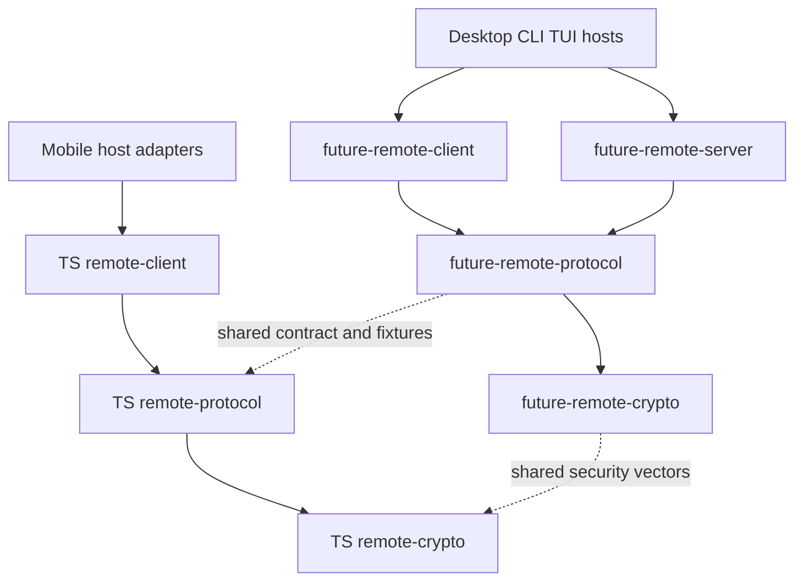

# Remote Package Development Plan

> [中文](remote-package-development.zh-CN.md)
>
> Design date: 2026-10-19. Source baseline: `4a64b65e`.
> Status: in progress; phases 1–4 are being migrated. Section 8 records implemented boundaries, checks and remaining work. Phases 0–5 are not complete.

Separate Remote into protocol, controller and controlled-endpoint packages, retaining the independent secure-channel foundation. Rust and TypeScript follow the same responsibility model with separate implementations, validated against a common contract, vectors and interoperability tests. Desktop, Mobile, CLI and TUI provide UI, environment and local business adapters; Remote libraries do not depend on a particular application entry point.

The immediate goal is independently buildable, testable and lintable package boundaries, narrower validation for unrelated edits, and less duplication of core tests across GUI/headless configurations. Existing controlled-endpoint capability remains owned by Desktop GUI or its foreground headless host. Extension points for CLI/TUI are part of this design; new commands and interactions belong to the later host integration phase.

Existing product behavior is specified in the [remote connection design](../internals/desktop/CONNECTION.md); [Remote E2EE](../internals/desktop/REMOTE_E2EE.md) governs security and the wire protocol. This plan owns package extraction and migration, without duplicating those documents' security parameters or historical compatibility rules.

## 1 Current implementation and extraction boundaries

| Current location | Existing responsibilities | Coupling to remove |
|---|---|---|
| [remote](../../desktop/src-tauri/src/remote/mod.rs) | Controlled-side protocol handling, NATS transport, secure channel, supervision, command routing and event publication | Direct Desktop host lookup, application errors, runtime, shutdown state and some configuration helpers |
| [remote_host](../../desktop/src-tauri/src/remote_host/mod.rs) | Adapts remote commands to local Agent, sessions, settings, approvals, tasks and files; provides pairing and state services | Keep business implementations in the application; relocate generic HTTP, JWT and protocol helpers |
| [remote_peer](../../desktop/src-tauri/src/remote_peer/mod.rs) | Desktop controller client, remote projections, requests and file transfers | Desktop identity, configuration, file persistence and HTTP helpers borrowed from remote_host |
| [Mobile client](../../mobile/src/remote/client.ts) | TypeScript controller connection, requests, events and recovery | Indirect dependencies on Expo device information, Mobile storage and application configuration |
| [Mobile remote context](../../mobile/src/remote/RemoteContext.tsx) | React state, connection orchestration, UI and device lifecycle adaptation | Separate from the reusable client; application hooks stay outside core packages |
| [remote crypto](../../packages/remote-crypto/src/lib.rs) | Independent Rust Noise handshake and encrypted records | Keep independent and preserve vectors shared with the TS implementation |

The existing [RemoteHost interfaces](../../desktop/src-tauri/src/remote/services.rs) separate business, pairing, state and file services, with implementations in [DesktopHost](../../desktop/src-tauri/src/remote_host/mod.rs). Reuse these boundaries rather than introducing a general plugin framework.

Today's CLI `future remote devices` primarily manages local controlled-endpoint pairings and requests device addition from a running Desktop through files; it is not a general remote controller client. Mobile currently exposes controller capability only. Renaming packages must not present these future capabilities as completed.

## 2 Target packages and dependency direction

| Layer | Rust package | npm package | Delivery scope |
|---|---|---|---|
| Secure channel | `future-remote-crypto` | `@future-os/remote-crypto` | Keep the existing Rust package; extract the TS implementation from Mobile |
| Protocol | `future-remote-protocol` | `@future-os/remote-protocol` | Implement both languages |
| Controller | `future-remote-client` | `@future-os/remote-client` | Implement both languages |
| Controlled endpoint | `future-remote-server` | `@future-os/remote-server` | Implement Rust now; create the npm package when a JS controlled-endpoint product needs it |

The three Remote responsibility packages share the Crypto foundation. Do not create an empty TS server implementation. Mobile continues to use Protocol, Crypto and Client as a controller.

Proposed directories are `packages/remote-crypto`, `packages/remote-protocol`, `packages/remote-client` and `packages/remote-server`. A directory may contain both `Cargo.toml` and `package.json` with separate Rust and TS entry points; source, test, lint and publishing patterns must explicitly distinguish languages. New npm packages start private, and this migration adds no external Rust publishing workflow. Keep the existing root lockfiles and workspaces.

New Rust packages use ordinary library targets. Do not inherit futureos's `staticlib`/`cdylib` outputs merely because code originated there; add them only for an actual FFI consumer.

Client and Server do not depend on each other; Protocol and Crypto do not depend on role runtimes. Shared packages do not import Desktop, Mobile, CLI, TUI or Agent product implementations. Local business capabilities enter through interfaces; hosts use existing Agent RPC/service interfaces.

## 3 Layer responsibilities and host interfaces

### 3.1 Secure channel

Crypto owns the existing handshake patterns, key derivation, authenticated records, sequence numbers, replay protection and associated bounds. Preserve algorithms and security parameters without expanding it into a general cryptography framework.

Crypto has no NATS, HTTP, business-command, database or UI dependency. Protocol owns message envelopes, handshake exchanges and secure-channel negotiation. Place TS Base64/JSON wrapping and Mobile secure-random environment initialization correctly so Crypto does not depend back on Protocol or React Native. Preserve the [existing security vectors](../../packages/remote-crypto/tests/vectors.json).

### 3.2 Protocol

Protocol owns public messages, commands, replies, events, error codes, versions, capability names, invitation encoding, subject/context binding and chunking rules. Include wire contracts only: credential persistence, UI presentation types, retry policies and local business implementations do not belong here merely because they currently share `types.ts`.

Maintain the common contract and compatibility fixtures in `packages/remote-protocol`. Describe representable message structures in shared schemas; select Rust/TS type-generation tooling during the protocol phase. Shared fixtures and interoperability tests still validate codec behavior. Generated code must not become another manually editable source of truth. Existing Agent gRPC protobuf remains owned by `future-rpc`; do not merge the Remote contract into it.

Protocol does not establish connections, read global HOME, access storage or launch background tasks. Initial extraction preserves wire formats, field casing, optional-field semantics and compatibility policy.

Keep existing product-named wire fields such as `desktopId` compatible. Hosts may use generic internal terminology without turning reuse across entry points into a protocol-renaming migration.

### 3.3 Controller

Client owns connecting to controlled endpoints, pairing exchanges, handshakes, request/reply matching, event subscriptions, recovery, remote catalogs/session projections and client-side transfers. Remote sessions remain authoritative at the remote host; local caches must not create a second authoritative local session copy.

Host adapters provide identity/credential persistence, device names, configuration, trust settings, transport creation and local file access. The core emits events or callbacks without importing React, Tauri or Expo or directly updating UI. Rust uses Tokio; TS uses ordinary classes/functions with platform transport adapters and preserves existing TLS/WSS requirements.

Mobile foreground/background and network observers supply lifecycle events to Client, whose state machine applies them. System file selection, sharing, file opening, SecureStore and UI hooks remain in Mobile. Reuse generic projections already owned by thread-projection rather than duplicating them.

### 3.4 Controlled endpoint

Server owns the controlled entry, secure handshake, controller checks, admission limits, request deduplication, command routing, replies/event publication, server-side transfers and supervision. Host interfaces execute local business operations; Server does not directly depend on application Store, Agent implementation or Tauri commands.

Start from the existing business, pairing, state and file interfaces, with application-independent DTOs and errors. The host provides credential persistence, pairing service calls, local catalogs and business authorization; Server keeps connection-level and controller-level checks. Interface extraction must preserve approvals, sandboxing and path-access restrictions.

Desktop remote_host becomes the application implementation. Remote prompts continue through existing session persistence and Agent execution paths. Do not implement another prompt, approval or task executor inside Server.

### 3.5 Runtime and shutdown

The host explicitly starts each role runtime, owns its handle, stops it and waits for cleanup. Libraries do not parse process arguments, register global exit handlers, terminate the process or silently turn foreground capability into a background service.

Instances receive explicit configuration, data locations, identity and execution context. Remove dependencies on Desktop singletons, global HOME and static host lookup incrementally. Tasks have explicit ownership; old connections, late callbacks and retry timers cannot reopen a stopped entry. Preserve task registration, cancellation, cleanup waits and total shutdown deadlines.

The first integration preserves GUI/headless behavior. Later CLI/TUI integration generalizes “Desktop owns Remote” to “the host explicitly enabling the controlled endpoint owns Remote.” New commands separately specify visible state, approvals, ownership conflicts and exit behavior. Reusable libraries do not automatically enable controlled-endpoint capability in every entry point.

## 4 Source and test migration map

| Current content | Destination |
|---|---|
| remote/protocol, common capabilities and wire formats in client invitation/codec code | Rust/TS Protocol packages |
| Existing Rust Crypto and reusable Mobile secureChannel implementation | Crypto packages in each language |
| remote_peer connection, projection and transfer core; Mobile client, recovery and generic synchronization | Client packages in each language |
| remote transport, supervision, routing, publication and controlled-side transfers | Rust Server package |
| remote_host Store, Agent, task, file and local pairing implementations | Desktop host adapters |
| Tauri commands, remote/control local management and headless output | Desktop entry/adapters; generic invitation encoding moves to Protocol |
| Mobile RemoteContext, hooks, device/storage/file/network lifecycle | Mobile application adapters |

Move functions by responsibility instead of copying whole directories. HTTP/JWT helpers currently borrowed by relay and peer from remote_host must move into the appropriate role service or platform host adapter, eliminating cross-role borrowing. Convert application errors at boundaries while preserving display messages and machine codes; a shared Desktop AppError must not reintroduce SQLite dependencies into core libraries.

Pure protocol, state-machine, deduplication, crypto, paging and simulated transport tests move with the core. Actual business persistence, approvals/Agent execution, GUI close and headless shutdown remain host integration tests. Do not add Desktop as a new library dev-dependency to recover old fixtures.

## 5 Delivery phases

Each phase is independently verifiable and mergeable. Old paths may temporarily forward calls during migration, with one implementation only; remove forwarding and duplicate types when that phase completes.

| Phase | Work and deliverables | Completion criteria |
|---|---|---|
| 0 Baseline and contracts | Inventory dependencies, role entry points, wire/storage formats, host behavior and CI timings; assign package, interoperability or application ownership to tests | Pin source, toolchain, runner, commands, features and cache state; record compilation separately from execution and list independent package test entry points |
| 1 Crypto and Protocol | Keep Rust Crypto, extract TS Crypto; establish both Protocol packages, shared schemas/fixtures and a type-generation strategy | Both languages execute the same security/protocol corpus and report case IDs; invitation, handshake, fields, encoding, errors and capabilities remain compatible; tests use no application configuration |
| 2 Rust Client | Extract remote_peer core with explicit identity, credentials, transport and events; reconnect Desktop | Pairing, renewal, recovery, sessions and files retain behavior; Client tests run without futureos |
| 3 Rust Server | Extract remote runtime, implement host interfaces in remote_host, reconnect GUI/headless | Business/controller behavior preserved; cancellation, shutdown, late results and credential commits verified; no core Tauri/Agent implementation dependency |
| 4 TS Client | Extract Mobile client and generic synchronization; supply React Native dependencies through adapters and consume shared controller scenarios | Rust/TS validate the same request, event and recovery behavior; TS Client tests run outside Expo; Mobile host interactions verified |
| 5 Interoperability and CI | Establish an independent Remote interoperability test project for Rust Client↔Rust Server and TS Client↔Rust Server; update affected graph and tasks | Real endpoints verified without Desktop; packages report independently, GUI/headless differences remain covered, measured improvements reported |
| 6 Additional hosts | Integrate CLI/TUI controller or controlled roles for actual product needs; track JS server implementation separately | Each new entry validates explicit start/stop, identity, storage, approvals, visible state and exit |

Choose and record schema/generation tooling in phase 1, minimal public APIs in phases 2/3, and batching/concurrency limits in phase 5 using migration prototypes. Do not promise unverified function signatures before implementation.

## 6 Validation and CI organization

### 6.1 Shared Rust and TypeScript test material

Secure-channel, protocol and controller behavior use one shared corpus and expected contract, with each language executing its own implementation. Inputs, expected results and semantics align; test source, frameworks and platform-specific additions need not be identical.

| Layer | Shared material | Results that must agree |
|---|---|---|
| Crypto | Keys, handshake messages, authenticated contexts, ciphertext, corrupt records, replay and sequence-boundary vectors | Required byte results for keys/handshake hashes/records and acceptance or rejection conditions |
| Protocol | Command, reply, event, invitation, version, capability, chunking, optional-field and invalid-input fixtures | Codec semantics and compatibility; exact bytes where the protocol specifies a byte format |
| Client | Request/response traces, event sequences, disconnect/renewal/recovery steps, timeout/cancellation and retry scenarios | Observable state transitions, send counts, event ordering and success/failure outcomes |

Crypto keeps `packages/remote-crypto/tests/vectors.json`. Suggested protocol/client corpus locations are `packages/remote-protocol/fixtures/` and `packages/remote-client/fixtures/`, without copies inside Desktop or Mobile. Fixtures define stable case IDs, inputs, operations and expected outcomes; shared structures need versions and validation. Both language adapters report executed IDs; unsupported shared cases must fail explicitly or record a specific platform difference instead of silently skipping them.

Each Client driver simulates transport and advances controlled time, for example “send, disconnect, recover, receive a duplicate reply,” without relying on matching wall clocks. JSON assertions follow protocol semantics rather than imposing byte order on unordered object fields. Language/platform-specific tests may add coverage; preserve existing crypto, error and compatibility boundaries rather than reducing the corpus to the intersection of two implementations.

### 6.2 Independent test ownership and execution

Rust/TS Crypto, Protocol and Client, plus Rust Server, each own test source, entry points, commands and dependency declarations. Core tests move out of `desktop/` and `mobile/` into their packages. Selecting one package runs its tests without building futureos, loading Tauri, starting Expo or importing application modules.

TS packages provide independent test scripts/configuration, without borrowing Desktop's Vitest configuration, Mobile's Jest/Expo preset or React Native mock environment. Root workspace tooling may manage dependencies centrally, but package entry points and dependencies must be explicit. Rust tests are selected through Cargo packages without application crate dependencies. Thin application wrappers must not rerun the entire core corpus.

Root workspaces may install dependencies centrally, reuse artifacts and batch execution; independence does not require separate node_modules, target directories or runners per package. CI reports package names, results, counts and duration separately so failures can be reproduced and rerun independently.

### 6.3 Package interoperability and application integration boundaries

| Test owner | Validates | Test host |
|---|---|---|
| Package tests | Crypto, protocol, state machines, deduplication, request matching, recovery, generic synchronization, projections and transfers | Package drivers, simulated transports and fake host services |
| Remote interoperability | Real Rust Client↔Rust Server and TS Client↔Rust Server handshakes, requests, events and transfers | Independent Remote test project with fake local business services, without Desktop |
| Application adapter tests | Tauri commands, React hooks/Context, device identity, secure storage, files and foreground/network wiring | Desktop/Mobile as appropriate; later CLI/TUI maintain their own |
| Application product integration | Actual Store/Agent/approval/file semantics, GUI close, headless shutdown and product entry points | Real application with isolated local services/data |

Shared fixtures and independent mocks do not replace real interoperability. The separate test project combines both roles through public APIs; phase 5 establishes its location and language drivers. Production Client/Server packages acquire no mutual dependency for tests. Applications verify that hosts start, invoke, cancel and clean up libraries, without owning every internal protocol scenario.

Maintain a baseline map from each original test to its package, interoperability or application destination, and confirm coverage before deleting the original. Cross-package business tests remain application integration tests; do not replace their business assertions with mocks merely to achieve package independence.

### 6.4 Required behavioral coverage

| Validation layer | Required coverage |
|---|---|
| Crypto | Existing cross-language vectors, both handshake patterns, corrupted records, replay and sequence bounds, key/candidate cleanup |
| Protocol | JSON/binary/invitation codecs, versions and unknown capabilities, optional fields, size limits, chunking, errors and older-client compatibility |
| Client | Request timeouts/retries, credential renewal, recovery budgets, event deduplication/gap filling, catalogs, multi-host isolation and transfer cancellation |
| Server | Controller ownership, uncommitted handshake admission, request deduplication, refresh/reconnect races, revocation/shutdown, reply/event ordering |
| Languages and roles | Rust Client↔Rust Server and TS Client↔Rust Server; shared fixtures plus real interoperability, beyond independent mocks |
| Host integration | Real Store/Agent/approval/file semantics; GUI/headless runtimes, later CLI/TUI entry points, Mobile lifecycle/native storage |

### 6.5 Checks scheduling and performance acceptance

Each package defines static checks and tests. Rust uses scoped rustfmt, Clippy `--all-targets` and package tests; TS uses type checks, lint and package tests. Source-exporting TS packages define a build only when an actual artifact requires one. Avoid duplicate compilation already covered by tests while retaining product-entry, packaging-feature and platform validation.

CI selects changed packages and affected consumers from actual dependencies, including shared schemas, vectors, configuration, generators and lockfiles. Package boundaries do not require a runner per task: batch by platform, toolchain and duration to reuse dependencies/artifacts within runner limits. Add no main-cache warming or full suite after every release.

Fixtures favor explicit instances, isolated data roots and ephemeral ports; never connect to or stop the user's running Agent. Preserve known lock ordering and cleanup constraints during migration, then use instance isolation to remove serialization from global HOME/singletons. Unit tests run in PR CI, not locally.

Performance acceptance compares compilation, linking, test execution, cache restoration and queueing separately with equivalent runners, toolchains, features, commands and cold/warm cache states. First verify core tests no longer repeat with GUI/headless, then assess slow tests and Windows builds. Test counts, source-line counts and differences between unrelated CI runs do not establish time savings.

## 7 Compatibility and completion checklist

- [ ] Rust Protocol, Client and Server packages and independent Crypto have acyclic dependencies without application imports.
- [ ] TS Crypto, Protocol and Client packages exist; React Native, Expo, React hooks and UI remain in Mobile.
- [ ] Rust/TS share contracts and security/protocol fixtures; wire formats, TLS/WSS, identity binding and security policy remain compatible.
- [ ] Security, protocol and controller corpora have one source; both languages report shared case IDs, record platform differences and preserve existing boundary coverage.
- [ ] Packages own test commands, configuration and dependencies; core tests leave application directories and do not borrow Desktop/Mobile test environments.
- [ ] Pairing/Peer credentials, pending revocations, device identity and file formats remain compatible; extraction alone does not change paths or force devices to pair again.
- [ ] Mobile two-slot credential commits, secure storage and key cleanup remain intact; credentials, complete invitations and private keys never enter logs or test snapshots.
- [ ] Authority for local sessions, remote projections, Agent, tasks and files remains unchanged, with approvals and sandbox restrictions preserved.
- [ ] Role runtimes explicitly start, stop and await cleanup; stale retries/callbacks cannot reverse disconnect or cancellation.
- [ ] Core tests run without Tauri/Expo; real business, lifecycle, platform and role interoperability remain covered.
- [ ] An independent Remote project exercises real endpoints through public APIs; application tests own adapters/product integration, with traceable destinations for migrated tests.
- [ ] CI affected graphs cover packages, consumers and non-source inputs without unconditional platform jobs for every package.
- [ ] Generated files are reproducible, obsolete forwarding/duplicate implementations removed, bilingual indexes and design links updated.
- [ ] Equivalent baselines report compilation/test changes without treating reduced required coverage as a performance improvement.

Update current package inventories as phases land. [Shared package conventions](packages.md) continue to govern new packages. Record actual interfaces, phase status and measurements here as implementation completes.

## 8 Implementation record

### 2026-10-19: baseline and first Crypto/Protocol extraction

Implementation branch: `refactor/remote-packages`. Scope remains phases 0–5; phase 6 has not started. This run creates no PR: final automated acceptance will use branch CI. Development runs compilation, type checks, lint, fmt and generated-file checks only. Overall completion requires confirmed manual acceptance.

The table reflects current status; subsequent subsections retain each implementation batch.

| Phase | Actual status | Evidence and remaining work |
|---|---|---|
| 0 | Source/test inventory and historical CI reference captured; performance comparison awaits final CI | The [test migration inventory](remote-test-migration.json) records baseline files, Rust and migrated TS case names, and destinations; `target: null` means unresolved ownership. The [historical CI reference](remote-ci-baseline.json) records the original commit, jobs, runner, steps and Windows compile/test log timings. It is not a same-condition performance result for this branch. |
| 1 | Foundations/shared fixtures connected; runtime acceptance pending | Both Crypto/Protocol implementations, command schema, handshake envelopes, capability identifiers and invitation/JSON codecs are assigned. Contract boundaries continue to be audited as roles move. Shared fixture drivers compile; execution awaits final CI. |
| 2 | In progress, connection core reconnected to Desktop | Rust Client connections, credential DTOs, multi-host instances, task lifecycle and upload/download orchestration are connected. Shared HTTP/JWT utilities are assigned to their owners. Independent network interoperability, shared Client scenarios and final acceptance remain. |
| 3 | Runtime implementation connected; runtime acceptance pending | Instance supervision, control, startup/recovery/rotation, event/catalog publication and role stop/drain are connected to GUI/headless; production state is encapsulated. Standalone interoperability, CI and manual boundary acceptance have not run. |
| 4 | In progress, TS connection/sync/file orchestration connected to Mobile | The Client npm package, explicit host interface, generic projection/paging/sync, file orchestration and independent Node/Jest entry exist. Complete stop/drain, shared Client scenarios and runtime acceptance remain. |
| 5 | Pending | Standalone real interoperability, affected CI scheduling, measured performance and final acceptance remain unfinished. |

Implemented package entry points and validation:

- Rust Crypto remains `future-remote-crypto`; `future-remote-protocol` is an ordinary library. Check each using `cargo clippy -p <package> --all-targets -- -D warnings`. Final CI uses each package's `cargo test -p <package> -- --show-output` to report shared case IDs.
- TS packages provide `npm run typecheck|lint|test --workspace @future-os/remote-crypto` and corresponding `@future-os/remote-protocol` and `@future-os/remote-client` entries. Here `typecheck|lint|test` means selecting each script, not literal shell syntax. Crypto/Protocol use independent Node/Vitest configurations; Client uses independent Node/Jest, without Expo or Desktop setup. Direct source exports need no empty build step.
- The [command schema](../../packages/remote-protocol/command.schema.json) owns 62 command fields, Rust missing-field defaults and TS producer types. The repository generator uses Python's standard library and pinned rustfmt: `python3 packages/remote-protocol/scripts/generate.py`; append `--check` to verify freshness. Never edit generated bindings. Other response/event DTOs are currently handwritten wire types owned by Protocol; further schema expansion will migrate those definitions into generation.
- [Security fixtures](../../packages/remote-crypto/tests/vectors.json) have `version: 1`, stable IDs, original byte vectors for both handshake patterns and shared negative record steps. Existing messages, ciphertexts and hashes are unchanged. [Protocol fixtures](../../packages/remote-protocol/fixtures/protocol.json) cover invitations, commands, JSON/gzip and size boundaries. Both drivers reject unknown fixture versions/kinds and report executed IDs.
- Original Crypto, invitation, JSON/gzip and codec core tests move with their owning package. Cooperative JSON scheduling/cancellation tests temporarily remain in Mobile and will move with Client in phase 4. Continue recording destinations without replacing real host business coverage with mocks.

Preserved parser difference: Rust invitation parsing validates the complete code, claim URL and expiry. TS `parsePairingInvitation` is only Mobile's preliminary shape parser; the application pairing flow still applies the full policy. Parsing a legacy shape does not authorize an older security protocol. Shared fixtures explicitly record language expectations and reasons; extraction does not change authentication, plaintext HTTP exceptions or credential semantics.

This batch uses pinned Rust 1.97.0 and Node 24.21.0 in an isolated macOS arm64 checkout. Crypto/Protocol and Desktop GUI/headless Clippy (including test compilation), both npm packages and Mobile typecheck/lint have passed. Unit tests and shared fixtures have not run, so this is not protocol/product acceptance. Historical Windows logs distinguish compilation from test execution, but no performance benefit is claimed for this refactor yet.

### 2026-10-19: Rust Client single-connection core

Phase 2 has started and remains incomplete. `future-remote-client` is an independent ordinary Rust library. Its first extraction includes `PeerSession`, Noise pairing/IK reconnection, encrypted command requests/retries, subscription lane selection, handshake confirmation validation and `PeerCreds`/`PeerIdentity` DTOs. It reads no global HOME, depends on no futureos/Agent/Tauri implementation and starts no application background tasks.

The public connection entry is `session::connect(&PeerCreds, &ConnectionOptions)`. The host supplies device name/kind and an optional platform certificate bundle. Production connections still require TLS. The non-default `test-support` feature exposes fixture seams; plaintext fixture connections additionally require a loopback address. Only Desktop test builds enable it. The host still uses `consumed_invitation` in the connection result to remove the spent PSK; the library does not alter persisted credentials itself.

Desktop's session module currently adapts environment and errors; the connection implementation exists only in the package. Client errors map by category to `AppError`, preserving transport/authorization classification, platform status/machine codes and user-visible messages without a SQLite dependency. The existing Desktop host still owns `remote_peers.json`, labels, atomic writes/configuration locks and device identity lookup. Serialized field names and optional-field rules are preserved. Credential DTO Debug output excludes keys/tokens so assertion or log output cannot accidentally expose them.

Eleven original session unit cases and two credential timing/revoke URL cases move to Client. New regressions protect credential Debug redaction and application error conversion. Real pairing, file, Store and application shutdown integration cases remain in the application and will be assigned through the [migration inventory](remote-test-migration.json). Test sources have compiled but have not executed.

Static checks passed on pinned Rust 1.97.0: independent Client library compilation with default features, default and `test-support` Clippy `--all-targets`, and Desktop GUI/headless Clippy `--all-targets`. Multi-host runtime instances, event supervision/recovery, credential/platform service interfaces, file transfer and owned stop/join semantics still require migration. A reusable connection core does not establish completion of phase 2 or the overall refactor.

### 2026-10-19: Rust Client multi-host instances and owned tasks

The multi-host controller runtime now lives in `future-remote-client::Client`, connected to Desktop through `DesktopClientHost`. Each instance owns its connections, stop intent, event/reconnect tasks, visible sessions, page assembly and chunk waiters. The library has no process-global runtime singleton and imports no Desktop Store, device identity or application error implementation. `ClientHost` explicitly supplies pairing/refresh/revoke calls, credential storage, trust/device information, command IDs and registered task execution.

Client wraps role tasks with cancellation and observable completion before asking the host to register them. Desktop's existing registration/freeze/cancel chain remains in place. `stop_admission()` synchronously closes admission and cancels role tasks; `shutdown(total_budget)` waits for actual future destruction and clears connections/subscriptions/chunk waiters within one total deadline. Rejected, unpolled tasks also signal completion, and panics remain observable. The shared Desktop GUI/headless shutdown path calls both entries. Test reset replaces an instance rather than restarting a stopped one.

Per-endpoint attempt generations prevent old handshakes from installing a connection after disconnect/new connect/stop. A failed old request cannot remove a newer connection. Pending claims, refreshes and handshakes receive shutdown cancellation. Desktop compares pairing identity under its original configuration lock before refreshing, clearing a PSK or removing a credential: only the same pair, NKey and refresh token can be modified. A late response cannot overwrite a newly paired endpoint sharing the desktop ID. Paths, serialized fields and atomic-write format are unchanged.

Thirteen original pure runtime parsing/queue/scheduling cases moved to Client; real application/platform/Agent wiring cases still drive the actual Client through the adapter. New independent cases cover instance isolation, task destruction on stop, rejected unpolled tasks, claim cancellation and refusing a late refresh after disconnect. An application regression protects re-paired credential writes. Ownership is recorded in the [migration inventory](remote-test-migration.json). No tests have executed locally; validation remains compilation and static checks only.

Phase 2 remains incomplete: client upload/download orchestration and file adapters still require extraction, shared host HTTP/JWT utilities must leave the controlled-host path, and some real-network core cases will move into the independent interoperability project. Server, TS Client, interoperability/affected CI and final acceptance in phases 3–5 retain their full scope. Establishing Client instances does not complete the overall objective.

This batch passed Client default/test-support Clippy `--all-targets`, Desktop GUI/headless Clippy `--all-targets`, fmt, generated-file freshness and scoped bilingual documentation checks on the pinned Rust toolchain. No local unit tests executed.

### 2026-10-19: Rust Client transfers and shared host utilities

Upload/download orchestration now belongs to Client. The library returns file bytes and metadata; Desktop retains preview caching, destination selection and atomic writes. Protocol owns the existing transfer reply DTOs. Chunk ordering, three attempts, first-error reporting, size/hash checks, timeouts and best-effort cancellation on failure are preserved. Transfers bind to their initial connection and generation: retries, pagination and cleanup after disconnect/re-pair cannot reconnect or operate on a new pairing. Actual received bytes are checked against the declared bound before extending the output buffer.

Scoped chunk registrations synchronously remove their waiter when a caller future is dropped. Each registration has its own identity, so old cleanup cannot delete a newer retry of the same chunk. Shutdown also cancels request/chunk network waits. Missing chunk data after a healthy acknowledgement retains the original retry behavior without treating the healthy connection as failed.

Two original retry cases and eight pure transfer cases move to Client; Desktop retains cache/filesystem and real Host/Agent file integration. New regressions cover the receive buffer bound and two waiter cleanup races. The original JWT parsing case moves to Protocol. Shared HTTP calls, TLS initialization and application error adaptation live in Desktop's `remote_platform`; controllers and relay no longer borrow those helpers from the controlled-host adapter. Failure logs contain only action/status to avoid reflecting credentials from platform responses; returned error categories/codes/messages remain unchanged.

This batch passed default/test-support Client, Protocol and Desktop GUI/headless Clippy `--all-targets`, fmt, generated-file freshness and scoped documentation checks. Source audits accounted for original transfer/pairing test names and confirmed unchanged Desktop cache/atomic-write implementation. No local unit tests executed. Phase 2 still requires network-coverage migration, shared scenarios and final acceptance.

### 2026-10-19: Rust Server security endpoint and host contracts

`future-remote-server` is now an independent ordinary library. Its first extraction owns secure handshakes, pending/candidate/active channels, identity binding, encrypted replies/publishing, controlled-endpoint credential values, status DTOs and business/state contracts. Desktop's `remote_host` still implements real Store/Agent business; credential files, platform calls and file operations remain host-owned. Server obtains binding persistence and presence through an explicit `HandshakeHost`. Desktop's temporary `secure` facade only adapts the single package implementation.

Existing limits and security rules remain: sixteen pending/candidate channels in total, thirty-second candidate lifetime, single-use/expiry checks, IK peer-key binding, authenticated readiness commit and candidate invalidation on clear. Binding must persist before confirmation/candidate installation; an uncommitted channel cannot execute business. Default production features offer no plaintext fixture; application tests opt into non-default `test-support`.

Thirteen original pure security cases move to Server without HOME/Store initialization. Two real persistence/restart/stale-refresh/save-failure integration cases remain in Desktop and drive the actual package. New regressions cover endpoint isolation, refusing candidate installation after a failed save, credential serialization and Debug redaction. Each of the fifteen baseline security names has exactly one destination. Source comparisons confirm unchanged credential fields/serde defaults and all nineteen advertised capabilities in their original order.

Protocol now owns the v2 handshake request envelope, refusal prefix, confirmation body and capability list; Mobile's confirmation DTO moves there too. Shared fixtures add IDs for request defaults, finish, additive fields and confirmation. Drivers verify server decoding/encoding and client production/consumption respectively. Command-schema generation remains unchanged; handshake DTOs are currently handwritten wire types in Protocol. Both npm package test entries use the verbose reporter so passing shared case IDs also appear in final CI output.

This batch passed default/test-support Server and Protocol Clippy `--all-targets`, Desktop GUI/headless Clippy `--all-targets`, Protocol/Mobile typecheck/lint, fmt, generated freshness and scoped bilingual documentation checks. No local unit tests or final CI ran. Phase 3 is incomplete: connection supervision, pairing/file host interfaces, command routing, event publication, instance isolation and total-deadline shutdown still require migration. A reusable security endpoint does not establish an independent controlled-role runtime.

### 2026-10-19: Rust Server transport, events and wire policies

Pairing/file contracts now belong to Server. All four host services are independent of Desktop errors. Application boundaries preserve transport, platform status/machine codes, service authorization and account authorization in both directions. Unknown business failures return to the host as opaque source errors without importing Agent/SQLite or classifying by display text. A new regression covers this roundtrip.

File framing runs as an explicit `TransferLoop` future. The host supplies file services, the active flag, secure endpoint and cleanup interval, and owns polling/cancellation. Committed-channel checks, download publication before acknowledgement, flush and cleanup behavior remain. Desktop's real file tests drive the package through the adapter. Production's sixty-second and application tests' twenty-millisecond sweeps remain explicit host inputs.

Ordered event consumption, contiguous fragment merging, event envelopes, size limits and gzip encoding now live in Server; the existing connection generation still owns the queue. The host polls/cancels core futures; the library starts no detached process work. Status copies still precede event-subject publication. Non-fragments, index gaps, different session/run/epoch/tool blocks and size boundaries retain their original merge rules. Process-wide category quotas still bound failure logs; transport/event tasks own their failure episodes.

Original lean, paging-budget, coalescing, access-epoch and candidate-cleanup cases move with their implementation. Production lean defaults off, and every request receives its own connection's scoped capability. A fixture-global fallback exists only in test/`test-support` builds. Server declares independent dev-dependencies without application test setup. Real business, approvals/Agent, filesystem and application shutdown coverage stays in the application.

Measurement/illustration-fixture scripts now select `future_remote_server-*` test binaries and migrated test paths; fixture generation selects `future-remote-server`. Existing ignored states remain. Historical network/coverage records are not acceptance evidence for the migration. The ownership inventory explicitly labels remaining runtime/application mixed files; a non-null target alone does not prove completion.

This batch passed default/test-support Server and Desktop GUI/headless Clippy `--all-targets`, fmt, generated-file and scoped bilingual documentation checks. Modified Python/JS scripts received syntax checks only. Source audits accounted for every baseline test name across six affected files exactly once and confirmed unchanged production wire-budget code. No local unit tests, measurement drivers or final CI executed, and no performance benefit is claimed. Connection supervision, command routing, instance state and total-deadline stop/join remain next; phases 3–5 are incomplete.

### 2026-10-19: Rust Server command endpoint and explicit context

Command subscriptions, encrypted requests/replies, readiness commit, single-flight execution/reply caching, control-command routing and local business dispatch now belong to `future-remote-server::commands`. Desktop retains the context adapter and real application tests. `CommandServices` explicitly supplies business, runtime context and cache lifetime. The core reads no Desktop global, HOME or process environment. The application supplies the operator gzip setting, scoped to the runtime serving the request.

Control/access-epoch decisions still reside in Desktop's supervisor, reached through a migration-only `CommandRuntime` adapter. This does not complete phase 3: the supervisor/state must move into Server instances, after which this temporary context interface can be internalized. Catalog/presence, control changes and single-device unpair still use the existing implementation; approvals, Store, Agent and sandbox are not replaced with mock business.

Reply slots are opaque shared values. Credential refresh retains the same cache while a new invitation isolates it. Fixture helpers preserve the original pointer-identity assertions. The host explicitly supplies the original ten-minute production/five-hundred-millisecond application-test TTL. Command/expiry tasks register with the host; role ownership and total-deadline stop/join still require supervisor migration. The obsolete security wrapper type is removed: connections, commands, transfers and events hold the same package endpoint type.

Two legacy transcript/signature cases move to Rust Protocol; three pure client-identity normalization cases move to Server. Mobile's legacy challenge verifier and four existing cases move to independent TS Protocol. NKey verification has an explicit `legacy-signature` subpath, avoiding verifier loading through ordinary codecs. A shared `protocol.handshake.legacy-transcript` fixture checks identical input and byte-exact transcripts in both languages. These compatibility helpers do not enable production plaintext v1 channels. Three negotiated capability spellings also move to Protocol.

New independent cases cover runtime isolation and operator gzip scope without application settings, Store or network. Real business/network boundary tests still drive the actual command core through narrow `test-support` seams, absent from default production features. Source audits account for all 106 baseline command test names exactly once, preserve the four TS cases and confirm unchanged Rust transcript/TS verifier bodies.

This batch passed default/test-support Server, Protocol and Desktop GUI/headless Clippy `--all-targets`, Protocol/Mobile typecheck/lint, fmt, generated freshness and scoped documentation checks. No local unit tests or final CI executed. Supervisor/control/catalog state, role task ownership and shutdown cleanup remain next; phases 0–5 are not complete.

### 2026-10-19: instance supervisor, status projection and native ownership

`future-remote-server::supervisor::Supervisor` now owns runtime state and receives explicit host/executor inputs. Each instance owns connection maps, known devices/controller, cross-generation replies, capabilities/identity, access epochs and recovery budgets. The library has no global supervisor. Desktop temporarily owns one instance and retains startup entries. Some fields remain public transitional wiring for startup/rebuild migration; phase 3 must encapsulate them before completion.

Control arbitration, generation-local NATS health classification, presence/catalog snapshot assembly and status projection now live in the package. Existing arbitration/classification bodies are preserved; credential files and real directory contents still come from the existing host. Projection returns optional validation-web retry requests for Desktop to execute; querying library status starts no web listener. Real Store/Agent/multi-device/sleep integration continues to drive the package.

Unregistered control-persistence threads become host-registered native jobs. Claims carry their request access epoch so stopped generations cannot move control. Control revisions and serialized native writes discard queued stale work and prevent older takeovers overwriting newer ones. Already-running synchronous filesystem work is observed to real completion instead of reporting a cancelled future as completed IO. Memory stop/control updates do not wait for the filesystem lock. Existing host configuration locks and file paths remain.

Recovery work uses observable cancellation handles. Host rejection of an unpolled future, normal completion, cancellation and panic all end its completion signal. `cancel_tasks()` cancels current recovery work; `wait_tasks(total_budget)` waits for future destruction/native completion within one budget, retaining unfinished handles after timeout. The shared GUI/headless exit path calls it using the existing coordinator's remaining time. This currently covers recovery/native work; connection generations and all role children still require full stop/join migration.

Three original supervisor cases move to an independent in-memory host without HOME setup. Two drop-log, four health/backoff and two status-classification cases move to Server. Five new cases cover instance isolation, stale/out-of-order control persistence, real future destruction, unpolled rejection and retrying a timed-out wait. All 105 baseline application test names and three state-file names have exactly one destination. Core sources import no Desktop/Agent/Tauri implementation.

This batch passed default/test-support Server, Desktop GUI/headless Clippy `--all-targets`, fmt, generated freshness and scoped bilingual documentation checks. No local unit tests or final CI executed. Phase 3 still needs connection startup/rebuild/refresh, heartbeat/catalog loops, complete role task ownership/stop/join and removal of transitional state/context wiring. TS Client, independent interoperability, affected CI, performance and manual acceptance in phases 4/5 retain their full scope.

### 2026-10-19: Server event admission, heartbeat/catalog loops and NATS connection

Event admission, lean filtering and size-policy calls, controller routing, heartbeat and catalog publishing now belong to the Server instance. Desktop retains actual Agent event attachment, host state services and a thin spawning adapter; the loops no longer query a Desktop-global supervisor. Construction returns an explicitly shared handle captured by background futures. Production retains the three-second heartbeat and one-second catalog detection cadence; application tests supply their ten-millisecond cadence through `PublisherTiming`, independently of downstream library `cfg(test)`.

The heartbeat directly polls its Agent monitor and catalog child futures rather than spawning detached Tokio children. Its access epoch is captured when the future is created; stopping cancels that epoch's loop. Native catalog reads still run off the caller thread, now registered through the host executor with real completion owned by the instance. Cancelled queued reads skip storage; synchronous reads already running remain owned and covered by the same `wait_tasks` budget, without publishing late results. Control is checked again after the read so a device losing control during that read cannot receive its catalog result.

Full-snapshot/activity-delta selection, signature advancement, retry without a secure key and workspace publishing retain the original policy, verified by a source-token comparison. Catalog content still comes from the actual host; existing Store and Agent application tests continue to drive the package loops rather than being replaced by mock-only acceptance.

NATS JWT/NKey authentication, callback health, backoff and connect-error classification now live in Server; Desktop explicitly supplies the trust-bundle path. Production exposes no runtime TLS-disable switch: `nats://` still requires verified TLS. The test-support plaintext option only accepts loopback targets. Added default-TLS and non-loopback refusal cases, and moved two existing connection-classification cases and the status-event lane classification into Server. All 105 baseline application test names still have exactly one source destination.

Four new catalog-read regressions cover invalidated epochs, cancelled queued jobs, instance isolation, native work already running during stop, and continued waiting after a timeout. These tests were compiled only, never executed locally. This batch passed Server default/test-support and Desktop GUI/headless Clippy `--all-targets`, formatting, protocol generation and bilingual documentation checks. Final CI has not run; this is not evidence of runtime-test success or performance improvement. Phase 3 still requires startup/rebuild/credential refresh, complete role cleanup and removal of temporary state/command-context wiring. Phases 4/5 and manual acceptance remain in full scope.

### 2026-10-19: Server lifecycle, recovery, credential rotation and command instance boundaries

Startup, multi-device plans, readiness handoff, automatic recovery/budgets, credential rotation, disconnect/revoke, re-pair and suspend/resume policy now live in Server. Desktop GUI/headless use the same instance entry points. The Desktop implementation of `CommandRuntime` has been removed and that contract is now internal to Server. Command contexts weakly reference their own supervisor, avoiding a supervisor → cached handshake → supervisor cycle. Production applications can no longer mutate connection maps, controllers, access epochs or recovery flags; fixture installation fields and fault injection are available only with test support.

The host explicitly supplies execution, trust material, timings, Agent event attachment, operator gzip, optional browser validation and exit state. The library reads no application globals, HOME, environment variables or Desktop implementation. Production and application-test timings are supplied separately; disabling automatic recovery/revoke compensation in tests is explicit configuration rather than downstream `cfg(test)`. Validation HTTP/HTML stays in Desktop, while Server owns the listener future and lifecycle.

Command, cache-expiry, recovery, generation and validation-listener tasks are wrapped in cancellable role handles with observable completion before host registration. Failed/cancelled candidate readiness aborts its tasks. Credential rotation still drains the old ordered event queue, but the instance retains its handle for cleanup. Stop cancels remaining generations; `shutdown(total_budget)` permanently closes admission, cancels revoke compensation and waits for actual role-future/native completion within one remaining budget. Timeouts retain unfinished handles and their cancellation ownership. Offline/control notifications remain asynchronous advisory work with a 750-millisecond bound; frozen process-exit registration retains the explicit-send path.

Additional epoch boundaries cancel an in-flight add-device invitation on stop rather than acquiring a new epoch and reopening admission; late generation tasks cannot register, and a closed instance refuses new starts. Known-device memory and connection installation share one epoch commit. Handshake binding persistence reuses the commit already held by command admission rather than recursively locking the same mutex; old contexts cannot persist or remove a newer pairing. Existing real persistence/business/approval/file tests still drive package implementation through thin application adapters, rather than being replaced by mock-only acceptance.

Eight original pure cases moved into Server: three pairing-error classifications, renewal lead time, invalid NKey, expired-renewal retry, power policy and reconnect budget. Nine new task/context regressions cover rejected late generations, cancellation ownership after a timeout, waiting for a retired event drain, final closure, stopping during add-device, handshake cache ownership cycles, stale context rejection, persistence inside an existing commit and application fixture reset isolation. Baseline application test-name destinations were audited; actual HTTP and credential-store tests remain in Desktop.

This batch passed Server default/test-support and Desktop GUI/headless Clippy `--all-targets`, formatting, protocol-generation consistency and bilingual documentation checks. These are compilation/static checks only: no local unit tests or final CI ran. Phase 3 runtime implementation is connected, while automated boundary acceptance still awaits final CI. Phases 4/5 still require TS Client, shared controller behavior fixtures, standalone real interoperability, affected CI and performance measurements. The user must confirm manual acceptance on the same final candidate; the overall goal remains incomplete.

### 2026-10-19: TS Client connection, synchronization and independent tests

`@future-os/remote-client` now shares its directory with Rust Client, retaining the root lockfiles. TS connection/generation management, NATS error classification, lifecycle FSM, encrypted handshake/request/subscriptions, refresh scheduling, cooperative JSON decoding, paged reads, replay, generic projection and SyncEngine live in the package. It continues to use existing `thread-projection` semantics rather than duplicating that implementation. Client owns credential/projection data; Protocol retains wire DTOs. Native attachment, view and navigation-lifetime types stay in Mobile.

Construction explicitly receives `ClientHost`: device name/kind, command IDs, actual credential-refresh service and transport creation. Client owns refresh timing and corrupt-JWT refusal; Mobile supplies actual HTTP/identity/environment adapters. Mobile's `RemoteClient` is now a small host adapter preserving its construction API. React hooks, SecureStore, platform URL policy, foreground/network listeners, file selection and native file capabilities remain application-owned. Fifteen migration forwarders were deleted; application consumers import the package modules directly.

Credential fields and secureBundle encoding, device declarations, request/receipt behavior, subscription readiness, generation handoff, retry/recovery budgets and cooperative scheduling retain their original semantics. A source-token comparison confirms that the connection class differs only by explicit host calls; synchronization/projection implementations moved with their source. Lint preserves null/undefined combined checks rather than incorrectly replacing `== null` with a strict null-only comparison.

Twenty-five original Client test files moved out of Mobile with all 455 test-declaration names and per-file ordering preserved; parameterized declarations are not execution counts. Five original model-reference declarations moved to Protocol. All fourteen codec-baseline declarations have exactly one Protocol/Client destination. Three new independent credential-policy cases cover corrupt JWT refusal before host IO, identity-preserving fresh credentials, and forwarding the same cancellation signal/refusal during renewal. Mobile hook/native-store/file/product interaction tests stay in the application.

Client owns its manifest, tsconfig, ESLint, Babel and Node/Jest configuration without an Expo preset, React Native mocks or Mobile test configuration. Drivers construct clients with explicit in-memory hosts. Real Noise/AEAD cases retain the algorithms and replace only NATS delivery. Node tests use standard WebCrypto and the same pure-JS sodium backend as Mobile. Typecheck, lint and tests have separate package scripts and explicitly declared direct test dependencies. The lockfile adds the workspace and adjusts existing tool hoisting; existing dependency versions were verified unchanged.

This batch passed Client, Protocol and Mobile typecheck/lint, protocol generation and scoped bilingual documentation checks. Babel/Jest also compiled 49 source/test/fixture files without executing the compiled code or any local unit test. Jest runtime and compatibility results await final CI. Phase 4 still requires platform file-orchestration boundaries, complete role stop/drain and shared Rust/TS Client behavior fixtures. Phase 5 real interoperability, affected CI, performance measurements and same-candidate manual acceptance remain in full scope.

### 2026-10-19: TS Client transfer orchestration, host IO and connection ownership

Upload initialization, ordered chunks, bounded retries, completion/cancellation, stable download preparation IDs/two timeout budgets, bounded download waves, ordered writes, cancellation and size/hash verification now live in Client's `transfer` module. `UploadHost` supplies readers; `DownloadHost` supplies verified cache lookup, file creation/removal, actual size and hashing. Mobile retains native files/SHA-256, image processing, picker/share, its 10 MiB product quota and preview-cache policy, preserving public call signatures. Client imports no Expo, React Native, Mobile or concrete filesystem implementation. Reader/output creation and upload completion failures are covered by the transfer cleanup boundary.

`captureTransfer()` pins each operation to its initial NATS connection, role generation and confirmed bridge instance. Chunks, request retries, continuation after recovery and remote cleanup check that owner instead of following a replacement connection. Preparation retains DTO object identity and wire fields, using weak ownership metadata so later download uses its preparing client/connection. Download waiters also record socket identity: a late old ACK/timeout can only remove its own waiter, never another socket's same-ID/index waiter. Late retired-channel acknowledgements and native hash results cannot complete an old transfer.

Downloads retain at most four concurrent requests with the 2 MiB wave budget, writing indexed results only after the wave settles. Cancellation releases the caller while observing late responses; a late successful preparation still releases its transfer through the same owner. Empty uploads need no connection, and verified cached bytes remain usable offline.

Added 25 independent memory-IO transfer declarations and five real Noise/AEAD fixture regressions for ordering, limits, retry identity, cancellation, late results, IO/integrity failures, cross-client descriptors, changed bridge instances and recovery handoff. All 122 baseline Mobile file/image/cache/native-adapter declaration names and order remain; these application integrations still call the actual adapter implementation. Preparation fixtures now use a distinct response object per case, matching actual RPC decoding. The migration inventory records their full names and retention rationale.

This batch passed Client/Mobile typecheck and lint, protocol-generation consistency, scoped bilingual documentation and diff checks. Babel/Jest statically transformed 53 source/test/fixture files without executing them or any local unit tests. Declaration counts are not execution counts; final CI has not run. Phase 4 still needs complete stop/real-task draining and shared Rust/TS Client scenarios. Phase 5 standalone real interoperability, affected CI, performance and same-candidate manual acceptance remain in full scope.
