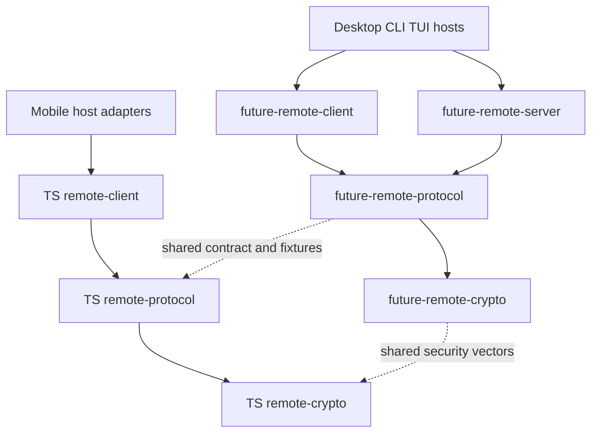

# Remote Package Development Plan

> [中文](remote-package-development.zh-CN.md)
>
> Design date: 2026-10-19. Source baseline: `4a64b65e`.
> Status: planned. This document defines target boundaries, migration steps and acceptance criteria; the new packages and entry points below are not implemented yet.

Separate Remote into protocol, controller and controlled-endpoint packages, retaining the independent secure-channel foundation. Rust and TypeScript follow the same responsibility model with separate implementations, validated against a common contract, vectors and interoperability tests. Desktop, Mobile, CLI and TUI provide UI, environment and local business adapters; Remote libraries do not depend on a particular application entry point.

The immediate goal is independently buildable, testable and lintable package boundaries, narrower validation for unrelated edits, and less duplication of core tests across GUI/headless configurations. Existing controlled-endpoint capability remains owned by Desktop GUI or its foreground headless host. Extension points for CLI/TUI are part of this design; new commands and interactions belong to the later host integration phase.

Existing product behavior is specified in the [remote connection design](../internals/desktop/CONNECTION.md); [Remote E2EE](../internals/desktop/REMOTE_E2EE.md) governs security and the wire protocol. This plan owns package extraction and migration, without duplicating those documents' security parameters or historical compatibility rules.

## 1 Current implementation and extraction boundaries

| Current location | Existing responsibilities | Coupling to remove |
|---|---|---|
| [remote](../../desktop/src-tauri/src/remote/mod.rs) | Controlled-side protocol handling, NATS transport, secure channel, supervision, command routing and event publication | Direct Desktop host lookup, application errors, runtime, shutdown state and some configuration helpers |
| [remote_host](../../desktop/src-tauri/src/remote_host/mod.rs) | Adapts remote commands to local Agent, sessions, settings, approvals, tasks and files; provides pairing and state services | Keep business implementations in the application; relocate generic HTTP, JWT and protocol helpers |
| [remote_peer](../../desktop/src-tauri/src/remote_peer/mod.rs) | Desktop controller client, remote projections, requests and file transfers | Desktop identity, configuration, file persistence and HTTP helpers borrowed from remote_host |
| [Mobile client](../../mobile/src/remote/client.ts) | TypeScript controller connection, requests, events and recovery | Indirect dependencies on Expo device information, Mobile storage and application configuration |
| [Mobile remote context](../../mobile/src/remote/RemoteContext.tsx) | React state, connection orchestration, UI and device lifecycle adaptation | Separate from the reusable client; application hooks stay outside core packages |
| [remote crypto](../../packages/remote-crypto/src/lib.rs) | Independent Rust Noise handshake and encrypted records | Keep independent and preserve vectors shared with the TS implementation |

The existing [RemoteHost interfaces](../../desktop/src-tauri/src/remote/services.rs) separate business, pairing, state and file services, with implementations in [DesktopHost](../../desktop/src-tauri/src/remote_host/mod.rs). Reuse these boundaries rather than introducing a general plugin framework.

Today's CLI `future remote devices` primarily manages local controlled-endpoint pairings and requests device addition from a running Desktop through files; it is not a general remote controller client. Mobile currently exposes controller capability only. Renaming packages must not present these future capabilities as completed.

## 2 Target packages and dependency direction

| Layer | Rust package | npm package | Delivery scope |
|---|---|---|---|
| Secure channel | `future-remote-crypto` | `@future-os/remote-crypto` | Keep the existing Rust package; extract the TS implementation from Mobile |
| Protocol | `future-remote-protocol` | `@future-os/remote-protocol` | Implement both languages |
| Controller | `future-remote-client` | `@future-os/remote-client` | Implement both languages |
| Controlled endpoint | `future-remote-server` | `@future-os/remote-server` | Implement Rust now; create the npm package when a JS controlled-endpoint product needs it |

The three Remote responsibility packages share the Crypto foundation. Do not create an empty TS server implementation. Mobile continues to use Protocol, Crypto and Client as a controller.

Proposed directories are `packages/remote-crypto`, `packages/remote-protocol`, `packages/remote-client` and `packages/remote-server`. A directory may contain both `Cargo.toml` and `package.json` with separate Rust and TS entry points; source, test, lint and publishing patterns must explicitly distinguish languages. New npm packages start private, and this migration adds no external Rust publishing workflow. Keep the existing root lockfiles and workspaces.

New Rust packages use ordinary library targets. Do not inherit futureos's `staticlib`/`cdylib` outputs merely because code originated there; add them only for an actual FFI consumer.

Client and Server do not depend on each other; Protocol and Crypto do not depend on role runtimes. Shared packages do not import Desktop, Mobile, CLI, TUI or Agent product implementations. Local business capabilities enter through interfaces; hosts use existing Agent RPC/service interfaces.

## 3 Layer responsibilities and host interfaces

### 3.1 Secure channel

Crypto owns the existing handshake patterns, key derivation, authenticated records, sequence numbers, replay protection and associated bounds. Preserve algorithms and security parameters without expanding it into a general cryptography framework.

Crypto has no NATS, HTTP, business-command, database or UI dependency. Protocol owns message envelopes, handshake exchanges and secure-channel negotiation. Place TS Base64/JSON wrapping and Mobile secure-random environment initialization correctly so Crypto does not depend back on Protocol or React Native. Preserve the [existing security vectors](../../packages/remote-crypto/tests/vectors.json).

### 3.2 Protocol

Protocol owns public messages, commands, replies, events, error codes, versions, capability names, invitation encoding, subject/context binding and chunking rules. Include wire contracts only: credential persistence, UI presentation types, retry policies and local business implementations do not belong here merely because they currently share `types.ts`.

Maintain the common contract and compatibility fixtures in `packages/remote-protocol`. Describe representable message structures in shared schemas; select Rust/TS type-generation tooling during the protocol phase. Shared fixtures and interoperability tests still validate codec behavior. Generated code must not become another manually editable source of truth. Existing Agent gRPC protobuf remains owned by `future-rpc`; do not merge the Remote contract into it.

Protocol does not establish connections, read global HOME, access storage or launch background tasks. Initial extraction preserves wire formats, field casing, optional-field semantics and compatibility policy.

Keep existing product-named wire fields such as `desktopId` compatible. Hosts may use generic internal terminology without turning reuse across entry points into a protocol-renaming migration.

### 3.3 Controller

Client owns connecting to controlled endpoints, pairing exchanges, handshakes, request/reply matching, event subscriptions, recovery, remote catalogs/session projections and client-side transfers. Remote sessions remain authoritative at the remote host; local caches must not create a second authoritative local session copy.

Host adapters provide identity/credential persistence, device names, configuration, trust settings, transport creation and local file access. The core emits events or callbacks without importing React, Tauri or Expo or directly updating UI. Rust uses Tokio; TS uses ordinary classes/functions with platform transport adapters and preserves existing TLS/WSS requirements.

Mobile foreground/background and network observers supply lifecycle events to Client, whose state machine applies them. System file selection, sharing, file opening, SecureStore and UI hooks remain in Mobile. Reuse generic projections already owned by thread-projection rather than duplicating them.

### 3.4 Controlled endpoint

Server owns the controlled entry, secure handshake, controller checks, admission limits, request deduplication, command routing, replies/event publication, server-side transfers and supervision. Host interfaces execute local business operations; Server does not directly depend on application Store, Agent implementation or Tauri commands.

Start from the existing business, pairing, state and file interfaces, with application-independent DTOs and errors. The host provides credential persistence, pairing service calls, local catalogs and business authorization; Server keeps connection-level and controller-level checks. Interface extraction must preserve approvals, sandboxing and path-access restrictions.

Desktop remote_host becomes the application implementation. Remote prompts continue through existing session persistence and Agent execution paths. Do not implement another prompt, approval or task executor inside Server.

### 3.5 Runtime and shutdown

The host explicitly starts each role runtime, owns its handle, stops it and waits for cleanup. Libraries do not parse process arguments, register global exit handlers, terminate the process or silently turn foreground capability into a background service.

Instances receive explicit configuration, data locations, identity and execution context. Remove dependencies on Desktop singletons, global HOME and static host lookup incrementally. Tasks have explicit ownership; old connections, late callbacks and retry timers cannot reopen a stopped entry. Preserve task registration, cancellation, cleanup waits and total shutdown deadlines.

The first integration preserves GUI/headless behavior. Later CLI/TUI integration generalizes “Desktop owns Remote” to “the host explicitly enabling the controlled endpoint owns Remote.” New commands separately specify visible state, approvals, ownership conflicts and exit behavior. Reusable libraries do not automatically enable controlled-endpoint capability in every entry point.

## 4 Source and test migration map

| Current content | Destination |
|---|---|
| remote/protocol, common capabilities and wire formats in client invitation/codec code | Rust/TS Protocol packages |
| Existing Rust Crypto and reusable Mobile secureChannel implementation | Crypto packages in each language |
| remote_peer connection, projection and transfer core; Mobile client, recovery and generic synchronization | Client packages in each language |
| remote transport, supervision, routing, publication and controlled-side transfers | Rust Server package |
| remote_host Store, Agent, task, file and local pairing implementations | Desktop host adapters |
| Tauri commands, remote/control local management and headless output | Desktop entry/adapters; generic invitation encoding moves to Protocol |
| Mobile RemoteContext, hooks, device/storage/file/network lifecycle | Mobile application adapters |

Move functions by responsibility instead of copying whole directories. HTTP/JWT helpers currently borrowed by relay and peer from remote_host must move into the appropriate role service or platform host adapter, eliminating cross-role borrowing. Convert application errors at boundaries while preserving display messages and machine codes; a shared Desktop AppError must not reintroduce SQLite dependencies into core libraries.

Pure protocol, state-machine, deduplication, crypto, paging and simulated transport tests move with the core. Actual business persistence, approvals/Agent execution, GUI close and headless shutdown remain host integration tests. Do not add Desktop as a new library dev-dependency to recover old fixtures.

## 5 Delivery phases

Each phase is independently verifiable and mergeable. Old paths may temporarily forward calls during migration, with one implementation only; remove forwarding and duplicate types when that phase completes.

| Phase | Work and deliverables | Completion criteria |
|---|---|---|
| 0 Baseline and contracts | Inventory dependencies, role entry points, wire/storage formats, host behavior and CI timings; assign package, interoperability or application ownership to tests | Pin source, toolchain, runner, commands, features and cache state; record compilation separately from execution and list independent package test entry points |
| 1 Crypto and Protocol | Keep Rust Crypto, extract TS Crypto; establish both Protocol packages, shared schemas/fixtures and a type-generation strategy | Both languages execute the same security/protocol corpus and report case IDs; invitation, handshake, fields, encoding, errors and capabilities remain compatible; tests use no application configuration |
| 2 Rust Client | Extract remote_peer core with explicit identity, credentials, transport and events; reconnect Desktop | Pairing, renewal, recovery, sessions and files retain behavior; Client tests run without futureos |
| 3 Rust Server | Extract remote runtime, implement host interfaces in remote_host, reconnect GUI/headless | Business/controller behavior preserved; cancellation, shutdown, late results and credential commits verified; no core Tauri/Agent implementation dependency |
| 4 TS Client | Extract Mobile client and generic synchronization; supply React Native dependencies through adapters and consume shared controller scenarios | Rust/TS validate the same request, event and recovery behavior; TS Client tests run outside Expo; Mobile host interactions verified |
| 5 Interoperability and CI | Establish an independent Remote interoperability test project for Rust Client↔Rust Server and TS Client↔Rust Server; update affected graph and tasks | Real endpoints verified without Desktop; packages report independently, GUI/headless differences remain covered, measured improvements reported |
| 6 Additional hosts | Integrate CLI/TUI controller or controlled roles for actual product needs; track JS server implementation separately | Each new entry validates explicit start/stop, identity, storage, approvals, visible state and exit |

Choose and record schema/generation tooling in phase 1, minimal public APIs in phases 2/3, and batching/concurrency limits in phase 5 using migration prototypes. Do not promise unverified function signatures before implementation.

## 6 Validation and CI organization

### 6.1 Shared Rust and TypeScript test material

Secure-channel, protocol and controller behavior use one shared corpus and expected contract, with each language executing its own implementation. Inputs, expected results and semantics align; test source, frameworks and platform-specific additions need not be identical.

| Layer | Shared material | Results that must agree |
|---|---|---|
| Crypto | Keys, handshake messages, authenticated contexts, ciphertext, corrupt records, replay and sequence-boundary vectors | Required byte results for keys/handshake hashes/records and acceptance or rejection conditions |
| Protocol | Command, reply, event, invitation, version, capability, chunking, optional-field and invalid-input fixtures | Codec semantics and compatibility; exact bytes where the protocol specifies a byte format |
| Client | Request/response traces, event sequences, disconnect/renewal/recovery steps, timeout/cancellation and retry scenarios | Observable state transitions, send counts, event ordering and success/failure outcomes |

Crypto keeps `packages/remote-crypto/tests/vectors.json`. Suggested protocol/client corpus locations are `packages/remote-protocol/fixtures/` and `packages/remote-client/fixtures/`, without copies inside Desktop or Mobile. Fixtures define stable case IDs, inputs, operations and expected outcomes; shared structures need versions and validation. Both language adapters report executed IDs; unsupported shared cases must fail explicitly or record a specific platform difference instead of silently skipping them.

Each Client driver simulates transport and advances controlled time, for example “send, disconnect, recover, receive a duplicate reply,” without relying on matching wall clocks. JSON assertions follow protocol semantics rather than imposing byte order on unordered object fields. Language/platform-specific tests may add coverage; preserve existing crypto, error and compatibility boundaries rather than reducing the corpus to the intersection of two implementations.

### 6.2 Independent test ownership and execution

Rust/TS Crypto, Protocol and Client, plus Rust Server, each own test source, entry points, commands and dependency declarations. Core tests move out of `desktop/` and `mobile/` into their packages. Selecting one package runs its tests without building futureos, loading Tauri, starting Expo or importing application modules.

TS packages provide independent test scripts/configuration, without borrowing Desktop's Vitest configuration, Mobile's Jest/Expo preset or React Native mock environment. Root workspace tooling may manage dependencies centrally, but package entry points and dependencies must be explicit. Rust tests are selected through Cargo packages without application crate dependencies. Thin application wrappers must not rerun the entire core corpus.

Root workspaces may install dependencies centrally, reuse artifacts and batch execution; independence does not require separate node_modules, target directories or runners per package. CI reports package names, results, counts and duration separately so failures can be reproduced and rerun independently.

### 6.3 Package interoperability and application integration boundaries

| Test owner | Validates | Test host |
|---|---|---|
| Package tests | Crypto, protocol, state machines, deduplication, request matching, recovery, generic synchronization, projections and transfers | Package drivers, simulated transports and fake host services |
| Remote interoperability | Real Rust Client↔Rust Server and TS Client↔Rust Server handshakes, requests, events and transfers | Independent Remote test project with fake local business services, without Desktop |
| Application adapter tests | Tauri commands, React hooks/Context, device identity, secure storage, files and foreground/network wiring | Desktop/Mobile as appropriate; later CLI/TUI maintain their own |
| Application product integration | Actual Store/Agent/approval/file semantics, GUI close, headless shutdown and product entry points | Real application with isolated local services/data |

Shared fixtures and independent mocks do not replace real interoperability. The separate test project combines both roles through public APIs; phase 5 establishes its location and language drivers. Production Client/Server packages acquire no mutual dependency for tests. Applications verify that hosts start, invoke, cancel and clean up libraries, without owning every internal protocol scenario.

Maintain a baseline map from each original test to its package, interoperability or application destination, and confirm coverage before deleting the original. Cross-package business tests remain application integration tests; do not replace their business assertions with mocks merely to achieve package independence.

### 6.4 Required behavioral coverage

| Validation layer | Required coverage |
|---|---|
| Crypto | Existing cross-language vectors, both handshake patterns, corrupted records, replay and sequence bounds, key/candidate cleanup |
| Protocol | JSON/binary/invitation codecs, versions and unknown capabilities, optional fields, size limits, chunking, errors and older-client compatibility |
| Client | Request timeouts/retries, credential renewal, recovery budgets, event deduplication/gap filling, catalogs, multi-host isolation and transfer cancellation |
| Server | Controller ownership, uncommitted handshake admission, request deduplication, refresh/reconnect races, revocation/shutdown, reply/event ordering |
| Languages and roles | Rust Client↔Rust Server and TS Client↔Rust Server; shared fixtures plus real interoperability, beyond independent mocks |
| Host integration | Real Store/Agent/approval/file semantics; GUI/headless runtimes, later CLI/TUI entry points, Mobile lifecycle/native storage |

### 6.5 Checks scheduling and performance acceptance

Each package defines static checks and tests. Rust uses scoped rustfmt, Clippy `--all-targets` and package tests; TS uses type checks, lint and package tests. Source-exporting TS packages define a build only when an actual artifact requires one. Avoid duplicate compilation already covered by tests while retaining product-entry, packaging-feature and platform validation.

CI selects changed packages and affected consumers from actual dependencies, including shared schemas, vectors, configuration, generators and lockfiles. Package boundaries do not require a runner per task: batch by platform, toolchain and duration to reuse dependencies/artifacts within runner limits. Add no main-cache warming or full suite after every release.

Fixtures favor explicit instances, isolated data roots and ephemeral ports; never connect to or stop the user's running Agent. Preserve known lock ordering and cleanup constraints during migration, then use instance isolation to remove serialization from global HOME/singletons. Unit tests run in PR CI, not locally.

Performance acceptance compares compilation, linking, test execution, cache restoration and queueing separately with equivalent runners, toolchains, features, commands and cold/warm cache states. First verify core tests no longer repeat with GUI/headless, then assess slow tests and Windows builds. Test counts, source-line counts and differences between unrelated CI runs do not establish time savings.

## 7 Compatibility and completion checklist

- [ ] Rust Protocol, Client and Server packages and independent Crypto have acyclic dependencies without application imports.
- [ ] TS Crypto, Protocol and Client packages exist; React Native, Expo, React hooks and UI remain in Mobile.
- [ ] Rust/TS share contracts and security/protocol fixtures; wire formats, TLS/WSS, identity binding and security policy remain compatible.
- [ ] Security, protocol and controller corpora have one source; both languages report shared case IDs, record platform differences and preserve existing boundary coverage.
- [ ] Packages own test commands, configuration and dependencies; core tests leave application directories and do not borrow Desktop/Mobile test environments.
- [ ] Pairing/Peer credentials, pending revocations, device identity and file formats remain compatible; extraction alone does not change paths or force devices to pair again.
- [ ] Mobile two-slot credential commits, secure storage and key cleanup remain intact; credentials, complete invitations and private keys never enter logs or test snapshots.
- [ ] Authority for local sessions, remote projections, Agent, tasks and files remains unchanged, with approvals and sandbox restrictions preserved.
- [ ] Role runtimes explicitly start, stop and await cleanup; stale retries/callbacks cannot reverse disconnect or cancellation.
- [ ] Core tests run without Tauri/Expo; real business, lifecycle, platform and role interoperability remain covered.
- [ ] An independent Remote project exercises real endpoints through public APIs; application tests own adapters/product integration, with traceable destinations for migrated tests.
- [ ] CI affected graphs cover packages, consumers and non-source inputs without unconditional platform jobs for every package.
- [ ] Generated files are reproducible, obsolete forwarding/duplicate implementations removed, bilingual indexes and design links updated.
- [ ] Equivalent baselines report compilation/test changes without treating reduced required coverage as a performance improvement.

Update current package inventories as phases land. [Shared package conventions](packages.md) continue to govern new packages. Record actual interfaces, phase status and measurements here as implementation completes.
