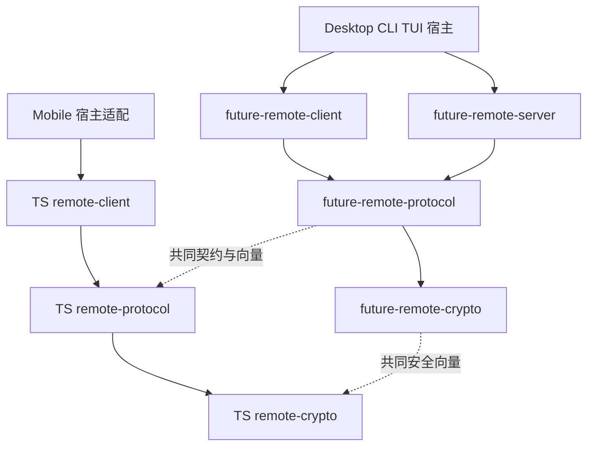

# Remote 拆包开发计划

> [English](remote-package-development.md)
>
> 设计日期：2026-10-19。源码基线：`4a64b65e`。
> 状态：实施中，阶段 1～3 持续迁移；实际落地、检查证据和待办见第 8 节。阶段 0～5 尚未整体完成。

将远程能力拆成协议、主控、被控三个职责包，保留独立的安全通道基础库。Rust 与 TypeScript 使用相同的职责模型，各自维护实现，通过共同的协议契约、测试向量和互通测试保证兼容。Desktop、Mobile、CLI、TUI 负责界面、环境和本地业务适配；远程库不依赖某个应用入口。

本计划的直接目标是建立可独立编译、测试和静态检查的包边界，缩小无关改动的验证范围，减少 GUI/headless 对相同核心测试的重复执行。现有被控能力继续由 Desktop GUI 或前台 headless 宿主管理。CLI/TUI 接入所需的扩展点属于本次设计，新命令和交互在后续宿主接入阶段实施。

现有产品行为见[远程连接设计](../internals/desktop/CONNECTION.zh-CN.md)，安全与线协议以 [Remote E2EE](../internals/desktop/REMOTE_E2EE.zh-CN.md) 为准。本计划维护拆包与迁移安排，不复制这两份文档的安全参数或历史兼容规则。

## 1 当前实现与拆分依据

| 当前位置 | 已有职责 | 需要解除的耦合 |
|---|---|---|
| [remote](../../desktop/src-tauri/src/remote/mod.rs) | 被控侧协议处理、NATS 通信、安全通道、连接监督、命令路由、事件发布 | 直接取得 Desktop 宿主，使用应用错误、运行时、退出状态和部分配置工具 |
| [remote_host](../../desktop/src-tauri/src/remote_host/mod.rs) | 将远程命令接入本地 Agent、会话、设置、审批、任务和文件系统；提供配对和状态能力 | 业务实现留在应用适配层；通用 HTTP、JWT 和协议工具重新归位 |
| [remote_peer](../../desktop/src-tauri/src/remote_peer/mod.rs) | Desktop 主控客户端，连接其他机器、维护远端投影、收发请求和文件 | 依赖 Desktop 的身份、配置、文件落盘，以及 remote_host 中的 HTTP 工具 |
| [Mobile client](../../mobile/src/remote/client.ts) | TypeScript 主控连接、请求、事件与恢复 | 间接绑定 Expo 设备信息、Mobile 存储及应用配置 |
| [Mobile remote context](../../mobile/src/remote/RemoteContext.tsx) | React 状态、连接编排、界面与设备生命周期适配 | 与通用客户端核心分离，应用 hooks 不进入核心包 |
| [remote crypto](../../packages/remote-crypto/src/lib.rs) | 独立 Rust Noise 握手和加密记录层 | 保持独立；与 TS 实现共用的向量继续维护 |

[RemoteHost 接口](../../desktop/src-tauri/src/remote/services.rs)已分出业务、配对、状态和文件四组能力，[DesktopHost](../../desktop/src-tauri/src/remote_host/mod.rs)已有实现。迁移复用这些边界，不另建通用插件框架。

当前 CLI 的 `future remote devices` 主要管理本机被控配对，并通过文件请求运行中的 Desktop 添加设备；它尚不是通用的远端主控客户端。当前 Mobile 只有主控产品能力。上述现状不能在改包名时被写成新能力已完成。

## 2 目标包与依赖方向

| 层次 | Rust 包 | npm 包 | 实施范围 |
|---|---|---|---|
| 安全通道 | `future-remote-crypto` | `@future-os/remote-crypto` | 保留现有 Rust 包；从 Mobile 提取 TS 实现 |
| 协议 | `future-remote-protocol` | `@future-os/remote-protocol` | 两种语言均建立 |
| 主控 | `future-remote-client` | `@future-os/remote-client` | 两种语言均建立 |
| 被控 | `future-remote-server` | `@future-os/remote-server` | 本轮建立 Rust 实现；有 JS 被控产品需求时再建立 npm 包 |

三个远程职责包共用 Crypto 基础库。TS 被控包暂不创建空实现；Mobile 继续作为主控使用协议、Crypto 和 Client 包。

建议目录为 `packages/remote-crypto`、`packages/remote-protocol`、`packages/remote-client` 和 `packages/remote-server`。同一目录可以同时拥有 `Cargo.toml` 和 `package.json`，分别使用 Rust 与 TS 入口；源码、测试、lint 和发布匹配规则必须明确区分语言。新 npm 包先保持 private，Rust 包不因本轮迁移新增对外发布流程。共同使用根锁文件和现有 workspace。

Rust 新包使用普通库目标；不因源自 futureos 就沿用其 `staticlib`/`cdylib` 产物配置。只有实际的 FFI 消费者需要时才增加相应产物。

Client 与 Server 不相互依赖；协议与 Crypto 不依赖角色运行时。共享包不导入 Desktop、Mobile、CLI、TUI 或 Agent 产品实现。库需要的本地业务通过接口提供，宿主负责使用现有 Agent RPC/服务接口。

## 3 各层职责与宿主接口

### 3.1 安全通道

Crypto 负责既有握手模式、密钥派生、认证加密记录、序列号、防重放和相关边界检查。保留现有算法与安全参数；不把它扩展为通用密码学框架。

Crypto 不依赖 NATS、HTTP、业务命令、数据库或 UI。协议层负责消息封装、握手消息交换约定及安全通道协商。TS 的 Base64/JSON 封装与 Mobile 安全随机数环境初始化须正确归位，避免 Crypto 反向依赖协议包或 React Native。沿用[现有安全向量](../../packages/remote-crypto/tests/vectors.json)。

### 3.2 协议

协议包负责公共消息、命令、回复、事件、错误码、版本、能力标识、邀请编码、主题/上下文绑定和分块约定。只收录线上契约；凭据落盘格式、UI 展示类型、重试策略及本地业务实现不因位于现有 `types.ts` 中就进入协议包。

在 `packages/remote-protocol` 中建立双方共同维护的契约与兼容样例。将可表达的消息结构归入公共 schema；Rust/TS 类型生成工具在协议阶段选定，编码行为仍由共同样例和互通测试验证。生成代码不得成为第二份可手改的事实源。现有 Agent gRPC protobuf 仍由 `future-rpc` 管理，Remote 契约不与其合并。

协议包不建立连接、读取全局 HOME、访问存储或启动后台任务。首次拆分保持现有 wire format、字段 casing、可选字段语义和兼容策略。

现有 `desktopId` 等线协议字段即使名称带有产品背景，也先保持兼容；宿主内部可以使用通用命名，不将跨入口复用扩展成一次协议重命名。

### 3.3 主控

Client 负责连接被控端、配对交换、握手、请求与回复匹配、事件订阅、恢复、远端目录和会话投影，以及客户端文件传输。远端会话仍由远端拥有，本地缓存不能变成本机会话的第二份权威记录。

身份/凭据读写、设备名称、配置、信任设置、传输创建和本地文件访问通过宿主适配提供。主控核心输出事件流或回调，不导入 React、Tauri、Expo，不直接更新界面。Rust 复用 Tokio；TS 使用普通类和函数，网络传输按平台适配，保留当前 TLS/WSS 要求。

Mobile 的前后台和网络监听向 Client 输入生命周期事件；连接状态机在 Client 中执行。系统文件选择、分享、文件打开、SecureStore 和界面 hooks 留在 Mobile。现有 thread-projection 中的通用投影继续复用，不在新包中复制。

### 3.4 被控

Server 负责被控入口、安全握手、控制权检查、接入限额、请求去重、命令路由、回复和事件发布、被控侧传输及连接监督。它通过宿主接口执行本地业务，不直接依赖应用 Store、Agent 实现或 Tauri 命令。

继续使用业务、配对、状态、文件四组能力作为接口起点，整理应用无关的 DTO 和错误类型。宿主提供凭据持久化、配对服务调用、本地目录和业务授权；Server 保留连接级和控制权级检查。现有审批、沙箱和路径访问约束不能因接口迁移被绕过。

Desktop 的 remote_host 成为该接口的应用实现。远程 prompt 继续复用现有会话持久化与 Agent 调用路径；不在 Server 中重新实现 prompt、审批或任务执行。

### 3.5 运行时与退出

宿主显式启动角色运行时，持有句柄并负责停止与等待清理。库不解析进程参数、不注册全局退出信号、不调用进程退出，也不自行把前台能力变成后台服务。

运行实例接收明确的配置、数据位置、身份和执行环境。逐步消除对 Desktop 全局单例、全局 HOME 和静态宿主查询的依赖。任务必须有归属，停止后旧连接、晚到的回调和恢复定时器不能重新开启入口；保留现有任务登记、取消、清理等待和总截止时间语义。

第一阶段保持 GUI/headless 的启停行为。CLI/TUI 后续接入时，将“Desktop 拥有 Remote”推广为“显式启用被控功能的宿主拥有 Remote”；新增命令需另行定义可见状态、审批交互、占用和退出行为。库可复用不等于所有入口已自动具备被控能力。

## 4 源码与测试迁移映射

| 当前内容 | 目标位置 |
|---|---|
| remote/protocol、公共能力标识、客户端 invitation/codec 中的线上格式 | Rust/TS 协议包 |
| 现有 Rust Crypto、Mobile secureChannel 中的通用安全实现 | 各语言 Crypto 包 |
| remote_peer 的连接、会话投影和传输核心；Mobile client、恢复和通用同步 | 各语言 Client 包 |
| remote 的传输、连接监督、路由、事件发布及被控侧传输 | Rust Server 包 |
| remote_host 的 Store、Agent、任务、文件和本地配对适配 | Desktop 宿主适配 |
| Tauri commands、remote/control 本地管理入口、headless 输出 | Desktop 入口与适配层；通用邀请编码下沉协议包 |
| Mobile RemoteContext、hooks、设备/存储/文件/网络生命周期 | Mobile 应用适配 |

按函数职责迁移，不整目录复制。当前 relay 和 peer 借用的 remote_host HTTP/JWT 代码需明确归入角色服务或宿主平台适配，消除跨角色借用。应用错误在边界转换，保留用户可见消息与机器错误码；不通过共享 Desktop AppError 把 SQLite 等依赖带回核心库。

纯协议、状态机、去重、加密、分页和模拟传输测试随核心迁移。真实业务持久化、审批/Agent 调用、GUI 关闭和 headless 退出测试留在宿主集成层。测试不能通过把 Desktop 设为新库的 dev-dependency 来重新引入耦合。

## 5 分阶段实施

每阶段独立可验证、可合并。旧路径可短期保留薄转发以迁移调用方，但只有一份实现；阶段完成后删除转发和重复类型。

| 阶段 | 工作与交付物 | 完成条件 |
|---|---|---|
| 0 基线与契约清单 | 记录依赖、角色入口、wire/存储格式、宿主行为和 CI 时间；为测试标记包内、互通、应用集成归属 | 固定源码、工具链、runner、命令、特性组合和缓存状态，分别记录编译与测试时间；列出各包独立测试入口 |
| 1 Crypto 与协议 | 保留 Rust Crypto，抽 TS Crypto；建立两语言协议包、共同 schema/样例和类型生成策略 | 两语言执行同一份安全/协议素材并报告用例 ID；邀请、握手、字段、编码、错误与未知能力兼容；包测试不依赖应用配置 |
| 2 Rust 主控 | 从 remote_peer 提取核心，显式提供身份、凭据、传输和事件接口；Desktop 接回 | 配对、刷新、恢复、会话与文件行为保持；Client 可脱离 futureos 独立测试 |
| 3 Rust 被控 | 从 remote 提取运行时；remote_host 实现宿主接口；接回 GUI/headless | 本地业务与控制权行为保持；取消、退出、晚到结果和凭据保存边界通过；核心无 Tauri/Agent 实现依赖 |
| 4 TS 主控 | 提取 Mobile client 与通用同步；React Native 依赖改由应用适配提供；接入共用主控场景 | Rust/TS 验证同一组请求、事件和恢复行为；TS Client 在非 Expo 环境独立测试；Mobile 宿主交互通过 |
| 5 互通与 CI | 建立独立 Remote 互通测试工程，覆盖 Rust Client↔Rust Server、TS Client↔Rust Server；调整 affected 图和任务 | 无需 Desktop 即可验证真实两端；各包独立报告，GUI/headless 保留宿主差异覆盖；报告实测收益 |
| 6 后续宿主 | 按实际产品需求接入 CLI/TUI 主控或被控；JS 被控另立实现任务 | 每个新入口有显式启动/停止、身份、存储、审批、可见状态和退出验收 |

阶段 1 的 schema/生成工具、阶段 2/3 的最小公开接口、阶段 5 的批次与并发限制，在对应阶段根据迁移原型确定并记录；不在实施前承诺未验证的函数签名。

## 6 验证与 CI 组织

### 6.1 Rust 与 TypeScript 共用测试素材

安全通道、协议和主控行为共用一份素材与预期契约，两种语言分别执行自己的实现。保持一致的是输入、预期结果和行为语义，不要求测试源码、框架或平台补充用例完全相同。

| 层次 | 共同维护的素材 | 两语言必须一致的结果 |
|---|---|---|
| Crypto | 密钥、握手消息、认证上下文、预期密文、损坏记录、防重放和序列边界向量 | 密钥/握手摘要/记录等约定字节结果，以及应接受或拒绝的条件 |
| Protocol | 命令、回复、事件、邀请、版本、能力、分块、可选字段和错误输入样例 | 编解码语义与兼容行为；协议规定字节格式时逐字节比较 |
| Client | 请求/响应记录、事件序列、断线/刷新/恢复步骤、超时/取消和重试场景 | 相同的可观察状态变化、发送次数、事件顺序及成功/失败结果 |

Crypto 沿用现有 `packages/remote-crypto/tests/vectors.json`。协议和主控素材建议分别放入 `packages/remote-protocol/fixtures/` 与 `packages/remote-client/fixtures/`，不复制到 Desktop 或 Mobile。素材定义稳定的用例 ID、输入、操作序列和预期结果；公共结构需要版本与校验。两语言适配器报告已执行的用例 ID，对未支持的共享用例明确失败或记录具体的平台差异，不能静默跳过。

Client 测试驱动各自模拟传输并推进可控时间，例如“发送请求、断线、恢复、收到重复回复”，不依赖两端真实时钟恰好一致。JSON 比较遵循协议语义，不对无顺序约定的对象字段强加字节顺序。语言/平台特有测试可以独立增加；已有加密、错误和兼容边界不能为了取两种实现的交集而删减。

### 6.2 每个包独立拥有和执行测试

Rust/TS Crypto、Protocol、Client 以及 Rust Server 各有自己的测试源码、入口、命令和依赖声明。核心测试随所属包维护，迁出 `desktop/`、`mobile/`；单独选择一个包即可执行，不要求编译 futureos、加载 Tauri、启动 Expo 或导入应用模块。

TS 包提供独立测试脚本和配置，不借用 Desktop 的 Vitest 配置、Mobile 的 Jest/Expo preset 或 React Native mock 环境。测试工具可由根 workspace 统一管理，但包的运行入口与依赖必须明确。Rust 包通过 Cargo 包选择运行，测试代码不依赖应用 crate。薄应用包装不能再完整重跑同一套核心用例。

根 workspace 可以统一安装依赖、复用构建产物并批量调度；测试独立不要求每包有单独的 node_modules、target 目录或 runner。CI 分别报告包名、测试结果、数量和耗时，包失败可以单独复现与重跑。

### 6.3 测试归属与集成边界

| 测试归属 | 验证内容 | 测试宿主 |
|---|---|---|
| 包内测试 | 加密、协议、状态机、去重、请求匹配、恢复、通用同步、投影与传输 | 所属包提供的测试驱动、模拟传输及假的宿主服务 |
| Remote 互通测试 | Rust Client↔Rust Server、TS Client↔Rust Server 的真实握手、请求、事件及传输 | 独立 Remote 测试工程，使用假的本地业务实现，不要求 Desktop |
| 应用适配测试 | Tauri commands、React hooks/Context、设备信息、安全存储、文件与前后台/网络事件接线 | 对应 Desktop/Mobile；后续 CLI/TUI 各自维护 |
| 应用产品集成测试 | 真实 Store/Agent/审批/文件语义；GUI 关闭、headless 退出和产品入口 | 实际应用与隔离的本地服务/数据目录 |

共享素材和各自 mock 通过不能代替真实互通。独立互通工程通过公开 API 组合两端，具体目录和语言驱动在阶段 5 落地；生产 Client/Server 不为测试互相引入依赖。应用仍验证宿主是否正确启动、调用、取消并清理库，但不承担库内部所有协议场景。

迁移基线建立“原测试 → 新包或互通/应用测试”的归属清单，确认覆盖去向后再删除原测试。跨包真实业务用例仍留在应用集成层，不能为了包独立将其替换成没有验证业务结果的 mock。

### 6.4 必须覆盖的行为

| 验证层 | 必须覆盖 |
|---|---|
| Crypto | 既有双语言向量、双方握手模式、损坏记录、防重放、序列边界和密钥/候选清理 |
| Protocol | JSON/二进制/邀请编码、版本与未知能力、可选字段、大小上限、分块、错误和旧客户端兼容 |
| Client | 请求超时与重试、凭据刷新、恢复预算、事件去重/补齐、目录投影、多远端隔离和文件取消 |
| Server | 控制权、未提交握手不可执行业务、请求去重、刷新/重连竞争、撤销/停机、回复与事件顺序 |
| 跨语言与角色 | Rust Client↔Rust Server、TS Client↔Rust Server；共享样例加真实互通，不只测试各自 mock |
| 宿主集成 | 真实 Store/Agent/审批/文件语义；GUI/headless runtime、CLI/TUI 后续入口；Mobile 前后台与原生存储 |

### 6.5 检查调度与性能验收

各包定义自己的静态检查和测试目标。Rust 使用 scoped rustfmt、Clippy `--all-targets` 与包测试；TS 使用类型检查、lint 和包测试。直接导出 TS 源码的包按实际需要定义 build，不添加没有产物意义的构建步骤。测试已覆盖的构建不重复执行；产品入口、打包特性组合和平台行为保留验证。

CI 根据真实依赖选择改动包及受影响消费者，并记录共享 schema、向量、配置、生成脚本和锁文件输入。包边界不等于每个任务都单独分配 runner；按平台、工具链和耗时批量执行，在 runner 限额内复用依赖与产物。不新增 main 缓存预热或每次发布后的全量工作。

测试夹具优先使用显式实例、独立数据根和随机端口，不能连接或停止用户运行中的 Agent。迁移期间保留已知锁顺序和任务清理约束，再用实例隔离消除全局 HOME/单例导致的串行竞争。单元测试由 PR CI 执行，不在本地运行单元测试。

性能验收分别比较编译、链接、测试执行、缓存恢复和排队时间；对照相同 runner、工具链、特性、命令与冷热缓存状态。先验证核心测试不再随 GUI/headless 重复，再评估慢测试和 Windows 构建。测试数量、代码行数及跨次 CI 差值不能直接作为节省时间的证明。

## 7 兼容性与完成清单

- [ ] Rust 协议、主控、被控包与独立 Crypto 建立，依赖方向无环，无应用反向依赖。
- [ ] TS Crypto、协议、主控包建立；React Native、Expo、React hooks 和 UI 留在 Mobile。
- [ ] Rust/TS 共用契约和安全/协议样例；既有 wire format、TLS/WSS、身份绑定及安全策略保持。
- [ ] 安全、协议、主控共享素材只有一份；两语言报告共同用例 ID，平台差异显式记录且保留原有边界覆盖。
- [ ] 各包有独立测试命令、配置和依赖，核心测试迁出应用目录，不借用 Desktop/Mobile 测试环境。
- [ ] 配对/Peer 凭据、待撤销记录、设备身份和相关文件格式兼容；无迁移原因不改变路径或使已配对设备重新配对。
- [ ] Mobile 两槽凭据提交、安全存储及密钥清理语义保持；凭据、完整邀请和私钥不进入日志或测试快照。
- [ ] 本地会话、远端投影、Agent、任务与文件的数据权威不改变；审批与沙箱约束保持。
- [ ] 角色运行时可显式启动、停止、等待清理；断开和取消不被旧重试或回调撤销。
- [ ] 核心测试脱离 Tauri/Expo；真实业务、宿主生命周期、平台差异和角色互通测试仍有覆盖。
- [ ] 独立 Remote 互通工程通过公开 API 验证真实两端；应用测试只承担自身适配与产品集成，原测试迁移归属可追踪。
- [ ] CI affected 图包含新包、消费者及非源码输入；未扩大为每个包的无条件全平台任务。
- [ ] 生成文件可复现，旧转发和重复实现清理，中英文索引及现有设计入口更新。
- [ ] 以同条件基线报告编译/测试变化；没有用减少必要覆盖冒充性能收益。

文档中的现有包清单在各阶段落地时更新。[共享包约定](packages.zh-CN.md)继续约束新包；完成后本计划记录实际接口、阶段状态和测量结果。

## 8 实施记录

### 2026-10-19：基线与第一批 Crypto/Protocol 迁移

实施分支：`refactor/remote-packages`；范围仍为阶段 0～5，第 6 阶段未启动。本轮不创建 PR；最终通过工作分支 CI 统一执行自动化验收。开发期间只执行编译、类型检查、lint、fmt 和生成文件检查；人工验收确认前不标记整体完成。

| 阶段 | 实际状态 | 证据与剩余工作 |
|---|---|---|
| 0 | 已固定源码/测试清单和历史 CI 参考；性能对照待最终 CI | [原测试迁移清单](remote-test-migration.json)记录基线文件、Rust 用例名和迁移目标；`target: null` 表示尚未归位。[历史 CI 参考](remote-ci-baseline.json)记录原提交、作业、runner、步骤及 Windows 编译/测试日志时间。该运行不是本分支的同条件性能结果。 |
| 1 | 实施中，已接回现有消费者 | TS Crypto 与两语言 Protocol 包已建立；Mobile 使用包内 Crypto/线上 DTO，Desktop 使用公共命令、邀请解析和 JSON 解码。其余握手封装、能力/分块常量及角色中散落的线协议 DTO 随后续迁移继续归位，自动化结果待最终 CI。 |
| 2 | 实施中，连接核心已接回 Desktop | Rust Client 连接、凭据 DTO、多远端实例、任务生命周期与上传/下载编排已接回；HTTP/JWT 共用工具已归位。独立网络互通、共享 Client 场景和最终验收仍待完成。 |
| 3 | 实施中，安全端点与部分宿主契约已接回 | 实例监督器状态、控制权、状态/presence 与恢复/原生任务等待已接回；连接建立/重建、心跳/目录发布、完整角色退出及临时接线收口仍待完成。 |
| 4～5 | 待实施 | TS Client、独立互通工程、CI affected 调度和最终验收仍未完成。 |

已落地的包入口与检查约定：

- Rust Crypto 保持 `future-remote-crypto`，Protocol 为普通库 `future-remote-protocol`。可分别使用 `cargo clippy -p <包名> --all-targets -- -D warnings` 检查；最终 CI 使用各自的 `cargo test -p <包名> -- --show-output`，输出共享用例 ID。
- TS 包使用 `npm run typecheck|lint|test --workspace @future-os/remote-crypto` 和对应的 `@future-os/remote-protocol` 入口；其中 `typecheck|lint|test` 表示分别选择脚本，并非一条 shell 命令。各自使用 Node/Vitest 配置，不加载 Expo 或 Desktop 配置。源码直接导出，无需额外空 build。
- [命令 schema](../../packages/remote-protocol/command.schema.json)是 62 个命令字段、Rust 缺省值和 TS 生产者类型的事实源。仓库内的生成器只使用 Python 标准库和固定工具链的 rustfmt：`python3 packages/remote-protocol/scripts/generate.py`；追加 `--check` 检查是否过期。不得手改生成文件。其余响应/事件 DTO 当前作为协议包内的手写线上类型维护，后续扩展 schema 时再迁入生成范围。
- [安全素材](../../packages/remote-crypto/tests/vectors.json)使用 `version: 1`、稳定 ID、两种握手的原始字节向量及共享负向记录步骤；原握手、密文、摘要未改变。[协议素材](../../packages/remote-protocol/fixtures/protocol.json)覆盖邀请、命令、JSON/gzip 和大小边界。两语言驱动拒绝未知素材版本/类型，并报告执行 ID。
- 原 Crypto、邀请、JSON/gzip 和 codec 核心测试迁入所属包；协作式 JSON 解析的调度/取消测试暂留 Mobile，阶段 4 随 Client 迁移。原测试去向继续更新清单，不以新 mock 替代真实宿主业务覆盖。

保留的历史解析差异：Rust 的邀请解析包含完整 code/claim URL/过期校验；TS 的 `parsePairingInvitation` 只是 Mobile 配对流程的前置格式解析，完整策略仍在应用配对流程执行。旧格式的前置解析结果不等于允许使用旧安全协议。共享素材为此显式记录语言预期和差异原因，本次迁移不借机改变认证、HTTP 例外或凭据语义。

本批静态验证使用固定 Rust 1.97.0、Node 24.21.0，在隔离 macOS arm64 工作目录执行。Rust Crypto/Protocol 与 Desktop GUI/headless 的 Clippy（包含测试目标编译）、两 npm 包和 Mobile 的 typecheck/lint 已通过。单元测试和共享素材尚未执行，不能据此宣称协议或产品验收通过。历史 Windows CI 显示测试执行与编译耗时差异较大，但尚无本次重构的性能收益结论。

### 2026-10-19：Rust Client 单次连接核心

阶段 2 已开始，尚未完成。`future-remote-client` 是独立普通 Rust 库，首批迁入 `PeerSession`、Noise 配对/IK 重连、加密命令请求与重试、订阅通道选择、握手确认校验，以及 `PeerCreds`/`PeerIdentity` DTO。库不读取全局 HOME、不依赖 futureos/Agent/Tauri、不自行启动应用后台任务。

公开连接入口为 `session::connect(&PeerCreds, &ConnectionOptions)`。宿主显式提供设备名称、设备种类和可选平台证书 bundle；生产连接继续强制 TLS。`test-support` 非默认特性只提供测试接线，明文 fixture 另有 loopback 地址检查；Desktop 的测试构建才启用它。连接结果中的 `consumed_invitation` 继续由宿主用于清除已消费 PSK，库不擅自更改凭据落盘。

Desktop 的 session 模块目前是环境/错误适配，真实连接实现只有包内一份。Client 错误逐类转换回 `AppError`，保留网络、授权、平台状态码/机器错误码和用户可见文字；核心不依赖 SQLite。`remote_peers.json`、label、原子写入/配置锁及设备身份取得仍由原 Desktop 宿主负责，序列化字段和可选值规则保持。凭据 DTO 的 Debug 输出改为不含密钥/令牌，防止断言或日志意外打印秘密。

11 个原 session 单元用例和 2 个凭据时序/撤销地址用例已迁到 Client；新增凭据 Debug 保密与应用错误转换回归用例。真实配对、文件、Store、应用退出等集成用例继续留在应用，后续按[迁移清单](remote-test-migration.json)归位。测试源码已编译，尚未执行。

本批静态检查已通过：Client 默认特性的独立库编译、默认及 `test-support` 的 Clippy `--all-targets`，以及 Desktop GUI/headless 的 Clippy `--all-targets`；使用固定 Rust 1.97.0。下一步仍须迁移多远端运行实例、事件监督与恢复、凭据/平台服务接口、文件传输和有归属的停止/等待清理。此时不能把连接核心可复用视为阶段 2 或整个重构已完成。

### 2026-10-19：Rust Client 多远端实例与任务归属

主控的多远端运行时已移入 `future-remote-client::Client`，Desktop 通过 `DesktopClientHost` 接回。每个实例独立拥有连接、停止意图、事件任务、重连任务、可见会话、分页重组和分块等待者；库内不再使用进程全局 runtime 单例，也不读取 Desktop Store、设备身份或应用错误实现。配对、刷新、撤销、凭据读写、证书与设备信息、命令 ID 和任务登记由 `ClientHost` 显式提供。

角色任务先由 Client 包装为可取消、可观察完成的句柄，再交给宿主登记执行。保留 Desktop 原有任务注册/冻结/取消链；`stop_admission()` 同步关闭入口并取消角色任务，`shutdown(total_budget)` 在同一总截止时间内等待 future 销毁、清理连接/订阅/文件等待者。宿主拒绝尚未 poll 的任务也必须发出完成通知，panic 仍可观察。Desktop GUI/headless 的公共退出路径已经接入这两个入口。测试重置替换实例，而不是复用已经停止的实例。

每个远端的连接尝试带有代次；断开、新连接或停机之后，旧握手不得安装连接，旧请求失败不得移除较新的连接。配对 claim/刷新/握手在停机时收到取消信号。Desktop 对刷新、PSK 清除和移除使用原配置锁内的身份比较后写入：只有仍对应同一配对、NKey 和刷新令牌的凭据可以修改，防止重配后的同名远端被旧结果覆盖。文件路径、字段和原子写入格式未改动。

13 个原运行时纯解析/队列/调度用例已迁入 Client，真实应用/平台/Agent 接线用例继续通过宿主适配驱动真实 Client。新增独立实例隔离、等待任务真实销毁、未 poll 任务被拒绝、停机取消 claim、断开拒绝晚到刷新等包内用例，以及应用凭据重配竞争回归用例。归属见[迁移清单](remote-test-migration.json)。所有用例仍未执行，本地仅编译与静态检查。

阶段 2 仍未完成：客户端上传/下载编排及文件适配尚待拆分，HTTP/JWT 共用宿主工具仍须从被控宿主路径归位，部分真实网络核心用例将在独立互通工程中迁出应用。阶段 3～5 的 Server、TS Client、互通/affected CI 和最终验收继续保留完整范围。当前不得把 Client 实例已建立视为整体目标完成。

本批已通过固定 Rust 工具链上的 Client 默认/测试辅助特性 Clippy `--all-targets`、Desktop GUI/headless Clippy `--all-targets`、fmt、生成文件一致性与相关双语文档检查；没有执行本地单元测试。

### 2026-10-19：Rust Client 文件传输与共用宿主工具

上传/下载编排已移入 Client。库返回文件字节和元数据，Desktop 保留预览缓存、路径选择与原子落盘。Protocol 拥有既有传输回复 DTO。分块顺序、三次重试、首次错误、大小/哈希校验、超时和失败后的尽力取消继续保留。传输绑定开始时的连接与代次，断开或重配之后的重试、分页和取消不能重新连接或操作新配对。实际接收字节在扩展缓冲区前校验声明上限。

分块等待者通过作用域登记，在调用 future 被取消时同步移除；每次登记有独立标识，旧调用退出不能删除同一分块的新重试。停机也取消请求与分块网络等待。仅丢失分块数据、但请求仍正常应答时继续沿用原有重试，不把健康连接误标为故障。

原传输中的 2 个重试用例和 8 个纯传输用例移至 Client；缓存/落盘和真实 Host/Agent 文件集成用例留在 Desktop。新增接收缓冲上限与两项等待者清理回归。原 JWT 解析用例移至 Protocol；HTTP 请求、TLS 初始化与应用错误转换集中于 Desktop 的 `remote_platform`，主控和 relay 不再从被控宿主借用工具。日志只记录失败动作与 HTTP 状态，避免打印平台响应中可能反射的凭据；返回的错误类别/码/文字保持。

本批已通过 Client 默认/测试辅助特性、Protocol、Desktop GUI/headless 的 Clippy `--all-targets`、fmt、生成文件一致性及文档检查。源码核对确认原传输/配对用例名称都有去向，Desktop 缓存和原子写入实现保持。没有执行本地单元测试；阶段 2 的网络覆盖迁移、共享场景及最终验收仍未完成。

### 2026-10-19：Rust Server 安全端点与宿主契约

`future-remote-server` 已建立为独立普通库，首批迁入安全握手、待决/候选/活动通道、身份绑定、加密回复与发布，以及被控凭据值、状态 DTO 和业务/状态服务契约。Desktop 的 `remote_host` 继续实现真实 Store/Agent 业务，配对文件、服务请求和文件操作仍由宿主管理。Server 通过显式 `HandshakeHost` 获取绑定持久化和 presence；应用 `secure` 暂为薄适配，安全实现只有包内一份。

保留 16 个待决/候选总量限制、30 秒候选寿命、邀请单次使用/过期检查、IK 公钥绑定、已认证 readiness 提交，以及停止清理候选的既有规则。绑定必须先保存成功，才能生成确认并安装候选；未提交通道仍不能执行业务。生产默认特性不提供明文 fixture，应用测试通过非默认 `test-support` 接线。

13 个原纯安全用例迁到 Server，解除 HOME/Store 初始化；2 个真实凭据保存/重启/刷新合并/注入保存失败的集成用例留在 Desktop，继续驱动实际包实现。新增端点隔离、绑定保存失败不可安装候选，以及凭据序列化/Debug 脱敏用例。基线 15 个安全用例名称均有且只有一个去向。源码对照确认凭据字段/serde 缺省值、19 项既有能力及其顺序保持。

Protocol 开始拥有 v2 握手请求封装、拒绝前缀、确认消息和能力列表；Mobile 的握手确认 DTO 也已归位。共享素材新增请求缺省值、finish、附加字段和确认消息 ID，两语言驱动分别验证服务器解码/编码和客户端生产/消费语义。原命令 schema 生成范围未扩展；这些握手 DTO 仍是协议包内的手写线上类型。两个 npm 包的测试入口使用 verbose reporter，使通过的共享用例 ID 也出现在最终 CI 输出中。

本批通过 Server 默认/测试辅助特性及 Protocol 的 Clippy `--all-targets`、Desktop GUI/headless Clippy `--all-targets`、Protocol/Mobile 类型与 lint、fmt、生成一致性及双语文档检查。没有执行本地单元测试或发起最终 CI。阶段 3 尚未完成：连接监督、配对/文件宿主接口、命令路由、事件发布、实例隔离与总截止时间停机仍需迁移；当前安全端点可复用不代表被控运行时已独立。

### 2026-10-19：Rust Server 传输、事件与 wire 策略

配对与文件宿主契约已进入 Server，四组服务均不依赖 Desktop 错误。应用边界双向转换网络、平台状态/机器码、服务授权和账号授权类别；未知业务错误以不透明源错误返回宿主，避免把 Agent/SQLite 实现带入库，也不依赖显示文字判断重试类别。新增边界往返回归用例。

被控文件订阅改为显式 `TransferLoop` future，宿主提供文件服务、活动标志、安全端点和清理间隔，并持有/取消执行任务。保留已提交安全通道检查、先发布下载数据后应答的顺序、原有 flush 与清理语义。Desktop 的真实文件用例通过薄适配继续驱动包实现；生产 60 秒、应用测试 20 毫秒的清理节奏仍由宿主显式传入。

有序事件消费、连续片段合并、事件封装、大小限制和 gzip 编码已迁入 Server；队列仍由既有连接代次管理。宿主消费/取消核心 future，库不自行启动进程后台工作。事件状态副本仍先于事件主题发布；遇到非片段、索引空洞、不同会话/运行/epoch/工具块或大小边界时保留原合并规则。传输失败日志继续受进程级类别配额约束，故障 episode 归所属传输/事件任务。

原 lean、分页大小、事件合并、访问代次与候选任务清理用例随职责迁移，不再随 Desktop 重新执行。生产 lean 缺省为关闭，每次请求从自己的连接作用域取得能力；供夹具使用的全局缺省值仅存在于测试/`test-support` 构建。新增 Server 的独立 dev-dependencies，不借用应用测试环境。真实业务、审批/Agent、文件和关闭测试继续留在应用。

测量和截图素材生成脚本改为选择 `future_remote_server-*` 测试二进制及新用例路径，夹具生成命令选择 `future-remote-server`；原 ignored 状态保持。历史网络/覆盖率记录不作为迁移后的验收证据。归属清单对剩余 runtime/应用混合文件显式标记待迁移，非空 target 本身不能证明完成。

本批通过 Server 默认及 `test-support` 的 Clippy `--all-targets`、Desktop GUI/headless Clippy `--all-targets`、fmt、生成文件与双语文档检查；修改的 Python/JS 脚本仅做语法检查。源码审计确认涉及六个基线文件的每个测试名恰有一个去向，生产 wire-budget 实现保持一致。没有执行本地单元测试、测量驱动或最终 CI，尚无性能收益结论。下一步继续连接监督、命令路由、实例状态与总截止时间停止/等待清理；阶段 3～5 未完成。

### 2026-10-19：Rust Server 命令入口与显式上下文

命令订阅、加密请求/回复、readiness 提交、请求 ID 单次执行/回复缓存、控制命令分派和本地业务调用已移入 `future-remote-server::commands`。原 Desktop 命令模块保留上下文适配和真实应用测试。核心通过 `CommandServices` 显式取得业务宿主、运行上下文及回复缓存期限，不读取 Desktop 全局、HOME 或进程环境；operator gzip 设置由应用提供，并限定于服务该请求的上下文。

原控制权与 access epoch 决策目前仍由 Desktop 监督器实现，通过迁移用的 `CommandRuntime` 适配进入核心；这不是阶段 3 已完成的标记。后续必须将监督器和这些状态移入 Server 实例，再收回临时上下文接口。目录/presence 生成、控制变更和单设备 unpair 仍沿原实现执行，本轮没有将审批、Store、Agent 或沙箱改成 mock 业务。

去重缓存改为不透明共享值，凭据刷新继续保留同一份缓存，重新邀请继续隔离缓存；原有指针同一性断言改为测试辅助方法，断言含义不变。生产十分钟、应用测试 500 毫秒的缓存期限由宿主显式传入。命令任务与过期清理任务通过宿主登记执行；角色自身的任务归属、停止与总截止时间等待仍要随监督器迁移完成。移除旧安全端点包装类型，连接、命令、传输和事件路径现在持有同一个包内端点类型。

两项旧握手 transcript/签名用例进入 Rust Protocol，三项纯客户端身份规范化用例进入 Server。Mobile 的旧握手签名验证及四个既有测试进入独立 TS Protocol；NKey 验证使用显式 `legacy-signature` 子路径，普通协议编解码导入不加载验证器。共享素材新增 `protocol.handshake.legacy-transcript`，两语言验证同一份输入与逐字节 transcript；这些兼容助手不启用生产明文 v1 通道。三项协商能力标识也归入 Protocol。

新增独立上下文隔离与 operator gzip 作用域用例，不使用应用配置、Store 或网络。原真实业务/网络边界测试继续通过窄的 `test-support` 接口调用实际命令核心；默认生产特性不提供这些夹具入口。源码核对确认基线命令文件的 106 个测试名均恰有一个去向，TS 四个原用例保持，Rust transcript 与 TS 签名验证函数体保持。

本批通过 Server 默认/测试辅助特性、Protocol 和 Desktop GUI/headless Clippy `--all-targets`，Protocol/Mobile 类型与 lint、fmt、生成一致性及相关文档检查。没有在本地执行单元测试或发起最终 CI。下一步继续监督器、控制权/目录状态、角色任务归属与停机清理；阶段 0～5 仍未整体完成。

### 2026-10-19：Server 实例监督器、状态投影与原生任务归属

监督器状态已进入 `future-remote-server::supervisor::Supervisor`，构造时显式传入业务宿主和执行器。每个实例拥有连接表、已知设备/控制者、跨代回复缓存、能力/身份、访问代次与恢复预算。包内没有全局监督器；Desktop 暂时持有一个实例并保留启动入口。为继续迁移现有启动/重建代码，部分状态字段仍作为临时接线公开，阶段 3 完成前必须收口。

控制权仲裁、NATS 代次健康分类、presence/目录快照组合及状态投影已移入包。原控制规则与健康分类函数体保持；配对凭据和真实目录内容仍来自原宿主。状态投影返回可选验证网页的重试请求，由 Desktop 执行，库不会因为查询状态自行启动网页。原真实 Store/Agent/多设备与休眠状态测试继续驱动包实现。

原来脱离登记的控制权落盘线程改为宿主登记的原生任务。变更请求携带自己的访问代次；已停止代次不能再移动控制者。异步落盘使用控制版本和串行写入顺序，拒绝尚未开始的过期结果，避免旧接管覆盖新接管。已开始的同步文件工作不做虚假的 future 取消，而是等待其真实完成；内存停止/控制变更不等待文件锁，落盘仍沿用宿主配置锁和原路径。

恢复任务使用可观察完成的取消句柄；宿主拒绝未 poll 的 future、正常完成、取消和 panic 都会结束完成信号。`cancel_tasks()` 关闭现有恢复工作，`wait_tasks(total_budget)` 在同一预算内等待 future 销毁和原生工作完成，超时保留未结束句柄以便后续复验。Desktop GUI/headless 公共退出路径已调用它，并使用既有退出协调器的剩余时间。当前等待范围是这些恢复/原生任务；连接代次和全部角色子任务的停止/等待还须随其循环迁移完成。

3 个原监督器状态用例迁到独立内存宿主，不再初始化 HOME；另有 2 个丢弃日志、4 个健康/退避和 2 个状态分类用例进入 Server。新增 5 项实例隔离、过期/乱序控制落盘、真实 future 销毁、未 poll 拒绝和超时后继续等待的用例。基线应用测试文件的 105 个用例与状态文件 3 个用例都恰有一个去向。核心无 Desktop/Agent/Tauri 实现导入。

本批通过 Server 默认/测试辅助特性、Desktop GUI/headless 的 Clippy `--all-targets`、fmt、生成一致性和双语文档检查。没有执行本地单元测试或最终 CI。剩余阶段 3 工作包括连接建立/重建/刷新、心跳和目录发布循环、完整角色任务归属及关闭等待，以及删除临时状态接线/上下文。阶段 4/5 的 TS Client、独立互通、affected CI、性能与人工验收仍保留完整范围。
