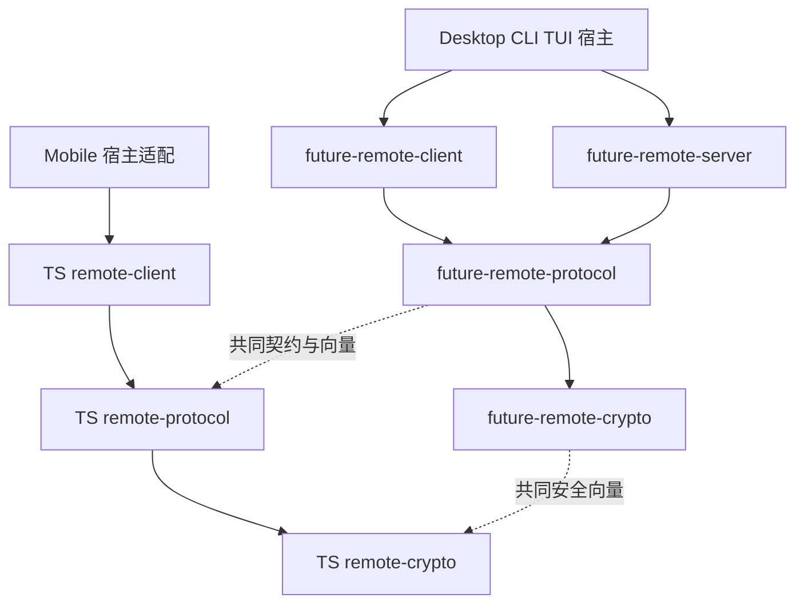

# Remote 拆包开发计划

> [English](remote-package-development.md)
>
> 设计日期：2026-10-19。源码基线：`4a64b65e`。
> 状态：包与 Desktop/headless/Mobile 接线已落地，本地包及应用单元测试通过；独立互通首轮失败，修正待复验，跨平台/性能与人工验收未完成。当前不启动 CI 或 NATS 网络测试。阶段 0～5 尚未整体完成。

> 2026-10-20 验证方式调整：用户要求因 CI 卡顿先停止 CI，改为本地运行单元测试。此要求覆盖下文开发阶段“不运行本地测试”的历史安排；当前不再启动新的 CI；随后用户又要求不再测 NATS，网络互通复验也停止。各包及现有应用单元结果已记录，真实网络互通、跨平台与人工结果仍单独记录，不能以本机单元通过替代。

将远程能力拆成协议、主控、被控三个职责包，保留独立的安全通道基础库。Rust 与 TypeScript 使用相同的职责模型，各自维护实现，通过共同的协议契约、测试向量和互通测试保证兼容。Desktop、Mobile、CLI、TUI 负责界面、环境和本地业务适配；远程库不依赖某个应用入口。

本计划的直接目标是建立可独立编译、测试和静态检查的包边界，缩小无关改动的验证范围，减少 GUI/headless 对相同核心测试的重复执行。现有被控能力继续由 Desktop GUI 或前台 headless 宿主管理。CLI/TUI 接入所需的扩展点属于本次设计，新命令和交互在后续宿主接入阶段实施。

现有产品行为见[远程连接设计](../internals/desktop/CONNECTION.zh-CN.md)，安全与线协议以 [Remote E2EE](../internals/desktop/REMOTE_E2EE.zh-CN.md) 为准。本计划维护拆包与迁移安排，不复制这两份文档的安全参数或历史兼容规则。

## 1 当前实现与拆分依据

| 当前位置 | 已有职责 | 需要解除的耦合 |
|---|---|---|
| [remote](../../desktop/src-tauri/src/remote/mod.rs) | 被控侧协议处理、NATS 通信、安全通道、连接监督、命令路由、事件发布 | 直接取得 Desktop 宿主，使用应用错误、运行时、退出状态和部分配置工具 |
| [remote_host](../../desktop/src-tauri/src/remote_host/mod.rs) | 将远程命令接入本地 Agent、会话、设置、审批、任务和文件系统；提供配对和状态能力 | 业务实现留在应用适配层；通用 HTTP、JWT 和协议工具重新归位 |
| [remote_peer](../../desktop/src-tauri/src/remote_peer/mod.rs) | Desktop 主控客户端，连接其他机器、维护远端投影、收发请求和文件 | 依赖 Desktop 的身份、配置、文件落盘，以及 remote_host 中的 HTTP 工具 |
| [Mobile client](../../mobile/src/remote/client.ts) | TypeScript 主控连接、请求、事件与恢复 | 间接绑定 Expo 设备信息、Mobile 存储及应用配置 |
| [Mobile remote context](../../mobile/src/remote/RemoteContext.tsx) | React 状态、连接编排、界面与设备生命周期适配 | 与通用客户端核心分离，应用 hooks 不进入核心包 |
| [remote crypto](../../packages/remote-crypto/src/lib.rs) | 独立 Rust Noise 握手和加密记录层 | 保持独立；与 TS 实现共用的向量继续维护 |

[RemoteHost 接口](../../packages/remote-server/src/services.rs)已分出业务、配对、状态和文件四组能力，[DesktopHost](../../desktop/src-tauri/src/remote_host/mod.rs)已有实现。迁移复用这些边界，不另建通用插件框架。

当前 CLI 的 `future remote devices` 主要管理本机被控配对，并通过文件请求运行中的 Desktop 添加设备；它尚不是通用的远端主控客户端。当前 Mobile 只有主控产品能力。上述现状不能在改包名时被写成新能力已完成。

## 2 目标包与依赖方向

| 层次 | Rust 包 | npm 包 | 实施范围 |
|---|---|---|---|
| 安全通道 | `future-remote-crypto` | `@future-os/remote-crypto` | 保留现有 Rust 包；从 Mobile 提取 TS 实现 |
| 协议 | `future-remote-protocol` | `@future-os/remote-protocol` | 两种语言均建立 |
| 主控 | `future-remote-client` | `@future-os/remote-client` | 两种语言均建立 |
| 被控 | `future-remote-server` | `@future-os/remote-server` | 本轮建立 Rust 实现；有 JS 被控产品需求时再建立 npm 包 |

三个远程职责包共用 Crypto 基础库。TS 被控包暂不创建空实现；Mobile 继续作为主控使用协议、Crypto 和 Client 包。

建议目录为 `packages/remote-crypto`、`packages/remote-protocol`、`packages/remote-client` 和 `packages/remote-server`。同一目录可以同时拥有 `Cargo.toml` 和 `package.json`，分别使用 Rust 与 TS 入口；源码、测试、lint 和发布匹配规则必须明确区分语言。新 npm 包先保持 private，Rust 包不因本轮迁移新增对外发布流程。共同使用根锁文件和现有 workspace。

Rust 新包使用普通库目标；不因源自 futureos 就沿用其 `staticlib`/`cdylib` 产物配置。只有实际的 FFI 消费者需要时才增加相应产物。

Client 与 Server 不相互依赖；协议与 Crypto 不依赖角色运行时。共享包不导入 Desktop、Mobile、CLI、TUI 或 Agent 产品实现。库需要的本地业务通过接口提供，宿主负责使用现有 Agent RPC/服务接口。

## 3 各层职责与宿主接口

### 3.1 安全通道

Crypto 负责既有握手模式、密钥派生、认证加密记录、序列号、防重放和相关边界检查。保留现有算法与安全参数；不把它扩展为通用密码学框架。

Crypto 不依赖 NATS、HTTP、业务命令、数据库或 UI。协议层负责消息封装、握手消息交换约定及安全通道协商。TS 的 Base64/JSON 封装与 Mobile 安全随机数环境初始化须正确归位，避免 Crypto 反向依赖协议包或 React Native。沿用[现有安全向量](../../packages/remote-crypto/tests/vectors.json)。

### 3.2 协议

协议包负责公共消息、命令、回复、事件、错误码、版本、能力标识、邀请编码、主题/上下文绑定和分块约定。只收录线上契约；凭据落盘格式、UI 展示类型、重试策略及本地业务实现不因位于现有 `types.ts` 中就进入协议包。

在 `packages/remote-protocol` 中建立双方共同维护的契约与兼容样例。将可表达的消息结构归入公共 schema；Rust/TS 类型生成工具在协议阶段选定，编码行为仍由共同样例和互通测试验证。生成代码不得成为第二份可手改的事实源。现有 Agent gRPC protobuf 仍由 `future-rpc` 管理，Remote 契约不与其合并。

协议包不建立连接、读取全局 HOME、访问存储或启动后台任务。首次拆分保持现有 wire format、字段 casing、可选字段语义和兼容策略。

现有 `desktopId` 等线协议字段即使名称带有产品背景，也先保持兼容；宿主内部可以使用通用命名，不将跨入口复用扩展成一次协议重命名。

### 3.3 主控

Client 负责连接被控端、配对交换、握手、请求与回复匹配、事件订阅、恢复、远端目录和会话投影，以及客户端文件传输。远端会话仍由远端拥有，本地缓存不能变成本机会话的第二份权威记录。

身份/凭据读写、设备名称、配置、信任设置、传输创建和本地文件访问通过宿主适配提供。主控核心输出事件流或回调，不导入 React、Tauri、Expo，不直接更新界面。Rust 复用 Tokio；TS 使用普通类和函数，网络传输按平台适配，保留当前 TLS/WSS 要求。

Mobile 的前后台和网络监听向 Client 输入生命周期事件；连接状态机在 Client 中执行。系统文件选择、分享、文件打开、SecureStore 和界面 hooks 留在 Mobile。现有 thread-projection 中的通用投影继续复用，不在新包中复制。

### 3.4 被控

Server 负责被控入口、安全握手、控制权检查、接入限额、请求去重、命令路由、回复和事件发布、被控侧传输及连接监督。它通过宿主接口执行本地业务，不直接依赖应用 Store、Agent 实现或 Tauri 命令。

继续使用业务、配对、状态、文件四组能力作为接口起点，整理应用无关的 DTO 和错误类型。宿主提供凭据持久化、配对服务调用、本地目录和业务授权；Server 保留连接级和控制权级检查。现有审批、沙箱和路径访问约束不能因接口迁移被绕过。

Desktop 的 remote_host 成为该接口的应用实现。远程 prompt 继续复用现有会话持久化与 Agent 调用路径；不在 Server 中重新实现 prompt、审批或任务执行。

### 3.5 运行时与退出

宿主显式启动角色运行时，持有句柄并负责停止与等待清理。库不解析进程参数、不注册全局退出信号、不调用进程退出，也不自行把前台能力变成后台服务。

运行实例接收明确的配置、数据位置、身份和执行环境。逐步消除对 Desktop 全局单例、全局 HOME 和静态宿主查询的依赖。任务必须有归属，停止后旧连接、晚到的回调和恢复定时器不能重新开启入口；保留现有任务登记、取消、清理等待和总截止时间语义。

第一阶段保持 GUI/headless 的启停行为。CLI/TUI 后续接入时，将“Desktop 拥有 Remote”推广为“显式启用被控功能的宿主拥有 Remote”；新增命令需另行定义可见状态、审批交互、占用和退出行为。库可复用不等于所有入口已自动具备被控能力。

## 4 源码与测试迁移映射

| 当前内容 | 目标位置 |
|---|---|
| remote/protocol、公共能力标识、客户端 invitation/codec 中的线上格式 | Rust/TS 协议包 |
| 现有 Rust Crypto、Mobile secureChannel 中的通用安全实现 | 各语言 Crypto 包 |
| remote_peer 的连接、会话投影和传输核心；Mobile client、恢复和通用同步 | 各语言 Client 包 |
| remote 的传输、连接监督、路由、事件发布及被控侧传输 | Rust Server 包 |
| remote_host 的 Store、Agent、任务、文件和本地配对适配 | Desktop 宿主适配 |
| Tauri commands、remote/control 本地管理入口、headless 输出 | Desktop 入口与适配层；通用邀请编码下沉协议包 |
| Mobile RemoteContext、hooks、设备/存储/文件/网络生命周期 | Mobile 应用适配 |

按函数职责迁移，不整目录复制。当前 relay 和 peer 借用的 remote_host HTTP/JWT 代码需明确归入角色服务或宿主平台适配，消除跨角色借用。应用错误在边界转换，保留用户可见消息与机器错误码；不通过共享 Desktop AppError 把 SQLite 等依赖带回核心库。

纯协议、状态机、去重、加密、分页和模拟传输测试随核心迁移。真实业务持久化、审批/Agent 调用、GUI 关闭和 headless 退出测试留在宿主集成层。测试不能通过把 Desktop 设为新库的 dev-dependency 来重新引入耦合。

## 5 分阶段实施

每阶段独立可验证、可合并。旧路径可短期保留薄转发以迁移调用方，但只有一份实现；阶段完成后删除转发和重复类型。

| 阶段 | 工作与交付物 | 完成条件 |
|---|---|---|
| 0 基线与契约清单 | 记录依赖、角色入口、wire/存储格式、宿主行为和 CI 时间；为测试标记包内、互通、应用集成归属 | 固定源码、工具链、runner、命令、特性组合和缓存状态，分别记录编译与测试时间；列出各包独立测试入口 |
| 1 Crypto 与协议 | 保留 Rust Crypto，抽 TS Crypto；建立两语言协议包、共同 schema/样例和类型生成策略 | 两语言执行同一份安全/协议素材并报告用例 ID；邀请、握手、字段、编码、错误与未知能力兼容；包测试不依赖应用配置 |
| 2 Rust 主控 | 从 remote_peer 提取核心，显式提供身份、凭据、传输和事件接口；Desktop 接回 | 配对、刷新、恢复、会话与文件行为保持；Client 可脱离 futureos 独立测试 |
| 3 Rust 被控 | 从 remote 提取运行时；remote_host 实现宿主接口；接回 GUI/headless | 本地业务与控制权行为保持；取消、退出、晚到结果和凭据保存边界通过；核心无 Tauri/Agent 实现依赖 |
| 4 TS 主控 | 提取 Mobile client 与通用同步；React Native 依赖改由应用适配提供；接入共用主控场景 | Rust/TS 验证同一组请求、事件和恢复行为；TS Client 在非 Expo 环境独立测试；Mobile 宿主交互通过 |
| 5 互通与 CI | 建立独立 Remote 互通测试工程，覆盖 Rust Client↔Rust Server、TS Client↔Rust Server；调整 affected 图和任务 | 无需 Desktop 即可验证真实两端；各包独立报告，GUI/headless 保留宿主差异覆盖；报告实测收益 |
| 6 后续宿主 | 按实际产品需求接入 CLI/TUI 主控或被控；JS 被控另立实现任务 | 每个新入口有显式启动/停止、身份、存储、审批、可见状态和退出验收 |

阶段 1 的 schema/生成工具、阶段 2/3 的最小公开接口、阶段 5 的批次与并发限制，在对应阶段根据迁移原型确定并记录；不在实施前承诺未验证的函数签名。

## 6 验证与 CI 组织

### 6.1 Rust 与 TypeScript 共用测试素材

安全通道、协议和主控行为共用一份素材与预期契约，两种语言分别执行自己的实现。保持一致的是输入、预期结果和行为语义，不要求测试源码、框架或平台补充用例完全相同。

| 层次 | 共同维护的素材 | 两语言必须一致的结果 |
|---|---|---|
| Crypto | 密钥、握手消息、认证上下文、预期密文、损坏记录、防重放和序列边界向量 | 密钥/握手摘要/记录等约定字节结果，以及应接受或拒绝的条件 |
| Protocol | 命令、回复、事件、邀请、版本、能力、分块、可选字段和错误输入样例 | 编解码语义与兼容行为；协议规定字节格式时逐字节比较 |
| Client | 请求/响应记录、事件序列、断线/刷新/恢复步骤、超时/取消和重试场景 | 相同的可观察状态变化、发送次数、事件顺序及成功/失败结果 |

Crypto 沿用现有 `packages/remote-crypto/tests/vectors.json`。协议和主控素材建议分别放入 `packages/remote-protocol/fixtures/` 与 `packages/remote-client/fixtures/`，不复制到 Desktop 或 Mobile。素材定义稳定的用例 ID、输入、操作序列和预期结果；公共结构需要版本与校验。两语言适配器报告已执行的用例 ID，对未支持的共享用例明确失败或记录具体的平台差异，不能静默跳过。

Client 测试驱动各自模拟传输并推进可控时间，例如“发送请求、断线、恢复、收到重复回复”，不依赖两端真实时钟恰好一致。JSON 比较遵循协议语义，不对无顺序约定的对象字段强加字节顺序。语言/平台特有测试可以独立增加；已有加密、错误和兼容边界不能为了取两种实现的交集而删减。

### 6.2 每个包独立拥有和执行测试

Rust/TS Crypto、Protocol、Client 以及 Rust Server 各有自己的测试源码、入口、命令和依赖声明。核心测试随所属包维护，迁出 `desktop/`、`mobile/`；单独选择一个包即可执行，不要求编译 futureos、加载 Tauri、启动 Expo 或导入应用模块。

TS 包提供独立测试脚本和配置，不借用 Desktop 的 Vitest 配置、Mobile 的 Jest/Expo preset 或 React Native mock 环境。测试工具可由根 workspace 统一管理，但包的运行入口与依赖必须明确。Rust 包通过 Cargo 包选择运行，测试代码不依赖应用 crate。薄应用包装不能再完整重跑同一套核心用例。

根 workspace 可以统一安装依赖、复用构建产物并批量调度；测试独立不要求每包有单独的 node_modules、target 目录或 runner。CI 分别报告包名、测试结果、数量和耗时，包失败可以单独复现与重跑。

### 6.3 测试归属与集成边界

| 测试归属 | 验证内容 | 测试宿主 |
|---|---|---|
| 包内测试 | 加密、协议、状态机、去重、请求匹配、恢复、通用同步、投影与传输 | 所属包提供的测试驱动、模拟传输及假的宿主服务 |
| Remote 互通测试 | Rust Client↔Rust Server、TS Client↔Rust Server 的真实握手、请求、事件及传输 | 独立 Remote 测试工程，使用假的本地业务实现，不要求 Desktop |
| 应用适配测试 | Tauri commands、React hooks/Context、设备信息、安全存储、文件与前后台/网络事件接线 | 对应 Desktop/Mobile；后续 CLI/TUI 各自维护 |
| 应用产品集成测试 | 真实 Store/Agent/审批/文件语义；GUI 关闭、headless 退出和产品入口 | 实际应用与隔离的本地服务/数据目录 |

共享素材和各自 mock 通过不能代替真实互通。独立互通工程通过公开 API 组合两端，具体目录和语言驱动在阶段 5 落地；生产 Client/Server 不为测试互相引入依赖。应用仍验证宿主是否正确启动、调用、取消并清理库，但不承担库内部所有协议场景。

迁移基线建立“原测试 → 新包或互通/应用测试”的归属清单，确认覆盖去向后再删除原测试。跨包真实业务用例仍留在应用集成层，不能为了包独立将其替换成没有验证业务结果的 mock。

### 6.4 必须覆盖的行为

| 验证层 | 必须覆盖 |
|---|---|
| Crypto | 既有双语言向量、双方握手模式、损坏记录、防重放、序列边界和密钥/候选清理 |
| Protocol | JSON/二进制/邀请编码、版本与未知能力、可选字段、大小上限、分块、错误和旧客户端兼容 |
| Client | 请求超时与重试、凭据刷新、恢复预算、事件去重/补齐、目录投影、多远端隔离和文件取消 |
| Server | 控制权、未提交握手不可执行业务、请求去重、刷新/重连竞争、撤销/停机、回复与事件顺序 |
| 跨语言与角色 | Rust Client↔Rust Server、TS Client↔Rust Server；共享样例加真实互通，不只测试各自 mock |
| 宿主集成 | 真实 Store/Agent/审批/文件语义；GUI/headless runtime、CLI/TUI 后续入口；Mobile 前后台与原生存储 |

### 6.5 检查调度与性能验收

各包定义自己的静态检查和测试目标。Rust 使用 scoped rustfmt、Clippy `--all-targets` 与包测试；TS 使用类型检查、lint 和包测试。直接导出 TS 源码的包按实际需要定义 build，不添加没有产物意义的构建步骤。测试已覆盖的构建不重复执行；产品入口、打包特性组合和平台行为保留验证。

CI 根据真实依赖选择改动包及受影响消费者，并记录共享 schema、向量、配置、生成脚本和锁文件输入。包边界不等于每个任务都单独分配 runner；按平台、工具链和耗时批量执行，在 runner 限额内复用依赖与产物。不新增 main 缓存预热或每次发布后的全量工作。

测试夹具优先使用显式实例、独立数据根和随机端口，不能连接或停止用户运行中的 Agent。迁移期间保留已知锁顺序和任务清理约束，再用实例隔离消除全局 HOME/单例导致的串行竞争。单元测试由 PR CI 执行，不在本地运行单元测试。

性能验收分别比较编译、链接、测试执行、缓存恢复和排队时间；对照相同 runner、工具链、特性、命令与冷热缓存状态。先验证核心测试不再随 GUI/headless 重复，再评估慢测试和 Windows 构建。测试数量、代码行数及跨次 CI 差值不能直接作为节省时间的证明。

## 7 兼容性与完成清单

- [x] Rust 协议、主控、被控包与独立 Crypto 建立，依赖方向无环，无应用反向依赖（manifest/源码静态核对；运行验收另列）。
- [x] TS Crypto、协议、主控包建立；React Native、Expo、React hooks 和 UI 留在 Mobile（独立配置、依赖及源码静态核对；运行验收另列）。
- [ ] Rust/TS 共用契约和安全/协议样例；既有 wire format、TLS/WSS、身份绑定及安全策略保持。
- [ ] 安全、协议、主控共享素材只有一份；两语言报告共同用例 ID，平台差异显式记录且保留原有边界覆盖。
- [ ] 各包有独立测试命令、配置和依赖，核心测试迁出应用目录，不借用 Desktop/Mobile 测试环境。
- [ ] 配对/Peer 凭据、待撤销记录、设备身份和相关文件格式兼容；无迁移原因不改变路径或使已配对设备重新配对。
- [ ] Mobile 两槽凭据提交、安全存储及密钥清理语义保持；凭据、完整邀请和私钥不进入日志或测试快照。
- [ ] 本地会话、远端投影、Agent、任务与文件的数据权威不改变；审批与沙箱约束保持。
- [ ] 角色运行时可显式启动、停止、等待清理；断开和取消不被旧重试或回调撤销。
- [ ] 核心测试脱离 Tauri/Expo；真实业务、宿主生命周期、平台差异和角色互通测试仍有覆盖。
- [ ] 独立 Remote 互通工程通过公开 API 验证真实两端；应用测试只承担自身适配与产品集成，原测试迁移归属可追踪。
- [ ] CI affected 图包含新包、消费者及非源码输入；未扩大为每个包的无条件全平台任务。
- [ ] 生成文件可复现，旧转发和重复实现清理，中英文索引及现有设计入口更新。
- [ ] 以同条件基线报告编译/测试变化；没有用减少必要覆盖冒充性能收益。

文档中的现有包清单在各阶段落地时更新。[共享包约定](packages.zh-CN.md)继续约束新包；完成后本计划记录实际接口、阶段状态和测量结果。

## 8 实施记录

### 2026-10-19：基线与第一批 Crypto/Protocol 迁移

实施分支：`refactor/remote-packages`；范围仍为阶段 0～5，第 6 阶段未启动。本轮不创建 PR；最终通过工作分支 CI 统一执行自动化验收。开发期间只执行编译、类型检查、lint、fmt 和生成文件检查；人工验收确认前不标记整体完成。

下表反映当前状态，后续小节保留各批次的实施记录。

| 阶段 | 实际状态 | 证据与剩余工作 |
|---|---|---|
| 0 | 基线和迁移归属已记录；Windows 首次同条件测量已完成，完整性能验收未完成 | [迁移清单](remote-test-migration.json)与[历史 CI 参考](remote-ci-baseline.json)保留；[Windows 测量](../testing/remote-windows-compilation-2026-10-20.json)三条检查总耗时增加 7.34%，不能宣称全量提速。最终候选的链接、测试、缓存与排队对照仍缺失。 |
| 1 | Rust/TS Crypto、Protocol 已接回并通过本地包测试；兼容性验收未完成 | [本地单元结果](../testing/remote-local-unit-results-2026-10-20.json)记录两语言独立套件。共享向量与契约由各包执行；真实 TLS/WSS、旧配对及真机结果不能由这些测试替代。 |
| 2 | Rust Client 已接回 Desktop；包及应用单元通过，独立互通未通过 | 连接、凭据、多远端、投影、传输和停止接口已接回；[互通记录](../testing/remote-local-interop-results-2026-10-20.json)包含真实两端首轮失败及测试修正，网络复验停止。 |
| 3 | Rust Server 已接回 GUI/headless；包及应用单元通过，产品人工验收未完成 | 监督器、控制权、路由、发布与传输使用显式宿主服务；真实 Store/Agent/审批/文件及生命周期应用套件保留。单元结果不代替其他平台与人工退出验证。 |
| 4 | TS Client 已接回 Mobile，独立包及 Mobile 单元通过；TS→Rust 互通未执行 | 独立 Node 测试入口、共享 Client 场景、显式设备/存储/网络/文件宿主接口已落地；前后台、原生文件及真机安全存储仍需人工确认。 |
| 5 | 边界与 affected 调度已落地；自动化、性能及人工最终验收未完成 | Rust 独立互通首次 6 通过、4 失败；三项测试假设已作源码修正但未复验，持有读取时的退出超时仍未定位。CI 和 NATS 当前停止；[同候选人工清单](../testing/remote-package-manual-acceptance.zh-CN.md)全部待执行/确认。 |

已落地的包入口与检查约定：

- Rust Crypto 保持 `future-remote-crypto`，Protocol 为普通库 `future-remote-protocol`。可分别使用 `cargo clippy -p <包名> --all-targets -- -D warnings` 检查；最终 CI 使用各自的 `cargo test -p <包名> -- --show-output`，输出共享用例 ID。
- TS 包使用 `npm run typecheck|lint|test --workspace @future-os/remote-crypto` 、`@future-os/remote-protocol` 和 `@future-os/remote-client` 入口；其中 `typecheck|lint|test` 表示分别选择脚本，并非一条 shell 命令。Crypto/Protocol 使用独立 Node/Vitest 配置，Client 使用独立 Node/Jest 配置；均不加载 Expo 或 Desktop 配置。源码直接导出，无需额外空 build。
- [命令 schema](../../packages/remote-protocol/command.schema.json)是 62 个命令字段、Rust 缺省值和 TS 生产者类型的事实源。仓库内的生成器只使用 Python 标准库和固定工具链的 rustfmt：`python3 packages/remote-protocol/scripts/generate.py`；追加 `--check` 检查是否过期。不得手改生成文件。其余响应/事件 DTO 当前作为协议包内的手写线上类型维护，后续扩展 schema 时再迁入生成范围。
- [安全素材](../../packages/remote-crypto/tests/vectors.json)使用 `version: 1`、稳定 ID、两种握手的原始字节向量及共享负向记录步骤；原握手、密文、摘要未改变。[协议素材](../../packages/remote-protocol/fixtures/protocol.json)覆盖邀请、命令、JSON/gzip 和大小边界。两语言驱动拒绝未知素材版本/类型，并报告执行 ID。
- 原 Crypto、邀请、JSON/gzip 和 codec 核心测试迁入所属包；协作式 JSON 解析的调度/取消测试已随阶段 4 迁入 Client。原测试去向继续更新清单，不以新 mock 替代真实宿主业务覆盖。

保留的历史解析差异：Rust 的邀请解析包含完整 code/claim URL/过期校验；TS 的 `parsePairingInvitation` 只是 Mobile 配对流程的前置格式解析，完整策略仍在应用配对流程执行。旧格式的前置解析结果不等于允许使用旧安全协议。共享素材为此显式记录语言预期和差异原因，本次迁移不借机改变认证、HTTP 例外或凭据语义。

本批静态验证使用固定 Rust 1.97.0、Node 24.21.0，在隔离 macOS arm64 工作目录执行。Rust Crypto/Protocol 与 Desktop GUI/headless 的 Clippy（包含测试目标编译）、两 npm 包和 Mobile 的 typecheck/lint 已通过。单元测试和共享素材尚未执行，不能据此宣称协议或产品验收通过。历史 Windows CI 显示测试执行与编译耗时差异较大，但尚无本次重构的性能收益结论。

### 2026-10-19：Rust Client 单次连接核心

阶段 2 已开始，尚未完成。`future-remote-client` 是独立普通 Rust 库，首批迁入 `PeerSession`、Noise 配对/IK 重连、加密命令请求与重试、订阅通道选择、握手确认校验，以及 `PeerCreds`/`PeerIdentity` DTO。库不读取全局 HOME、不依赖 futureos/Agent/Tauri、不自行启动应用后台任务。

公开连接入口为 `session::connect(&PeerCreds, &ConnectionOptions)`。宿主显式提供设备名称、设备种类和可选平台证书 bundle；生产连接继续强制 TLS。`test-support` 非默认特性只提供测试接线，明文 fixture 另有 loopback 地址检查；Desktop 的测试构建才启用它。连接结果中的 `consumed_invitation` 继续由宿主用于清除已消费 PSK，库不擅自更改凭据落盘。

Desktop 的 session 模块目前是环境/错误适配，真实连接实现只有包内一份。Client 错误逐类转换回 `AppError`，保留网络、授权、平台状态码/机器错误码和用户可见文字；核心不依赖 SQLite。`remote_peers.json`、label、原子写入/配置锁及设备身份取得仍由原 Desktop 宿主负责，序列化字段和可选值规则保持。凭据 DTO 的 Debug 输出改为不含密钥/令牌，防止断言或日志意外打印秘密。

11 个原 session 单元用例和 2 个凭据时序/撤销地址用例已迁到 Client；新增凭据 Debug 保密与应用错误转换回归用例。真实配对、文件、Store、应用退出等集成用例继续留在应用，后续按[迁移清单](remote-test-migration.json)归位。测试源码已编译，尚未执行。

本批静态检查已通过：Client 默认特性的独立库编译、默认及 `test-support` 的 Clippy `--all-targets`，以及 Desktop GUI/headless 的 Clippy `--all-targets`；使用固定 Rust 1.97.0。下一步仍须迁移多远端运行实例、事件监督与恢复、凭据/平台服务接口、文件传输和有归属的停止/等待清理。此时不能把连接核心可复用视为阶段 2 或整个重构已完成。

### 2026-10-19：Rust Client 多远端实例与任务归属

主控的多远端运行时已移入 `future-remote-client::Client`，Desktop 通过 `DesktopClientHost` 接回。每个实例独立拥有连接、停止意图、事件任务、重连任务、可见会话、分页重组和分块等待者；库内不再使用进程全局 runtime 单例，也不读取 Desktop Store、设备身份或应用错误实现。配对、刷新、撤销、凭据读写、证书与设备信息、命令 ID 和任务登记由 `ClientHost` 显式提供。

角色任务先由 Client 包装为可取消、可观察完成的句柄，再交给宿主登记执行。保留 Desktop 原有任务注册/冻结/取消链；`stop_admission()` 同步关闭入口并取消角色任务，`shutdown(total_budget)` 在同一总截止时间内等待 future 销毁、清理连接/订阅/文件等待者。宿主拒绝尚未 poll 的任务也必须发出完成通知，panic 仍可观察。Desktop GUI/headless 的公共退出路径已经接入这两个入口。测试重置替换实例，而不是复用已经停止的实例。

每个远端的连接尝试带有代次；断开、新连接或停机之后，旧握手不得安装连接，旧请求失败不得移除较新的连接。配对 claim/刷新/握手在停机时收到取消信号。Desktop 对刷新、PSK 清除和移除使用原配置锁内的身份比较后写入：只有仍对应同一配对、NKey 和刷新令牌的凭据可以修改，防止重配后的同名远端被旧结果覆盖。文件路径、字段和原子写入格式未改动。

13 个原运行时纯解析/队列/调度用例已迁入 Client，真实应用/平台/Agent 接线用例继续通过宿主适配驱动真实 Client。新增独立实例隔离、等待任务真实销毁、未 poll 任务被拒绝、停机取消 claim、断开拒绝晚到刷新等包内用例，以及应用凭据重配竞争回归用例。归属见[迁移清单](remote-test-migration.json)。所有用例仍未执行，本地仅编译与静态检查。

阶段 2 仍未完成：客户端上传/下载编排及文件适配尚待拆分，HTTP/JWT 共用宿主工具仍须从被控宿主路径归位，部分真实网络核心用例将在独立互通工程中迁出应用。阶段 3～5 的 Server、TS Client、互通/affected CI 和最终验收继续保留完整范围。当前不得把 Client 实例已建立视为整体目标完成。

本批已通过固定 Rust 工具链上的 Client 默认/测试辅助特性 Clippy `--all-targets`、Desktop GUI/headless Clippy `--all-targets`、fmt、生成文件一致性与相关双语文档检查；没有执行本地单元测试。

### 2026-10-19：Rust Client 文件传输与共用宿主工具

上传/下载编排已移入 Client。库返回文件字节和元数据，Desktop 保留预览缓存、路径选择与原子落盘。Protocol 拥有既有传输回复 DTO。分块顺序、三次重试、首次错误、大小/哈希校验、超时和失败后的尽力取消继续保留。传输绑定开始时的连接与代次，断开或重配之后的重试、分页和取消不能重新连接或操作新配对。实际接收字节在扩展缓冲区前校验声明上限。

分块等待者通过作用域登记，在调用 future 被取消时同步移除；每次登记有独立标识，旧调用退出不能删除同一分块的新重试。停机也取消请求与分块网络等待。仅丢失分块数据、但请求仍正常应答时继续沿用原有重试，不把健康连接误标为故障。

原传输中的 2 个重试用例和 8 个纯传输用例移至 Client；缓存/落盘和真实 Host/Agent 文件集成用例留在 Desktop。新增接收缓冲上限与两项等待者清理回归。原 JWT 解析用例移至 Protocol；HTTP 请求、TLS 初始化与应用错误转换集中于 Desktop 的 `remote_platform`，主控和 relay 不再从被控宿主借用工具。日志只记录失败动作与 HTTP 状态，避免打印平台响应中可能反射的凭据；返回的错误类别/码/文字保持。

本批已通过 Client 默认/测试辅助特性、Protocol、Desktop GUI/headless 的 Clippy `--all-targets`、fmt、生成文件一致性及文档检查。源码核对确认原传输/配对用例名称都有去向，Desktop 缓存和原子写入实现保持。没有执行本地单元测试；阶段 2 的网络覆盖迁移、共享场景及最终验收仍未完成。

### 2026-10-19：Rust Server 安全端点与宿主契约

`future-remote-server` 已建立为独立普通库，首批迁入安全握手、待决/候选/活动通道、身份绑定、加密回复与发布，以及被控凭据值、状态 DTO 和业务/状态服务契约。Desktop 的 `remote_host` 继续实现真实 Store/Agent 业务，配对文件、服务请求和文件操作仍由宿主管理。Server 通过显式 `HandshakeHost` 获取绑定持久化和 presence；应用 `secure` 暂为薄适配，安全实现只有包内一份。

保留 16 个待决/候选总量限制、30 秒候选寿命、邀请单次使用/过期检查、IK 公钥绑定、已认证 readiness 提交，以及停止清理候选的既有规则。绑定必须先保存成功，才能生成确认并安装候选；未提交通道仍不能执行业务。生产默认特性不提供明文 fixture，应用测试通过非默认 `test-support` 接线。

13 个原纯安全用例迁到 Server，解除 HOME/Store 初始化；2 个真实凭据保存/重启/刷新合并/注入保存失败的集成用例留在 Desktop，继续驱动实际包实现。新增端点隔离、绑定保存失败不可安装候选，以及凭据序列化/Debug 脱敏用例。基线 15 个安全用例名称均有且只有一个去向。源码对照确认凭据字段/serde 缺省值、19 项既有能力及其顺序保持。

Protocol 开始拥有 v2 握手请求封装、拒绝前缀、确认消息和能力列表；Mobile 的握手确认 DTO 也已归位。共享素材新增请求缺省值、finish、附加字段和确认消息 ID，两语言驱动分别验证服务器解码/编码和客户端生产/消费语义。原命令 schema 生成范围未扩展；这些握手 DTO 仍是协议包内的手写线上类型。两个 npm 包的测试入口使用 verbose reporter，使通过的共享用例 ID 也出现在最终 CI 输出中。

本批通过 Server 默认/测试辅助特性及 Protocol 的 Clippy `--all-targets`、Desktop GUI/headless Clippy `--all-targets`、Protocol/Mobile 类型与 lint、fmt、生成一致性及双语文档检查。没有执行本地单元测试或发起最终 CI。阶段 3 尚未完成：连接监督、配对/文件宿主接口、命令路由、事件发布、实例隔离与总截止时间停机仍需迁移；当前安全端点可复用不代表被控运行时已独立。

### 2026-10-19：Rust Server 传输、事件与 wire 策略

配对与文件宿主契约已进入 Server，四组服务均不依赖 Desktop 错误。应用边界双向转换网络、平台状态/机器码、服务授权和账号授权类别；未知业务错误以不透明源错误返回宿主，避免把 Agent/SQLite 实现带入库，也不依赖显示文字判断重试类别。新增边界往返回归用例。

被控文件订阅改为显式 `TransferLoop` future，宿主提供文件服务、活动标志、安全端点和清理间隔，并持有/取消执行任务。保留已提交安全通道检查、先发布下载数据后应答的顺序、原有 flush 与清理语义。Desktop 的真实文件用例通过薄适配继续驱动包实现；生产 60 秒、应用测试 20 毫秒的清理节奏仍由宿主显式传入。

有序事件消费、连续片段合并、事件封装、大小限制和 gzip 编码已迁入 Server；队列仍由既有连接代次管理。宿主消费/取消核心 future，库不自行启动进程后台工作。事件状态副本仍先于事件主题发布；遇到非片段、索引空洞、不同会话/运行/epoch/工具块或大小边界时保留原合并规则。传输失败日志继续受进程级类别配额约束，故障 episode 归所属传输/事件任务。

原 lean、分页大小、事件合并、访问代次与候选任务清理用例随职责迁移，不再随 Desktop 重新执行。生产 lean 缺省为关闭，每次请求从自己的连接作用域取得能力；供夹具使用的全局缺省值仅存在于测试/`test-support` 构建。新增 Server 的独立 dev-dependencies，不借用应用测试环境。真实业务、审批/Agent、文件和关闭测试继续留在应用。

测量和截图素材生成脚本改为选择 `future_remote_server-*` 测试二进制及新用例路径，夹具生成命令选择 `future-remote-server`；原 ignored 状态保持。历史网络/覆盖率记录不作为迁移后的验收证据。归属清单对剩余 runtime/应用混合文件显式标记待迁移，非空 target 本身不能证明完成。

本批通过 Server 默认及 `test-support` 的 Clippy `--all-targets`、Desktop GUI/headless Clippy `--all-targets`、fmt、生成文件与双语文档检查；修改的 Python/JS 脚本仅做语法检查。源码审计确认涉及六个基线文件的每个测试名恰有一个去向，生产 wire-budget 实现保持一致。没有执行本地单元测试、测量驱动或最终 CI，尚无性能收益结论。下一步继续连接监督、命令路由、实例状态与总截止时间停止/等待清理；阶段 3～5 未完成。

### 2026-10-19：Rust Server 命令入口与显式上下文

命令订阅、加密请求/回复、readiness 提交、请求 ID 单次执行/回复缓存、控制命令分派和本地业务调用已移入 `future-remote-server::commands`。原 Desktop 命令模块保留上下文适配和真实应用测试。核心通过 `CommandServices` 显式取得业务宿主、运行上下文及回复缓存期限，不读取 Desktop 全局、HOME 或进程环境；operator gzip 设置由应用提供，并限定于服务该请求的上下文。

原控制权与 access epoch 决策目前仍由 Desktop 监督器实现，通过迁移用的 `CommandRuntime` 适配进入核心；这不是阶段 3 已完成的标记。后续必须将监督器和这些状态移入 Server 实例，再收回临时上下文接口。目录/presence 生成、控制变更和单设备 unpair 仍沿原实现执行，本轮没有将审批、Store、Agent 或沙箱改成 mock 业务。

去重缓存改为不透明共享值，凭据刷新继续保留同一份缓存，重新邀请继续隔离缓存；原有指针同一性断言改为测试辅助方法，断言含义不变。生产十分钟、应用测试 500 毫秒的缓存期限由宿主显式传入。命令任务与过期清理任务通过宿主登记执行；角色自身的任务归属、停止与总截止时间等待仍要随监督器迁移完成。移除旧安全端点包装类型，连接、命令、传输和事件路径现在持有同一个包内端点类型。

两项旧握手 transcript/签名用例进入 Rust Protocol，三项纯客户端身份规范化用例进入 Server。Mobile 的旧握手签名验证及四个既有测试进入独立 TS Protocol；NKey 验证使用显式 `legacy-signature` 子路径，普通协议编解码导入不加载验证器。共享素材新增 `protocol.handshake.legacy-transcript`，两语言验证同一份输入与逐字节 transcript；这些兼容助手不启用生产明文 v1 通道。三项协商能力标识也归入 Protocol。

新增独立上下文隔离与 operator gzip 作用域用例，不使用应用配置、Store 或网络。原真实业务/网络边界测试继续通过窄的 `test-support` 接口调用实际命令核心；默认生产特性不提供这些夹具入口。源码核对确认基线命令文件的 106 个测试名均恰有一个去向，TS 四个原用例保持，Rust transcript 与 TS 签名验证函数体保持。

本批通过 Server 默认/测试辅助特性、Protocol 和 Desktop GUI/headless Clippy `--all-targets`，Protocol/Mobile 类型与 lint、fmt、生成一致性及相关文档检查。没有在本地执行单元测试或发起最终 CI。下一步继续监督器、控制权/目录状态、角色任务归属与停机清理；阶段 0～5 仍未整体完成。

### 2026-10-19：Server 实例监督器、状态投影与原生任务归属

监督器状态已进入 `future-remote-server::supervisor::Supervisor`，构造时显式传入业务宿主和执行器。每个实例拥有连接表、已知设备/控制者、跨代回复缓存、能力/身份、访问代次与恢复预算。包内没有全局监督器；Desktop 暂时持有一个实例并保留启动入口。为继续迁移现有启动/重建代码，部分状态字段仍作为临时接线公开，阶段 3 完成前必须收口。

控制权仲裁、NATS 代次健康分类、presence/目录快照组合及状态投影已移入包。原控制规则与健康分类函数体保持；配对凭据和真实目录内容仍来自原宿主。状态投影返回可选验证网页的重试请求，由 Desktop 执行，库不会因为查询状态自行启动网页。原真实 Store/Agent/多设备与休眠状态测试继续驱动包实现。

原来脱离登记的控制权落盘线程改为宿主登记的原生任务。变更请求携带自己的访问代次；已停止代次不能再移动控制者。异步落盘使用控制版本和串行写入顺序，拒绝尚未开始的过期结果，避免旧接管覆盖新接管。已开始的同步文件工作不做虚假的 future 取消，而是等待其真实完成；内存停止/控制变更不等待文件锁，落盘仍沿用宿主配置锁和原路径。

恢复任务使用可观察完成的取消句柄；宿主拒绝未 poll 的 future、正常完成、取消和 panic 都会结束完成信号。`cancel_tasks()` 关闭现有恢复工作，`wait_tasks(total_budget)` 在同一预算内等待 future 销毁和原生工作完成，超时保留未结束句柄以便后续复验。Desktop GUI/headless 公共退出路径已调用它，并使用既有退出协调器的剩余时间。当前等待范围是这些恢复/原生任务；连接代次和全部角色子任务的停止/等待还须随其循环迁移完成。

3 个原监督器状态用例迁到独立内存宿主，不再初始化 HOME；另有 2 个丢弃日志、4 个健康/退避和 2 个状态分类用例进入 Server。新增 5 项实例隔离、过期/乱序控制落盘、真实 future 销毁、未 poll 拒绝和超时后继续等待的用例。基线应用测试文件的 105 个用例与状态文件 3 个用例都恰有一个去向。核心无 Desktop/Agent/Tauri 实现导入。

本批通过 Server 默认/测试辅助特性、Desktop GUI/headless 的 Clippy `--all-targets`、fmt、生成一致性和双语文档检查。没有执行本地单元测试或最终 CI。剩余阶段 3 工作包括连接建立/重建/刷新、心跳和目录发布循环、完整角色任务归属及关闭等待，以及删除临时状态接线/上下文。阶段 4/5 的 TS Client、独立互通、affected CI、性能与人工验收仍保留完整范围。

### 2026-10-19：Server 事件入口、心跳/目录循环与 NATS 连接

事件入队、lean 过滤和大小限制调用、控制者路由、心跳及目录发布循环已进入 Server 实例。Desktop 保留实际 Agent 事件接入、宿主状态服务和薄启动适配，循环不再读取 Desktop 全局监督器。监督器构造返回显式共享句柄，后台 future 捕获该实例。生产心跳 3 秒、目录检测 1 秒的节奏保持；应用测试的 10 毫秒节奏通过 `PublisherTiming` 显式提供，不依赖下游库的 `cfg(test)`。

心跳直接持有并轮询 Agent 监视与目录子 future，不再创建脱离父任务的 Tokio 子任务。future 创建时捕获访问代次；停止会取消该代次的循环。目录宿主读取仍在线程外执行，但改为通过宿主执行器登记并由实例持有实际完成状态。取消后的排队读取跳过存储，已经开始的同步读取保持有归属并纳入 `wait_tasks` 的同一预算；迟到结果不能继续发布。读取完成后重新检查控制权，避免设备在读取期间失去控制后仍收到该目录。

原全量快照/活动差量选择、签名更新、缺少安全密钥时重试及工作区发布策略保持，源码 token 核对已通过。目录读取仍使用真实宿主内容，原 Store 与 Agent 应用测试继续驱动包中的循环，未换成纯 mock 验收。

NATS 的 JWT/NKey 认证、回调健康状态、退避和连接错误分类已进入 Server，信任证书路径由 Desktop 显式传入。生产环境不提供关闭 TLS 的运行时选项，`nats://` 仍强制验证 TLS。测试辅助特性中的明文选项只接受回环目标。新增默认 TLS 与非回环拒绝的用例；原两项连接分类及一项事件状态主题分类用例迁入 Server，105 个基线应用测试名仍各有一个去向。

新增 4 项目录读取回归用例，覆盖过期访问代次、取消后排队任务、两个实例隔离、停止时实际运行的原生读取以及超时后继续等待。仅编译这些测试，未在本地执行。本批通过 Server 默认/测试辅助特性和 Desktop GUI/headless 的 Clippy `--all-targets`、fmt、协议生成与双语文档检查。最终 CI 尚未运行，不能据此声称运行测试或性能收益。阶段 3 仍须完成启动/重建/凭据刷新、完整角色任务清理和临时状态/命令上下文收口；阶段 4/5 与人工验收继续保留完整范围。

### 2026-10-19：Server 启停、恢复、凭据刷新与命令实例边界

启动、多设备计划、readiness 交接、自动恢复/预算、凭据刷新、设备断开/撤销、重新配对和休眠/恢复策略已进入 Server。Desktop GUI/headless 使用同一实例入口；原本由 Desktop 实现的 `CommandRuntime` 已删除，相关契约收为 Server 内部接口。命令上下文通过弱引用取得所属监督器，避免“监督器 → 缓存握手 → 监督器”引用循环。生产构建的连接表、控制者、访问代次和恢复标志不再对应用公开；安装夹具所需的字段与故障注入仅在测试辅助特性下开放。

宿主显式提供执行器、信任证书、定时配置、Agent 事件接入、operator gzip、可选验证网页及退出状态。库不读取应用全局、HOME、环境变量或 Desktop 实现。生产和应用测试的原有定时节奏分别传入；测试禁用自动恢复/撤销补偿也通过配置表达，不依赖下游库的 `cfg(test)`。本地验证网页的 HTTP/HTML 实现保留在 Desktop，Server 持有其监听 future 和生命周期。

命令、缓存清理、恢复、连接代次和网页监听任务均先包装为可取消/可观察完成的角色句柄，再交给宿主登记执行。候选 readiness 失败或取消会中止其任务；刷新时旧事件队列仍按序排空，但句柄由实例保留，不再脱离清理等待。停止取消剩余连接代次；`shutdown(total_budget)` 永久关闭实例、取消撤销补偿并在同一剩余预算内等待角色 future 与原生工作真实结束。超时保留未完成句柄和取消归属，后续等待不丢失它们。离线/控制权通知有 750 毫秒上限，仍是异步建议通知；退出冻结登记时沿用显式发送路径。

补充访问代次边界：停止期间尚未完成的“添加设备”邀请会被取消，不再取得新代次并重新开启入口；迟到代次任务不能登记，已关闭实例拒绝再次启动。设备记忆与连接安装在同一次代次提交中更新。握手绑定落盘复用命令入口已经持有的提交边界，避免在回调中重复获取同一互斥锁；迟到上下文仍不能落盘或移除新配对。既有真实持久化/业务/审批/文件用例继续通过应用薄适配驱动包实现，未改写成 mock-only 验收。

8 个原纯策略用例进入 Server：3 个配对错误分类、刷新提前量、坏 NKey、过期重试、休眠决策和重连预算。新增 9 个任务/上下文回归用例，覆盖代次迟到拒绝、超时后取消归属、刷新后旧队列等待、最终关闭、添加设备期间停止、握手缓存引用循环、旧上下文拒绝、已持有提交边界中的落盘及应用夹具重置隔离。原应用基线测试名的去向已核对，真实 HTTP/凭据存储测试继续留在 Desktop。

本批通过 Server 默认/测试辅助特性及 Desktop GUI/headless 的 Clippy `--all-targets`、fmt、协议生成一致性和双语文档检查；这些只证明编译与静态检查，没有执行本地单元测试或最终 CI。阶段 3 的运行时实现已接回，自动化边界验收仍待最终 CI；阶段 4/5 的 TS Client、共用主控行为素材、独立真实互通、affected CI 和性能测量尚待实施，人工验收仍须在同一最终候选版本上由用户确认。整体目标未完成。

### 2026-10-19：TS Client 连接、同步与独立测试入口

`@future-os/remote-client` 已与 Rust Client 共存于同一目录，各自使用原有根锁文件。TS 的连接/代次、NATS 错误分类、状态机、加密握手/请求/订阅、凭据刷新调度、JSON 协作式解码、分页读取、replay、通用投影及 SyncEngine 已进入包。它继续调用既有 `thread-projection`，不复制其投影语义。凭据与投影数据类型由 Client 持有，线上 DTO 继续由 Protocol 持有；Mobile 的原生附件、界面和导航生命周期类型留在应用。

构造函数显式接收 `ClientHost`：设备名称/种类、命令 ID、实际凭据刷新服务及传输创建。刷新时机与坏 JWT 拒绝由 Client 决定，Mobile 只提供实际 HTTP/身份/环境适配。现有 Mobile `RemoteClient` 现在是小型宿主适配，继续提供原有构造 API。React hooks、SecureStore、平台 URL 策略、前后台/网络监听、文件选择和原生文件能力均留在应用。15 个迁移用转发模块已删除，应用消费者直接导入包内职责模块。

保留原凭据字段与 secureBundle 编码、设备声明、请求/回执、订阅就绪、代次交接、重试/恢复预算和合作式调度语义。源码 token 比较确认连接类除了显式宿主调用外与本批前的实现一致；其他同步/投影实现随源码迁移。lint 保留原 null/undefined 合并判断，未将 `== null` 错改为只判断 null 的严格相等。

25 个原 Client 测试文件迁出 Mobile，共 455 个测试声明的名称和文件内顺序保持；参数化声明不是实际执行次数。Model reference 的 5 个原声明进入 Protocol。codec 基线的 14 个原声明已分别核对 Protocol/Client 唯一去向。新增 3 个独立凭据策略用例，验证坏 JWT 不调用宿主、健康凭据保持同一对象、临期刷新传递相同取消信号并保留宿主拒绝。Mobile hooks、原生存储、文件和产品交互测试继续留在应用。

Client 自有 `package.json`、tsconfig、ESLint、Babel 和 Node/Jest 配置，不使用 Expo preset、React Native mocks 或 Mobile 测试配置。测试通过显式内存宿主创建 Client；真实 Noise/AEAD 用例仍保留算法实现，只替换 NATS 投递。Node 测试使用标准 WebCrypto，并与现有 Mobile 一样映射纯 JS sodium 后端。Client 的类型检查、lint 和 test 各有独立脚本；测试直接使用的依赖显式声明。锁文件只增加 workspace 并调整已有工具的 hoist，核对未改变现有包版本。

本批通过 Client、Protocol 与 Mobile 的 typecheck/lint、协议生成和相关双语文档检查。另通过 Babel/Jest 编译 49 个源码/测试/夹具文件；没有执行编译产物或任何本地单元测试，Jest 运行和实际兼容结果仍待最终 CI。阶段 4 尚需抽取平台文件编排边界、完整角色停止/等待清理及 Rust/TS 共用 Client 行为素材；阶段 5 的真实互通、affected CI、性能实测和同版本人工验收仍保留完整范围。

### 2026-10-19：TS Client 文件编排、宿主 IO 与连接归属

上传初始化、顺序分块、有限重试、完成/取消，下载准备的稳定命令 ID 与两档超时，以及下载分块并发/保序、取消、大小/哈希结果校验已进入 Client 的 `transfer` 模块。`UploadHost` 提供读取句柄；`DownloadHost` 提供验证缓存、创建/移除文件、实际落盘大小与哈希。Mobile 保留原生文件、SHA-256 实现、图片处理、选择/分享、10 MiB 产品配额、预览缓存与清理策略，公开调用签名保持。包实现不导入 Expo、React Native、Mobile 或具体文件系统。上传读取句柄创建失败、上传完成失败、下载写入句柄创建失败也纳入同一传输清理边界。

每次传输通过 `captureTransfer()` 固定开始时的 NATS 连接、角色代次和已确认桥实例。分块、请求重试、恢复后的继续及远端清理都经过该归属检查；连接/桥实例切换后不能转向新连接。准备下载的原始 DTO 对象身份及线协议字段保持，以弱引用记录所属客户端与连接，后续下载仍使用准备时的归属。下载等待项同时记录连接身份，迟到的旧 ACK/超时只能移除自己的等待项，不能删除新连接上同一传输 ID/块号的等待项。旧连接回执以及原生哈希迟到结果不再完成已退役的传输。

下载继续以最多 4 请求且受 2 MiB 波次预算约束的方式取块，整波结束后按索引写入；取消释放调用路径并观察迟到响应。准备后迟到的成功响应仍触发同一归属上的尽力清理。空上传批次无需连接；验证过的缓存仍可离线使用，未为新增连接检查而改成必须在线读取缓存。

新增独立内存 IO 的 25 个传输测试声明，以及真实 Noise/AEAD 请求夹具中的 5 个连接/等待项回归声明，覆盖乱序、限流、重试身份、取消、迟到结果、文件失败、校验、跨客户端描述符、桥实例变化和恢复换代。Mobile 原 122 个文件/图片/缓存/原生适配测试声明名称及顺序与基线保持；这些应用集成断言仍调用真实适配代码。准备响应夹具改为每例独立对象，与实际 RPC 解码的身份边界一致。迁移清单补充其完整声明与保留理由。

本批通过 Client 和 Mobile 的类型/lint 检查、协议生成一致性、相关双语文档检查和 diff 检查；Babel/Jest 静态编译 53 个源码/测试/夹具文件，未执行产物或本地单元测试。声明数不是实际运行次数，最终 CI 尚未执行。阶段 4 的完整停止/真实任务等待、共用 Rust/TS Client 场景仍待完成；阶段 5 的独立真实互通、affected CI、性能与同版本人工验收仍保留完整范围。

### 2026-10-19：TS Client 任务归属、停止等待与 Mobile 清理

Client 实例现在显式登记连接尝试/恢复、凭据刷新及持久化回调、握手、探测与其实际底层 Promise、请求解码/重试、分块 ACK/等待项、订阅循环、异步消息消费、状态迭代、文件编排和连接关闭。任务先登记再调用宿主，允许宿主在同步回调中关闭实例而不漏掉正在启动的工作。定时器随停止取消；已经进入 SDK 或原生 IO 的工作继续保留实际完成归属，不能以调用方超时或取消替代完成。

`close()` 保留立即取消的既有 API。`shutdown(totalBudgetMs, reason)` 先永久停止接入、取消角色/传输并开始关闭连接，再用同一总预算观察清理，返回 `complete` 与尚未完成的任务标签。预算耗尽保留任务，不伪造 SDK 取消；宿主可再次 `waitTasks(budget)`，或继续观察实际完成。迟到连接会经过同一关闭路径；连接关闭 Promise 按 socket 去重。订阅显式取消、状态迭代器返回与 SDK 关闭分别登记，不能在迭代器还阻塞时先将它们算作结束。运行实例间没有共享任务表。

文件编排通过 Client 的实例任务入口执行。外部取消、角色停止及所属连接代次退役会传给传输；退避和调用方等待可以取消，仍在执行的 SDK 请求、准备响应清理观察和原生哈希则继续保留归属。已关闭实例拒绝新的文件任务。准备响应的迟到清理观察本身也登记，避免父调用取消后出现无人等待的后续工作。停止期间不会通过新连接补发旧清理请求。

Mobile 的连接替换、明确离线/撤销和卸载路径使用 2 秒预算。超时记录任务标签并释放界面路径，宿主仍持有旧 Client，继续观察实际完成后才移除清理归属。连接状态、目录、presence、能力和 ready 回调之后补上存活检查；宿主同步关闭时不能继续调用凭据服务、重新订阅、发出就绪通知或设置健康/刷新定时器。

新增 15 个独立生命周期测试声明，涵盖登记顺序、截止时间后继续等待、子任务与拒绝、迟到连接与关闭、开连接超时后的真实工作、SDK 请求、原生哈希、凭据回调、刷新、实例隔离及同步回调关闭。Mobile 新增 2 个真实 hook 集成声明，验证卸载预算后的继续观察和离线状态先于清理完成。原传输 25、Mobile 文件 122、连接 hook 36 和多远端组合 30 个声明名称及顺序保持；应用测试保留实际 hook，只更新角色边界夹具。迁移清单记录应用测试去向。

本批通过 Client/Mobile 的 typecheck、lint、协议生成、相关双语文档及 diff 检查；Babel/Jest 仅静态编译 58 个源码/测试/夹具文件，没有执行测试或产物。声明数不等于参数化后的执行次数。阶段 4 仍须完成 Rust/TS 共用 Client 行为素材与运行验收；阶段 5 的独立真实互通、affected CI、性能证据和同版本人工确认继续保留完整范围，整体目标未完成。

### 2026-10-19：独立 Rust/TS 真实互通工程与首批共用 Client 素材

建立 [`tests/remote-interop`](../testing/remote-interop.md)，同时具有独立 Cargo/npm 入口、依赖与静态检查配置。它通过公开 `Supervisor`、Rust `Client` 和 TS `RemoteClient` 组合角色，不导入 Desktop、Tauri、Agent、Mobile、Expo 或应用测试配置。测试宿主只提供内存业务、配对存储、账户适配与文件 IO；实际 NATS 连接、订阅、Noise XXpsk0/IK、FRE2 记录、命令准入/去重、事件发布和分块收发继续走包实现。

[`packages/remote-client/fixtures/client.json`](../../packages/remote-client/fixtures/client.json) 是这批双语言共用输入与预期的唯一来源：版本 1、6 组请求案例、文件字节、事件元数据及 5 个流程报告 ID。首批请求覆盖读/写回复、业务拒绝、重复读/写请求只执行一次，以及相同命令 ID 改变内容被拒绝。两语言驱动均拒绝未知版本/种类/字段、重复 ID 和有歧义的预期；共享数值限制在 JS 安全整数范围，Rust 预期解码区分缺字段与显式 null。流程 ID 覆盖首次配对并清除邀请 secret、加密事件、二进制上传/下载、去除 secret 后的 IK 重连和最终清理。声明/报告 ID 不等于实际运行次数。

宿主拥有单独的 `nats-server` 子进程、回环 TCP/WebSocket 随机端口和临时配置目录，不读取账户服务或用户 Agent。Rust 互通通过显式 `test-support` 的回环明文选项运行；TS 宿主工厂也只接受回环 WS，产品 TLS/WSS 策略未增加绕过选项。夹具 broker 刻意不启用 JWT/subject ACL，这批不能替代真实 relay 授权测试。缺少 broker 必须失败，不能静默跳过或换成 mock。

Rust 用例与 TS 驱动读取同一份素材，分别核对实际回复、宿主执行次数、事件内容、文件字节/哈希与清理。TS 通过私有 JSON-lines IPC 启动/控制真实 Rust 宿主，角色仍经 NATS WebSocket 通信；IPC 的凭据行不得转发到 CI 输出或快照。测试报告只输出语言、共同 ID 和结果；secret 清理失败的断言也只打印布尔值，避免失败路径泄露配对材料。新宿主二进制仅属测试工程，需显式 `network-tests` 特性，不是第 6 阶段产品入口。

根 Cargo/npm workspace 和锁文件已登记工程。Rust 在默认及 `network-tests` 下通过 Clippy `--all-targets` 与 fmt；TS 通过自己的 typecheck/lint，并使用 esbuild 仅编译 Node bundle。依赖审计检查 121 个 bundle 输入和 Rust 依赖树，均无应用反向依赖。npm 锁只新增 workspace/link 两个包条目，核对原有包版本未改变；新工程工具版本固定为本次检查实际使用的现有版本。

本机没有 `nats-server`，且按约定没有执行任何本地单元或互通测试；上述只证明源码、编译与静态边界，不能作为互通通过或性能收益证据。最终 CI 尚未接线/运行。阶段 4 的可控时间/模拟传输共用 Client 驱动，丢回复后重试次数、超时/取消、刷新/恢复竞争、事件去重/补齐、多远端隔离及进一步安全故障素材仍待完成；本批普通请求/去重用例不能替代它们。现有真实应用与 relay/Agent/审批/文件测试未删除，核心网络测试迁移归属仍需收尾。阶段 5 的 affected CI、同条件性能证据和同版本人工确认继续保留完整范围。

### 2026-10-19：共用 Client 请求策略与可控时间驱动

新增 [`fixtures/requests.json`](../../packages/remote-client/fixtures/requests.json) 和[素材说明](../testing/remote-client-fixtures.md)，作为 17 个双语言请求策略场景的唯一输入/预期来源。场景覆盖首发成功、读/列表/上传完成的丢回复重试、不可重试写入、业务/授权拒绝、三次预算耗尽、实际默认请求超时、协商回执后的 prompt、旧能力 prompt/continue、固定命令 ID/bridge/body，以及关闭发生在退避或请求进行中。版本、suite、kind、未知字段、重复 ID、结果类型及未说明的语言差异均显式拒绝，不静默跳过。

Rust 将原有重试循环提取为内部函数，`PeerSession` 生产请求继续调用它；命令序列化/bridge 填充也成为同一内部实现。没有新增公开宿主抽象或改变重试判定、次数、间隔及错误类别。源码 token 核对确认循环仅将绑定的 exchange 换成参数，循环逻辑保持；原运行时归属测试源码完整保留。新驱动复用生产序列化、白名单、重试循环和 `Client::while_running` 停止入口，替换的仅是底层 exchange 结果。Tokio `test-util` 只作为 Client 的开发依赖提供可控时间，不在应用中复制策略。

TS 驱动调用真实 `RemoteClient.requestRetry`、命令编码/回复解码、恢复入口和 shutdown，使用内存 SDK 请求/关闭与真实加密记录。夹具直接安装已建立的通道，不将它当作 Noise 握手测试。输入同时核对实际传给 SDK 的默认超时、尝试时间、恢复入口次数、真实探测次数、每次解密后的命令身份和字段；额外确认重发记录使用不同 nonce。关闭后推进虚拟时间 60 秒，不能产生迟到重发，任务、SDK 等待项和定时器须清理。

两语言各推进自己的虚拟时间，比较共同预期，不等待真实十秒超时。Rust 为 Tokio 毫秒粒度的累计取整保留不超过 10 毫秒余量；TS 使用精确假时钟。既有差异明确写入素材：TS 在重试前请求恢复/探测，Rust session 在原连接直接重发并由外层运行时负责重建；TS 对 prompt/continue 要求 `prompt_receipt_v1`，Rust 保留历史白名单；进行中的非重试写入关闭时，Rust 运行时取消与 TS SDK 传输错误的暴露类别也保留。恢复入口调用与实际探测分别计数，关闭后的调用不能被误算成网络 IO。未为使结果相同而改变兼容行为或删除场景。

本批新增一个 Rust 参数化驱动声明和一个 Jest `.each` 声明，两者分别报告同一组 17 个 ID，不能将声明数当作实际执行次数。Client 默认/测试辅助特性的 Clippy `--all-targets`、互通消费者 Clippy、fmt、TS typecheck/lint、协议生成及相关双语文档检查通过；Babel/Jest 只静态编译 55 个包内源码/测试/夹具文件，没有执行产物或本地单元测试。运行结论仍待最终 CI。

这批只落实共用请求策略场景。凭据刷新/恢复竞争、事件去重/补齐与目录投影、多远端隔离、传输取消等共用行为驱动和进一步真实互通故障场景仍在阶段 4/5 范围内；原有独立包与应用回归用例未据此删除。CI affected 调度、同条件性能证据、同候选版本人工确认尚未完成，整体目标继续进行。

### 2026-10-19：共用凭据策略、迟到刷新与多实例归属

新增 [`fixtures/credentials.json`](../../packages/remote-client/fixtures/credentials.json)，两语言各执行同一组 18 个 ID：8 个到期策略样例和 10 个刷新归属场景。策略样例涵盖健康、临期、恰好 60 秒、到期/过期、零/负到期值及坏 JWT 元数据；刷新场景涵盖正常提交、关闭/退役/新尝试先于迟到结果、已提交后关闭，以及两个实例分别关闭、退役、替换和逆序完成。版本、suite、kind、未知字段、重复 ID、动作目标、实例预期长度和未完成的宿主结果都显式检查，不跳过未知场景。

素材保留当前边界差异：Rust 使用存储的秒级 expiry 且包含 60 秒边界，TS 从 JWT 元数据读取并使用严格毫秒比较；非正/不可读 metadata 的拒绝位置也不同。两者都不能因此把元数据判断当作签名认证。本批只写明既有预期，不修改产品刷新时机或凭据格式。案例断言与报告只显示布尔值、次数和 ID，不输出凭据、JWT、secret 或私钥。

Rust 驱动调用真实 `needs_refresh`、`renew_credentials`、尝试代次/断开和 shutdown，复用包内内存宿主。为宿主添加仅测试使用的 future 完成/销毁观察计数，关闭后应销毁可取消的旧服务 future；旧代次结果不能调用持久化或向连接调用方返回新 grant。原 7 个运行时归属测试函数体逐一核对未改变。驱动对宿主进入、动作执行及调用者完成加虚拟时间上限，锁顺序/丢通知回归必须失败，不能令 CI 无限等待。

TS 驱动调用真实 expiry helper、刷新入口、取消/后台退役和 shutdown；后续 `open` 仅作为连接继续入口观察，不执行新握手。宿主 Promise 故意忽略取消：关闭或代次退役应立即使信号失效，但实例必须继续持有实际工作直至结果返回。迟到结果不能更新持久化回调或角色内存凭据，也不能继续连接。两个实例分别拥有宿主、状态和清理；停止一个不能吞掉另一个的刷新，已在停止前提交的有效 grant 也不能回滚。

共同字段 `continuations` 在 Rust 表示向外层连接器成功返回新 grant，在 TS 表示请求 `open` 继续入口；它不是网络已建立的证据。多实例样例不替代同一 Rust runtime 内多个真实远端的隔离、实际恢复链路或应用 SecureStore 原子提交测试。源级边界和[素材说明](../testing/remote-client-fixtures.md)均已写明，未以测试替身代替真实互通/应用验收。

本批只增加测试素材、驱动与测试宿主观察，不改产品逻辑。新增一个 Rust 驱动声明和一个 Jest `.each` 声明，各报告同一组 18 个 ID。Client 默认/测试辅助特性的 Clippy `--all-targets`、fmt、TS typecheck/lint、协议生成与相关双语文档检查通过；Babel/Jest 仅静态编译 57 个包内文件，未运行测试或编译产物。最终 CI 尚未执行。

阶段 4/5 仍需共用实际恢复预算/连接更换、事件去重/补齐与目录投影、同实例多远端和传输取消等场景、更多真实互通故障及应用核心测试迁移收尾。affected CI、同条件性能证据和同候选版本人工确认仍未完成，整体目标继续进行。

### 2026-10-19：Remote affected 调度与分支 CI 验收入口

新增 [`remote-affected.mjs`](../../scripts/ci/remote-affected.mjs)，按实际依赖分别选择四个 Rust 包、三个 TS 包及独立互通项目。Rust 源码沿 Crypto → Protocol → Client/Server 选择消费者，并触发 Desktop GUI/headless 编译及生命周期检查；TS 源码沿 Crypto → Protocol → Client 触发 Mobile，Desktop TS 没有导入 Remote npm 包，仍按自己的依赖选择。`thread-projection` 的产品输入影响 TS Protocol/Client。根 Cargo/npm 清单和锁分别扩展对应语言，schema、生成器和未归类的包构建输入保守选择消费者。

包内测试、共享向量和行为素材只选择实际拥有驱动的包，避免因修改测试输入重新编译 GUI；`client.json` 另外选择真实互通。包的 TS 配置选择所属包，依赖清单变化选择消费者。Remote 检查从原 channels/rpc/goal 分组移出，统一在一个 Linux runner 中批量执行，共用 Cargo target 和 npm install。没有增加缓存预热或发布触发。原应用测试继续保留。Remote 失败也汇入既有 `Rust tests (Linux)` 必需检查，不能因新增任务尚未配置为分支保护项而漏过失败。

[`ci.yml`](../../.github/workflows/ci.yml) 增加手动 `remote` scope，可在工作分支 dispatch，不需要 PR；最终完整验收仍使用 `all`，包含既有应用和平台矩阵。新增 [`remote-checks.mjs`](../../scripts/ci/remote-checks.mjs) 分包执行 fmt、Clippy `--all-targets`、必要的 test-support 特性检查、单元测试和两种真实互通驱动；缺少 broker 必须失败。该脚本要求 CI 环境，开发期间不执行。报告分别记录各包测试编译和测试命令耗时；Cargo 测试命令仍包含 freshness 开销，不能据此宣称纯执行耗时或冷编译收益，安装、缓存与排队仍需从 Actions 元数据分别取得。

新增 12 个调度回归测试声明，覆盖语言隔离、依赖传播、共享素材、schema/生成器、配置/锁、真实互通输入、无关文档和手动全量选择。当前只完成 JavaScript 语法和 workflow YAML/接线静态核对，未本地执行这些测试或 Remote 验收；CI 尚未触发，调度效果及性能收益仍待运行证明。阶段 4/5 的其余行为素材、真实故障、应用迁移收尾和人工确认继续保留为待办。

凭据审计另外确认：Server 刷新循环只对 `load()` 返回的当前槽匹配 pair，非当前槽可能结束刷新任务；源码基线 `4a64b65e` 已有相同选择逻辑。本轮未修改其产品行为，不能把本次刷新归属素材解读为已证明所有 standby 槽都自动续期。后续真实多槽场景需明确报告这一既有边界。

### 2026-10-19：真实多远端隔离的共用素材与独立驱动

新增 [`isolation.json`](../../packages/remote-client/fixtures/isolation.json)，含两个公开端点标签、不同业务内容、同一请求 ID 和 5 个共同报告 ID：请求/去重、目录归属、事件归属、断开独立性、重连独立性。Rust/TS 均校验版本、suite、字段、端点标签及 ID 唯一性；两端调用真实角色公开 API，未替换连接、Noise、记录加密或 Server 路由。

Rust 新增独立互通测试声明：一个 Client 同时连接同一真实 broker 上的两个 Server supervisor，分别使用独立身份、pair、通道、宿主和任务。相同请求 ID 在每端各执行一次且重放不重复业务；相同 session ID 的目录带有各自内容和 Client 的 desktop/pair stamp；推送内容与事件 desktop 身份对应。显式断开一端后另一端保持连接且继续回答，恢复第一端后两端都连接，已消费邀请 secret 不重新进入存储。应用 Store/Agent/文件没有进入该工程。

TS 新增互通流程，两个 Client 对应两个实际宿主/broker 子进程，读取同一份端点/报告素材，核对各自请求去重、目录内容和事件回调。停止第一个角色、用其持久化身份建立新角色并 IK 重连时，第二个仍可回答；两端业务计数不能串用，所有创建过的角色与宿主均参与清理。Rust 的同 broker/单 Client 多远端与 TS 的独立 broker/多 Client 拓扑明确不同，不能据此宣称真实 relay JWT/ACL、应用 SecureStore、自动断网恢复或通用投影去重已验证。

测试宿主的控制权初值改为自己的配对 ID，目录使用自己的公开身份标签；这些仅为测试实现，不改产品逻辑。原 Desktop 多宿主进程测试仍保留真实 Store、安装身份和 headless 进程集成，[迁移清单](remote-test-migration.json)记录其归属，未以核心假业务替换真实应用验收。affected 规则已将新互通素材接入，调度回归源码也补充对应断言。

互通项目默认/网络特性的 Clippy `--all-targets`、fmt、TS typecheck/lint 和 Node bundle 编译通过；bundle 只生成，不运行。相关文档和生成文件静态核对通过。两语言各新增 5 个报告 ID，加上基础互通的 11 个 ID，各自计划报告 16 个流程/场景，不是 16 个框架测试声明，运行结论仍待最终 CI。阶段 4/5 其余恢复/事件/传输行为素材、真实网络故障、应用迁移核对、性能证据和同候选版本人工确认仍待完成。

### 2026-10-19：原 Client 重试核心测试迁出 Desktop

审查原 `remote_peer/tests.rs` 后，将三个只验证客户端重试/记录协议的网络用例迁到独立互通工程的 [`support/scripted_requests.rs`](../../tests/remote-interop/tests/support/scripted_requests.rs)：丢一次回复仍保持命令 ID、丢失所有回复时总计三次尝试、白名单外写命令只尝试一次。测试改用工程自有真实 broker，仍调用实际 `PeerSession.request`、Noise 通道、记录与回复上下文；回复端是明确的脚本，不把它称作真实 Server 互通。它们继续包含在显式 `network-tests` 的现有 Rust 测试目标中，不新增应用依赖或本地执行入口。

重试白名单的原测试迁到 Client 包。四个用例保留原名字和全部函数体语句/断言；三个网络用例只额外添加 drain 和响应任务停止/等待。源级比较排除这两条清理语句并规范化空白后逐一相同。Desktop 删除对应重复用例和脚本宿主，继续保留原真实业务、配对、存储、平台和事件集成。新增 `async-nats` 只是互通工程对已有锁定依赖的直接声明，没有改已有依赖版本。

同时核对基线 Rust 清单的源码去向，发现原清单中的 `that` 来自 `verify_e2e.rs` 的注释“blocking fn that builds its own runtime”，不是测试函数；已修正并记录原因。其余 729 个基线名字均在当前源码找到，202 个位于独立核心/互通，527 个位于应用。这个检查只证明名字未丢失，不能证明用例仍覆盖同一行为、条件编译生效或运行通过；混合应用文件仍需按职责审查，不能把“名字存在”作为阶段完成标准。

Client 默认/测试辅助特性、互通网络特性，以及 Desktop GUI/headless 的 Clippy `--all-targets` 均通过；相关 fmt、协议生成和文档静态检查通过。没有执行单元测试、网络用例、CI 或测试产物。真实故障补充和迁移清单有实际进展，但最终自动化、性能测量及同候选版本人工验收仍待完成。

### 2026-10-19：Server gzip 能力测试归包

原 Desktop 的 `gzip_follows_the_per_connection_capability` 与 `clearing_the_capability_reaches_the_loop_copy` 已迁到 Server 包的 `commands/context_tests.rs`，从 Desktop 单例构造改为显式内存命令宿主/运行时，保留 v1 legacy 连接形状、原测试名字和全部断言：默认不压缩、声明后压缩、未声明者仍收到原始 JSON、离开命令作用域恢复默认，以及权限重置对命令循环 clone 立即可见。比较仅排除原凭据/单例 fixture 构造后，断言块一致。产品 operator 环境变量测试和真实网络命令循环测试仍留在应用；不在 GUI/headless 中重复执行这两个纯核心用例。[迁移清单](remote-test-migration.json)已更新，基线名字的当前归属为独立核心/互通 204、应用 525。

Server 默认及 test-support、Desktop GUI/headless 的 Clippy `--all-targets` 和相关 fmt/文档静态检查通过；本地没有运行测试。最终 CI、剩余迁移/行为核对、性能与人工确认继续进行。

### 2026-10-19：共用恢复预算与停止场景

新增 [`recovery.json`](../../packages/remote-client/fixtures/recovery.json)，两语言报告同一组 4 个 ID：预算自然结束、首轮前关闭、一次失败后关闭、三次失败后关闭。双方校验版本、suite、字段、ID、时钟和次数范围；共享预期保留 Rust 的 18 次尝试和 TS 的 180000ms 恢复窗口，TS 在确定性中点 jitter 下应发起 10 次连接。关闭后的全部尝试次数和实际任务清理也必须符合预期。

Rust 驱动运行真实 supervisor → resume → connect 流程，只在显式宿主 load 边界返回 transport 错误，因此不会创建网络连接。使用既有测试构建的毫秒退避单位与 Tokio 暂停时钟，观察真正的任务结束；自然耗尽不把整个 Client 改成 terminal。TS 驱动提供“角色曾就绪”的明确前置状态，通过公开 open/shutdown 运行实际 deadline、退避、失败与停止，宿主连接工厂明确拒绝；不替换恢复调度。TS 在预算到期应进入 failed，后续 open 也不能复活该实例。两端再推进十分钟，仍不能出现额外尝试。真实握手、重连和事件补齐由独立互通及原有应用/同步回归承担，不能用这批模拟失败替代。

只增加共享素材、测试驱动和测试宿主 load 失败计数，产品逻辑未变，原 7 个 Rust 运行时归属测试函数体逐一确认未改变。新增一个 Rust 驱动声明与一个 Jest `.each` 声明，各覆盖同一组 4 个 ID。Client 默认/测试辅助特性的 Clippy `--all-targets`、fmt、TS typecheck/lint、协议生成及文档静态检查通过；Babel/Jest 仅静态编译 58 个文件，未执行产物或本地测试。运行结果仍待最终 CI，整体目标未完成。

### 2026-10-19：真实传输中的停止与迟到读取

新增 [`transfer.json`](../../packages/remote-client/fixtures/transfer.json) 及两端独立互通驱动，共同报告 `client.transfer-stop.pending-download`。实际 Client/Server 通过真实 broker、Noise 和记录通道开始下载；测试内存 FileHost 用闸门停住第一块读取。Client shutdown 与下载调用方必须在读取释放前完成取消，之后释放真实 Server 的迟到读取，仍不能交付文件字节或创建新逻辑连接。Rust 检查调用结果确实失败而不是返回空文件，TS 累计每次写入，另检查输出 handle 关闭、未完成输出删除和零次 hash；不能用清空缓冲区掩盖迟到写入。

闸门只存在于测试宿主，不改产品同步文件接口。宿主进程及该 Rust 场景显式使用两个 Tokio worker，等待期间不持有凭据/目录/下载表锁；Fixture drop/shutdown 均释放闸门，20 秒上限作为失败后备。错误路径同样停止/等待 Rust 调用方并清理角色与自有 broker；测试不会接触实际 Agent、应用数据或用户文件。TS 可能已发出并发 pull wave，Rust 逐块读取，不强求消息数量相同。关闭 Client 后不假定还能发 cancel，Server transfer 记录由显式 Server shutdown 清理；原真实应用文件集成仍保留。

新增素材通过版本、suite、类型、未知字段、重复 ID、预期范围和差异说明校验。互通专用的 `client.json`、`isolation.json`、`transfer.json` 现只触发实际读取它们的互通工程；请求/凭据/恢复单元素材仍选择两语言 Client，调度回归源码补充这一边界。互通默认/网络特性的 Clippy `--all-targets`、fmt、TS typecheck/lint、Node bundle 编译、协议生成、相关文档及 CI 脚本语法检查通过；静态 bundle 审计未发现应用导入。两语言各增加一个报告 ID，计划各报告 17 个真实互通流程/场景，未本地执行测试或产物。

这一批补足停止期间真实角色传输的驱动，运行结论仍待最终 CI。其余应用迁移与事件/投影边界核对、统一自动化、同条件性能证据和同候选版本人工确认仍待完成，整体目标继续进行。

### 2026-10-19：包边界静态门与临时转发收尾

新增 [`remote-boundaries.mjs`](../../scripts/ci/remote-boundaries.mjs)，并接入 Remote CI。Rust 根据锁定/offline 的 Cargo metadata 检查四个核心库与互通工程的 workspace 依赖方向、普通 lib 目标、默认 feature 的传递展开，以及互通可执行目标必须显式选择 network-tests；不能经 dev-dependency 重新导入应用或让测试明文传输默认启用。TS 检查 manifest 各类依赖、独立脚本/配置及 AST 中的 import/export、类型导入、动态模块与测试 mock；通过 TypeScript 模块解析和 realpath 检查别名，防止绕过目录边界导入应用。Protocol 对 thread-projection 只共享线上历史结构类型，不能引入其运行时代码。纯 Rust/纯 TS CI 分别选择对应静态检查，不为 TS 独立改动安装 Rust，也不为 Rust 单元素材安装 npm。

当前静态审计覆盖 5 个 Rust 包（含互通）和 120 个 TS/JS 源码、测试、配置文件；审计不加载应用、不执行测试。新增两个包边界回归测试声明，合计 14 个调度/边界声明，留待 CI 运行。该工具证明的是已检查的依赖和源码接线，不能代替协议、安全、退出和产品运行验证。

删除 Desktop `remote/protocol.rs`、`remote/services.rs`、`remote/health.rs` 三个只转发导入的旧模块。应用与集成测试直接使用 Protocol DTO、Server 配对凭据/宿主契约和 health 类型；真实 Store、审批、沙箱、事件接线和 GUI/headless 宿主适配没有迁进核心。当前连接设计、包索引和覆盖说明已同步更新，不再把已迁入 Client 的 TS 文件编排/停止等待描述成尚未开始。

事件投影边界经源码核对：Rust Client 输出带远端身份的事件、目录与恢复信号；Desktop 的会话投影/补齐通过 remoteRunStreams/remoteRunReplay 使用既有 thread-projection，TS Client 的 projection/syncEngine 复用同一基础投影器。此次不新增第二套 Rust UI 投影器，也不能把原始事件转发当作已做语义去重。独立角色互通、共享安全/请求/凭据/恢复/隔离/传输素材和应用投影回归分别承担相应层的证据，最终都仍待统一 CI。

包边界审计、Desktop GUI/headless Clippy `--all-targets`、fmt、协议生成和相关文档静态检查通过；未执行本地测试、CI 或测试产物。整体目标仍等待剩余应用测试归属核对、统一自动化、同条件性能与人工确认。

### 2026-10-19：同步主干 7eb94d52 的 Remote 行为

在隔离分支合并远程 `origin/main` 的 `7eb94d52`，未修改用户主工作区。合并包含 #1224/#1228/#1230/#1232 等已有产品改动；不是本轮新增 CLI/TUI 宿主。拆分前路径上的逻辑逐项移植到包内，而不是把旧全局实现放回应用：Server 续期按自身 pair 读取槽，解决前文记录的 standby 退出刷新问题；GUI enable 可保持空机器 Enabled 而不生成邀请，headless start 仍保留原邀请入口；add/re-pair 使用相应的保留/替换语义；浏览器监听器的 warning/retry 由真正拥有它的槽承担，stop 同步清除归属。

Client 接回主干的 control/holder 状态，握手 presence 初始化，后续 presence/control 包更新同一实例句柄，列表和事件共享该读数；旧主机不声明 control 时仍保持未知而非误判 standby。两个新策略测试迁到独立 Client，6 个解析/更新方法与两个测试函数体和主干逐一核对一致。应用新增 standby 续期、监听器归属、Enabled/邀请和控制权通知等回归继续保留，只有 task/handshake fixture 改为当前显式宿主与受管句柄。[迁移清单](remote-test-migration.json)新增该主干的 9 个 Remote Rust 测试声明及目标位置。另补一个 Server 独立用例，检查空实例 enable/stop/enable 与最终 shutdown 后不可重启；尚未执行。

移植继续遵守本分支的代次约束：invite 策略与 web owner 写入受 access commit 保护；没有借主干同步恢复全局 Core 单例。Mobile 的控制权即时确认与现有 shutdown/原生接线自动合并后通过静态检查，Desktop 原有投影基础库修复也一并保留。

合并后的 Client/Server 默认及 test-support、互通 network-tests、Desktop GUI/headless、CLI 的 Clippy `--all-targets`，相关 fmt，以及 Desktop/Mobile typecheck/ESLint、Protocol/Client/interop 类型检查、包边界审计、生成与相关文档检查通过。未运行本地测试、互通或最终 CI。源码基线仍记为 4a64b65e 以追踪最初迁移，当前另明确集成的主干提交；此前历史 CI 时间不因此成为新候选的同条件收益证据。整体目标继续进行。

### 2026-10-19：统一验收前的邀请调试输出收紧

审查发现 Invitation、RemoteStatus 和嵌套 RemoteDevice 的自动 Debug 会输出完整邀请/一次性 secret，失败断言也可能触发。改为只显示身份、状态和“是否有邀请”等诊断字段，省略 claim code/nonce/secret 与可能带认证信息的 URL；Serialize、字段名、UI/CLI 邀请显示与凭据格式不变。增加 Protocol/Server 各一个回归声明，分别检查邀请敏感字段、嵌套状态/URL不进入 Debug，并保留序列化原值。Protocol/Server、Client/互通消费者和 Desktop GUI/headless Clippy `--all-targets`、fmt、包边界及生成静态检查通过；未在本地运行测试。

### 2026-10-19：测试归属收尾与统一 CI 候选准备

再迁出 8 个不使用应用服务的用例：重试分类、握手/请求超时分类、已关闭 watch 留在独立 Client；control/presence、缺失 session ID 回填、队列溢出补齐信号和失败订阅切换迁到独立互通工程。原名字与断言序列逐一核对保留；watch 改用暂停时钟，网络夹具改为实际 broker、显式空内存宿主和受管 Client，不借用 Desktop HOME/单例。队列场景通过 publisher flush 与接收连接 PONG 的有序屏障确认缓冲前缀，替代原 300ms 等待；旧 Desktop cov_harness 及只供这些用例的转发已删除。

[迁移清单](remote-test-migration.json)补齐保留位置和理由：Desktop 业务/Store/Agent/审批/文件、平台账户与证书适配、真实多进程、应用运行时/凭据书及其测试基础设施；Mobile 原生存储、HTTP/设备、React/Context、可见会话提交和呈现规则继续留在应用，不因纯函数形式误归协议。729 个原基线 Rust 名字仍可追踪，211 个在独立核心/互通、518 个在应用；主干新增 control 网络用例也迁入互通。归属和源码断言不等于验收通过。

Client/interop 与 Desktop GUI/headless Clippy `--all-targets`、相关 fmt、边界/生成/文档检查通过；没有执行本地测试。实现进入工作分支统一自动化验收准备，阶段状态仍等待 CI 结果、同条件性能证据与同候选版本人工确认；不创建 PR。

[人工验收清单](../testing/remote-package-manual-acceptance.zh-CN.md)用于记录最终候选及待确认的真机结果；当前尚未执行，不代表人工通过。

### 2026-10-19：Windows 编译同条件测量入口

CI 增加只手动选择的 `remote-compile-measurement` scope，固定已集成主干 `7eb94d52db36b288a295ae33cb4f654ea1994044` 为拆分前基线。在同一 Windows runner、同一固定 Rust 工具链和相同 `.cargo/config.toml` 下，先为两份源码准备 registry，再分别用独立空 target 顺序执行既有 workspace、GUI/CLI、headless 三条 cargo check。禁用编译 wrapper/incremental，不恢复或保存 Actions 编译缓存；下载准备与 check 时间分开记录，保留完整 SHA、环境、命令、退出码及 Cargo timing HTML。脚本只在 CI 的 Windows 环境运行，本地只检查 Python/YAML 语法。

这是单次顺序样本，基线先运行，系统页缓存、机器负载和顺序效应不可控；只观测检查/元数据编译，不代表可执行产物链接、发布构建或测试执行耗时。尚未运行，不能据此宣布 Windows 提速；测试与排队/缓存证据另从完整验收获取，仍需说明可比性。

### 2026-10-20：首次统一 CI 的实际日志与修复

首次完整分支运行 [39280476153](https://github.com/futuregene/future-os/actions/runs/39280476153) 对应 `4a9213c5`。Actions/Check Runs 接口持续返回 queued、空 steps 和空 conclusion，但直接下载 job 日志已证明多个任务完成；此前据状态接口报告“尚未执行”的结论不准确。后续结合实际日志与产物核验，不能把此接口的 queued 当作真实 runner 排队证据。

实际日志中 Rust Crypto 11、Protocol 23、Client 55、Server 155 个测试通过（Server 另有 5 个 ignored）；Mobile 138 个 suite / 2696 个测试通过；Desktop TS 主套件 325 个文件 / 4428 个测试，另一个配置套件 13 个测试通过。Remote job 在 TS Crypto 的 6 个失败后退出，后续 TS Protocol/Client 和真实互通尚未执行，不能声称整体 Remote 通过。Desktop GUI 为 2045 通过、2 失败、10 ignored；headless 为 1618 通过、3 失败、10 ignored。

TS Crypto 失败根因是 Node Buffer.slice 与 Uint8Array.slice 的所有权差异：握手清理 split keys 会同时清空通道借用的内存，导致合法记录认证失败及反射检测失效。通道构造改为 Uint8Array.from 显式复制 send/receive/id；增加源 Buffer 清理和兄弟通道销毁不影响自身的回归，保留原安全向量和拒绝断言。

Client 显式连接在建立新代次之前移除/取消旧 supervisor，避免旧恢复尝试覆盖新连接的 epoch；supervisor 自身恢复走内部入口，不取消自己。增加旧 supervisor 已进入续期时，公开 connect 即使读取凭据失败也必须销毁旧续期且不保存迟到结果的独立回归。初始订阅等待有请求预算约束的 flush/PONG 后才返回，避免不同连接在 SUB 尚未到 broker 时立即发事件而丢失首批推送。心跳失败测试等待受管任务实际完成（五秒失败上限），替代读取/序列化 9MB 夹具后仅睡 100ms 的调度假设；原结束断言保留。

这些是根据 CI 失败作出的修复，尚待新候选 CI 复验；本地仍只做类型、lint、Clippy/编译、fmt、生成与边界静态检查，没有运行单元测试或互通。人工与性能结果继续待确认。

### 2026-10-20：首个 Windows 同条件测量结果（没有全量提速）

[运行 39281256679](https://github.com/futuregene/future-os/actions/runs/39281256679) 的实际 job 日志和[产物 12202960069](https://github.com/futuregene/future-os/actions/runs/39281256679/artifacts/12202960069)已完成并上传。仓库保存[原始 JSON 报告及来源](../testing/remote-windows-compilation-2026-10-20.json)，未从状态接口的 queued 推断结果。基线为 `7eb94d52`，候选为 `ca5a9b77`；不是后续修复候选 `bf8f0c31` 的最终测量。

| 同 runner 顺序执行的检查 | 基线秒 | 候选秒 | 差值秒 | 相对变化 |
|---|---:|---:|---:|---:|
| workspace（排除 futureos） | 157.17 | 180.57 | +23.40 | +14.89% |
| Desktop GUI + CLI | 159.45 | 165.82 | +6.37 | +3.99% |
| Desktop headless | 54.86 | 52.38 | -2.48 | -4.53% |
| 三条合计 | 371.48 | 398.77 | +27.28 | +7.34% |

双方在同一 4 核 Windows Server 2025 runner、Rust/Cargo 1.97.0、相同 Cargo 配置下，以独立空 target 开始，variant 内共享三条命令的 target。全部命令退出码为 0。依赖准备基线 50.56 秒、候选 0.66 秒，发生在两边编译前并未计入上表，不能把 registry 的先后下载差异当作编译收益。

这一样本不支持“拆包使 Windows 全量检查变快”：总耗时反而增加约 27 秒。workspace 成员增加，编译图发生变化，这是完整工作区成本的一部分，不能从报告中扣掉。包边界和 affected 调度允许无关改动少选任务，但这只是已实现的验证范围机制，不是本样本证明的总耗时节省。单次顺序样本仍受系统缓存和机器负载影响；未测可执行链接/发布构建，也未得到同条件测试执行、缓存恢复或排队收益。最终候选的运行验收和必要性能证据继续待完成。

### 2026-10-20：按用户新安排完成本地单元测试

用户要求“先不跑 CI，改为本地跑单元测试”。已请求取消当前 CI `39283767289`，前一轮 `39282804797` 在取消请求时确认已完成；本批没有再 dispatch CI。本地验证产品源码固定为已合并主干 `53847357` 的 `d6a240b439d0cfd1bd41becb90d374e6d3ae4faf`，期间只编辑开发文档，没有修改产品代码或停用失败测试。

环境为 macOS arm64、Rust 1.97.0、Node v24.21.0。[结果和完整命令](../testing/remote-local-unit-results-2026-10-20.json)已保存：

| 套件 | 通过 | 失败 | 既有 ignored |
|---|---:|---:|---:|
| Rust Crypto | 11 | 0 | 0 |
| Rust Protocol（含 1 个包内契约集成目标） | 23 | 0 | 0 |
| Rust Client | 56 | 0 | 0 |
| Rust Server | 155 | 0 | 5 |
| TS Crypto | 17 | 0 | 0 |
| TS Protocol | 48 | 0 | 0 |
| TS Client（31 suites） | 657 | 0 | 0 |
| Desktop TS（325 files） | 4430 | 0 | 0 |
| Mobile（138 suites） | 2696 | 0 | 0 |
| 共享 shell 投影 | 13 | 0 | 0 |
| Remote 调度/包边界回归 | 14 | 0 | 0 |
| Desktop Rust GUI 库 | 2071 | 0 | 10 |
| Desktop Rust headless 库 | 1624 | 0 | 10 |

之前 CI 暴露的 TS Crypto 记录认证、心跳退出、突发事件按序交付和替换旧恢复循环，均已在本地对应套件通过。Rust 四包可以独立于 futureos 执行，TS 三包各用自己的 Node 配置执行；Desktop/Mobile 的真实宿主适配、存储、审批、进程和生命周期夹具仍由应用套件执行。

GUI 与 headless 选择各自完整 `--lib` 套件并顺序运行，避免应用夹具固定端口争用；执行时间分别为 547.27s 和 431.53s，不含构建，不能当作 Windows 或同条件提速对照。数量是框架执行次数，不是两语言/两配置间的唯一行为数。既有 ignored 的人工、测量、真实模型用例未强制启用；单独 binary/integration targets 不由本次 `--lib` 结果证明。独立 `network-tests` 互通工程、其他平台和真机人工验收尚未通过本批验证，不能将本地单元全绿写成整体目标完成；当前继续遵守不启动 CI 的安排。

### 2026-10-20：独立互通首次本地失败及停止网络测试

本地单元测试通过后，独立 Rust 互通目标在同一产品源码 `d6a240b4` 上执行，结果为 **6 通过、4 失败**（29.70 秒，退出 101），与上面的单元全绿结果分开记录。[互通结果、命令、日志摘要及后续状态](../testing/remote-local-interop-results-2026-10-20.json)保留了全部四项失败。用户随后要求“NATS 不用测了”；此后不再启动 broker、执行网络互通或 dispatch CI，TS→Rust 驱动未执行。

源码核对后修正两处测试问题：成功的 Rust 下载原本保留服务端记录直到过期或显式取消，测试改为先验证保留，再通过真实 Client 请求取消并要求归零；失败迁移订阅的测试已主动 drain 连接，去掉清理阶段对同一连接的第二次 drain，保留流所有者和模拟宿主退出。未改变产品传输生命周期或放宽字节/hash、旧订阅交付断言。

另外两项仍未解决：容量为 8 的事件积压测试实际交付 9 项，原 flush 屏障不能证明整批事件已进入消费者队列，需要确定性的可观察预装条件；停止下载测试只报告 deadline，现增加四个阶段的错误上下文，尚未确认具体超时根因。当前修改仅通过互通工程 `--features network-tests --all-targets` Clippy 和 fmt，没有重跑网络测试，不能将任何一项写成运行通过。最终互通、平台/性能和同候选真机人工验收仍待完成。

### 2026-10-20：积压测试改用同连接接收屏障

进一步核对 async-nats 0.49.1 的接收处理：它按连接输入顺序处理消息，并逐条 `try_send` 到对应订阅队列。积压测试现在先在事件接收连接上建立独立 marker 订阅；同一事件发布连接在全部 12 条加密事件之后发送 marker，测试收到 marker 后才启动真实 Client 事件循环。marker 主题位于角色订阅范围之外，不进入事件/状态/传输逻辑。此条件替代原本仅靠两端 flush 和 `yield_now` 猜测事件全部预装的安排，保留容量 8、一次 resumed、最新 4 条被丢弃的断言；未修改运行时代码或降低覆盖。

本轮互通工程 network-feature `--all-targets` Clippy、fmt 和文档检查通过；没有启动 NATS 或 CI，首次运行仍为 6 通过、4 失败。此屏障修正尚未运行复验；持有文件读取时的退出超时根因也仍未确认，整体互通不能标记完成。

### 2026-10-20：无 broker 的读取门诊断

按用户允许本地单元测试的安排，新增并执行 `held_chunk_gate_remains_observable_and_releasable`：在与互通夹具相同的两 worker Tokio runtime 上挂起同步读取，确认另一个任务可观察到 waiting/reads/finished，再释放并确认真实读取结束。1 通过、0 失败，执行 0.01 秒，不启动 broker 或 socket。失败路径也先释放门再断言，避免测试自身遗留长时间阻塞。互通工程 `--all-targets` Clippy 和 fmt 通过。

此证据仅验证隔离后的读取门，不能证明真实下载链路或退出路径；原互通超时仍未定位，不据此修改产品取消逻辑。完整 Rust/TS 互通复验继续受“不再测 NATS、不启动 CI”的当前安排限制；人工候选与真机结果仍待确认。
