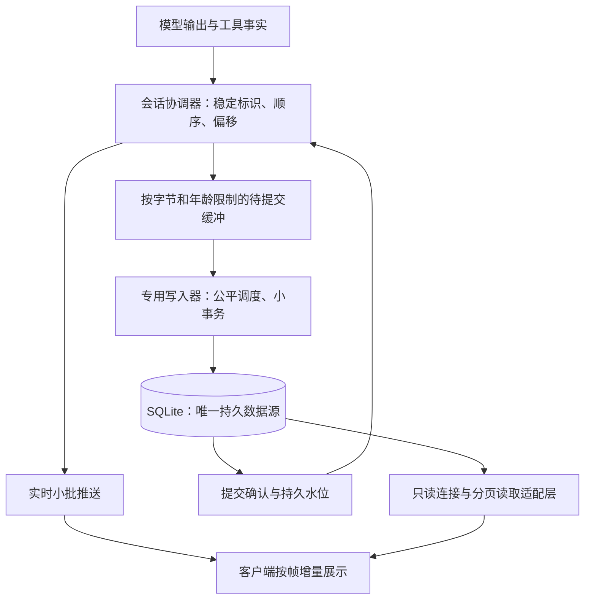

> 归档：2026-10-26 未发布的上一版计划，保留原有阶段记录和测量引用。源提交 `e339334e`。当前有效要求见[修订计划](stream-storage-development.zh-CN.md)；本归档不代表当前开发状态。

# 精简会话存储与流式传输重构开发计划

状态：M0–M5 实现完成；M6 本地验证与修复完成，交付人工验收。新会话默认格式为 2，历史会话保持原格式；真机及跨平台发布验收仍需完成。
日期：2026-10-26。本文描述目标架构，不把目标参数当作已有性能结果。
英文：[Streaming storage development plan](stream-storage-development-unreleased-2026-10-26.md)。

第 11–27 节保留实施过程记录；其中旧的默认关闭状态由第 28 节的统一验证状态取代。最终测量与限制见 [验收原始记录](../testing/segmented-storage-acceptance-2026-10-26.json)。

## 1. 目标与边界

1. 正常生成、长时间思考和大工具输出时，实时显示保持流畅；存储等待不进入渲染或广播锁的临界区。
2. 已确认接收的用户消息、审批/执行关键状态和已确认完成的运行有持久提交依据。正文持续保存，尽量缩小崩溃时的未提交尾部。
3. 旧会话兼容读取，不扫描、压缩、转换或重写历史正文；新会话从首次写入就精简。
4. 新格式的结束路径不生成整轮快照、不拼接整轮正文、不集中删除原始事件，不因存储整理卡顿。
5. 消息、工具详情、重连与恢复共享一份持久正文；不增加 SQLite 之外的持久日志和后续导入链。

此处的“压缩”指数据库事件整理，不改变模型上下文 checkpoint/摘要的产品功能。历史检索、分叉、重置、附件和 provider 必需字段必须继续可用。

正常实时显示先于持久提交，因此 Agent/系统突然崩溃仍可能丢失尚未提交的正文尾部。不能同时承诺任意磁盘故障下实时输出永不等待、内存有界且零丢失。存储严重落后时应暂停生成或报错，界面仍须响应。

## 2. 当前证据与需要改变的路径

| 当前路径 | 问题 | 目标职责 |
|---|---|---|
| `agent/src/rpc/broadcaster/mod.rs`、`journal_writer.rs` | 广播持锁时入队，队列满或持久边界可能阻塞；事务批量仍保留逐 token 行 | 轻量顺序分配；实时投递与写入分别调度 |
| `agent/src/rpc/broadcaster/projection.rs` | 拼接并序列化增长中的文本，长块产生重复工作 | 按块、文本段维护增量状态 |
| `agent/src/session/database/mod.rs` | 单个有序连接执行读写，重读/转换可排在写入之前 | 专用 writer 与有界只读连接，转换离开数据库线程 |
| `agent/src/session/{entry_records.rs,sqlite_store,history}` | 正文、事件和展示表示分离，可能重复保存内容 | 一份正文加薄元数据；适配层组装读取结果 |
| `agent/src/session/{journal_compaction.rs,journal_compactor.rs}` | 结束后扫描并构造整轮回放快照 | 新格式无压缩调用；旧格式只保留必要读取兼容 |
| host、Desktop、mobile、TUI、CLI、channels、remote | 不同客户端依赖事件、工具结果与历史 RPC | 对外行为统一，格式差异由 Agent/共享协议适配 |

本机调查样本：Agent 库约 96.8 MiB，其中原始事件及索引约 85.2 MiB；181,480 条思考碎片的事件 JSON 约 38.7 MiB，实际思考文本约 1.68 MiB。样本仅说明开销来源，不是新格式的性能或节省比例验收结果。不得将历史副本压缩实验的 83% 直接作为新格式承诺。

## 3. 架构与不可破坏的约束

- 同一会话由一个协调器分配操作顺序。队列交接转移不可变新增数据的所有权；无持锁磁盘等待、同步跨线程等待或无界入队。
- 实时与持久路径使用相同的内容标识及顺序，不能独立生成两份可分歧的消息状态。
- 正文段创建后不可变；新内容追加新段。不对增长中的完整消息反复 `UPDATE` 或序列化。
- 单次写入、读取、恢复页和客户端增量处理都有字节预算。大工具输出跨多个批次落库。
- 已提交水位、正文段和对应语义状态在同一事务推进。提交失败不前移水位。
- 结束仅封闭内容块和写终态。正文保持分段，无结束后重打包。
- 衍生展示状态只保存必要顺序/关联，不复制正文；重建不得堵塞正在写入的连接。

## 4. 数据模型与读写契约

以下是逻辑对象，不是冻结 DDL；M1 交付键、索引、事务与 RPC 的确切定义。

| 对象 | 持久内容 | 边界 |
|---|---|---|
| 会话与运行 | 格式版本、来源、次序、状态、计费、持久水位 | 新会话固定格式；内部关联优先短整型键 |
| 消息与内容块 | 稳定 ID、作者/种类、顺序、完整/部分状态 | 内容块支持回复、思考、工具参数/结果及结构化扩展 |
| 正文段 | 内容块关联、UTF-8 字节偏移、正文 | 追加、不可变、有限大小；不重复会话/运行的完整 JSON 信封 |
| 工具执行 | 调用 ID、参数/结果内容引用、执行事实 | shell 输出一份；退出码等独立于输出正文 |
| 审批 | 最终决定、原因、风险、授权、错误与关联 | 正式版不保留概率分布、输入审计详情等诊断载荷 |
| 变更元数据 | 本批语义变化、内容范围、顺序、提交位置 | 小型元数据，不再存放正文副本或逐 token 包装 |

必须保留 provider 协议需要的思考签名、opaque 内容、工具错误标志、多模态附件与未知扩展；不能把未在界面显示的字段一律归为调试数据。M1 给出逐字段保留矩阵。

工具参数生成期间可为不完整 JSON，以文本段保存；完成时校验并标记完成，不为持久化再复制一份参数对象。shell 的模型摘要与展示文本从规范数据生成；无法无损生成的历史表示仍由旧读取器负责，不能猜测改写。

建议的存储接口包含 `append_segments`、`commit_semantic_boundary`、`read_content_range`、`read_changes`、`read_history_page`。每批带稳定身份和预期偏移；重复批次幂等，重叠冲突明确失败。仅校验本批及相关尾部，不重新计算整轮正文哈希。

## 5. 流畅度、持久化与背压

| 项目 | 起始设计值/要求 | 验证方式 |
|---|---|---|
| 实时推送/渲染 | 约一帧的小批；内容完整、不按 token 驱动全文更新 | Desktop/mobile/TUI 长文本剖析 |
| 持久提交调度 | 20–50 ms 起始调优范围，按最老未提交数据计算期限 | 同时记录队列年龄、事务与 sync 耗时 |
| 批次大小 | 几十 KiB 的正文上限，M1 冻结具体值 | 大输出、多会话公平性 |
| 内存限制 | 同时有每会话、全局字节预算及积压年龄阈值 | 慢盘/写锁/磁盘满故障注入 |
| 关键状态 | 用户接收确认、执行必要边界、终态确认等待提交 | 在确认前后杀进程 |

周期不是最大丢失窗口承诺。保留 SQLite WAL 与 FULL 同步提交，不用降低 durability 掩盖耗时。写入器跨会话合批/公平调度，同一会话的正文与终态保持因果顺序，优先级不能让终态越过未保存正文。

背压高水位时暂停生产端读取/下一步生成，低水位后恢复；若 provider 不支持安全暂停，则使用协议允许的中断并明确标记不完整。任何情况下不能无限缓存、丢弃待保存正文或虚报完成。渲染和用户取消操作保持可用。预留控制命令容量，取消不应被正文积压饿死。

只读连接限制数量、事务寿命和每页字节。SQL 外的 JSON/展示转换不占 writer；WAL checkpoint 使用可让步预算，避免前台提交触发长期维护。checkpoint 与保留策略需测量 WAL 峰值及长读者影响，不承诺磁盘占用硬上限。

## 6. 崩溃一致性与重连

维护 `produced_cursor` 与 `durable_cursor`；客户端恢复另带数据库身份/恢复代次、运行 epoch、内容块 ID 和字节偏移。两个水位是内部协议状态，正常情况下不增加界面噪声。

| 崩溃边界 | 必须满足的结果 |
|---|---|
| 用户输入提交前 | 不确认已接收；客户端可用请求 ID 幂等重试 |
| 正文已推送但未提交 | 允许丢失该尾部；恢复显示已提交前缀并标记中断 |
| 正文已提交但确认丢失 | 不重复写入；从持久水位重读 |
| 执行意图提交后、外部操作/结果不确定 | 保留未知结果，不自动重做；外部副作用无法靠本地事务实现通用 exactly-once |
| 工具结果已提交、终态未提交 | 结果可读取，运行仍为未完成/中断 |
| 终态已提交但客户端未收到 | 重连读取相同终态，不重新生成或重复执行 |

同进程断网重连可补内存尾部；Agent 重启/epoch 变化以数据库为准，客户端替换未确认尾部，不能把客户端缓存当作权威工具执行事实写回。

重连使用“截至某水位的分页状态 + 之后的变化”。订阅注册与读取边界要原子捕获或有明确去重协议；正文段可在客户端请求偏移处分片，不能因为一段覆盖多个实时碎片而重复追加。禁止靠旧事件必须连续的假设偷偷跳号。恢复只读取所需页/活动运行元数据，不重放整轮 token 流。

## 7. 兼容、上下文与发布

- Agent schema、会话格式和 RPC 能力分别版本化；旧会话与新会话双读，写入按会话格式唯一选择。
- 现有旧会话继续旧格式追加；不做会话内混合格式。旧读取保留现有原始事件和快照支持。
- 升级不扫描历史正文，不补扫压缩，不重建旧正文；只新增必要结构/元数据，沿用数据库身份、恢复代次、准入与经校验备份契约。
- 旧格式完成事件不再新排压缩任务；兼容读取保留，不把历史快照误判为可删缓存。
- 历史分页、工具详情、全文检索、fork、reset、export、删除/墓碑/outbox、协同备份恢复、任务与通道逐项接入。模型上下文使用规范正文，不能重用仅展示摘要。
- fork 用有界的引用/映射事务建立独立视图；共享不可变正文的归属、删除与引用计数需在 M1 证明。reset/context checkpoint 修改关联与范围，不因该功能引入整轮正文复制或丢失可检索原文。
- RPC 的能力协商必须覆盖 Desktop、mobile、TUI、CLI、channels 与 remote 适配。旧客户端遇到不支持格式明确报错，不能返回空历史或双写降级。
- 发布开关只决定是否允许创建新格式会话。写入过新格式后，回滚开关仍保留新读取器；不能回退到不认识新 schema 的二进制。恢复旧版本只能走明确的备份恢复流程。
- 独立进程 Agent 与 Desktop 内嵌 Agent 都需要测量；后者共享进程资源，单纯“另起线程”不足以证明不卡 UI。

## 8. 开发阶段与依赖

| 阶段 | 交付内容/主要位置 | 退出条件 |
|---|---|---|
| M0：废弃结构清理（本次） | host schema、contract 4、工作区删除路径、删除失效引用缓存模块；app-settings 版本；文档 | 新库不创建；旧库事务退役；失败回滚可重试；保留 live/legacy 历史 |
| M1：契约与基准 | Agent/session、rpc、共享投影；确切 DDL/索引/状态机/能力协商/保留矩阵；合成基准与时延分段 | 本计划 review 后提交可审查的协议契约；冻结崩溃边界、预算和基准环境 |
| M2：规范内容存储 | Agent 新表、分段追加、幂等、双读适配、writer/read 连接、备份删除归属 | SQLite 故障与部分块恢复通过；新格式仍不默认启用 |
| M3：实时与提交解耦 | 协调器、轻量 live 流、专用 writer、两水位、背压/取消、有限增量投影 | 慢盘不阻塞 UI；积压有界；确认语义与持久数据一致 |
| M4：所有消费者 | RPC/remote/shared projection、host、Desktop/mobile/TUI/CLI/channels；历史/工具/上下文/fork/reset | 重连、恢复、身份隔离和跨端输出一致；不生成持久正文副本 |
| M5：正式版精简与切换 | 诊断开关、审批字段精简、新会话默认、停用结束整理；保留兼容 reader | 正式版无逐 token 存储、无压缩调用；末尾工作量与总轮次长度解耦 |
| M6：验收与发布 | Linux/macOS/Windows CI、内嵌/独立 Agent、Desktop/mobile 真机、性能报告与运维文档 | 性能和故障矩阵达标后启用；所有数据边界问题关闭 |

M2 与 M3 的接口由 M1 冻结，M4 完成前不得默认启用新格式。阶段可以独立提交，但最终目标不以仅替换压缩器或仅改批次参数结项。

## 9. 验收与证据

全部使用合成数据或专门授权的测试副本，不将个人对话纳入自动化。按用户本次明确指令：实施中不运行测试；全部阶段完成后统一执行本地测试与性能/故障验收，再交付人工测试。静态编译检查不执行测试。后续 PR CI 继续覆盖完整矩阵。

| 场景 | 核查内容 |
|---|---|
| 高速思考、1/10 MiB 正文、大工具输出 | 数据库/WAL/写入字节、行数、CPU、峰值内存、尾段成本；长度增长不引入全文重算 |
| 1/4/16 个活跃会话与历史分页并发 | 公平性、取消响应、writer 排队、读事务寿命 |
| 弱网、客户端落后、订阅/提交竞态 | 无重复/缺段；偏移、epoch、恢复代次和分页覆盖正确 |
| 各事务/确认前后 kill、系统退出、磁盘满、写锁与 writer panic | 已提交前缀与确认承诺一致；部分块可见；不重复外部副作用 |
| 新旧布局、已有快照、迁移失败和重复启动 | 旧正文/附件不变、无后台压缩、无启动全文扫描 |
| fork/reset/context checkpoint/导出/删除/备份恢复 | 内容与引用归属完整，检索与模型上下文不丢原文 |

性能初始门槛（M1 固定设备与 workload 后确认）：

- 正常盘下提交积压 p99 目标不超过 100 ms，同时报告最大值；这不是崩溃丢失硬上限。
- Desktop 主线程增量更新 p95 目标在一帧 16.7 ms 内，mobile 目标 33 ms 内；记录长任务、输入/滚动延迟与后半程退化。
- 正常首段显示 p95 相比基准不回退超过 10%；单独报告存储确认耗时，禁止以隐藏显示等待换取该指标。
- 运行结束不允许全轮扫描/正文序列化/批量删除；固定尾部负载下，1 MiB 与 10 MiB 运行的结束工作量应近似不变。
- 新格式与旧格式运行同一合成负载，同时记录运行中峰值及结束体积。主要收益必须来自不写冗余数据，不以 VACUUM、后处理或削减有效正文获得。
- 队列字节、最老未提交年龄、事务大小/时延、WAL、客户端帧耗时均有低开销观测；正式版不记录每 token 的诊断历史。

## 10. M0 删除清单与 review 重点

| 删除对象 | 依据 | 保留能力 |
|---|---|---|
| `workspace_files` 及其主键索引 | 生产文件搜索直接遍历磁盘，表无读写用途 | 工作区文件搜索与路径链接 |
| `reference_targets`、`object_references` 及所属索引 | 同步代码只在测试中编译，生产解析读取实际对象 | 作用域隔离的对象链接解析 |
| `idx_review_snapshots_run` | 与 `UNIQUE(run_id, phase)` 自动索引重复 | review 按 run/phase 查询与唯一约束 |

通过新增 Desktop contract 4 按外键顺序删除，保留旧迁移 SQL 校验和和历史夹具；失败回滚，不关闭外键强删，不对用户库执行 VACUUM。本次交付代码不会直接修改调查用个人数据库；应用升级时沿现有快照与迁移契约执行。

review 重点：是否接受实时显示领先于持久水位的有限尾部风险；旧会话继续旧写入的边界；正文单份保存和 fork/reset 的引用模型；M1 冻结预算/协议后才启用新格式。三项目标与“不做历史整理”是硬约束，具体提交频率以实测决定。

## 11. 实施中的存储契约

以下结构及初步接线已写入任务工作树；尚未完成全部消费者、故障审计和测试，不能作为验收版本：

- Agent schema 8 新增 `session_formats`，没有记录表示旧格式 1；新格式 2 必须在创建会话事务中显式选择。绝不为已有会话补写格式标记。
- `content_objects` 管理长度、封闭状态和 SHA-256；`content_segments(content_id, byte_offset)` 保存不可变 UTF-8 段。段上限 16 KiB，单批正文写入 64 KiB，单次范围读取 256 KiB。
- `content_references(session_id, owner_kind, owner_id, field)` 是正文归属。entry、stream、tool、checkpoint 可以共享同一对象；内容 ID 本身不是 RPC 读取授权。
- 流式生产者增量计算摘要；封闭只更新长度/摘要元数据，不回读/合并正文。已封闭正文通过摘要复用，完成消息只建立引用，不再复制其流式正文。
- 工具参数额外索引解析后 JSON 的摘要，原始空白/键顺序不同也能共享流式正文；实际原始字节摘要单独保留，不为去重改写已存正文。
- `stream_runs` 保存会话/运行/epoch 与持久水位；`stream_changes` 保存一批覆盖的游标范围及薄元数据；`stream_change_content` 引用正文范围。正文、变更与持久水位一起提交。
- 大正文可以先分批暂存，但关联变更发布前不能推进持久水位。重复批次与重叠内容必须逐项验证，不能 `INSERT OR IGNORE` 掩盖差异。
- `resolved_message_blocks` 为旧读取接口提供规范正文与旧列的兼容视图；旧正文不移动。新格式工具/历史读取走独立 reader，不挤占 writer。
- 两个只读 worker、64 项有界读取队列与 query-only 连接已加入；解析和组装结果离开 writer。
- 只有显式引用删除才进入 `content_collection`；每次清理最多退役四段（64 KiB 正文），共享正文不能回收。封闭正文开始回收前先退出摘要复用索引，不做启动/结束扫描。
- 实时投影的可变尾段限制为 16 KiB；已封闭段通过共享引用捕获，正文复制和 JSON 组装移到广播锁外。新格式加入保守的 8 MiB 投影准入预算、4 MiB 回放 ring 预算；超限显式转分页读取，传输 ring 与大工具结果的整体内存仍待审计。
- 流式与最终消息使用生成前分配的同一个 entry ID；正文块携带稳定内容键和 UTF-8 偏移。结束只封闭剩余内容块。连续新增字节在落库前小批合并，不创建逐 token 的正文段行。
- 新格式 writer 使用 25 ms 调度起始值，待提交预算为每会话 32 MiB、全局 128 MiB、最老准入数据 2 秒；超限明确中断。提交回执等待已移出广播锁，异步调用线程与控制命令准入仍待审计。
- 初步恢复路径只读取未完成的新格式运行，将已发布范围引用到原消息身份下，并在同一事务发布中断终态与回放边界；暂存但未发布的尾部不进入恢复结果。未知外部操作结果不自动重做。该路径尚未经过故障测试。
- shell 原始事实只存一份，模型摘要通过共享纯函数生成；正式版审批只持久化决定、风险/授权、原因、错误和关联等必要事实，完整诊断保留给 debug 构建。
- 生产环境不再启动或排队会话存储压缩任务；旧快照 reader 保留。新格式的正常展示索引只追加元数据，分叉以有界消息头/引用批次建立子会话。

这些预算均为实现起始值，不是实测性能承诺。

后续工作仍须完成 M1 的协议/负载契约、M2 的完整归属和恢复、M3–M6；目前不得默认启用新格式或交付为人工验收版本。用户已明确允许最终本地测试，覆盖了此前“本地不运行单元测试”的默认流程。

## 12. 正文传输与保留矩阵（实施契约）

`get_event_content_range` 使用 RPC 命令中的 `session_id`、`run_id` 和
`content_request`。引用包含 `databaseId`、`restoreGeneration`、`epoch`、
`cursor`、`field`；后两者必须定位已发布的语义变更及 `/data/...` 字段，
不能传内部对象 ID。`offset`、`maxBytes` 按 UTF-8 字节计量，默认 64 KiB，
服务端最大 256 KiB；超出发布范围、字符边界、会话或恢复代次均明确失败。
每页返回 `text`、`nextOffset`、`totalBytes`、`hasMore`、`encoding`、`etag`
以及相同的数据库身份。ETag 绑定不可变的发布范围；后续追加或封闭不会改变
已发布前缀的 ETag。授权查询与正文读取必须处于同一只读事务。

| 字段族 | 新格式持久化 | 实时/回放传输 | 正式版保留理由 |
|---|---|---|---|
| `text_chunk.text`、`thinking_delta.text` | 分段正文及覆盖游标 | 有界新增范围；偏移去重 | 用户可见正文及可恢复前缀 |
| `tool_delta.text`、最终 `tool_args` | 原始参数段；校验后共享语义引用 | 小段内联，大对象引用 | 工具执行、审批、上下文及按需详情 |
| `tool_end.text`、`shell_result` | 规范事实一份；能派生的摘要只存引用 | 有界预览及正文引用；`is_error` 单独保留 | 完整输出、错误事实与可解释执行结果 |
| 用户正文、附件、审批请求 action | 规范正文和薄消息头 | 小值内联；必需大字段分页补取后使用 | 用户输入、审批决定不能依赖空预览 |
| provider 签名、opaque 内容、未知扩展 | 无损保留；大字段外置 | 展示不需要时可按需读取 | 下一轮模型协议与历史兼容 |
| 审批最终决定、原因、风险、授权、错误、关联 | 保留 | 保留 | 可解释的用户行为与恢复边界 |
| 审批概率分布、输入审计等诊断细节 | debug 保留，release 不写 | release 不依赖这些诊断字段 | 不改变已算出的审批结论 |
| 队列恢复请求 JSON 副本 `payload_json` | 新格式为 NULL；用户内容用正文引用 | 不传 | 恢复不读取此副本，调度器持有当前请求 |
| 每 token 原始事件 JSON 信封、整轮结束快照 | 新格式不写 | 由范围/薄变更适配 | 不需要重复正文来恢复或显示 |

实时字符串碎片上限 4 KiB，单帧元数据预算 64 KiB；大事实字段用显式
`content_refs`，不能静默截断。单个完整字段的客户端物化预算为 16 MiB，
超过预算的详情使用正文页迭代，不要求渲染线程一次解析全部内容。

事件回放从源头限制为 8 MiB 加一个真实前瞻事件，而非先读完整轮再切页。
首个 `EventsSince.watermark` 是本次有限读取的包含式提交边界；后续命令传
`replay_until_idx` 固定该边界。远程端首个请求也只读取一个 Agent 页，不能
为了得知水位而汇总完整尾部。后续页重复相同水位，变化或无进展明确失败。
原子订阅已接为服务端分页回放，再衔接提前注册的实时接收器；运行重建只读取短尾部。
跨边界合并的范围整体发送，并据其结束游标过滤实时重复片段。这些路径及其他消费者完成验证前不得默认启用新格式。

## 13. 显式重置的引用发布契约（实施中）

新格式重置在 writer 外规划、映射保留块的序号并写入可独立恢复的备份。
`content_operations` 先记录暂存归属，保留正文由独立 checkpoint 引用保护；
原有消息在发布前仍完整可读。发布事务再次校验 revision，只替换消息头和
正文引用，不在 writer 中展开正文。删除思考、工具或附件导致序号变化时，
引用随保留块映射，不能继续沿用旧序号。已恢复的未封闭前缀可直接共享，
不为重置重新封闭或复制正文。

`retired_streams` 在同一事务使受影响回放不可读。实际退役在空闲小批次中
进行，每片最多删除 64 条正文关联、64 条无正文关联的变更和 64 条 stream
归属引用；段回收沿用原有字节预算。它只服务显式重置/prune，不在运行结束时
触发历史整理。暂存清理有持久回执、进程内活动保护和取消检查，失败不会
移除已发布消息的归属。发布本身仍随消息头/引用数量增长，需在最终性能
验收中测量跨会话公平性，不能宣称常数时间。

重置排除活跃运行、已接受队列和并发新提示词/删除操作；先排空此前写入，
成功后清除旧内存回放。备份文件在发布前完成同步并禁止覆盖已有文件。
这些路径已有未执行规格，尚未通过最终故障和性能验收。

## 14. 异步持久边界与控制通道（实施中）

新格式模型事件只做有界入队与实时发布，不同步等待写入确认。消息结束后、
工具执行意图后、审批结束且实际执行前、工具结果保存前分别异步等待持久边界；
等待期间不持有会话广播锁，取消之后不启动尚未执行的工具。存储失败后，
最终消息回调不能从内存补写一份越过持久水位的完整正文。

控制命令使用独立的有界通道，携带入队时捕获的正文顺序号。写入器可优先
接收控制命令，但必须消费并提交截至该顺序号的正文才能确认；正文队列满
不能占用控制命令的容量。异步等待方取消不撤销已经接收的数据。正常结束
先等待末尾源事件，再提交终态；终态记录与回放可见性在进程崩溃边界上的
一致性仍需审计。旧格式保留原有写入行为，不能声称其锁等待已经消除。

以上路径已接入、仅通过库编译；规格与性能/故障验收尚未运行，不能将实现
状态当作性能或崩溃一致性已经达标。

## 15. 终态、远程能力与观测（实施中）

新格式显式运行提交在同一事务写入终态消息头、运行状态和 `agent_end` 变更。
实时通道在提交后读取并发布这条记录，不重复入队或占用新的游标。进程在
提交后、发布前退出，重连仍能读到相同终态。普通历史导入、fork 和 reset
不会因此补写历史事件；启动恢复仍只处理明确的活动运行。

Rust 与 TypeScript 远程客户端声明 `segmented_content_v1`。服务端按连接
记录并在重连时重置；未声明的客户端在内容操作前读取轻量格式元数据，
旧格式继续可用，新格式明确返回 `client_upgrade_required`。取消、审批决定
和删除不受这项展示能力限制。实时通道同样拒绝向旧客户端发送引用正文。
该链路已接入，仍需最终的跨端、重连与故障验收。

`get_runtime_metrics` 提供固定容量的队列字节/年龄、批次次数/失败、大小
和耗时分桶，不落库逐 token 诊断。批次耗时包含 staging 和提交，不能当作
单次 fsync 的测量；UI 帧耗时、WAL 峰值仍由验收负载采集。计费从规范
usage/model_changed 变更读取，不复制一份原始事件。

## 16. 扩展正文与恢复引用（实施中）

大块 provider 元数据、签名、opaque 状态、图片字段和未知扩展按原 JSON
路径保存为正文引用，区分字符串与 JSON 编码；读取适配层恢复原来的类型、
嵌套结构和带 `/`、`~` 的字段名。消息头保留类型正确的空占位及必要的小摘要。
恢复思考/工具参数时直接绑定已提交的 provider 元数据范围，不把大字段展开
后再次写入消息头。重置随块序号调整引用，未知标量块也保留原始内容。

大终态错误与回放结束事件共用同一个正文对象。终态事务只建立范围关联；
运行列表可用有界预览，完整历史和所需回放通过范围读取恢复错误内容。
历史索引和运行控制使用无正文消息头；新格式运行控制只读取最新运行的
必要标记，完整错误读取在独立 reader 上进行。

这些实现尚未执行测试。会话控制配置的引用更新、大正文分页读取、展示页
避免加载不可见 provider 数据、最终消息回调避免全文复制/哈希仍在实施中。
新格式继续关闭默认创建，不能把当前状态当作验收完成。

## 17. 由已提交源数据发布助手消息头（实施中）

新格式助手保存回调只构造消息头、稳定块标识、字节数和类型标志，不再复制
并序列化完整正文，也不在结束时重算正文哈希。持久化 worker 核对同一
会话/运行/epoch/entry 的 `message_end`、已封闭正文范围与字段身份，分批
建立引用，最后发布消息头。源数据查询使用限定事件类型的部分索引，普通
正文增量不增加这些索引的行数。

未完成工具输入字符串保留原始正文，通过版本化的读取解释恢复模型使用的
字符串值；不在库里再写一份修复后的参数。缺少工具 ID 时先在源头赋予
稳定 ID。单条助手消息内无法区分的重复工具 ID 明确失败，不能猜测归属。
审批观察的模型消息内容保持完整。

模型运行出错时转移其消息列表的所有权回会话，不依赖中途复制全部消息来
保留上下文。工具执行前异步等待正文和消息头两个队列，任何先前保存失败
均阻止后续外部副作用。以上已通过库编译，身份、故障、性能规格仍未运行；
分页读取、配置引用更新和剩余消费者验收完成前，新格式继续关闭默认创建。

## 18. 分页正文、工具字段与衍生分片缓存（实施中）

格式 2 的完整会话读取、终态详情、展示页、工具详情和原文片段已接入独立分段读取器。
消息头、块和引用的单次定位最多 64 条，正文/原始列单次返回最多 256 KiB；
JSON 组装与派生解释在数据库 worker 外执行。展示页只查询薄索引和消息定位，
不再通过兼容视图聚合正文；工具详情只读取所需参数、结果和执行事实。
原文片段直接切取普通文本和 JSON 参数范围；派生摘要/修复参数仍在数据库
worker 外解释，其跨请求重复计算和缓存预算仍需审计。

读取捕获数据库身份、恢复代次、历史改写代次和历史尾部位置。每页正文在
同一事务核对消息/字段/范围归属；追加不会使已捕获的前缀失效，重置、删除
和恢复使旧读取明确失败。历史改写代次是新增的小型元数据，不扫描旧正文。
已发布消息的正文引用保持不可变；编码冲突和试图扩展已发布恢复前缀的重试
在修改前拒绝。每片写入在同一事务复核发布状态，重试只推进范围长度，
不会缩短已经发布的正文。JSON 字段与原始文本分别绑定正确编码。

超长展示结果首次序列化时流式溢写匿名临时文件，并同时计算摘要；连续分片
命中缓存后只读取所需字节。缓存仅是可丢弃的展示派生结果，丢失后从 SQLite
重建，不承担持久化，也不需要 fsync。起始上限为 16 个文件/128 MiB，空闲
120 秒后在后续访问时淘汰；超过缓存上限的消息仍可读取，但可能重新计算。
这些参数尚未实测，不能据此宣称所有大消息和并发请求的内存/延迟已经有界。

完整历史 API、超大详情的返回值仍会物化。配置引用更新、原文检索、派生片段缓存、
列表摘要、checkpoint 守卫、展示字段选择及全局并发预算仍需完成；规格已
编写但尚未运行，新格式继续关闭默认创建。

## 19. 配置引用与运行结束的小补丁提交（实施中）

大系统提示词、来源元数据与未知配置值已接入正文引用。配置更新只暂存本次
提供的字段，发布事务读取最新薄元数据并合并补丁；未修改的大字段直接共享
引用，不读取/重新序列化。替换为小值或 null 时同步退役旧归属。元数据准入
起始预算为 128 个顶层字段、64 KiB 薄消息头、4 KiB 单个内联控制字符串；
这些值尚未实测，超限明确失败，不截断配置。

配置补丁具有持久暂存回执，允许独立补丁并发；reset 与这些回执互斥。
崩溃恢复只清理回执标识的未发布引用，每次最多 64 条。在进程内，活动操作
保护机制避免另一个 Manager 抢先回收仍在写入的暂存数据。配置变化使用独立
metadata_generation，普通消息追加不会无故使配置分页失效。

新格式正常运行结束只携带用量和必要的自动标题，不再读取完整会话来合并
配置，也不复制冻结的提示词/来源数据。元数据归属、终态消息、运行状态和
回放结束变更在同一事务发布。旧终态重试验证消息头及引用集合后直接返回，
不能用旧运行的用量覆盖较新的运行。界面状态轮询也改为计数、父会话和所需
运行标记查询，不展开正文或完整配置；运行时真正加载配置时仍恢复完整字段。

以上规格未执行。后续分叉、checkpoint、普通消息暂存和原文搜索的实施进展
见第 20–22 节；消费者、全局预算及最终验收完成前，新格式继续关闭默认创建。

## 20. 分叉的身份映射与隐藏发布（实施中）

新格式分叉捕获数据库/历史代次和父会话尾部，分页读取消息头。仅对选中范围
中的当前 checkpoint 读取身份相关字段，将 cutoff、covered-from、protected IDs
以及确定性证据索引中的消息 ID 按同一映射改写；普通正文、签名、provider 状态
和未知扩展共享不可变范围。发生改写的 checkpoint 字段单独保存，不能重新挂回
仍包含父 ID 的原始正文。

子会话在持久分叉回执下以 revision=-1 隐藏暂存，最后原子发布。复制期间允许
父会话追加，但拒绝超出捕获尾部的源条目，以及 reset、恢复、删除造成的身份
变化。RPC 只返回子会话身份与 created 状态，不在完成时再加载所有正文。
父会话删除后，子会话自己的引用保护共享正文；重复 request ID 沿原回执返回。

启动时仅查找有回执的隐藏分叉，分批删除其明确归属，不扫描旧正文。进程内
活动 guard 防止另一个 Manager 清理仍在进行的分叉。相关规格已编写、未执行。

## 21. checkpoint 回执与普通消息的暂存归属（实施中）

新格式模型上下文 checkpoint 的准入不再在 writer 上遍历并哈希历史正文。
四种对话条目的索引尾部、不可变条目指纹与显式历史改写代次组成输入身份；
配置、运行标记和 checkpoint 不改变该身份。正文在 writer 外准备，checkpoint
消息头、正文引用和成功回执在同一事务发布。成功回执保存条目定位与摘要校验值，
不重复保存 summary；重试在分页读取后验证完整 checkpoint 并恢复原返回值。
失败错误正文也通过独立归属引用保存，读取时逐页验证摘要。started 无终态的
请求保持不确定状态，不能静默重跑模型调用。

普通消息正文暂存现在也先建立持久 entry 回执，记录精确 entry ID 和可选 run ID。
消息头或排队接收回执提交前保留租约；失败/放弃后及崩溃恢复按该回执每批最多
清理 64 个未发布字段。已发布消息、相同 entry 的其他准备操作，以及同一运行
的已接收用户输入均保护正文。此机制没有历史全库扫描，正文仍只保存一份。
重置与这些租约互斥；生产关闭或存储故障导致清理失败时保留回执供恢复处理。

这些源码路径已通过库编译。原子提交失败、幂等、重复身份冲突、错误校验、
跨 Manager 活动保护和排队恢复规格尚未运行；根级 meta 在新格式中要求对象或
null，异常形状明确拒绝，避免补写 run 归属时静默覆盖数据。旧格式行为不变。

## 22. 原文搜索与会话列表的独立读取（实施中）

新格式原文搜索分页选择对话条目和可读字段，正文每页最多 256 KiB；ASCII
大小写匹配、跨页 query 重叠和 120 字节片段前文在数据库 worker 外处理。
不通过 resolved_message_blocks 聚合全文，也不读取思考正文与 provider 隐藏字段。
返回原有块身份、片段和串联字节偏移；精确 tool-call ID 匹配仍保留。跨会话
搜索支持新旧混合，每个会话读取独立调度，候选集随结果上限裁剪。

新格式列表直接读薄控制元数据、更新时刻、用户计数及首条用户消息的选中文本；
不恢复配置大字段、图片、其他助手/工具正文。原有标题规则保持，但首条超长
用户文本的标题变换仍会物化该字段；派生参数/摘要的重复解码与全局并发内存
预算也尚未完成。不能将有界 SQL 页误称为所有读取的总内存/总耗时已经有界。
与兼容搜索结果对照、跨读取页/UTF-8 边界、混合格式和缺损无关字段的规格已
编写，未执行。新格式继续关闭默认创建，全部实施完成后统一测试与验收。

## 23. 分页标题与派生原文缓存（实施中）

首条消息的标题改用 4 KiB UTF-8 页读取。链接/图片取标签、会话引用优先不作为
标题、仅含引用时退回标签、空白折叠和 40 列预览沿用共享规则，不为短标题
展开整条消息。零宽字符增加 1 KiB 输出字节上限，避免可见列数无法限制内存。
长链接的合法性仍可能需要扫描其目标，但不持有数据库事务，也不缓存整个目标。
普通运行的标题生成也接入同一提取器。与原规则对照、长标签/目标和小 Unicode
页的规格已编写，未执行。

原文片段中的 shell 摘要和中断参数字符串改为可丢弃的匿名文件派生缓存，避免
每个片段都重新读取/修复/解码全部正文。缓存键包含数据库/恢复/历史身份、
条目、字段、范围及解释版本，每次命中和分片读取仍核对精确归属。驱逐或进程
崩溃只丢失加速结果，原正文仍由 SQLite 保留。参数修复的 JSON 校验改成不保留
数组/对象树的 visitor，保留数字范围、语法和嵌套深度检查。

派生构建起始准入为全进程最多 2 个任务、256 MiB 估算工作内存，按来源字节的
16 倍加固定缓冲计费；最多 32 个等待者，等候超时或超大输入明确失败，不能
截断原数据。缓存仍为 16 项/128 MiB、120 秒惰性过期。所有展示/派生匿名文件
（包括驱逐后仍被请求持有的 Arc）另外共享 64 文件/512 MiB 的实际写入预算。
以上均为未实测起始参数；不代表整个模型上下文或所有客户端的总内存已验收。

## 24. 读取准入、展示选择与 CLI 分片（实施中）

gRPC 在进入 blocking pool 前异步准入：重型搜索/列表/完整上下文 2 个，普通
历史/工具/范围请求 4 个，订阅补读 2 个，各有 32 个等候容量。控制和正常实时
投递不经过这些读取队列。任务开始后许可随后台工作移动，取消请求不会提前
释放仍在进行的任务。订阅补读的许可保留到该页耗尽或订阅丢弃，避免慢客户端
无限累积已经物化的回放页。调度规格已编写，尚未执行。

展示读取只展开现有 public projection 实际使用的字段。已被该投影丢弃的根
扩展和已知块额外字段不再读取；未知块、公开 provider 元数据、附件、执行
事实及配置/checkpoint 公开字段仍保留。完整历史、上下文和导出读取继续恢复
全部来源字段。这是避免无效读取，不改变原始持久数据或缩减现有展示契约。

新格式拒绝无 offset/before 的全历史 RPC，返回 history_paging_required，避免
悄悄进入完整历史缓存。CLI 的完整历史接口改为逐页组装，前向/后向接口都调用
共享的分片校验和组装器；host/TUI 已有对应分页路径。客户端明确请求完整历史
时仍可能物化完整返回值，此处不把单个服务端页的上限冒充为客户端总内存上限。
分片、前向游标、无分页拒绝和展示字段等价性规格已编写，未执行。所有剩余
消费者/归属审计与性能故障场景完成后，再统一运行本地测试并启用新会话。

## 25. 显式改写后的 checkpoint 退役（实施中）

新格式 checkpoint 准入同时记录所属历史代次；旧格式回执不补扫、不改写。
显式 reset/replace 在发布新历史的同一事务推进代次，并用一个水位登记旧回执
的退役范围。空闲清理每次只选择一个旧回执、最多删除 64 个精确错误正文归属，
然后移除回执。正文对象仍由共享引用与分段 GC 保护，不遍历或压缩历史正文。

新的代次不会被旧清理队列删除，重复改写只推进退役水位。旧请求迟到的失败
不能在新历史中重新发布错误正文；回收失败可重试。保留的消息/子会话仍能保护
相同正文。当前代次、旧格式和共享正文保留，以及每次清理上限的规格已编写，
未执行。

## 26. 模型输入准备与 WAL 独立调度（实施中）

每轮 model request 的消息列表改为转移所有权；仅 verbose 开启时才构建调试用
LLM 表示。首次完整上下文快照仍需存在，但复制与审批历史证据准备已移到受
run 所有权跟踪的 blocking 任务，在会话命令锁释放后执行。准入时只捕获消息
数量与尾部身份，后台核对同一前缀并检查取消，不能把后续排队输入混入此轮。
审批当前来源、权限代次与取消标记仍在准入时冻结，不因延迟准备而扩大授权。

写连接继续 WAL + FULL，但关闭自动页数 checkpoint。独立连接/线程以 250 ms
起始周期执行 PASSIVE checkpoint；空闲回收也不再调用 TRUNCATE，避免长同步
操作附着在前台提交或占用写锁。后台失败时正文仍保存在 WAL，后续周期重试。
长读者可阻碍 checkpoint 并使 WAL 增长，8 MiB journal_size_limit 仅是重用时的
保留策略，不是磁盘占用硬上限；这里没有使用 VACUUM 或降低持久性。

存储健康增加固定内存直方图：写入排队/执行、读取排队/执行、COMMIT、后台
checkpoint，以及 WAL 帧推进和每 250 ms 采样的文件体积/峰值。COMMIT 耗时
包含 FULL 同步，但不是孤立的 fsync 耗时；该指标覆盖统一事务 helper，完整
writer job 指标覆盖队列工作。观测不保存 SQL、路径、正文或逐 token 记录。
后台任务在关闭时接收停止信号并 join，避免实例退出后仍遗留数据库工作。

库编译已通过；迟到回调、输入身份/取消、审批来源、长读者与继续提交的规格
未执行。客户端大 JSON 解码和本地历史 IPC 的后续处理见第 27 节；渲染与最终
性能/故障验收尚未完成，新会话默认开关继续关闭。

## 27. 新会话预留与客户端分时解码（实施中）

生产事件绑定现在在一个写事务中预留身份并读取新会话格式策略。只有本次
真正插入、没有任何导入收据的新身份可启用格式 2；已有占位/会话保持原格式，
跳过的导入、删除收据和 tombstone 拒绝重新绑定。格式插入失败会连同占位回滚。
显式 reserve_segmented 仅是规格夹具；生产创建路径已连接，但默认常量仍为 1，
待剩余运行模式与验收准备完成才切换，不进行历史迁移。

共享 thread-projection 解码器对小 JSON 保留原生路径，大 JSON 使用迭代对象/
数组组合器，约 4 ms 检查让出任务；UTF-8 解码块为 64 KiB，原生字符串片段
约 8 KiB。它保留重复键、普通对象原型、自有 __proto__ 属性、Unicode/转义语义，
不经过有损字段筛选。限制包括 128 层深度、超长原始字面量显式拒绝，以及两个
活动解码、估算 256 MiB 准入计费、32 个等待者/5 秒等待。计费不是 JavaScript
堆的精确测量；字符串最终 join 和分配仍不可抢占，必须以最终界面延迟衡量。
远程字节页和 content_refs 的 JSON 正文已使用此共享路径；不新增逐 token 队列。

本地桌面分页历史改走 GUI 传输适配器：先得到不可变快照描述符，再顺序读取
每块至多 64 KiB 的二进制 IPC，兼容 WebView 回退的字节数组。后端在读取前
准入，两个活动读取/快照、32 个额外等待者，单快照编码硬上限 16 MiB；序列化
在 blocking 任务完成，取消后的任务结果不会发布无人持有的快照。快照按窗口
所有权验证，末块读完即退役，失败显式释放，遗留快照在 120 秒后按访问清理。
前端从开始读取到完成解码也仅准入两个任务，切换会话/代次后不再读取后续块。
缓存只保存传输副本，崩溃后可重新从 SQLite 读取，不承担持久化职责。

规格已补充但未执行：原生语义一致性、语法拒绝、时间片/取消、UTF-8 跨块、
格式预留事务回滚和旧身份保留、IPC 二进制/回退、边界/窗口归属、过期释放、
编码超预算。仍需处理必要事件水合后的字符串化/再次解析、临时会话运行模式、
最终故障与性能验收，随后才开启新会话默认格式并进行统一测试。

## 28. 统一验收阶段与最后的消费者接线

第 27 节之后，必要事件的已解码正文通过进程内 Symbol 随事件传递，重放
规范化、桌面远程信封、移动端投影及共享 projector 都携带同一对象。正文
不再 stringify 回协议字符串再 parse；原始薄信封保留用于游标核验，Symbol
不能由远端 JSON 属性伪造，也不会写回协议。旧的大内联事件先分时解码。
游标核验只解析 64 KiB 以内的规范信封；超大正文不能获得规范重叠授权。
必要事件的累计水合预算为 16 MiB、最多 128 个字段，不再给每字段单独放大。

临时模式在首个提示词准入前选择：先关闭事件准入、排空并 join 原写线程，再
进入没有 store/writer 的内存发送模式。已准入/运行后拒绝切换；内存事件产生
后也拒绝重新启用持久化，防止复用未落盘游标。未产生事件前可撤销临时选择。
内存重放 ring 和投影也保持字节上限。历史正文和此前已提交事件保持原样。

本地有界读取适配器现覆盖桌面远程历史、重放、正文及工具参数读取。读取前
准入、后台编码；32 KiB 以内直接返回，较大结果返回窗口所有的不可变传输
描述符，再以 64 KiB IPC 读取。前端到解码结束持有同一准入，恢复代次/会话
切换会停止后续块。取消等控制命令走原有独立路径。

M1–M5 的实现接线完成后，任务分支将 NEW_SESSION_FORMAT 切换到 2，开始
用户要求的统一本地测试阶段；个人库未被转换，主工作树没有源码改动。测试
发现的问题在此阶段修复并重跑相关检查，不将初次失败当成交付完成。

最终负载源码已加入：1/10 MiB 新旧写入对比、1/4/16 会话共享 writer 与分页
reader、真实子进程在确认后/未提交事务内被 kill、SQLITE_FULL、外部写锁和
真实 writer 线程 panic。它们使用临时合成库，显式 ignored，必须在最终阶段
单独运行。输出包含正文校验、行数、数据库/WAL、提交分位、结束耗时；直接
batch 时延不等于实时准入积压，采样体积不等于瞬时峰值，进程 kill 不等于
物理断电。浏览器新增 storage-read-benchmark，测 1/10 MiB 字符串/对象图解码、
帧间隔、长任务和输入定时器延迟；既有 Markdown 基准另测渲染，均未冒充真机
mobile 指标。最终结果与限制在验证完成后记录。
