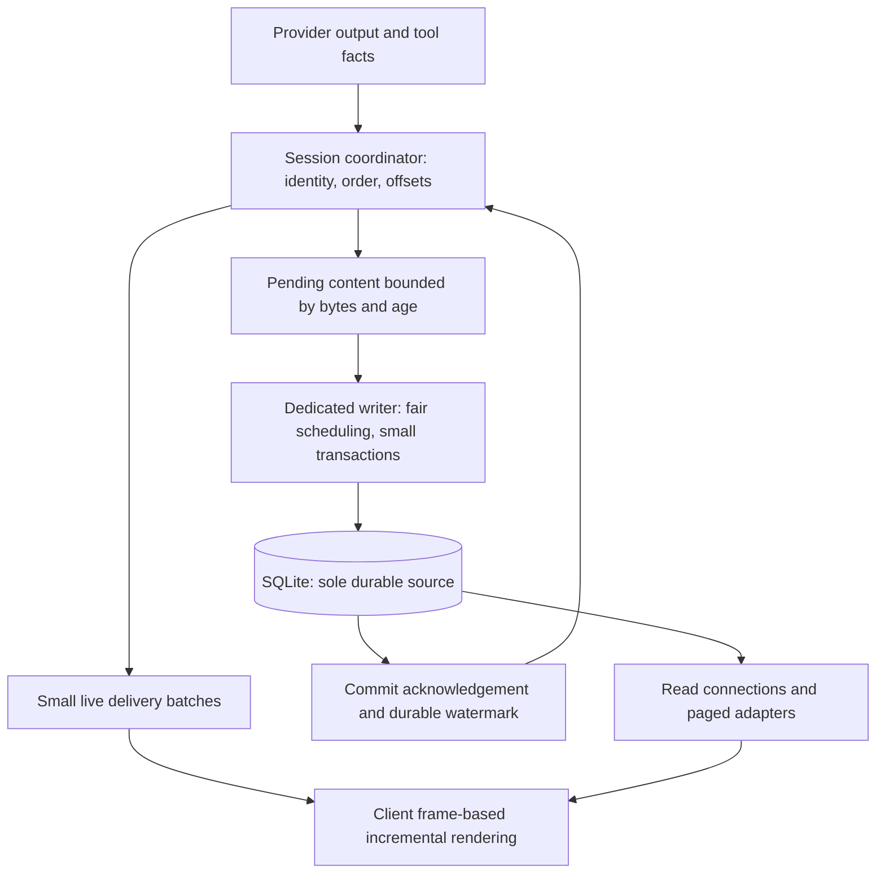

# Compact session storage and streaming development plan

Status: M0 has landed; M1–M5 source wiring is complete and the task branch is in M6 local verification and repair. The task branch now defaults new conversations to format 2; it is not merged/installed or ready for manual acceptance.
Date: 2026-10-26. This document describes a target architecture, not measured performance results.
Chinese: [精简会话存储与流式传输重构开发计划](stream-storage-development.zh-CN.md).

Sections 11–27 preserve implementation checkpoints; their earlier default-off state is superseded by the final-validation state in section 28. See the [raw acceptance record](../testing/segmented-storage-acceptance-2026-10-26.json) for measurements and limitations.

## 1. Goals and boundaries

1. Keep streaming responsive during long reasoning and large tool outputs. Storage waits must not enter rendering or broadcaster lock critical sections.
2. Persist acknowledged user inputs, critical approval/execution states and acknowledged completed runs. Continuously persist content to minimize the uncommitted tail at a crash.
3. Read existing conversations compatibly without scanning, compacting, converting or rewriting historical bodies. New conversations start with compact storage.
4. Finalization must not build a whole-run snapshot, concatenate the full body or delete a raw journal. Storage housekeeping must not stall completion.
5. History, tool inspection, reconnect and recovery share one durable body. SQLite remains the only durable store; do not add a file journal and import pipeline.

Storage compaction is distinct from model-context checkpoints and summaries, whose product behavior remains supported. Preserve recall, forks, resets, attachments and provider-required fields.

Live display precedes durable commit, so an Agent/system crash can still lose the uncommitted tail. Unconditionally nonblocking production, bounded memory and zero loss under arbitrary disk failure cannot all be guaranteed. Severe storage lag must pause production or fail explicitly while the UI remains responsive.

## 2. Evidence and affected paths

| Current path | Problem | Intended responsibility |
|---|---|---|
| `agent/src/rpc/broadcaster/mod.rs`, `journal_writer.rs` | Enqueue under broadcaster locks can block on capacity or commit; transaction batching still stores token rows | Lightweight sequencing; independently scheduled live delivery and persistence |
| `agent/src/rpc/broadcaster/projection.rs` | Growing text is repeatedly concatenated and serialized | Incremental block/segment state |
| `agent/src/session/database/mod.rs` | Reads and writes share an ordered connection | Dedicated writer, bounded read connections, conversion outside database threads |
| `agent/src/session/{entry_records.rs,sqlite_store,history}` | Bodies, events and display representations can duplicate content | One content source and thin metadata, assembled through adapters |
| `agent/src/session/{journal_compaction.rs,journal_compactor.rs}` | Completion scans and constructs whole-run replay snapshots | No compaction for the new format; retain required legacy readers |
| host, Desktop, mobile, TUI, CLI, channels and remote | Consumers depend on event, history and tool RPCs | Unified outward behavior with storage/protocol adapters |

The local audit sample had a 96.8 MiB Agent database, including 85.2 MiB of raw events and indexes. JSON for 181,480 reasoning fragments occupied about 38.7 MiB while their actual text was about 1.68 MiB. This identifies overhead; it is not a new-format benchmark. The 83% reduction from the historical-copy experiment is not a release promise.

## 3. Architecture and invariants

- One coordinator orders operations per session. Handoffs transfer immutable new data; no disk wait or synchronous cross-thread wait under locks, and no unbounded admission.
- Live and durable paths share content identities and ordering rather than independently creating divergent message state.
- Content segments are immutable after creation. Append new segments; never repeatedly update or serialize an entire growing message.
- Writes, reads, recovery pages and client updates have byte budgets. Large tool outputs span batches.
- Commit segments, associated semantic changes and the durable watermark atomically. A failed commit cannot advance the watermark.
- Finalization seals blocks and records terminal metadata. It never repacks segments.
- Derived display state stores ordering and references rather than body copies. Reconstruction cannot occupy the active writer.

## 4. Data and API contracts

These are logical objects, not frozen DDL. M1 supplies exact keys, indexes, transactions and RPCs.

| Object | Durable content | Boundary |
|---|---|---|
| Sessions and runs | Format, provenance, order, status, usage and durable watermark | Stable per-session format; short integer internal references |
| Messages and blocks | Stable IDs, author/kind, order and partial/complete state | Text, reasoning, arguments/results and structured extensions |
| Content segments | Block reference, UTF-8 byte offset and body | Append-only, immutable, bounded; no repeated full session/run envelope |
| Tool execution | Call identity, argument/result references and process facts | One shell output; exit status independent of body text |
| Approval | Decision, reason, risk, authorization, error and association | Production omits probability distributions and input audit diagnostics |
| Change metadata | Batched semantic changes, content ranges, order and commit position | Thin metadata, neither body copies nor token envelopes |

Preserve reasoning signatures, opaque provider content, tool error flags, multimodal attachments and unknown extensions. Lack of UI display is insufficient evidence to delete a field. M1 includes a field-retention matrix.

Partial tool arguments can be invalid JSON and remain text segments until validated and marked complete; do not persist another parsed argument body. Derive shell model summaries and display text from canonical facts. Historical representations that cannot be reconstructed losslessly remain the legacy reader's responsibility.

Suggested APIs are `append_segments`, `commit_semantic_boundary`, `read_content_range`, `read_changes` and `read_history_page`. Stable batch identity and expected offsets make retries idempotent; overlapping conflicts fail explicitly. Validate the batch and relevant tail without hashing the full run again.

## 5. Responsiveness, persistence and backpressure

| Item | Initial design value or requirement | Validation |
|---|---|---|
| Live delivery/rendering | Approximately frame-sized batching without losing text or reparsing the full body per token | Desktop/mobile/TUI profiles |
| Commit scheduling | Start with 20–50 ms, measured from the oldest pending data | Queue age, transaction and sync timings |
| Batch size | Tens of KiB of new content; exact limit frozen in M1 | Large outputs and multi-session fairness |
| Memory limits | Per-session and global byte budgets plus oldest-pending-age thresholds | Slow disk, locks and full-disk injection |
| Critical boundaries | Await commit for accepted input, necessary execution boundaries and terminal acknowledgement | Kill before and after acknowledgement |

The interval is not a maximum-loss guarantee. Retain SQLite WAL and FULL synchronous commits. Coalesce and fairly schedule across sessions; do not let terminal priority overtake its own uncommitted content.

Apply backpressure to provider reads/next generation at the high watermark and resume at the low watermark. If safe pausing is unsupported, use an allowed interruption and mark incomplete. Never buffer without limit, discard pending bodies or report false completion. Keep rendering and cancellation responsive, with reserved control capacity.

Bound read connection count, transaction lifetime and page bytes. Perform JSON/display conversion outside the writer. Budget checkpoint work so foreground commits cannot inherit lengthy maintenance. Measure long-reader and WAL effects rather than claiming a hard disk-space bound.

## 6. Crash consistency and reconnect

Track `produced_cursor` and `durable_cursor`. Resume also carries database identity/restore generation, run epoch, block identity and byte offsets. Normal watermark traffic should not add UI noise.

| Crash boundary | Required outcome |
|---|---|
| Before user-input commit | No acceptance acknowledgement; request ID allows idempotent retry |
| Displayed content before commit | Tail loss is possible; restore committed prefix and show interruption |
| Committed content with lost acknowledgement | Deduplicate retry and read from the durable watermark |
| Intent saved but external execution/result uncertain | Preserve unknown outcome; never automatically rerun. Local transactions cannot guarantee generic exactly-once external effects |
| Tool result saved before terminal | Result remains readable; run stays incomplete/interrupted |
| Terminal saved but not received | Resume returns the same terminal without regeneration/execution |

Network reconnect within one process can include its pending tail. After restart/epoch change, durable state replaces the client's unconfirmed tail. Client caches cannot become authoritative tool execution facts.

Reconnect uses paged state through a watermark followed by later changes. Subscription attachment and the boundary must be captured atomically or reconciled by an explicit deduplication protocol. Read segments from requested byte offsets, including positions inside segments. Do not silently skip old event IDs or append overlapping ranges twice. Recovery reads bounded pages/active metadata instead of replaying the entire token stream.

## 7. Compatibility, context and rollout

- Version Agent schema, session storage format and RPC capabilities separately. Dual-read old/new sessions; select one writer by session format.
- Existing conversations keep legacy writes. Do not mix storage formats inside a conversation in the initial release. Read both existing raw journals and snapshots.
- No historical-body scan, conversion, backfill compaction or startup body reconstruction. Add required structures/metadata while retaining admission, database identity, restore generation and verified backup contracts.
- Stop scheduling new journal-compaction work on legacy completion as well; retain readers and never treat existing authoritative snapshots as disposable cache.
- Adapt paging, tool inspection, recall, fork, reset, export, tombstones/deletion outbox, coordinated backup/restore, tasks and channels. Model context reads canonical bodies rather than display summaries.
- Forks create independent views through bounded reference/mapping transactions. M1 must prove ownership, deletion and reference accounting for shared immutable segments. Reset/context checkpoints change associations and ranges without whole-run body copies or losing recallable originals.
- Capability negotiation covers Desktop, mobile, TUI, CLI, channels and remote. Unsupported clients fail explicitly rather than receiving empty history or silently enabling dual writes.
- A rollout switch controls creation of new-format sessions only. Once such data exists, disabling creation retains the reader. Do not downgrade to a binary that cannot understand the schema; old-version recovery requires the explicit backup/restore procedure.
- Benchmark both standalone and embedded Agent modes. A new thread alone does not demonstrate UI isolation in a shared process.

## 8. Delivery phases and dependencies

| Phase | Deliverable / locations | Exit condition |
|---|---|---|
| M0: retire unused structures (this change) | host schema/contract 4, workspace deletion, dead reference-cache modules, app-settings version and docs | Fresh omission, transactional upgrade, rollback/retry, retained live/legacy history |
| M1: contracts and baseline | Agent/session, rpc, shared projection; exact DDL/indexes/state machine/capabilities/retention matrix; synthetic benchmark and timing breakdown | Review this plan, then freeze budgets, crash boundaries and benchmark environment |
| M2: canonical storage | New tables, append/idempotency, dual-read adapters, writer/read connections, backup/deletion ownership | Fault and partial-block recovery pass; default remains off |
| M3: live/commit separation | Coordinator, small live batches, writer, watermarks, backpressure/cancellation and bounded incremental projection | Slow storage cannot block UI; bounded backlog and truthful acknowledgements |
| M4: every consumer | RPC/remote/shared projection, host, Desktop/mobile/TUI/CLI/channels; history/tools/context/fork/reset | Cross-client reconnect/recovery/identity parity with no durable body copies |
| M5: production pruning and cutover | Diagnostics policy, minimal approvals, new-session default, no completion compaction, retained readers | No token-journal storage or compaction call for new sessions; completion independent of prior run length |
| M6: acceptance and release | Linux/macOS/Windows CI, embedded/standalone Agent, real Desktop/mobile, performance report and operations docs | Performance/fault matrix passes; close data-boundary issues before enabling |

M1 freezes the M2/M3 interface. Do not enable the new format by default before M4. Phases can land separately, but replacing the compactor or changing batch parameters alone does not complete this project.

## 9. Acceptance evidence

Use synthetic data or explicitly authorized copies, never personal conversations in automation. The user explicitly requested no tests during implementation. After all phases are implemented, run the complete affected local tests and performance/fault acceptance once, then hand off for manual testing. Static compilation does not execute tests. Subsequent PR CI retains the full matrix.

| Scenario | Evidence |
|---|---|
| High-rate reasoning, 1/10 MiB bodies, large tool output | Database/WAL/write bytes, rows, CPU, memory and tail processing; no growing full-body work |
| 1/4/16 active sessions with history reads | Fairness, cancellation, writer queue and read transaction lifetime |
| Weak network, slow consumers and attach/commit races | No gaps/duplicates; correct offsets, epochs, restore generation and page coverage |
| Kill around transactions/acknowledgements; shutdown, full disk, locks and writer panic | Committed prefix matches acknowledgements; partial blocks survive; no repeated external effects |
| Old/new layouts, existing snapshots, migration failure/reopen | Unchanged old bodies/attachments, no background compaction/startup scan |
| Fork/reset/context checkpoint/export/delete/backup/restore | Complete ownership/reference semantics and original recall/model context |

Initial performance gates, confirmed on fixed hardware/workloads in M1:

- Normal-disk pending-age p99 target at most 100 ms, with maxima reported. This is not a hard crash-loss bound.
- Incremental Desktop main-thread work p95 target within 16.7 ms; mobile within 33 ms. Report long tasks, input/scroll latency and degradation over time.
- First visible content p95 regresses no more than 10% against baseline. Measure commit acknowledgement separately; do not hide a display wait.
- No whole-run scan, body serialization or bulk delete at completion. With the same tail payload, completion work is approximately invariant between 1 and 10 MiB runs.
- Run identical synthetic workloads on old/new storage; report both active peak and final size. Gains come from omitted redundancy, not VACUUM, postprocessing or deleting valid content.
- Low-overhead observations cover queue bytes/age, transaction sizes/timings, WAL and client frames. Production keeps no per-token diagnostic history.

## 10. M0 scope and review decisions

| Retired object | Evidence | Retained behavior |
|---|---|---|
| `workspace_files` and its primary-key index | Production file search walks disk, with no table reader/writer | File search and path links |
| `reference_targets`, `object_references` and their indexes | Synchronizer is test-only; production resolves live objects | Workspace-scoped object references |
| `idx_review_snapshots_run` | Duplicates the `UNIQUE(run_id, phase)` autoindex | Review lookup and uniqueness |

New Desktop contract 4 drops children before parents, preserves released SQL checksums/fixtures, rolls back on failure and never disables foreign keys for this retirement. No VACUUM is added. This change does not directly modify the audited personal databases; application upgrade uses the existing snapshot/migration contract.

Review decisions: accept the limited uncommitted live tail; keep existing conversations on legacy writes; approve canonical content and fork/reset ownership; freeze budgets/protocols in M1 before cutover. Responsiveness, durability and no historical reorganization are requirements; exact cadence follows measurements.

## 11. Storage contract under implementation

The following structures are in the task worktree; streaming/client integration and all test execution remain pending:

- Agent schema 8 adds `session_formats`. An absent row means legacy format 1; format 2 is explicitly selected in the session-creation transaction, never backfilled for an existing conversation.
- `content_objects` owns length, sealing and SHA-256. `content_segments(content_id, byte_offset)` stores immutable UTF-8 segments: 16 KiB per segment, 64 KiB per content-write batch and 256 KiB per range read.
- `content_references(session_id, owner_kind, owner_id, field)` owns access. Entries, streams, tools and checkpoints may share a body; an object ID alone never authorizes an RPC read.
- Stream producers hash incrementally. Sealing updates metadata without reading/repacking content. Completed message callbacks reuse sealed bodies by digest and create references instead of body copies.
- Tool arguments also index the parsed JSON digest, so whitespace/key ordering does not require a body copy. The raw-byte digest remains separate, and stored bytes are never rewritten for deduplication.
- `stream_runs` records session/run/epoch and the durable cursor. `stream_changes` records covered cursor ranges and thin metadata; `stream_change_content` refers to body ranges. Segments, changes and the durable cursor commit atomically.
- Large bodies can be staged in batches without advancing the cursor before the referencing change is published. Verify retries and overlaps rather than hiding conflicts with `INSERT OR IGNORE`.
- `resolved_message_blocks` adapts canonical bodies and legacy columns without moving old data. New tool/history reads use separate readers instead of the writer.
- Two query-only workers and a bounded 64-job read queue are installed. Result conversion/assembly leaves the writer.
- Only explicit reference deletion queues `content_collection`. Each slice retires at most four segments (64 KiB of payload), never shared bodies. Remove digest reuse eligibility before collecting sealed content; no startup/completion sweep.
- Mutable live-projection tails are bounded at 16 KiB. Closed segments are captured through shared references, and body cloning/JSON assembly leave the broadcaster lock. A total projection-memory bound and live/durable separation still need integration.

M1 protocol/workload contracts, full M2 ownership/recovery and M3–M6 remain required. Do not enable the new format or claim a manual acceptance candidate yet. The user's explicit request authorizes final local tests and supersedes the earlier default of running no local unit tests.

Implementation update: the model loop now assigns an entry ID before output and
carries ordered content keys through final persistence. Canonical writer batching
packs adjacent bytes before segment insertion, closes individual blocks, and
publishes UTF-8 ranges for overlap-safe replay. Initial active-run recovery binds
only published ranges to their original identities and commits an interrupted
terminal with its replay boundary; this remains untested. Canonical admission
starts at 25 ms, 32 MiB per session, 128 MiB globally and two seconds backlog age;
projection/ring admission budgets are 8 MiB/4 MiB. These are unmeasured starting
values. Large transport payloads, async wait sites, controls and all consumers
still require integration/audit. Canonical forks now copy body-free headers and
references in bounded batches before publication. Shell summaries derive from
shared facts; release approval records omit diagnostics after verdict computation.
Production compactor startup and scheduling are removed; legacy snapshot readers
remain. New-session format selection is still deliberately disabled.

## 12. Body transport and retention matrix (implementation contract)

`get_event_content_range` combines command-level `session_id`/`run_id` with
`content_request`: `databaseId`, `restoreGeneration`, `epoch`, `cursor` and
`field` must resolve a committed semantic change and its `/data/...` field.
Internal object IDs are not an RPC authority. UTF-8 byte `offset`/`maxBytes`
default to 64 KiB, with a 256 KiB server ceiling. Wrong scopes, restore identity,
character boundaries or unpublished ranges fail explicitly. Replies contain
`text`, `nextOffset`, `totalBytes`, `hasMore`, `encoding`, `etag` and the same
storage identity. ETags describe the immutable published prefix and survive
later appends/sealing. Resolve authority and read bytes in one read transaction.

| Field family | Canonical persistence | Live/replay transport | Release retention reason |
|---|---|---|---|
| Text/reasoning deltas | Immutable segments and cursor coverage | Bounded added range with overlap offsets | Visible output and recoverable prefixes |
| Tool argument fragments/final arguments | Original segments and verified semantic references | Small deltas; lazy large objects | Execution, approval, context and details |
| Tool output and shell facts | Facts once; derived summary references | Bounded preview/references; separate `is_error` | Complete output and authoritative outcomes |
| User content, attachments and approval actions | Canonical bodies and thin headers | Inline small values; hydrate required large fields | Decisions must not operate on an empty preview |
| Provider signatures, opaque/unknown extensions | Lossless, large fields externalized | Lazy when irrelevant to display | Provider continuation and compatibility |
| Approval decision/reason/risk/authorization/error/association | Retain | Retain | Explainable behavior and recovery |
| Approval distributions/input audit diagnostics | Debug only; release omits | Release does not require them | The already-computed decision stays identical |
| Queued `payload_json` request duplicate | NULL for format 2; referenced user content | None | Recovery never reads the duplicate; scheduler owns the live request |
| Token JSON envelopes and whole-run final snapshots | Not written in format 2 | Adapted from ranges/thin changes | Restoration/display needs no second body copy |

Live string fragments are at most 4 KiB and fact frames have a 64 KiB budget.
Explicit `content_refs` replace large fields; never silently clip them. Client
field materialization is limited to 16 MiB, with page iteration for larger
details rather than whole-body parsing on a rendering thread.

Source replay stops after 8 MiB plus one real lookahead event. The first
`EventsSince.watermark` is the inclusive committed read boundary; subsequent
commands pin it using `replay_until_idx`. Even the first remote read requests
one Agent page rather than collecting an entire tail to discover its watermark.
A changed boundary or nonadvancing continuation fails explicitly. Atomic attach
now pages server-side before polling the receiver registered at capture; run
reconstruction reads a short tail. Coalesced ranges crossing the capture boundary
advance the live cutoff to avoid duplicate fragments. Format 2 must remain
opt-in until these paths and the other integrations have passed acceptance.

## 13. Explicit reset reference publication (in progress)

Canonical reset plans, maps retained block ordinals and writes its portable
backup off the writer. A durable content_operations receipt precedes staging;
independent checkpoint references protect retained bodies while the original
messages remain readable. Publication rechecks revision and atomically replaces
headers/ownership without writer-side body materialization. Removing reasoning,
tools or attachments remaps retained references rather than reusing stale
ordinals. Unsealed recovered prefixes are shared without resealing/copying.

retired_streams hides affected replay in that transaction. Idle slices retire at
most 64 body links, 64 link-free changes and 64 stream-owner references; segment
collection keeps its byte budget. This queue serves explicit reset/prune only,
never ordinary run completion. Durable staging receipts, process-local active
protection and cancellation checks make cleanup retryable without deleting live
entry ownership. Publication itself scales with header/reference count; final
fairness measurements must not be replaced with a constant-time claim.

Reset excludes active/accepted queued work and concurrent prompt/delete admission,
fences prior writers, and invalidates stale in-memory replay after success. The
backup is synced and published without clobbering an existing file first. These
paths have authored specifications but no final fault/performance acceptance yet.

## 14. Async durability and control lane (implementation in progress)

Canonical model callbacks admit bounded data and publish live without waiting
synchronously for durable receipts. Message end, tool intent, post-approval
pre-effect and tool result publication await explicit semantic fences. No
broadcaster lock is retained while awaiting. A stopped intent must not start an
external effect, and failed streams must not save a complete in-memory body past
the durable watermark.

A separate bounded control channel captures the last admitted body sequence.
Priority permits accepting a control while the body lane is full, but its reply
cannot overtake that body. Cancelling the waiter never discards admitted data.
Finalization fences source events before its terminal transcript commit; crash
consistency of terminal state and replay visibility still needs audit. Legacy
admission retains its original behavior.

These paths have library compilation only. Their authored specifications and
performance/fault acceptance have not run; implementation is not acceptance.

## 15. Atomic terminal, remote capability and metrics (in progress)

Explicit canonical run commits atomically publish transcript termination, derived
run state and the terminal stream change. Live delivery reads that exact record
without a second enqueue/cursor. A crash between commit and live publication
therefore retains the same replay outcome. Ordinary history imports, forks and
resets do not synthesize old events.

Rust and TS remote clients declare segmented_content_v1. Each connection owns its
flag, resets it on transport replacement, and scopes it into business handling.
Legacy peers retain legacy access; metadata-only preflight explicitly refuses
unsupported canonical/prospective formats. Stop, approval decisions and deletion
remain available. The live lane also refuses referenced bodies to an old peer.
End-to-end and fault acceptance have not run.

Runtime metrics expose fixed-size pending byte/age snapshots, attempt/failure
counts, batch maxima and duration buckets, without persistent token diagnostics.
Batch timing includes staging/commits, not individual fsync time. UI/WAL acceptance
still needs workload measurements. Pricing selects canonical usage/model-change
metadata without raw-event copies.

## 16. Extension bodies and recovered references (in progress)

Large provider metadata, signatures, opaque state, image fields and unknown
extensions use original JSON-pointer-scoped body references. String/JSON encoding
retains types, structure and escaped names. Typed placeholders keep header-only
shape/index operations valid. Recovery shares committed provider ranges rather
than decoding/copying them into block metadata; reset remaps nested and scalar
block references.

Terminal history and replay share the same error body. The terminal transaction
links ranges only; run lists use a bounded preview and full readers hydrate the
error as needed. Index/control paths read thin headers. Canonical admission reads
only the latest run's necessary markers; full terminal reads use a reader worker.

Tests have not run. Reference-aware configuration updates, bounded canonical body
reads, display-only selection, and thin final assistant callbacks remain work in
progress. New-format creation remains disabled pending the complete integration
and acceptance pass.

## 17. Source-bound assistant header publication (in progress)

Canonical assistant save callbacks build only headers, ordered source identities,
byte counts and type flags. They do not clone/serialize or hash completed text.
The persistence worker verifies the exact committed message_end, sealed ranges
and semantic source fields, binds references in small jobs, then publishes the
header. Partial expression indexes exclude ordinary text/reasoning delta rows.

Unfinished tool strings share raw source bytes with a versioned reader-side
interpretation matching the model, without another repaired body in SQLite.
Missing tool IDs are minted before source publication. Ambiguous duplicate IDs
within one assistant fail closed; review still observes original model content.

An errored run transfers its owned message vector back to the session, avoiding
per-save full-message context copies. Pre-effect fences await both journal and
transcript queues asynchronously. Library compilation passed; specifications and
performance/fault acceptance have not run. Bounded readers, configuration updates
and remaining consumers must finish before new-format creation is enabled.

## 18. Paged bodies, targeted tool fields and derived fragments (in progress)

Canonical full-history/terminal reads, display/tool pages and original-text ranges use an
independent paged reader. Header/block/reference identity jobs select at most 64
rows, and body/raw-column jobs return at most 256 KiB. JSON assembly and derived
interpretations execute outside DB workers. Display queries select thin locators
and annotations without compatibility-body aggregation; tool reads select only
requested argument/result/fact fields. Original-text reads slice ordinary text and
raw JSON argument ranges directly. Derived summaries/repaired strings still
materialize outside DB workers and require a repeated-read/cache budget audit.

Readers capture database/restore identity, explicit history rewrite generation
and the history end position. Each body page checks its exact entry/field/range
in the same transaction. Appends preserve captured prefixes; reset/delete/restore
invalidate old reads. The additive rewrite fence never scans historical bodies.
Published content stays immutable: conflicting encodings and generic attempts to
extend recovered published prefixes fail before modification. Every piece checks
publication atomically and advances reference lengths monotonically, so a late
identical retry cannot shrink published content. JSON fields and
raw strings now bind their actual encoding.

Oversized display serialization spills once to a buffered anonymous temporary
file, hashing that stream. Consecutive canonical fragments reuse the derived
file, with normal scope validation before returning bytes. This cache is
expendable, rebuilds from SQLite and owns no durability/fsync role. Initial limits
are 16 files/128 MiB with lazy 120-second idle expiry and LRU eviction. Larger
entries remain readable but may be recomputed. These budgets are unmeasured;
first-load materialization, concurrent requests and global latency/memory are not
proven bounded by this change.

Full-history and large detail return values still materialize their requested
contents. Configuration references, original-text search/derived recall caching, summaries,
checkpoint guards, display-only selection and global budgets remain unfinished.
Specifications were authored but not executed. Default canonical creation remains
disabled until complete integration and the final acceptance phase.

## 19. Configuration references and small run-boundary patches (in progress)

Large prompts, provenance and unknown configuration values now use scoped body
references. Updates stage only supplied fields, then merge the current thin
metadata and transfer unchanged references atomically. Small/null replacements
retire the previous owner. Starting admission limits are 128 top-level fields,
64 KiB thin metadata and 4 KiB per inline control string; these are unmeasured
budgets and reject rather than truncate input.

Durable checkpoint-owner receipts protect metadata staging; independent patches
can coexist, while reset excludes them. Recovery only removes receipt-scoped
unpublished references in 64-row slices. Active process guards protect a live
stage from another Manager. A separate metadata_generation advances only on
configuration changes, without invalidation by ordinary message appends.

Canonical completion carries counters/automatic title only. It no longer loads
whole history to merge configuration or clones frozen prompts/provenance for the
terminal snapshot. Metadata ownership, terminal header, run state and replay end
publish in one transaction. Immutable-header/range validation makes an older
terminal retry a no-op rather than a rollback of newer usage. State polling reads
counts, lineage and relevant run markers, while actual runtime hydration restores
configuration fields fully.

These specifications have not run. Sections 20–22 record subsequent fork,
checkpoint, ordinary-entry staging and search work. Consumer/global-budget audits
and final acceptance remain prerequisites for default canonical creation.

## 20. Fork identity remapping and hidden publication (in progress)

Canonical forks capture database/history identity and the parent's transcript
tail, then read header pages. Only identity-bearing fields of selected current
checkpoints are hydrated. Cutoff/covered-from/protected IDs and deterministic
evidence-index IDs use the same mapping. Ordinary bodies, signatures, provider
state and unknown extensions share immutable ranges. Changed checkpoint fields
receive new bodies, never the original ranges that would restore parent IDs.

A durable fork receipt owns an unpublished revision=-1 child until atomic
publication. Appending to the parent is allowed; sources beyond the captured
tail, history rewrites, restore and deletion are refused. RPC returns identity
and created status without a final full-body load. The child's own references
protect shared bodies after parent deletion; retries use the original receipt.
Startup selects receipt-owned hidden forks and discards their exact ownership in
bounded slices, without scanning historical bodies. Active process guards
protect ongoing work from another Manager. Specifications exist but have not run.

## 21. Checkpoint receipts and ordinary-entry staging ownership (in progress)

Canonical context-checkpoint admission no longer hashes all history on the writer.
Four indexed dialogue tails, immutable entry fingerprints and explicit rewrite
generation identify the input. Configuration, lifecycle markers and checkpoints
do not change it. Preparation happens off the writer; checkpoint headers, body
references and the successful receipt publish atomically. The receipt stores a
locator/digest rather than a second summary. Cached reads page and verify the
complete checkpoint before reconstructing the original result. Failure errors
also use separately owned, digest-checked bodies. A started operation without a
durable outcome remains indeterminate and never silently repeats the model call.

Ordinary entry preparation now creates durable leases for exact entry IDs and
optional run IDs before staging bodies. The lease survives until a transcript
header or queued acceptance receipt commits. Failed/abandoned/crashed preparation
cleans at most 64 unpublished fields per slice. Published entries, another stage
for the same entry, and accepted input of the exact queued run protect ownership.
No history sweep or second body copy is introduced. Reset excludes these leases;
failed cleanup retains its receipt for recovery.

Library compilation passes; atomic-publication failure, idempotence, immutable
identity conflicts, digest checks, active-Manager protection and queued recovery
specifications have not run. New canonical root meta requires an object or null;
an unexpected shape is refused rather than overwritten when assigning run
ownership. Legacy behavior is unchanged.

## 22. Cooperative original-text search and sidebar reads (in progress)

Canonical original-text search pages dialogue locators/readable fields and reads
at most 256 KiB per body job. ASCII-insensitive matching, cross-page query overlap
and 120-byte snippet lookbehind run outside SQLite workers. It does not aggregate
resolved_message_blocks or read reasoning/provider-hidden fields. Results retain
block identity, snippets, concatenated byte offsets and exact tool-call-ID hits.
Cross-session search supports mixed formats, schedules each session independently
and trims its candidate set to the result limit between sessions.

Canonical summaries read thin control metadata, update time, user count and the
first user's selected text field. They do not hydrate large configuration,
images, or other assistant/tool bodies. Existing title rules remain; deriving a
preview from an enormous first user text still materializes that field. Repeated
derived-argument/summary decoding and global concurrent-memory budgets remain
unfinished. Bounded SQL pages do not prove bounded total read memory/latency.
Legacy-oracle equivalence, cross-page/UTF-8 edges, mixed-format and damaged
irrelevant-field specifications were authored but not run. Default creation
remains disabled until complete implementation and final acceptance.

## 23. Paged titles and disposable original-text derivations (in progress)

First-message titles now read 4 KiB UTF-8 pages. Link/image labels, addressing
reference omission, label fallback, whitespace collapse and the 40-column rule
retain shared behavior without expanding a complete message for a short title.
A 1 KiB output cap also bounds zero-width scalar sequences. Validating a long
link can still scan its target, without retaining it or a database transaction.
Normal runtime title generation uses the same extractor. Equivalence, long
label/target and small Unicode-page specifications were authored but not run.

Shell summaries and interrupted argument-string representations use disposable
anonymous-file caches for consecutive original-text fragments. Keys include
database/restore/history identity, entry, field, exact range and interpretation
version. Cache hits and fragment reads still authorize that exact ownership.
Eviction/crash loses acceleration only; SQLite retains the authoritative bytes.
Argument repair validates JSON without retaining arrays/maps merely to check
syntax; number range and recursion checks remain.

Starting process-wide derivation admission allows two builds and 256 MiB charged
working memory (16 times source bytes plus fixed buffering), with at most 32
waiters and a bounded wait. Oversized inputs fail explicitly without truncation.
The cache remains 16 items/128 MiB with lazy 120-second expiry. All display/derived
anonymous files, including evicted files still held by requests, separately share
a 64-file/512 MiB actual-write budget. These are unmeasured starting limits, not
proof of bounded total model-context or client memory.

## 24. Read admission, display selection and CLI fragments (in progress)

Before entering the blocking pool, gRPC asynchronously admits two heavy
search/list/context reads, four ordinary history/tool/range reads and two replay
backfills, each with 32 waiting slots. Controls and normal live delivery bypass
these lanes. A started job retains its permit after client cancellation. Replay
keeps a permit until its materialized page drains or the subscription drops,
bounding pages retained by slow clients. Scheduling specifications have not run.

Display hydration selects fields consumed by the existing public projection.
Discarded root extensions and extra fields on known blocks are not read. Unknown
blocks, public provider metadata, attachments, execution facts and public
configuration/checkpoint fields remain. Full/context/export reads still restore
all source fields: this changes unnecessary IO, not stored data or the public
display contract.

Canonical history refuses RPCs with neither offset nor before, returning
history_paging_required rather than entering the full-history cache. CLI full
history now assembles forward pages; both cursor directions use the shared
fragment verification/assembly helper. Host/TUI already use paging. A client
explicitly requesting a complete transcript still materializes its result; a
bounded server page does not prove bounded client memory. Fragment/cursor,
unpaged-refusal and projection-equivalence specs were authored, not run. Finish
remaining consumers/ownership and acceptance workloads before final local tests
and enabling new-session creation.

## 25. Checkpoint retirement after explicit rewrites (in progress)

Canonical admission records the receipt's history generation. Legacy receipts
are neither scanned nor rewritten. Explicit reset/replace advances that fence
and registers a retirement watermark in the same publication transaction. Each
idle slice selects one indexed old receipt, removes at most 64 exactly owned
error references, then removes the receipt. Shared references and segmented GC
protect bodies; no historical-body traversal or compaction is introduced.

New generations survive older cleanup, and repeated rewrites only advance the
watermark. A late failure cannot republish old error ownership after rewriting.
Failed cleanup remains retryable; retained entries/forks still protect shared
bytes. Current/legacy/shared ownership and bounded-slice specs exist but have
not run.

## 26. Model input preparation and independent WAL scheduling (in progress)

Each model request takes ownership of its projected message list; debug LLM
conversion happens only with verbose enabled. A first full-context snapshot is
still required, but copying and approval-evidence preparation now run in an owned
blocking task after releasing the session command lock. Admission captures only
message count and tail identity; background preparation checks the same prefix
and cancellation. Later queued inputs cannot enter the accepted request. Approval
source, policy generation and cancellation remain frozen at admission.

The writer retains WAL + FULL but disables automatic page-count checkpoints.
A separate connection/thread performs PASSIVE checkpoints every 250 ms initially.
Idle reclamation no longer requests TRUNCATE, keeping long synchronization away
from foreground commits/write locks. On checkpoint failure, durable bytes stay
in WAL and later periods retry. A long reader can prevent progress and grow WAL;
the 8 MiB journal_size_limit is a reuse-retention policy, not a hard disk cap.
No full VACUUM or weaker durability is used.

Health adds fixed in-memory histograms for writer/read queue and execution,
COMMIT and background checkpoint, plus frame progress and file sizes sampled
every 250 ms. COMMIT includes FULL synchronization, not an isolated fsync metric;
its coverage is the shared transaction helper, while writerJob covers complete
queued work. No SQL, paths, bodies or per-token records are retained. Shutdown
signals and joins the checkpoint worker before relinquishing ownership.

Library compilation passes. Late-callback, input/cancellation, approval-source,
long-reader and continued-commit specs have not run. Section 27 describes the
subsequent large-JSON and native history IPC work; rendering and final performance/
fault acceptance remain incomplete. Default canonical creation stays disabled.

## 27. New-session reservation and cooperative client decoding (in progress)

Production event binding now reserves identity and selects the new-session policy
in one write transaction. Only a newly inserted identity with no import receipt
can enable format 2. Existing placeholders/sessions retain their format; skipped
imports, deleted receipts and tombstones refuse rebinding. Format insertion failure
rolls back the placeholder too. Explicit reserve_segmented is now a specification
fixture. Production creation is connected, but the default remains 1 until remaining
runtime modes and acceptance preparation are complete; no history is migrated.

The shared thread-projection decoder keeps native parsing for small JSON. Large
JSON uses an iterative object/array composer with approximately 4 ms yield checks,
64 KiB UTF-8 decode chunks and approximately 8 KiB native string fragments. Duplicate
keys, ordinary prototypes, own __proto__ properties, Unicode and escaping retain
their native semantics. Limits include depth 128, explicit refusal of oversized
primitive literals, two active decodes, estimated 256 MiB admission charges, and
32 waiters/5-second admission. Charges are not exact JavaScript heap measurements;
final string joins and allocations remain unpreemptible and require UI-latency
acceptance. Remote byte pages and JSON content_refs use this shared path. No extra
per-token queue is introduced.

Local desktop history paging now uses a GUI transport adapter: an immutable
snapshot descriptor followed by sequential binary IPC chunks of at most 64 KiB,
including compatibility with the WebView byte-array fallback. Backend admission
precedes the read: two active reads/snapshots, 32 additional waiters, and a hard
16 MiB encoded-snapshot limit. Serialization runs on the blocking pool. A canceled
job result cannot publish an ownerless snapshot. Snapshots verify window ownership,
retire on their final chunk, explicitly release on failure, and prune abandoned
copies after 120 seconds on access. Frontend admission covers reading through
decoding, with two active operations; source changes stop subsequent chunks. This
cache holds disposable transport copies, recoverable from SQLite after a crash.

Authored, unexecuted specifications cover native semantic parity, syntax refusal,
yields/cancellation, UTF-8 boundaries, reservation rollback/old identities, binary/
fallback IPC, ranges/ownership, expiry release and encoding limits. Required-event
hydration still needs its stringify/reparse path addressed, as do ephemeral runtime
modes and final fault/performance acceptance. Then enable the new-session default
and run the single final local verification phase.

## 28. Final verification phase and remaining consumer wiring

After section 27, decoded required-event bodies now travel under a process-local
Symbol through replay normalization, desktop peer envelopes, mobile projections
and the shared projector. Consumers share that object instead of stringifying it
back into the protocol string and parsing it again. The original thin envelope
remains for cursor validation. Remote JSON fields cannot forge the Symbol and it
is never serialized. Large legacy inline events decode cooperatively first.
Cursor checks parse canonical envelopes only within their 64 KiB bound; oversized
bodies cannot authorize canonical overlap. Required-event hydration has a cumulative
16 MiB/128-field budget, rather than multiplying a per-field allocation budget.

Ephemeral mode is selected before the first prompt admission. It closes journal
admission, drains/joins the original actor, then delivers from memory with no store
or writer. Changes after admission/start are refused; re-enabling persistence after
memory events is also refused, preventing reuse of volatile cursors. Selection can
be undone before any memory event exists. Memory replay/projection retain byte
limits. Previously committed history/events remain unchanged.

The bounded native read adapter now covers desktop peer history, replay, content
and tool argument reads. Admission precedes reading and background encoding. Replies
within 32 KiB stay inline; larger replies return a window-owned immutable descriptor
and use 64 KiB IPC chunks. Frontend admission covers reading through decoding; source
or conversation changes stop subsequent chunks. Controls such as cancel retain their
independent path.

With M1–M5 wiring complete, the task branch switches NEW_SESSION_FORMAT to 2 and
enters the user-requested final local test phase. No personal database was converted
and no main-worktree source was edited. Failures discovered here are repaired and
rechecked; an initial failed run is not a completed delivery.

Explicit final workloads are authored: 1/10 MiB old/new writes, 1/4/16 sessions on a
shared writer with paged readers, real process kills after acknowledgement/in an
uncommitted transaction, SQLITE_FULL, an external write lock, and a real writer
thread panic. They use temporary synthetic databases and are ignored tests requiring
an explicit final invocation. Reports include body equality, rows, database/WAL,
commit percentiles and finish latency. Direct batch timing is not live admission
backlog; sampled file size is not an instantaneous peak; process kill does not simulate
physical power loss. The new browser storage-read-benchmark measures 1/10 MiB strings/
object graphs, frame intervals, long tasks and input timer latency. The existing
Markdown benchmark separately measures rendering; neither is a mobile-device result.
Final results and limitations will be recorded after verification.
