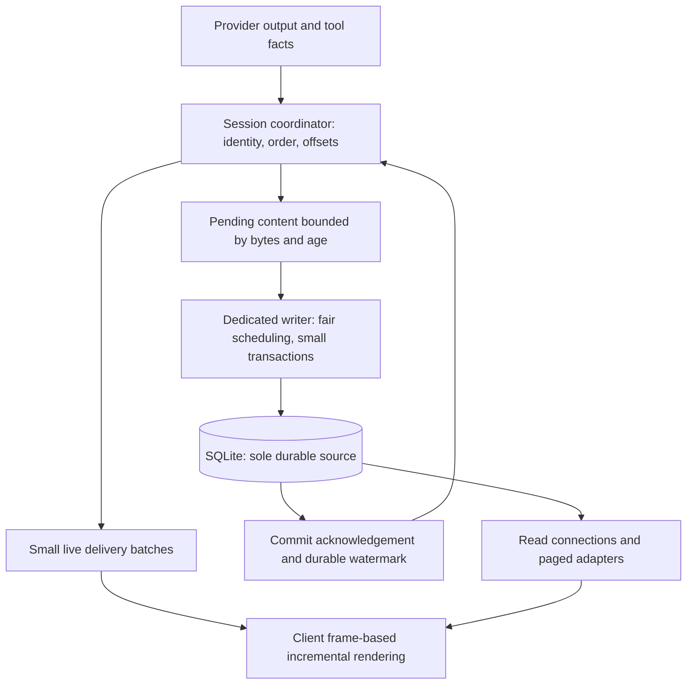

# Compact session storage and streaming development plan

Status: awaiting user review. Only M0, retiring unused tables and an index, is implemented in this change. M1–M6 remain planned.
Date: 2026-10-26. This document describes a target architecture, not measured performance results.
Chinese: [精简会话存储与流式传输重构开发计划](stream-storage-development.zh-CN.md).

## 1. Goals and boundaries

1. Keep streaming responsive during long reasoning and large tool outputs. Storage waits must not enter rendering or broadcaster lock critical sections.
2. Persist acknowledged user inputs, critical approval/execution states and acknowledged completed runs. Continuously persist content to minimize the uncommitted tail at a crash.
3. Read existing conversations compatibly without scanning, compacting, converting or rewriting historical bodies. New conversations start with compact storage.
4. Finalization must not build a whole-run snapshot, concatenate the full body or delete a raw journal. Storage housekeeping must not stall completion.
5. History, tool inspection, reconnect and recovery share one durable body. SQLite remains the only durable store; do not add a file journal and import pipeline.

Storage compaction is distinct from model-context checkpoints and summaries, whose product behavior remains supported. Preserve recall, forks, resets, attachments and provider-required fields.

Live display precedes durable commit, so an Agent/system crash can still lose the uncommitted tail. Unconditionally nonblocking production, bounded memory and zero loss under arbitrary disk failure cannot all be guaranteed. Severe storage lag must pause production or fail explicitly while the UI remains responsive.

## 2. Evidence and affected paths

| Current path | Problem | Intended responsibility |
|---|---|---|
| `agent/src/rpc/broadcaster/mod.rs`, `journal_writer.rs` | Enqueue under broadcaster locks can block on capacity or commit; transaction batching still stores token rows | Lightweight sequencing; independently scheduled live delivery and persistence |
| `agent/src/rpc/broadcaster/projection.rs` | Growing text is repeatedly concatenated and serialized | Incremental block/segment state |
| `agent/src/session/database/mod.rs` | Reads and writes share an ordered connection | Dedicated writer, bounded read connections, conversion outside database threads |
| `agent/src/session/{entry_records.rs,sqlite_store,history}` | Bodies, events and display representations can duplicate content | One content source and thin metadata, assembled through adapters |
| `agent/src/session/{journal_compaction.rs,journal_compactor.rs}` | Completion scans and constructs whole-run replay snapshots | No compaction for the new format; retain required legacy readers |
| host, Desktop, mobile, TUI, CLI, channels and remote | Consumers depend on event, history and tool RPCs | Unified outward behavior with storage/protocol adapters |

The local audit sample had a 96.8 MiB Agent database, including 85.2 MiB of raw events and indexes. JSON for 181,480 reasoning fragments occupied about 38.7 MiB while their actual text was about 1.68 MiB. This identifies overhead; it is not a new-format benchmark. The 83% reduction from the historical-copy experiment is not a release promise.

## 3. Architecture and invariants

- One coordinator orders operations per session. Handoffs transfer immutable new data; no disk wait or synchronous cross-thread wait under locks, and no unbounded admission.
- Live and durable paths share content identities and ordering rather than independently creating divergent message state.
- Content segments are immutable after creation. Append new segments; never repeatedly update or serialize an entire growing message.
- Writes, reads, recovery pages and client updates have byte budgets. Large tool outputs span batches.
- Commit segments, associated semantic changes and the durable watermark atomically. A failed commit cannot advance the watermark.
- Finalization seals blocks and records terminal metadata. It never repacks segments.
- Derived display state stores ordering and references rather than body copies. Reconstruction cannot occupy the active writer.

## 4. Data and API contracts

These are logical objects, not frozen DDL. M1 supplies exact keys, indexes, transactions and RPCs.

| Object | Durable content | Boundary |
|---|---|---|
| Sessions and runs | Format, provenance, order, status, usage and durable watermark | Stable per-session format; short integer internal references |
| Messages and blocks | Stable IDs, author/kind, order and partial/complete state | Text, reasoning, arguments/results and structured extensions |
| Content segments | Block reference, UTF-8 byte offset and body | Append-only, immutable, bounded; no repeated full session/run envelope |
| Tool execution | Call identity, argument/result references and process facts | One shell output; exit status independent of body text |
| Approval | Decision, reason, risk, authorization, error and association | Production omits probability distributions and input audit diagnostics |
| Change metadata | Batched semantic changes, content ranges, order and commit position | Thin metadata, neither body copies nor token envelopes |

Preserve reasoning signatures, opaque provider content, tool error flags, multimodal attachments and unknown extensions. Lack of UI display is insufficient evidence to delete a field. M1 includes a field-retention matrix.

Partial tool arguments can be invalid JSON and remain text segments until validated and marked complete; do not persist another parsed argument body. Derive shell model summaries and display text from canonical facts. Historical representations that cannot be reconstructed losslessly remain the legacy reader's responsibility.

Suggested APIs are `append_segments`, `commit_semantic_boundary`, `read_content_range`, `read_changes` and `read_history_page`. Stable batch identity and expected offsets make retries idempotent; overlapping conflicts fail explicitly. Validate the batch and relevant tail without hashing the full run again.

## 5. Responsiveness, persistence and backpressure

| Item | Initial design value or requirement | Validation |
|---|---|---|
| Live delivery/rendering | Approximately frame-sized batching without losing text or reparsing the full body per token | Desktop/mobile/TUI profiles |
| Commit scheduling | Start with 20–50 ms, measured from the oldest pending data | Queue age, transaction and sync timings |
| Batch size | Tens of KiB of new content; exact limit frozen in M1 | Large outputs and multi-session fairness |
| Memory limits | Per-session and global byte budgets plus oldest-pending-age thresholds | Slow disk, locks and full-disk injection |
| Critical boundaries | Await commit for accepted input, necessary execution boundaries and terminal acknowledgement | Kill before and after acknowledgement |

The interval is not a maximum-loss guarantee. Retain SQLite WAL and FULL synchronous commits. Coalesce and fairly schedule across sessions; do not let terminal priority overtake its own uncommitted content.

Apply backpressure to provider reads/next generation at the high watermark and resume at the low watermark. If safe pausing is unsupported, use an allowed interruption and mark incomplete. Never buffer without limit, discard pending bodies or report false completion. Keep rendering and cancellation responsive, with reserved control capacity.

Bound read connection count, transaction lifetime and page bytes. Perform JSON/display conversion outside the writer. Budget checkpoint work so foreground commits cannot inherit lengthy maintenance. Measure long-reader and WAL effects rather than claiming a hard disk-space bound.

## 6. Crash consistency and reconnect

Track `produced_cursor` and `durable_cursor`. Resume also carries database identity/restore generation, run epoch, block identity and byte offsets. Normal watermark traffic should not add UI noise.

| Crash boundary | Required outcome |
|---|---|
| Before user-input commit | No acceptance acknowledgement; request ID allows idempotent retry |
| Displayed content before commit | Tail loss is possible; restore committed prefix and show interruption |
| Committed content with lost acknowledgement | Deduplicate retry and read from the durable watermark |
| Intent saved but external execution/result uncertain | Preserve unknown outcome; never automatically rerun. Local transactions cannot guarantee generic exactly-once external effects |
| Tool result saved before terminal | Result remains readable; run stays incomplete/interrupted |
| Terminal saved but not received | Resume returns the same terminal without regeneration/execution |

Network reconnect within one process can include its pending tail. After restart/epoch change, durable state replaces the client's unconfirmed tail. Client caches cannot become authoritative tool execution facts.

Reconnect uses paged state through a watermark followed by later changes. Subscription attachment and the boundary must be captured atomically or reconciled by an explicit deduplication protocol. Read segments from requested byte offsets, including positions inside segments. Do not silently skip old event IDs or append overlapping ranges twice. Recovery reads bounded pages/active metadata instead of replaying the entire token stream.

## 7. Compatibility, context and rollout

- Version Agent schema, session storage format and RPC capabilities separately. Dual-read old/new sessions; select one writer by session format.
- Existing conversations keep legacy writes. Do not mix storage formats inside a conversation in the initial release. Read both existing raw journals and snapshots.
- No historical-body scan, conversion, backfill compaction or startup body reconstruction. Add required structures/metadata while retaining admission, database identity, restore generation and verified backup contracts.
- Stop scheduling new journal-compaction work on legacy completion as well; retain readers and never treat existing authoritative snapshots as disposable cache.
- Adapt paging, tool inspection, recall, fork, reset, export, tombstones/deletion outbox, coordinated backup/restore, tasks and channels. Model context reads canonical bodies rather than display summaries.
- Forks create independent views through bounded reference/mapping transactions. M1 must prove ownership, deletion and reference accounting for shared immutable segments. Reset/context checkpoints change associations and ranges without whole-run body copies or losing recallable originals.
- Capability negotiation covers Desktop, mobile, TUI, CLI, channels and remote. Unsupported clients fail explicitly rather than receiving empty history or silently enabling dual writes.
- A rollout switch controls creation of new-format sessions only. Once such data exists, disabling creation retains the reader. Do not downgrade to a binary that cannot understand the schema; old-version recovery requires the explicit backup/restore procedure.
- Benchmark both standalone and embedded Agent modes. A new thread alone does not demonstrate UI isolation in a shared process.

## 8. Delivery phases and dependencies

| Phase | Deliverable / locations | Exit condition |
|---|---|---|
| M0: retire unused structures (this change) | host schema/contract 4, workspace deletion, dead reference-cache modules, app-settings version and docs | Fresh omission, transactional upgrade, rollback/retry, retained live/legacy history |
| M1: contracts and baseline | Agent/session, rpc, shared projection; exact DDL/indexes/state machine/capabilities/retention matrix; synthetic benchmark and timing breakdown | Review this plan, then freeze budgets, crash boundaries and benchmark environment |
| M2: canonical storage | New tables, append/idempotency, dual-read adapters, writer/read connections, backup/deletion ownership | Fault and partial-block recovery pass; default remains off |
| M3: live/commit separation | Coordinator, small live batches, writer, watermarks, backpressure/cancellation and bounded incremental projection | Slow storage cannot block UI; bounded backlog and truthful acknowledgements |
| M4: every consumer | RPC/remote/shared projection, host, Desktop/mobile/TUI/CLI/channels; history/tools/context/fork/reset | Cross-client reconnect/recovery/identity parity with no durable body copies |
| M5: production pruning and cutover | Diagnostics policy, minimal approvals, new-session default, no completion compaction, retained readers | No token-journal storage or compaction call for new sessions; completion independent of prior run length |
| M6: acceptance and release | Linux/macOS/Windows CI, embedded/standalone Agent, real Desktop/mobile, performance report and operations docs | Performance/fault matrix passes; close data-boundary issues before enabling |

M1 freezes the M2/M3 interface. Do not enable the new format by default before M4. Phases can land separately, but replacing the compactor or changing batch parameters alone does not complete this project.

## 9. Acceptance evidence

Use synthetic data or explicitly authorized copies, never personal conversations in automation. PR CI runs unit/integration tests. Local work runs scoped static checks and explicit performance/fault acceptance, not unit tests.

| Scenario | Evidence |
|---|---|
| High-rate reasoning, 1/10 MiB bodies, large tool output | Database/WAL/write bytes, rows, CPU, memory and tail processing; no growing full-body work |
| 1/4/16 active sessions with history reads | Fairness, cancellation, writer queue and read transaction lifetime |
| Weak network, slow consumers and attach/commit races | No gaps/duplicates; correct offsets, epochs, restore generation and page coverage |
| Kill around transactions/acknowledgements; shutdown, full disk, locks and writer panic | Committed prefix matches acknowledgements; partial blocks survive; no repeated external effects |
| Old/new layouts, existing snapshots, migration failure/reopen | Unchanged old bodies/attachments, no background compaction/startup scan |
| Fork/reset/context checkpoint/export/delete/backup/restore | Complete ownership/reference semantics and original recall/model context |

Initial performance gates, confirmed on fixed hardware/workloads in M1:

- Normal-disk pending-age p99 target at most 100 ms, with maxima reported. This is not a hard crash-loss bound.
- Incremental Desktop main-thread work p95 target within 16.7 ms; mobile within 33 ms. Report long tasks, input/scroll latency and degradation over time.
- First visible content p95 regresses no more than 10% against baseline. Measure commit acknowledgement separately; do not hide a display wait.
- No whole-run scan, body serialization or bulk delete at completion. With the same tail payload, completion work is approximately invariant between 1 and 10 MiB runs.
- Run identical synthetic workloads on old/new storage; report both active peak and final size. Gains come from omitted redundancy, not VACUUM, postprocessing or deleting valid content.
- Low-overhead observations cover queue bytes/age, transaction sizes/timings, WAL and client frames. Production keeps no per-token diagnostic history.

## 10. M0 scope and review decisions

| Retired object | Evidence | Retained behavior |
|---|---|---|
| `workspace_files` and its primary-key index | Production file search walks disk, with no table reader/writer | File search and path links |
| `reference_targets`, `object_references` and their indexes | Synchronizer is test-only; production resolves live objects | Workspace-scoped object references |
| `idx_review_snapshots_run` | Duplicates the `UNIQUE(run_id, phase)` autoindex | Review lookup and uniqueness |

New Desktop contract 4 drops children before parents, preserves released SQL checksums/fixtures, rolls back on failure and never disables foreign keys for this retirement. No VACUUM is added. This change does not directly modify the audited personal databases; application upgrade uses the existing snapshot/migration contract.

Review decisions: accept the limited uncommitted live tail; keep existing conversations on legacy writes; approve canonical content and fork/reset ownership; freeze budgets/protocols in M1 before cutover. Responsiveness, durability and no historical reorganization are requirements; exact cadence follows measurements.
