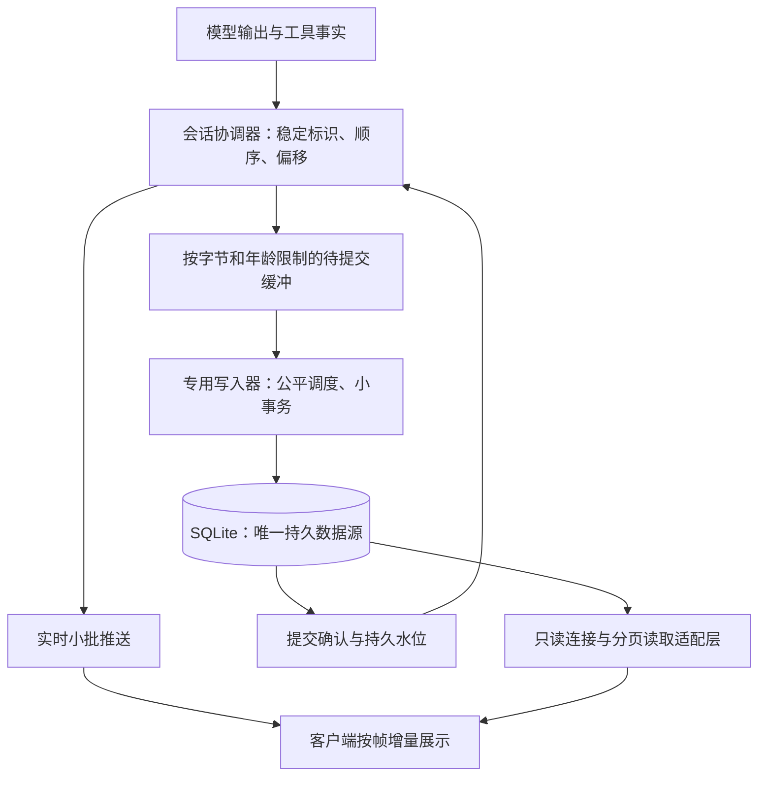

# 精简会话存储与流式传输重构开发计划

状态：待用户 review；仅 M0 废弃表与索引清理在本次实现。M1–M6 为开发计划，尚未实施。
日期：2026-10-26。本文描述目标架构，不把目标参数当作已有性能结果。
英文：[Streaming storage development plan](stream-storage-development.md)。

## 1. 目标与边界

1. 正常生成、长时间思考和大工具输出时，实时显示保持流畅；存储等待不进入渲染或广播锁的临界区。
2. 已确认接收的用户消息、审批/执行关键状态和已确认完成的运行有持久提交依据。正文持续保存，尽量缩小崩溃时的未提交尾部。
3. 旧会话兼容读取，不扫描、压缩、转换或重写历史正文；新会话从首次写入就精简。
4. 新格式的结束路径不生成整轮快照、不拼接整轮正文、不集中删除原始事件，不因存储整理卡顿。
5. 消息、工具详情、重连与恢复共享一份持久正文；不增加 SQLite 之外的持久日志和后续导入链。

此处的“压缩”指数据库事件整理，不改变模型上下文 checkpoint/摘要的产品功能。历史检索、分叉、重置、附件和 provider 必需字段必须继续可用。

正常实时显示先于持久提交，因此 Agent/系统突然崩溃仍可能丢失尚未提交的正文尾部。不能同时承诺任意磁盘故障下实时输出永不等待、内存有界且零丢失。存储严重落后时应暂停生成或报错，界面仍须响应。

## 2. 当前证据与需要改变的路径

| 当前路径 | 问题 | 目标职责 |
|---|---|---|
| `agent/src/rpc/broadcaster/mod.rs`、`journal_writer.rs` | 广播持锁时入队，队列满或持久边界可能阻塞；事务批量仍保留逐 token 行 | 轻量顺序分配；实时投递与写入分别调度 |
| `agent/src/rpc/broadcaster/projection.rs` | 拼接并序列化增长中的文本，长块产生重复工作 | 按块、文本段维护增量状态 |
| `agent/src/session/database/mod.rs` | 单个有序连接执行读写，重读/转换可排在写入之前 | 专用 writer 与有界只读连接，转换离开数据库线程 |
| `agent/src/session/{entry_records.rs,sqlite_store,history}` | 正文、事件和展示表示分离，可能重复保存内容 | 一份正文加薄元数据；适配层组装读取结果 |
| `agent/src/session/{journal_compaction.rs,journal_compactor.rs}` | 结束后扫描并构造整轮回放快照 | 新格式无压缩调用；旧格式只保留必要读取兼容 |
| host、Desktop、mobile、TUI、CLI、channels、remote | 不同客户端依赖事件、工具结果与历史 RPC | 对外行为统一，格式差异由 Agent/共享协议适配 |

本机调查样本：Agent 库约 96.8 MiB，其中原始事件及索引约 85.2 MiB；181,480 条思考碎片的事件 JSON 约 38.7 MiB，实际思考文本约 1.68 MiB。样本仅说明开销来源，不是新格式的性能或节省比例验收结果。不得将历史副本压缩实验的 83% 直接作为新格式承诺。

## 3. 架构与不可破坏的约束

- 同一会话由一个协调器分配操作顺序。队列交接转移不可变新增数据的所有权；无持锁磁盘等待、同步跨线程等待或无界入队。
- 实时与持久路径使用相同的内容标识及顺序，不能独立生成两份可分歧的消息状态。
- 正文段创建后不可变；新内容追加新段。不对增长中的完整消息反复 `UPDATE` 或序列化。
- 单次写入、读取、恢复页和客户端增量处理都有字节预算。大工具输出跨多个批次落库。
- 已提交水位、正文段和对应语义状态在同一事务推进。提交失败不前移水位。
- 结束仅封闭内容块和写终态。正文保持分段，无结束后重打包。
- 衍生展示状态只保存必要顺序/关联，不复制正文；重建不得堵塞正在写入的连接。

## 4. 数据模型与读写契约

以下是逻辑对象，不是冻结 DDL；M1 交付键、索引、事务与 RPC 的确切定义。

| 对象 | 持久内容 | 边界 |
|---|---|---|
| 会话与运行 | 格式版本、来源、次序、状态、计费、持久水位 | 新会话固定格式；内部关联优先短整型键 |
| 消息与内容块 | 稳定 ID、作者/种类、顺序、完整/部分状态 | 内容块支持回复、思考、工具参数/结果及结构化扩展 |
| 正文段 | 内容块关联、UTF-8 字节偏移、正文 | 追加、不可变、有限大小；不重复会话/运行的完整 JSON 信封 |
| 工具执行 | 调用 ID、参数/结果内容引用、执行事实 | shell 输出一份；退出码等独立于输出正文 |
| 审批 | 最终决定、原因、风险、授权、错误与关联 | 正式版不保留概率分布、输入审计详情等诊断载荷 |
| 变更元数据 | 本批语义变化、内容范围、顺序、提交位置 | 小型元数据，不再存放正文副本或逐 token 包装 |

必须保留 provider 协议需要的思考签名、opaque 内容、工具错误标志、多模态附件与未知扩展；不能把未在界面显示的字段一律归为调试数据。M1 给出逐字段保留矩阵。

工具参数生成期间可为不完整 JSON，以文本段保存；完成时校验并标记完成，不为持久化再复制一份参数对象。shell 的模型摘要与展示文本从规范数据生成；无法无损生成的历史表示仍由旧读取器负责，不能猜测改写。

建议的存储接口包含 `append_segments`、`commit_semantic_boundary`、`read_content_range`、`read_changes`、`read_history_page`。每批带稳定身份和预期偏移；重复批次幂等，重叠冲突明确失败。仅校验本批及相关尾部，不重新计算整轮正文哈希。

## 5. 流畅度、持久化与背压

| 项目 | 起始设计值/要求 | 验证方式 |
|---|---|---|
| 实时推送/渲染 | 约一帧的小批；内容完整、不按 token 驱动全文更新 | Desktop/mobile/TUI 长文本剖析 |
| 持久提交调度 | 20–50 ms 起始调优范围，按最老未提交数据计算期限 | 同时记录队列年龄、事务与 sync 耗时 |
| 批次大小 | 几十 KiB 的正文上限，M1 冻结具体值 | 大输出、多会话公平性 |
| 内存限制 | 同时有每会话、全局字节预算及积压年龄阈值 | 慢盘/写锁/磁盘满故障注入 |
| 关键状态 | 用户接收确认、执行必要边界、终态确认等待提交 | 在确认前后杀进程 |

周期不是最大丢失窗口承诺。保留 SQLite WAL 与 FULL 同步提交，不用降低 durability 掩盖耗时。写入器跨会话合批/公平调度，同一会话的正文与终态保持因果顺序，优先级不能让终态越过未保存正文。

背压高水位时暂停生产端读取/下一步生成，低水位后恢复；若 provider 不支持安全暂停，则使用协议允许的中断并明确标记不完整。任何情况下不能无限缓存、丢弃待保存正文或虚报完成。渲染和用户取消操作保持可用。预留控制命令容量，取消不应被正文积压饿死。

只读连接限制数量、事务寿命和每页字节。SQL 外的 JSON/展示转换不占 writer；WAL checkpoint 使用可让步预算，避免前台提交触发长期维护。checkpoint 与保留策略需测量 WAL 峰值及长读者影响，不承诺磁盘占用硬上限。

## 6. 崩溃一致性与重连

维护 `produced_cursor` 与 `durable_cursor`；客户端恢复另带数据库身份/恢复代次、运行 epoch、内容块 ID 和字节偏移。两个水位是内部协议状态，正常情况下不增加界面噪声。

| 崩溃边界 | 必须满足的结果 |
|---|---|
| 用户输入提交前 | 不确认已接收；客户端可用请求 ID 幂等重试 |
| 正文已推送但未提交 | 允许丢失该尾部；恢复显示已提交前缀并标记中断 |
| 正文已提交但确认丢失 | 不重复写入；从持久水位重读 |
| 执行意图提交后、外部操作/结果不确定 | 保留未知结果，不自动重做；外部副作用无法靠本地事务实现通用 exactly-once |
| 工具结果已提交、终态未提交 | 结果可读取，运行仍为未完成/中断 |
| 终态已提交但客户端未收到 | 重连读取相同终态，不重新生成或重复执行 |

同进程断网重连可补内存尾部；Agent 重启/epoch 变化以数据库为准，客户端替换未确认尾部，不能把客户端缓存当作权威工具执行事实写回。

重连使用“截至某水位的分页状态 + 之后的变化”。订阅注册与读取边界要原子捕获或有明确去重协议；正文段可在客户端请求偏移处分片，不能因为一段覆盖多个实时碎片而重复追加。禁止靠旧事件必须连续的假设偷偷跳号。恢复只读取所需页/活动运行元数据，不重放整轮 token 流。

## 7. 兼容、上下文与发布

- Agent schema、会话格式和 RPC 能力分别版本化；旧会话与新会话双读，写入按会话格式唯一选择。
- 现有旧会话继续旧格式追加；不做会话内混合格式。旧读取保留现有原始事件和快照支持。
- 升级不扫描历史正文，不补扫压缩，不重建旧正文；只新增必要结构/元数据，沿用数据库身份、恢复代次、准入与经校验备份契约。
- 旧格式完成事件不再新排压缩任务；兼容读取保留，不把历史快照误判为可删缓存。
- 历史分页、工具详情、全文检索、fork、reset、export、删除/墓碑/outbox、协同备份恢复、任务与通道逐项接入。模型上下文使用规范正文，不能重用仅展示摘要。
- fork 用有界的引用/映射事务建立独立视图；共享不可变正文的归属、删除与引用计数需在 M1 证明。reset/context checkpoint 修改关联与范围，不因该功能引入整轮正文复制或丢失可检索原文。
- RPC 的能力协商必须覆盖 Desktop、mobile、TUI、CLI、channels 与 remote 适配。旧客户端遇到不支持格式明确报错，不能返回空历史或双写降级。
- 发布开关只决定是否允许创建新格式会话。写入过新格式后，回滚开关仍保留新读取器；不能回退到不认识新 schema 的二进制。恢复旧版本只能走明确的备份恢复流程。
- 独立进程 Agent 与 Desktop 内嵌 Agent 都需要测量；后者共享进程资源，单纯“另起线程”不足以证明不卡 UI。

## 8. 开发阶段与依赖

| 阶段 | 交付内容/主要位置 | 退出条件 |
|---|---|---|
| M0：废弃结构清理（本次） | host schema、contract 4、工作区删除路径、删除失效引用缓存模块；app-settings 版本；文档 | 新库不创建；旧库事务退役；失败回滚可重试；保留 live/legacy 历史 |
| M1：契约与基准 | Agent/session、rpc、共享投影；确切 DDL/索引/状态机/能力协商/保留矩阵；合成基准与时延分段 | 本计划 review 后提交可审查的协议契约；冻结崩溃边界、预算和基准环境 |
| M2：规范内容存储 | Agent 新表、分段追加、幂等、双读适配、writer/read 连接、备份删除归属 | SQLite 故障与部分块恢复通过；新格式仍不默认启用 |
| M3：实时与提交解耦 | 协调器、轻量 live 流、专用 writer、两水位、背压/取消、有限增量投影 | 慢盘不阻塞 UI；积压有界；确认语义与持久数据一致 |
| M4：所有消费者 | RPC/remote/shared projection、host、Desktop/mobile/TUI/CLI/channels；历史/工具/上下文/fork/reset | 重连、恢复、身份隔离和跨端输出一致；不生成持久正文副本 |
| M5：正式版精简与切换 | 诊断开关、审批字段精简、新会话默认、停用结束整理；保留兼容 reader | 正式版无逐 token 存储、无压缩调用；末尾工作量与总轮次长度解耦 |
| M6：验收与发布 | Linux/macOS/Windows CI、内嵌/独立 Agent、Desktop/mobile 真机、性能报告与运维文档 | 性能和故障矩阵达标后启用；所有数据边界问题关闭 |

M2 与 M3 的接口由 M1 冻结，M4 完成前不得默认启用新格式。阶段可以独立提交，但最终目标不以仅替换压缩器或仅改批次参数结项。

## 9. 验收与证据

全部使用合成数据或专门授权的测试副本，不将个人对话纳入自动化。单元/集成测试由 PR CI 运行；本地执行受影响模块静态检查与明确的性能/故障验收，不运行单元测试。

| 场景 | 核查内容 |
|---|---|
| 高速思考、1/10 MiB 正文、大工具输出 | 数据库/WAL/写入字节、行数、CPU、峰值内存、尾段成本；长度增长不引入全文重算 |
| 1/4/16 个活跃会话与历史分页并发 | 公平性、取消响应、writer 排队、读事务寿命 |
| 弱网、客户端落后、订阅/提交竞态 | 无重复/缺段；偏移、epoch、恢复代次和分页覆盖正确 |
| 各事务/确认前后 kill、系统退出、磁盘满、写锁与 writer panic | 已提交前缀与确认承诺一致；部分块可见；不重复外部副作用 |
| 新旧布局、已有快照、迁移失败和重复启动 | 旧正文/附件不变、无后台压缩、无启动全文扫描 |
| fork/reset/context checkpoint/导出/删除/备份恢复 | 内容与引用归属完整，检索与模型上下文不丢原文 |

性能初始门槛（M1 固定设备与 workload 后确认）：

- 正常盘下提交积压 p99 目标不超过 100 ms，同时报告最大值；这不是崩溃丢失硬上限。
- Desktop 主线程增量更新 p95 目标在一帧 16.7 ms 内，mobile 目标 33 ms 内；记录长任务、输入/滚动延迟与后半程退化。
- 正常首段显示 p95 相比基准不回退超过 10%；单独报告存储确认耗时，禁止以隐藏显示等待换取该指标。
- 运行结束不允许全轮扫描/正文序列化/批量删除；固定尾部负载下，1 MiB 与 10 MiB 运行的结束工作量应近似不变。
- 新格式与旧格式运行同一合成负载，同时记录运行中峰值及结束体积。主要收益必须来自不写冗余数据，不以 VACUUM、后处理或削减有效正文获得。
- 队列字节、最老未提交年龄、事务大小/时延、WAL、客户端帧耗时均有低开销观测；正式版不记录每 token 的诊断历史。

## 10. M0 删除清单与 review 重点

| 删除对象 | 依据 | 保留能力 |
|---|---|---|
| `workspace_files` 及其主键索引 | 生产文件搜索直接遍历磁盘，表无读写用途 | 工作区文件搜索与路径链接 |
| `reference_targets`、`object_references` 及所属索引 | 同步代码只在测试中编译，生产解析读取实际对象 | 作用域隔离的对象链接解析 |
| `idx_review_snapshots_run` | 与 `UNIQUE(run_id, phase)` 自动索引重复 | review 按 run/phase 查询与唯一约束 |

通过新增 Desktop contract 4 按外键顺序删除，保留旧迁移 SQL 校验和和历史夹具；失败回滚，不关闭外键强删，不对用户库执行 VACUUM。本次交付代码不会直接修改调查用个人数据库；应用升级时沿现有快照与迁移契约执行。

review 重点：是否接受实时显示领先于持久水位的有限尾部风险；旧会话继续旧写入的边界；正文单份保存和 fork/reset 的引用模型；M1 冻结预算/协议后才启用新格式。三项目标与“不做历史整理”是硬约束，具体提交频率以实测决定。
