# Choice cards in a reply

> Status: design settled (v3). **§11 steps 1–8 are implemented**: parsing of `futureos-choice`, the desktop card, the answer pill inside the editor, the draft carrying it, remote desktop, the phone, the pick inside the queue, and the system prompt. Step 9 — the visual regression that swaps the injected prototypes for the real components — is not done, so apart from the three "real component" scenario captures, every screenshot below is a DOM prototype injected into the **real interface** (no product code) to fix the styling and geometry; implementation is §11.
> Scope: desktop, mobile, remote desktop. TUI / CLI are out of scope for this pass (§10 says how they degrade).
>
> **v2 fixes three real defects** reported by the reader, each located in the code before changing anything:
> 1. Send stayed disabled after picking, so "pick and send" did not work — v1 put the answer in the attachments row while the send test only reads the editor (§5.2.1, measured);
> 2. the phone's chosen row marked selection three times over (fill + border + white check) and read as "done" rather than "selected" (§5.7.1);
> 3. once the answer joined the send queue it was flattened to plain text and the choice could no longer be changed (§5.8).
>
> **v3 adds what the queue looks like on all three surfaces**, and fixes one ambiguity v2 introduced: v2 gave the queue row's chip a pencil, while that row already carries a pencil meaning "edit the words" — two pencils a few pixels apart meaning different things. v3 makes **the chip itself the button** (with a chevron) and leaves the row's own pencil and bin untouched (§5.8.2). It also states the three panels' relationship: remote reuses the desktop `SendQueuePanel`, the phone is a second implementation (§5.8.1).

## 1. What this solves

A reply can only be read today; to pick a next step, the user has to type a paragraph. That wastes two things:

- The model lists three next steps in prose, the user answers "the second one", and the model has to guess which one that was;
- The user only wanted to pick one, and typed twenty characters restating what the model just said.

A choice card turns that into one click: the model appends a card to its reply listing the moves it **can actually do next**; the reader clicks one, the answer lands in the input, and they send as usual — adding a note if they want, or not.

The real design problem on that path is **where the answer goes**, not what the card looks like. The card only displays the question; the answer has to be part of the draft in the input, or "pick and send" (requirement d) cannot work at all.

## 2. State model: the answer lives in the draft

In one line: **the card is a view of the question; the answer belongs to the draft.** The same answer shows up in three places — the highlighted row in the card, the pill/chip in the composer, the user message after sending — and all three derive from one value. There is no second source of truth.

> v1 said "the answer belongs to the draft" but drew the chip in the attachments row, which is neither editor content nor the `attachments` array, so neither existing test recognised it. v2 turns the principle into a concrete slot: on desktop the answer is an **atomic pill inside the editor** (§5.2.1); on phone and remote it is **a draft item the composer counts**.

```
model output fence ──parse──> card (last block of the last reply)
                                 │ click a row
                                 ▼
                          answer in the draft ──send──> user message (text with the answer)
                                 │
                                 ├─> composer pill/chip (visible, changeable, removable)
                                 └─> highlighted row in the card (echo)
```

Three hard rules follow:

| Rule | Why |
|---|---|
| Only the **last card in the thread** is interactive; earlier cards are read-only (the chosen row stays highlighted, the rest dim) | An old card answers a question that is over; letting it change makes "which pick did I just change" unanswerable |
| The card never stores "chosen" itself | It derives from the draft. After sending, the draft empties and the card stays highlighted because the answer is now in the user message right below it |
| Changing the answer means changing the draft | Clicking a row, the pill/chip's pencil, the phone's bottom sheet, and the choice chip on a queue row all write the same value |

**Several threads / several questions** cannot interfere: the draft is per conversation, and both the card and the chip read that conversation's draft.

## 3. The key: a `futureos-choice` fence

What the model emits is a code fence — the "key" in the request:

````markdown
```futureos-choice
title: 接下来做哪一件？
mode: single
option: forest | 重画森林图 | 按 Dreher 2025 的样本量重算两篇的置信区间
option: flow | 补一张实验流程图 | 把两篇的被试流程画成一张对照图
option: table | 表里加一列样本量 | Frank 42 / Dreher 186，标出测量手段
```
````

Fields:

| Field | Required | Meaning |
|---|---|---|
| `title` | yes | The question itself, one line, ≤ 60 chars. It is the card's heading |
| `mode` | no | `single` (default) / `multi` |
| `option` | yes (2–4) | One per line: `id \| label \| one-line note`; the note may be omitted |
| `id` | — | Stable identifier to send back: ASCII, `[a-z0-9-]`, ≤ 24 chars, unique within the card |
| `hint` | no | Overrides the default subtitle ("pick one and it lands in the input…") |

**Why a fence rather than an inline link or JSON:**

1. **It degrades by itself.** A fence means "code block". Any client that does not know this card — TUI, an older desktop build, an IM bot, a copy-paste elsewhere — draws it as a code block, and the reader sees the option list; nothing is lost. An inline link or raw JSON degrades into noise.
2. **Cheapest to parse.** The repository already has `parseDirectiveFields` (`packages/markdown/src/parseFutureMarkdown.ts`) reading `key: value` lines, which is how `futureos-file` fences are parsed. Here it only needs repeated keys to become an array.
3. **One implementation, three surfaces.** Parsing lives in `packages/markdown`; desktop, mobile and remote consume the same AST, so "desktop understands it, the phone doesn't" cannot happen.

In the AST the card is its own node type (not a `futureEmbed` reference), because its payload is a list of options rather than one object id.

**Parse tolerance** (draw no card rather than eat the reply):

| Case | Handling |
|---|---|
| Fewer than 2 or more than 4 options | The whole block degrades to a code block |
| Duplicate, malformed or over-long `id` | Drop that line; if fewer than 2 remain, degrade the block |
| Missing `title` | Fall back to the first option's label; still empty ⇒ degrade |
| Fence mid-reply (not the last block) | Renders normally but read-only (the "last card" rule in §2) |
| Unknown field | Ignored |

## 4. What goes into the system prompt

A new `agent/src/prompt/choice.md`, pushed in via `include_str!` next to `communication.md` in `agent/src/prompt/mod.rs` (end of `parts`), so "how to ask the user" sits next to "how to talk to the user".

What it must say is **when the card is warranted**, not format details — the syntax already constrains those:

```markdown
# Offering Choices

When your reply ends by asking the user what to do next, offer the options as a
`futureos-choice` block instead of a prose list. The reader then answers with one
click instead of restating your own wording.

Use it only when all of these hold:
- The reply genuinely ends with a question about the next step, and you can carry
  out every option yourself right after they pick.
- There are 2–4 real alternatives. One option, or five, is a paragraph — not a card.
- The options are mutual alternatives — you would do one of them next.

Do not use it for: confirming a risky action (the approval card already owns that),
restating what you just did, "let me know if you need anything", or a question whose
answer needs a sentence rather than a pick.

`mode:` — omit it for one pick (`single` is the default). Write `mode: multi` when the
rows are parts of one job rather than alternatives, and you would do two or more of them
together. The reader then ticks several and the answer joins their labels with 、.

Write each option as the instruction you would follow if chosen — the user's words,
not a menu label ("重画森林图", not "选项 A"). The third field says what changes or
what it costs, one line, no marketing.

The block goes last, alone. Never two cards in one reply, never one mid-reply.
```

The point: **an option's label must be the sentence the user would say**, because on send it becomes part of the message. Not "option A/B/C".

**Why §4 was revised on 2026-11-15.** The first wording described `multi` as a
last resort ("omit `mode: multi` unless several can be done in one go") and put it in
a list of conditions for using the card at all. Every card the model then wrote came
out single, including a row of tasks where picking two was obviously one job — the
answer had to be typed by hand, which is the waste the card exists to remove. The
rule now says when to write `mode: multi` on its own terms, next to the other
per-field lines, instead of as a caveat on the default.

## 5. The interface

### 5.1 Desktop · nothing chosen

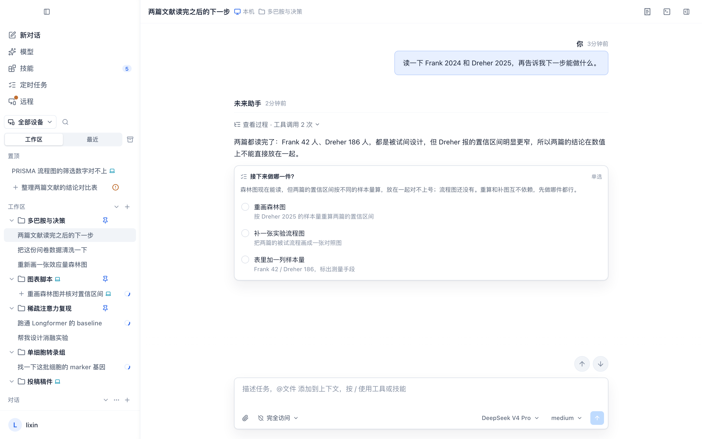

- 768px wide, the same as the text column (`max-w-3xl`), left-aligned, 4px below the last block;
- Header: 12px semibold title plus an 11px mode label on the right (`单选` / `多选`);
- Subtitle at 11px says "pick one and it lands in the input; you can type something else instead" — this line replaces the in-card "write your own" row (§5.6 says why);
- Each option is a row: a 16px radio, a 13px label, a 12px one-line note (`ink-muted`); unselected rows have no border and no fill and are separated by spacing alone;
- Card shell: `1px line` / `radius 10px` / `surface` / a very light shadow — the approval card's material, but a **different position**: the approval card floats above the composer, a choice card grows inside the reply.

### 5.2 Desktop · one chosen

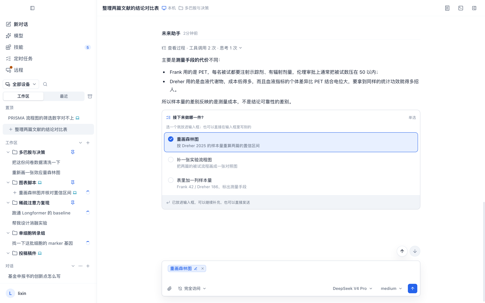

- Chosen row: `accent-soft` fill and label at weight 500 (no border on top of the fill — two cues for one state was v1's mistake, and §5.7.1 has the same fix);
- The card gains an 8px footer (`line-soft` top border, `surface-subtle` fill). **v2 shortened this sentence**: v1 said "in the input" next to a chip that sat outside the field, so it was patching the layout with words. Now the answer really is in the editor and the sentence no longer has to lie;
- The answer appears as a **pill inside the editor**: an atomic element (`data-mention="choice"`, `contenteditable=false`) of the same kind as a file, skill or session reference:

```
┌ 重画森林图  ✎ ✕ ┐        ← inside the contenteditable
```

### 5.2.1 Why it has to be a pill in the editor (v1's hard error)

v1 put the chip in the attachments row (inside `form`, above the field). It looked right and satisfied neither existing test:

| Test | Where | v1's chip in the attachments row | With a pill in the editor |
|---|---|---|---|
| `inputEmpty` | `disabled={(inputEmpty && attachmentCount === 0) …}` at `ComposerControls.tsx:426` | the chip is neither in `attachments` nor in the contenteditable ⇒ **still true** | a pill makes `isEditorEmpty` false (`mentionDom.ts:6-12`: any `[data-mention]` counts) |
| `attachmentCount` | same expression, from real `attachments` state | 0 | not needed |

The consequence: in the v1 mockups "choose and send without typing" (requirement d) **could not work at all** — the send button stayed grey. That is not a taste problem; the design put the answer in the wrong slot.

Moved into the editor, all four requirements follow from machinery that already exists, with no change to any send test:

- (a) nothing chosen ⇒ editor empty ⇒ button grey;
- (c) words and pill flow together, and `serialize()` (`mentionDom.ts:113-165`) emits the pill's text then the words in document order;
- (d) only a pill ⇒ `isEditorEmpty` false ⇒ button live;
- (b) the pencil and × ride on the pill itself and write the same value.

**Measured** (1440×900, pill injected into the real contenteditable and the DOM read back; no product code changed):

| State | `disabled` |
|---|---|
| empty editor | `true` |
| only a pill | **`false`** |
| pill removed | `true` |

The pill measured `bg rgb(232,240,255)` (`accent-soft`), `color rgb(37,99,235)` (`accent`), `12.88px` (`0.92em`), 114×21; the send button `bg rgb(37,99,235)` (`accent-fill`), 28×28, at `x 1211`.

### 5.2.2 One chosen, plus a sentence

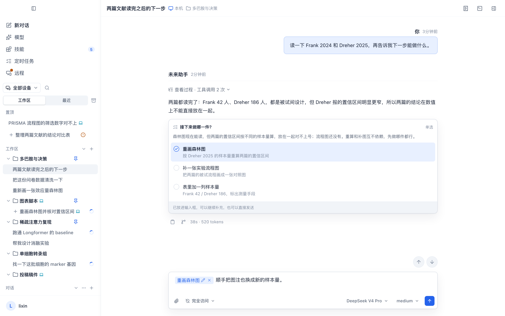

Requirement (c) on screen. The pill and the words share one editor flow, so the order on screen is the order that ships: `serialize()` writes the pill's `[question → answer]` first, then the text. What the user's bubble shows is what was actually sent — no second rendering that could drift. After sending, that sentence is drawn in the bubble as a tag rather than as brackets (§5.2.3): the same sentence, no longer mixed into the words the reader typed themselves.

### 5.2.3 The user's bubble after sending

One treatment on all three clients: the run of `[question → answer]` at the **head** of a prompt is drawn as a tag — a `ListChecks` glyph, the question in a lighter ink, `→`, the answer in a heavier one — and the text after it goes through markdown as before. Picked a row and typed nothing else, and the bubble is just the tag.

- **The text is unchanged.** The tag is a *drawing* of the sentence `choiceAnswerText` writes, not a second copy of it: the copy button, the agent and a paste elsewhere all still see `[question → answer]`. That is exactly why §7 sends plain text — how the display layer draws it cannot change how readable the sentence is;
- **The test is conservative** (`packages/markdown/src/choiceAnswerEcho.ts`): only the head of the message, only with an `→`, never when the closing bracket is followed by `(` or `[` (that is a link, or another bracket run), at most four answers (a card's own bound). A false negative costs the styling, never a character;
- **The material follows the bubble.** The desktop bubble is `accent-soft`, so the tag is `accent/10` on `accent/25`; the phone's bubble is solid `accent`, so the tag mixes the bubble's own ink at 12% with a 20% border — the same colours `MarkdownText`'s `onAccent` tone uses, readable in both appearances.

### 5.3 Desktop · changing it

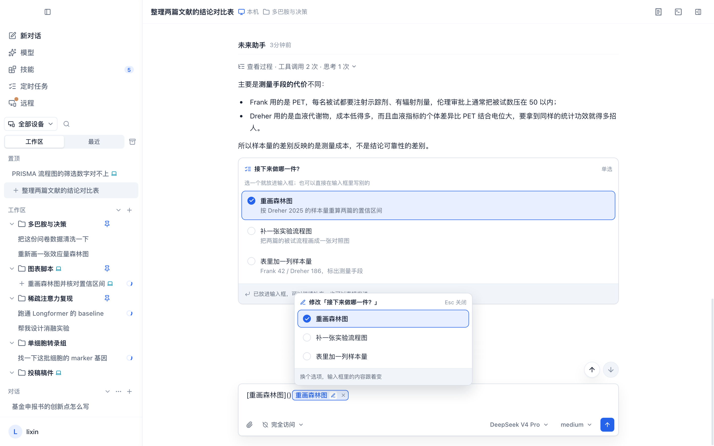

- The pill's pencil re-opens the question **in place** (a 360px popover 10px above the pill) — no scrolling back, no jumping to the reply;
- The popover holds the same options (compact rows, notes dropped), still with the chosen one marked;
- Picking another ⌁ the pill's text follows and the draft's old answer is replaced; `Esc` or an outside click closes it unchanged;
- The pill's ✕ revokes the choice: the pill disappears and the send button **goes grey again** — the same `isEditorEmpty`, no extra wiring.

### 5.4 Remote desktop

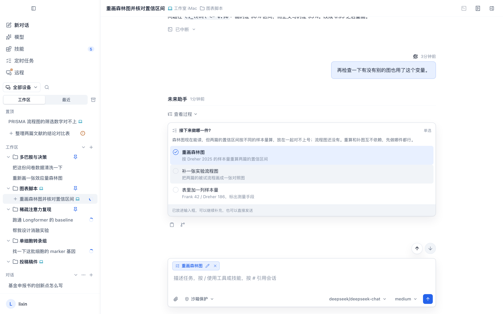

A remote conversation's transcript is markdown from the host, rendered **locally**, so the card is automatically the same component with the same tokens — remote needs no separate implementation. Measured: the card is 768 wide, matching the remote composer.

The one difference is the field: `RemoteComposer` is a plain `textarea` (no `contenteditable`, no pill machinery), so a chosen answer goes in the **chip row above the field** — the attachments' slot.

Remote's send test measures as `disabled={(!text.trim() && uploads.length === 0) || busy || …}` (`RemoteComposer.tsx:1525`; `send()` at `:865` is the same expression), so remote has to count the answer on the `uploads`/draft side — **a chip drawn without being counted will leave the button disabled**. That is the one thing remote must change in implementation.

### 5.5 Dark

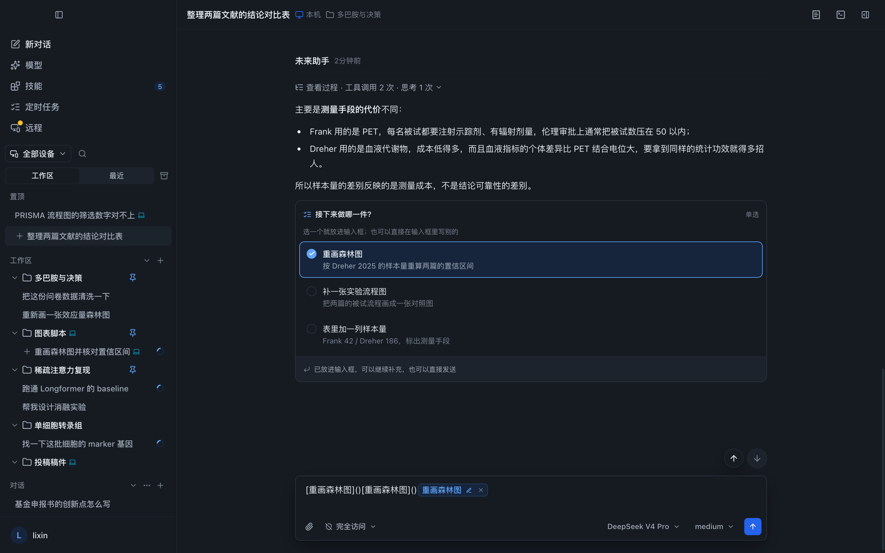

Everything is a semantic token (`surface` / `line` / `line-soft` / `surface-subtle` / `accent` / `accent-soft` / `ink*`), no literal colours. Measured dark card background `rgb(22,27,34)` (`--color-surface` in dark), chosen row `accent-soft` dark value `#16243c`.

### 5.6 Three card styles

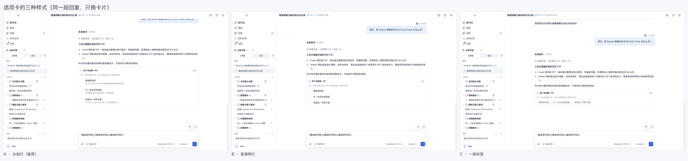

| | Height | Fits | Verdict |
|---|---|---|---|
| **A · grouped rows** (with a note line) | 255px | Options need to say what picking them does | **Chosen.** The note line is exactly what "I'm not sure which" needs |
| B · compact two-line | 186px | Options are self-explanatory and cards are frequent | The fallback for a card eating half the screen |
| C · a row of pills | 110px | Very short options, narrow widths | Rejected: long labels wrap inside a pill and the notes are lost |

Two explored and **rejected** approaches, recorded so they are not redone:

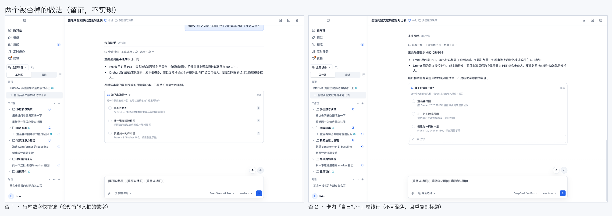

- **Row numbers 1/2/3** (type a digit to choose). It looks like a keyboard accelerator and in fact collides with free text in the composer: when the user types "2 篇论文", is that `2` a choice? Choosing must be a click (or a keyboard action on the chip), never a hijack of the field's digits.
- **An in-card "write your own…" row.** It says what the subtitle already says, and a dashed box that looks like an input but does not accept focus is worse than nothing. The free-form entry point is the composer; pointing at it is enough.

### 5.7 Mobile

390×844, three frames: nothing chosen, one chosen, changing it.

| Nothing chosen | One chosen | Changing it |
|---|---|---|
| 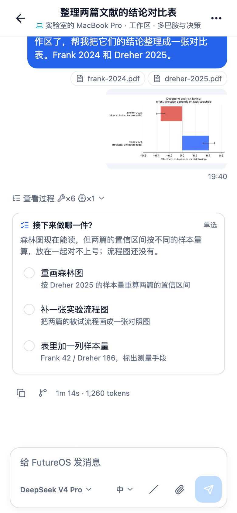 | 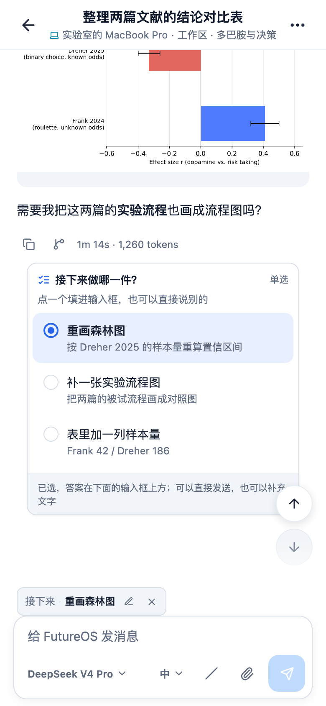 | 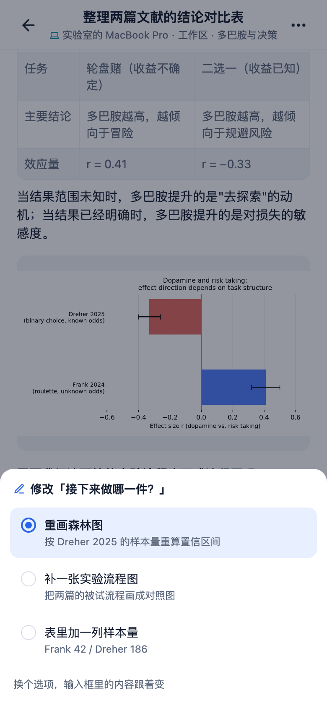 |

- The card is full width (358pt, 16pt margins), `radius 12px`, rows **≥ 44pt** (measured: 60pt each), notes wrap rather than truncate;
- The chosen chip sits inside the dock above the textarea (measured: chip `y 702..736`, field `y 737..783`);
- **Changing it uses a bottom sheet**: at 390pt there is no room for an in-place popover. The sheet's top lands at 559pt, rows stay 44pt, a pick writes straight back to the chip and the draft is untouched.

### 5.7.1 Why v1's chosen state looked wrong, and what v2 changes

v1's chosen row announced itself in three places at once: `accent-soft` fill, `accent` border and a white check on a solid blue disc. On a 390pt card that does not read as decided, it reads as shouty — and the blue disc with a white tick reads as a *completed task* badge rather than a *single-select*. v2 fixes it point by point:

| v1 | v2 | Why |
|---|---|---|
| fill + border + white check | `accent-soft` fill only, plus **a ring with a dot** | The empty ring is always drawn (it thickens and turns accent when chosen), so the row does not jump; a ring-and-dot is the universal single-select shape and cannot be mistaken for "done" |
| the chip used a `focus`-blue border while the card used `accent` | the chip uses a `line` border and `surface-subtle` fill | One state should not wear two blues. The chip is a decided thing, and it should look like the attachments beside it |
| pencil accent, × grey (two inks for two equal actions) | both `ink-soft` | The two actions are interchangeable; the ink should not rank them. Measured: both `rgb(93,104,122)` |
| footer said "in the input" while the chip sat outside it | says "the answer is above the field below" | A sentence must not patch a layout. A phone field really is a textarea and cannot hold a pill, so say where it is |
| 18pt touch targets | 24pt (transparent hit area around it) | 24pt is enough without inflating the chip; the desktop pill keeps 16pt inside it (mouse precision differs) |

**Why the phone does not copy desktop's in-field pill:** RN's field is a `TextInput` (a native textarea) with no atomic contenteditable element and no `isEditorEmpty` equivalent. The phone's honest equivalent is to make the answer count as one of the draft items `canSend`/`hasDraft` already read — `ComposerDock.tsx:180-181` and `:233` are both `!!message.trim() || attachments.length > 0` — so the answer must be counted like an attachment, not drawn as a chip that takes no part in the decision.

### 5.8 A chosen answer in the send queue

Three captures, because the queue panel is **not one component**:

| Desktop (local session) | Remote desktop | Phone |
|---|---|---|
| 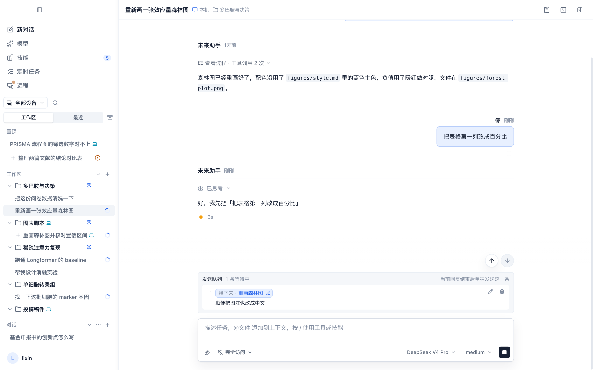 | 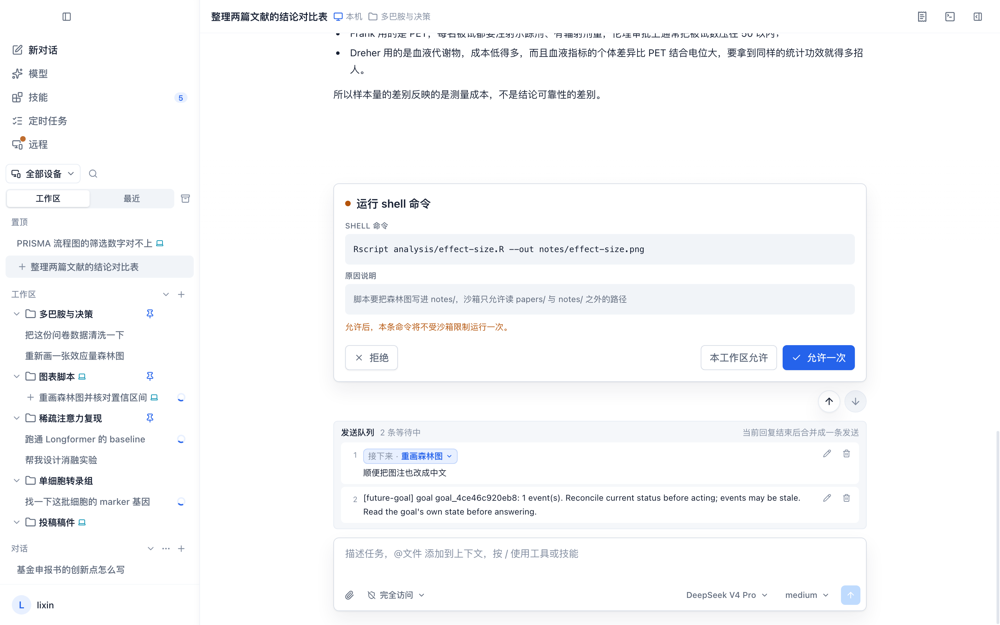 | 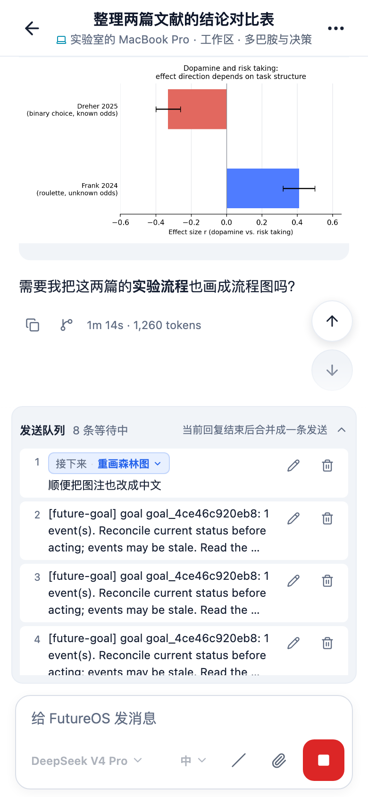 |

First, what **happens today** (read from the code, not guessed):

- `Composer.tsx:581-600 queueDraft()` hands `editor.getContent()` — already-serialized text — to `onEnqueue`, so the answer is flattened into the string `[接下来做哪一件？ → 重画森林图]`;
- `AgentQueueRow.text` and `SendQueuePanelItem.content` are both `string`, and the panel's inline editor only edits that text (`SendQueuePanel.tsx:99-116`: `editingText` → `onUpdate(id, content)`);
- Deleting and editing text **already work** on all three surfaces: every row has its own bin and an inline editor.

So the gap is not "can it be deleted" but "can the *choice* be changed": today the reader has to hand-edit the serialized form, which means knowing the `[question → answer]` format.

#### 5.8.1 The three panels: remote draws nothing new, the phone is a second implementation

This decides the size of the work, so it goes first:

- **Remote desktop reuses the desktop `SendQueuePanel`**: `RemoteComposer.tsx:23` imports `{ SendQueuePanel } from "../agent/SendQueuePanel"` and renders it at `:1244`. Remote has its own *composer* (a plain textarea, no pills), but the queue *panel* is the same component. So remote queue styling **is** desktop queue styling — nothing needs designing twice, only confirming the remote stylesheet does not drag it out of shape. Measured on both: chip `136×22`, pencil at `x=1181`, row width `746`.
- **The phone has its own** `mobile/src/features/chat/components/SendQueuePanel.tsx`: a one-line `Pressable` header (`accessibilityState.expanded`, copy `展开队列中的消息` / `收起队列中的消息`) that always starts collapsed — the header already carries the count, the hint and a parked row's warning, and every row it would draw is a row of the conversation it is covering. When open the list is bounded by `sendQueueListHeight(vh, kb) = max(96, min(240, round((vh-kb)*0.3)))` and scrolls inside that. So the phone needs its own pass on chip size and placement.

#### 5.8.2 The row draws a chip that **is itself the button**

v2 gave the chip a pencil. That was wrong and v3 removes it:

**The row already has a pencil**, and its meaning is "edit this message's words" (`composer.queue.edit` = `修改队列中的消息`). A second pencil a few pixels away meaning something else is exactly the ambiguity this design exists to remove (the same judgement as §5.7.1).

The corrected rule, identical on all three surfaces:

| The reader wants to | Where they go |
|---|---|
| change the option | **press the chip itself** (`role=button`, one chevron, aria-label `更换这条消息里的选择：<title> · <option>`), which opens the desktop popover / the phone sheet |
| edit this message's words | the row's own pencil (there is exactly one) |
| delete the whole message | the row's own bin |
| drop just the choice, keep the words | the "no choice" entry in the option list — the same entry the card itself offers, not a new button on the chip |

A chevron rather than a pencil is deliberate: it says "this opens something" and cannot be read as "edit the words".

#### 5.8.3 Data shape

Give `SendQueuePanelItem` and `AgentQueueRow` an **optional** `choice?: { mode, title, options, selectedIds }` — the card's whole option list, not just the pick, because offering the other options is the point (§5.8.2) and re-parsing the sentence could not recover them. Follows the `attachments?` precedent (`undefined` = this surface's queue does not report the field, so an older Agent is never described as carrying no choice and no empty chip is drawn).

The write path **stays out of the plain-text edit**. On the desktop the queue panel reports *which row* and a portal-positioned list opens (`SelectMenu`, not `ChoicePopover` — that one is positioned inside the editor's wrapper, which a queue row does not have); the dock owns the phone's `ChoiceSheet` for the same reason a `Modal` does not belong inside a list of rows. Changing a pick rewrites the text's bracketed head and leaves whatever the reader typed after it alone.

#### 5.8.4 Measured (real panel, real 加入发送队列 flow — not drawn)

| | Desktop | Remote | Phone |
|---|---|---|---|
| chip | `136×22` | `136×22` | `129×23` |
| chip right edge / pencil left | `659` / `1181` | `659` / `1181` | `180` / `297` |
| row | `746×60` | `746×52` | `348×52` |
| icons on the chip | 1 (chevron) | 1 (chevron) | 1 (chevron) |
| row text | `1 接下来 · 重画森林图 顺便把图注也改成中文` | same | same |

All three rows keep their own pencil and bin: the assertions check that the chip's right edge is left of the pencil's left edge, and that `[data-queue-edit]` / `[data-testid=send-queue-edit]` still exist. The chip is **inserted into** the row, not a replacement for the row's controls.

## 6. Composer behaviour (requirements a–d)

| Requirement | Behaviour | Implementation constraint |
|---|---|---|
| (a) may pick nothing and stay empty | Nothing picked, nothing typed ⇒ send stays disabled (the existing `inputEmpty` logic) | The card's presence does **not** count as draft content. A card appearing must never enable Send |
| (b) a pick can be changed | Five entries: any row in the card, the pill/chip's pencil, the phone's bottom sheet, **the choice chip on a queue row — pressed directly, it is its own button** (§5.8.2), and that queue row's own pencil for the words. They write the same value | Afterwards focus stays in the composer (desktop) / the sheet closes (phone); existing text is never disturbed |
| (c) extra text can be typed and sent | Pill/text coexist; on send the answer comes first | Desktop relies on `isEditorEmpty` accepting a pill (measured); phone/remote must count the answer among the draft items `canSend` already reads |
| (d) send with no text at all | A pill alone ⇒ Send is enabled | Measured `disabled:false` on desktop; phone/remote follow (c) |

After sending: the draft clears, the chip goes, the card stays highlighted (the answer is now in the user message). **Nothing auto-sends** — the requirement is that sending is *possible*, and auto-send would make (c) meaningless.

## 7. What gets sent back to the agent

The answer must be readable by the agent **and** on the degraded paths (TUI, IM bots, pasted elsewhere). So it is plain text, not a custom protocol:

| Case | Message sent |
|---|---|
| Picked, nothing typed | `[接下来做哪一件？ → 重画森林图]` |
| Picked and added a note | `[接下来做哪一件？ → 重画森林图] 顺便把图例挪到右下` |
| Multiple picks | `[这三项都要 → 重画森林图、补一张实验流程图]` |
| Only typed (nothing picked / chip removed) | Just what the user wrote |

`→` is the only fixed token; the question and the label come from the model's own output. The `title` is included so that "重画森林图" has an owner when several cards have appeared in one thread.

**Why not send a `futureos://choice/...` link:** that needs a new reference type, `isFutureReferenceType` widened, and server-side understanding — and the only gain is a chip in the user's bubble. Version one sends text, so the user's bubble shows what actually went out: honest, copyable, readable by any client. The tag in that bubble is display only (§5.2.3): the sentence is not rewritten and no second protocol exists.

## 8. Compatibility and degradation

| Client | Before upgrading | After |
|---|---|---|
| Desktop / mobile / remote | — | The full card |
| TUI | A code block (which reads like a bulleted option list) | Unchanged this pass: still prints the block's content |
| CLI `future run` | Same | Same |
| IM bots (Feishu / DingTalk) | Same | Same (interactive cards are a separate job) |
| Third-party Markdown readers | A code block | A code block |

The fence syntax makes "unknown" mean "renders normally", which is the main reason it was chosen (§3). The parser never throws: any malformed input falls back to a code block.

## 9. Copy / icons / accessibility

Fixed copy (the model neither provides nor should provide it) — keys needed on all three surfaces:

| key | Chinese | English |
|---|---|---|
| `choice.mode.single` | 单选 | Single choice |
| `choice.mode.multi` | 多选 | Multiple choice |
| `choice.hint.single` | 选一个就放进输入框；也可以直接在输入框里写别的 | Pick one and it lands in the input; you can type something else instead |
| `choice.hint.multi` | 可以多选，点几个都行 | Pick as many as apply |
| `choice.foot.queued` | 已放进输入框，可以继续补充，也可以直接发送 | In the input — add a note if you want, or send as is |
| `choice.chip.change` | 修改「{{title}}」的选择 | Change the answer to "{{title}}" |
| `choice.chip.remove` | 移除「{{title}}」的选择 | Remove the answer to "{{title}}" |
| `choice.stale` | 这张卡已经过期 | This card is no longer active |
| `choice.mobile.change` | 修改「{{title}}」 | Change "{{title}}" |
| `choice.queue.change` | 更换这条消息里的选择：{{title}} · {{label}} | Change the choice in this message: {{title}} · {{label}} |

- Icons: `list-checks` in the card header (pick one of several items), the existing `lucide` pencil and ✕ elsewhere, a chevron on the queue chip;
- Semantics: the card is `role="group"` with `aria-labelledby` pointing at its title; option rows are `role="radio"` (single) / `role="checkbox"` (multi) with `aria-checked`; the composer chip is a `role="group"` whose two buttons carry the `aria-label`s above; **the queue chip is the opposite — the whole chip is one `role="button"`** labelled with `choice.queue.change`, because it means one thing only (change the choice) while the row's pencil and bin stand on their own;
- Keyboard: Tab into the card → arrows move between options → Enter/Space picks → focus moves to the composer. `Esc` closes a popover;
- The chosen state never relies on colour alone: filled check + border + fill (still legible in greyscale or with colour-vision deficiency).

## 10. Explicitly out of scope

| Not doing | Why |
|---|---|
| Auto-send | Conflicts with (c); the user may want to look first |
| A free-text field inside the card | The composer is the free-text field (§5.6) |
| Digit shortcuts on rows | They would hijack the composer's digits (§5.6) |
| Nested cards / a card mid-reply | "Which pick did I change" becomes unanswerable |
| Editing historical cards | Same; read-only plus a highlighted chosen row |
| An interactive TUI / IM version | This pass only guarantees readable degradation; the TUI already has its own local choice UI (`SendChoiceSheet`), which is app UI, not transcript content |
| Pill-ifying the answer in the user's bubble | Needs a new reference type plus server understanding, and the gain is purely visual; version two |
| Structured choice records on the model side | Reading the text is enough for v1; add it when something actually needs the counts |

## 11. Implementation breakdown

In dependency order; each step merges on its own:

1. **Syntax and parsing** (`packages/markdown`): a `ChoiceCardNode` type; a branch for the `futureos-choice` fence next to `parseFutureEmbed` in `parseFutureMarkdown.ts`, with `parseDirectiveFields` gathering repeated keys into an array; unit tests for the whole tolerance table in §3.
2. **Desktop rendering**: `desktop/src/features/markdown/renderers/ChoiceCard.tsx` (both read-only and interactive states), wired into the node switch in `MarkdownContent.tsx` (from :119, beside the `futureEmbed` branch); copy keys go into `desktop/src/i18n/locales/{zh,en}/markdown.json` (they belong to the rendering layer, not to the `packages/markdown` types).
3. **Desktop answer pill (the key v2 step)**: a fourth pill kind in `MentionEditor` — `buildChoicePill()` modelled on `buildSessionPill`, with `data-mention="choice"` and `data-choice` — plus a `serialize()` branch emitting `[title → label]`. Once this lands, (a)(c)(d) hold **by themselves**; the `disabled` expression in `ComposerControls` needs no edit (§5.2.1, measured). The change popover is its own `ChoicePopover.tsx`.
4. **Answer state**: an optional `choice` field on the existing per-conversation draft — desktop's `ComposerDraft` (`desktop/src/features/agent/composerDraft.ts`; the shape deliberately allows growth, so an optional field needs no `DRAFT_VERSION` bump) and remote's `RemoteComposerDraft` (`desktop/src/features/remote-peer/remoteComposerDraft.ts`). The card's chosen row and the pill both read it.
5. **Remote**: `RemoteComposer` uses the chip row (a plain textarea cannot hold a pill) **and must count the choice on the `uploads`/draft side**, or `disabled={(!text.trim() && uploads.length === 0) || …}` (`:1525`) still blocks it (§5.4).
6. **Mobile**: `mobile/src/components/MarkdownText.tsx` mounts `ChoiceCard` (redrawn per §5.7.1); `ComposerDock.tsx` gains the chip row plus `ChoiceSheet`; the choice must be counted among the draft items `canSend` (`:180-181`) / `hasDraft` (`:233`) already read, not drawn as a decorative chip.
7. **Choices in the queue**: an optional `choice` on `AgentQueueRow` and `SendQueuePanelItem`, carried through `onEnqueue`; the panel row renders a chip and reports which row it is, leaving the option list to the layer above (keeping structured arguments out of the plain-text edit path). An older Agent that does not report the field degrades to today's text-only row. **The chip is itself the button and gets no pencil of its own** (§5.8.2); the row's existing pencil and bin are untouched.
   - 7a. **Desktop, local session**: insert the chip into `SendQueuePanel.tsx`'s row; pressing it opens the options through `SelectMenu` (`portal` mode) — not `ChoicePopover`, which is positioned inside the editor's wrapper and a queue row has none.
   - 7b. **Remote desktop**: `RemoteComposer.tsx:1244` reuses the same `SendQueuePanel`, so this surface needs **no new code** — only one verification run inside a remote session (the remote stylesheet could drag the row width or type scale out of shape).
   - 7c. **Phone**: `mobile/src/features/chat/components/SendQueuePanel.tsx` is a separate implementation (folding header + `sendQueueListHeight` bound); the chip is 11px type, sits above the row's words, and reports which row to change (`onRequestChoiceChange`) — `ComposerDock` owns the `ChoiceSheet`, because a sheet is a `Modal` and does not belong inside a list of rows.
8. **Prompt**: `agent/src/prompt/choice.md` plus the `include_str!` in `mod.rs`; update the prompt-assembly tests in `agent/src/prompt/mod.rs` that assert section order.
9. **Regression**: `scripts/screenshots/scenarios.d/choice-cards.json` already turns every frame in this document into a re-runnable scenario (ten on desktop, four on the phone, including `chosen-text`, `queue`, `queue-remote` and `phone-queue`) — use it for visual regression once implemented (swap the injections for the real component).

## 12. Test points

- **Parsing**: legal single/multi; the 2 and 4 boundaries; degradation below 3 and above 5; duplicate id, malformed id, missing title; a mid-reply fence; unknown fields ignored.
- **Desktop, three states (must-test)**: empty editor ⇒ `disabled:true`; only a pill ⇒ **`disabled:false`**; pill removed ⇒ `disabled:true`. This is exactly what v1 got wrong, so it gets pinned.
- **Desktop**: card renders; read-only ↔ interactive switching; clicking a row puts a pill in; the pencil changes it; ✕ removes it and the send button goes grey; sent content for all four cases in §7, asserted one by one; after sending the pill is gone and the card stays highlighted.
- **Remote**: as above, plus asserting the chip is above the textarea rather than inside it, **that the send button is live with only a chip** (also missed by v1), and that switching conversations does not leak an answer.
- **Mobile**: 44pt rows; the chosen row carries **exactly one cue** (no border); the pencil and × use the same ink; a sheet pick updates the chip; **`canSend` is true with only a chip**; the keyboard does not cover the chip row.
- **Queue (all three surfaces)**: after enqueueing, the answer is a `choice` rather than flattened text; changing it updates both the row's chip and the text that eventually sends; removing the whole row and removing only the choice are distinct paths; an older Agent that omits `choice` degrades without error.
  - **The chip never takes over the row's pencil** (v3's hard constraint): the chip is `role=button` with **exactly one** icon (a chevron); the chip's right edge is left of the pencil's left edge; the row's own pencil and bin still exist and are hittable. Three assertions, and losing one brings back the two-pencil ambiguity.
  - **Remote**: since remote reuses the desktop panel, assert that `[data-send-queue]` draws the chip inside the remote frame at the same size as desktop (`136×22`).
  - **Phone**: the folding header opens and closes; the chip does not overflow its row (`129×23` in a `348`-wide row); the row keeps `send-queue-edit` and `send-queue-remove`.
- **Degradation**: the TUI prints the block's content; unknown clients likewise.
- **Accessibility**: `role` / `aria-checked` / `aria-label` assertions; arrow keys and Enter.
- **Visual regression**: the fourteen scenarios in `choice-cards.json` (including both comparison sheets and the two rejected approaches).

## 13. Re-running the screenshots

```bash
python3 scripts/screenshots/capture.py serve-desktop        # desktop harness (5299)
python3 scripts/screenshots/capture.py serve-mobile         # phone harness (8099)
python3 scripts/screenshots/capture.py --out .screenshots/choice-design \
  capture-desktop choice-card-empty choice-card-chosen choice-card-change \
                  choice-card-chosen-text choice-card-queue \
                  choice-card-queue-remote \
                  choice-card-remote choice-card-dark
python3 scripts/screenshots/capture.py --out .screenshots/choice-design \
  variants-desktop choice-card-styles --columns 3
python3 scripts/screenshots/capture.py --out .screenshots/choice-design \
  variants-desktop choice-card-rejected --columns 2
python3 scripts/screenshots/capture.py --out .screenshots/choice-design \
  capture-mobile choice-card-phone choice-card-phone-chosen \
                 choice-card-phone-change choice-card-phone-queue
```

Every scenario asserts, it does not merely capture: `choice-card-chosen` checks the pill is **inside** the editor and that `window.__choiceSendButton().disabled === false`; the phone scenarios check the chosen row has **no border** and that the pencil and × share one ink. A failed assertion makes `capture.py` report `n/m captured` rather than quietly handing back a picture that "looks fine".

**Two prerequisites when running from a worktree** (both gitignored, so the repo stays clean):

- if the root `node_modules` (or `mobile/node_modules`) is missing, the sub-directories must still resolve dependencies;
- `mobile/src/version.generated.ts` is generated and absent in a worktree; without it Metro fails and the page stays blank (the log says `Unable to resolve ../version.generated`). Generate it with `npm --prefix mobile run gen-version`, or copy it from the main checkout.

The scenarios and injection scripts live in `scripts/screenshots/scenarios.d/choice-cards.json` and `scripts/screenshots/injects/choice-card-*.js`. They are **not product code**: they inject a DOM prototype so the samples sit on the real interface (real tokens, real type scale, real column width). The desktop pill injection inserts a **real** `[data-mention]` atomic element and dispatches an `input` event, so the send button lighting up in the screenshot is the interface's own reaction, not a painted-on state. Once implemented, delete the injections and capture the real component.
