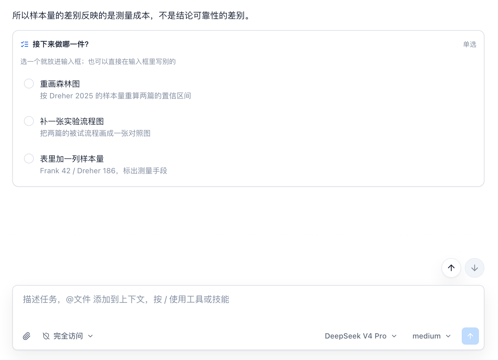
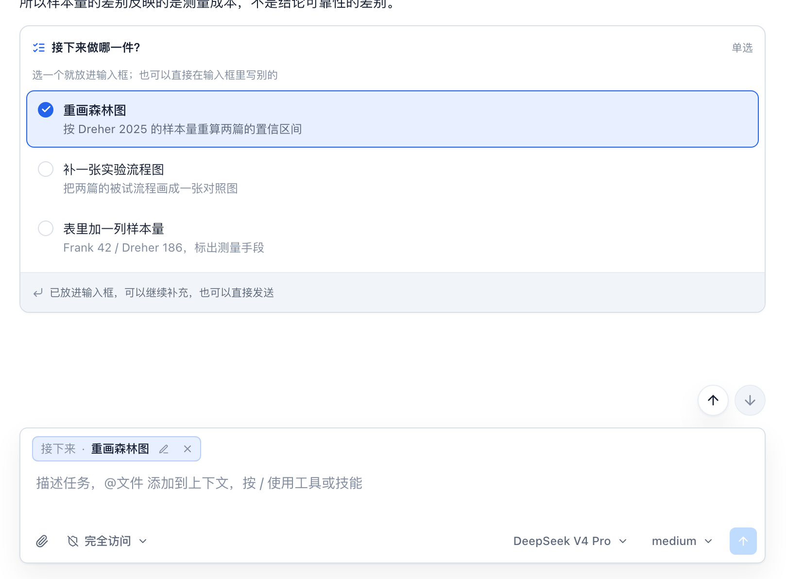
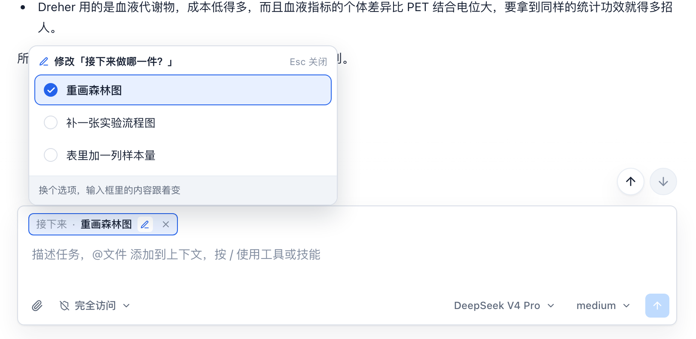
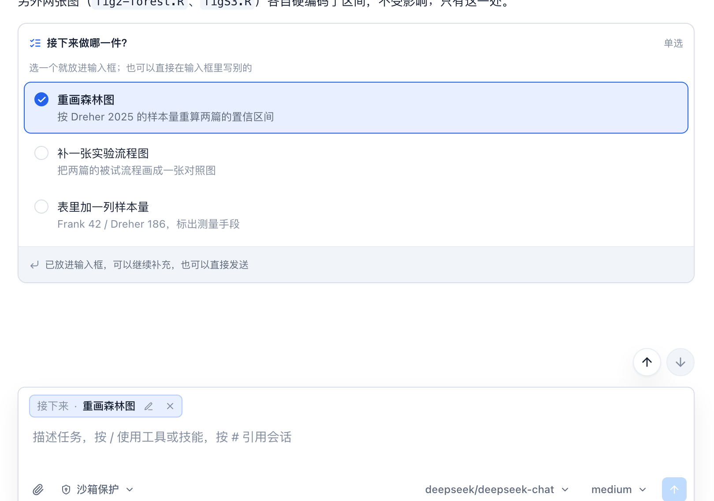
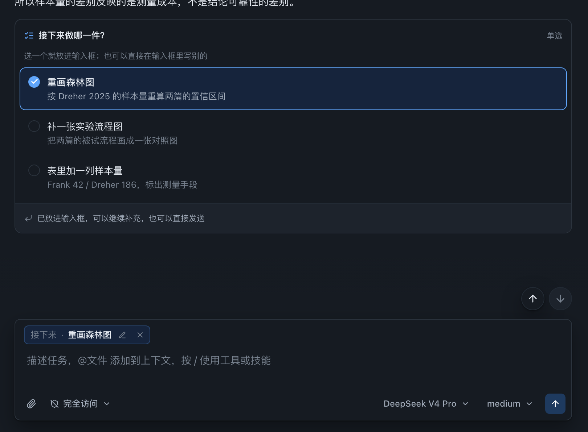
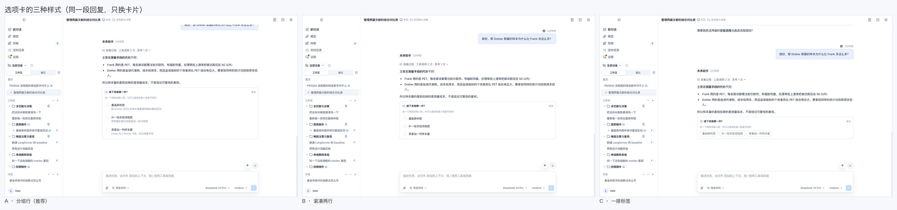
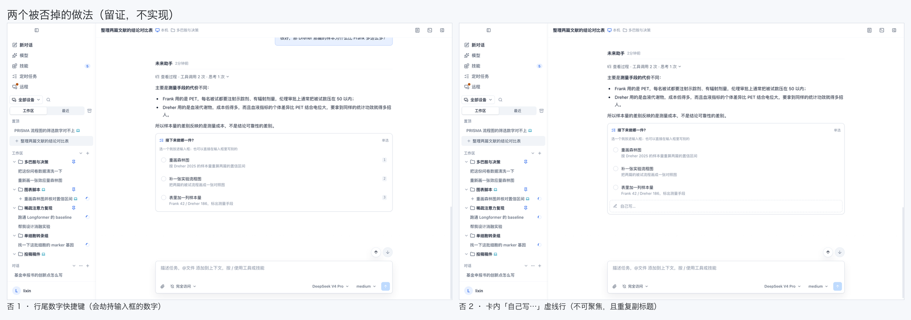
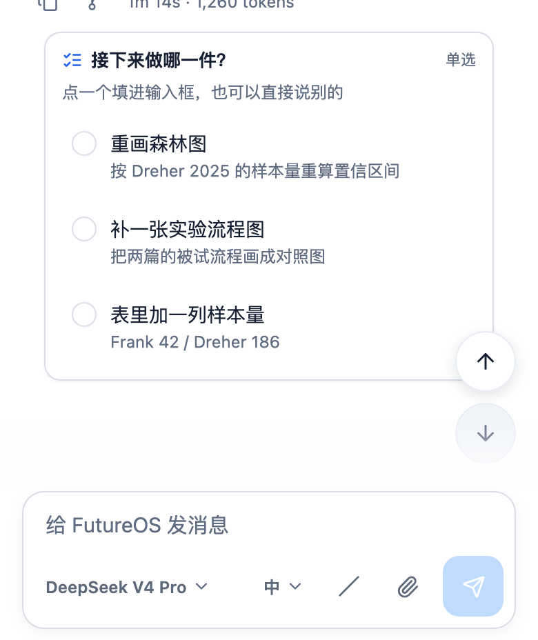
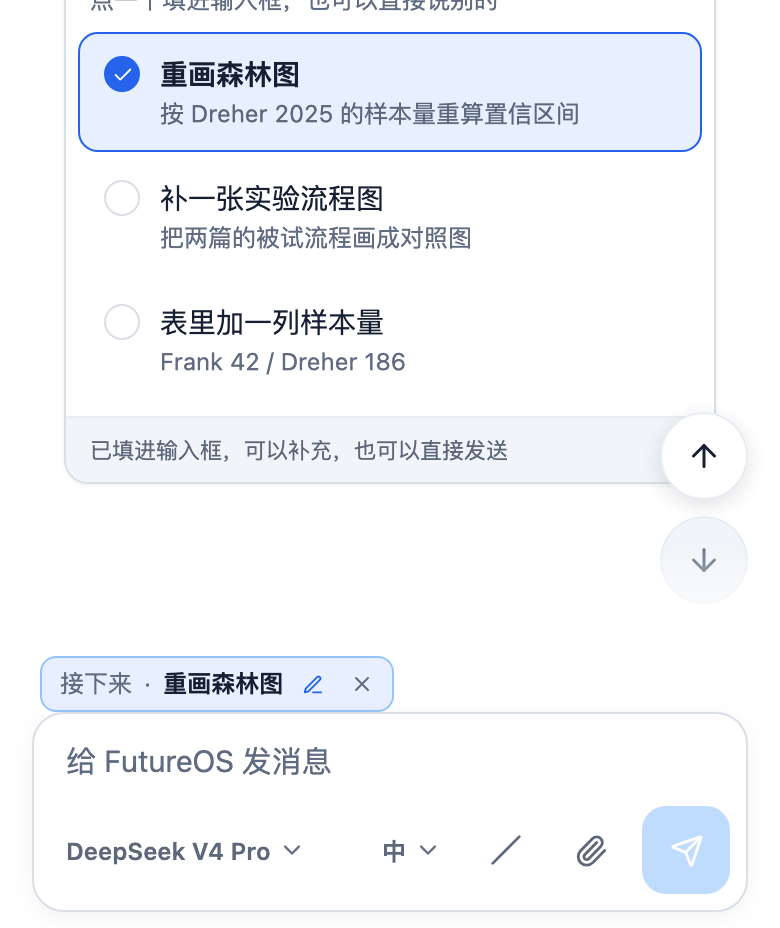
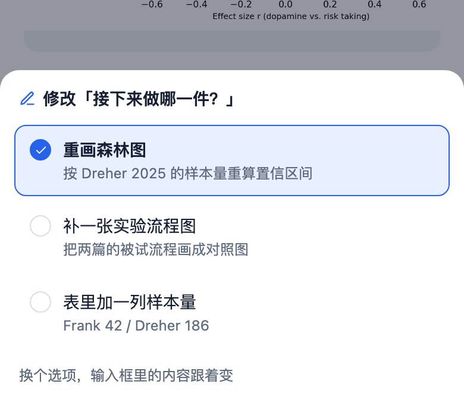

# Choice cards in a reply

> Status: design settled, not implemented. Every screenshot below is a DOM prototype injected into the **real interface** (no product code) to fix the styling and geometry; implementation is §11.
> Scope: desktop, mobile, remote desktop. TUI / CLI are out of scope for this pass (§10 says how they degrade).

## 1. What this solves

A reply can only be read today; to pick a next step, the user has to type a paragraph. That wastes two things:

- The model lists three next steps in prose, the user answers "the second one", and the model has to guess which one that was;
- The user only wanted to pick one, and typed twenty characters restating what the model just said.

A choice card turns that into one click: the model appends a card to its reply listing the moves it **can actually do next**; the reader clicks one, the answer lands in the input, and they send as usual — adding a note if they want, or not.

The real design problem on that path is **where the answer goes**, not what the card looks like. The card only displays the question; the answer has to be part of the draft in the input, or "pick and send" (requirement d) cannot work at all.

## 2. State model: the answer lives in the draft

In one line: **the card is a view of the question; the answer belongs to the draft.** The same answer shows up in three places — the highlighted row in the card, the chip in the composer, the user message after sending — and all three derive from one value. There is no second source of truth.

```
model output fence ──parse──> card (last block of the last reply)
                                 │ click a row
                                 ▼
                          answer in the draft ──send──> user message (text with the answer)
                                 │
                                 ├─> composer chip (visible, changeable, removable)
                                 └─> highlighted row in the card (echo)
```

Three hard rules follow:

| Rule | Why |
|---|---|
| Only the **last card in the thread** is interactive; earlier cards are read-only (the chosen row stays highlighted, the rest dim) | An old card answers a question that is over; letting it change makes "which pick did I just change" unanswerable |
| The card never stores "chosen" itself | It derives from the draft. After sending, the draft empties and the card stays highlighted because the answer is now in the user message right below it |
| Changing the answer means changing the draft | Clicking a row, the chip's pencil, and the phone's bottom sheet all write the same value |

**Several threads / several questions** cannot interfere: the draft is per conversation, and both the card and the chip read that conversation's draft.

## 3. The key: a `futureos-choice` fence

What the model emits is a code fence — the "key" in the request:

````markdown
```futureos-choice
title: 接下来做哪一件？
mode: single
option: forest | 重画森林图 | 按 Dreher 2025 的样本量重算两篇的置信区间
option: flow | 补一张实验流程图 | 把两篇的被试流程画成一张对照图
option: table | 表里加一列样本量 | Frank 42 / Dreher 186，标出测量手段
```
````

Fields:

| Field | Required | Meaning |
|---|---|---|
| `title` | yes | The question itself, one line, ≤ 60 chars. It is the card's heading |
| `mode` | no | `single` (default) / `multi` |
| `option` | yes (2–4) | One per line: `id \| label \| one-line note`; the note may be omitted |
| `id` | — | Stable identifier to send back: ASCII, `[a-z0-9-]`, ≤ 24 chars, unique within the card |
| `hint` | no | Overrides the default subtitle ("pick one and it lands in the input…") |

**Why a fence rather than an inline link or JSON:**

1. **It degrades by itself.** A fence means "code block". Any client that does not know this card — TUI, an older desktop build, an IM bot, a copy-paste elsewhere — draws it as a code block, and the reader sees the option list; nothing is lost. An inline link or raw JSON degrades into noise.
2. **Cheapest to parse.** The repository already has `parseDirectiveFields` (`packages/markdown/src/parseFutureMarkdown.ts`) reading `key: value` lines, which is how `futureos-file` fences are parsed. Here it only needs repeated keys to become an array.
3. **One implementation, three surfaces.** Parsing lives in `packages/markdown`; desktop, mobile and remote consume the same AST, so "desktop understands it, the phone doesn't" cannot happen.

In the AST the card is its own node type (not a `futureEmbed` reference), because its payload is a list of options rather than one object id.

**Parse tolerance** (draw no card rather than eat the reply):

| Case | Handling |
|---|---|
| Fewer than 2 or more than 4 options | The whole block degrades to a code block |
| Duplicate, malformed or over-long `id` | Drop that line; if fewer than 2 remain, degrade the block |
| Missing `title` | Fall back to the first option's label; still empty ⇒ degrade |
| Fence mid-reply (not the last block) | Renders normally but read-only (the "last card" rule in §2) |
| Unknown field | Ignored |

## 4. What goes into the system prompt

A new `agent/src/prompt/choice.md`, pushed in via `include_str!` next to `communication.md` in `agent/src/prompt/mod.rs` (end of `parts`), so "how to ask the user" sits next to "how to talk to the user".

What it must say is **when the card is warranted**, not format details — the syntax already constrains those:

```markdown
# Offering Choices

When your reply ends by asking the user what to do next, offer the options as a
`futureos-choice` block instead of a prose list. The reader then answers with one
click instead of restating your own wording.

Use it only when all of these hold:
- The reply genuinely ends with a question about the next step, and you can carry
  out every option yourself right after they pick.
- There are 2–4 real alternatives. One option, or five, is a paragraph — not a card.
- The options are mutually exclusive (omit `mode: multi` unless several can be done
  in one go).

Do not use it for: confirming a risky action (the approval card already owns that),
restating what you just did, "let me know if you need anything", or a question whose
answer needs a sentence rather than a pick.

Write each option as the instruction you would follow if chosen — the user's words,
not a menu label ("重画森林图", not "选项 A"). The third field says what changes or
what it costs, one line, no marketing.

The block goes last, alone. Never two cards in one reply, never one mid-reply.
```

The point: **an option's label must be the sentence the user would say**, because on send it becomes part of the message. Not "option A/B/C".

## 5. The interface

### 5.1 Desktop · nothing chosen



- 768px wide, the same as the text column (`max-w-3xl`), left-aligned, 4px below the last block;
- Header: 12px semibold title plus an 11px mode label on the right (`单选` / `多选`);
- Subtitle at 11px says "pick one and it lands in the input; you can type something else instead" — this line replaces the in-card "write your own" row (§5.6 says why);
- Each option is a row: a 16px radio, a 13px label, a 12px one-line note (`ink-muted`); unselected rows have no border and no fill and are separated by spacing alone;
- Card shell: `1px line` / `radius 10px` / `surface` / a very light shadow — the approval card's material, but a **different position**: the approval card floats above the composer, a choice card grows inside the reply.

### 5.2 Desktop · one chosen



- Chosen row: `accent` border + `accent-soft` fill + a filled check circle, label at weight 500;
- The card gains an 8px footer (`line-soft` top border, `surface-subtle` fill): "in the input — add a note if you want, or send as is". It **appears only after the click**, because before it there is nothing to say;
- A chip appears in the composer, in the attachments' row and slot (inside `form`, above the field), 26px tall:

```
┌ 接下来 · 重画森林图  ✎ ✕ ┐
```

- **The field itself stays empty.** The chip is not text; to add words the user types into the field. When both are present, the chip goes first and the text after it.

Measured geometry (1440×900, CSS px): card `y 326..622`, chip `y 749..775`, form `y 740..880`, field below.

### 5.3 Desktop · changing it



- The chip's pencil re-opens the question **in place** (a 360px popover 10px above the chip) — no scrolling back, no jumping to the reply;
- The popover holds the same options (compact rows, notes dropped), still with the chosen one marked;
- Picking another ⌁ the chip text follows and the draft's old answer is replaced; `Esc` or an outside click closes it unchanged;
- The chip's ✕ revokes the choice, leaving the composer with no answer (the field was already empty, so that is an empty composer).

### 5.4 Remote desktop



A remote conversation's transcript is markdown from the host, rendered **locally**, so the card is automatically the same component with the same tokens — remote needs no separate implementation. Measured: the card is 768 wide, matching the remote composer.

The one difference is the field: `RemoteComposer` is a plain `textarea` (no `contenteditable`, no pill machinery), so a chosen answer goes in the **chip row above the field** — the attachments' slot. The local chip reuses that same row (§11: both share `ComposerChoiceRow`).

The remote chip is equally changeable and removable, with the popover anchored above it; switching conversations mid-draft carries the answer with the draft (remote drafts are per conversation already).

### 5.5 Dark



Everything is a semantic token (`surface` / `line` / `line-soft` / `surface-subtle` / `accent` / `accent-soft` / `ink*`), no literal colours. Measured dark card background `rgb(22,27,34)` (`--color-surface` in dark), chosen row `accent-soft` dark value `#16243c`.

### 5.6 Three card styles



| | Height | Fits | Verdict |
|---|---|---|---|
| **A · grouped rows** (with a note line) | 255px | Options need to say what picking them does | **Chosen.** The note line is exactly what "I'm not sure which" needs |
| B · compact two-line | 186px | Options are self-explanatory and cards are frequent | The fallback for a card eating half the screen |
| C · a row of pills | 110px | Very short options, narrow widths | Rejected: long labels wrap inside a pill and the notes are lost |

Two explored and **rejected** approaches, recorded so they are not redone:



- **Row numbers 1/2/3** (type a digit to choose). It looks like a keyboard accelerator and in fact collides with free text in the composer: when the user types "2 篇论文", is that `2` a choice? Choosing must be a click (or a keyboard action on the chip), never a hijack of the field's digits.
- **An in-card "write your own…" row.** It says what the subtitle already says, and a dashed box that looks like an input but does not accept focus is worse than nothing. The free-form entry point is the composer; pointing at it is enough.

### 5.7 Mobile

390×844, three frames: nothing chosen, one chosen, changing it.

| Nothing chosen | One chosen | Changing it |
|---|---|---|
|  |  |  |

- The card is full width (358pt, 16pt margins), `radius 12px`, rows **≥ 44pt** (measured: 60pt each), notes wrap rather than truncate;
- The chosen chip sits inside the dock above the textarea, in the attachments' slot (measured: chip `y 708..736`, field `y 737..783`, i.e. the field is 46pt tall);
- **Changing it uses a bottom sheet**: at 390pt there is no room for an in-place popover. The sheet's top lands at 559pt, rows stay 44pt, a pick writes straight back to the chip and the draft is untouched;
- Every touch target is ≥ 44pt; the chip's pencil and ✕ are 44pt on mobile (18pt visually, transparent hit area around them).

## 6. Composer behaviour (requirements a–d)

| Requirement | Behaviour | Implementation constraint |
|---|---|---|
| (a) may pick nothing and stay empty | Nothing picked, nothing typed ⇒ send stays disabled (the existing `inputEmpty` logic) | The card's presence does **not** count as draft content. A card appearing must never enable Send |
| (b) a pick can be changed | Three entries: any row in the card, the chip's pencil, the phone's bottom sheet. They write the same value | Afterwards focus stays in the composer (desktop) / the sheet closes (phone); existing text is never disturbed |
| (c) extra text can be typed and sent | Chip and text coexist; on send the chip comes first | The empty check must treat "has a chip" as non-empty (the way `isEditorEmpty` already treats a pill) |
| (d) send with no text at all | Chip only ⇒ Send is enabled | Same empty check as (a), with the chip counting as content |

After sending: the draft clears, the chip goes, the card stays highlighted (the answer is now in the user message). **Nothing auto-sends** — the requirement is that sending is *possible*, and auto-send would make (c) meaningless.

## 7. What gets sent back to the agent

The answer must be readable by the agent **and** on the degraded paths (TUI, IM bots, pasted elsewhere). So it is plain text, not a custom protocol:

| Case | Message sent |
|---|---|
| Picked, nothing typed | `[接下来做哪一件？ → 重画森林图]` |
| Picked and added a note | `[接下来做哪一件？ → 重画森林图] 顺便把图例挪到右下` |
| Multiple picks | `[这三项都要 → 重画森林图、补一张实验流程图]` |
| Only typed (nothing picked / chip removed) | Just what the user wrote |

`→` is the only fixed token; the question and the label come from the model's own output. The `title` is included so that "重画森林图" has an owner when several cards have appeared in one thread.

**Why not send a `futureos://choice/...` link:** that needs a new reference type, `isFutureReferenceType` widened, and server-side understanding — and the only gain is a chip in the user's bubble. Version one sends text, so the user's bubble shows what actually went out: honest, copyable, readable by any client. Pill-ifying it is deferred (§10).

## 8. Compatibility and degradation

| Client | Before upgrading | After |
|---|---|---|
| Desktop / mobile / remote | — | The full card |
| TUI | A code block (which reads like a bulleted option list) | Unchanged this pass: still prints the block's content |
| CLI `future run` | Same | Same |
| IM bots (Feishu / DingTalk) | Same | Same (interactive cards are a separate job) |
| Third-party Markdown readers | A code block | A code block |

The fence syntax makes "unknown" mean "renders normally", which is the main reason it was chosen (§3). The parser never throws: any malformed input falls back to a code block.

## 9. Copy / icons / accessibility

Fixed copy (the model neither provides nor should provide it) — keys needed on all three surfaces:

| key | Chinese | English |
|---|---|---|
| `choice.mode.single` | 单选 | Single choice |
| `choice.mode.multi` | 多选 | Multiple choice |
| `choice.hint.single` | 选一个就放进输入框；也可以直接在输入框里写别的 | Pick one and it lands in the input; you can type something else instead |
| `choice.hint.multi` | 可以多选，点几个都行 | Pick as many as apply |
| `choice.foot.queued` | 已放进输入框，可以继续补充，也可以直接发送 | In the input — add a note if you want, or send as is |
| `choice.chip.change` | 修改「{{title}}」的选择 | Change the answer to "{{title}}" |
| `choice.chip.remove` | 移除「{{title}}」的选择 | Remove the answer to "{{title}}" |
| `choice.stale` | 这张卡已经过期 | This card is no longer active |
| `choice.mobile.change` | 修改「{{title}}」 | Change "{{title}}" |

- Icons: `list-checks` in the card header (pick one of several items), the existing `lucide` pencil and ✕ elsewhere;
- Semantics: the card is `role="group"` with `aria-labelledby` pointing at its title; option rows are `role="radio"` (single) / `role="checkbox"` (multi) with `aria-checked`; the chip is a `role="group"` whose two buttons carry the `aria-label`s above;
- Keyboard: Tab into the card → arrows move between options → Enter/Space picks → focus moves to the composer. `Esc` closes a popover;
- The chosen state never relies on colour alone: filled check + border + fill (still legible in greyscale or with colour-vision deficiency).

## 10. Explicitly out of scope

| Not doing | Why |
|---|---|
| Auto-send | Conflicts with (c); the user may want to look first |
| A free-text field inside the card | The composer is the free-text field (§5.6) |
| Digit shortcuts on rows | They would hijack the composer's digits (§5.6) |
| Nested cards / a card mid-reply | "Which pick did I change" becomes unanswerable |
| Editing historical cards | Same; read-only plus a highlighted chosen row |
| An interactive TUI / IM version | This pass only guarantees readable degradation; the TUI already has its own local choice UI (`SendChoiceSheet`), which is app UI, not transcript content |
| Pill-ifying the answer in the user's bubble | Needs a new reference type plus server understanding, and the gain is purely visual; version two |
| Structured choice records on the model side | Reading the text is enough for v1; add it when something actually needs the counts |

## 11. Implementation breakdown

In dependency order; each step merges on its own:

1. **Syntax and parsing** (`packages/markdown`): a `ChoiceCardNode` type; a branch for the `futureos-choice` fence next to `parseFutureEmbed` in `parseFutureMarkdown.ts`, with `parseDirectiveFields` gathering repeated keys into an array; unit tests for the whole tolerance table in §3.
2. **Desktop rendering**: `desktop/src/features/markdown/renderers/ChoiceCard.tsx` (both read-only and interactive states), wired into the node switch in `MarkdownContent.tsx` (from :119, beside the `futureEmbed` branch); copy keys go into `desktop/src/i18n/locales/{zh,en}/markdown.json` (they belong to the rendering layer, not to the `packages/markdown` types).
3. **Desktop composer**: `ComposerChoiceRow.tsx` (the chip row, in the attachments' slot) plus the change popover; the empty check goes through the same `isEditorEmpty` path (a chip counts as content); `Composer` assembles the §7 text on send.
4. **Answer state**: an optional `choice` field on the existing per-conversation draft — desktop's `ComposerDraft` (`desktop/src/features/agent/composerDraft.ts`; the shape deliberately allows growth, so an optional field needs no `DRAFT_VERSION` bump) and remote's `RemoteComposerDraft` (`desktop/src/features/remote-peer/remoteComposerDraft.ts`). Card and chip both read it.
5. **Remote**: `RemoteComposer` reuses step 3's chip row (it was designed for a plain textarea); it assembles the same text and clears with the draft.
6. **Mobile**: `mobile/src/components/MarkdownText.tsx` mounts `ChoiceCard`; `ComposerDock.tsx` gains the chip row plus `ChoiceSheet` (reusing the sheet shell of `mobile/src/features/chat/components/SendChoiceSheet.tsx`); copy goes into `resources.{zh,en}.translation` in `mobile/src/i18n/locales.ts`.
7. **Prompt**: `agent/src/prompt/choice.md` plus the `include_str!` in `mod.rs`; update the prompt-assembly tests in `agent/src/prompt/mod.rs` that assert section order.
8. **Regression**: `scripts/screenshots/scenarios.d/choice-cards.json` already turns every frame in this document into a re-runnable scenario (seven on desktop, three on the phone) — use it for visual regression once implemented (swap the injections for the real component).

## 12. Test points

- **Parsing**: legal single/multi; the 2 and 4 boundaries; degradation below 3 and above 5; duplicate id, malformed id, missing title; a mid-reply fence; unknown fields ignored.
- **Desktop**: card renders; read-only ↔ interactive switching; clicking a row puts a chip in and leaves the field empty; the pencil changes the chip; ✕ clears it; sent content for all four cases in §7, asserted one by one; after sending the chip is gone and the card stays highlighted.
- **Remote**: as above, plus asserting the chip is above the textarea rather than inside it, and that switching conversations does not leak an answer.
- **Mobile**: 44pt rows; a sheet pick updates the chip; the keyboard does not cover the chip row.
- **Degradation**: the TUI prints the block's content; unknown clients likewise.
- **Accessibility**: `role` / `aria-checked` / `aria-label` assertions; arrow keys and Enter.
- **Visual regression**: the ten scenarios in `choice-cards.json` (including both comparison sheets and the two rejected approaches).

## 13. Re-running the screenshots

```bash
python3 scripts/screenshots/capture.py serve-desktop        # desktop harness
python3 scripts/screenshots/capture.py serve-mobile         # phone harness
python3 scripts/screenshots/capture.py --out .screenshots/choice-design \
  capture-desktop choice-card-empty choice-card-chosen choice-card-change \
                  choice-card-remote choice-card-dark
python3 scripts/screenshots/capture.py --out .screenshots/choice-design \
  variants-desktop choice-card-styles --columns 3
python3 scripts/screenshots/capture.py --out .screenshots/choice-design \
  capture-mobile choice-card-phone choice-card-phone-chosen choice-card-phone-change
```

The scenarios and injection scripts live in `scripts/screenshots/scenarios.d/choice-cards.json` and `scripts/screenshots/injects/choice-card-*.js`. They are **not product code**: they inject a DOM prototype so the samples sit on the real interface (real tokens, real type scale, real column width). Once implemented, delete the injections and capture the real component.
