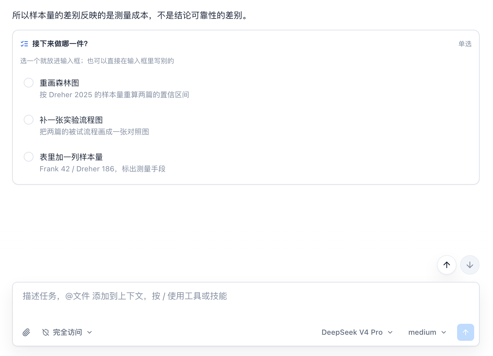
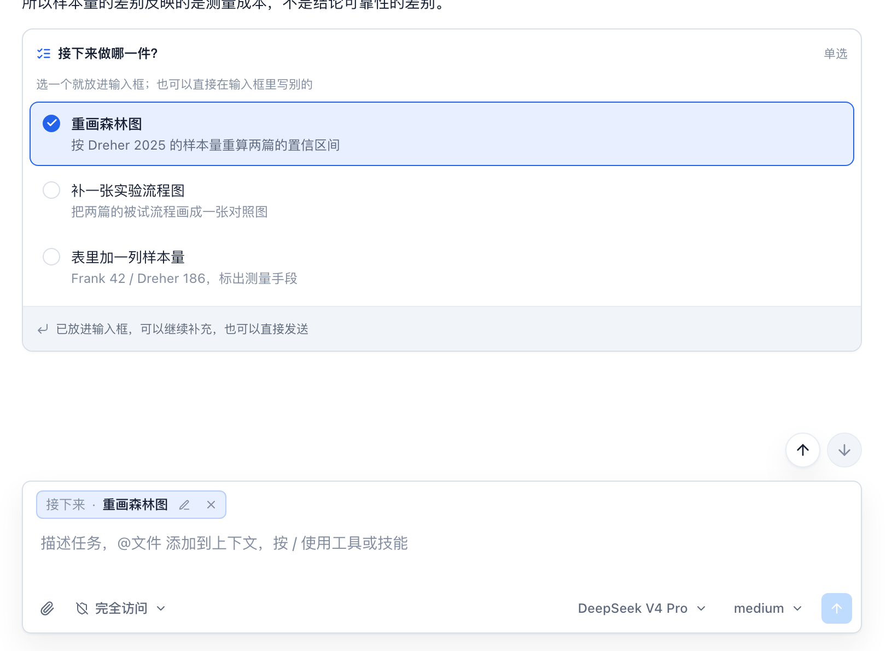
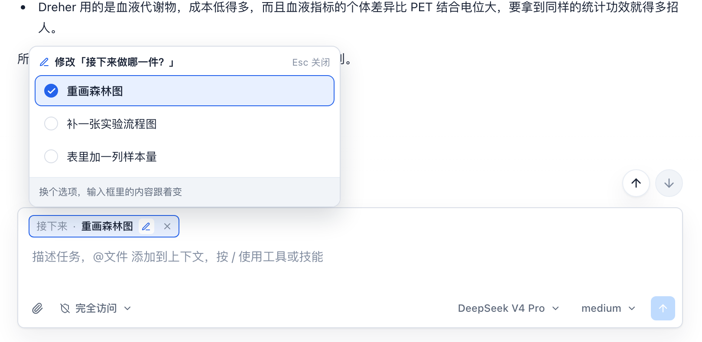
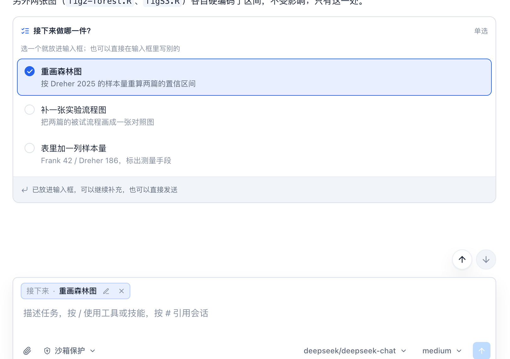
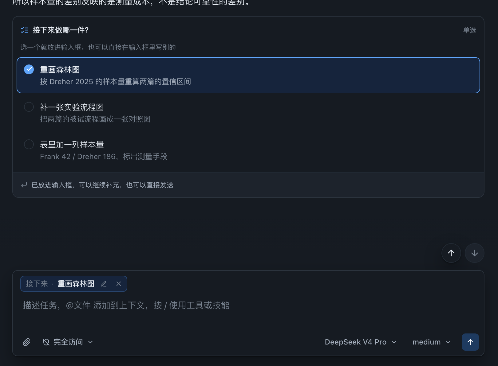
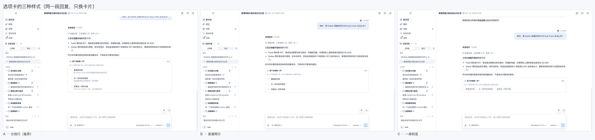
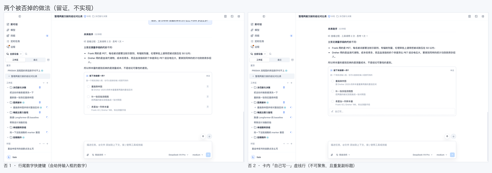
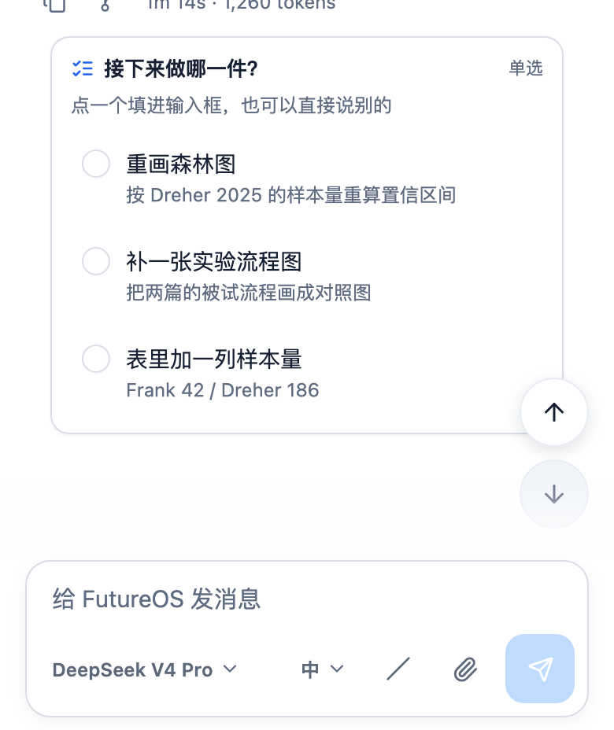
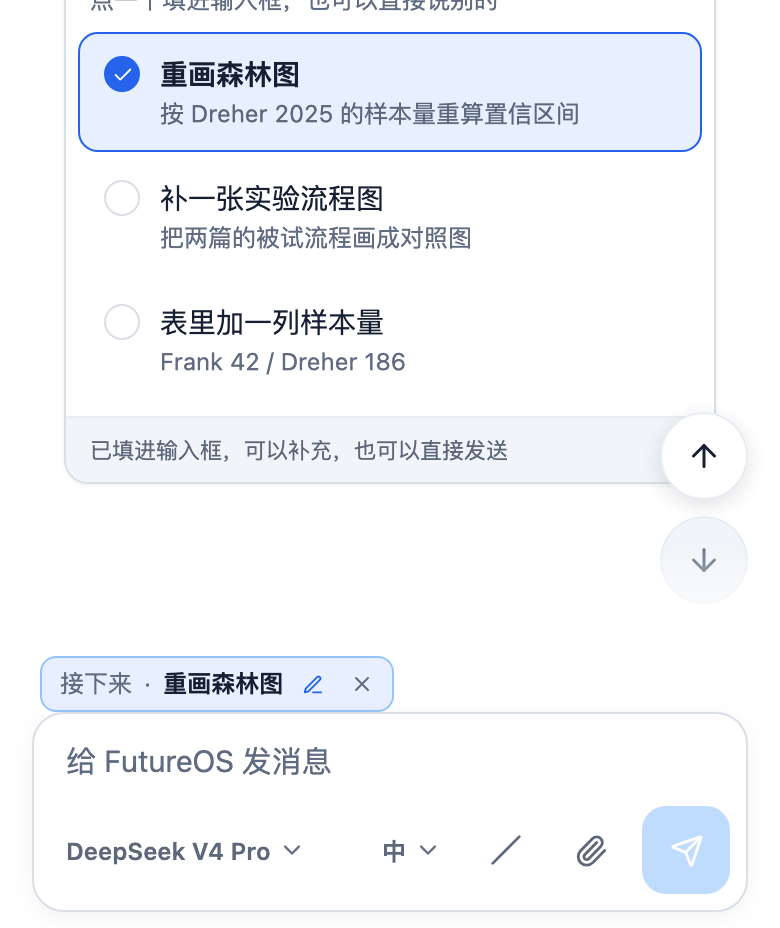
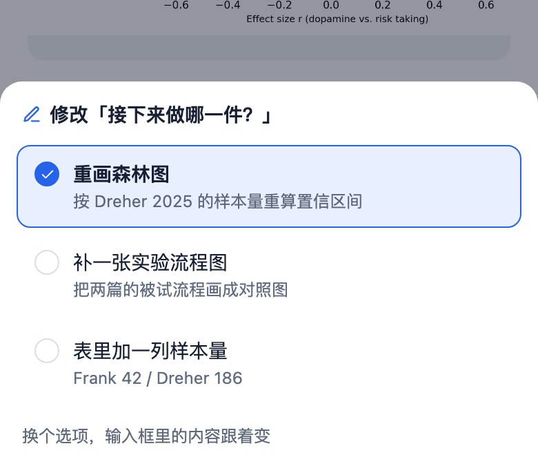

# 回复里的选项卡（choice card）设计

> 状态：设计定稿，尚未实现。所有截图都是在**真实界面**上注入 DOM 原型拍的（不含产品代码），用来定样式与几何；实现见 §11。
> 主要范围：桌面端、移动端、远程桌面。TUI / CLI 不在本期范围（§10 说明它们如何降级）。

## 1. 要解决的问题

现在的回复只能"读"，要给下一步做选择，用户得自己打一段话。于是常见两种浪费：

- 模型在正文里列出三个下一步，用户回一句"第二个"，模型还得猜"第二个"指哪个；
- 用户明明只想选一个，却敲了二十个字复述模型刚说过的话。

选项卡把这一步变成一次点击：模型在回复末尾挂一张卡，列出它**真能接着做**的几个动作；用户点一个，答案进输入框，然后照常发送——想补一句就补，不想补就直接发。

这条链路上真正需要设计的是**答案去哪了**，不是卡片长什么样。卡片只是问题的展示；答案必须是输入框里那条草稿的一部分，否则"选完之后直接发送"这条需求无从实现。

## 2. 状态模型：答案存在草稿里

一句话：**卡片是问题的视图，答案属于草稿。** 同一份答案在三个地方出现——卡片里的选中行、输入框里的 chip、发送后的用户消息——它们都从同一处状态派生，不存在第二份真相。

```
模型输出围栏 ──解析──> 卡片（末条回复的最后一个块）
                          │ 点击某行
                          ▼
                    草稿里的答案  ──发送──> 用户消息（带答案的文本）
                          │
                          ├─> 输入框 chip（可见、可改、可删）
                          └─> 卡片选中行（回显）
```

由此得到三条硬规则：

| 规则 | 原因 |
|---|---|
| 只有**线程里最后一张**卡可交互，更早的卡只读（选中行仍高亮，其余行置灰） | 历史卡片对应的问题早已过去，允许改它只会让"我改的是哪一次"变得不可回答 |
| 卡片不自己保存"已选" | 它从前面的草稿派生。发送后草稿清空，卡片仍高亮——因为答案此时在紧随其后的用户消息里 |
| 改答案 = 改草稿 | 点卡片任意一行、点 chip 的铅笔、点底部 sheet，三个入口写同一个值 |

**多个线程 / 多次提问**不会互相干扰：草稿按会话（thread）隔离，卡片与 chip 都读本会话的草稿。

## 3. 钥匙：`futureos-choice` 围栏

模型输出的是一个代码围栏（这就是需求里的"钥匙"）：

````markdown
```futureos-choice
title: 接下来做哪一件？
mode: single
option: forest | 重画森林图 | 按 Dreher 2025 的样本量重算两篇的置信区间
option: flow | 补一张实验流程图 | 把两篇的被试流程画成一张对照图
option: table | 表里加一列样本量 | Frank 42 / Dreher 186，标出测量手段
```
````

字段：

| 字段 | 必填 | 说明 |
|---|---|---|
| `title` | 是 | 问题本身，一句话，≤ 60 字。它就是卡片标题 |
| `mode` | 否 | `single`（默认）/ `multi` |
| `option` | 是（2–4 个） | 每行一个，`id \| 显示文案 \| 一行说明`；说明可以省略 |
| `id` | — | 选项 id：ASCII、`[a-z0-9-]`、≤ 24 字符、卡内唯一。它是要回传的稳定标识 |
| `hint` | 否 | 覆盖默认副标题（"选一个就放进输入框…"） |

**为什么是围栏而不是内联链接或 JSON：**

1. **自降级**。围栏的语义是"代码块"。任何不认识这张卡的客户端——TUI、旧的桌面版本、IM 机器人、复制粘到别处——都会把它当代码块画出来，用户看到的就是选项清单，信息不丢。换成内联链接或裸 JSON，降级后就是一堆噪音。
2. **解析成本最低**。仓库里已有 `parseDirectiveFields`（`packages/markdown/src/parseFutureMarkdown.ts`）按 `key: value` 逐行取值，`futureos-file` 围栏就是这么解析的。这里只需让重复 key 变成数组，其余不动。
3. **一份实现三端共用**。解析在 `packages/markdown` 里，桌面、移动、远程都消费同一份 AST，不会出现"桌面认识、手机不认识"。

卡片节点进 AST 时是独立的节点类型（不是复用 `futureEmbed` 的引用），因为它的载荷是选项列表而不是一个对象 id。

**解析容错**（宁可少画一张卡，不能吃掉回复）：

| 情况 | 处理 |
|---|---|
| 选项少于 2 个或多于 4 个 | 整块降级为代码块 |
| `id` 重复、非法字符、超长 | 该行丢弃；剩不足 2 个则整块降级 |
| 缺 `title` | 用第一个选项的文案兜底；仍为空则降级 |
| 围栏出现在回复中间（不在最后一块） | 照常渲染，但只读（§2 的"最后一张"规则） |
| 未知字段 | 忽略 |

## 4. system prompt 里加什么

新增 `agent/src/prompt/choice.md`，在 `agent/src/prompt/mod.rs` 里与 `communication.md` 一起 `include_str!` 推入（`parts` 末尾，紧邻 communication），保证"怎么问用户"和"怎么说话"相邻。

要求它写清楚的是**什么时候才配用**，而不是格式细节——格式已经在语法里约束了：

```markdown
# Offering Choices

When your reply ends by asking the user what to do next, offer the options as a
`futureos-choice` block instead of a prose list. The reader then answers with one
click instead of restating your own wording.

Use it only when all of these hold:
- The reply genuinely ends with a question about the next step, and you can carry
  out every option yourself right after they pick.
- There are 2–4 real alternatives. One option, or five, is a paragraph — not a card.
- The options are mutually exclusive (omit `mode: multi` unless several can be done
  in one go).

Do not use it for: confirming a risky action (the approval card already owns that),
restating what you just did, "let me know if you need anything", or a question whose
answer needs a sentence rather than a pick.

Write each option as the instruction you would follow if chosen — the user's words,
not a menu label ("重画森林图", not "选项 A"). The third field says what changes or
what it costs, one line, no marketing.

The block goes last, alone. Never two cards in one reply, never one mid-reply.
```

要点：**选项文案必须是用户会说的那句话**（因为发送时它就是消息的一部分），不是"选项 A/B/C"。

## 5. 界面

### 5.1 桌面端 · 未选



- 卡宽 768px，与正文列同宽（`max-w-3xl`），左对齐、跟在最后一个块之后 4px；
- 卡头 12px 半粗标题 + 右侧 11px 模式标注（`单选` / `多选`）；
- 副标题 11px，说明"选一个就放进输入框；也可以直接在输入框里写别的"——这句话替代了卡内的"自己写…"行（§5.6 说明为什么删掉）；
- 每个选项一行：16px 单选圈 + 13px 文案 + 12px 一行说明（`ink-muted`）；未选行无边框、无底色，靠留白分列；
- 卡片外框 `1px line` / `radius 10px` / `surface` 底 / 极轻投影，与审批卡同一套材质，但**位置不同**：审批卡浮在输入框上方，选项卡长在正文里。

### 5.2 桌面端 · 已选



- 选中行：`accent` 描边 + `accent-soft` 底 + 实心圆对勾，文案转 500 权重；
- 卡底多一条 8px 的分隔脚注（`line-soft` 上边框 + `surface-subtle` 底）："已放进输入框，可以继续补充，也可以直接发送"——**在点击之后才出现**，因为点击前说这句话没有意义；
- 输入框里出现 chip，位置与文件附件同一行同一槽位（`form` 内、field 之上），高度 26px：

```
┌ 接下来 · 重画森林图  ✎ ✕ ┐
```

- **输入框本身保持空**。chip 不是文字，用户想补话就直接在 field 里写；两者一起发送时先 chip 后文字。

实测几何（1440×900，CSS px）：卡 `y 326..622`，chip `y 749..775`，form `y 740..880`，field 在其下。

### 5.3 桌面端 · 改回来



- chip 上的铅笔把问题**原地**展开（360px 浮层，贴在 chip 上方 10px），不滚动、不跳回正文；
- 浮层里是同一份选项（紧凑行，去掉说明），选中项仍是那个；
- 换一个 ⇒ chip 文案跟着变，草稿里的旧答案被替换；`Esc` 或点外部关闭，答案不变；
- chip 上的 ✕ 直接撤销这次选择，输入框回到"没有答案"的状态（field 本来就空，所以就是空输入框）。

### 5.4 远程桌面



远程会话的正文是宿主送来的 markdown、由**本机**渲染，所以卡片自动就是同一个组件、同一套 token——不需要为远程单独做一份。实测卡宽 768 与远程输入框同宽。

唯一的差别在输入框：远程 `RemoteComposer` 是纯 `textarea`（没有 `contenteditable`、没有 pill 机制），所以已选项走**输入框上方的 chip 行**——和附件同一个槽位，本地端的 chip 也复用这一行的实现（§11 里两者共用 `ComposerChoiceRow`）。

远程端的 chip 同样可点铅笔/叉，浮层锚在 chip 上方；跨机器的会话切换时草稿随草稿一起传（远程草稿本来就是按会话托管的）。

### 5.5 深色



全部用语义 token（`surface` / `line` / `line-soft` / `surface-subtle` / `accent` / `accent-soft` / `ink*`），不写死颜色。实测深色卡底 `rgb(22,27,34)`（`--color-surface` 的深色值），选中行 `accent-soft` 深色值 `#16243c`。

### 5.6 卡片样式的三个方向



| | 高度 | 适用 | 结论 |
|---|---|---|---|
| **A · 分组行**（带一行说明） | 255px | 选项需要解释"选它会怎样" | **采用**。说明行承担的正是"我不确定选哪个"的那种犹豫 |
| B · 紧凑两行 | 186px | 选项自解释、卡出现频繁 | 备选：一张卡挡住半屏时切它 |
| C · 一排标签 | 110px | 极短选项、窄屏 | 不采用：长文案会在标签里断行，且丢掉说明 |

两个探索过、**没有采用**的做法，记在这里免得日后重做：



- **行尾编号 1/2/3**（按数字键选）。看起来像键盘加速，实际会和输入框的自由文字冲突：用户打"2 篇论文"时，那个 `2` 到底是不是一次选择？选项选择必须是点击（或 chip 上的键盘操作），不能劫持输入框的数字。
- **卡内"自己写…"虚线行**。它和副标题说的是同一件事，而且一条虚线框——看着像输入框、点了却不聚焦——比没有更糟。自由输入的正确入口是输入框本身，副标题指过去就够了。

### 5.7 移动端

手机 390×844，三张图分别是未选 / 已选 / 改回来。

| 未选 | 已选 | 改回来 |
|---|---|---|
|  |  |  |

- 卡满宽（358pt，左右各 16pt 边距），`radius 12px`，行高 **≥ 44pt**（实测三行各 60pt），说明文字换行而不截断；
- 已选项的 chip 在 dock 内、textarea 之上，与附件同槽位（实测 chip `y 708..736`，field `y 737..783`，即 field 高 46pt）；
- **改答案用底部 sheet**：390pt 宽没有空间在原地放浮层。sheet 顶到 559pt，三行仍 44pt，选中即写回 chip，底稿不动；
- 触控目标一律 ≥ 44pt，chip 里的铅笔/叉在移动端各占 44pt（视觉 18pt，外面是透明热区）。

## 6. 输入框行为（需求的 a–d）

| 需求 | 行为 | 实现约束 |
|---|---|---|
| (a) 可以不选，保持为空 | 什么都没选、什么都没写 ⇒ 发送禁用（现有 `inputEmpty` 逻辑不变） | 卡片的存在**不**算草稿有内容。禁止"卡片一出现就能发送" |
| (b) 已选可以回去改 | 三个入口：卡片任意一行、chip 的铅笔、手机端底部 sheet。改的是同一个值 | 改完 focus 留在输入框（桌面）/ 关掉 sheet（手机），不打断已有的文字 |
| (c) 可以继续输入文字发送 | chip 与文字共存，发送时先 chip 后文字 | 空判定要把"有 chip"算作非空（沿用 `isEditorEmpty` 认 pill 的做法） |
| (d) 不输入文字直接发送 | 只有 chip ⇒ 发送按钮可用 | 与 (a) 共用同一套空判定，只是把 chip 当作内容 |

发送后：草稿清空、chip 消失、卡片保持高亮（答案已进入用户消息）。**不自动发送**——需求只要求"可以直接发送"，任何自动发送都会让 (c) 失去意义。

## 7. 回传给 agent 的文本

答案必须让 agent 读懂，且必须**在降级路径上也读得懂**（TUI、IM 机器人、粘贴到别处）。所以回传的是纯文本，不是自定义协议：

| 情况 | 发出的消息 |
|---|---|
| 只选了，没写字 | `[接下来做哪一件？ → 重画森林图]` |
| 选了又补一句 | `[接下来做哪一件？ → 重画森林图] 顺便把图例挪到右下` |
| 多选 | `[这三项都要 → 重画森林图、补一张实验流程图]` |
| 只写字（没选 / 删掉了 chip） | 就是用户写的文字 |

`→` 是唯一的固定记号，问号与文案都来自模型自己的输出。带上 `title` 是为了在同一线程里出现过几张卡时，"重画森林图"这句话有归属。

**为什么不回传 `futureos://choice/...` 链接：** 那需要新增引用类型、让 `isFutureReferenceType` 放开、并保证服务端也理解它；而收益只是用户气泡里显示成 chip。第一版用文本，用户气泡显示的就是真正发出去的内容——诚实、可复制、任何客户端都能读。胶囊化留给后续（§10）。

## 8. 兼容与降级

| 客户端 | 未升级时看到 | 升级后 |
|---|---|---|
| 桌面 / 移动 / 远程 | —— | 完整卡片 |
| TUI | 代码块（选项三点清单的样子） | 本期不变：仍打印代码块内容 |
| CLI `future run` | 同上 | 同上 |
| IM 机器人（飞书 / 钉钉） | 同上 | 同上（卡片式交互另立项） |
| 第三方 Markdown 阅读器 | 代码块 | 代码块 |

围栏语法让"不认识"变成"照正常渲染"，这是选它的首要理由（§3）。同时解析器永不抛错：任何畸形输入都退回代码块。

## 9. 文案 / 图标 / 无障碍

固定文案（模型不提供、也不该提供）——三端都要 key：

| key | 中文 | 英文 |
|---|---|---|
| `choice.mode.single` | 单选 | Single choice |
| `choice.mode.multi` | 多选 | Multiple choice |
| `choice.hint.single` | 选一个就放进输入框；也可以直接在输入框里写别的 | Pick one and it lands in the input; you can type something else instead |
| `choice.hint.multi` | 可以多选，点几个都行 | Pick as many as apply |
| `choice.foot.queued` | 已放进输入框，可以继续补充，也可以直接发送 | In the input — add a note if you want, or send as is |
| `choice.chip.change` | 修改「{{title}}」的选择 | Change the answer to "{{title}}" |
| `choice.chip.remove` | 移除「{{title}}」的选择 | Remove the answer to "{{title}}" |
| `choice.stale` | 这张卡已经过期 | This card is no longer active |
| `choice.mobile.change` | 修改「{{title}}」 | Change "{{title}}" |

- 图标：卡头 `list-checks`（一批待办里挑一件），铅笔、叉沿用现有 `lucide` 图标集；
- 语义：卡片是 `role="group"` + `aria-labelledby` 指向标题；选项行是 `role="radio"`（单选）/ `role="checkbox"`（多选），带 `aria-checked`；chip 是 `role="group"`，两个按钮各有 `aria-label`（上表）；
- 键盘：Tab 进卡 → 方向键在选项间移动 → Enter/Space 选中 → 焦点进输入框。`Esc` 关浮层；
- 选中状态不只靠颜色：实心圆对勾 + 描边 + 底色三重区分（灰度或色弱下仍可辨）。

## 10. 明确不做的部分

| 不做 | 理由 |
|---|---|
| 自动发送 | 与 (c) 冲突；且用户可能只是想先看看 |
| 卡内自由输入框 | 输入框就是自由输入框（§5.6） |
| 行尾数字快捷键 | 会劫持输入框的数字（§5.6） |
| 卡片嵌套 / 回复中途的卡 | 交互上无法回答"我改的是哪一次" |
| 历史卡片可改 | 同上；只读 + 高亮已选 |
| TUI / IM 的交互版 | 本期只保证降级可读；TUI 已经有自己的选择机制（`SendChoiceSheet` 那套是本机 UI，不是 transcript 内容） |
| 答案胶囊化（用户气泡里的 chip） | 需要新引用类型 + 服务端理解，收益是纯视觉的；留到第二版 |
| 模型端记账（"用户选了哪个"作为结构化字段） | 第一版让模型读文本就够了；真需要统计时再加 |

## 11. 实现拆分

按依赖顺序，每一步都能单独合入：

1. **语法与解析**（`packages/markdown`）：`ChoiceCardNode` 类型；`parseFutureMarkdown.ts` 里把 `futureos-choice` 围栏接进 `parseFutureEmbed` 的分支，`parseDirectiveFields` 支持重复 key；单测覆盖 §3 的容错表。
2. **桌面渲染**：`desktop/src/features/markdown/renderers/ChoiceCard.tsx`（含只读/可交互两态），在 `MarkdownContent.tsx` 的节点 switch（:119 起，`futureEmbed` 那个分支旁边）里接上；i18n key 进 `desktop/src/i18n/locales/{zh,en}/markdown.json`（文案表本身在 `packages/markdown` 的类型旁没有位置，key 属于渲染层）。
3. **桌面输入框**：`ComposerChoiceRow.tsx`（chip 行，插在附件行同一槽位）+ 修改浮层；空判定走 `isEditorEmpty` 的同一套（chip 算内容）；`Composer` 发送时拼装 §7 的文本。
4. **答案状态**：放进现有的按会话草稿——桌面的 `ComposerDraft`（`desktop/src/features/agent/composerDraft.ts`）加一个可选的 `choice` 字段（该结构刻意留了增长位，新增可选字段不用升 `DRAFT_VERSION`）；远程的 `RemoteComposerDraft`（`desktop/src/features/remote-peer/remoteComposerDraft.ts`）同理。卡片与 chip 都从它读。
5. **远程**：`RemoteComposer` 复用第 3 步的 chip 行（它就是为纯 textarea 设计的）；提交时同样拼装文本，随草稿一起清空。
6. **移动端**：`mobile/src/components/MarkdownText.tsx` 接 `ChoiceCard`；`ComposerDock.tsx` 里加 chip 行 + `ChoiceSheet`（复用 `mobile/src/features/chat/components/SendChoiceSheet.tsx` 的 sheet 外壳）；文案进 `mobile/src/i18n/locales.ts` 的 `resources.{zh,en}.translation`。
7. **prompt**：`agent/src/prompt/choice.md` + `mod.rs` 推入；改 `agent/src/prompt/mod.rs` 的既有测试（断言 prompt 段落顺序的那几条）。
8. **回归**：`scripts/screenshots/scenarios.d/choice-cards.json` 已经把本文的每一屏变成可重跑的场景（桌面 7 个、手机 3 个），实现完成后用它做视觉回归（把注入换成真实组件即可）。

## 12. 测试点

- **解析**：合法单/多选；2 与 4 的边界；3 个以下/5 个以上降级；重复 id、非法 id、缺 title 的降级；围栏在中途；未知字段忽略。
- **桌面**：卡片渲染与只读/可交互切换；点行 → chip 出现且 field 仍空；点铅笔改动 chip；点叉清空；chip + 文字一起发送的内容（§7 四种情况逐条断言）；发送后 chip 消失、卡片高亮保留。
- **远程**：同上，且断言 chip 在 textarea 之上而不是里面；远程草稿切换不串答案。
- **移动端**：44pt 行高；sheet 改选后 chip 更新；键盘弹起时 chip 行不遮 field。
- **降级**：TUI 打印代码块内容；未知客户端同。
- **无障碍**：`role`/`aria-checked`/`aria-label` 三条断言；方向键与 Enter 的键路径。
- **视觉回归**：`choice-cards.json` 的 10 个场景（含两种样式对比表与两个被否方案）。

## 13. 截图怎么重跑

```bash
python3 scripts/screenshots/capture.py serve-desktop        # 桌面 harness
python3 scripts/screenshots/capture.py serve-mobile         # 手机 harness
python3 scripts/screenshots/capture.py --out .screenshots/choice-design \
  capture-desktop choice-card-empty choice-card-chosen choice-card-change \
                  choice-card-remote choice-card-dark
python3 scripts/screenshots/capture.py --out .screenshots/choice-design \
  variants-desktop choice-card-styles --columns 3
python3 scripts/screenshots/capture.py --out .screenshots/choice-design \
  capture-mobile choice-card-phone choice-card-phone-chosen choice-card-phone-change
```

场景与注入脚本在 `scripts/screenshots/scenarios.d/choice-cards.json` 与 `scripts/screenshots/injects/choice-card-*.js`。它们**不是产品代码**：注入的是 DOM 原型，只为了让样张长在真实界面上（真实 token、真实字号、真实列宽）。实现完成后，把注入删掉、改拍真实组件即可。
