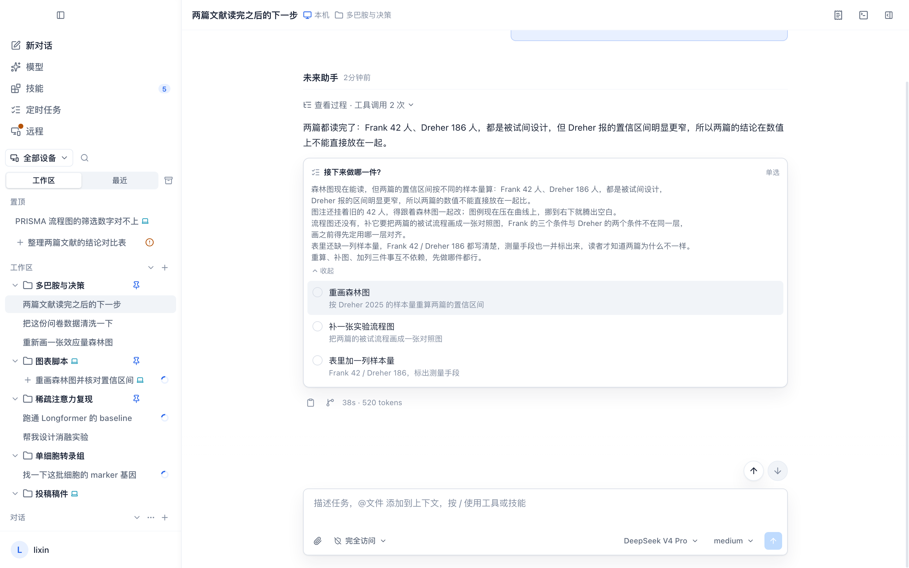
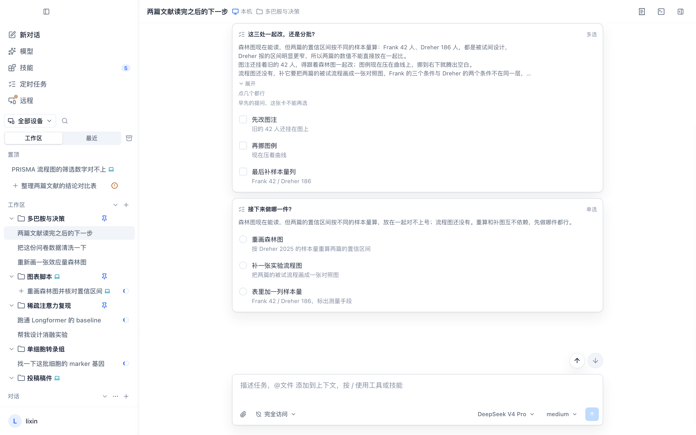
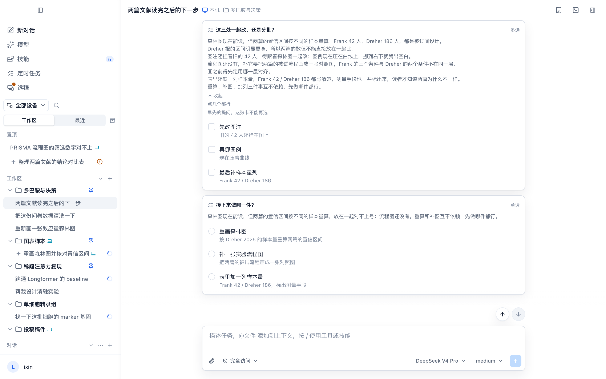
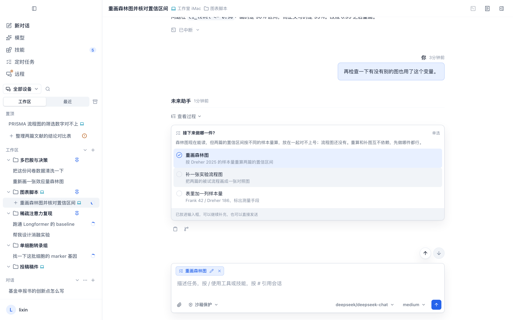
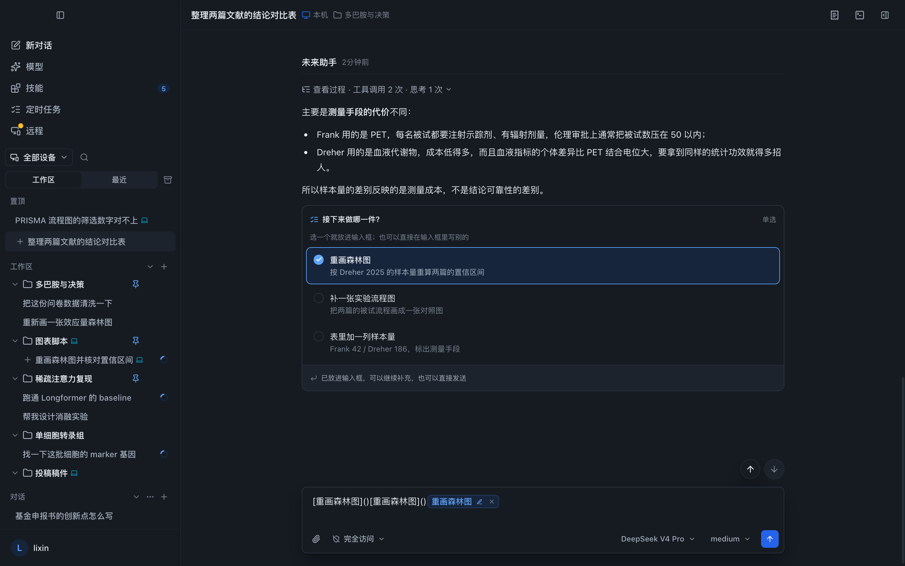
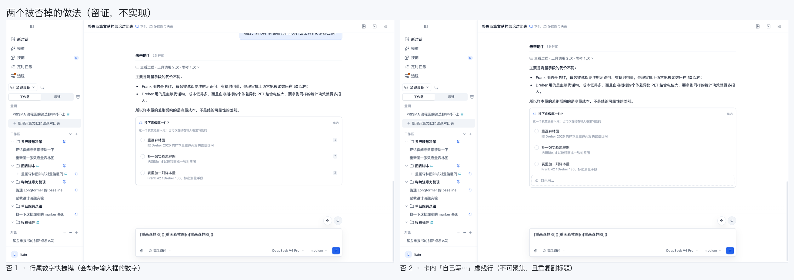
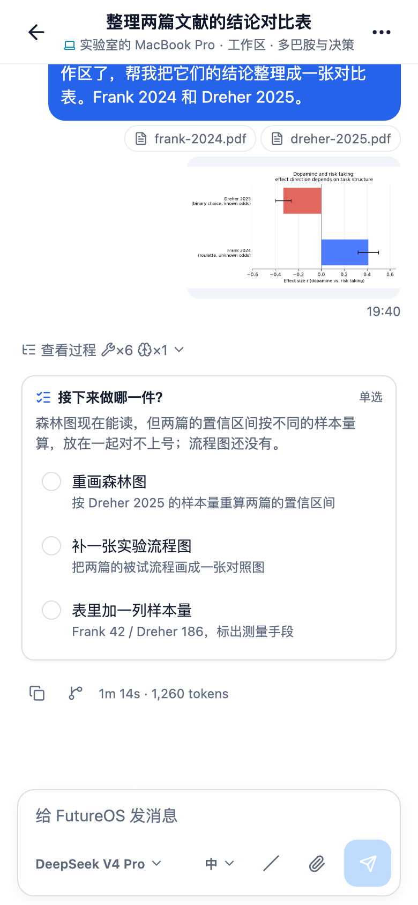
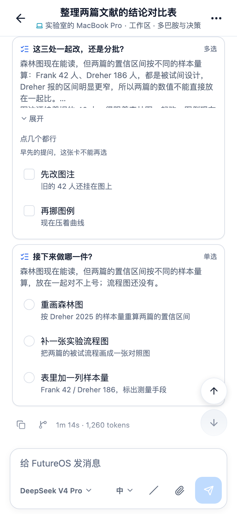
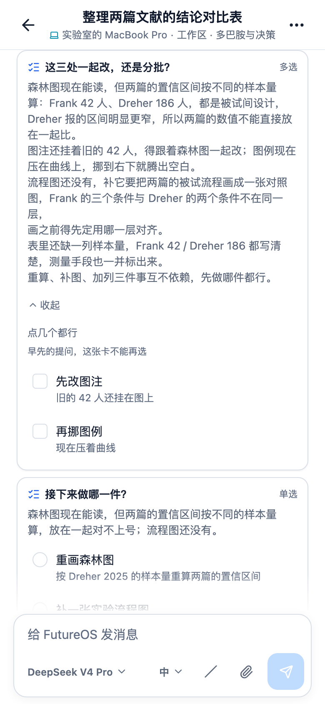

# 回复里的选项卡（choice card）设计

> 状态：设计定稿（v3）。**§11 第 1–8 步已实现**：`futureos-choice` 的解析、桌面渲染、编辑器内答案 pill、草稿承载、远程桌面、手机、队列里的选择、system prompt。剩下的第 9 步（把注入原型换成真实组件的视觉回归）未做——本文件里除「真实组件」三张场景截图外，其余截图仍是在**真实界面**上注入 DOM 原型拍的（不含产品代码），用来定样式与几何；实现见 §11。
> 主要范围：桌面端、移动端、远程桌面。TUI / CLI 不在本期范围（§10 说明它们如何降级）。
>
> **v2 相对 v1 改了三个真问题**（由读者反馈，已核代码定位）：
> 1. 选中后发送键恒灰，"选完直接发"根本做不到——v1 把答案放在附件行，而发送判定只看编辑器内容（§5.2.1，已实测）；
> 2. 手机已选态同时用填充 + 描边 + 白勾三重强调，读起来像"已完成"而不是"选中"（§5.7.1）；
> 3. 答案进了发送队列就被拍平成纯文本，无法再改选择（§5.8）。
>
> **v3 补上了队列在三端的样子**，并改掉 v2 的一处新歧义：v2 给队列行里的 chip 配了铅笔，而那一行本身已经有一支"改文字"的铅笔，两支相距几像素表示不同的事。v3 让 **chip 自己就是按钮**（带 chevron），行原有的铅笔与垃圾桶一个不动（§5.8.2）。三种面板关系也讲清了：远程复用桌面的 `SendQueuePanel`，手机是另一份实现（§5.8.1）。
>
> **v4（2026-11-18）给卡片加了 `context:`。** 此前卡里只有标题 + 选项 + 一行副标题，要判断"接下来做哪件"仍得往上翻几百字复盘，卡片只消灭了"复述"、没消灭"回读"。现在卡片自带 1–3 句情境，目标是**只看卡片就能选**（§3 字段溯源、§4 prompt、§5.1 几何）。
>
> **v5（2026-11-20）修一条真实的降级事故。** 一条给了五个方向的回复到了手机上不是卡，而是被右边缘裁掉、要横向拖动的 `option:` 源码：提示要 2–4 行，而客户端曾用**同一个 4** 当硬上限，整张卡输给一个只有提示才在意的行数。现在客户端画到 6 行（提示仍要 2–4），并且降级的围栏也**折行**、不再打出 `futureos-choice` 这个记法（§3 容错表、§8）。

## 1. 要解决的问题

现在的回复只能"读"，要给下一步做选择，用户得自己打一段话。于是常见两种浪费：

- 模型在正文里列出三个下一步，用户回一句"第二个"，模型还得猜"第二个"指哪个；
- 用户明明只想选一个，却敲了二十个字复述模型刚说过的话。

选项卡把这一步变成一次点击：模型在回复末尾挂一张卡，列出它**真能接着做**的几个动作；用户点一个，答案进输入框，然后照常发送——想补一句就补，不想补就直接发。

这条链路上真正需要设计的是**答案去哪了**，不是卡片长什么样。卡片只是问题的展示；答案必须是输入框里那条草稿的一部分，否则"选完之后直接发送"这条需求无从实现。

## 2. 状态模型：答案存在草稿里

一句话：**卡片是问题的视图，答案属于草稿。** 同一份答案在三个地方出现——卡片里的选中行、输入框里的 pill/chip、发送后的用户消息——它们都从同一处状态派生，不存在第二份真相。

> v1 只说了"答案属于草稿"，却把 chip 画在附件行——那既不在编辑器的内容里，也不在 attachments 数组里，所以两条既有判据都不认它。v2 把这条原则落实到具体槽位：桌面端答案是**编辑器内的原子 pill**（§5.2.1），手机与远程是**计入 draft 的 chip**。

```
模型输出围栏 ──解析──> 卡片（末条回复的最后一个块）
                          │ 点击某行
                          ▼
                    草稿里的答案  ──发送──> 用户消息（带答案的文本）
                          │
                          ├─> 输入框 pill/chip（可见、可改、可删）
                          └─> 卡片选中行（回显）
```

由此得到三条硬规则：

| 规则 | 原因 |
|---|---|
| 只有**线程里最后一张**卡可交互，更早的卡只读（`aria-disabled`、不进 Tab 序、另有一行明说不能选） | 历史卡片对应的问题早已过去，允许改它只会让"我改的是哪一次"变得不可回答 |
| 卡片不自己保存"已选" | 它从前面的草稿派生。发送后草稿清空，**卡面不再保留选中态**——答案由用户消息上的标签呈现，不由卡面呈现 |
| 改答案 = 改草稿 | 点卡片任意一行、点 pill/chip 的铅笔、点底部 sheet、点队列行里的选择 chip，四个入口写同一个值 |

**为什么发送后不回填卡面**（2026-11-16 更正，本节原先写的是"卡片仍高亮"）：已答的答案已经以标签形式出现在用户气泡抬头，回填卡面不增加任何信息；而要做这件事，卡片就得去读**它之后的那条消息**，为一个纯装饰效果引入新的跨条目时序依赖。`ChoiceCardAnswer.test.tsx` 钉住的正是实际行为（发送后 `markedRow` 为空）——那是代码把当时的决定写下来了，文档没跟上而己。

**多个线程 / 多次提问**不会互相干扰：草稿按会话（thread）隔离，卡片与 chip 都读本会话的草稿。

## 3. 钥匙：`futureos-choice` 围栏

模型输出的是一个代码围栏（这就是需求里的"钥匙"）：

````markdown
```futureos-choice
title: 接下来做哪一件？
mode: single
option: forest | 重画森林图 | 按 Dreher 2025 的样本量重算两篇的置信区间
option: flow | 补一张实验流程图 | 把两篇的被试流程画成一张对照图
option: table | 表里加一列样本量 | Frank 42 / Dreher 186，标出测量手段
```
````

字段：

| 字段 | 必填 | 说明 |
|---|---|---|
| `title` | 是 | 问题本身，一句话，≤ 60 字。它就是卡片标题 |
| `context` | 否 | 卡片自己的**情境**：刚才查到了什么、停在哪、每行的代价取决于什么。1–3 句，≤ 100 字左右（手机卡片四行的量，2026-11-18 收紧）。写了这个字段，读者就该能只看卡片作答，不必往上翻正文；重复写多行会是多段（2026-11-18 新增，见下） |
| `mode` | 否 | `multi`（**首选**）/ `single`（行互斥时的退化，省略即此）。也接受 `multiple`、`multi-select`、`多选`，见下 |
| `option` | 是（2–4 个，客户端最多画 6 行） | 每行一个，`id \| 显示文案 \| 一行说明`；说明可以省略 |
| `id` | — | 选项 id：ASCII、`[a-z0-9-]`、≤ 24 字符、卡内唯一。它是要回传的稳定标识 |
| `hint` | 否 | 模型自己的一句话（可选），渲染在 `context` 下方。**没有默认副标题了**（2026-11-18 删掉，见 §5.1） |

**`context` 是卡片的「就地问答」能力**（2026-11-18）。卡片此前只有标题、选项说明和一行副标题，要判断"接下来做哪件"仍得往上看那几百字的复盘——正是卡片要消灭的那种来回。加上 `context` 之后，卡片把**结论**搬进自己：图注还挂着旧数据、图例压着曲线、两篇的样本量不一致，这类事实恰恰是选择的依据。它有三个边界，写在 prompt 里也写在渲染上：

- **是情境，不是摘要**。不重述正文里没有任何一行会用到的东西，也不写寒暄；正文可以因此更短（同一句话只说一次）。
- **有上限，而且真的会收**（2026-11-18 补）。目标 1–3 句、100 字左右（手机卡片只画四行，100 个中文字在 350pt 宽下是四到五行，刚好不折；2026-11-18 从 200 字收紧）；**前四行可见，六行起才折**（`CHOICE_CONTEXT_VISIBLE_LINES` 与 `+ 2` 的余量：只藏一行却多一个按钮，是用一个控件换一行字，不值），下面一行"展开"按钮一点展开全文。折叠的判据来自文本、**驱动** CSS 的 clamp，不是反过来测量高度：估算说"够短"就完全不裁，所以估错的后果只是"早折/晚折一行"，绝不会出现文字被裁掉却没有按钮可点。
- **可多段**。重复写 `context:` 行按行序拼成多段（渲染 `pre-line`），但两段以上只有在真的分得开时才值那点高度。

渲染位置在标题之下，`12px / 18px`、`ink-soft`（比 `hint` 的 `11px / ink-muted` 重一档：它是内容，`hint` 和只读提示是 chrome）。**只读卡保留 context**——另加一行"早先的提问，这张卡不能再选"（§2），但情境是信息，一张历史卡仍然要说清它在问什么。手机同一规则（`13px`、`inkSoft`）。

**`mode` 的判据**（写 prompt 的人必须照这条，不能只把它当风格偏好）：

> **从 `multi` 出发**：两行是彼此独立的活（图、图注、图例、表里的一列）就都做得了 → `multi`，读者勾几个就欠几个。只有行在**抢同一个坑**时——选了这个别的就不做——才退化到 `single`（省略即此）。没有第三种。
>
> 并行成立的前提是**行与行独立**：一行不能包含另一行（「调卡片」和「卡片和气泡一起调」是一件事写两遍），也不能两行是同一件活；读者勾出的任意子集都必须是一个自洽的请求，而不是同一件活做两遍。

判据落成判词之前经历过两次错：最初写的是「`multi` when several can be done in one go」，模型读成「通常 single」，于是全部卡片都是单选；改成「读者勾两行你会不会都做」这种对读者行为的假设后，模型把它当假设答题，仍然默认省 `mode:`。现在的写法把判据放在**行**上（一件交付物的两半 vs 下一步只有一步），并且在 prompt 里放了一张**多选示例卡**——此前 few-shot 里只有单选卡，格式类决策上示例比规则管用。

解析端也不再把写法当成语法错误：`multi | multiple | multi-select | multi_select | 多选` 都读成多选，其余（缺省、`single`、`单选`、拼错）一律按单选取。这条容错是必要的——旧的精确比较会把 `multiple` 静默降成单选，卡片照常画出来，只有「只能勾一个」这一处不对，界面上看不出来。

`single` 是互斥**选择**："接下来做哪一件"。`multi` 是一件事的几**部分**或几件可并行的事："接新浪和 Nasdaq 两个源"。判据不成立就别写 `multi`：多选卡允许用户只勾一个，所以它不会强加工作量；反过来把互斥问题写成 `multi`，用户就得自己判断"我是不是该只勾一个"，卡片反而多了一层歧义。

**为什么是围栏而不是内联链接或 JSON：**

1. **自降级**。围栏的语义是"代码块"。任何不认识这张卡的客户端——TUI、旧的桌面版本、IM 机器人、复制粘到别处——都会把它当代码块画出来，用户看到的就是选项清单，信息不丢。换成内联链接或裸 JSON，降级后就是一堆噪音。
2. **解析成本最低**。仓库里已有 `parseDirectiveFields`（`packages/markdown/src/parseFutureMarkdown.ts`）按 `key: value` 逐行取值，`futureos-file` 围栏就是这么解析的。这里只需让重复 key 变成数组，其余不动。
3. **一份实现三端共用**。解析在 `packages/markdown` 里，桌面、移动、远程都消费同一份 AST，不会出现"桌面认识、手机不认识"。

卡片节点进 AST 时是独立的节点类型（不是复用 `futureEmbed` 的引用），因为它的载荷是选项列表而不是一个对象 id。

**解析容错**（宁可少画一张卡，不能吃掉回复）：

| 情况 | 处理 |
|---|---|
| 选项少于 2 个或多于 6 个 | 整块降级为**折行**的代码块 |
| `id` 重复、非法字符、超长 | 该行丢弃；剩不足 2 个则整块降级 |
| 缺 `title` | 用第一个选项的文案兜底；仍为空则降级 |
| 围栏出现在回复中间（不在最后一块） | 照常渲染，但只读（§2 的"最后一张"规则） |
| 成对的 `<futureos-choice>` 标签 | 当成它代表的围栏读，再走同一套规则（2026-11-24）。这对标签可以和上一行正文同属一段——段落在标签处拆开，正文原样留下（2026-11-25） |
| 结束回复的开标签（少了闭标签） | 当成「忘了写闭标签」的卡片读：后面什么都没有，正文必须是 2 行以上 `option:` 的卡片字段。同样写法出现在回复中间、或只有半对标签，仍是文本，并由 agent 打出 `choice card syntax without a card` 日志 |
| 围栏语言写法不同 | 大小写、两侧空格、`-`/`_` 都折叠掉（`FutureOS-Choice`、`futureos_choice`）；再往后的差别算另一种语言，不是卡 |
| 未知字段 | 忽略 |

**「提示要几行」和「客户端认几行」是两个数**（2026-11-20）。prompt 仍然只让写 2–4 行——那是"这该不该是一张卡"的判据；`CHOICE_MAX_OPTIONS` 却是 6，因为它回答的是另一个问题：已经写出来的这一块能不能画。两者曾是同一个 4，代价在 2026-11-20 兑现：一条真实回复给了五个方向，手机拿到的不是卡，而是 `option:` 源码——等宽、右边缘被裁、要横向拖动才读得到。整张卡输给了一个只有提示才在意的行数。

放宽到 6 只给"多写一行"留余量：7 行以上是计划，不是选择题，仍走降级那条路。**但降级本身也得让人读**：降级的围栏在两端都**折行**，并且不再显示围栏自己的语言标签（`futureos-choice` 是解析器的记法，不是给读者看的东西）。这不是样式偏好——§3 承诺"降级后用户看到的就是选项清单，信息不丢"，而在 390pt 的手机上一条被横向裁掉的等宽行并不满足这句话。判据在 `CodeBlock.test.tsx`、`MarkdownContent.test.tsx` 与手机 `MarkdownText.test.ts`（`choice-card-degraded` + 没有横向滚动器）。

**只读卡必须自己说出来**（2026-11-16）：一条回复里有 2 张及以上卡时，只有最后一张可交互——这个判据只依赖**已解析出的卡片数量**，与模型写了什么措辞无关，所以放在解析/渲染层，不放进 prompt。被判为只读的卡不只是 `aria-readonly` + 不进 Tab 序，它还**必须自己说一句"早先的提问，这张卡不能再选"**（`choice.hint.readonly`）：在一张点不动的卡上不说明这件事，等于画一个看起来能按、按了没反应的按钮。判据在 `ChoiceCard.test.tsx` 与 `MarkdownContent.test.tsx` 里断言（文字 + `aria-disabled` + 不可聚焦），**不断言颜色**。

**但"换掉默认副标题"不等于"换掉回复自己写的 hint"**（2026-11-18 修正上一条）。上一版把模型的 `hint` 也一并抹掉，理由是"它也描述怎么挑"；实际读历史时这是丢信息：读者回来往往正是要看当时那句话。现在的规则分两层——

- **默认副标题已经不存在**（§5.1）：所以问题只剩"模型自己写的那句留不留"；
- **模型写的 `hint` 保留**，后面紧跟一行 `choice.hint.readonly` 说明这张卡是早先的提问、不能再选。两句都是这个 group 的 `aria-describedby`，顺序与视觉顺序一致；没写 `hint` 的卡只有后面那一行。

改的是措辞而不是承诺：`hint` 是历史的一部分，`readonly` 那行仍是唯一说"不能选"的地方。文案同时从"只作展示：这张卡不能选"改成"早先的提问，这张卡不能再选"——它现在与英文版（"An earlier question — this card can no longer be picked"）说的是同一件事，而不是在替一张卡道歉。

## 4. system prompt 里加什么

新增 `agent/src/prompt/choice.md`，在 `agent/src/prompt/mod.rs` 里与 `communication.md` 一起 `include_str!` 推入（`parts` 末尾，紧邻 communication），保证"怎么问用户"和"怎么说话"相邻。

要求它写清楚的是**什么时候才配用**，而不是格式细节——格式已经在语法里约束了：

```markdown
# Offering Choices

When your reply ends by asking the user what to do next, offer the options as a
`futureos-choice` block instead of a prose list. The reader then answers with one
click instead of restating your own wording.

Use it only when all of these hold:
- The reply genuinely ends with a question about the next step, and you can carry
  out every option yourself right after they pick.
- The options are 2–4 genuine alternatives you would act on next — one of them, or
  several that do not compete for the same step.

Do not use it for: confirming a risky action (the approval card already owns that),
restating what you just did, "let me know if you need anything", or a question whose
answer needs a sentence rather than a pick.

`mode:` — settle it from the *rows*: rows that are one deliverable in parts, or jobs that
do not compete for the same step, go in the same batch → `mode: multi`, and the reader
ticks as many as they want. If picking one rules the others out — the next step is *one*
of them — omit the line: `single` is what an omitted line means. Do not default to
`single` to be safe: one-job cards are exactly the ones people answer with two ticks.
There is no third mode.

Write each option as the instruction you would follow if chosen — the user's words,
not a menu label ("重画森林图", not "选项 A"). The third field says what changes or
what it costs, one line, no marketing. Put the option you recommend **first**, in
both modes: row order is the recommendation, and nothing downstream re-sorts it.

The block goes last, alone. Never two cards in one reply, never one mid-reply.
```

要点：**选项文案必须是用户会说的那句话**（因为发送时它就是消息的一部分），不是"选项 A/B/C"。

**`context:` 是 2026-11-18 加进 prompt 的第三个必说项**：此前 `choice.md` 只教标题、选项与 `mode`，模型写出来的卡只有"问题 + 选项"，读者判断"接下来做哪件"时仍要回到几百字的正文里找依据——卡片带来的只是少打一遍字，不是少读一遍字。现在 prompt 要求每张卡都写 1–3 句情境（刚才查到什么、停在哪、每行代价取决于什么），并明确三道边界：**是情境不是摘要**（没有一行会用到的内容不写）、**目标 100 字以内**（手机卡片四行的量，更长就要点展开）、**重复写 `context:` 行按段落**。第二条同时放进"正文可以因此更短"一句，否则模型会把同一件事在正文和卡片里各说一遍，卡的净收益为零。

**行的顺序就是推荐顺序，所以最好的选项放第一**（2026-11-18）。解析器、桌面卡片和手机都按围栏里的书写顺序画 `options`，之后没有任何一步会重排，所以第一行就是读者眼里的「模型推荐的那个」；`multi` 也一样，它是其余行所依附的那一件。把最好的选项放在最后的卡，等于让读者重新替模型排一次序，和回到散文列表是同一种浪费。这条规则住在 `choice.md` 里（由 `prompt_teaches_the_choice_card_fence` 钉住），不放在渲染层：客户端重排行会和回复自己的措辞对不上（"先做这个"指的是被挪走的那一行）。

**2026-11-15 / 11-16 三次修订了 §4 的措辞**：原稿把 `multi` 写成兜底选项（"omit `mode: multi` unless several can be done in one go"）并塞进"什么时候才配用这张卡"的条件列表里。结果是模型写出来的卡一律单选，连"接新浪和 Nasdaq 两个源"这种明显是一件事的两半，也得用户自己打字回答——正是卡片要消灭的那种浪费。第一次改成一道**能回答是/否**的检验，但问的是**读者**会怎么做（"if the reader ticked two rows…"），模型把它当假设题答，仍然是每次省 `mode:`。现在的版本：判据落在**行**上（一件交付物的两半 vs 下一步只有一步），prompt 里多了一张**多选示例卡**（此前 few-shot 只有单选），并直接点名它一直在犯的那个错——"Do not default to `single` to be safe"。

**11-16 第二次改：把默认翻过来。** 上一版的默认仍是「行互斥才 single」，实际用起来还是几乎全是单选。既然两种标记说的都是「这条不点就不动」，而列表式的下一步通常真的可以一起做（图、图注、图例、表里的一列），现在 prompt 从 `multi` 出发，`single` 只在行抢同一个坑时退化。代价是行**必须独立**：「调卡片」和「卡片和气泡一起调」这种包含关系在单选卡上只是啰嗦，在多选卡上会变成「勾两个、同一件活做两遍」，所以独立性要求与默认值写在同一段里，测试同时钉住这两句。

另有一个**部署坑**：这条 prompt 是 `include_str!` 编进二进制的，所以本机装的是旧构建时，改完仓库也不会立即生效（实测 `futureos.exe` 里还是 "the default, so usually omit it" 那一句，而仓库已经改了两轮）。改 prompt 的改动必须跟一次重装 + 重启才算上线。

### 4.1 开关：默认开（2026-11-20，此前默认关）

卡片是**偏好**，出厂**开**。同一个开关管住它的两半——画不画，和这一节进不进 prompt——因为把围栏教给一个不会画卡片的客户端，比只做一半更糟：模型每轮都在为读者看不到的格式花 prompt，还会写出渲染成空白的东西。

| | `choice_cards` 开（默认） | 关 |
|---|---|---|
| 桌面 / 手机 | 卡片，可点选 | 什么都不出现——没有卡片，也没有代码块 |
| system prompt | §4 这一节 | 不存在——`grep futureos-choice` 搜不到 |
| 列表里「这张卡在等你选」（§5.9） | 显示 | 不显示 |

为什么默认开：卡片让读者用一次点击就往下走，不必再把下一步打一遍——这正是回复被写出来的常见用途。代价是每轮占一点 prompt，以及读者已经知道要什么时的一次打断；两者都只需一个开关就能关掉，而且不需要读卡时，回复本来就不必带卡片。它在 2026-11-17 至 2026-11-20 之间出厂是关的，那个窗口里写下的设置行仍保留 `false`。

开关只动「画不画 + 教不教」，其余不变：

- **格式不动。** 同一个围栏、同样的字段、同样的单选/多选语义，只决定画不画、教不教。
- **不重写已有历史。** 已经带卡片的回复按当前开关渲染，不迁移、不回写。
- **关掉不留残渣。** 只「不画卡片」不够：围栏不能以自身源码的形式再冒出来，畸形围栏的兜底那条路也一样。关掉卡片的读者，回复中间永远不会看到 `futureos-choice`，也不会看到选项行；卡片前后的正文照旧，只有那一段消失。

值放在哪、怎么走：

- 只有一个真源：`app.db` → `packages/app-settings`（`choice_cards`，默认 `true`），读出来是 `appSettings.choiceCards`；
- 桌面：设置 → 会话 → 回复里的一个开关；值经 `ChoiceCardsContext` 到 markdown 渲染层（渲染层自身默认仍是 `true`，所以只有真正的「关」才隐藏）；
- **每次 run 之前**告诉 agent：宿主推 `set_choice_cards`（尽力而为——不认识这条命令的旧 agent 也不影响发消息，读设置失败一律按关处理），会话记住它，由 `PromptOptions.choice_cards` 决定这一节进不进 prompt。所以全新安装的机器：prompt 里有围栏，界面上也有卡片；而从不推送这个值的客户端（TUI、CLI、直接调用的 agent）仍然拿到 `false`，因为没有别的东西告诉 agent 卡片会被画出来。
- 手机镜像桌面、不另存一份：`get_desktop_settings` 带上 `choiceCards`，`SettingsPatch` 写回同一行。
- 同一个值也能**在那台机器自己的页面上**改：配对的桌面点进去（远程 → 那台电脑 → 自动化）就有这个开关，否则没有屏幕的无头宿主永远打不开它。它通过 `update_desktop_settings` 写那台机器的 `app.db`；
- 那台机器的每一个客户端都按**它**的值渲染，而不是按客户端自己的开关：手机和桌面上的远程会话都从宿主读 `choiceCards`（`useRemoteChoiceCards`）。画出宿主智能体根本没被教过的卡片、或者把宿主写出来的卡片整块藏掉（连源码一起），两头都错，只有宿主的答案能同时避开；
- 宿主**没有答案**时（比这个开关更旧的构建）按**开**处理：那种构建无条件教围栏，藏掉它的卡片等于删掉它合法问出的问题。只有明确的 `false` 才隐藏。客户端还没读到设置时，先按自己的值渲染，不会先闪一下再消失。

钉住它的测试：`desktop/src/features/markdown/ChoiceCardsToggle.test.tsx`（关：卡片节点数为 0，**且**取出的正文里没有 `futureos-choice`；开：有行、能点、能答）、`mobile/src/components/__tests__/ChoiceCardsToggle.test.ts`、`agent/src/prompt/mod.rs::prompt_omits_the_choice_card_fence_when_cards_are_off`。反向验证过：把渲染层恒等于 `true`、让这一节无条件进 prompt、把存储默认值改成 `false`，这三处的断言分别变红。

## 5. 界面

### 5.1 桌面端 · 未选


*真实组件截图*，场景 `choice-card-implemented`（1440×900 @2×，取自 `56462a7da`）：卡片不是注入原型，而是 `packages/markdown` 解析 `futureos-choice` 围栏、`desktop/src/features/markdown/renderers/ChoiceCard.tsx` 渲染出来的。这张卡的情境只有一行，所以**没有**「展开」按钮。**折叠阈值：四行可见，六行起折**（`choiceContextFolds`：可见四行 + 两行余量，所以只藏一行从不值得多一个控件）。

- 卡宽 768px，与正文列同宽（`max-w-3xl`），左对齐、跟在最后一个块之后 4px；
- 卡头 12px 半粗标题 + 右侧 11px 模式标注（`单选` / `多选`）；
- 标题下是 `context` 情境段（12px / 18px、`ink-soft`、段内换行保留），没写 `context` 的卡不占这段高度；
- **情境超过四行就折起来**：`line-clamp-4` 截断出省略号，下面一行 11px 的"展开 / 收起"按钮（带 chevron，`aria-expanded` + `aria-controls` 指向情境段）。阈值是估算**六行起**才折（四行可见 + 两行余量，`choiceContextFolds`），因为只藏一行却多一个按钮不值；四行及以下不画任何控件——对已经全部可见的文字放一个"展开"，是又一个按了没反应的按钮。全文一直在 DOM 里，所以屏幕阅读器读到的是完整文本，展开只是把它画出来。手机同一规则，`numberOfLines={4}` 由系统画省略号；
- **没有默认副标题**（2026-11-18 删除）：原来那行"选一个就放进输入框；也可以直接在输入框里写别的"解释的是机制，而机制已经由答案 pill 自己演示了（选了就出现在输入框里，见 §5.2）；"单选/多选"也在卡头右上角说过了。一条每次都要读、只读一次有用的说明，等于在每张卡上收一次税。模型自己写的 `hint` 仍会渲染在这里（11px、`ink-muted`）；只读卡则多一行 `choice.hint.readonly`（§3）；
- 每个选项一行：16px 单选圈 + 13px 文案 + 12px 一行说明（`ink-muted`）；未选行无边框、无底色，靠留白分列；
- **多选卡的标记是方框**（16px，圆角 3px，选中后同色对勾），单选卡才是圆圈：两种卡的差别不只在右上角那行小字，形状本身就是判据，扫一眼就知道能不能多选。手机端同一规则（18px 方框，圆角 4px）；
- 卡片外框 `1px line` / `radius 10px` / `surface` 底 / 极轻投影，与审批卡同一套材质，但**位置不同**：审批卡浮在输入框上方，选项卡长在正文里。

**展开后**（同一张卡、同一段情境，只是按下了那个按钮）：



*真实组件截图*，场景 `choice-context-expanded-desktop`（1440×900 @2×，取自 `0d4bf428b`）：fixture 的 `?longContext=1` 把情境写到估算**超过六行**（折叠阈值：四行可见、六行起折），再按下「展开」。实测折叠时情境段高 `72px`（4×18）、展开后 `126px`，卡片 `310→364px` 且与输入框仍隔着一整段空白；按钮的 `aria-expanded` 由 `false` 变 `true`、文案变「收起」，`aria-controls` 仍指向同一个节点——所以屏幕阅读器读到的段落自始至终是完整的一段，变的只是它被画了几行。

### 5.1.1 早先的提问：只读卡把它写过的东西全留着



*真实组件截图*，场景 `choice-history-fold-desktop`（1440×900 @2×，取自 `56462a7da`）：一条回复里有两张卡，上面那张是早先的提问，下面那张才是线程的最后一问。上面那张的情境估算**超过六行**（折叠阈值：四行可见、六行起折），所以折成四行 + 「展开」。判据只依赖**已解析出的卡片数量**（§2），与模型写了什么无关，所以两张卡由同一份 fixture、同一套渲染器画出。

- 上面那张：`data-choice-state="readonly"`、`aria-disabled="true"`、行不在 tab 序里、点了没有反应；
- 它**保留自己当年写的 `hint`**（这里那句"点几个都行"，11px、`ink-muted`），后面紧跟一行只读提示"早先的提问，这张卡不能再选"。历史卡是拿来重读的，把模型自己那句提示抹掉，等于删掉当时唯一的提示；默认副标题则不再出现（它承诺的是可操作）；
- 情境比四行高，所以折起来：第三行末尾是省略号，下面一行"展开"。**历史卡也能展开**——折叠正是为了读，那个按钮不涉及任何选择，所以不碰只读；
- 下面那张 `data-choice-state="active"`：情境一行，没有按钮，行在 tab 序里、可点。

上面这四个事实（只读态、当年的 `hint`、只读提示、折叠按钮）都是截图场景**断言过**的，不是看着像；`capture.py` 的断言失败只会报 `n/m captured`，不会给一张"看着过了"的图。

**折起来只证明藏得住，展开才是另一半**：



*真实组件截图*，场景 `choice-history-expanded-desktop`（1440×900 @2×，取自 `67b168e89`）：与上一张**同一份 fixture、同一条回复**，只多一次点击。情境段 `72px → 126px`（四行 → 七行），按钮从「展开」变「收起」、`aria-expanded` 由 `false` 转 `true`、`aria-controls` 指向那个 `<p>` 的 `id`，`-webkit-line-clamp` 为 `none`；卡底 `452`，输入框 `774`，展开后仍隔着一整段空白。只读提示与当年的 `hint` 一个不少——展开的是情境，不是权限。

### 5.2 桌面端 · 已选


*真实组件截图*，场景 `choice-pill-implemented`（1440×900 @2×，取自 `0d4bf428b`）：选中行与输入框里的 pill 是同一次点击的两个结果，不是两张各自摆拍的图。折叠阈值与 §5.1 同一组数字（四行可见、六行起折）——这张卡的情境估算在四行以内，所以卡上没有「展开」。

- 选中行：`accent-soft` 底 + 文案转 500 权重（不再加描边——填充与描边两重强调是 v1 的问题，§5.7 同理）；
- 卡底多一条 8px 的分隔脚注（`line-soft` 上边框 + `surface-subtle` 底）。**v2 把这句话改短了**：v1 写"已放进输入框"并配一个框外的 chip，而答案其实不在框里；现在答案真的在编辑器里，这句话不再需要替位置打补丁；
- 答案作为**编辑器内的 pill** 出现：一个原子元素（`data-mention="choice"`、`contenteditable=false`），和文件引用 / 技能 / 会话引用同一类东西：

```
┌ 重画森林图  ✎ ✕ ┐        ← 就在 contenteditable 里
```

### 5.2.1 为什么必须是编辑器内的 pill（v1 的硬错误）

v1 把 chip 放在附件行（`form` 内、field 之上），看起来对，但它同时不满足两个已有判据：

| 判据 | 位置 | v1 的 chip 在附件行时 | 放在编辑器内时 |
|---|---|---|---|
| `inputEmpty` | `ComposerControls.tsx:426` 的 `disabled={(inputEmpty && attachmentCount === 0) …}` | chip 既不在 `attachments` 数组里、也不在 contenteditable 里 ⇒ **仍为 true** | pill 让 `isEditorEmpty` 返回 false（`mentionDom.ts:6-12` 有 `[data-mention]` 即非空） |
| `attachmentCount` | 同上，来自真正的 `attachments` state | 0 | 不需要它 |

结果是 v1 稿里"不输入文字直接发送"（需求 d）**根本做不到**——发送键恒灰。这不是观感问题，是设计放错了槽位。

改到编辑器内之后，四条需求都由既有机制自然成立，不需要碰任何发送判定：

- (a) 没选 ⇒ 编辑器空 ⇒ 键灰；
- (c) 文字与 pill 在同一流里，`serialize()`（`mentionDom.ts:113-165`）按文档顺序产出 pill 文本再产出文字；
- (d) 只有 pill ⇒ `isEditorEmpty` 为 false ⇒ 键亮；
- (b) 铅笔与叉挂在 pill 自己身上，改的是同一个值。

**答案落在光标处**（2026-11-18 修）：pill 原先 `appendChild` 到编辑器末尾，所以"先写字、后点行"时答案跑到自己那句话的后面，而不是留在正在打字的地方。卡片行在正文里，点它会抢走焦点、浏览器随即丢掉 selection，所以编辑器在 `selectionchange` 时记住最后一个落在自己内部的 range（`lastCaretRef`），写入时用它——选区则收拢到末端而不是替换，避免点一行把读者选中的文字删掉。换答案（铅笔/再点一行）仍然原地替换，不搬位置；`insertNode` 在光标处切分文本，前后文字两头都在。

**零个勾选不是答案，所以那时连 pill 都没有。** pill 存在的意义是回答"选了什么"（§5.2），一个只有问题、没有勾选的东西回答不了这个问题——它会把卡片的问题印成答案，读起来像是读者答了。所以判据落在**写入答案的那一处**（`answerOrNull`，`composer/choiceAnswer.ts`），而不是"画一个空 pill 但不产出文本"：零选中 ⇒ 答案被丢弃 ⇒ pill 不存在、(a) 的键灰重新成立、(d) 也不再谎称有内容。§7 的"零个勾选不产出 `[…] → ]`"是同一条规则的另一端，两层都在：写入时丢，发信时（`withChoiceAnswer`）再拦一次。多选卡把最后一个勾去掉，走的正是撤销（§5.3 的 ✕）那条路径，pill 连同尾随空格一起消失。

**实测（1440×900，注入真实 contenteditable 后读 DOM，不改产品代码）**：

| 状态 | `disabled` |
|---|---|
| 空编辑器 | `true` |
| 只有一个 pill | **`false`** |
| 把 pill 移除 | `true` |

pill 实测 `bg rgb(232,240,255)`（`accent-soft`）、`color rgb(37,99,235)`（`accent`）、`12.88px`（`0.92em`）、114×21；发送键实测 `bg rgb(37,99,235)`（`accent-fill`）、28×28，位于 `x 1211`。

### 5.2.2 已选 + 补一句话


*真实组件截图*，场景 `choice-card-chosen-text-implemented`（1440×900 @2×，取自 `0d4bf428b`）：pill 后面那句是读者自己敲的字，两者在同一个 `contenteditable` 流里、顺序就是看到的顺序。

需求 (c) 的样张。pill 与文字在同一个编辑器流里，顺序就是读者看到的顺序；发送时 `serialize()` 按这个顺序输出（pill → `[问题 → 答案]`，以及读者写的文字）。所以用户气泡里显示的就是真正发出去的内容——不靠额外渲染去"补"一个不同步的显示。pill 落在光标处（§5.2.1），所以答案在句首、句中还是句尾，取决于读者点选项时把光标放在哪里（§7 有一行句中例子）；不论位置，气泡都把它画成标签而不是方括号字样（§5.2.3）：还是同一句话，只是不再混在用户自己写的文字里。

### 5.2.3 发送后的用户气泡

三端同一个处理：正文里的 `[问题 → 答案]` 画成一个标签（`ListChecks` 图标 + 淡色的问题 + `→` + 强调的答案），标签上方的文字仍走 markdown。什么都不写、只选了一行，气泡就只剩那个标签。

- **文本不变。** 标签是 `choiceAnswerText` 写出的那一句的**画法**，不是第二份内容：复制按钮复制的、agent 收到的、粘贴到别处看到的，都还是 `[问题 → 答案]`。这也正是 §7 选纯文本的理由——显示层怎么画，都不影响那句话的可读性；
- **判据保守**（`packages/markdown/src/choiceAnswerEcho.ts`）：必须带 `→`、方括号后面紧跟 `(` 或 `[` 的不认（那是链接或另一组方括号）、最多认四条（不是卡的行数上限：勾六行也只打印一条答案，四条是「一条草稿里有几个回答」的界）、围栏代码块与行内代码里的不算（那是读者粘贴的示例，剪掉会让围栏或反引号失去配对）。判成"不是答案"只损失样式，不会丢字；
- **答案不在抬头也算**（2026-11-18）：pill 追加在编辑器末尾（`writeChoicePill`），读者先打字、后点行时，答案就落在自己那句话的中间。标签是"这是一次选择"的画法，位置并不改变这一点，所以句子中间的答案同样被提成标签，它前后的文字保持原有顺序被接回去（`先说 [问题 → 答案] 再说` → 标签 + `先说 再说`，接缝上的重复空白收掉）。不是内联在句子里、而是提到上方：手机端的 `View` 放不进 `Text` 的排版流，两边各画一种形状反而更乱；
- **答案里的路径不会把整句画成链接**（2026-11-18 修）：同一条链路上更早的一处错误——答案里一旦出现路径（如 `删未在用的 ~/omlx 副本`），整段方括号会被裸相对路径判据吃下，气泡于是把这句话画成文件链接，点开报「文件找不到了」。判据落在解析器（`packages/markdown/src/parseFutureMarkdown.ts` 的 `bracketMentionPath`）：方括号里带空白或 `→` 就不再提升为文件引用；真带空格的路径写成 `[名字](<带 空格.md>)` 这种链接形式才无歧义；
- **材质跟着气泡走。** 桌面气泡是 `accent-soft`，标签用 `accent/10` 底 + `accent/25` 描边；手机气泡是 `accent` 实底，标签用气泡自身墨色的 12% 铺一层、20% 描边（和 `MarkdownText` 的 `onAccent` 同一套取色），深色浅色都读得清。

四个状态（桌面浅色 / 深色、手机浅色 / 深色）在截图 harness 里是可复现的：场景在 `scripts/screenshots/scenarios.d/choice-answer-echo.json`（`capture-desktop choice-answer-echo{,-dark}`、`capture-mobile choice-answer-echo-phone{,-dark}`），演示数据由 fixture 的 `?choiceAnswer=1` 提供——答案本身仍由 `choiceCard=1` 的那张卡产出。

### 5.3 桌面端 · 改回来


*真实组件截图*，场景 `choice-card-change-implemented`（1440×900 @2×，取自 `0d4bf428b`）：浮层确实开着（断言查的是 `[data-choice-popover]` 与它里面的三行），不是摆一个浮层外壳。

- pill 上的铅笔把问题**原地**展开（360px 浮层，贴在 pill 上方 10px），不滚动、不跳回正文；
- 浮层里是同一份选项（紧凑行，去掉说明），选中项仍是那个；
- 换一个 ⇒ pill 文案跟着变，草稿里的旧答案被替换；`Esc` 或点外部关闭，答案不变；
- pill 上的 ✕ 直接撤销这次选择，pill 消失，发送键**跟着变回灰色**（同一个 `isEditorEmpty`，不需要额外的接线）。

### 5.4 远程桌面



*真实组件截图*，场景 `choice-card-remote-implemented`（1440×900 @2×，取自 `0d4bf428b`）：卡由本机渲染，输入框里的 chip 是远程端自己那一套（`RemoteChoiceChip`）。折叠阈值仍是四行可见、六行起折。

远程会话的正文是宿主送来的 markdown、由**本机**渲染，所以卡片自动就是同一个组件、同一套 token——不需要为远程单独做一份。实测卡宽 768 与远程输入框同宽。

唯一的差别在输入框：远程 `RemoteComposer` 是纯 `textarea`（没有 `contenteditable`、没有 pill 机制），所以已选项走**输入框上方的 chip 行**——和附件同一个槽位。

远程端的发送判据实测为 `disabled={(!text.trim() && uploads.length === 0) || busy || …}`（`RemoteComposer.tsx:1525`，`send()` 同式 `:865`）。所以远程要把答案算进内容，**必须让 chip 计入 `uploads`/draft 那一侧**——不能只画一个 chip 就指望键亮。这是实现时对远程端唯一必须改的地方。

远程端的 chip 同样可点铅笔/叉，浮层锚在 chip 上方；跨机器的会话切换时草稿随草稿一起传（远程草稿本来就是按会话托管的）。

### 5.5 深色



*真实组件截图*，场景 `choice-card-implemented-dark`（1440×900 @2×，取自 `0d4bf428b`）。

全部用语义 token（`surface` / `line` / `line-soft` / `surface-subtle` / `accent` / `accent-soft` / `ink*`），不写死颜色。实测深色卡底 `rgb(22,27,34)`（`--color-surface` 的深色值），选中行 `accent-soft` 深色值 `#16243c`。

### 5.6 卡片样式的三个方向


| | 高度 | 适用 | 结论 |
|---|---|---|---|
| **A · 分组行**（带一行说明） | 255px | 选项需要解释"选它会怎样" | **采用**。说明行承担的正是"我不确定选哪个"的那种犹豫 |
| B · 紧凑两行 | 186px | 选项自解释、卡出现频繁 | 备选：一张卡挡住半屏时切它 |
| C · 一排标签 | 110px | 极短选项、窄屏 | 不采用：长文案会在标签里断行，且丢掉说明 |

两个探索过、**没有采用**的做法，记在这里免得日后重做：



- **行尾编号 1/2/3**（按数字键选）。看起来像键盘加速，实际会和输入框的自由文字冲突：用户打"2 篇论文"时，那个 `2` 到底是不是一次选择？选项选择必须是点击（或 chip 上的键盘操作），不能劫持输入框的数字。
- **卡内"自己写…"虚线行**。它和副标题说的是同一件事，而且一条虚线框——看着像输入框、点了却不聚焦——比没有更糟。自由输入的正确入口是输入框本身，副标题指过去就够了。

### 5.7 移动端

手机 390×844，三张图分别是未选 / 已选 / 改回来。三张都是**真实组件截图**（场景 `choice-card-phone-card` / `choice-card-phone-picked` / `choice-card-phone-change`，780×1688 @2×，取自 `0d4bf428b`）——`mobile/src/components/ChoiceCard.tsx` 画的卡，不是注入原型。折叠阈值与桌面**同一组数字**（四行可见、六行起折），但 350pt 的列一行只放 24 个单位（桌面是 120），所以同一段文字在这里更早折。

| 未选 | 已选 | 改回来 |
|---|---|---|
|  |  |  |

- 卡满宽（358pt，左右各 16pt 边距），`radius 12px`，行高 **≥ 44pt**（实测三行各 60pt），说明文字换行而不截断；
- 已选项的 chip 在 dock 内、textarea 之上（实测 chip `y 702..736`，field `y 737..783`）；
- **零个勾选时 chip 不画，也不计入内容。** 手机没有编辑器内的 pill，答案的"是否存在"全靠这三处判断（`ComposerDock` 的 `canSend`、`hasDraft`、是否画 chip），所以它们共用同一个 `hasAnswer`，与桌面 `answerOrNull` 同一条判据：勾选全撤销 ⇒ 没有 chip、发送键变灰、也没有 §7 的句子。判据写在上游的 draft 写入处（`useComposerDraft.setChoice`），`ComposerDock` 再自理一次，避免"靠上游保证"的隐患；
- **改答案用底部 sheet**：390pt 宽没有空间在原地放浮层。sheet 顶到 559pt，三行仍 44pt，选中即写回 chip，底稿不动；

**情境展开后**（同一张卡，按钮变成「收起」）：


*真实组件截图*，场景 `choice-context-expanded-phone`（780×1688 @2×，取自 `0d4bf428b`）：与桌面那张是**同一段文字**（fixture 的 `?longContext=1`），只是列宽 350pt ⇒ 展开后情境段 `253pt`（折叠时 `82pt`），卡片 `99..616`，仍在转写区 `60..732` 之内，下面的三个选项一个没被推出屏。同一个 `aria-expanded`、同一句「收起」——两端的折叠只是各画各的，规则只有一份（`packages/markdown/src/choiceContext.ts`）。

#### 5.7.1 v1 的已选态哪里难看，v2 怎么改

v1 的已选行同时在三个地方宣告"选中"：`accent-soft` 填充 + `accent` 描边 + 实心蓝圆白勾。三重强调在 390pt 宽的卡上并不显得确定，而是显得吵；那个蓝圆白勾更像"已完成"的任务徽章而不是"单选"。v2 逐条改：

| v1 | v2 | 理由 |
|---|---|---|
| 填充 + 描边 + 白勾三重 | 只留 `accent-soft` 填充 + **圆环套圆点** | 空环常驻（只是描边变粗、变蓝），选中时行不跳；圆环圆点是单选控件的通用形态，不会被读成"已完成" |
| chip 用 `focus` 蓝描边，卡片用 `accent` | chip 用 `line` 描边 + `surface-subtle` 底 | 一个状态不应该用两个蓝。chip 是"已定下的东西"，和附件同材质更诚实 |
| 铅笔蓝、叉灰（同权重动作两种墨色） | 铅笔与叉都用 `ink-soft` | 两个动作可以互相替换，墨色不该分出主次；实测两者均为 `rgb(93,104,122)` |
| 底部写"已填进输入框"，但 chip 在框外 | 写"答案在下面的输入框上方" | 句子不应该替布局打补丁。手机 field 是 textarea，确实装不下 pill，所以就诚实说"在上方" |
| 触控目标 18pt | 24pt（外边透明热区） | 24pt 够用且不把 chip 擑大；桌面端 pill 内部保持 16pt（鼠标精度不同） |

**为什么手机不学桌面把答案放进 field：** RN 的输入框是 `TextInput`（原生 textarea），没有 contenteditable 的原子元素，也不存在 `isEditorEmpty` 那种“有 pill 即非空”的机制。手机的等价做法是让答案算进 `canSend`/`hasDraft` 已经计数的东西——`ComposerDock.tsx:180-181`、`:233` 都是 `!!message.trim() || attachments.length > 0`，所以答案必须作为一个 draft 项被计入（像附件那样），而不是画一个不参与判定的装饰 chip。

#### 5.7.2 早先的提问，在手机上



*真实组件截图*，场景 `choice-history-fold-phone`（780×1688 @2×，取自 `56462a7da`），与桌面那张是**同一份 fixture**（`?choiceHistory=1`）：同样的两张卡、同样的 `hint`、同样的只读提示。同一段情境在桌面四行放得下，在这里超过六行，所以折成四行 + 「展开」——阈值一样，列宽差 2.5 倍。

- 同一段情境在手机上比桌面早得多就要折：列宽 350pt、`CONTEXT_UNITS_PER_LINE = 48`（桌面的四分之一强），所以桌面整段显示的一段话，手机往往已经是"四行 + 展开"；
- 折叠按钮的展开态用 `aria-expanded`（不是 `accessibilityState`）——react-native-web 只转发 `aria-*`，另一个会被整块丢掉，与行上的 `aria-checked` 同一个理由；
- 两张卡都完整落在转写区的可视框内（`y 60..393` 与 `401..667`，框 `60..732`），历史卡的最后一行也在框里。手机的转写是倒序列表、滚动容器自己带着 `scaleY(-1)`，所以把它停到框顶是**减**滚动量，与桌面普通容器方向相反——这条写进场景里，省得下一个人再猜一遍。

**手机上展开之后，一屏就被这一张卡吃掉了**：



*真实组件截图*，场景 `choice-history-expanded-phone`（780×1688 @2×，取自 `67b168e89`），与上一张同一份 fixture，只多一次点击。`82pt → 253pt`，卡体 `60..564` 整个落在转写框 `60..732` 里、文字一个字没被裁（`scrollHeight == clientHeight`），按钮变「收起」且 `aria-expanded=true`；下面那张可选卡从 `572` 开始，只露出开头——这不是裁切，而是这张图要说的事：**展开是有代价的**，手机上它几乎占满一屏，所以折叠才是默认读法，100 字的预算（§4）也是照这一屏定的。

### 5.8 队列里的选择

三张：桌面（本地会话）、远程桌面、手机。远程那一格 2026-11-18 补齐——它的行以前画不出 chip（本机把宿主报的 `choice` 丢了），现在两端共用同一个解析器与同一条 `edit_queued_run`。

| 桌面（本地会话） | 远程桌面 | 手机 |
|---|---|---|
|  |  |  |

三张都是*真实组件截图*（场景 `send-queue-choice-implemented` 与 `send-queue-choice-remote-implemented`，1440×900 与 780×1688 @2×，取自 `0d4bf428b` 与本批的这个提交）；桌面与远程的行由 fixture 的 `?queue=1&queueChoice=1` 造成（远程那份走宿主的 `get_queue`），手机那份是 `demoQueueRows`。行文字是答案要发出去的句子，行里的 `choice` 字段才是 chip 的依据。

先说 **今天实际发生什么**（已核代码，不靠猜）：

- `Composer.tsx:581-600 queueDraft()` 把 `editor.getContent()`（已经序列化的文本）交给 `onEnqueue`，答案就拍平成 `[接下来做哪一件？ → 重画森林图]` 这一串字；
- `AgentQueueRow.text` / `SendQueuePanelItem.content` 都是 `string`，面板行内只能改这段文字（`SendQueuePanel.tsx:99-116` 的 `editingText` → `onUpdate(id, content)`）；
- 删除与改文字**今天就有**：每行的垃圾桶与行内编辑框，三端都有。

所以缺的不是“能不能删”，而是“能不能改**选择**”：现在只能对着序列化文本手改，用户得知道 `[问题 → 答案]` 这个格式才改得对。

### 5.8.1 三端的面板关系：远程不另画，手机是另一份

这一节决定了实现量，所以先讲清楚：

- **远程桌面复用桌面端的 `SendQueuePanel`**：`RemoteComposer.tsx` 直接 `import { SendQueuePanel } from "../agent/SendQueuePanel"`，在它自己的队列行上方渲染。远程的输入框是另一套（纯 textarea，没有 pill），但队列**面板**是同一个组件，所以样式就是桌面的样式——不需要为远程设计第二遍。
- **远程的行也画得出 chip，与本地同一套规则**（2026-11-18 补齐）。宿主一直带着 `choice` 过来（`host/src/agent_bridge/queue.rs` 把它写进 `get_queue`），是本机解析时丢掉的；现在 `remoteQueue.ts` 用**同一个** `parseQueueChoice`（导出在 `agentQueue.ts`，本地队列用的就是它）读出答案，`RemoteComposer` 把它传给面板并接上 `onUpdateChoice`。换答案走 `edit_queued_run`，**答案与它声明的句子一起发**，宿主一次原地改写——行的位置、附件、冻结的设置都不动，与本地会话完全同一条路径。
  - **没有 cancel-重发 的回退，是有意的**：chip 只为“宿主报得出答案”的行绘制，而“报得出”与“接受改写”是同一批宿主改动（`e8eb0d1ec`），所以画得出 chip 的宿主就改得动它。旧宿主不报这个字段 ⇒ 不画 chip ⇒ 也就没有会失败的按钮。失败就报一句，行保持原样。
  - **上一版这里写的「实测两边 chip 都是 `136×22`」是错的**，远程也没有一张图；两件事都在这轮改了（实测见 §5.8.4，图见 §5.8）。
- **手机有它自己的一份** `mobile/src/features/chat/components/SendQueuePanel.tsx`：表头是一行 `Pressable` 折叠条（`aria-expanded`——不是 `accessibilityState`，react-native-web 只转发 `aria-*`；文案 `展开队列中的消息` / `收起队列中的消息`），**一律默认收起**——条上已经有条数、那句「当前回复结束后合并成一条发送」和 parked 行的警示，而展开的每一行都会盖住它下面的对话。展开后列表高度 `sendQueueListHeight(vh, kb) = max(96, min(240, round((vh-kb)*0.3)))`，再长就在列表内滚动。手机端因此需要单独设计一遍 chip 的尺寸与位置。

### 5.8.2 行里画什么：chip **自己就是按钮**

v2 曾经给 chip 配一支铅笔，这是错的，v3 改掉了：

**队列行里已经有一支铅笔**，它的语义是“改这条消息的文字”（`composer.queue.edit` = `修改队列中的消息`）。再给 chip 配第二支铅笔，两支相距几像素、表示两件不同的事——这正是本设计从第一版起就要消灭的歧义（见 §5.7.1 的同一类判断）。

修正后的规则：

| 用户想做的事 | 三端一致的出口 |
|---|---|
| 换一个选项 | **点 chip 本身**（chip 是 `role=button`，带一个 chevron，aria-label `更换这条消息里的选择：<标题> · <选项>`），弹出桌面浮层 / 手机 sheet |
| 改这条消息的文字 | 行自己的铅笔（有且只有一支） |
| 删掉整条消息 | 行自己的垃圾桶 |
| 只去掉选择、保留文字 | 取消到最后一个勾时**这次改写被拒绝**：队列行文本与答案原样保留，并提示一次（见下） |

chevron 而不是铅笔，是刻意的：它说的是“这里能打开点什么”，不可能被读成“编辑文字”。

**零个勾选不是答案，所以排队消息不能被改成那个样子。** 队列行的句子是 `[问题 → 答案]`（§7），从零选中改写它只会得到 `[问题 → ]`——一个被模型当成答案的问题——或者只剩方括号里的问题。而这一行**已经在等待发送**，在读者眼皮底下悄悄改掉它的文本，比提示一次更容易造成意外，所以这条路径取“拒绝 + 一句提示”：文本、答案与 `edit_queued_run` 调用都不发生，要删这条消息就用它自己的垃圾桶（同一形态见 `removeQueuedAttachment` 对“只剩文件的最后一条”的处理）。手机端 sheet 此时保持打开，让读者重新点一个，而不是关掉它假装改完了。

这与 §5.2.1（编辑器里的 pill）、§7（回传文本）、§5.7（手机的 chip）是同一条规则的不同落点：`answerOrNull` 在写入时拦，`ComposerDock` 的 `hasAnswer` 在渲染时拦，`withChoiceAnswer` 在发信时拦，这里是最后一条——队列改写。判据只有一个来源，不是四条各自实现的规则。

### 5.8.3 数据形状

给 `SendQueuePanelItem` 与 `AgentQueueRow` 加一个**可选**的 `choice`，照 `attachments?` 的先例（`undefined` = 这一端的队列不报该字段，旧 Agent 不会因此被说成“没有选择”，也就不会画出空 chip）。落地的形状是 `SessionQueueChoice`：`{ mode: "single" | "multi", title, options: {id, label}[], selectedIds: string[] }`——chip 要能自己开一个选项表，所以它带的是整道题，而不只是“标题 + 一个标签”。

写回路径**不**拖进纯文本编辑：新增 `onUpdateChoice(id, choice)`（而不是给 `onUpdate(id, content)` 加可选参数）。纯文本编辑与结构化选择是两件事，混在一个签名里，实现时必然要在一个函数里分支。

### 5.8.4 实测（真实面板 + 真实“加入发送队列”流程，不是画的）

| | 桌面 | 远程 | 手机 |
|---|---|---|---|
| chip 尺寸 | 宽填满行内容区，高 `22` | `182×22` | `185×21` |
| 行尺寸 | `746×60` | `746×52` | `348×52` |
| chip 上的图标数 | 1（chevron） | 1（chevron） | 1（chevron） |
| 行文字 | `[接下来做哪一件？ → 重画森林图]` | 同左 | 同左 |

三端的行都保留了自己的铅笔与垃圾桶：断言里直接查了 chip 的 `aria-label` 与行文字同时成立，以及行的 `[aria-label="修改队列中的消息"]` / `[aria-label="从队列中删除"]`（手机是 `send-queue-edit` / `send-queue-remove`）仍然在行里。也就是说 chip 是**插在**行里的，不是替换掉行的操作。

远程那一格是 2026-11-18 量的，同一个场景里还断言了“这一帧确实是远程会话”（`[data-testid="remote-thread-usage"]`），否则一张本地截图会被当成远程的证据。

## 5.9 会话列表里的标记：这一条在等你选

卡片只能被"打开了的会话"看见——用户要先点进去，读完才看到那张卡。但会话列表（桌面左栏、手机的会话列表、合并了别的桌面之后的那一份）恰恰是用来回答"哪一条在等我"的地方，所以列表行上要有自己的标记，和审批那个圆点并列。

### 5.9.1 什么时候出现

| 条件 | 原因 |
|---|---|
| 这个会话**最新一次 run 已完成**（`completed`） | 还在 streaming 的是"等等就好"，不是"等你回答" |
| 且那次回复**以一张合法的卡收尾** | 历史里有卡不算：那个问题早就过去了（§2 的"只有最后一张卡可交互"是同一判断） |
| 且这一行**不是当前打开的那条**（桌面 / 远程） | 卡就在眼前，再标一次是噪音（与审批圆点同一条规矩） |

三条都不满足时什么都不画。已经选了但还没发送时标记**不消失**：会话仍然停在那张卡上，差一次发送。

### 5.9.2 数据从哪来：一次写入，三端共读

列表是拿不到别的会话的正文的（桌面左栏只读本地 store，手机只读对端的 catalog），所以"这条回复以卡收尾"必须在**产生回复的那一端**写成事实，而不是让每个客户端各自去猜文本：

```
Agent 提交 run ──┬─> terminal entry `content.offers_choice`
                 └─> agent_end `offers_choice: true`
                          │
       桌面 host 落库 runs.offers_choice ──┬─> latest_run_infos → 左栏
                                          └─> sessions catalog → 手机 / 远程行
```

- **判定在 Agent 里做一次**（`agent/src/prompt/choice_card.rs`），规则与渲染器 `parseChoiceCard` 对齐：围栏语言 `futureos-choice`、2–6 行 `option:`、id 为 `[a-z0-9-]`（≤24）、必须有非空 label；被引号包在文档围栏里的卡不算，卡后面还有正文的也不算（"卡收尾，且只有卡"）。行数上限必须与 `CHOICE_MAX_OPTIONS` 同值：徽标只能承诺客户端真会画的那种卡。
- **只有干净收尾的 run 才带这个字段**：取消/失败/截断的回复不是"等你回答"。
- **标记跟着 run 行**：用户下一次发送是新的一行，标记自然清零，不需要第二步清理。
- 列表侧只读一个布尔：桌面 `ThreadRunInfo.offersChoice`（推送落在 terminal 状态时补读一次行），对端 catalog 行 `offersChoice`（手机与桌面远程行共用）。

### 5.9.3 图标与文案

- 图标 `list-checks`（与卡头同一枚），**颜色和审批那枚一样用 warning**：两者都在说「这条不点就不动」，而蓝色读起来像一条信息，不像一次请求。区别留在形状上——审批是 `circle-alert`（agent 卡在命令上，动不了），选择是清单（回复已经答完，等你选一项）。
- 三端同一个 key：`pendingChoice` = "这条回复在等你选一项" / "This reply is waiting on your choice"。
- 手机端它**占用**未读圆点的位置（已完成的会话）：两者说的都是"你不在时它结束了"，而只有卡说的那件事有欠账；未读仍由标题加粗表达。

### 5.9.4 「都不做」：关掉这张卡，什么也不发（2026-11-19）

需求 (a) 说"可以不选，保持为空"，但**页面上的沉默有两种意思**：一种是还没想好，另一种是我看见了、这件事我不做。两者在界面上完全一样，结果也一样——那一行一直带着 §5.9 的标记，会话永远停在"在等你选一项"。读者唯一的说法是打一句话发出去，而那会真的惊动模型。

所以卡上多一个出口：**都不做**。

| | |
|---|---|
| 画在哪 | 可交互那张卡（最后一条、已落定的回复）的**最后一行**，选项组**之外** |
| 为什么在组外 | 它不是选项。`role="radiogroup"` 里放一个不产生答案的按钮，读屏会把它数成一个选项 |
| 长什么样 | 顶部一条 hairline 分隔，`X` 图标，一行主文案（都不做）+ 一行说明（不回复模型，只清掉会话列表的提醒）；两行都是 12–13px 的次要墨色。它是出路，不是第五个选项，重量必须低于选项行 |
| 按下之后 | ① 清掉草稿里这张卡的答案（pill / chip 一起走）；② 让产生这条回复的那一端清掉 run 行上的 `offers_choice`；③ 弹一条 toast。**不发任何消息** |
| 为什么草稿也要清 | 已经选了一项再按"都不做"，留下 pill 就是在替读者声称一个他们刚否掉的回答（§7 同理：有标题没有选项的答案形同作答） |

**为什么写入发生在那一端，而不是本机记一个"已忽略"**（§5.9.2 的延续）：标记是 run 行上的一个布尔，本机左栏、手机、合并后的远程行全都读它。本机记一份 id 列表只清得掉本机那一份，手机和另一台桌面照样问。所以"都不做"是一个命令，不是本地状态：

```
桌面本机会话    dismiss_thread_choice(threadId)            → store: UPDATE runs SET offers_choice = 0
手机 / 远程桌面  { type: "dismiss_choice", sessionId }      → 同一处 store 写入（host 用 session 解析 thread）
```

- 路由落在 `Route::Catalog`，并进 `PHONE_COMMANDS`（手机真的会发它），`threadId` 与 `sessionId` 都是既有字段，不需要改 wire schema；
- `updated_at` **不动**：拒绝不是活跃，动它会把会话在按时间排序的列表里顶上去；
- 没有可清的东西（回复没带卡、问题已经答过、这条会话没有 run）⇒ `dismissed:false` 且 `success:true`。读者的意图是"别再问了"，而它已经不问了，这不是失败；
- 未知 session ⇒ `success:false` + `session_not_found`（与其他会话级命令同一个拒绝）；
- 写完 `mark_catalog_dirty()` + `emit_remote_activity(thread_id)`：前者让对端的 catalog 版本往前走，后者让本机左栏立刻重读那一行（`useThreadStore` 的 `remote-activity` 监听，不等 30 秒的巡检）。手机在同一份 `useSessionCatalog` 里乐观地把那一行的 `offersChoice` 置 false——整个效果就是"一个标记消失"，否则按下去像没反应。

**只画在可交互的卡上，且只在有人能清标记时才画**：早先的提问早就没有"在等你"这回事（§5.9.1 第一条）；一个只有预览、没有 store 写的表面画一个按下去没有去处的按钮，比不画更糟。两个条件分别是 `interactive`（有 `onSelect`）与 `onDismiss` 存在。

## 6. 输入框行为（需求的 a–d）

| 需求 | 行为 | 实现约束 |
|---|---|---|
| (a) 可以不选，保持为空 | 什么都没选、什么都没写 ⇒ 发送禁用（现有 `inputEmpty` 逻辑不变） | 卡片的存在**不**算草稿有内容。禁止"卡片一出现就能发送" |
| (b) 已选可以回去改 | 五个入口：卡片任意一行、pill/chip 的铅笔、手机端底部 sheet、**队列行里的选择 chip（整个 chip 就是按钮，直接点它）**（§5.8.2）、以及该队列行自己的铅笔（改文字）。改的是同一个值 | 改完 focus 留在输入框（桌面）/ 关掉 sheet（手机），不打断已有的文字。例外：勾选取消到零是"没有答案"，这次改写被拒绝（draft 层丢弃、队列层提示），sheet 保持打开让读者重选 |
| (c) 可以继续输入文字发送 | pill 与文字共存，发送时先 pill 后文字 | 桌面靠 `isEditorEmpty` 认 pill（已实测）；手机/远程要让答案计进 `canSend` 已读的 draft 项 |
| (d) 不输入文字直接发送 | 只有 pill ⇒ 发送按钮可用 | 桌面已实测 `disabled:false`；手机/远程同 (c) |

发送后：草稿清空、pill 消失、卡片保持高亮（答案已进入用户消息）。**不自动发送**——需求只要求"可以直接发送"，任何自动发送都会让 (c) 失去意义。

## 7. 回传给 agent 的文本

答案必须让 agent 读懂，且必须**在降级路径上也读得懂**（TUI、IM 机器人、粘贴到别处）。所以回传的是纯文本，不是自定义协议：

| 情况 | 发出的消息 |
|---|---|
| 只选了，没写字 | `[接下来做哪一件？ → 重画森林图]` |
| 选了又补一句 | `[接下来做哪一件？ → 重画森林图] 顺便把图例挪到右下` |
| 在句子中间点行（pill 落在光标处） | `另外 asrbench 可以删除[删哪些？ → 删 A 类全部]` |
| 多选 | `[这三项都要 → 重画森林图、补一张实验流程图]` |
| 只写字（没选 / 删掉了 chip） | 就是用户写的文字 |
| 勾选后又全部取消（多选卡） | 就是用户写的文字（零个勾选不是答案，两端都不产出 `[…] → ]`） |

`→` 是唯一的固定记号，问号与文案都来自模型自己的输出。带上 `title` 是为了在同一线程里出现过几张卡时，"重画森林图"这句话有归属。

**为什么不回传 `futureos://choice/...` 链接：** 那需要新增引用类型、让 `isFutureReferenceType` 放开、并保证服务端也理解它；而收益只是用户气泡里显示成 chip。第一版用文本，用户气泡显示的就是真正发出去的内容——诚实、可复制、任何客户端都能读。气泡里的标签化只发生在显示层（§5.2.3）：不重写这句话，也不是第二个协议。

## 8. 兼容与降级

| 客户端 | 未升级时看到 | 升级后 |
|---|---|---|
| 桌面 / 移动 / 远程 | —— | 完整卡片 |
| TUI | 代码块（选项三点清单的样子） | 本期不变：仍打印代码块内容 |
| CLI `future run` | 同上 | 同上 |
| IM 机器人（飞书 / 钉钉） | 同上 | 同上（卡片式交互另立项） |
| 第三方 Markdown 阅读器 | 代码块 | 代码块 |

围栏语法让"不认识"变成"照正常渲染"，这是选它的首要理由（§3）。同时解析器永不抛错：任何畸形输入都退回代码块。**退回的代码块要能读**（2026-11-20）：`futureos-choice` 这一种围栏单独**折行**，且不画围栏自己的语言标签——在 390pt 的手机上，一条不折的等宽行只能横向拖到右边缘外，而这张表承诺的恰恰是"用户看到的就是选项清单"。

这张表说的是「认识卡片」的客户端。读者把开关**关掉**时不属于「退回代码块」那一行：关掉就是整块不出现、连源码也不出现，agent 那边也不会被教这个围栏（§4.1）。

## 9. 文案 / 图标 / 无障碍

固定文案（模型不提供、也不该提供）——三端都要 key：

| key | 中文 | 英文 |
|---|---|---|
| `choice.mode.single` | 单选 | Single choice |
| `choice.mode.multi` | 多选 | Multiple choice |
| `choice.context.expand` | 展开 | Show more |
| `choice.context.collapse` | 收起 | Show less |
| `choice.hint.readonly` | 早先的提问，这张卡不能再选 | An earlier question — this card can no longer be picked |
| `choice.foot.queued` | 已放进输入框，可以继续补充，也可以直接发送 | In the input — add a note if you want, or send as is |
| `choice.chip.change` | 修改「{{title}}」的选择 | Change the answer to "{{title}}" |
| `choice.chip.remove` | 移除「{{title}}」的选择 | Remove the answer to "{{title}}" |
| `choice.queue.change` | 更换这条消息里的选择：{{title}} · {{label}} | Change the choice in this message: {{title}} · {{label}} |
| `choice.mobile.change` | 修改「{{title}}」 | Change "{{title}}" |
| `choice.dismiss` | 都不做 | Not now |
| `choice.dismissNote` | 不回复模型，只清掉会话列表的提醒 | No reply is sent — this only clears the list's reminder |

按下"都不做"之后的 toast 是另一组 key（它是行为反馈，不是卡面文案）：桌面本机 `agent.json` 的 `choice.dismissed` / `choice.dismissFailed`、远程 `remotePeer.json` 的 `choiceDismissed` / `choiceDismissFailed`、手机 `chat.choiceDismissed` / `chat.choiceDismissFailed`。失败文案一律"再试一次"，因为标记还在、命令可以重发。

- 图标：卡头 `list-checks`（一批待办里挑一件），铅笔、叉沿用现有 `lucide` 图标集；
- 语义：卡片是 `role="group"` + `aria-labelledby` 指向标题；选项行是 `role="radio"`（单选）/ `role="checkbox"`（多选），带 `aria-checked`；输入框里的 chip 是 `role="group"`，两个按钮各有 `aria-label`（上表）；**队列行里的 chip 反过来——整个 chip 是一个 `role="button"`**，`aria-label` 用 `choice.queue.change`，因为它只表示一件事（换选择），而行的铅笔、垃圾桶各自独立。
- 折叠按钮是 `role="button"` + `aria-expanded` + `aria-controls`（指向情境段）；**手机也写 `aria-expanded`**，因为 react-native-web 只转发 `aria-*`、会整块丢掉 `accessibilityState`——行上的 `aria-checked` 同一个理由，三端读出同一件事。
- 键盘：Tab 进卡 → 方向键在选项间移动 → Enter/Space 选中 → 焦点进输入框。`Esc` 关浮层；
- 选中状态不只靠颜色：对勾 + 描边 + 底色三重区分（灰度或色弱下仍可辨）；单选的圆与多选的方框让模式也不只靠颜色。

## 10. 明确不做的部分

| 不做 | 理由 |
|---|---|
| 自动发送 | 与 (c) 冲突；且用户可能只是想先看看 |
| 卡内自由输入框 | 输入框就是自由输入框（§5.6） |
| 行尾数字快捷键 | 会劫持输入框的数字（§5.6） |
| 卡片嵌套 / 回复中途的卡 | 交互上无法回答"我改的是哪一次" |
| 历史卡片可改 | 同上；只读，且另有一行明说不能选（§3） |
| TUI / IM 的交互版 | 本期只保证降级可读；TUI 已经有自己的选择机制（`SendChoiceSheet` 那套是本机 UI，不是 transcript 内容） |
| 答案胶囊化（用户气泡里的 chip） | 需要新引用类型 + 服务端理解，收益是纯视觉的；留到第二版 |
| 模型端记账（"用户选了哪个"作为结构化字段） | 第一版让模型读文本就够了；真需要统计时再加 |

## 11. 实现拆分

按依赖顺序，每一步都能单独合入：

1. **语法与解析**（`packages/markdown`）：`ChoiceCardNode` 类型；`parseFutureMarkdown.ts` 里把 `futureos-choice` 围栏接进 `parseFutureEmbed` 的分支，`parseDirectiveFields` 支持重复 key；单测覆盖 §3 的容错表。
2. **桌面渲染**：`desktop/src/features/markdown/renderers/ChoiceCard.tsx`（含只读/可交互两态），在 `MarkdownContent.tsx` 的节点 switch（:119 起，`futureEmbed` 那个分支旁边）里接上；i18n key 进 `desktop/src/i18n/locales/{zh,en}/markdown.json`（文案表本身在 `packages/markdown` 的类型旁没有位置，key 属于渲染层）。
3. **桌面答案 pill（v2 关键）**：在 `MentionEditor` 里加第四种 pill——`buildChoicePill()`（仿 `buildSessionPill`，`data-mention="choice"` + `data-choice`），`serialize()` 加一个分支输出 `[title → label]`。这一步完成之后 (a)(c)(d) **自动成立**，不需要碰 `ComposerControls` 的 `disabled` 表达式（§5.2.1 已实测）。修改浮层单独一个 `ChoicePopover.tsx`。
4. **答案状态**：放进现有的按会话草稿——桌面的 `ComposerDraft`（`desktop/src/features/agent/composerDraft.ts`）加一个可选的 `choice` 字段（该结构刻意留了增长位，新增可选字段不用升 `DRAFT_VERSION`）；远程的 `RemoteComposerDraft`（`desktop/src/features/remote-peer/remoteComposerDraft.ts`）同理。卡片选中行与 pill 都从它读。
5. **远程**：`RemoteComposer` 用 chip 行（它是纯 textarea，装不下 pill）；**同时必须把选择计入 `uploads`/draft 那一侧**，否则 `disabled={(!text.trim() && uploads.length === 0) || …}`（`:1525`）仍会拦着（§5.4）。
6. **移动端**：`mobile/src/components/MarkdownText.tsx` 接 `ChoiceCard`（按 §5.7.1 重绘）；`ComposerDock.tsx` 加 chip 行 + `ChoiceSheet`；选择必须计入 `canSend`（`:180-181`）/ `hasDraft`（`:233`）已读的 draft 项，而不是只画一个装饰 chip。
7. **发进队列的选择**：`AgentQueueRow` 与 `SendQueuePanelItem` 加可选 `choice`；`onEnqueue` 携带它；面板行渲染 chip，由面板上报“要改哪一行”、由上层开选项浮层（不把纯文本编辑路径拖进结构化参数）。旧 Agent 不报该字段时退化成今天的纯文本行。**chip 自己就是按钮，不另配铅笔**（§5.8.2），行原有的铅笔、垃圾桶一个都不动。
   - 7a. **桌面本地会话**：`SendQueuePanel.tsx` 行内插 chip，点它经 `SelectMenu`（`portal` 模式）开选项列表——不用 `ChoicePopover`，后者依赖编辑器 wrapper 的坐标系，队列行里没有。
   - 7b. **远程桌面**：`RemoteComposer.tsx:1244` 复用同一个 `SendQueuePanel`，所以这一端**不需要新代码**，只需要在远程会话里验证一次（远程样式表可能把行宽/字号带歪）。
   - 7c. **手机**：`mobile/src/features/chat/components/SendQueuePanel.tsx` 单独改——它是另一份实现（折叠表头 + `sendQueueListHeight` 上限），chip 11px 字、行内插在文字上方；面板只上报“要改哪一行”（`onRequestChoiceChange`），`ChoiceSheet` 由 `ComposerDock` 渲染——sheet 是 `Modal`，不放进行列表里。
8. **prompt**：`agent/src/prompt/choice.md` + `mod.rs` 推入；改 `agent/src/prompt/mod.rs` 的既有测试（断言 prompt 段落顺序的那几条）。
9. **回归**：`scripts/screenshots/scenarios.d/choice-cards.json` 已经把本文的每一屏变成可重跑的场景（目前桌面 22 个、手机 12 个，含 `chosen-text`、`queue`、`queue-remote`、`expanded`、`history-fold`、`history-expanded`）。

## 12. 测试点

- **解析**：合法单/多选；2 与 6 的边界；1 个以下/7 个以上降级；5 与 6 行仍画出可点的卡（2026-11-20）；重复 id、非法 id、缺 title 的降级；围栏在中途；未知字段忽略。
- **`context`（2026-11-18）**：单行原样保留；重复行拼成多段；写了但空掉的不出现；桌面与手机都画在标题下；只读卡仍保留；没写时不占高度。（`choiceCard.test.ts`、`ChoiceCard.test.tsx`、`MarkdownContent.test.tsx`、手机 `ChoiceCard.test.ts`）
- **折叠（2026-11-18）**：行数估算（宽字符算两格、显式换行算新段、零宽列不炸）；四行及以下**不画按钮也不裁**；六行起折叠，`aria-expanded` 从 `false` 变 `true` 后 clamp 消失、全文仍在 DOM；只读卡上按钮同样可用且不解锁任何行；`line-clamp-4` 与 `CHOICE_CONTEXT_VISIBLE_LINES` 由测试读常量对齐；**prompt 的 100 字预算与手机列对齐**：100 个中文字（48 units/行）不折、144 字开始折（`choiceContext.test.ts`），且 `choice.md` 里每个示例的 `context:` 字数≤ 100（`prompt_teaches_the_choice_card_fence`）——教什么就得示范什么。（`choiceContext.test.ts`、桌面与手机的 `ChoiceCard.test`）
- **历史卡（只读）**：一条回复两张卡时，上面那张 `readonly`/`aria-disabled`/不进程 tab 序，**保留它当年写的 `hint`**，并在其后画 `choice.hint.readonly`；卡片自己的 `context` 仍在，且折叠按钮可用。截图场景额外钉住两件事：两张卡与只读卡最后一行都落在转写区的可视框内，以及折叠段的实测高度（桌面 72px、手机 82pt）。
- **都不做（§5.9.4）**：可交互的卡上画出 `[data-choice-dismiss]`（桌面）/ `choice-card-dismiss`（手机），**在选项组之外**且选项行数不变（不允许读成多一个选项）；按下只调 `onDismiss`，`onSelect` 一次都不调；没接 `onDismiss` 的卡、以及早先的只读卡都**不画**；一条回复两张卡时只有一个出口（当前那张的）。
  - 草稿一侧：先选一行再按"都不做" ⇒ pill/chip 消失、`loadComposerDraft` 为 `null`、只有 pill 时才会亮的发送键变灰，且**没有发出任何消息**（手机端 `ChatScreen` 那条断言同样钉住 `sendMessage` / `editQueuedRun` 一次都没被调用）。
  - 宿主一侧：`dismiss_run_choice` 只清最新那一行的标记（同一会话更早的 run 不动、`updated_at` 不变）；第二次按 ⇒ `dismissed:false` 且 `success:true`；未知 session ⇒ `session_not_found`；写完 `latest_run_infos` 读回 `offers_choice = false`（桌面左栏、手机 catalog 读的是同一行）。
  - 左栏刷新：不发 `thread-runtime-updated`（状态没动），所以 `remote-activity` 必须触发一次行重读——`useThreadStore.hook.test.ts` 里把那一行从 `offersChoice:true` 改成 `false` 后只发 `remote-activity`，断言标记消失而 `runId`/`status` 不变。
- **桌面（三态回归，必测）**：空编辑器 ⇒ `disabled:true`；只有 pill ⇒ **`disabled:false`**；移除 pill ⇒ `disabled:true`。这是 v1 错误的那一条，必须钉死。
- **桌面**：卡片渲染与只读/可交互切换；点行 → pill 出现；铅笔改 pill；叉移除 pill 且发送键变灰；pill + 文字一起发送的内容（§7 四种情况逐条断言）；发送后 pill 消失，**卡面不保留高亮**（答案在用户消息的标签上，为什么不做回填见 §2）。
- **远程**：同上，且断言 chip 在 textarea 之上而不是里面；**只有 chip 时发送键可用**（v1 同样漏掉的那一条）；远程草稿切换不串答案。
- **移动端**：44pt 行高；选中行**只有一处强调**（无描边）；铅笔与叉同墨色；sheet 改选后 chip 更新；**只有 chip 时 `canSend` 为真**；键盘弹起时 chip 行不遮 field。
- **队列（三端都要测）**：入队后答案作为 `choice` 而非纯文本；改选择后行内 chip 与最终发出的文本都变；删整行与“只删选择保留文字”两条路径；旧 Agent 不报 `choice` 时退化不报错。
  - **chip 不抢行铅笔的活**（v3 的硬约束）：chip 是 `role=button` 且**只有一个**图标（chevron）；chip 的右边缘小于铅笔的左边缘；行自己的铅笔与垃圾桶仍然存在且可点。断言三条，缺一条就退回到"两支铅笔"的歧义。
  - **远程**：远程复用同一个面板，且行的 `choice` 现在会被解析（`parseQueueChoice`，与本地共用一个）；断言：chip 在远程帧里画出、`aria-label` 与行文字同时成立、铅笔与垃圾桶仍在、按下只会发一条 `edit_queued_run`（`message` 与 `choice` 同行，不是 cancel+重发）。宿主不报该字段时（旧宿主）不画 chip——`remoteQueue.test.ts` 单独钉了“缺/空/不可用三种都读作没有答案”。
  - **手机**：折叠表头能展开/收起，且报 `aria-expanded`（不是 `accessibilityState`，web 上会被整块丢掉）；chip 在行内不溢出（实测 `185×21`，行宽 `348`）；行仍保留 `send-queue-edit` 与 `send-queue-remove`。
  - **手机换答案落到宿主队列，不落到本机草稿**：`queueChoiceWiring.test.ts` 把整屏**不 mock 面板**地挂起来，按 `send-queue-toggle` → `send-queue-choice` → `choice-sheet-option-flow` 真正点下去，断言宿主收到的是 `editQueuedRun(会话, 行, 重写后的句子, {mode,options,selectedIds,title})`，并读真实 dock 的 `choice` 证明这一屏的草稿前后都是 `null`（答案留在那一行，没有进输入框）。反向断证三条：删掉第四个参数 → 红；把 `onQueueUpdateChoice` 接成 `undefined`（面板不再连到处理函数）→ 红；把 dock 与屏幕里"零勾不是答案"的两道拒绝一起删掉 → 第二条测试红（只删一道仍然绿，所以那条测试钉的是结果而不是哪一层拒绝，注释里写明了）。同一件事在两个 mock 掉面板的文件里各有半边：`ComposerDock.test.ts` 驱动真实面板并断言**没有**碰 `onChangeChoice`（草稿那条路，两者答案形状一模一样，串了会把同一个答案发两次），`ChatScreen.test.ts` 从面板递上来的入口断言载荷与草稿。
- **降级**：TUI 打印代码块内容；未知客户端同；**卡片的降级源码在桌面与手机都折行**且不显示 `futureos-choice`（`CodeBlock.test.tsx`、`MarkdownContent.test.tsx`、手机 `MarkdownText.test.ts` 断言 `choice-card-degraded` 存在且没有横向滚动器）。
- **无障碍**：`role`/`aria-checked`/`aria-label` 三条断言；方向键与 Enter 的键路径。
- **视觉回归**：`choice-cards.json` 的 34 个场景（桌面 22 + 手机 12，含两种样式对比表与两个被否方案）。

## 13. 截图怎么重跑

```bash
python3 scripts/screenshots/capture.py serve-desktop        # 桌面 harness（5299）
python3 scripts/screenshots/capture.py serve-mobile         # 手机 harness（8099）
python3 scripts/screenshots/capture.py --out .screenshots/choice-design \
  capture-desktop choice-card-empty choice-card-chosen choice-card-change \
                  choice-card-chosen-text choice-card-queue \
                  choice-card-remote choice-card-dark
python3 scripts/screenshots/capture.py --out .screenshots/choice-design \
  variants-desktop choice-card-styles --columns 3
python3 scripts/screenshots/capture.py --out .screenshots/choice-design \
  variants-desktop choice-card-rejected --columns 2
python3 scripts/screenshots/capture.py --out .screenshots/choice-design \
  capture-mobile choice-card-phone choice-card-phone-chosen \
                 choice-card-phone-change choice-card-phone-queue
# 真实组件的样张（§5.1 / §5.1.1 / §5.2 / §5.3 / §5.4 / §5.5 / §5.7 / §5.7.2 / §5.8 引的就是这几张）
python3 scripts/screenshots/capture.py --out .screenshots/choice-design \
  capture-desktop choice-card-implemented choice-history-fold-desktop \
                  choice-history-expanded-desktop choice-context-expanded-desktop \
                  choice-pill-implemented \
                  choice-card-chosen-text-implemented choice-card-change-implemented \
                  choice-card-implemented-dark choice-card-remote-implemented \
                  send-queue-choice-implemented send-queue-choice-remote-implemented
python3 scripts/screenshots/capture.py --out .screenshots/choice-design \
  capture-mobile choice-card-phone-card choice-history-fold-phone \
                 choice-history-expanded-phone choice-context-expanded-phone \
                 choice-card-phone-picked \
                 choice-card-phone-change send-queue-choice-implemented
```

顺序有讲究：`serve-mobile` 会往 `mobile` 工作区装 `react-native-web` 等仅 harness 需要的包（`--no-save`，不进 lockfile），它会顺带挪动几个依赖；跑完手机截图再跑 `mobile` 的 jest，需要 `npm ci` 一次把 `@react-native/jest-preset` 装回来（否则 jest-expo 报 "the React Native Jest preset … has moved to a separate package"）。

每个场景都带断言（不只截图）：例如 `choice-card-chosen` 会检查 pill 在编辑器**内**、且 `window.__choiceSendButton().disabled === false`；手机场景检查选中行**没有描边**且铅笔与叉墨色相同。断言失败时 `capture.py` 报 `n/m captured`，不会静静给你一张"看着过了"的图。

**在 worktree 里跑的两个前提**（都已被 gitignore，不污染仓库）：

- 根 `node_modules`（或 `mobile/node_modules`）缺失时，子目录要能解析到依赖；
- `mobile/src/version.generated.ts` 是生成物，worktree 里没有，缺了 Metro 会直接白屏（日志里是 `Unable to resolve ../version.generated`）。用 `npm --prefix mobile run gen-version` 生成，或从主仓拷一份。

场景与注入脚本在 `scripts/screenshots/scenarios.d/choice-cards.json` 与 `scripts/screenshots/injects/choice-card-*.js`。它们**不是产品代码**：注入的是 DOM 原型，只为了让样张长在真实界面上（真实 token、真实字号、真实列宽）。桌面端的 pill 注入的是**真的** `[data-mention]` 原子元素并分发 `input` 事件，所以截图里的发送键亮起是界面的真实反应，不是画上去的。实现完成后，把注入删掉、改拍真实组件即可。
