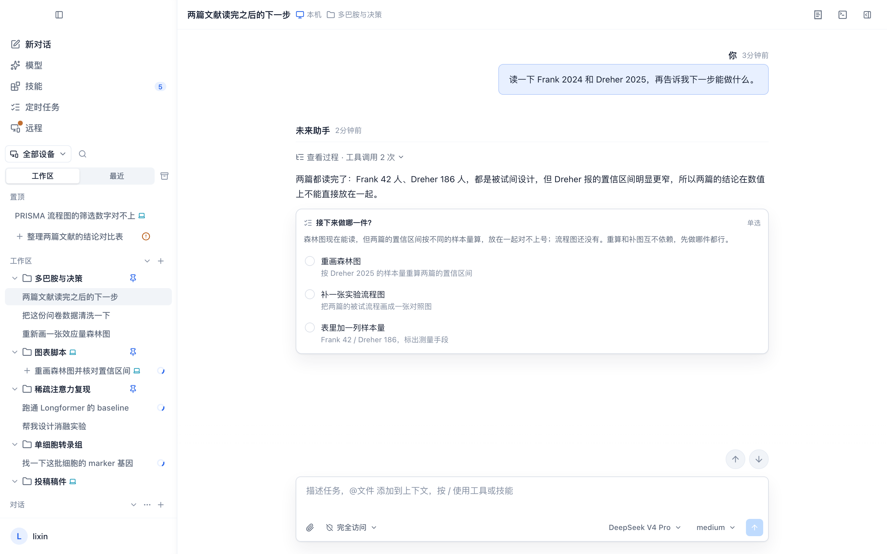
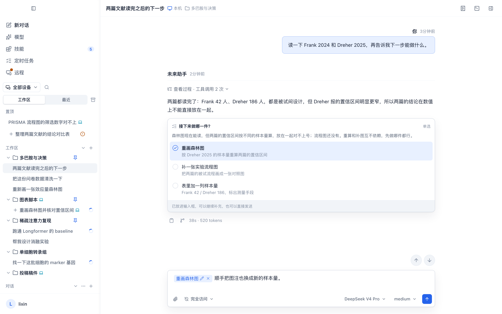
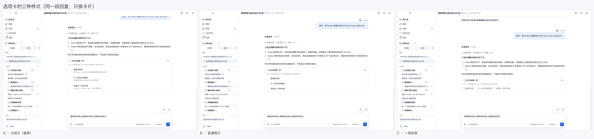
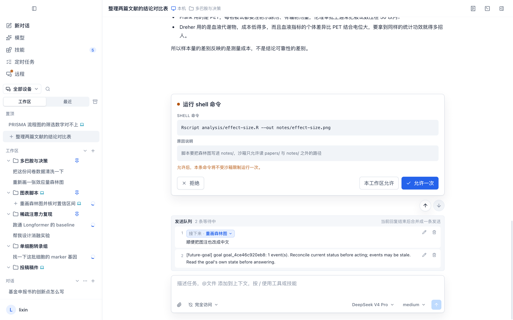

# 回复里的选项卡（choice card）设计

> 状态：设计定稿（v3）。**§11 第 1–8 步已实现**：`futureos-choice` 的解析、桌面渲染、编辑器内答案 pill、草稿承载、远程桌面、手机、队列里的选择、system prompt。剩下的第 9 步（把注入原型换成真实组件的视觉回归）未做——本文件里除「真实组件」三张场景截图外，其余截图仍是在**真实界面**上注入 DOM 原型拍的（不含产品代码），用来定样式与几何；实现见 §11。
> 主要范围：桌面端、移动端、远程桌面。TUI / CLI 不在本期范围（§10 说明它们如何降级）。
>
> **v2 相对 v1 改了三个真问题**（由读者反馈，已核代码定位）：
> 1. 选中后发送键恒灰，"选完直接发"根本做不到——v1 把答案放在附件行，而发送判定只看编辑器内容（§5.2.1，已实测）；
> 2. 手机已选态同时用填充 + 描边 + 白勾三重强调，读起来像"已完成"而不是"选中"（§5.7.1）；
> 3. 答案进了发送队列就被拍平成纯文本，无法再改选择（§5.8）。
>
> **v3 补上了队列在三端的样子**，并改掉 v2 的一处新歧义：v2 给队列行里的 chip 配了铅笔，而那一行本身已经有一支"改文字"的铅笔，两支相距几像素表示不同的事。v3 让 **chip 自己就是按钮**（带 chevron），行原有的铅笔与垃圾桶一个不动（§5.8.2）。三种面板关系也讲清了：远程复用桌面的 `SendQueuePanel`，手机是另一份实现（§5.8.1）。

## 1. 要解决的问题

现在的回复只能"读"，要给下一步做选择，用户得自己打一段话。于是常见两种浪费：

- 模型在正文里列出三个下一步，用户回一句"第二个"，模型还得猜"第二个"指哪个；
- 用户明明只想选一个，却敲了二十个字复述模型刚说过的话。

选项卡把这一步变成一次点击：模型在回复末尾挂一张卡，列出它**真能接着做**的几个动作；用户点一个，答案进输入框，然后照常发送——想补一句就补，不想补就直接发。

这条链路上真正需要设计的是**答案去哪了**，不是卡片长什么样。卡片只是问题的展示；答案必须是输入框里那条草稿的一部分，否则"选完之后直接发送"这条需求无从实现。

## 2. 状态模型：答案存在草稿里

一句话：**卡片是问题的视图，答案属于草稿。** 同一份答案在三个地方出现——卡片里的选中行、输入框里的 pill/chip、发送后的用户消息——它们都从同一处状态派生，不存在第二份真相。

> v1 只说了"答案属于草稿"，却把 chip 画在附件行——那既不在编辑器的内容里，也不在 attachments 数组里，所以两条既有判据都不认它。v2 把这条原则落实到具体槽位：桌面端答案是**编辑器内的原子 pill**（§5.2.1），手机与远程是**计入 draft 的 chip**。

```
模型输出围栏 ──解析──> 卡片（末条回复的最后一个块）
                          │ 点击某行
                          ▼
                    草稿里的答案  ──发送──> 用户消息（带答案的文本）
                          │
                          ├─> 输入框 pill/chip（可见、可改、可删）
                          └─> 卡片选中行（回显）
```

由此得到三条硬规则：

| 规则 | 原因 |
|---|---|
| 只有**线程里最后一张**卡可交互，更早的卡只读（`aria-disabled`、不进 Tab 序、副标题明说不能选） | 历史卡片对应的问题早已过去，允许改它只会让"我改的是哪一次"变得不可回答 |
| 卡片不自己保存"已选" | 它从前面的草稿派生。发送后草稿清空，**卡面不再保留选中态**——答案由用户消息上的标签呈现，不由卡面呈现 |
| 改答案 = 改草稿 | 点卡片任意一行、点 pill/chip 的铅笔、点底部 sheet、点队列行里的选择 chip，四个入口写同一个值 |

**为什么发送后不回填卡面**（2026-11-16 更正，本节原先写的是"卡片仍高亮"）：已答的答案已经以标签形式出现在用户气泡抬头，回填卡面不增加任何信息；而要做这件事，卡片就得去读**它之后的那条消息**，为一个纯装饰效果引入新的跨条目时序依赖。`ChoiceCardAnswer.test.tsx` 钉住的正是实际行为（发送后 `markedRow` 为空）——那是代码把当时的决定写下来了，文档没跟上而己。

**多个线程 / 多次提问**不会互相干扰：草稿按会话（thread）隔离，卡片与 chip 都读本会话的草稿。

## 3. 钥匙：`futureos-choice` 围栏

模型输出的是一个代码围栏（这就是需求里的"钥匙"）：

````markdown
```futureos-choice
title: 接下来做哪一件？
mode: single
option: forest | 重画森林图 | 按 Dreher 2025 的样本量重算两篇的置信区间
option: flow | 补一张实验流程图 | 把两篇的被试流程画成一张对照图
option: table | 表里加一列样本量 | Frank 42 / Dreher 186，标出测量手段
```
````

字段：

| 字段 | 必填 | 说明 |
|---|---|---|
| `title` | 是 | 问题本身，一句话，≤ 60 字。它就是卡片标题 |
| `mode` | 否 | `single`（默认）/ `multi` |
| `option` | 是（2–4 个） | 每行一个，`id \| 显示文案 \| 一行说明`；说明可以省略 |
| `id` | — | 选项 id：ASCII、`[a-z0-9-]`、≤ 24 字符、卡内唯一。它是要回传的稳定标识 |
| `hint` | 否 | 覆盖默认副标题（"选一个就放进输入框…"） |

**`mode` 的判据**（写 prompt 的人必须照这条，不能只把它当风格偏好）：

> 读者同时勾两行，这两行你会**在同一段后续工作里都做**吗？会 → `multi`；不会，因为选了这行另外几行就不做了 → `single`（默认，省略即此）。没有第三种。

`single` 是互斥**选择**："接下来做哪一件"。`multi` 是一件事的几**部分**或几件可并行的事："接新浪和 Nasdaq 两个源"。判据不成立就别写 `multi`：多选卡允许用户只勾一个，所以它不会强加工作量；反过来把互斥问题写成 `multi`，用户就得自己判断"我是不是该只勾一个"，卡片反而多了一层歧义。

**为什么是围栏而不是内联链接或 JSON：**

1. **自降级**。围栏的语义是"代码块"。任何不认识这张卡的客户端——TUI、旧的桌面版本、IM 机器人、复制粘到别处——都会把它当代码块画出来，用户看到的就是选项清单，信息不丢。换成内联链接或裸 JSON，降级后就是一堆噪音。
2. **解析成本最低**。仓库里已有 `parseDirectiveFields`（`packages/markdown/src/parseFutureMarkdown.ts`）按 `key: value` 逐行取值，`futureos-file` 围栏就是这么解析的。这里只需让重复 key 变成数组，其余不动。
3. **一份实现三端共用**。解析在 `packages/markdown` 里，桌面、移动、远程都消费同一份 AST，不会出现"桌面认识、手机不认识"。

卡片节点进 AST 时是独立的节点类型（不是复用 `futureEmbed` 的引用），因为它的载荷是选项列表而不是一个对象 id。

**解析容错**（宁可少画一张卡，不能吃掉回复）：

| 情况 | 处理 |
|---|---|
| 选项少于 2 个或多于 4 个 | 整块降级为代码块 |
| `id` 重复、非法字符、超长 | 该行丢弃；剩不足 2 个则整块降级 |
| 缺 `title` | 用第一个选项的文案兜底；仍为空则降级 |
| 围栏出现在回复中间（不在最后一块） | 照常渲染，但只读（§2 的"最后一张"规则） |
| 未知字段 | 忽略 |

**只读卡必须自己说出来**（2026-11-16）：一条回复里有 2 张及以上卡时，只有最后一张可交互——这个判据只依赖**已解析出的卡片数量**，与模型写了什么措辞无关，所以放在解析/渲染层，不放进 prompt。被判为只读的卡不只是 `aria-readonly` + 不进 Tab 序，它的**副标题也必须换成"这张卡不能选"**（`choice.hint.readonly`）：副标题是卡片唯一能"承诺动作"的地方，在一个点不动的卡上印"选一个就放进输入框"，等于画一个看起来能按、按了没反应的按钮。模型自带的 `hint` 描述的是"怎么挑"，所以同样一并换掉。判据在 `ChoiceCard.test.tsx` 与 `MarkdownContent.test.tsx` 里断言（文字 + `aria-disabled` + 不可聚焦），**不断言颜色**。

## 4. system prompt 里加什么

新增 `agent/src/prompt/choice.md`，在 `agent/src/prompt/mod.rs` 里与 `communication.md` 一起 `include_str!` 推入（`parts` 末尾，紧邻 communication），保证"怎么问用户"和"怎么说话"相邻。

要求它写清楚的是**什么时候才配用**，而不是格式细节——格式已经在语法里约束了：

```markdown
# Offering Choices

When your reply ends by asking the user what to do next, offer the options as a
`futureos-choice` block instead of a prose list. The reader then answers with one
click instead of restating your own wording.

Use it only when all of these hold:
- The reply genuinely ends with a question about the next step, and you can carry
  out every option yourself right after they pick.
- There are 2–4 real alternatives. One option, or five, is a paragraph — not a card.
- The options are mutual alternatives — you would do one of them next.

Do not use it for: confirming a risky action (the approval card already owns that),
restating what you just did, "let me know if you need anything", or a question whose
answer needs a sentence rather than a pick.

`mode:` — one test decides it: if the reader ticked two rows, would you do both in
the one stretch of work that follows this reply? Yes → `mode: multi`; no, because each
rules the others out → omit the line, and `single` is what an omitted line means. There
is no third mode.

Write each option as the instruction you would follow if chosen — the user's words,
not a menu label ("重画森林图", not "选项 A"). The third field says what changes or
what it costs, one line, no marketing.

The block goes last, alone. Never two cards in one reply, never one mid-reply.
```

要点：**选项文案必须是用户会说的那句话**（因为发送时它就是消息的一部分），不是"选项 A/B/C"。

**2026-11-15 修订了 §4 的措辞**：原稿把 `multi` 写成兜底选项（"omit `mode: multi` unless several can be done in one go"）并塞进"什么时候才配用这张卡"的条件列表里。结果是模型写出来的卡一律单选，连"接新浪和 Nasdaq 两个源"这种明显是一件事的两半，也得用户自己打字回答——正是卡片要消灭的那种浪费。现在判据是一条**能回答是/否**的检验（勾两行会不会在同一段工作里都做），写在 §3 字段表下面与 §4 的字段说明里：判据不能只活在 prompt 里，否则下次改 prompt 的人不知道它为什么长这样。

## 5. 界面

### 5.1 桌面端 · 未选



- 卡宽 768px，与正文列同宽（`max-w-3xl`），左对齐、跟在最后一个块之后 4px；
- 卡头 12px 半粗标题 + 右侧 11px 模式标注（`单选` / `多选`）；
- 副标题 11px，说明"选一个就放进输入框；也可以直接在输入框里写别的"——这句话替代了卡内的"自己写…"行（§5.6 说明为什么删掉）；
- 每个选项一行：16px 单选圈 + 13px 文案 + 12px 一行说明（`ink-muted`）；未选行无边框、无底色，靠留白分列；
- 卡片外框 `1px line` / `radius 10px` / `surface` 底 / 极轻投影，与审批卡同一套材质，但**位置不同**：审批卡浮在输入框上方，选项卡长在正文里。

### 5.2 桌面端 · 已选


- 选中行：`accent-soft` 底 + 文案转 500 权重（不再加描边——填充与描边两重强调是 v1 的问题，§5.7 同理）；
- 卡底多一条 8px 的分隔脚注（`line-soft` 上边框 + `surface-subtle` 底）。**v2 把这句话改短了**：v1 写"已放进输入框"并配一个框外的 chip，而答案其实不在框里；现在答案真的在编辑器里，这句话不再需要替位置打补丁；
- 答案作为**编辑器内的 pill** 出现：一个原子元素（`data-mention="choice"`、`contenteditable=false`），和文件引用 / 技能 / 会话引用同一类东西：

```
┌ 重画森林图  ✎ ✕ ┐        ← 就在 contenteditable 里
```

### 5.2.1 为什么必须是编辑器内的 pill（v1 的硬错误）

v1 把 chip 放在附件行（`form` 内、field 之上），看起来对，但它同时不满足两个已有判据：

| 判据 | 位置 | v1 的 chip 在附件行时 | 放在编辑器内时 |
|---|---|---|---|
| `inputEmpty` | `ComposerControls.tsx:426` 的 `disabled={(inputEmpty && attachmentCount === 0) …}` | chip 既不在 `attachments` 数组里、也不在 contenteditable 里 ⇒ **仍为 true** | pill 让 `isEditorEmpty` 返回 false（`mentionDom.ts:6-12` 有 `[data-mention]` 即非空） |
| `attachmentCount` | 同上，来自真正的 `attachments` state | 0 | 不需要它 |

结果是 v1 稿里"不输入文字直接发送"（需求 d）**根本做不到**——发送键恒灰。这不是观感问题，是设计放错了槽位。

改到编辑器内之后，四条需求都由既有机制自然成立，不需要碰任何发送判定：

- (a) 没选 ⇒ 编辑器空 ⇒ 键灰；
- (c) 文字与 pill 在同一流里，`serialize()`（`mentionDom.ts:113-165`）按文档顺序产出 pill 文本再产出文字；
- (d) 只有 pill ⇒ `isEditorEmpty` 为 false ⇒ 键亮；
- (b) 铅笔与叉挂在 pill 自己身上，改的是同一个值。

**实测（1440×900，注入真实 contenteditable 后读 DOM，不改产品代码）**：

| 状态 | `disabled` |
|---|---|
| 空编辑器 | `true` |
| 只有一个 pill | **`false`** |
| 把 pill 移除 | `true` |

pill 实测 `bg rgb(232,240,255)`（`accent-soft`）、`color rgb(37,99,235)`（`accent`）、`12.88px`（`0.92em`）、114×21；发送键实测 `bg rgb(37,99,235)`（`accent-fill`）、28×28，位于 `x 1211`。

### 5.2.2 已选 + 补一句话



需求 (c) 的样张。pill 与文字在同一个编辑器流里，顺序就是读者看到的顺序；发送时 `serialize()` 先输出 pill 的 `[问题 → 答案]`，再输出文字。所以用户气泡里显示的就是真正发出去的内容——不靠额外渲染去"补"一个不同步的显示。发送之后，这句话在气泡里被画成标签而不是方括号字样（§5.2.3）：还是同一句话，只是不再混在用户自己写的文字里。

### 5.2.3 发送后的用户气泡

三端同一个处理：正文**抬头**那一段 `[问题 → 答案]` 画成一个标签（`ListChecks` 图标 + 淡色的问题 + `→` + 强调的答案），其后的文字仍走 markdown。什么都不写、只选了一行，气泡就只剩那个标签。

- **文本不变。** 标签是 `choiceAnswerText` 写出的那一句的**画法**，不是第二份内容：复制按钮复制的、agent 收到的、粘贴到别处看到的，都还是 `[问题 → 答案]`。这也正是 §7 选纯文本的理由——显示层怎么画，都不影响那句话的可读性；
- **判据保守**（`packages/markdown/src/choiceAnswerEcho.ts`）：只在正文首部认、必须带 `→`、方括号后面紧跟 `(` 或 `[` 的不认（那是链接或另一组方括号）、最多认四条（一张卡的上限）。判成"不是答案"只损失样式，不会丢字；
- **材质跟着气泡走。** 桌面气泡是 `accent-soft`，标签用 `accent/10` 底 + `accent/25` 描边；手机气泡是 `accent` 实底，标签用气泡自身墨色的 12% 铺一层、20% 描边（和 `MarkdownText` 的 `onAccent` 同一套取色），深色浅色都读得清。

四个状态（桌面浅色 / 深色、手机浅色 / 深色）在截图 harness 里是可复现的：场景在 `scripts/screenshots/scenarios.d/choice-answer-echo.json`（`capture-desktop choice-answer-echo{,-dark}`、`capture-mobile choice-answer-echo-phone{,-dark}`），演示数据由 fixture 的 `?choiceAnswer=1` 提供——答案本身仍由 `choiceCard=1` 的那张卡产出。

### 5.3 桌面端 · 改回来


- pill 上的铅笔把问题**原地**展开（360px 浮层，贴在 pill 上方 10px），不滚动、不跳回正文；
- 浮层里是同一份选项（紧凑行，去掉说明），选中项仍是那个；
- 换一个 ⇒ pill 文案跟着变，草稿里的旧答案被替换；`Esc` 或点外部关闭，答案不变；
- pill 上的 ✕ 直接撤销这次选择，pill 消失，发送键**跟着变回灰色**（同一个 `isEditorEmpty`，不需要额外的接线）。

### 5.4 远程桌面


远程会话的正文是宿主送来的 markdown、由**本机**渲染，所以卡片自动就是同一个组件、同一套 token——不需要为远程单独做一份。实测卡宽 768 与远程输入框同宽。

唯一的差别在输入框：远程 `RemoteComposer` 是纯 `textarea`（没有 `contenteditable`、没有 pill 机制），所以已选项走**输入框上方的 chip 行**——和附件同一个槽位。

远程端的发送判据实测为 `disabled={(!text.trim() && uploads.length === 0) || busy || …}`（`RemoteComposer.tsx:1525`，`send()` 同式 `:865`）。所以远程要把答案算进内容，**必须让 chip 计入 `uploads`/draft 那一侧**——不能只画一个 chip 就指望键亮。这是实现时对远程端唯一必须改的地方。

远程端的 chip 同样可点铅笔/叉，浮层锚在 chip 上方；跨机器的会话切换时草稿随草稿一起传（远程草稿本来就是按会话托管的）。

### 5.5 深色


全部用语义 token（`surface` / `line` / `line-soft` / `surface-subtle` / `accent` / `accent-soft` / `ink*`），不写死颜色。实测深色卡底 `rgb(22,27,34)`（`--color-surface` 的深色值），选中行 `accent-soft` 深色值 `#16243c`。

### 5.6 卡片样式的三个方向



| | 高度 | 适用 | 结论 |
|---|---|---|---|
| **A · 分组行**（带一行说明） | 255px | 选项需要解释"选它会怎样" | **采用**。说明行承担的正是"我不确定选哪个"的那种犹豫 |
| B · 紧凑两行 | 186px | 选项自解释、卡出现频繁 | 备选：一张卡挡住半屏时切它 |
| C · 一排标签 | 110px | 极短选项、窄屏 | 不采用：长文案会在标签里断行，且丢掉说明 |

两个探索过、**没有采用**的做法，记在这里免得日后重做：


- **行尾编号 1/2/3**（按数字键选）。看起来像键盘加速，实际会和输入框的自由文字冲突：用户打"2 篇论文"时，那个 `2` 到底是不是一次选择？选项选择必须是点击（或 chip 上的键盘操作），不能劫持输入框的数字。
- **卡内"自己写…"虚线行**。它和副标题说的是同一件事，而且一条虚线框——看着像输入框、点了却不聚焦——比没有更糟。自由输入的正确入口是输入框本身，副标题指过去就够了。

### 5.7 移动端

手机 390×844，三张图分别是未选 / 已选 / 改回来。

| 未选 | 已选 | 改回来 |
|---|---|---|
|  |  |  |

- 卡满宽（358pt，左右各 16pt 边距），`radius 12px`，行高 **≥ 44pt**（实测三行各 60pt），说明文字换行而不截断；
- 已选项的 chip 在 dock 内、textarea 之上（实测 chip `y 702..736`，field `y 737..783`）；
- **改答案用底部 sheet**：390pt 宽没有空间在原地放浮层。sheet 顶到 559pt，三行仍 44pt，选中即写回 chip，底稿不动；

#### 5.7.1 v1 的已选态哪里难看，v2 怎么改

v1 的已选行同时在三个地方宣告"选中"：`accent-soft` 填充 + `accent` 描边 + 实心蓝圆白勾。三重强调在 390pt 宽的卡上并不显得确定，而是显得吵；那个蓝圆白勾更像"已完成"的任务徽章而不是"单选"。v2 逐条改：

| v1 | v2 | 理由 |
|---|---|---|
| 填充 + 描边 + 白勾三重 | 只留 `accent-soft` 填充 + **圆环套圆点** | 空环常驻（只是描边变粗、变蓝），选中时行不跳；圆环圆点是单选控件的通用形态，不会被读成"已完成" |
| chip 用 `focus` 蓝描边，卡片用 `accent` | chip 用 `line` 描边 + `surface-subtle` 底 | 一个状态不应该用两个蓝。chip 是"已定下的东西"，和附件同材质更诚实 |
| 铅笔蓝、叉灰（同权重动作两种墨色） | 铅笔与叉都用 `ink-soft` | 两个动作可以互相替换，墨色不该分出主次；实测两者均为 `rgb(93,104,122)` |
| 底部写"已填进输入框"，但 chip 在框外 | 写"答案在下面的输入框上方" | 句子不应该替布局打补丁。手机 field 是 textarea，确实装不下 pill，所以就诚实说"在上方" |
| 触控目标 18pt | 24pt（外边透明热区） | 24pt 够用且不把 chip 擑大；桌面端 pill 内部保持 16pt（鼠标精度不同） |

**为什么手机不学桌面把答案放进 field：** RN 的输入框是 `TextInput`（原生 textarea），没有 contenteditable 的原子元素，也不存在 `isEditorEmpty` 那种“有 pill 即非空”的机制。手机的等价做法是让答案算进 `canSend`/`hasDraft` 已经计数的东西——`ComposerDock.tsx:180-181`、`:233` 都是 `!!message.trim() || attachments.length > 0`，所以答案必须作为一个 draft 项被计入（像附件那样），而不是画一个不参与判定的装饰 chip。

## 5.8 队列里的选择

三端各一张，因为队列面板**不是同一个组件**：

| 桌面（本地会话） | 远程桌面 | 手机 |
|---|---|---|
|  |  |  |

先说 **今天实际发生什么**（已核代码，不靠猜）：

- `Composer.tsx:581-600 queueDraft()` 把 `editor.getContent()`（已经序列化的文本）交给 `onEnqueue`，答案就拍平成 `[接下来做哪一件？ → 重画森林图]` 这一串字；
- `AgentQueueRow.text` / `SendQueuePanelItem.content` 都是 `string`，面板行内只能改这段文字（`SendQueuePanel.tsx:99-116` 的 `editingText` → `onUpdate(id, content)`）；
- 删除与改文字**今天就有**：每行的垃圾桶与行内编辑框，三端都有。

所以缺的不是“能不能删”，而是“能不能改**选择**”：现在只能对着序列化文本手改，用户得知道 `[问题 → 答案]` 这个格式才改得对。

### 5.8.1 三端的面板关系：远程不另画，手机是另一份

这一节决定了实现量，所以先讲清楚：

- **远程桌面复用桌面端的 `SendQueuePanel`**：`RemoteComposer.tsx:23` 直接 `import { SendQueuePanel } from "../agent/SendQueuePanel"`，在 `:1244` 渲染。远程的输入框是另一套（纯 textarea，没有 pill），但队列**面板**是同一个组件。所以远程的队列样式就是桌面的队列样式——不需要为远程设计第二遍，只需要确认它没被远程样式表带歪。实测两边的 chip 都是 `136×22`、铅笔都在 `x=1181`、行宽都是 `746`。
- **手机有它自己的一份** `mobile/src/features/chat/components/SendQueuePanel.tsx`：表头是一行 `Pressable` 折叠条（`accessibilityState.expanded`，文案 `展开队列中的消息` / `收起队列中的消息`），**一律默认收起**——条上已经有条数、那句「当前回复结束后合并成一条发送」和 parked 行的警示，而展开的每一行都会盖住它下面的对话。展开后列表高度 `sendQueueListHeight(vh, kb) = max(96, min(240, round((vh-kb)*0.3)))`，再长就在列表内滚动。手机端因此需要单独设计一遍 chip 的尺寸与位置。

### 5.8.2 行里画什么：chip **自己就是按钮**

v2 曾经给 chip 配一支铅笔，这是错的，v3 改掉了：

**队列行里已经有一支铅笔**，它的语义是“改这条消息的文字”（`composer.queue.edit` = `修改队列中的消息`）。再给 chip 配第二支铅笔，两支相距几像素、表示两件不同的事——这正是本设计从第一版起就要消灭的歧义（见 §5.7.1 的同一类判断）。

修正后的规则：

| 用户想做的事 | 三端一致的出口 |
|---|---|
| 换一个选项 | **点 chip 本身**（chip 是 `role=button`，带一个 chevron，aria-label `更换这条消息里的选择：<标题> · <选项>`），弹出桌面浮层 / 手机 sheet |
| 改这条消息的文字 | 行自己的铅笔（有且只有一支） |
| 删掉整条消息 | 行自己的垃圾桶 |
| 只去掉选择、保留文字 | 选项列表里那一条“不作选择”（和卡片上的 `不做选择` 是同一个条目），不是 chip 上的新按钮 |

chevron 而不是铅笔，是刻意的：它说的是“这里能打开点什么”，不可能被读成“编辑文字”。

### 5.8.3 数据形状

给 `SendQueuePanelItem` 与 `AgentQueueRow` 加一个**可选**的 `choice?: { title, optionId, label }`，照 `attachments?` 的先例（`undefined` = 这一端的队列不报该字段，旧 Agent 不会因此被说成“没有选择”，也就不会画出空 chip）。

写回路径**不**拖进纯文本编辑：新增 `onUpdateChoice(id, choice)`（而不是给 `onUpdate(id, content)` 加可选参数）。纯文本编辑与结构化选择是两件事，混在一个签名里，实现时必然要在一个函数里分支。

### 5.8.4 实测（真实面板 + 真实“加入发送队列”流程，不是画的）

| | 桌面 | 远程 | 手机 |
|---|---|---|---|
| chip 尺寸 | `136×22` | `136×22` | `129×23` |
| chip 右边缘 / 铅笔左边 | `659` / `1181` | `659` / `1181` | `180` / `297` |
| 行尺寸 | `746×60` | `746×52` | `348×52` |
| chip 上的图标数 | 1（chevron） | 1（chevron） | 1（chevron） |
| 行文字 | `1 接下来 · 重画森林图 顺便把图注也改成中文` | 同左 | 同左 |

三行都保留了自己的铅笔与垃圾桶：断言里直接检查了 chip 的右边缘小于铅笔的左边缘，以及 `[data-queue-edit]` / `[data-testid=send-queue-edit]` 仍然存在。也就是说 chip 是**插在**行里，不是替换掉行的操作。

## 5.9 会话列表里的标记：这一条在等你选

卡片只能被"打开了的会话"看见——用户要先点进去，读完才看到那张卡。但会话列表（桌面左栏、手机的会话列表、合并了别的桌面之后的那一份）恰恰是用来回答"哪一条在等我"的地方，所以列表行上要有自己的标记，和审批那个圆点并列。

### 5.9.1 什么时候出现

| 条件 | 原因 |
|---|---|
| 这个会话**最新一次 run 已完成**（`completed`） | 还在 streaming 的是"等等就好"，不是"等你回答" |
| 且那次回复**以一张合法的卡收尾** | 历史里有卡不算：那个问题早就过去了（§2 的"只有最后一张卡可交互"是同一判断） |
| 且这一行**不是当前打开的那条**（桌面 / 远程） | 卡就在眼前，再标一次是噪音（与审批圆点同一条规矩） |

三条都不满足时什么都不画。已经选了但还没发送时标记**不消失**：会话仍然停在那张卡上，差一次发送。

### 5.9.2 数据从哪来：一次写入，三端共读

列表是拿不到别的会话的正文的（桌面左栏只读本地 store，手机只读对端的 catalog），所以"这条回复以卡收尾"必须在**产生回复的那一端**写成事实，而不是让每个客户端各自去猜文本：

```
Agent 提交 run ──┬─> terminal entry `content.offers_choice`
                 └─> agent_end `offers_choice: true`
                          │
       桌面 host 落库 runs.offers_choice ──┬─> latest_run_infos → 左栏
                                          └─> sessions catalog → 手机 / 远程行
```

- **判定在 Agent 里做一次**（`agent/src/prompt/choice_card.rs`），规则与渲染器 `parseChoiceCard` 对齐：围栏语言 `futureos-choice`、2–4 行 `option:`、id 为 `[a-z0-9-]`（≤24）、必须有非空 label；被引号包在文档围栏里的卡不算，卡后面还有正文的也不算（"卡收尾，且只有卡"）。
- **只有干净收尾的 run 才带这个字段**：取消/失败/截断的回复不是"等你回答"。
- **标记跟着 run 行**：用户下一次发送是新的一行，标记自然清零，不需要第二步清理。
- 列表侧只读一个布尔：桌面 `ThreadRunInfo.offersChoice`（推送落在 terminal 状态时补读一次行），对端 catalog 行 `offersChoice`（手机与桌面远程行共用）。

### 5.9.3 图标与文案

- 图标 `list-checks`（与卡头同一枚），颜色用 accent——审批用 `circle-alert` + warning，两者形状和色相都不同，扫一眼就能分开。
- 三端同一个 key：`pendingChoice` = "这条回复在等你选一项" / "This reply is waiting on your choice"。
- 手机端它**占用**未读圆点的位置（已完成的会话）：两者说的都是"你不在时它结束了"，而只有卡说的那件事有欠账；未读仍由标题加粗表达。

## 6. 输入框行为（需求的 a–d）

| 需求 | 行为 | 实现约束 |
|---|---|---|
| (a) 可以不选，保持为空 | 什么都没选、什么都没写 ⇒ 发送禁用（现有 `inputEmpty` 逻辑不变） | 卡片的存在**不**算草稿有内容。禁止"卡片一出现就能发送" |
| (b) 已选可以回去改 | 五个入口：卡片任意一行、pill/chip 的铅笔、手机端底部 sheet、**队列行里的选择 chip（整个 chip 就是按钮，直接点它）**（§5.8.2）、以及该队列行自己的铅笔（改文字）。改的是同一个值 | 改完 focus 留在输入框（桌面）/ 关掉 sheet（手机），不打断已有的文字 |
| (c) 可以继续输入文字发送 | pill 与文字共存，发送时先 pill 后文字 | 桌面靠 `isEditorEmpty` 认 pill（已实测）；手机/远程要让答案计进 `canSend` 已读的 draft 项 |
| (d) 不输入文字直接发送 | 只有 pill ⇒ 发送按钮可用 | 桌面已实测 `disabled:false`；手机/远程同 (c) |

发送后：草稿清空、pill 消失、卡片保持高亮（答案已进入用户消息）。**不自动发送**——需求只要求"可以直接发送"，任何自动发送都会让 (c) 失去意义。

## 7. 回传给 agent 的文本

答案必须让 agent 读懂，且必须**在降级路径上也读得懂**（TUI、IM 机器人、粘贴到别处）。所以回传的是纯文本，不是自定义协议：

| 情况 | 发出的消息 |
|---|---|
| 只选了，没写字 | `[接下来做哪一件？ → 重画森林图]` |
| 选了又补一句 | `[接下来做哪一件？ → 重画森林图] 顺便把图例挪到右下` |
| 多选 | `[这三项都要 → 重画森林图、补一张实验流程图]` |
| 只写字（没选 / 删掉了 chip） | 就是用户写的文字 |

`→` 是唯一的固定记号，问号与文案都来自模型自己的输出。带上 `title` 是为了在同一线程里出现过几张卡时，"重画森林图"这句话有归属。

**为什么不回传 `futureos://choice/...` 链接：** 那需要新增引用类型、让 `isFutureReferenceType` 放开、并保证服务端也理解它；而收益只是用户气泡里显示成 chip。第一版用文本，用户气泡显示的就是真正发出去的内容——诚实、可复制、任何客户端都能读。气泡里的标签化只发生在显示层（§5.2.3）：不重写这句话，也不是第二个协议。

## 8. 兼容与降级

| 客户端 | 未升级时看到 | 升级后 |
|---|---|---|
| 桌面 / 移动 / 远程 | —— | 完整卡片 |
| TUI | 代码块（选项三点清单的样子） | 本期不变：仍打印代码块内容 |
| CLI `future run` | 同上 | 同上 |
| IM 机器人（飞书 / 钉钉） | 同上 | 同上（卡片式交互另立项） |
| 第三方 Markdown 阅读器 | 代码块 | 代码块 |

围栏语法让"不认识"变成"照正常渲染"，这是选它的首要理由（§3）。同时解析器永不抛错：任何畸形输入都退回代码块。

## 9. 文案 / 图标 / 无障碍

固定文案（模型不提供、也不该提供）——三端都要 key：

| key | 中文 | 英文 |
|---|---|---|
| `choice.mode.single` | 单选 | Single choice |
| `choice.mode.multi` | 多选 | Multiple choice |
| `choice.hint.single` | 选一个就放进输入框；也可以直接在输入框里写别的 | Pick one and it lands in the input; you can type something else instead |
| `choice.hint.multi` | 可以多选，点几个都行 | Pick as many as apply |
| `choice.hint.readonly` | 只作展示：这张卡不能选 | An earlier question — this card can no longer be picked |
| `choice.foot.queued` | 已放进输入框，可以继续补充，也可以直接发送 | In the input — add a note if you want, or send as is |
| `choice.chip.change` | 修改「{{title}}」的选择 | Change the answer to "{{title}}" |
| `choice.chip.remove` | 移除「{{title}}」的选择 | Remove the answer to "{{title}}" |
| `choice.queue.change` | 更换这条消息里的选择：{{title}} · {{label}} | Change the choice in this message: {{title}} · {{label}} |
| `choice.mobile.change` | 修改「{{title}}」 | Change "{{title}}" |

- 图标：卡头 `list-checks`（一批待办里挑一件），铅笔、叉沿用现有 `lucide` 图标集；
- 语义：卡片是 `role="group"` + `aria-labelledby` 指向标题；选项行是 `role="radio"`（单选）/ `role="checkbox"`（多选），带 `aria-checked`；输入框里的 chip 是 `role="group"`，两个按钮各有 `aria-label`（上表）；**队列行里的 chip 反过来——整个 chip 是一个 `role="button"`**，`aria-label` 用 `choice.queue.change`，因为它只表示一件事（换选择），而行的铅笔、垃圾桶各自独立。
- 键盘：Tab 进卡 → 方向键在选项间移动 → Enter/Space 选中 → 焦点进输入框。`Esc` 关浮层；
- 选中状态不只靠颜色：实心圆对勾 + 描边 + 底色三重区分（灰度或色弱下仍可辨）。

## 10. 明确不做的部分

| 不做 | 理由 |
|---|---|
| 自动发送 | 与 (c) 冲突；且用户可能只是想先看看 |
| 卡内自由输入框 | 输入框就是自由输入框（§5.6） |
| 行尾数字快捷键 | 会劫持输入框的数字（§5.6） |
| 卡片嵌套 / 回复中途的卡 | 交互上无法回答"我改的是哪一次" |
| 历史卡片可改 | 同上；只读，且副标题明说不能选（§3） |
| TUI / IM 的交互版 | 本期只保证降级可读；TUI 已经有自己的选择机制（`SendChoiceSheet` 那套是本机 UI，不是 transcript 内容） |
| 答案胶囊化（用户气泡里的 chip） | 需要新引用类型 + 服务端理解，收益是纯视觉的；留到第二版 |
| 模型端记账（"用户选了哪个"作为结构化字段） | 第一版让模型读文本就够了；真需要统计时再加 |

## 11. 实现拆分

按依赖顺序，每一步都能单独合入：

1. **语法与解析**（`packages/markdown`）：`ChoiceCardNode` 类型；`parseFutureMarkdown.ts` 里把 `futureos-choice` 围栏接进 `parseFutureEmbed` 的分支，`parseDirectiveFields` 支持重复 key；单测覆盖 §3 的容错表。
2. **桌面渲染**：`desktop/src/features/markdown/renderers/ChoiceCard.tsx`（含只读/可交互两态），在 `MarkdownContent.tsx` 的节点 switch（:119 起，`futureEmbed` 那个分支旁边）里接上；i18n key 进 `desktop/src/i18n/locales/{zh,en}/markdown.json`（文案表本身在 `packages/markdown` 的类型旁没有位置，key 属于渲染层）。
3. **桌面答案 pill（v2 关键）**：在 `MentionEditor` 里加第四种 pill——`buildChoicePill()`（仿 `buildSessionPill`，`data-mention="choice"` + `data-choice`），`serialize()` 加一个分支输出 `[title → label]`。这一步完成之后 (a)(c)(d) **自动成立**，不需要碰 `ComposerControls` 的 `disabled` 表达式（§5.2.1 已实测）。修改浮层单独一个 `ChoicePopover.tsx`。
4. **答案状态**：放进现有的按会话草稿——桌面的 `ComposerDraft`（`desktop/src/features/agent/composerDraft.ts`）加一个可选的 `choice` 字段（该结构刻意留了增长位，新增可选字段不用升 `DRAFT_VERSION`）；远程的 `RemoteComposerDraft`（`desktop/src/features/remote-peer/remoteComposerDraft.ts`）同理。卡片选中行与 pill 都从它读。
5. **远程**：`RemoteComposer` 用 chip 行（它是纯 textarea，装不下 pill）；**同时必须把选择计入 `uploads`/draft 那一侧**，否则 `disabled={(!text.trim() && uploads.length === 0) || …}`（`:1525`）仍会拦着（§5.4）。
6. **移动端**：`mobile/src/components/MarkdownText.tsx` 接 `ChoiceCard`（按 §5.7.1 重绘）；`ComposerDock.tsx` 加 chip 行 + `ChoiceSheet`；选择必须计入 `canSend`（`:180-181`）/ `hasDraft`（`:233`）已读的 draft 项，而不是只画一个装饰 chip。
7. **发进队列的选择**：`AgentQueueRow` 与 `SendQueuePanelItem` 加可选 `choice`；`onEnqueue` 携带它；面板行渲染 chip，由面板上报“要改哪一行”、由上层开选项浮层（不把纯文本编辑路径拖进结构化参数）。旧 Agent 不报该字段时退化成今天的纯文本行。**chip 自己就是按钮，不另配铅笔**（§5.8.2），行原有的铅笔、垃圾桶一个都不动。
   - 7a. **桌面本地会话**：`SendQueuePanel.tsx` 行内插 chip，点它经 `SelectMenu`（`portal` 模式）开选项列表——不用 `ChoicePopover`，后者依赖编辑器 wrapper 的坐标系，队列行里没有。
   - 7b. **远程桌面**：`RemoteComposer.tsx:1244` 复用同一个 `SendQueuePanel`，所以这一端**不需要新代码**，只需要在远程会话里验证一次（远程样式表可能把行宽/字号带歪）。
   - 7c. **手机**：`mobile/src/features/chat/components/SendQueuePanel.tsx` 单独改——它是另一份实现（折叠表头 + `sendQueueListHeight` 上限），chip 11px 字、行内插在文字上方；面板只上报“要改哪一行”（`onRequestChoiceChange`），`ChoiceSheet` 由 `ComposerDock` 渲染——sheet 是 `Modal`，不放进行列表里。
8. **prompt**：`agent/src/prompt/choice.md` + `mod.rs` 推入；改 `agent/src/prompt/mod.rs` 的既有测试（断言 prompt 段落顺序的那几条）。
9. **回归**：`scripts/screenshots/scenarios.d/choice-cards.json` 已经把本文的每一屏变成可重跑的场景（桌面 10 个、手机 4 个，含 `chosen-text`、`queue`、`queue-remote`、`phone-queue`），实现完成后用它做视觉回归（把注入换成真实组件即可）。

## 12. 测试点

- **解析**：合法单/多选；2 与 4 的边界；3 个以下/5 个以上降级；重复 id、非法 id、缺 title 的降级；围栏在中途；未知字段忽略。
- **桌面（三态回归，必测）**：空编辑器 ⇒ `disabled:true`；只有 pill ⇒ **`disabled:false`**；移除 pill ⇒ `disabled:true`。这是 v1 错误的那一条，必须钉死。
- **桌面**：卡片渲染与只读/可交互切换；点行 → pill 出现；铅笔改 pill；叉移除 pill 且发送键变灰；pill + 文字一起发送的内容（§7 四种情况逐条断言）；发送后 pill 消失，**卡面不保留高亮**（答案在用户消息的标签上，为什么不做回填见 §2）。
- **远程**：同上，且断言 chip 在 textarea 之上而不是里面；**只有 chip 时发送键可用**（v1 同样漏掉的那一条）；远程草稿切换不串答案。
- **移动端**：44pt 行高；选中行**只有一处强调**（无描边）；铅笔与叉同墨色；sheet 改选后 chip 更新；**只有 chip 时 `canSend` 为真**；键盘弹起时 chip 行不遮 field。
- **队列（三端都要测）**：入队后答案作为 `choice` 而非纯文本；改选择后行内 chip 与最终发出的文本都变；删整行与“只删选择保留文字”两条路径；旧 Agent 不报 `choice` 时退化不报错。
  - **chip 不抢行铅笔的活**（v3 的硬约束）：chip 是 `role=button` 且**只有一个**图标（chevron）；chip 的右边缘小于铅笔的左边缘；行自己的铅笔与垃圾桶仍然存在且可点。断言三条，缺一条就退回到"两支铅笔"的歧义。
  - **远程**：远程复用桌面的面板，所以断言里要确认 `[data-send-queue]` 在远程帧里也画出了 chip，且尺寸与桌面一致（`136×22`）。
  - **手机**：折叠表头能展开/收起；chip 在行内不溢出（`129×23`，行宽 `348`）；行仍保留 `send-queue-edit` 与 `send-queue-remove`。
- **降级**：TUI 打印代码块内容；未知客户端同。
- **无障碍**：`role`/`aria-checked`/`aria-label` 三条断言；方向键与 Enter 的键路径。
- **视觉回归**：`choice-cards.json` 的 14 个场景（含两种样式对比表与两个被否方案）。

## 13. 截图怎么重跑

```bash
python3 scripts/screenshots/capture.py serve-desktop        # 桌面 harness（5299）
python3 scripts/screenshots/capture.py serve-mobile         # 手机 harness（8099）
python3 scripts/screenshots/capture.py --out .screenshots/choice-design \
  capture-desktop choice-card-empty choice-card-chosen choice-card-change \
                  choice-card-chosen-text choice-card-queue \
                  choice-card-queue-remote \
                  choice-card-remote choice-card-dark
python3 scripts/screenshots/capture.py --out .screenshots/choice-design \
  variants-desktop choice-card-styles --columns 3
python3 scripts/screenshots/capture.py --out .screenshots/choice-design \
  variants-desktop choice-card-rejected --columns 2
python3 scripts/screenshots/capture.py --out .screenshots/choice-design \
  capture-mobile choice-card-phone choice-card-phone-chosen \
                 choice-card-phone-change choice-card-phone-queue
```

每个场景都带断言（不只截图）：例如 `choice-card-chosen` 会检查 pill 在编辑器**内**、且 `window.__choiceSendButton().disabled === false`；手机场景检查选中行**没有描边**且铅笔与叉墨色相同。断言失败时 `capture.py` 报 `n/m captured`，不会静静给你一张"看着过了"的图。

**在 worktree 里跑的两个前提**（都已被 gitignore，不污染仓库）：

- 根 `node_modules`（或 `mobile/node_modules`）缺失时，子目录要能解析到依赖；
- `mobile/src/version.generated.ts` 是生成物，worktree 里没有，缺了 Metro 会直接白屏（日志里是 `Unable to resolve ../version.generated`）。用 `npm --prefix mobile run gen-version` 生成，或从主仓拷一份。

场景与注入脚本在 `scripts/screenshots/scenarios.d/choice-cards.json` 与 `scripts/screenshots/injects/choice-card-*.js`。它们**不是产品代码**：注入的是 DOM 原型，只为了让样张长在真实界面上（真实 token、真实字号、真实列宽）。桌面端的 pill 注入的是**真的** `[data-mention]` 原子元素并分发 `input` 事件，所以截图里的发送键亮起是界面的真实反应，不是画上去的。实现完成后，把注入删掉、改拍真实组件即可。
