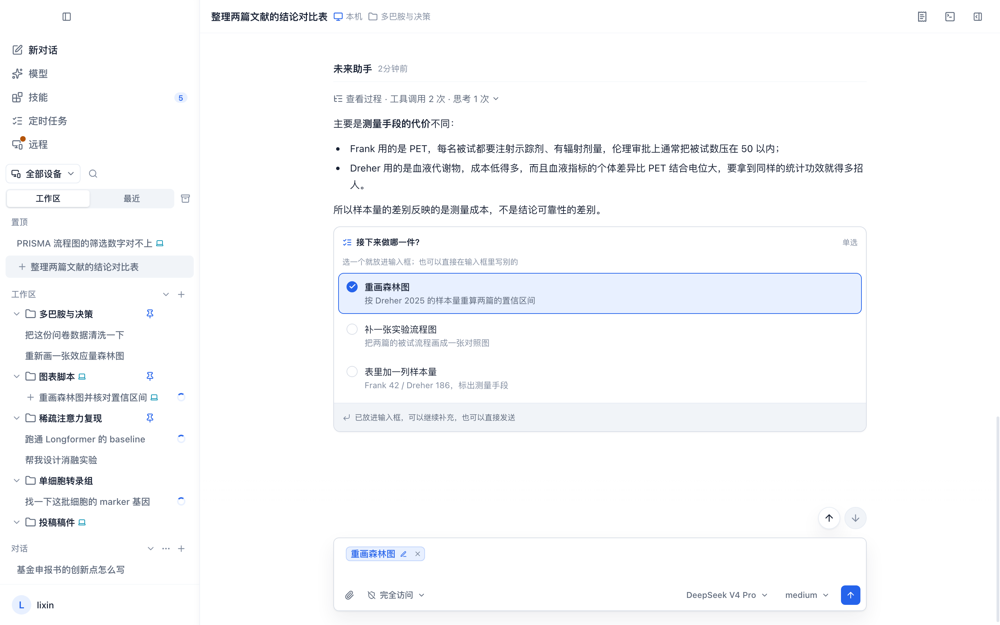
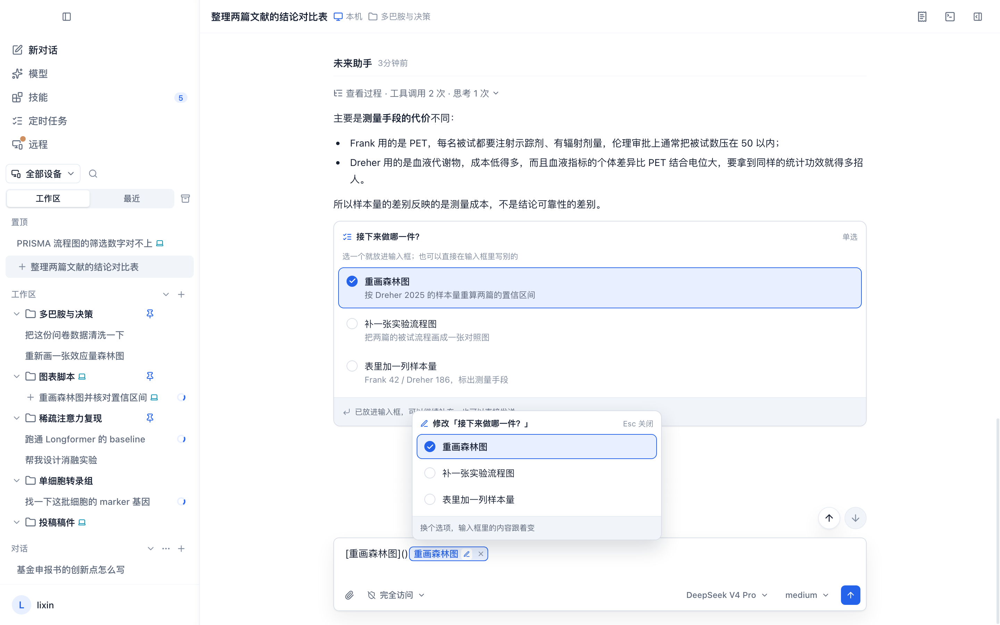
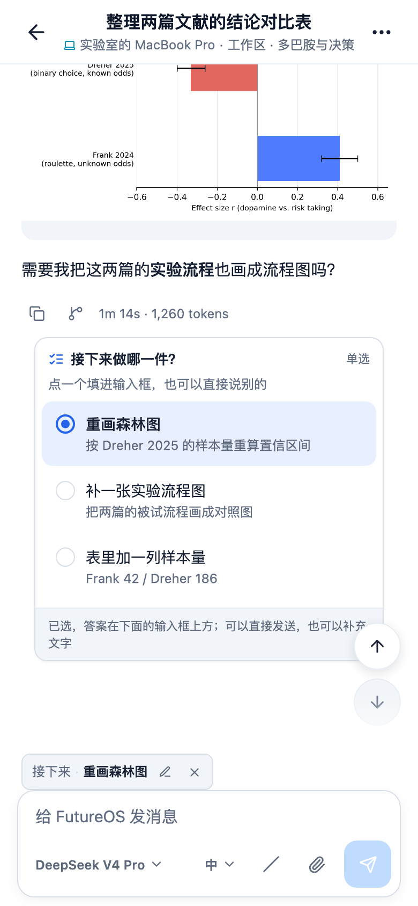
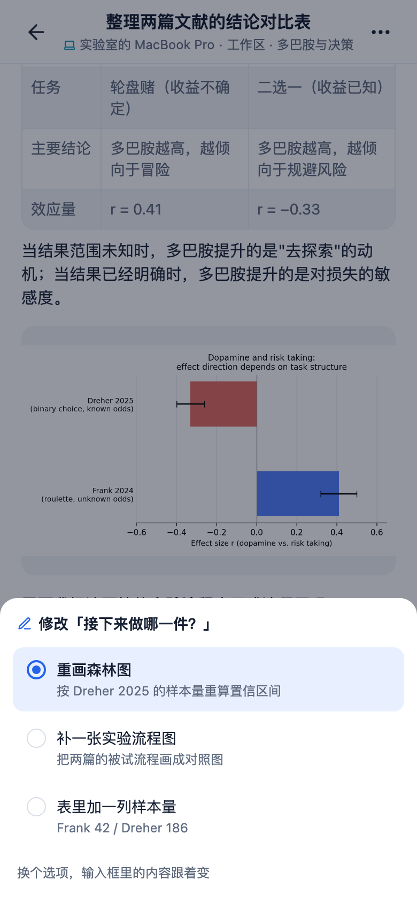
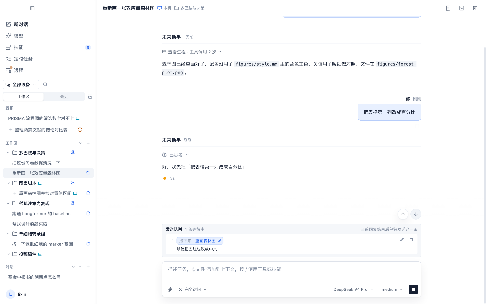

# 回复里的选项卡（choice card）设计

> 状态：设计定稿（v2）。**§11 第 1–3 步已实现**（`futureos-choice` 的解析、桌面渲染、编辑器内的答案 pill），第 4 步及其之后未实现。除「真实组件」三张场景截图外，下面的截图都是在**真实界面**上注入 DOM 原型拍的（不含产品代码），用来定样式与几何；实现见 §11。
> 主要范围：桌面端、移动端、远程桌面。TUI / CLI 不在本期范围（§10 说明它们如何降级）。
>
> **v2 相对 v1 改了三个真问题**（由读者反馈，已核代码定位）：
> 1. 选中后发送键恒灰，"选完直接发"根本做不到——v1 把答案放在附件行，而发送判定只看编辑器内容（§5.2.1，已实测）；
> 2. 手机已选态同时用填充 + 描边 + 白勾三重强调，读起来像"已完成"而不是"选中"（§5.7.1）；
> 3. 答案进了发送队列就被拍平成纯文本，无法再改选择（§5.8）。

## 1. 要解决的问题

现在的回复只能"读"，要给下一步做选择，用户得自己打一段话。于是常见两种浪费：

- 模型在正文里列出三个下一步，用户回一句"第二个"，模型还得猜"第二个"指哪个；
- 用户明明只想选一个，却敲了二十个字复述模型刚说过的话。

选项卡把这一步变成一次点击：模型在回复末尾挂一张卡，列出它**真能接着做**的几个动作；用户点一个，答案进输入框，然后照常发送——想补一句就补，不想补就直接发。

这条链路上真正需要设计的是**答案去哪了**，不是卡片长什么样。卡片只是问题的展示；答案必须是输入框里那条草稿的一部分，否则"选完之后直接发送"这条需求无从实现。

## 2. 状态模型：答案存在草稿里

一句话：**卡片是问题的视图，答案属于草稿。** 同一份答案在三个地方出现——卡片里的选中行、输入框里的 pill/chip、发送后的用户消息——它们都从同一处状态派生，不存在第二份真相。

> v1 只说了"答案属于草稿"，却把 chip 画在附件行——那既不在编辑器的内容里，也不在 attachments 数组里，所以两条既有判据都不认它。v2 把这条原则落实到具体槽位：桌面端答案是**编辑器内的原子 pill**（§5.2.1），手机与远程是**计入 draft 的 chip**。

```
模型输出围栏 ──解析──> 卡片（末条回复的最后一个块）
                          │ 点击某行
                          ▼
                    草稿里的答案  ──发送──> 用户消息（带答案的文本）
                          │
                          ├─> 输入框 pill/chip（可见、可改、可删）
                          └─> 卡片选中行（回显）
```

由此得到三条硬规则：

| 规则 | 原因 |
|---|---|
| 只有**线程里最后一张**卡可交互，更早的卡只读（选中行仍高亮，其余行置灰） | 历史卡片对应的问题早已过去，允许改它只会让"我改的是哪一次"变得不可回答 |
| 卡片不自己保存"已选" | 它从前面的草稿派生。发送后草稿清空，卡片仍高亮——因为答案此时在紧随其后的用户消息里 |
| 改答案 = 改草稿 | 点卡片任意一行、点 pill/chip 的铅笔、点底部 sheet、点队列行里的选择 chip，四个入口写同一个值 |

**多个线程 / 多次提问**不会互相干扰：草稿按会话（thread）隔离，卡片与 chip 都读本会话的草稿。

## 3. 钥匙：`futureos-choice` 围栏

模型输出的是一个代码围栏（这就是需求里的"钥匙"）：

````markdown
```futureos-choice
title: 接下来做哪一件？
mode: single
option: forest | 重画森林图 | 按 Dreher 2025 的样本量重算两篇的置信区间
option: flow | 补一张实验流程图 | 把两篇的被试流程画成一张对照图
option: table | 表里加一列样本量 | Frank 42 / Dreher 186，标出测量手段
```
````

字段：

| 字段 | 必填 | 说明 |
|---|---|---|
| `title` | 是 | 问题本身，一句话，≤ 60 字。它就是卡片标题 |
| `mode` | 否 | `single`（默认）/ `multi` |
| `option` | 是（2–4 个） | 每行一个，`id \| 显示文案 \| 一行说明`；说明可以省略 |
| `id` | — | 选项 id：ASCII、`[a-z0-9-]`、≤ 24 字符、卡内唯一。它是要回传的稳定标识 |
| `hint` | 否 | 覆盖默认副标题（"选一个就放进输入框…"） |

**为什么是围栏而不是内联链接或 JSON：**

1. **自降级**。围栏的语义是"代码块"。任何不认识这张卡的客户端——TUI、旧的桌面版本、IM 机器人、复制粘到别处——都会把它当代码块画出来，用户看到的就是选项清单，信息不丢。换成内联链接或裸 JSON，降级后就是一堆噪音。
2. **解析成本最低**。仓库里已有 `parseDirectiveFields`（`packages/markdown/src/parseFutureMarkdown.ts`）按 `key: value` 逐行取值，`futureos-file` 围栏就是这么解析的。这里只需让重复 key 变成数组，其余不动。
3. **一份实现三端共用**。解析在 `packages/markdown` 里，桌面、移动、远程都消费同一份 AST，不会出现"桌面认识、手机不认识"。

卡片节点进 AST 时是独立的节点类型（不是复用 `futureEmbed` 的引用），因为它的载荷是选项列表而不是一个对象 id。

**解析容错**（宁可少画一张卡，不能吃掉回复）：

| 情况 | 处理 |
|---|---|
| 选项少于 2 个或多于 4 个 | 整块降级为代码块 |
| `id` 重复、非法字符、超长 | 该行丢弃；剩不足 2 个则整块降级 |
| 缺 `title` | 用第一个选项的文案兜底；仍为空则降级 |
| 围栏出现在回复中间（不在最后一块） | 照常渲染，但只读（§2 的"最后一张"规则） |
| 未知字段 | 忽略 |

## 4. system prompt 里加什么

新增 `agent/src/prompt/choice.md`，在 `agent/src/prompt/mod.rs` 里与 `communication.md` 一起 `include_str!` 推入（`parts` 末尾，紧邻 communication），保证"怎么问用户"和"怎么说话"相邻。

要求它写清楚的是**什么时候才配用**，而不是格式细节——格式已经在语法里约束了：

```markdown
# Offering Choices

When your reply ends by asking the user what to do next, offer the options as a
`futureos-choice` block instead of a prose list. The reader then answers with one
click instead of restating your own wording.

Use it only when all of these hold:
- The reply genuinely ends with a question about the next step, and you can carry
  out every option yourself right after they pick.
- There are 2–4 real alternatives. One option, or five, is a paragraph — not a card.
- The options are mutually exclusive (omit `mode: multi` unless several can be done
  in one go).

Do not use it for: confirming a risky action (the approval card already owns that),
restating what you just did, "let me know if you need anything", or a question whose
answer needs a sentence rather than a pick.

Write each option as the instruction you would follow if chosen — the user's words,
not a menu label ("重画森林图", not "选项 A"). The third field says what changes or
what it costs, one line, no marketing.

The block goes last, alone. Never two cards in one reply, never one mid-reply.
```

要点：**选项文案必须是用户会说的那句话**（因为发送时它就是消息的一部分），不是"选项 A/B/C"。

## 5. 界面

### 5.1 桌面端 · 未选


- 卡宽 768px，与正文列同宽（`max-w-3xl`），左对齐、跟在最后一个块之后 4px；
- 卡头 12px 半粗标题 + 右侧 11px 模式标注（`单选` / `多选`）；
- 副标题 11px，说明"选一个就放进输入框；也可以直接在输入框里写别的"——这句话替代了卡内的"自己写…"行（§5.6 说明为什么删掉）；
- 每个选项一行：16px 单选圈 + 13px 文案 + 12px 一行说明（`ink-muted`）；未选行无边框、无底色，靠留白分列；
- 卡片外框 `1px line` / `radius 10px` / `surface` 底 / 极轻投影，与审批卡同一套材质，但**位置不同**：审批卡浮在输入框上方，选项卡长在正文里。

### 5.2 桌面端 · 已选



- 选中行：`accent-soft` 底 + 文案转 500 权重（不再加描边——填充与描边两重强调是 v1 的问题，§5.7 同理）；
- 卡底多一条 8px 的分隔脚注（`line-soft` 上边框 + `surface-subtle` 底）。**v2 把这句话改短了**：v1 写"已放进输入框"并配一个框外的 chip，而答案其实不在框里；现在答案真的在编辑器里，这句话不再需要替位置打补丁；
- 答案作为**编辑器内的 pill** 出现：一个原子元素（`data-mention="choice"`、`contenteditable=false`），和文件引用 / 技能 / 会话引用同一类东西：

```
┌ 重画森林图  ✎ ✕ ┐        ← 就在 contenteditable 里
```

### 5.2.1 为什么必须是编辑器内的 pill（v1 的硬错误）

v1 把 chip 放在附件行（`form` 内、field 之上），看起来对，但它同时不满足两个已有判据：

| 判据 | 位置 | v1 的 chip 在附件行时 | 放在编辑器内时 |
|---|---|---|---|
| `inputEmpty` | `ComposerControls.tsx:426` 的 `disabled={(inputEmpty && attachmentCount === 0) …}` | chip 既不在 `attachments` 数组里、也不在 contenteditable 里 ⇒ **仍为 true** | pill 让 `isEditorEmpty` 返回 false（`mentionDom.ts:6-12` 有 `[data-mention]` 即非空） |
| `attachmentCount` | 同上，来自真正的 `attachments` state | 0 | 不需要它 |

结果是 v1 稿里"不输入文字直接发送"（需求 d）**根本做不到**——发送键恒灰。这不是观感问题，是设计放错了槽位。

改到编辑器内之后，四条需求都由既有机制自然成立，不需要碰任何发送判定：

- (a) 没选 ⇒ 编辑器空 ⇒ 键灰；
- (c) 文字与 pill 在同一流里，`serialize()`（`mentionDom.ts:113-165`）按文档顺序产出 pill 文本再产出文字；
- (d) 只有 pill ⇒ `isEditorEmpty` 为 false ⇒ 键亮；
- (b) 铅笔与叉挂在 pill 自己身上，改的是同一个值。

**实测（1440×900，注入真实 contenteditable 后读 DOM，不改产品代码）**：

| 状态 | `disabled` |
|---|---|
| 空编辑器 | `true` |
| 只有一个 pill | **`false`** |
| 把 pill 移除 | `true` |

pill 实测 `bg rgb(232,240,255)`（`accent-soft`）、`color rgb(37,99,235)`（`accent`）、`12.88px`（`0.92em`）、114×21；发送键实测 `bg rgb(37,99,235)`（`accent-fill`）、28×28，位于 `x 1211`。

### 5.2.2 已选 + 补一句话


需求 (c) 的样张。pill 与文字在同一个编辑器流里，顺序就是读者看到的顺序；发送时 `serialize()` 先输出 pill 的 `[问题 → 答案]`，再输出文字。所以用户气泡里显示的就是真正发出去的内容——不靠额外渲染去"补"一个不同步的显示。

### 5.3 桌面端 · 改回来



- pill 上的铅笔把问题**原地**展开（360px 浮层，贴在 pill 上方 10px），不滚动、不跳回正文；
- 浮层里是同一份选项（紧凑行，去掉说明），选中项仍是那个；
- 换一个 ⇒ pill 文案跟着变，草稿里的旧答案被替换；`Esc` 或点外部关闭，答案不变；
- pill 上的 ✕ 直接撤销这次选择，pill 消失，发送键**跟着变回灰色**（同一个 `isEditorEmpty`，不需要额外的接线）。

### 5.4 远程桌面


远程会话的正文是宿主送来的 markdown、由**本机**渲染，所以卡片自动就是同一个组件、同一套 token——不需要为远程单独做一份。实测卡宽 768 与远程输入框同宽。

唯一的差别在输入框：远程 `RemoteComposer` 是纯 `textarea`（没有 `contenteditable`、没有 pill 机制），所以已选项走**输入框上方的 chip 行**——和附件同一个槽位。

远程端的发送判据实测为 `disabled={(!text.trim() && uploads.length === 0) || busy || …}`（`RemoteComposer.tsx:1525`，`send()` 同式 `:865`）。所以远程要把答案算进内容，**必须让 chip 计入 `uploads`/draft 那一侧**——不能只画一个 chip 就指望键亮。这是实现时对远程端唯一必须改的地方。

远程端的 chip 同样可点铅笔/叉，浮层锚在 chip 上方；跨机器的会话切换时草稿随草稿一起传（远程草稿本来就是按会话托管的）。

### 5.5 深色


全部用语义 token（`surface` / `line` / `line-soft` / `surface-subtle` / `accent` / `accent-soft` / `ink*`），不写死颜色。实测深色卡底 `rgb(22,27,34)`（`--color-surface` 的深色值），选中行 `accent-soft` 深色值 `#16243c`。

### 5.6 卡片样式的三个方向


| | 高度 | 适用 | 结论 |
|---|---|---|---|
| **A · 分组行**（带一行说明） | 255px | 选项需要解释"选它会怎样" | **采用**。说明行承担的正是"我不确定选哪个"的那种犹豫 |
| B · 紧凑两行 | 186px | 选项自解释、卡出现频繁 | 备选：一张卡挡住半屏时切它 |
| C · 一排标签 | 110px | 极短选项、窄屏 | 不采用：长文案会在标签里断行，且丢掉说明 |

两个探索过、**没有采用**的做法，记在这里免得日后重做：


- **行尾编号 1/2/3**（按数字键选）。看起来像键盘加速，实际会和输入框的自由文字冲突：用户打"2 篇论文"时，那个 `2` 到底是不是一次选择？选项选择必须是点击（或 chip 上的键盘操作），不能劫持输入框的数字。
- **卡内"自己写…"虚线行**。它和副标题说的是同一件事，而且一条虚线框——看着像输入框、点了却不聚焦——比没有更糟。自由输入的正确入口是输入框本身，副标题指过去就够了。

### 5.7 移动端

手机 390×844，三张图分别是未选 / 已选 / 改回来。

| 未选 | 已选 | 改回来 |
|---|---|---|
|  |  |  |

- 卡满宽（358pt，左右各 16pt 边距），`radius 12px`，行高 **≥ 44pt**（实测三行各 60pt），说明文字换行而不截断；
- 已选项的 chip 在 dock 内、textarea 之上（实测 chip `y 702..736`，field `y 737..783`）；
- **改答案用底部 sheet**：390pt 宽没有空间在原地放浮层。sheet 顶到 559pt，三行仍 44pt，选中即写回 chip，底稿不动；

#### 5.7.1 v1 的已选态哪里难看，v2 怎么改

v1 的已选行同时在三个地方宣告"选中"：`accent-soft` 填充 + `accent` 描边 + 实心蓝圆白勾。三重强调在 390pt 宽的卡上并不显得确定，而是显得吵；那个蓝圆白勾更像"已完成"的任务徽章而不是"单选"。v2 逐条改：

| v1 | v2 | 理由 |
|---|---|---|
| 填充 + 描边 + 白勾三重 | 只留 `accent-soft` 填充 + **圆环套圆点** | 空环常驻（只是描边变粗、变蓝），选中时行不跳；圆环圆点是单选控件的通用形态，不会被读成"已完成" |
| chip 用 `focus` 蓝描边，卡片用 `accent` | chip 用 `line` 描边 + `surface-subtle` 底 | 一个状态不应该用两个蓝。chip 是"已定下的东西"，和附件同材质更诚实 |
| 铅笔蓝、叉灰（同权重动作两种墨色） | 铅笔与叉都用 `ink-soft` | 两个动作可以互相替换，墨色不该分出主次；实测两者均为 `rgb(93,104,122)` |
| 底部写"已填进输入框"，但 chip 在框外 | 写"答案在下面的输入框上方" | 句子不应该替布局打补丁。手机 field 是 textarea，确实装不下 pill，所以就诚实说"在上方" |
| 触控目标 18pt | 24pt（外边透明热区） | 24pt 够用且不把 chip 擑大；桌面端 pill 内部保持 16pt（鼠标精度不同） |

**为什么手机不学桌面把答案放进 field：** RN 的输入框是 `TextInput`（原生 textarea），没有 contenteditable 的原子元素，也不存在 `isEditorEmpty` 那种“有 pill 即非空”的机制。手机的等价做法是让答案算进 `canSend`/`hasDraft` 已经计数的东西——`ComposerDock.tsx:180-181`、`:233` 都是 `!!message.trim() || attachments.length > 0`，所以答案必须作为一个 draft 项被计入（像附件那样），而不是画一个不参与判定的装饰 chip。

## 5.8 队列里的选择（v2 新增）



用户提的第三点。先说 **今天实际发生什么**（已核代码，不靠猜）：

- `Composer.tsx:581-600 queueDraft()` 把 `editor.getContent()`（已经序列化的文本）交给 `onEnqueue`，答案就拍平成 `[接下来做哪一件？ → 重画森林图]` 这一串字；
- `AgentQueueRow.text` / `SendQueuePanelItem.content` 都是 `string`，面板行内只能改这段文字（`SendQueuePanel.tsx:99-116` 的 `editingText` → `onUpdate(id, content)`）；
- 删除与改文字**今天就有**：每行的叉与行内编辑框。

所以缺的不是“能不能删”，而是“能不能改**选择**”：现在只能对着序列化文本手改，用户得知道 `[问题 → 答案]` 这个格式才改得对。

设计：给 `SendQueuePanelItem` 与 `AgentQueueRow` 加一个**可选**的 `choice?: { title, optionId, label }`，照 `attachments?` 的先例（undefined = 这个队列不报该字段，旧 Agent 不会因此被说成“没有选择”）。行内渲染 chip：

- chip 的铅笔 → 弹出同一份选项（桌面浮层 / 手机 sheet），选中即写回该行（**需要 `onUpdate` 多一个可选参数**或新增 `onUpdateChoice(id, choice)`；倾向于后者，不把纯文本编辑路径拖进结构化参数）；
- 行的叉 → 删整条（已有）；
- 只删选择、保留该行文字 → chip 自己的叉，把该行退化成纯文字消息。

实测（真实队列面板 + 真实“加入发送队列”流程）：chip `139×22`，动作 `更换这条消息里的选择`，行宽 `746`，不溢出。

## 6. 输入框行为（需求的 a–d）

| 需求 | 行为 | 实现约束 |
|---|---|---|
| (a) 可以不选，保持为空 | 什么都没选、什么都没写 ⇒ 发送禁用（现有 `inputEmpty` 逻辑不变） | 卡片的存在**不**算草稿有内容。禁止"卡片一出现就能发送" |
| (b) 已选可以回去改 | 四个入口：卡片任意一行、pill/chip 的铅笔、手机端底部 sheet、**队列行里的选择 chip**（§5.8）。改的是同一个值 | 改完 focus 留在输入框（桌面）/ 关掉 sheet（手机），不打断已有的文字 |
| (c) 可以继续输入文字发送 | pill 与文字共存，发送时先 pill 后文字 | 桌面靠 `isEditorEmpty` 认 pill（已实测）；手机/远程要让答案计进 `canSend` 已读的 draft 项 |
| (d) 不输入文字直接发送 | 只有 pill ⇒ 发送按钮可用 | 桌面已实测 `disabled:false`；手机/远程同 (c) |

发送后：草稿清空、pill 消失、卡片保持高亮（答案已进入用户消息）。**不自动发送**——需求只要求"可以直接发送"，任何自动发送都会让 (c) 失去意义。

## 7. 回传给 agent 的文本

答案必须让 agent 读懂，且必须**在降级路径上也读得懂**（TUI、IM 机器人、粘贴到别处）。所以回传的是纯文本，不是自定义协议：

| 情况 | 发出的消息 |
|---|---|
| 只选了，没写字 | `[接下来做哪一件？ → 重画森林图]` |
| 选了又补一句 | `[接下来做哪一件？ → 重画森林图] 顺便把图例挪到右下` |
| 多选 | `[这三项都要 → 重画森林图、补一张实验流程图]` |
| 只写字（没选 / 删掉了 chip） | 就是用户写的文字 |

`→` 是唯一的固定记号，问号与文案都来自模型自己的输出。带上 `title` 是为了在同一线程里出现过几张卡时，"重画森林图"这句话有归属。

**为什么不回传 `futureos://choice/...` 链接：** 那需要新增引用类型、让 `isFutureReferenceType` 放开、并保证服务端也理解它；而收益只是用户气泡里显示成 chip。第一版用文本，用户气泡显示的就是真正发出去的内容——诚实、可复制、任何客户端都能读。胶囊化留给后续（§10）。

## 8. 兼容与降级

| 客户端 | 未升级时看到 | 升级后 |
|---|---|---|
| 桌面 / 移动 / 远程 | —— | 完整卡片 |
| TUI | 代码块（选项三点清单的样子） | 本期不变：仍打印代码块内容 |
| CLI `future run` | 同上 | 同上 |
| IM 机器人（飞书 / 钉钉） | 同上 | 同上（卡片式交互另立项） |
| 第三方 Markdown 阅读器 | 代码块 | 代码块 |

围栏语法让"不认识"变成"照正常渲染"，这是选它的首要理由（§3）。同时解析器永不抛错：任何畸形输入都退回代码块。

## 9. 文案 / 图标 / 无障碍

固定文案（模型不提供、也不该提供）——三端都要 key：

| key | 中文 | 英文 |
|---|---|---|
| `choice.mode.single` | 单选 | Single choice |
| `choice.mode.multi` | 多选 | Multiple choice |
| `choice.hint.single` | 选一个就放进输入框；也可以直接在输入框里写别的 | Pick one and it lands in the input; you can type something else instead |
| `choice.hint.multi` | 可以多选，点几个都行 | Pick as many as apply |
| `choice.foot.queued` | 已放进输入框，可以继续补充，也可以直接发送 | In the input — add a note if you want, or send as is |
| `choice.chip.change` | 修改「{{title}}」的选择 | Change the answer to "{{title}}" |
| `choice.chip.remove` | 移除「{{title}}」的选择 | Remove the answer to "{{title}}" |
| `choice.stale` | 这张卡已经过期 | This card is no longer active |
| `choice.mobile.change` | 修改「{{title}}」 | Change "{{title}}" |

- 图标：卡头 `list-checks`（一批待办里挑一件），铅笔、叉沿用现有 `lucide` 图标集；
- 语义：卡片是 `role="group"` + `aria-labelledby` 指向标题；选项行是 `role="radio"`（单选）/ `role="checkbox"`（多选），带 `aria-checked`；chip 是 `role="group"`，两个按钮各有 `aria-label`（上表）；
- 键盘：Tab 进卡 → 方向键在选项间移动 → Enter/Space 选中 → 焦点进输入框。`Esc` 关浮层；
- 选中状态不只靠颜色：实心圆对勾 + 描边 + 底色三重区分（灰度或色弱下仍可辨）。

## 10. 明确不做的部分

| 不做 | 理由 |
|---|---|
| 自动发送 | 与 (c) 冲突；且用户可能只是想先看看 |
| 卡内自由输入框 | 输入框就是自由输入框（§5.6） |
| 行尾数字快捷键 | 会劫持输入框的数字（§5.6） |
| 卡片嵌套 / 回复中途的卡 | 交互上无法回答"我改的是哪一次" |
| 历史卡片可改 | 同上；只读 + 高亮已选 |
| TUI / IM 的交互版 | 本期只保证降级可读；TUI 已经有自己的选择机制（`SendChoiceSheet` 那套是本机 UI，不是 transcript 内容） |
| 答案胶囊化（用户气泡里的 chip） | 需要新引用类型 + 服务端理解，收益是纯视觉的；留到第二版 |
| 模型端记账（"用户选了哪个"作为结构化字段） | 第一版让模型读文本就够了；真需要统计时再加 |

## 11. 实现拆分

按依赖顺序，每一步都能单独合入：

1. **语法与解析**（`packages/markdown`）：`ChoiceCardNode` 类型；`parseFutureMarkdown.ts` 里把 `futureos-choice` 围栏接进 `parseFutureEmbed` 的分支，`parseDirectiveFields` 支持重复 key；单测覆盖 §3 的容错表。
2. **桌面渲染**：`desktop/src/features/markdown/renderers/ChoiceCard.tsx`（含只读/可交互两态），在 `MarkdownContent.tsx` 的节点 switch（:119 起，`futureEmbed` 那个分支旁边）里接上；i18n key 进 `desktop/src/i18n/locales/{zh,en}/markdown.json`（文案表本身在 `packages/markdown` 的类型旁没有位置，key 属于渲染层）。
3. **桌面答案 pill（v2 关键）**：在 `MentionEditor` 里加第四种 pill——`buildChoicePill()`（仿 `buildSessionPill`，`data-mention="choice"` + `data-choice`），`serialize()` 加一个分支输出 `[title → label]`。这一步完成之后 (a)(c)(d) **自动成立**，不需要碰 `ComposerControls` 的 `disabled` 表达式（§5.2.1 已实测）。修改浮层单独一个 `ChoicePopover.tsx`。
4. **答案状态**：放进现有的按会话草稿——桌面的 `ComposerDraft`（`desktop/src/features/agent/composerDraft.ts`）加一个可选的 `choice` 字段（该结构刻意留了增长位，新增可选字段不用升 `DRAFT_VERSION`）；远程的 `RemoteComposerDraft`（`desktop/src/features/remote-peer/remoteComposerDraft.ts`）同理。卡片选中行与 pill 都从它读。
5. **远程**：`RemoteComposer` 用 chip 行（它是纯 textarea，装不下 pill）；**同时必须把选择计入 `uploads`/draft 那一侧**，否则 `disabled={(!text.trim() && uploads.length === 0) || …}`（`:1525`）仍会拦着（§5.4）。
6. **移动端**：`mobile/src/components/MarkdownText.tsx` 接 `ChoiceCard`（按 §5.7.1 重绘）；`ComposerDock.tsx` 加 chip 行 + `ChoiceSheet`；选择必须计入 `canSend`（`:180-181`）/ `hasDraft`（`:233`）已读的 draft 项，而不是只画一个装饰 chip。
7. **发进队列的选择（v2 新增）**：`AgentQueueRow` 与 `SendQueuePanelItem` 加可选 `choice`；`onEnqueue` 携带它；面板行渲染可改/可删的 chip，新增 `onUpdateChoice(id, choice)`（不把纯文本编辑路径拖进结构化参数）。旧 Agent 不报该字段时退化成今天的纯文本行。
8. **prompt**：`agent/src/prompt/choice.md` + `mod.rs` 推入；改 `agent/src/prompt/mod.rs` 的既有测试（断言 prompt 段落顺序的那几条）。
9. **回归**：`scripts/screenshots/scenarios.d/choice-cards.json` 已经把本文的每一屏变成可重跑的场景（桌面 9 个、手机 3 个，含新增的 `chosen-text` 与 `queue`），实现完成后用它做视觉回归（把注入换成真实组件即可）。

## 12. 测试点

- **解析**：合法单/多选；2 与 4 的边界；3 个以下/5 个以上降级；重复 id、非法 id、缺 title 的降级；围栏在中途；未知字段忽略。
- **桌面（三态回归，必测）**：空编辑器 ⇒ `disabled:true`；只有 pill ⇒ **`disabled:false`**；移除 pill ⇒ `disabled:true`。这是 v1 错误的那一条，必须钉死。
- **桌面**：卡片渲染与只读/可交互切换；点行 → pill 出现；铅笔改 pill；叉移除 pill 且发送键变灰；pill + 文字一起发送的内容（§7 四种情况逐条断言）；发送后 pill 消失、卡片高亮保留。
- **远程**：同上，且断言 chip 在 textarea 之上而不是里面；**只有 chip 时发送键可用**（v1 同样漏掉的那一条）；远程草稿切换不串答案。
- **移动端**：44pt 行高；选中行**只有一处强调**（无描边）；铅笔与叉同墨色；sheet 改选后 chip 更新；**只有 chip 时 `canSend` 为真**；键盘弹起时 chip 行不遮 field。
- **队列（v2 新增）**：入队后答案作为 `choice` 而非纯文本；改选择后行内 chip 与最终发出的文本都变；删整行与“只删选择保留文字”两条路径；旧 Agent 不报 `choice` 时退化不报错。
- **降级**：TUI 打印代码块内容；未知客户端同。
- **无障碍**：`role`/`aria-checked`/`aria-label` 三条断言；方向键与 Enter 的键路径。
- **视觉回归**：`choice-cards.json` 的 12 个场景（含两种样式对比表与两个被否方案）。

## 13. 截图怎么重跑

```bash
python3 scripts/screenshots/capture.py serve-desktop        # 桌面 harness（5299）
python3 scripts/screenshots/capture.py serve-mobile         # 手机 harness（8099）
python3 scripts/screenshots/capture.py --out .screenshots/choice-design \
  capture-desktop choice-card-empty choice-card-chosen choice-card-change \
                  choice-card-chosen-text choice-card-queue \
                  choice-card-remote choice-card-dark
python3 scripts/screenshots/capture.py --out .screenshots/choice-design \
  variants-desktop choice-card-styles --columns 3
python3 scripts/screenshots/capture.py --out .screenshots/choice-design \
  variants-desktop choice-card-rejected --columns 2
python3 scripts/screenshots/capture.py --out .screenshots/choice-design \
  capture-mobile choice-card-phone choice-card-phone-chosen choice-card-phone-change
```

每个场景都带断言（不只截图）：例如 `choice-card-chosen` 会检查 pill 在编辑器**内**、且 `window.__choiceSendButton().disabled === false`；手机场景检查选中行**没有描边**且铅笔与叉墨色相同。断言失败时 `capture.py` 报 `n/m captured`，不会静静给你一张"看着过了"的图。

**在 worktree 里跑的两个前提**（都已被 gitignore，不污染仓库）：

- 根 `node_modules`（或 `mobile/node_modules`）缺失时，子目录要能解析到依赖；
- `mobile/src/version.generated.ts` 是生成物，worktree 里没有，缺了 Metro 会直接白屏（日志里是 `Unable to resolve ../version.generated`）。用 `npm --prefix mobile run gen-version` 生成，或从主仓拷一份。

场景与注入脚本在 `scripts/screenshots/scenarios.d/choice-cards.json` 与 `scripts/screenshots/injects/choice-card-*.js`。它们**不是产品代码**：注入的是 DOM 原型，只为了让样张长在真实界面上（真实 token、真实字号、真实列宽）。桌面端的 pill 注入的是**真的** `[data-mention]` 原子元素并分发 `input` 事件，所以截图里的发送键亮起是界面的真实反应，不是画上去的。实现完成后，把注入删掉、改拍真实组件即可。
