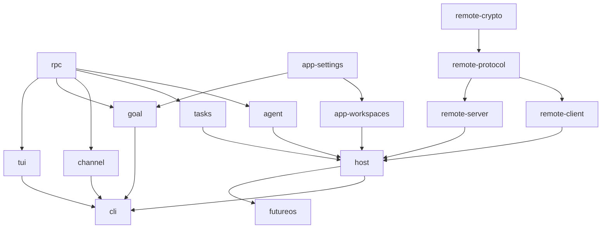
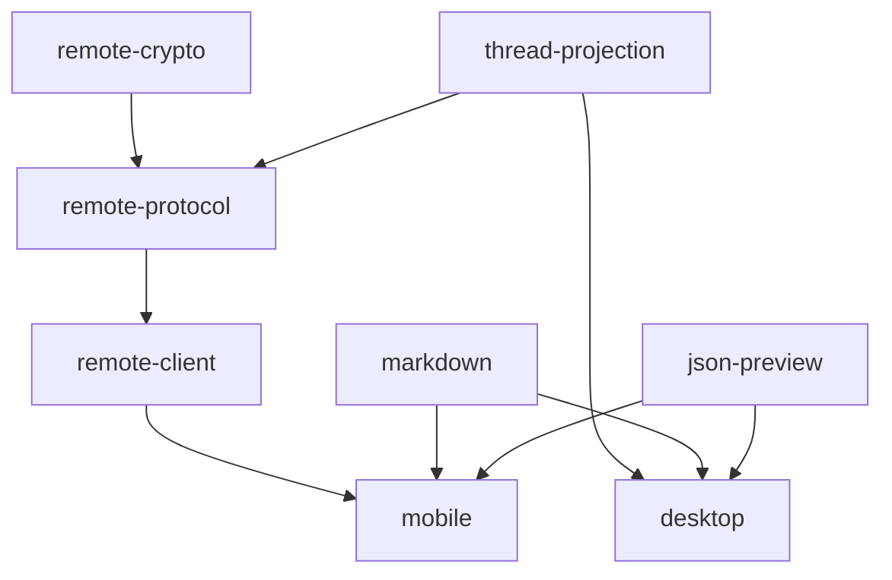

# Continuous integration

[中文](ci.zh-CN.md)

## Regular checks

[`ci.yml`](../../.github/workflows/ci.yml) runs on pull requests, merge groups,
and pushes to main. A manual dispatch runs every regular project by default.
Its optional `projects` input accepts comma-separated Cargo/npm workspace names,
for example `future-host,future-tui,future-cli`. It selects exactly those projects
using the existing runner groups; consumers are not added. Use `android` or `ios`
for native jobs (selecting `@future-os/mobile` alone runs the JS checks).
Unknown names fail planning. PRs, merge groups and main pushes always use automatic
change/dependency detection, including deletions and rename sources; manual
selection never restricts those events.

| Job | Runner | Work |
|---|---|---|
| Rust Linux / Windows / macOS test | Corresponding native OS | Build and tests for selected Rust crates |
| Rust check | Linux | fmt and all-target Clippy, warnings denied |
| TypeScript test | Linux | Typecheck, build and tests for selected npm projects |
| TypeScript check | Linux | ESLint and applicable Stylelint |
| Android test | Linux | Debug app build, JVM module tests and staging IO tests |
| iOS test | macOS | Unsigned Simulator app build and Foundation ShareInbox tests |
| CI result | Linux | Require success for every job selected by the plan |

Build and tests share a runner and Cargo target directory. Source-only TS
libraries verify JS/declaration emission into a temporary directory. Mobile JS
builds both Android and iOS bundles on Linux; Jest runs once. Native jobs test
existing JVM/Swift code without signing or publishing. The iOS Foundation tests
do not claim Simulator UI/E2E coverage.

For Rust groups, Build uses `cargo test --locked --no-run` to compile
the test targets; Tests uses the same package selection and profile to execute
them. There is no preceding standalone dev-profile build. Documentation tests
can still compile examples during Tests. Desktop precompiles only its default GUI
test targets, including `desktop_entry` argument/startup checks. Actual
`future host` process tests belong to CLI. The GUI-disabled Desktop entry
compatibility test and Clippy run only in Misc (`desktop-entry-compat`). Regular
CI has no standalone product or combined CLI/GUI build. Packaging and signing
belong to the release workflows.

Rust test invocations use `--no-fail-fast`: a failed target still fails its job,
but Cargo continues through the other selected test targets so one run exposes
all their failures instead of revealing them one target at a time.

All regular Rust, TypeScript and Android/iOS jobs collect GitHub's existing step
timestamps for toolchain/cache setup, dependencies, Build, Tests and checks.
Each job publishes a `timings-*` artifact with **3-day retention**. Its `job.json`
includes the commit, platform, attempt, step status and elapsed seconds. The
snapshot excludes later uploads, post-job cache saves and queue time; GitHub
step timestamps have second precision. Early cancellation or runner loss may
prevent the final upload.

Rust/TS `commands.jsonl` also records monotonic command duration, exit status and
selection. Rust Build uses `cargo test --no-run --timings` for Cargo's compilation
HTML. JSONL preserves native Rust target headings and test-result summaries,
including reported elapsed time and pass/fail/ignore counts. stdout/stderr are
separate streams and children may print summaries too: adjacent rows alone do
not establish attribution. Output arrival intervals are not individual-test or
internal-module durations. Further TS/native details remain in framework logs
and existing reports; internal phase hooks are not added to every test.

Every Rust test platform enables the same Host fixture recorder, including
Desktop/CLI targets using Host test support. `host-fixture-timings.jsonl` records
shared-lock wait, pre-cleanup, home/database setup, body lifetime, cleanup and
environment/file restoration. Summaries group by fixture and Rust module and
list the slowest scopes. Nested fixtures and concurrent lock waits overlap:
cumulative seconds must not be added or treated as job wall time. Tests without
these fixtures have no internal phase breakdown; body lifetime includes nested
setup and teardown.

Instrumentation changes no assertions, deadlines or scheduling. Job metadata is
read after the work; command/native-summary records are sparse; each completed
Host fixture appends one row rather than logging every event. Fixture wall_ms
excludes the reporting write. No separate overhead benchmark has been run, so
no specific percentage is claimed. Metadata collection failures warn without
replacing the build/test exit status.

## Selection and dependency graph

[`affected.mjs`](../../scripts/ci/affected.mjs) reads Cargo workspace metadata
(including path dependencies used by build/dev/target configurations) and npm
workspace manifests. Source changes select the owner and transitive consumers.
Test-only inputs select the owner. A mixed Rust/TS directory is selected by input
language; shared schema/fixture inputs can select both languages. Interoperability
projects are explicitly excluded from regular execution.

In the diagrams, arrows point from a **dependency to its consumer**: changes
propagate along the arrows. Repeated edges that can be inferred through an
intermediate project are omitted for readability. The tables list every direct
workspace dependency, including those omitted edges. Rust names below omit
`future-`; `futureos` is the Desktop Rust crate. The manifests remain authoritative;
CI prints the current execution plan and selection reasons in its summary.



| Rust crate | Direct workspace dependencies |
|---|---|
| host | agent, app-settings, app-workspaces, remote-client, remote-crypto, remote-protocol, remote-server, rpc, tasks |
| agent | rpc |
| rpc | — |
| app-settings | — |
| app-workspaces | app-settings |
| remote-client | remote-crypto, remote-protocol |
| remote-crypto | — |
| remote-protocol | remote-crypto |
| remote-server | remote-crypto, remote-protocol |
| tasks | rpc |
| channel | rpc |
| goal | app-settings, rpc |
| tui | rpc |
| cli | agent, app-settings, app-workspaces, channel, goal, host, rpc, tasks, tui, remote-crypto (dev) |
| futureos | agent, app-settings, app-workspaces, host, remote-client, remote-crypto, remote-protocol, remote-server, rpc, tasks |

TS names omit their npm scopes (`@future-os/`, Desktop uses `@futureos/`).



| TypeScript project | Direct workspace dependencies |
|---|---|
| json-preview | — |
| markdown | — |
| thread-projection | — |
| remote-crypto | — |
| remote-protocol | remote-crypto, thread-projection |
| remote-client | remote-crypto, remote-protocol, thread-projection |
| desktop | json-preview, markdown, thread-projection |
| mobile | json-preview, markdown, thread-projection, remote-crypto, remote-protocol, remote-client |

Mobile also consumes the local `future-share-intent` and `future-file-handler`
modules. Their Android and iOS/extension/test trees select only the corresponding
native job. Shared module interfaces, app configuration and Mobile source inputs
conservatively select both native builds. Mobile test-only edits do not rebuild
native apps. Root npm manifest/lock changes select all TS/native projects; root
Cargo manifest/lock/toolchain/config changes select all regular Rust crates.
CI planner/runner edits select every regular project. Invalid planning fails the
gate, rather than silently skipping checks.

Examples: `json-preview/src/index.ts` selects json-preview, Desktop and Mobile
TS checks plus both native apps. A Rust remote-client source change selects
remote-client, Host, CLI and Desktop Rust. A schema input in remote-protocol
selects the affected projects of both languages, while schema freshness and
interop remain manual Misc suites.

## Shared Rust runner groups

[`rust-ci.yml`](../../.github/workflows/rust-ci.yml) expands these groups on each
native OS for build/test and on Linux for fmt/Clippy. A group contains only its
selected crates; absent groups allocate no runner. TS projects each get a Linux
build/test runner and a separate Linux lint runner.

[`typescript-ci.yml`](../../.github/workflows/typescript-ci.yml) owns the TS package
matrix and execution steps. The main workflow calls it through `TypeScript test`
and `TypeScript check`, matching Rust's reusable-workflow structure. Both languages
therefore appear as collapsible parent groups in the Actions sidebar, with their
crate groups or packages nested below them.

| Group | Possible members |
|---|---|
| libraries | rpc, app-settings, app-workspaces, channel, goal, tasks |
| remote | remote-crypto, remote-protocol, remote-client, remote-server |
| agent | agent |
| host-remote / host-core (tests); host (checks) | host |
| tui-cli | tui, cli |
| desktop | futureos |

Host has exactly two test jobs on each platform: `host-remote` and `host-core`.
Remote matches `remote` anywhere in the full test name, covering remote,
remote_host, remote_peer and related cases in other modules. Core applies the
complementary filter. Documentation tests follow the same filters and original
ignored states remain unchanged. New names without that substring default to
core. Both jobs compile the same Host test targets separately: total compilation
work increases, without transferring build artifacts between runners. Rust
checks still check Host once. Affected selection remains crate/dependency based:
whenever Host is selected, including Host test-only changes, both suites run.
There is no inferred Rust source-module dependency graph.

Five application-independent remote_peer cases now use Client instances and
memory credentials, retaining their names and assertions. Ownership is recorded
in the [migration inventory](../architecture/remote-test-migration.json). Real
host credential persistence, Store, files and shutdown integration stay in Host.

Desktop Clippy also checks the combined CLI/GUI feature resolution.
Remote client/server Clippy covers `test-support`. Linux Host tests use an
isolated broker. Other native platforms run the Host crate's own suite.
Core groups share one cache per OS; the main CLI test job is its sole writer.
Desktop has a separate GUI cache written by main Desktop test jobs. PR/check/Misc
jobs do not write large private Rust cache copies.

## Specialty validation

[`misc.yml`](../../.github/workflows/misc.yml) has **only** a manual trigger.
It is outside PR/main gating. It replaces the old `ci.yml` specialty scopes and
the standalone flaky-stress workflow. Regular native checks absorb the former
mobile-native-io workflow.

```bash
gh workflow run ci.yml --ref <branch>
gh workflow run misc.yml --ref <branch> -f suite=generated
gh workflow run misc.yml --ref <branch> -f suite=remote-interop
gh workflow run misc.yml --ref <branch> -f suite=windows-update
```

| `suite` | Validation |
|---|---|
| generated | Proto regeneration and Remote schema/codegen freshness |
| remote-interop | Rust/TS interoperability and Remote boundaries |
| windows-update | Offline installer/update fixtures |
| macos-notarization | Recovery/publication script regressions on Linux |
| flaky-stress | Repeated Agent, TUI and CLI tests |
| agent-lifecycle | Native three-OS lifecycle, Host/CLI boundaries and Host docs |
| remote-compile-measurement | Matched cold Windows compilation |
| desktop-entry-compat | Three-OS GUI-disabled Desktop Clippy and entry refusal/hint/no-state regression |
| headless-measurement | Matched Headless build/startup observation; optional `measurement_candidate` SHA |
| full-regression | All regular CI projects, without specialty suites |

Release signing, notarization, packaging and uploads remain in release workflows.

## Merge gate migration

Use the stable `CI result` check as the required status. It runs with `always()`
and rejects failed planning, failures, cancellations, missing results and
unexpected skips. Unaffected suites are allowed to skip. Dynamic matrix names
are diagnostic, not required-check names.

When landing this refactor, migrate the Protect Main ruleset's old individual
required contexts to `CI result` (GitHub Actions app id 15368), preserving strict
up-to-date enforcement and all other rules. Until that administrative migration,
the old contexts will remain pending even when the new checks pass. No ruleset
is changed by editing these workflow files.

Local validation uses syntax/static checks. Unit tests, including planner/gate
regressions in `scripts/tests/ci-plan.test.mjs`, run in CI.
