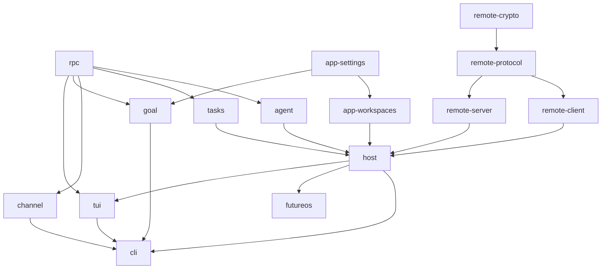
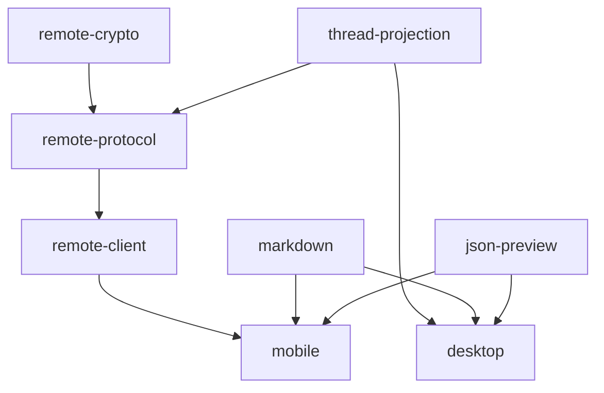

# Continuous integration

[中文](ci.zh-CN.md)

## Regular checks

[`ci.yml`](../../.github/workflows/ci.yml) runs on pull requests and merge groups;
pushes to main do not trigger another run. A manual dispatch runs every regular project by default.
Its optional `projects` input accepts comma-separated Cargo/npm workspace names,
for example `future-host,future-tui,future-cli`. It selects exactly those projects
using the existing runner groups; consumers are not added. Use `android` or `ios`
for native jobs (selecting `@future-os/mobile` alone runs the JS checks).
Unknown names fail planning. PRs and merge groups always use automatic
change/dependency detection, including deletions and rename sources; manual
selection never restricts those events.

| Job | Runner | Work |
|---|---|---|
| Rust Linux / Windows / macOS test | Corresponding native OS | Build and tests for selected Rust crates |
| Rust check | Linux | fmt and all-target Clippy, warnings denied |
| TypeScript test | Linux | Typecheck, build and tests for selected npm projects |
| TypeScript check | Linux | ESLint and applicable Stylelint |
| Android test | Linux | Debug app build, JVM module tests and staging IO tests |
| iOS test | macOS | Unsigned Simulator app build and Foundation ShareInbox tests |
| CI result | Linux | Require success for every job selected by the plan |

Build and tests share a runner and Cargo target directory. Source-only TS
libraries verify JS/declaration emission into a temporary directory. Mobile JS
builds both Android and iOS bundles on Linux; Jest runs once. Native jobs test
existing JVM/Swift code without signing or publishing. The iOS Foundation tests
do not claim Simulator UI/E2E coverage.

For Rust groups, Build uses `cargo nextest run --locked --no-run` to compile
the test targets; Tests uses the same package selection and profile to execute
them. There is no preceding standalone dev-profile build. Documentation tests
can still compile examples during Tests. Desktop precompiles only its default GUI
test targets, including `desktop_entry` argument/startup checks. Actual
`future host` process tests belong to CLI. The GUI-disabled Desktop entry
compatibility test and Clippy run only in Misc (`desktop-entry-compat`). Regular
CI has no standalone product or combined CLI/GUI build. Packaging and signing
belong to the release workflows.

Tests execute through `cargo nextest`, which gives every test its own process and
schedules all of them in one pool. `cargo test` runs one test binary at a time and
parallelises only inside it, so a lane's wall time was set by its slowest single
binary. nextest also runs no executable doctests; every doc code fence in this
workspace is tagged `text`, `ignore` or `json`, and rustdoc compiles none of those,
so nothing is dropped. `desktop/src-tauri`'s `gui_main_thread_drive` target is
`harness = false` (it hands its tests the AppKit main thread) and speaks no
listing protocol, so nextest excludes that one binary and `cargo test` runs it.

Rust test invocations use `--no-fail-fast`: a failed target still fails its job,
but the other selected targets still run so one run exposes all their failures
instead of revealing them one target at a time. `--no-tests=pass` keeps libtest's
behaviour where a filter that matches nothing is not a failure.

All regular Rust, TypeScript and Android/iOS jobs collect GitHub's existing step
timestamps for toolchain/cache setup, dependencies, Build, Tests and checks.
Each job publishes a `timings-*` artifact with **3-day retention**. Its `job.json`
includes the commit, platform, attempt, step status and elapsed seconds. The
snapshot excludes later uploads, post-job cache saves and queue time; GitHub
step timestamps have second precision. Early cancellation or runner loss may
prevent the final upload.

Rust/TS `commands.jsonl` also records monotonic command duration, exit status and
selection. Rust Build uses `cargo nextest run --no-run --timings` for Cargo's
compilation HTML. JSONL preserves native Rust target headings and test-result
summaries,
including reported elapsed time and pass/fail/ignore counts. stdout/stderr are
separate streams and children may print summaries too: adjacent rows alone do
not establish attribution. Output arrival intervals are not individual-test or
internal-module durations. Further TS/native details remain in framework logs
and existing reports; internal phase hooks are not added to every test.

Every Rust test platform enables the same Host fixture recorder, including
Desktop/CLI targets using Host test support. `host-fixture-timings.jsonl` records
shared-lock wait, pre-cleanup, home/database setup, body lifetime, cleanup and
environment/file restoration. Summaries group by fixture and Rust module and
list the slowest scopes. Nested fixtures and concurrent lock waits overlap:
cumulative seconds must not be added or treated as job wall time. Tests without
these fixtures have no internal phase breakdown; body lifetime includes nested
setup and teardown.

Instrumentation changes no assertions, deadlines or scheduling. Job metadata is
read after the work; command/native-summary records are sparse; each completed
Host fixture appends one row rather than logging every event. Fixture wall_ms
excludes the reporting write. No separate overhead benchmark has been run, so
no specific percentage is claimed. Metadata collection failures warn without
replacing the build/test exit status.

## Selection and dependency graph

[`affected.mjs`](../../scripts/ci/affected.mjs) reads Cargo workspace metadata
(including path dependencies used by build/dev/target configurations) and npm
workspace manifests. Source changes select the owner and transitive consumers.
Test-only inputs select the owner. A mixed Rust/TS directory is selected by input
language; shared schema/fixture inputs can select both languages. Interoperability
projects are explicitly excluded from regular execution.

In the diagrams, arrows point from a **dependency to its consumer**: changes
propagate along the arrows. Repeated edges that can be inferred through an
intermediate project are omitted for readability. The tables list every direct
workspace dependency, including those omitted edges. Rust names below omit
`future-`; `futureos` is the Desktop Rust crate. The manifests remain authoritative;
CI prints the current execution plan and selection reasons in its summary.



| Rust crate | Direct workspace dependencies |
|---|---|
| host | agent, app-settings, app-workspaces, remote-client, remote-crypto, remote-protocol, remote-server, rpc, tasks |
| agent | rpc |
| rpc | — |
| app-settings | — |
| app-workspaces | app-settings |
| remote-client | remote-crypto, remote-protocol |
| remote-crypto | — |
| remote-protocol | remote-crypto |
| remote-server | remote-crypto, remote-protocol |
| tasks | rpc |
| channel | rpc |
| goal | app-settings, rpc |
| tui | host, rpc |
| cli | agent, app-settings, app-workspaces, channel, goal, host, rpc, tasks, tui, remote-crypto (dev) |
| futureos | agent, app-settings, app-workspaces, host, remote-client, remote-crypto, remote-protocol, remote-server, rpc, tasks |

TS names omit their npm scopes (`@future-os/`, Desktop uses `@futureos/`).



New TypeScript workspace packages must be registered here **and** in the
`shared` list of [`scripts/ci/typescript-checks.mjs`](../../scripts/ci/typescript-checks.mjs).
The planner reads the npm workspaces, so it plans any package on its own, but
the shared runners only cover a registered one: an unregistered source-only
package fails every phase on a missing script — `@future-os/git-graph` did
exactly that (`must define typecheck`, same for lint and test). Nothing
validates this table; `make check-docs` covers placement and links only.

| TypeScript project | Direct workspace dependencies |
|---|---|
| git-graph | — |
| json-preview | — |
| markdown | — |
| peer-icons | — |
| thread-projection | — |
| remote-crypto | — |
| remote-protocol | remote-crypto, thread-projection |
| remote-client | remote-crypto, remote-protocol, thread-projection |
| desktop | json-preview, markdown, thread-projection |
| mobile | json-preview, markdown, thread-projection, remote-crypto, remote-protocol, remote-client |

Mobile also consumes the local `future-share-intent` and `future-file-handler`
modules. Their Android and iOS/extension/test trees select only the corresponding
native job. Shared module interfaces, app configuration and Mobile source inputs
conservatively select both native builds. Mobile test-only edits do not rebuild
native apps. Root npm manifest/lock changes select all TS/native projects; root
Cargo manifest/lock/toolchain/config changes select all regular Rust crates.
CI planner/runner edits select every regular project. Invalid planning fails the
gate, rather than silently skipping checks.

Examples: `json-preview/src/index.ts` selects json-preview, Desktop and Mobile
TS checks plus both native apps. A Rust remote-client source change selects
remote-client, Host, CLI and Desktop Rust. A schema input in remote-protocol
selects the affected projects of both languages, while schema freshness and
interop remain manual Misc suites.

## Shared Rust runner groups

[`rust-ci.yml`](../../.github/workflows/rust-ci.yml) expands these groups on each
native OS for build/test and on Linux for fmt/Clippy. A group contains only its
selected crates; absent groups allocate no runner. TS projects each get a Linux
build/test runner and a separate Linux lint runner.

[`typescript-ci.yml`](../../.github/workflows/typescript-ci.yml) owns the TS package
matrix and execution steps. The main workflow calls it through `TypeScript test`
and `TypeScript check`, matching Rust's reusable-workflow structure. Both languages
therefore appear as collapsible parent groups in the Actions sidebar, with their
crate groups or packages nested below them.

| Group | Possible members |
|---|---|
| libraries | rpc, app-settings, app-workspaces, channel, goal, tasks |
| remote | remote-crypto, remote-protocol, remote-client, remote-server |
| agent | agent |
| host-remote / host-core (tests); host (checks) | host |
| tui-cli | tui, cli |
| desktop | futureos |

Host has exactly two test jobs on each platform: `host-remote` and `host-core`.
Remote matches `remote` anywhere in the full test name, covering remote,
remote_host, remote_peer and related cases in other modules. Core applies the
complementary filter. Documentation tests follow the same filters and original
ignored states remain unchanged. New names without that substring default to
core. Both jobs compile the same Host test targets separately: total compilation
work increases, without transferring build artifacts between runners. Rust
checks still check Host once. Affected selection remains crate/dependency based:
whenever Host is selected, including Host test-only changes, both suites run.
There is no inferred Rust source-module dependency graph.

Five application-independent remote_peer cases now use Client instances and
memory credentials, retaining their names and assertions. Ownership is recorded
in the [migration inventory](../architecture/remote-test-migration.json). Real
host credential persistence, Store, files and shutdown integration stay in Host.

Desktop Clippy also checks the combined CLI/GUI feature resolution.
Remote client/server Clippy covers `test-support`. Linux Host tests use an
isolated broker. Other native platforms run the Host crate's own suite.
Core groups share one cache per OS; the CLI test job can write it when CI is
manually dispatched on main. Desktop has a separate GUI cache written by Desktop
test jobs in that dispatch. PR/check/Misc jobs do not write large private Rust
cache copies. Dispatch CI on main when shared caches need refreshing.

### Cache quota

The repository-wide Actions cache quota is 10 GB, and it is shared by every
workflow. Only `refs/heads/main` entries are restorable across runs; an entry
written on a PR merge ref is visible to that PR alone. So a per-ref cache is a
pure liability: it consumes quota nobody else can use, and the eviction it
causes costs the restorable entries their hits.

Measured 2026-11-15: 27 entries / 10.19 GB, of which 21 entries / 6.40 GB were
`node-cache-*` written by `actions/setup-node` with `cache: npm`. That setting
keys the tarball by ref, so each PR wrote its own ~318 MB (Linux) + ~305 MB
(macOS) copy, and the same entry existed once per closed PR plus once on
`dev-huichen`. The six `v0-rust-*` entries the Rust lanes actually restore were
0.48–0.94 GB each and were being evicted to make room.

[`scripts/ci/prune-node-caches.sh`](../../scripts/ci/prune-node-caches.sh)
lists those entries and deletes them with `--apply`. Deleting a cache needs only
`repo` scope, not `workflow` scope, so it works on a machine whose token cannot
push workflow edits. After pruning, the same command reports the new total:
3.79 GB, with all six Rust entries intact.

Pruning is not a fix, only a reset — it buys back the quota and nothing more. A
PR that opens after the prune writes a new per-ref copy straight away: within
hours of the reset above, `refs/pull/1616/merge` had already added its own
318 MB `node-cache-*` entry. The durable fix has to stop the per-ref write.

### Executable plan: make the npm cache restore-only on PRs

Blocked on a machine whose token has `workflow` scope. Every file and line below
was verified against `128d0e6d4`; apply them together and re-run a PR to confirm.

Seven sites set `cache: npm`. That is the complete set — `grep -rn "cache: npm"
.github/` returns exactly these seven, and `build-windows-signed.yml` /
`build-android-apk.yml` already run `npm ci` with no `cache:` at all, so the
target shape is a form this repository already uses:

| File | Line | Job |
| --- | --- | --- |
| `.github/workflows/typescript-ci.yml` | 34 | TypeScript check/test (10 project jobs each) |
| `.github/workflows/ci.yml` | 155 | Android test |
| `.github/workflows/ci.yml` | 214 | iOS test |
| `.github/workflows/misc.yml` | 256 | Misc npm job |
| `.github/workflows/build-linux.yaml` | 65 | Linux release build |
| `.github/workflows/build-ios-testflight.yml` | 59 | iOS TestFlight build |
| `.github/workflows/build-macos-signed.yml` | 113 | macOS signed build |

Do **not** simply delete `cache: npm`. `npm ci` is not free: measured across the
22 invocations in run `43637520669`, it cost **883 s total = 14.7 runner-min**,
mean 40.1 s, median 32 s, min 19 s, max 88 s. Removing the cache outright pays
that in full on all 22 jobs. What has to change is *who may write*, not whether
a cache exists.

Two shapes work. Prefer (A) because it keeps `setup-node`'s own download logic:

**(A) Stop `setup-node` from managing the cache; add an explicit restore-only step.**
Replace each of the seven `cache: npm` lines, leaving `node-version` in place:

```yaml
      - uses: actions/setup-node@v7
        with:
          node-version: '24'
          # npm cache is restore-only: a per-ref write costs 318-305 MB of the
          # 10 GB repository quota and no other PR can reuse it.
      - name: Restore npm cache
        uses: actions/cache/restore@v4
        with:
          path: ~/.npm
          key: npm-${{ runner.os }}-${{ hashFiles('package-lock.json') }}
          restore-keys: |
            npm-${{ runner.os }}-
```

Two properties matter here and both are load-bearing:

- The `key` contains no `${{ github.ref }}`, so every PR computes the same key
  as `main` and restores the one shared entry instead of writing a private copy.
- `actions/cache/restore` never saves. Nothing this step does can add an entry
  or evict a Rust one, on any ref.

`hashFiles('package-lock.json')` at the repository root is correct for this
workspace: the root `package.json` declares the npm workspaces and the root
lockfile is the single source of truth, which is why the existing
`cache-dependency-path: package-lock.json` already points there.

**(B) Keep `setup-node`, drive it from an env flag.**
If a reviewer prefers fewer steps, `actions/setup-node` accepts `cache: ''`,
so the same effect comes from passing the cache name conditionally:

```yaml
      - uses: actions/setup-node@v7
        with:
          node-version: '24'
          cache: ${{ github.ref == 'refs/heads/main' && 'npm' || '' }}
```

This still writes on `main` only. It is simpler but leaves the save path alive,
so a future edit to the condition re-introduces the leak; (A) cannot leak by
construction.

After applying either shape, confirm all four of these:

1. `grep -rn "cache: npm" .github/` returns nothing, or only the `main`-guarded
   form from (B).
2. A PR run logs `Cache restored from key: npm-Linux-x64-<hash>` (a *restore*,
   not `Cache saved with key`).
3. `gh api 'repos/:owner/:repo/actions/caches?per_page=100'` shows no
   `refs/pull/*` entry after the PR finishes.
4. The six `v0-rust-*` entries on `refs/heads/main` are still present.

### Runner cost: wall clock, not minutes

The repository is public, so runner minutes are not billed. What a 22-job
expansion actually costs is **wall clock and queueing**, and on this matrix the
two are not where "too many jobs" intuition puts them.

Measured on run `43637520669` (51 jobs, the first run after nextest landed):

| | value |
| --- | --- |
| wall clock, first job start to last job end | **22.4 min** |
| sum of job durations | 214.3 runner-min |
| peak concurrent jobs | 20 (the org-free limit) |
| jobs on the critical path | **one** |

Per runner: `ubuntu-latest` 36 jobs / 95.5 min, `windows-latest` 7 / 65.7,
`macos-latest` 8 / 53.1. Per group: `Rust Windows test` 7 jobs / 65.7 min is the
largest, then `Rust Linux test` 7 / 41.5 and `Rust macOS test` 7 / 40.6.

The run finished 22.4 min in because **`Rust Windows test / agent` alone took
21.9 min** — the other 50 jobs were done well inside it. Peak concurrency hit 20
for only part of the run, and the queue wait was short (≤2 s on the pure-Rust
run `43642118345`). So on the current matrix, cutting job count would not
shorten the run at all; it would lengthen it.

That job's split is `Build 245 s + Tests 981 s`. The 981 s is **pre-existing,
not a nextest regression**: in run `43635381613`, taken before the nextest
change, the same step took **1024 s**. Windows runs these tests ~4× slower than
Linux (`Tests` 981 s vs 234 s for the same crate, same suite), which is the real
target.

### Executable plan: shard the critical-path job

Blocked on `workflow` scope, like the npm-cache plan above. `cargo nextest`
supports `--partition`, so the job splits with no new tooling. Verified on
`future-config`: `--partition hash:1/2` and `hash:2/2` return 3 and 4 of 7 tests,
summing to the total with **zero overlap**.

One constraint shapes the change: all three OS callers pass the **same**
`rust_tests` JSON (`ci.yml:91/101/111`), so sharding in `affected.mjs` alone
would shard all three platforms. Only Windows needs it. The planner therefore
publishes a second, sharded matrix and only the Windows caller consumes it.

**(1) `scripts/ci/affected.mjs`** — emit a sharded variant next to the plain one:

```js
// Windows runs `agent` ~4x slower than Linux; split only that lane, only there.
export function rustTestGroups(groups) {
  return groups.flatMap(group => group.name === 'host'
    ? ['remote', 'core'].map(suite => ({ ...group, name: `host-${suite}`, hostSuite: suite }))
    : [group]);
}

export function shardedTestGroups(groups) {
  return rustTestGroups(groups).flatMap(group => group.name === 'agent'
    ? [1, 2].map(n => ({ ...group, name: `agent (${n}/2)`, shard: `${n}/2` }))
    : [group]);
}
```

and in `main`, alongside the existing `rust_tests` output:

```js
plan.rust_tests_sharded = shardedTestGroups(plan.rust);
```

`GITHUB_OUTPUT` gains `rust_tests_sharded=$(JSON.stringify(plan.rust_tests_sharded))`.

**(2) `.github/workflows/ci.yml`** — expose it, and use it only for Windows:

```yaml
      rust_tests_sharded: ${{ steps.plan.outputs.rust_tests_sharded }}
```

```yaml
  rust-windows-test:
    with:
      os: windows-latest
      mode: test
      projects: ${{ needs.affected.outputs.rust_tests_sharded }}   # was rust_tests
```

Linux and macOS keep `rust_tests`. Cost: **+1 job** (52 total instead of 51),
which matters because peak concurrency already touches the 20-job org-free
limit — sharding all three OSes would add 3 and is why this is scoped to one.

**(3) `.github/workflows/rust-ci.yml`** — carry the shard into the job env:

```yaml
    env:
      CI_TEST_SHARD: ${{ matrix.shard }}
```

**(4) `scripts/ci/rust-checks.mjs`** — append the partition. Already implemented on
this branch (`docs/ci-plan`), so a workflow-only follow-up needs nothing here:

```js
const testShard = process.env.CI_TEST_SHARD || '';
if (testShard && !/^[1-9]\d*\/[1-9]\d*$/.test(testShard)) throw new Error(`Invalid CI_TEST_SHARD: ${testShard}`);
const partition = testShard ? ['--partition', `hash:${testShard}`] : [];
const NEXTEST_TEST = [...NEXTEST, '--no-fail-fast', ...partition];
```

`build` reuses `NEXTEST` with `--no-run`, so both shards compile the full test
targets; that is why `Build` does not halve below.

Projected effect on the critical path:

| shape | build | tests | job duration | run wall clock |
| --- | --- | --- | --- | --- |
| today | 245 s | 981 s | 20.4 min | 22.4 min |
| 2-way | 245 s | 490 s | 12.3 min | **~14 min** |
| 3-way | 245 s | 327 s | 9.5 min | **~11 min** |

The `+66 s` setup/cache per extra shard job is included (Windows measured 10 s
setup + 56 s cache). 3-way needs `[1,2,3].map(...)` and `(n/3)` in
`shardedTestGroups`, and adds one more job.

**Do not collapse crates to fewer jobs.** Measured, one job per OS running its 7
crates sequentially would be `Linux 35.5 min`, `Windows 55.5 min`, `macOS
35.6 min` — each *worse* than today's 22.4 min run, because per-crate build and
test time simply adds up once the parallelism is gone. The 21 Rust test jobs are
not the problem; one job inside them is.

## Specialty validation

[`misc.yml`](../../.github/workflows/misc.yml) has **only** a manual trigger.
It is outside PR/main gating. Regular native checks cover mobile native IO.

```bash
gh workflow run ci.yml --ref <branch>
gh workflow run misc.yml --ref <branch> -f suite=generated
gh workflow run misc.yml --ref <branch> -f suite=remote-interop
gh workflow run misc.yml --ref <branch> -f suite=windows-update
```

| `suite` | Validation |
|---|---|
| generated | Proto regeneration and Remote schema/codegen freshness |
| remote-interop | Rust/TS interoperability and Remote boundaries |
| windows-update | Offline installer/update fixtures |
| linux-update | Linux DEB update fixtures: root-side verification and dpkg recovery of a prepared executor |
| macos-notarization | Recovery/publication script regressions on Linux |
| flaky-stress | Repeated Agent, TUI and CLI tests |
| agent-lifecycle | Native three-OS lifecycle, Host/CLI boundaries and Host docs |
| remote-compile-measurement | Matched cold Windows compilation |
| desktop-entry-compat | Three-OS GUI-disabled Desktop Clippy and entry refusal/hint/no-state regression |
| headless-measurement | Matched Headless build/startup observation; optional `measurement_candidate` SHA |
| full-regression | All regular CI projects, without specialty suites |

Release signing, notarization, packaging and uploads remain in release workflows.

## Merge gate

Use the stable `CI result` check as the required status. It runs with `always()`
and rejects failed planning, failures, cancellations, missing results and
unexpected skips. Unaffected suites are allowed to skip. Dynamic matrix names
are diagnostic, not required-check names.

The `Protect Main` ruleset requires exactly that one context (`CI result`, GitHub
Actions app id 15368) with strict up-to-date enforcement, so adding or renaming a
workflow job needs no administrative change. No ruleset is changed by editing
these workflow files.

Local validation uses syntax/static checks. Unit tests, including planner/gate
regressions in `scripts/tests/ci-plan.test.mjs`, run in CI.
