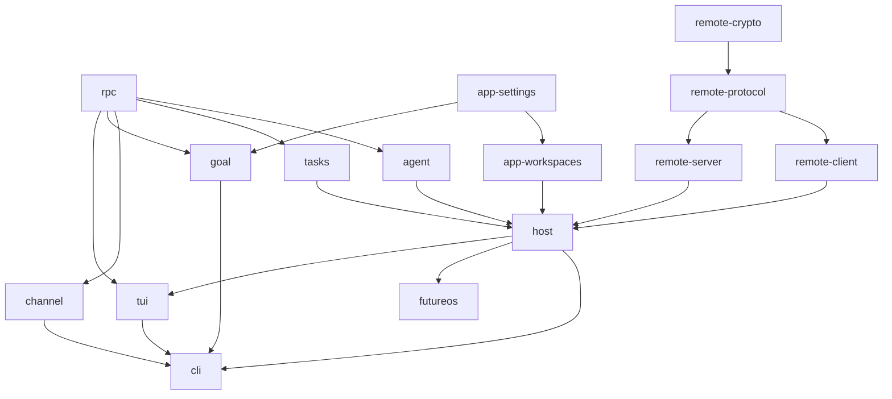
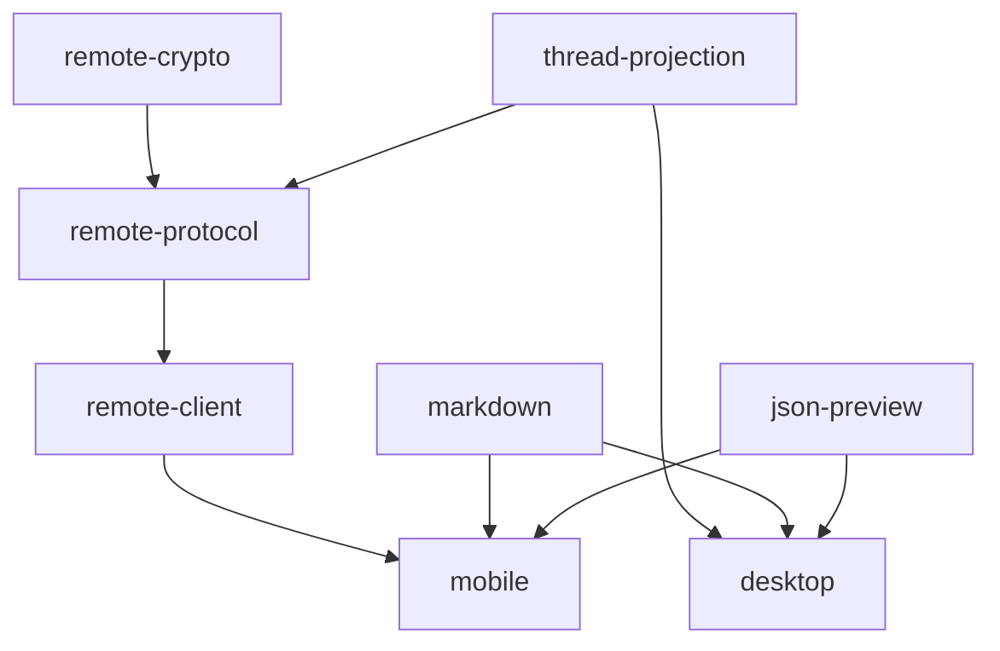

# 持续集成

[English](ci.md)

## 常规检查

[`ci.yml`](../../.github/workflows/ci.yml) 在 PR、merge group 和 main push 时运行，
按改动范围选择项目；手动 dispatch 默认执行全部常规项目。
手动入口的可选 `projects` 参数接受逗号分隔的 Cargo/npm workspace 项目名，
例如 `future-host,future-tui,future-cli`，沿用现有 runner 分组，只执行明确选择的项目，
不自动扩展消费者。原生任务使用 `android`、`ios`；仅选择 `@future-os/mobile` 时执行 JS 检查。
未知项目名会使计划失败。PR、merge group 和 main push 始终自动判断改动和依赖，
包含删除及重命名前的路径，手动选择不会限制这些事件。

| Job | Runner | 内容 |
|---|---|---|
| Rust Linux / Windows / macOS test | 对应原生操作系统 | 选中 crate 的 build 和 tests |
| Rust check | Linux | fmt、all-target Clippy，禁止 warnings |
| TypeScript test | Linux | 选中 npm 项目的 typecheck、build、tests |
| TypeScript check | Linux | ESLint、适用项目的 Stylelint |
| Android test | Linux | Debug app 构建、JVM 模块测试、staging IO 测试 |
| iOS test | macOS | 无发布签名的 Simulator 构建、Foundation ShareInbox 测试 |
| CI result | Linux | 要求计划中的所有任务成功 |

build 和 tests 共享 runner 与 Cargo target 目录。直接导出源码的 TS 库向临时目录
生成 JS/declaration，验证产物可生成。Mobile 在 Linux 上打包 Android/iOS 两份 JS
bundle，Jest 只跑一次；原生 job 执行现有 JVM/Swift 测试，不签名或发布。
iOS 的 Foundation 测试不代表 Simulator UI/E2E 覆盖。

Rust 组的 Build 使用 `cargo test --locked --no-run` 编译测试目标，
Tests 使用相同的包选择和 profile 执行测试，不再先跑一次独立的 dev-profile 构建。
文档测试仍可能在 Tests 中编译示例。Desktop 只预编译默认 GUI 测试目标，
其中 `desktop_entry` 验证参数与启动副作用；真正的 `future host` 进程测试归 CLI。
关闭 GUI 的 Desktop 入口兼容性测试与 Clippy 只在 Misc 的 `desktop-entry-compat` 中运行。
常规 CI 不执行独立产品或 CLI/GUI 联合构建；打包和签名归发布工作流负责。

Rust 测试命令使用 `--no-fail-fast`：任一测试目标失败仍使 job 失败，但 Cargo 会继续执行
其他选中的测试目标，让一轮 CI 收集它们的失败，避免每次只暴露第一个失败目标。

所有常规 Rust、TypeScript、Android/iOS job 使用相同的计时采集方式，在 summary
展示 GitHub 已有的 step 时间戳，覆盖工具链、缓存、依赖安装、Build、Tests 和检查。
每个 job 上传 `timings-*` artifact，**保留 3 天**；`job.json` 包含提交、平台、运行轮次、
step 状态和耗时。快照不包含后续 artifact 上传、post-job 缓存保存与排队时间；
GitHub 时间戳精度为秒。取消过早或 runner 故障时，最后的上传可能无法执行。

Rust/TS 的 `commands.jsonl` 另外记录每条命令的单调时钟耗时、退出状态和选择范围。
Rust Build 的 `cargo test --no-run --timings` 生成 Cargo 编译明细 HTML；
JSONL 保留 Rust 测试框架原生的目标标题、通过/失败/忽略数量和执行耗时汇总。
原生输出按各自 stdout/stderr 流记录，子进程也可能输出汇总；不能仅凭相邻行推断对应关系，
也不能把日志到达间隔当成单个测试或内部模块的耗时。TS/原生测试的进一步明细继续看各自
测试框架日志与已有报告，未给所有测试强行增加内部阶段埋点。

所有平台的 Rust 测试 job 都启用同一个 Host 夹具记录器；使用 Host 测试辅助的
Desktop/CLI 目标也会产生 `host-fixture-timings.jsonl`。记录共享锁等待、前置清理、
HOME/数据库初始化、主体存活时间、清理与环境/文件恢复；summary 按夹具及测试模块
分别汇总，并列出最慢作用域。嵌套 Home/Mock 夹具和并发锁等待存在重叠，累计秒数
不能相加，也不代表 job 墙钟时间；不使用这些夹具的测试不在内部阶段计时范围内。
主体存活时间包含嵌套初始化和销毁。

计时不修改断言、期限或测试调度。job 时间戳在工作结束后读取；命令与原生汇总只写
少量条目；Host 每次夹具完成后追加一行，不逐事件记录，写入耗时不算进夹具 wall_ms。
未进行独立的开销基准，不能承诺具体百分比。计时元数据采集错误只警告，
原构建/测试退出状态仍决定 CI 结果。

## 范围检测与依赖图

[`affected.mjs`](../../scripts/ci/affected.mjs) 从 Cargo workspace metadata 和
npm workspace manifest 读取依赖，包含 Rust 的 build/dev/target 路径依赖。
源码变化选择所属项目及其传递消费者；仅测试输入变化只选择所属项目。
Rust/TS 混合目录按输入语言区分，共享 schema/fixture 可以同时选择两种语言。
互操作项目明确排除在常规执行范围外。

依赖图的箭头表示**依赖项 → 消费者**，改动影响沿箭头传播。为便于阅读，图中省略了
可由中间项目推导出的重复连线；表格保留全部直接 workspace 依赖，包含这些省略的边。
Rust 名称省略 `future-`，`futureos` 表示 Desktop Rust crate。
manifest 是事实来源；每次 CI summary 都会输出当前执行计划和选择原因。



| Rust crate | 直接 workspace 依赖 |
|---|---|
| host | agent、app-settings、app-workspaces、remote-client、remote-crypto、remote-protocol、remote-server、rpc、tasks |
| agent | rpc |
| rpc | — |
| app-settings | — |
| app-workspaces | app-settings |
| remote-client | remote-crypto、remote-protocol |
| remote-crypto | — |
| remote-protocol | remote-crypto |
| remote-server | remote-crypto、remote-protocol |
| tasks | rpc |
| channel | rpc |
| goal | app-settings、rpc |
| tui | host、rpc |
| cli | agent、app-settings、app-workspaces、channel、goal、host、rpc、tasks、tui、remote-crypto（dev） |
| futureos | agent、app-settings、app-workspaces、host、remote-client、remote-crypto、remote-protocol、remote-server、rpc、tasks |

TS 名称省略 npm scope（通常为 `@future-os/`，Desktop 为 `@futureos/`）。



| TypeScript 项目 | 直接 workspace 依赖 |
|---|---|
| json-preview | — |
| markdown | — |
| thread-projection | — |
| remote-crypto | — |
| remote-protocol | remote-crypto、thread-projection |
| remote-client | remote-crypto、remote-protocol、thread-projection |
| desktop | json-preview、markdown、thread-projection |
| mobile | json-preview、markdown、thread-projection、remote-crypto、remote-protocol、remote-client |

Mobile 还消费本地 `future-share-intent`、`future-file-handler` 模块。
它们的 Android、iOS/extension/test 目录只选择对应原生 job；共享模块接口、
应用配置和 Mobile 源码保守地选择两个原生构建。仅 Mobile 测试变化不构建原生 app。
根 npm manifest/lock 变化选择全部 TS/原生项目；根 Cargo manifest/lock/toolchain/
config 变化选择全部常规 Rust crate。CI 选择器或 runner 脚本变化选择全部常规项目。
无效范围输入使门禁失败，不静默跳过。

例如：`json-preview/src/index.ts` 选择 json-preview、Desktop、Mobile 的 TS 检查，
以及 Android/iOS 原生验证。Rust remote-client 源码变化选择 remote-client、Host、
CLI、Desktop Rust。remote-protocol 的共享 schema 选择受影响的两种语言项目，
生成一致性和互操作仍只在 Misc 手动执行。

## Rust 共享 runner 分组

[`rust-ci.yml`](../../.github/workflows/rust-ci.yml) 在三个原生平台展开 build/test
分组，在 Linux 展开 fmt/Clippy 分组。每组只带入本次选中的 crate；空组不分配 runner。
TS 项目各自拥有一个 Linux build/test runner 和一个独立 Linux lint runner。

[`typescript-ci.yml`](../../.github/workflows/typescript-ci.yml) 负责 TS package
矩阵和执行步骤，主工作流通过 `TypeScript test`、`TypeScript check` 调用它，
与 Rust 使用相同的可复用 workflow 结构。因此两种语言在 Actions 左侧栏都显示为
可折叠的父分组，展开后查看各 crate 分组或 package。

| 组 | 可能包含的 crate |
|---|---|
| libraries | rpc、app-settings、app-workspaces、channel、goal、tasks |
| remote | remote-crypto、remote-protocol、remote-client、remote-server |
| agent | agent |
| host-remote / host-core（测试）；host（检查） | host |
| tui-cli | tui、cli |
| desktop | futureos |

Host 在三个平台都只分 `host-remote`、`host-core` 两个测试 job。前者匹配完整测试名
中的 `remote`（包含 remote、remote_host、remote_peer 及其他模块内相关用例），后者
使用同一匹配串的反向筛选。两组互补，文档测试也遵循相同筛选，原有 ignored 状态不变，
不是省略 Remote 覆盖。新增不含该串的测试默认进 core。
两组各自预编译同样的 Host 测试目标；这会增加总编译用量，避免依赖构建产物跨 runner 搬运。
Rust check 仍只检查 Host 一次。affected 继续按 crate/依赖决定是否选择 Host，
选中后两组都跑，包括仅改 Host 测试的情况；尚未引入源码模块级的依赖推断。

`remote_peer` 中 5 个只验证 Client 行为的测试已迁至 Client 的独立实例/内存凭据夹具，
名称与原断言保留；归属见 [迁移清单](../architecture/remote-test-migration.json)。
真实宿主凭据持久化、Store、文件和退出集成继续留在 Host。

Desktop 的 Clippy 额外检查 CLI/GUI 组合特性解析；Remote client/server 的 Clippy
覆盖 `test-support`；Linux Host 使用隔离 broker，其他平台执行 Host 自有套件。
Core 分组共享每个操作系统的一份缓存，由 main CLI test job 单独写入；Desktop
使用独立 GUI 缓存，由 main Desktop test job 写入。PR/check/Misc 不写入大型私有缓存。

## 专项验证

[`misc.yml`](../../.github/workflows/misc.yml) **只有手动入口**，不参与 PR/main 门禁。
移动端原生 IO 验证由常规原生检查覆盖。

```bash
gh workflow run ci.yml --ref <branch>
gh workflow run misc.yml --ref <branch> -f suite=generated
gh workflow run misc.yml --ref <branch> -f suite=remote-interop
gh workflow run misc.yml --ref <branch> -f suite=windows-update
```

| `suite` | 验证内容 |
|---|---|
| generated | Proto 重新生成、Remote schema/codegen 一致性 |
| remote-interop | Rust/TS 互操作、Remote 边界 |
| windows-update | 离线安装器/更新 fixtures |
| linux-update | Linux DEB 更新 fixtures：预置执行器的 root 侧校验与 dpkg 恢复 |
| macos-notarization | Linux 上的恢复/发布脚本回归 |
| flaky-stress | 重复运行 Agent、TUI、CLI 测试 |
| agent-lifecycle | 三平台原生生命周期、Host/CLI 边界、Host 文档 |
| remote-compile-measurement | Windows 冷编译对照 |
| desktop-entry-compat | 三平台关闭 GUI 的 Desktop Clippy，以及入口拒绝、CLI 提示、无状态副作用回归 |
| headless-measurement | Headless 构建/启动观测，可传 `measurement_candidate` SHA |
| full-regression | 全部常规 CI 项目，不包含专项 |

发布签名、公证、打包和上传继续由发布工作流负责。

## 合并门禁

使用固定的 `CI result` 作为 required status。它通过 `always()` 执行，拒绝规划失败、
任务失败/取消、缺失结果和计划外跳过；未受影响的任务允许跳过。动态矩阵名称用于诊断，
不作为分支保护的 required-check 名称。

`Protect Main` ruleset 只要求这一个 context（`CI result`，GitHub Actions app id 15368），
并保留严格主干同步要求，因此新增或重命名工作流 job 不需要改动管理配置。
编辑工作流文件本身不会修改 ruleset。

本地只执行语法/静态检查；包括 `scripts/tests/ci-plan.test.mjs` 在内的单元测试交给 CI。
