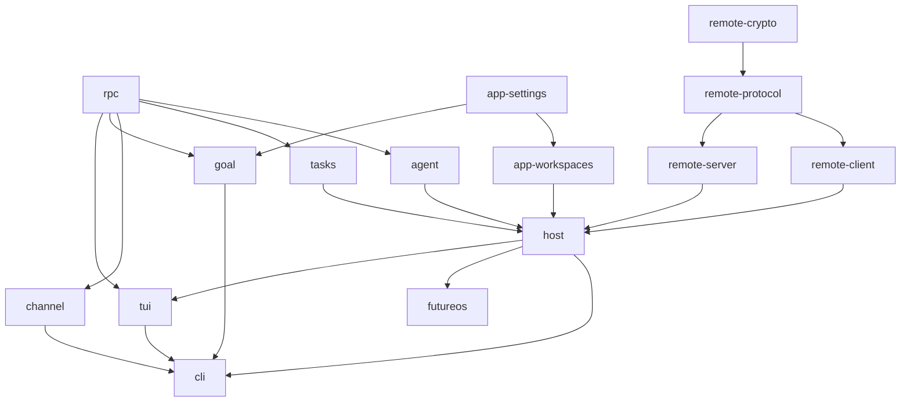
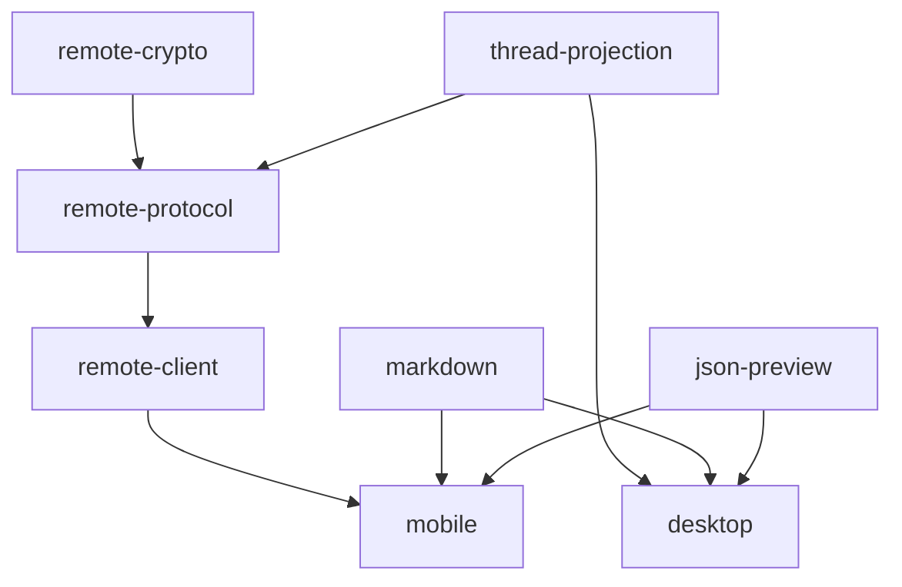

# 持续集成

[English](ci.md)

## 常规检查

[`ci.yml`](../../.github/workflows/ci.yml) 在 PR 和 merge group 时运行，
按改动范围选择项目；main push 不再触发重复运行。手动 dispatch 默认执行全部常规项目。
手动入口的可选 `projects` 参数接受逗号分隔的 Cargo/npm workspace 项目名，
例如 `future-host,future-tui,future-cli`，沿用现有 runner 分组，只执行明确选择的项目，
不自动扩展消费者。原生任务使用 `android`、`ios`；仅选择 `@future-os/mobile` 时执行 JS 检查。
未知项目名会使计划失败。PR 和 merge group 始终自动判断改动和依赖，
包含删除及重命名前的路径，手动选择不会限制这些事件。

| Job | Runner | 内容 |
|---|---|---|
| Rust Linux / Windows / macOS test | 对应原生操作系统 | 选中 crate 的 build 和 tests |
| Rust check | Linux | fmt、all-target Clippy，禁止 warnings |
| TypeScript test | Linux | 选中 npm 项目的 typecheck、build、tests |
| TypeScript check | Linux | ESLint、适用项目的 Stylelint |
| Android test | Linux | Debug app 构建、JVM 模块测试、staging IO 测试 |
| iOS test | macOS | 无发布签名的 Simulator 构建、Foundation ShareInbox 测试 |
| CI result | Linux | 要求计划中的所有任务成功 |

build 和 tests 共享 runner 与 Cargo target 目录。直接导出源码的 TS 库向临时目录
生成 JS/declaration，验证产物可生成。Mobile 在 Linux 上打包 Android/iOS 两份 JS
bundle，Jest 只跑一次；原生 job 执行现有 JVM/Swift 测试，不签名或发布。
iOS 的 Foundation 测试不代表 Simulator UI/E2E 覆盖。

Rust 组的 Build 使用 `cargo nextest run --locked --no-run` 编译测试目标，
Tests 使用相同的包选择和 profile 执行测试，不再先跑一次独立的 dev-profile 构建。
文档测试仍可能在 Tests 中编译示例。Desktop 只预编译默认 GUI 测试目标，
其中 `desktop_entry` 验证参数与启动副作用；真正的 `future host` 进程测试归 CLI。
关闭 GUI 的 Desktop 入口兼容性测试与 Clippy 只在 Misc 的 `desktop-entry-compat` 中运行。
常规 CI 不执行独立产品或 CLI/GUI 联合构建；打包和签名归发布工作流负责。

测试通过 `cargo nextest` 执行：每个测试独占进程，全部测试共用一个调度池。
`cargo test` 一次只跑一个测试二进制，并行只发生在二进制内部，因此一条腿的墙钟
由它最慢的那个二进制决定。nextest 不执行可执行 doctest；本仓所有文档代码围栏都标了
`text`、`ignore` 或 `json`，rustdoc 均不编译，因此没有丢失任何测试。
`desktop/src-tauri` 的 `gui_main_thread_drive` 目标是 `harness = false`
（它把 AppKit 主线程交给测试），不实现列举协议，因此 nextest 排除该二进制、
由 `cargo test` 单独运行它。

Rust 测试命令使用 `--no-fail-fast`：任一测试目标失败仍使 job 失败，但其他选中的测试目标
照常执行，让一轮 CI 收集它们的失败，避免每次只暴露第一个失败目标。
`--no-tests=pass` 保持 libtest 的语义：过滤后没有匹配测试不算失败。

所有常规 Rust、TypeScript、Android/iOS job 使用相同的计时采集方式，在 summary
展示 GitHub 已有的 step 时间戳，覆盖工具链、缓存、依赖安装、Build、Tests 和检查。
每个 job 上传 `timings-*` artifact，**保留 3 天**；`job.json` 包含提交、平台、运行轮次、
step 状态和耗时。快照不包含后续 artifact 上传、post-job 缓存保存与排队时间；
GitHub 时间戳精度为秒。取消过早或 runner 故障时，最后的上传可能无法执行。

Rust/TS 的 `commands.jsonl` 另外记录每条命令的单调时钟耗时、退出状态和选择范围。
Rust Build 的 `cargo nextest run --no-run --timings` 生成 Cargo 编译明细 HTML；
JSONL 保留 Rust 测试框架原生的目标标题、通过/失败/忽略数量和执行耗时汇总。
原生输出按各自 stdout/stderr 流记录，子进程也可能输出汇总；不能仅凭相邻行推断对应关系，
也不能把日志到达间隔当成单个测试或内部模块的耗时。TS/原生测试的进一步明细继续看各自
测试框架日志与已有报告，未给所有测试强行增加内部阶段埋点。

所有平台的 Rust 测试 job 都启用同一个 Host 夹具记录器；使用 Host 测试辅助的
Desktop/CLI 目标也会产生 `host-fixture-timings.jsonl`。记录共享锁等待、前置清理、
HOME/数据库初始化、主体存活时间、清理与环境/文件恢复；summary 按夹具及测试模块
分别汇总，并列出最慢作用域。嵌套 Home/Mock 夹具和并发锁等待存在重叠，累计秒数
不能相加，也不代表 job 墙钟时间；不使用这些夹具的测试不在内部阶段计时范围内。
主体存活时间包含嵌套初始化和销毁。

计时不修改断言、期限或测试调度。job 时间戳在工作结束后读取；命令与原生汇总只写
少量条目；Host 每次夹具完成后追加一行，不逐事件记录，写入耗时不算进夹具 wall_ms。
未进行独立的开销基准，不能承诺具体百分比。计时元数据采集错误只警告，
原构建/测试退出状态仍决定 CI 结果。

## 范围检测与依赖图

[`affected.mjs`](../../scripts/ci/affected.mjs) 从 Cargo workspace metadata 和
npm workspace manifest 读取依赖，包含 Rust 的 build/dev/target 路径依赖。
源码变化选择所属项目及其传递消费者；仅测试输入变化只选择所属项目。
Rust/TS 混合目录按输入语言区分，共享 schema/fixture 可以同时选择两种语言。
互操作项目明确排除在常规执行范围外。

依赖图的箭头表示**依赖项 → 消费者**，改动影响沿箭头传播。为便于阅读，图中省略了
可由中间项目推导出的重复连线；表格保留全部直接 workspace 依赖，包含这些省略的边。
Rust 名称省略 `future-`，`futureos` 表示 Desktop Rust crate。
manifest 是事实来源；每次 CI summary 都会输出当前执行计划和选择原因。



| Rust crate | 直接 workspace 依赖 |
|---|---|
| host | agent、app-settings、app-workspaces、remote-client、remote-crypto、remote-protocol、remote-server、rpc、tasks |
| agent | rpc |
| rpc | — |
| app-settings | — |
| app-workspaces | app-settings |
| remote-client | remote-crypto、remote-protocol |
| remote-crypto | — |
| remote-protocol | remote-crypto |
| remote-server | remote-crypto、remote-protocol |
| tasks | rpc |
| channel | rpc |
| goal | app-settings、rpc |
| tui | host、rpc |
| cli | agent、app-settings、app-workspaces、channel、goal、host、rpc、tasks、tui、remote-crypto（dev） |
| futureos | agent、app-settings、app-workspaces、host、remote-client、remote-crypto、remote-protocol、remote-server、rpc、tasks |

TS 名称省略 npm scope（通常为 `@future-os/`，Desktop 为 `@futureos/`）。



| TypeScript 项目 | 直接 workspace 依赖 |
|---|---|
| json-preview | — |
| markdown | — |
| thread-projection | — |
| remote-crypto | — |
| remote-protocol | remote-crypto、thread-projection |
| remote-client | remote-crypto、remote-protocol、thread-projection |
| desktop | json-preview、markdown、thread-projection |
| mobile | json-preview、markdown、thread-projection、remote-crypto、remote-protocol、remote-client |

Mobile 还消费本地 `future-share-intent`、`future-file-handler` 模块。
它们的 Android、iOS/extension/test 目录只选择对应原生 job；共享模块接口、
应用配置和 Mobile 源码保守地选择两个原生构建。仅 Mobile 测试变化不构建原生 app。
根 npm manifest/lock 变化选择全部 TS/原生项目；根 Cargo manifest/lock/toolchain/
config 变化选择全部常规 Rust crate。CI 选择器或 runner 脚本变化选择全部常规项目。
无效范围输入使门禁失败，不静默跳过。

例如：`json-preview/src/index.ts` 选择 json-preview、Desktop、Mobile 的 TS 检查，
以及 Android/iOS 原生验证。Rust remote-client 源码变化选择 remote-client、Host、
CLI、Desktop Rust。remote-protocol 的共享 schema 选择受影响的两种语言项目，
生成一致性和互操作仍只在 Misc 手动执行。

## Rust 共享 runner 分组

[`rust-ci.yml`](../../.github/workflows/rust-ci.yml) 在三个原生平台展开 build/test
分组，在 Linux 展开 fmt/Clippy 分组。每组只带入本次选中的 crate；空组不分配 runner。
TS 项目各自拥有一个 Linux build/test runner 和一个独立 Linux lint runner。

[`typescript-ci.yml`](../../.github/workflows/typescript-ci.yml) 负责 TS package
矩阵和执行步骤，主工作流通过 `TypeScript test`、`TypeScript check` 调用它，
与 Rust 使用相同的可复用 workflow 结构。因此两种语言在 Actions 左侧栏都显示为
可折叠的父分组，展开后查看各 crate 分组或 package。

| 组 | 可能包含的 crate |
|---|---|
| libraries | rpc、app-settings、app-workspaces、channel、goal、tasks |
| remote | remote-crypto、remote-protocol、remote-client、remote-server |
| agent | agent |
| host-remote / host-core（测试）；host（检查） | host |
| tui-cli | tui、cli |
| desktop | futureos |

Host 在三个平台都只分 `host-remote`、`host-core` 两个测试 job。前者匹配完整测试名
中的 `remote`（包含 remote、remote_host、remote_peer 及其他模块内相关用例），后者
使用同一匹配串的反向筛选。两组互补，文档测试也遵循相同筛选，原有 ignored 状态不变，
不是省略 Remote 覆盖。新增不含该串的测试默认进 core。
两组各自预编译同样的 Host 测试目标；这会增加总编译用量，避免依赖构建产物跨 runner 搬运。
Rust check 仍只检查 Host 一次。affected 继续按 crate/依赖决定是否选择 Host，
选中后两组都跑，包括仅改 Host 测试的情况；尚未引入源码模块级的依赖推断。

`remote_peer` 中 5 个只验证 Client 行为的测试已迁至 Client 的独立实例/内存凭据夹具，
名称与原断言保留；归属见 [迁移清单](../architecture/remote-test-migration.json)。
真实宿主凭据持久化、Store、文件和退出集成继续留在 Host。

Desktop 的 Clippy 额外检查 CLI/GUI 组合特性解析；Remote client/server 的 Clippy
覆盖 `test-support`；Linux Host 使用隔离 broker，其他平台执行 Host 自有套件。
Core 分组共享每个操作系统的一份缓存，在 main 手动 dispatch CI 时由 CLI test job
单独写入；Desktop 使用独立 GUI 缓存，由该次运行的 Desktop test job 写入。
PR/check/Misc 不写入大型私有缓存。共享缓存需要刷新时，在 main 手动 dispatch CI。

### 缓存配额

仓库级 Actions 缓存配额是 10 GB，所有 workflow 共用。只有 `refs/heads/main`
上的条目能被其他运行还原；写在 PR merge ref 上的条目只对那个 PR 可见。因此按 ref
生成的缓存是纯负担：它占掉谁都读不到的配额，而它引发的驱逐又让可还原条目丢命中。

2026-11-15 实测：27 条 / 10.19 GB，其中 21 条 / 6.40 GB 是 `actions/setup-node`
配 `cache: npm` 写出的 `node-cache-*`。该配置按 ref 生成 key，于是每个 PR 各写
~318 MB（Linux）+ ~305 MB（macOS），同一个条目在已关闭的 PR 上各存一份，外加
`dev-huichen` 上一份。Rust 各腿真正还原的 6 条 `v0-rust-*` 每条 0.48–0.94 GB，
正是被挤掉的那些。

[`scripts/ci/prune-node-caches.sh`](../../scripts/ci/prune-node-caches.sh) 列出这些条目，
加 `--apply` 删除。删缓存只需 `repo` scope、不需要 `workflow` scope，所以在无法推送
workflow 改动的机器上也能用。清理后同一命令会报告新的总量：3.79 GB，6 条 Rust 条目
完好。

清理只是把配额买回来，不是修好。清理之后新开的 PR 会立刻再写一份：上面那次重置后几小时，
`refs/pull/1616/merge` 就新增了自己的 318 MB `node-cache-*` 条目。根治必须停掉按 ref 的写入。

### 可执行清单：让 npm 缓存只在 PR 还原、不写入

阻塞在需要 `workflow` scope 的机器上。下列文件与行号已对 `128d0e6d4` 逐条核实；一起改完后
跑一个 PR 验证。

设了 `cache: npm` 的共 7 处，且这就是全集——`grep -rn "cache: npm" .github/` 恰好返回这 7 条；
`build-windows-signed.yml` 与 `build-android-apk.yml` 本来就直接 `npm ci`、完全没有 `cache:`，
所以目标形态是这个仓库已有的写法：

| 文件 | 行号 | Job |
| --- | --- | --- |
| `.github/workflows/typescript-ci.yml` | 34 | TypeScript check/test（各 10 个 project job） |
| `.github/workflows/ci.yml` | 155 | Android test |
| `.github/workflows/ci.yml` | 214 | iOS test |
| `.github/workflows/misc.yml` | 256 | Misc npm job |
| `.github/workflows/build-linux.yaml` | 65 | Linux release building |
| `.github/workflows/build-ios-testflight.yml` | 59 | iOS TestFlight building |
| `.github/workflows/build-macos-signed.yml` | 113 | macOS signed building |

**不要**直接删掉 `cache: npm`。`npm ci` 不免费：run `43637520669` 上 22 次调用合计
**883 s = 14.7 runner-min**，均值 40.1 s、中位 32 s、最小 19 s、最大 88 s。去掉缓存就要在
全部 22 个 job 上付这笔钱。要改的是*谁能写*，不是缓存在不在。

有两种写法，推荐 (A)，它保留 `setup-node` 自己的下载逻辑：

**(A) 让 `setup-node` 不再管缓存，另加一个只还原的步骤。**
把 7 处 `cache: npm` 那一行替换成下面这样（`node-version` 保留）：

```yaml
      - uses: actions/setup-node@v7
        with:
          node-version: '24'
          # npm 缓存只还原不写入：按 ref 写入会吃掉 10 GB 仓库配额中的
          # 318-305 MB，而别的 PR 一条都用不上。
      - name: Restore npm cache
        uses: actions/cache/restore@v4
        with:
          path: ~/.npm
          key: npm-${{ runner.os }}-${{ hashFiles('package-lock.json') }}
          restore-keys: |
            npm-${{ runner.os }}-
```

两个性质都是关键、都不能少：

- `key` 里**不含** `${{ github.ref }}`，所以每个 PR 算出的 key 与 `main` 相同，会去还原那一条
  共享条目，而不是写私有一份。
- `actions/cache/restore` 从不保存。这一步在任何 ref 上都不可能新增条目或挤掉 Rust 缓存。

`hashFiles('package-lock.json')` 指根目录是对的：根 `package.json` 声明 npm workspaces，
根 lockfile 是唯一来源，现有 `cache-dependency-path: package-lock.json` 也是这么指的。

**(B) 保留 `setup-node`，用 env 条件控制。**
若倾向更少步骤，`actions/setup-node` 接受 `cache: ''`，同样效果：

```yaml
      - uses: actions/setup-node@v7
        with:
          node-version: '24'
          cache: ${{ github.ref == 'refs/heads/main' && 'npm' || '' }}
```

但它保留了保存路径，将来有人改条件就会把泄漏带回来；(A) 结构上不可能泄漏。

改完任一种后，确认这四条：

1. `grep -rn "cache: npm" .github/` 无输出，或只剩 (B) 那种 main 守卫写法。
2. PR 日志出现 `Cache restored from key: npm-Linux-x64-<hash>`（是*还原*，不是
   `Cache saved with key`）。
3. PR 跑完后 `gh api 'repos/:owner/:repo/actions/caches?per_page=100'` 里没有
   `refs/pull/*` 条目。
4. `refs/heads/main` 上那 6 条 `v0-rust-*` 仍在。

### 成本是墙钟，不是分钟

仓库是公开的，runner 分钟不计费。所以 22 个 job 展开真正花掉的是**墙钟和排队**，而在本矩阵上
这两者都不在「job 太多」这个直觉指向的位置。

run `43637520669`（51 job，nextest 落地后的第一次）实测：

| | 值 |
| --- | --- |
| 墙钟：首个 job 开始到最后一个结束 | **22.4 min** |
| 各 job 时长之和 | 214.3 runner-min |
| 峰值并发 | 20（org free 上限） |
| 处于关键路径的 job | **1 个** |

按 runner 分：`ubuntu-latest` 36 job / 95.5 min，`windows-latest` 7 / 65.7，
`macos-latest` 8 / 53.1。按组：`Rust Windows test` 7 job / 65.7 min 最大，其次
`Rust Linux test` 7 / 41.5、`Rust macOS test` 7 / 40.6。

这次在 22.4 min 结束，是因为**`Rust Windows test / agent` 一个 job 就跑了 21.9 min**——
其余 50 个 job 早就跑完了。峰值并发只在一部分时间里达到 20，排队等待很短（纯 Rust 的
run `43642118345` 上最长 ≤2 s）。所以在当前矩阵上，减少 job 数**根本不会**缩短这次运行，
反而会拉长。

那个 job 的构成是 `Build 245 s + Tests 981 s`。981 s 是**既有的、不是 nextest 引入的**：
在 nextest 改动之前的 run `43635381613` 上，同一步是 **1024 s**。Windows 跑这些测试比
Linux 慢约 4 倍（同一 crate 同一套件 `Tests` 981 s vs 234 s），这才是真正要打的目标。

### 可执行清单：给关键路径 job 分片

和上面的 npm 缓存清单一样，阻塞在 `workflow` scope。`cargo nextest` 支持 `--partition`，
所以不需要新工具就能拆。已在 `future-config` 上验证：`--partition hash:1/2` 与 `hash:2/2`
分别返回 7 个测试中的 3 个和 4 个，相加等于总数，**无重叠**。

有一个约束决定了改法：三个 OS 的 caller 传的是**同一份** `rust_tests` JSON
（`ci.yml:91/101/111`），只在 `affected.mjs` 里分片会把三个平台一起分了。只有 Windows 需要。
因此 planner 另发一份分片矩阵，只让 Windows caller 用。

**(1) `scripts/ci/affected.mjs`** —— 在原有输出旁多发一份分片版：

```js
// Windows 跑 `agent` 比 Linux 慢约 4 倍；只拆这一条腿，且只在那一个平台上。
export function rustTestGroups(groups) {
  return groups.flatMap(group => group.name === 'host'
    ? ['remote', 'core'].map(suite => ({ ...group, name: `host-${suite}`, hostSuite: suite }))
    : [group]);
}

export function shardedTestGroups(groups) {
  return rustTestGroups(groups).flatMap(group => group.name === 'agent'
    ? [1, 2].map(n => ({ ...group, name: `agent (${n}/2)`, shard: `${n}/2` }))
    : [group]);
}
```

并在 `main` 里、现有 `rust_tests` 输出旁：

```js
plan.rust_tests_sharded = shardedTestGroups(plan.rust);
```

`GITHUB_OUTPUT` 增加 `rust_tests_sharded=$(JSON.stringify(plan.rust_tests_sharded))`。

**(2) `.github/workflows/ci.yml`** —— 暴露该输出，且只给 Windows 用：

```yaml
      rust_tests_sharded: ${{ steps.plan.outputs.rust_tests_sharded }}
```

```yaml
  rust-windows-test:
    with:
      os: windows-latest
      mode: test
      projects: ${{ needs.affected.outputs.rust_tests_sharded }}   # 原来是 rust_tests
```

Linux 与 macOS 继续用 `rust_tests`。代价是 **+1 job**（52 而非 51）——这很重要，因为峰值
并发已经贴到 org free 的 20 job 上限；三个 OS 都分片会加 3 个，这正是只限一个平台的原因。

**(3) `.github/workflows/rust-ci.yml`** —— 把分片号带进 job env：

```yaml
    env:
      CI_TEST_SHARD: ${{ matrix.shard }}
```

**(4) `scripts/ci/rust-checks.mjs`** —— 追加 partition。本分支（`docs/ci-plan`）已实现，
所以后续只需改 workflow，这里不用再动：

```js
const testShard = process.env.CI_TEST_SHARD || '';
if (testShard && !/^[1-9]\d*\/[1-9]\d*$/.test(testShard)) throw new Error(`Invalid CI_TEST_SHARD: ${testShard}`);
const partition = testShard ? ['--partition', `hash:${testShard}`] : [];
const NEXTEST_TEST = [...NEXTEST, '--no-fail-fast', ...partition];
```

`build` 复用 `NEXTEST` 加 `--no-run`，所以两个分片都会编译完整 test target；这就是下面
`Build` 不减半的原因。

对关键路径的预估效果：

| 形态 | build | tests | job 时长 | run 墙钟 |
| --- | --- | --- | --- | --- |
| 现在 | 245 s | 981 s | 20.4 min | 22.4 min |
| 2 片 | 245 s | 490 s | 12.3 min | **~14 min** |
| 3 片 | 245 s | 327 s | 9.5 min | **~11 min** |

已计入每多一个分片 job 的 `+66 s` setup/cache（Windows 实测 10 s setup + 56 s cache）。
3 片需把 `[1,2].map` 改成 `[1,2,3].map`、`(n/2)` 改成 `(n/3)`，并再加一个 job。

**不要为了减 job 而合并 crate。** 实测：每 OS 一个 job 串行跑 7 个 crate 会是
`Linux 35.5 min`、`Windows 55.5 min`、`macOS 35.6 min`——每一个都比今天这次 22.4 min 的
运行*更差*，因为并行度一没，各 crate 的构建与测试时间就是直接相加。21 个 Rust test job
不是问题；它们里面的那一个才是。

## 专项验证

[`misc.yml`](../../.github/workflows/misc.yml) **只有手动入口**，不参与 PR/main 门禁。
移动端原生 IO 验证由常规原生检查覆盖。

```bash
gh workflow run ci.yml --ref <branch>
gh workflow run misc.yml --ref <branch> -f suite=generated
gh workflow run misc.yml --ref <branch> -f suite=remote-interop
gh workflow run misc.yml --ref <branch> -f suite=windows-update
```

| `suite` | 验证内容 |
|---|---|
| generated | Proto 重新生成、Remote schema/codegen 一致性 |
| remote-interop | Rust/TS 互操作、Remote 边界 |
| windows-update | 离线安装器/更新 fixtures |
| linux-update | Linux DEB 更新 fixtures：预置执行器的 root 侧校验与 dpkg 恢复 |
| macos-notarization | Linux 上的恢复/发布脚本回归 |
| flaky-stress | 重复运行 Agent、TUI、CLI 测试 |
| agent-lifecycle | 三平台原生生命周期、Host/CLI 边界、Host 文档 |
| remote-compile-measurement | Windows 冷编译对照 |
| desktop-entry-compat | 三平台关闭 GUI 的 Desktop Clippy，以及入口拒绝、CLI 提示、无状态副作用回归 |
| headless-measurement | Headless 构建/启动观测，可传 `measurement_candidate` SHA |
| full-regression | 全部常规 CI 项目，不包含专项 |

发布签名、公证、打包和上传继续由发布工作流负责。

## 合并门禁

使用固定的 `CI result` 作为 required status。它通过 `always()` 执行，拒绝规划失败、
任务失败/取消、缺失结果和计划外跳过；未受影响的任务允许跳过。动态矩阵名称用于诊断，
不作为分支保护的 required-check 名称。

`Protect Main` ruleset 只要求这一个 context（`CI result`，GitHub Actions app id 15368），
并保留严格主干同步要求，因此新增或重命名工作流 job 不需要改动管理配置。
编辑工作流文件本身不会修改 ruleset。

本地只执行语法/静态检查；包括 `scripts/tests/ci-plan.test.mjs` 在内的单元测试交给 CI。
