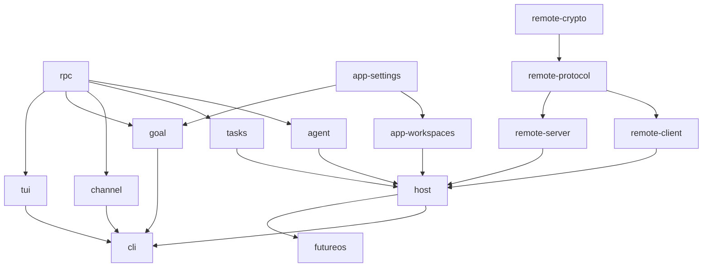
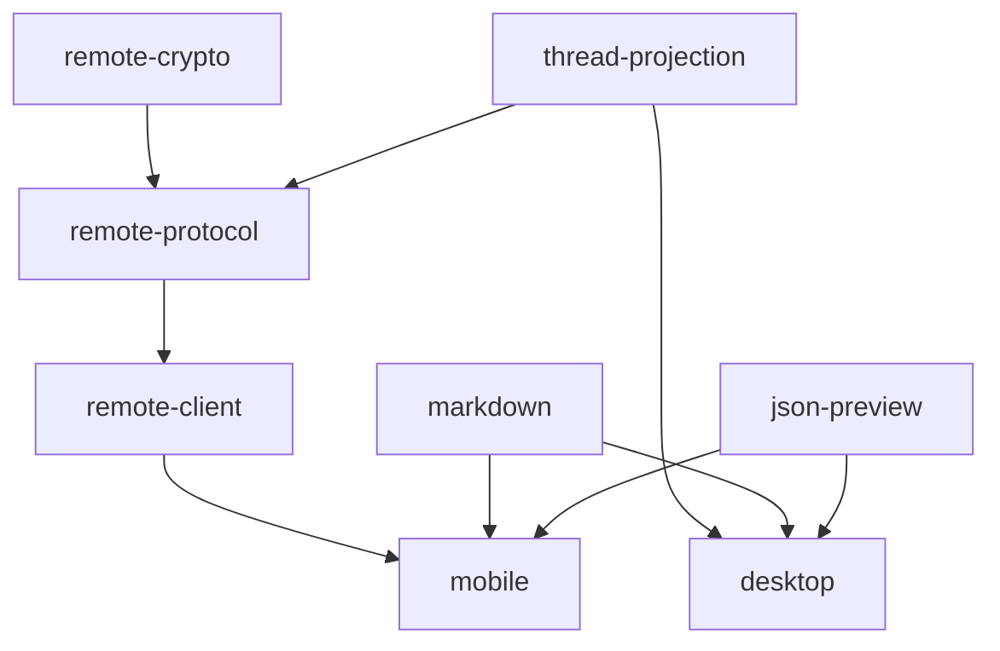

# 持续集成

[English](ci.md)

## 常规检查

[`ci.yml`](../../.github/workflows/ci.yml) 在 PR、merge group 和 main push 时运行，
按改动范围选择项目；手动 dispatch 执行全部常规项目。删除和重命名前的路径也参与识别。

| Job | Runner | 内容 |
|---|---|---|
| Rust Linux / Windows / macOS test | 对应原生操作系统 | 选中 crate 的 build 和 tests |
| Rust check | Linux | fmt、all-target Clippy，禁止 warnings |
| TypeScript test | Linux | 选中 npm 项目的 typecheck、build、tests |
| TypeScript check | Linux | ESLint、适用项目的 Stylelint |
| Android test | Linux | Debug app 构建、JVM 模块测试、staging IO 测试 |
| iOS test | macOS | 无发布签名的 Simulator 构建、Foundation ShareInbox 测试 |
| CI result | Linux | 要求计划中的所有任务成功 |

build 和 tests 共享 runner 与 Cargo target 目录。直接导出源码的 TS 库向临时目录
生成 JS/declaration，验证产物可生成。Mobile 在 Linux 上打包 Android/iOS 两份 JS
bundle，Jest 只跑一次；原生 job 执行现有 JVM/Swift 测试，不签名或发布。
iOS 的 Foundation 测试不代表 Simulator UI/E2E 覆盖。

Rust 测试命令使用 `--no-fail-fast`：任一测试目标失败仍使 job 失败，但 Cargo 会继续执行
其他选中的测试目标，让一轮 CI 收集它们的失败，避免每次只暴露第一个失败目标。

## 范围检测与依赖图

[`affected.mjs`](../../scripts/ci/affected.mjs) 从 Cargo workspace metadata 和
npm workspace manifest 读取依赖，包含 Rust 的 build/dev/target 路径依赖。
源码变化选择所属项目及其传递消费者；仅测试输入变化只选择所属项目。
Rust/TS 混合目录按输入语言区分，共享 schema/fixture 可以同时选择两种语言。
互操作项目明确排除在常规执行范围外。

依赖图的箭头表示**依赖项 → 消费者**，改动影响沿箭头传播。为便于阅读，图中省略了
可由中间项目推导出的重复连线；表格保留全部直接 workspace 依赖，包含这些省略的边。
Rust 名称省略 `future-`，`futureos` 表示 Desktop Rust crate。
manifest 是事实来源；每次 CI summary 都会输出当前执行计划和选择原因。



| Rust crate | 直接 workspace 依赖 |
|---|---|
| host | agent、app-settings、app-workspaces、remote-client、remote-crypto、remote-protocol、remote-server、rpc、tasks |
| agent | rpc |
| rpc | — |
| app-settings | — |
| app-workspaces | app-settings |
| remote-client | remote-crypto、remote-protocol |
| remote-crypto | — |
| remote-protocol | remote-crypto |
| remote-server | remote-crypto、remote-protocol |
| tasks | rpc |
| channel | rpc |
| goal | app-settings、rpc |
| tui | rpc |
| cli | agent、app-settings、app-workspaces、channel、goal、host、rpc、tasks、tui、remote-crypto（dev） |
| futureos | agent、app-settings、app-workspaces、host、remote-client、remote-crypto、remote-protocol、remote-server、rpc、tasks |

TS 名称省略 npm scope（通常为 `@future-os/`，Desktop 为 `@futureos/`）。



| TypeScript 项目 | 直接 workspace 依赖 |
|---|---|
| json-preview | — |
| markdown | — |
| thread-projection | — |
| remote-crypto | — |
| remote-protocol | remote-crypto、thread-projection |
| remote-client | remote-crypto、remote-protocol、thread-projection |
| desktop | json-preview、markdown、thread-projection |
| mobile | json-preview、markdown、thread-projection、remote-crypto、remote-protocol、remote-client |

Mobile 还消费本地 `future-share-intent`、`future-file-handler` 模块。
它们的 Android、iOS/extension/test 目录只选择对应原生 job；共享模块接口、
应用配置和 Mobile 源码保守地选择两个原生构建。仅 Mobile 测试变化不构建原生 app。
根 npm manifest/lock 变化选择全部 TS/原生项目；根 Cargo manifest/lock/toolchain/
config 变化选择全部常规 Rust crate。CI 选择器或 runner 脚本变化选择全部常规项目。
无效范围输入使门禁失败，不静默跳过。

例如：`json-preview/src/index.ts` 选择 json-preview、Desktop、Mobile 的 TS 检查，
以及 Android/iOS 原生验证。Rust remote-client 源码变化选择 remote-client、Host、
CLI、Desktop Rust。remote-protocol 的共享 schema 选择受影响的两种语言项目，
生成一致性和互操作仍只在 Misc 手动执行。

## Rust 共享 runner 分组

[`rust-ci.yml`](../../.github/workflows/rust-ci.yml) 在三个原生平台展开 build/test
分组，在 Linux 展开 fmt/Clippy 分组。每组只带入本次选中的 crate；空组不分配 runner。
TS 项目各自拥有一个 Linux build/test runner 和一个独立 Linux lint runner。

[`typescript-ci.yml`](../../.github/workflows/typescript-ci.yml) 负责 TS package
矩阵和执行步骤，主工作流通过 `TypeScript test`、`TypeScript check` 调用它，
与 Rust 使用相同的可复用 workflow 结构。因此两种语言在 Actions 左侧栏都显示为
可折叠的父分组，展开后查看各 crate 分组或 package。

| 组 | 可能包含的 crate |
|---|---|
| libraries | rpc、app-settings、app-workspaces、channel、goal、tasks |
| remote | remote-crypto、remote-protocol、remote-client、remote-server |
| agent | agent |
| host | host |
| tui-cli | tui、cli |
| desktop | futureos |

Desktop 组额外验证关闭 GUI 和 CLI/GUI 组合构建；Remote client/server 的 Clippy
覆盖 `test-support`；Linux Host 使用隔离 broker，其他平台执行 Host 自有套件。
Core 分组共享每个操作系统的一份缓存，由 main CLI test job 单独写入；Desktop
使用独立 GUI 缓存，由 main Desktop test job 写入。PR/check/Misc 不写入大型私有缓存。

## 专项验证

[`misc.yml`](../../.github/workflows/misc.yml) **只有手动入口**，不参与 PR/main 门禁，
替代原 `ci.yml` 专项 scope 和独立 flaky-stress 工作流。
原 mobile-native-io 工作流的验证已并入常规 Android job。

```bash
gh workflow run ci.yml --ref <branch>
gh workflow run misc.yml --ref <branch> -f suite=generated
gh workflow run misc.yml --ref <branch> -f suite=remote-interop
gh workflow run misc.yml --ref <branch> -f suite=windows-update
```

| `suite` | 验证内容 |
|---|---|
| generated | Proto 重新生成、Remote schema/codegen 一致性 |
| remote-interop | Rust/TS 互操作、Remote 边界 |
| windows-update | 离线安装器/更新 fixtures |
| macos-notarization | Linux 上的恢复/发布脚本回归 |
| flaky-stress | 重复运行 Agent、TUI、CLI 测试 |
| agent-lifecycle | 三平台原生生命周期、Host/CLI 边界、Host 文档 |
| remote-compile-measurement | Windows 冷编译对照 |
| headless-measurement | Headless 构建/启动观测，可传 `measurement_candidate` SHA |
| full-regression | 全部常规 CI 项目，不包含专项 |

发布签名、公证、打包和上传继续由发布工作流负责。

## 合并门禁迁移

使用固定的 `CI result` 作为 required status。它通过 `always()` 执行，拒绝规划失败、
任务失败/取消、缺失结果和计划外跳过；未受影响的任务允许跳过。动态矩阵名称用于诊断，
不作为分支保护的 required-check 名称。

本次改造落地时，需要将 Protect Main ruleset 中旧的逐项 required contexts
迁移为 `CI result`（GitHub Actions app id 15368），保留严格主干同步要求和其他规则。
管理配置迁移前，旧名称会一直 pending，即使新检查已通过。
编辑工作流文件本身不会修改 ruleset。

本地只执行语法/静态检查；包括 `scripts/tests/ci-plan.test.mjs` 在内的单元测试交给 CI。
